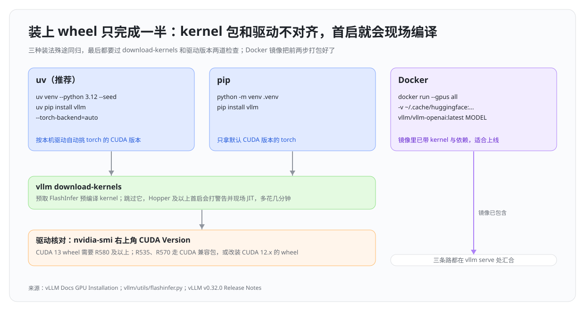
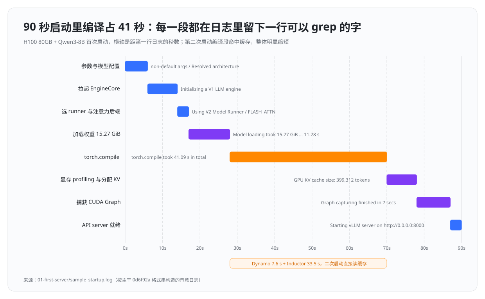
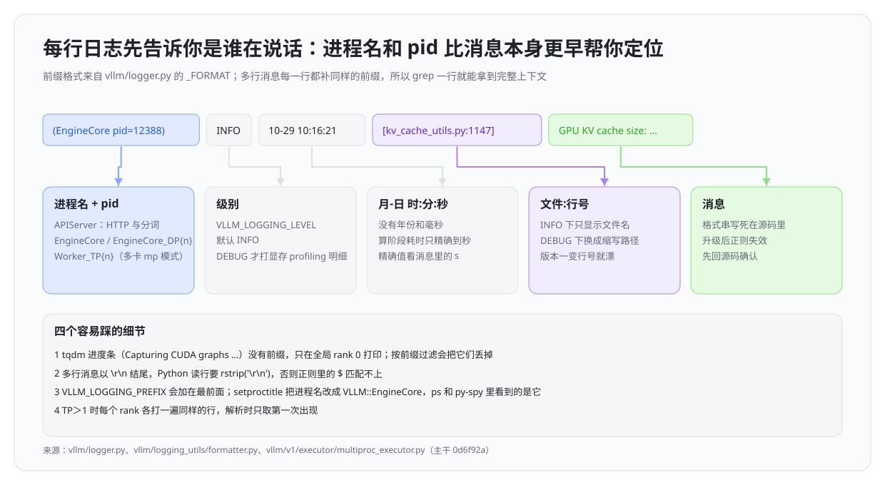
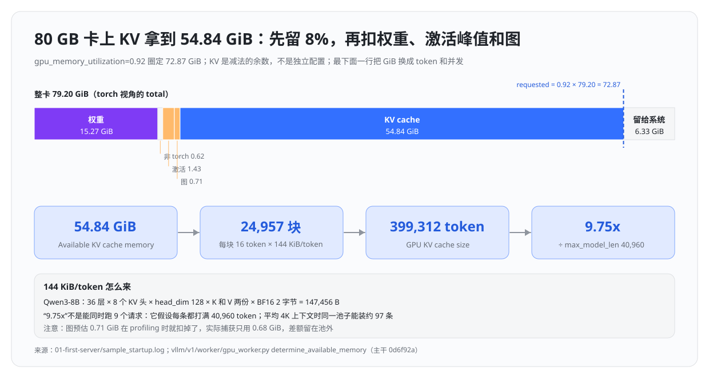
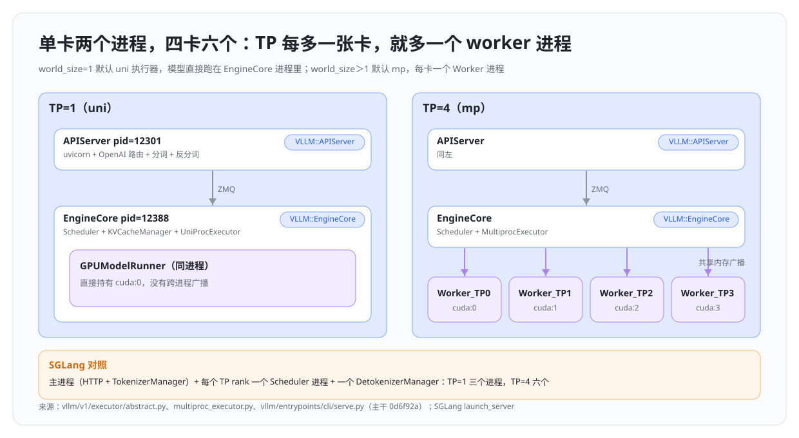
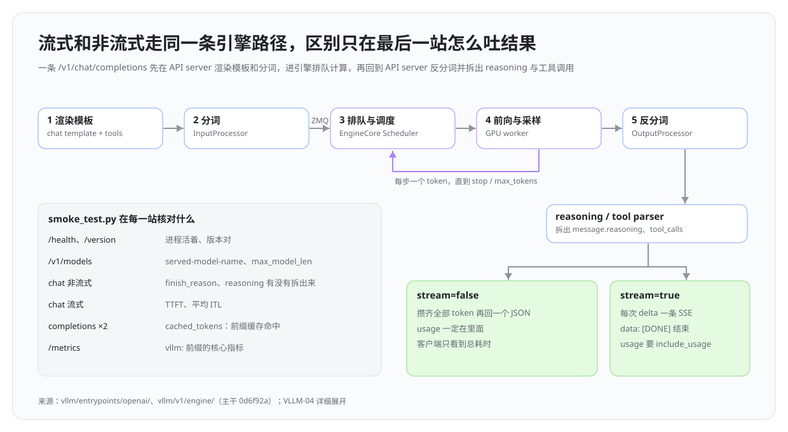
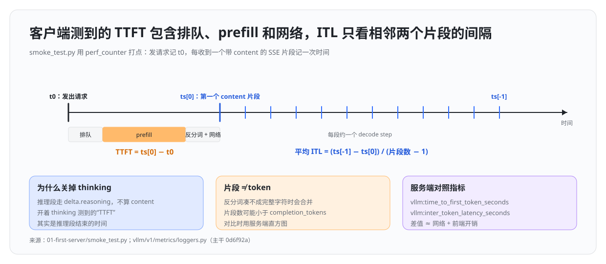
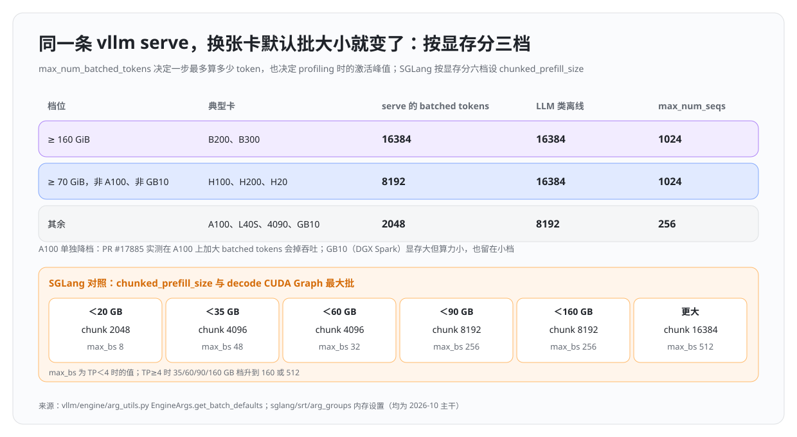
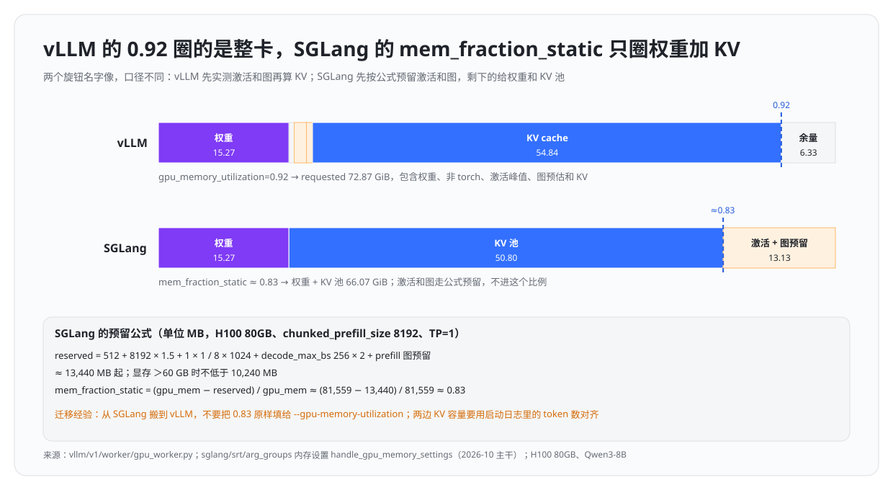
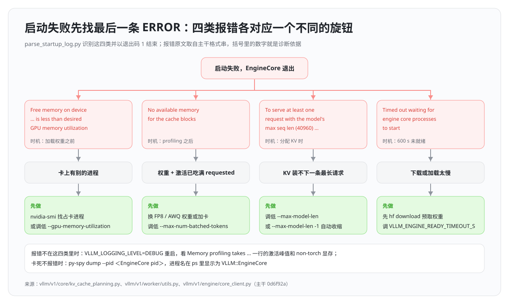

# VLLM-01｜上手｜第一个服务：安装、vllm serve 与读懂启动日志

> 🎯 **这篇文档解决什么问题**：用同一个启动入口分别加载 Qwen3.8-27B 稠密模型与 Qwen3.5-35B-A3B MoE，保存固定 revision 和启动日志。日志阅读仍用 Qwen3-8B 历史示例讲解：90 秒、54.84 GiB 等数字属于该示意样例，不能当作新模型实测。双模型的 KV 与 GDN 状态要分开核算，启动失败先从明确报错查起。
>
> 使用方式：有 GPU 时从启动入口开始，用 MODEL_PROFILE=dense 或 moe 选择通用主例；没有 GPU 时用配套示意日志和 CPU 解析脚本。Qwen3-8B BF16、H100 80GB SXM 和旧启动时间线仅是历史示意基线。当前安装命令固定 vLLM v0.32.0，源码讲解保留 0d6f92a 与 SGLang 8fabf5e 的历史定位；两套口径不得混作双模型实测。
>
> **代码**：[01-first-server](../01-first-server)，包括启动脚本 serve.sh、六步冒烟测试 smoke_test.py、启动日志解析器 parse_startup_log.py，以及一份示意日志 sample_startup.log。示意日志的每一行都按主干的 logger 格式串构造，数字按 H100 + Qwen3-8B 推算，没有拷贝某一次真实启动。

# 导读 · 先给结论

## 双模型启动与旧日志分开

当前通用入口用 MODEL_PROFILE=dense/moe；serve.sh 固定模型 revision，默认 localhost、8192 上下文，不自动打开工具调用或 reasoning 解析器。需要解析器时，先核对该模型聊天模板和引擎支持，再通过位置参数传入。24 GB 卡不能直接套用这两个 BF16 基座的启动配置。

本章 90 秒、54.84 GiB、399312 token 等数字仍属于 Qwen3-8B 示意日志，未迁移为新模型实测。新模型须分别核对加载权重、全注意力 KV、GDN 状态和 runtime workspace；文本请求也不能证明视觉权重已被排除。

双模型结构以固定版本配置核对[[Qwen3.8-27B config.json]](https://huggingface.co/Qwen/Qwen3.8-27B/blob/37561816e66b5b9153b1b64c10968c18c1e6f4a0/config.json)[[Qwen3.5-35B-A3B config.json]](https://huggingface.co/Qwen/Qwen3.5-35B-A3B/blob/59d61f3ce65a6d9863b86d2e96597125219dc754/config.json)。

```bash
MODEL_PROFILE=dense bash serve.sh
# 更换模型前停止前一个实例
MODEL_PROFILE=moe TP=2 bash serve.sh
python3 smoke_test.py
```

1. **pip 装完还差一步。**还要再跑一次 `vllm download-kernels` 预取 FlashInfer 的预编译 kernel。不跑这一步，Hopper 及更新的卡首次启动会现场编译，多花几分钟，Blackwell 上最明显[[1]](https://docs.vllm.ai/en/latest/getting_started/installation/gpu/)。还有一处，安装文档写的默认 CUDA 版本和代码里的不一致，以 `torch.version.cuda` 的实际输出为准。
2. **首次启动的 90 秒里，有 41 秒花在 torch.compile 上。**第二次启动直接读编译缓存。容器部署时如果不把 `VLLM_CACHE_ROOT` 挂成卷，每次都要重新编译[[2]](https://docs.vllm.ai/en/latest/deployment/docker/)[[3]](https://vllm.ai/blog/2025-08-20-torch-compile)。
3. **KV 容量是做减法剩下的余数，没有地方直接配置它。**先用 0.92 × 整卡显存得到总预算，再依次扣掉权重、非 torch 显存、激活峰值和 CUDA Graph 预估，剩下的才给 KV。54.84 GiB 除以每 token 144 KiB，得到 399,312 个 token。日志里的“9.75x”是按每条请求打满 40,960 token 算的，平均上下文 4K 时，同一个池子能装下大约 97 条。
4. **单卡也是两个进程：APIServer 和 EngineCore。**TP=4 时是六个，每张卡多一个 Worker。SGLang 的进程数恰好也是 3 和 6，但分工不同：它把反分词单独放进一个进程[[4]](https://docs.vllm.ai/en/latest/design/arch_overview/)[[5]](https://arxiv.org/abs/2312.07104)。排查卡死时，py-spy 要对准哪个 pid，取决于你清楚哪个进程在做什么。
5. **从 SGLang 迁移过来，最容易在三个口径上出错。**vLLM 的 0.92 圈的是整张卡，SGLang 的 mem_fraction_static 只圈权重和 KV。推理段字段 vLLM 叫 `reasoning`，SGLang 叫 `reasoning_content`。`/health` 在 vLLM 里只检查引擎进程是否还活着，在 SGLang 里会真实生成一个 token[[6]](https://docs.sglang.io/docs/advanced_features/server_arguments)[[7]](https://github.com/sgl-project/sglang/blob/8fabf5e/python/sglang/srt/entrypoints/http_server.py)。
6. **启动失败基本落在四类报错里，每一类对应一个不同的旋钮。**分别是：卡上空闲显存不够、权重加激活已经吃满预算、KV 装不下一条最长的请求、引擎在 600 秒内没有就绪。parse_startup_log.py 能识别这四类，并以退出码 1 结束，可以直接接进部署流水线。

# 第 1 章 · 问题：先把版本装对

vLLM 的安装是三方对齐：wheel 里预编译 kernel 用的 CUDA 版本、torch 用的 CUDA 版本、驱动支持的最高 CUDA 版本。三者有一处不匹配，可能根本 import 不了，也可能顺利启动，但首启时在后台悄悄编译好几分钟。下面三种装法最后都汇到 `vllm serve`，区别在于谁替你完成这次对齐。



## 1.1 三种装法

```bash
# 在配套仓库 01-first-server 目录执行；目标 GPU 需另行验证
uv venv --python 3.12 --seed && source .venv/bin/activate
uv pip install 'vllm==0.32.0' --torch-backend=auto
MODEL_PROFILE=dense TP=2 bash serve.sh
# 更换模型前停止前一个实例，再选 moe：
# MODEL_PROFILE=moe TP=2 bash serve.sh
```

Docker 命令里有两个参数要单独说。`--ipc=host` 让容器使用宿主机的共享内存，TP 多进程之间靠共享内存广播调度结果，容器默认的 64 MB `/dev/shm` 不够用；多机部署的文档改用 `--shm-size=16G`，作用相同。`vllm-cache` 卷保住的是 `VLLM_CACHE_ROOT`，里面有 inductor、Triton 和 AOT 产物。不挂这个卷，每个新容器都要把第 2 章那 41 秒的编译再走一遍[[2]](https://docs.vllm.ai/en/latest/deployment/docker/)。

## 1.2 download-kernels 做了什么

这个子命令只做一件事：调用 FlashInfer 自己的 CLI，把预编译 kernel 装到本地。PyTorch 的 CUDA 版本有对应的 `flashinfer-jit-cache` wheel 时就下载它；没有时退回只装 `flashinfer-cubin`，CUDA 低于 12.9 的 torch 走的就是这条路[[1]](https://docs.vllm.ai/en/latest/getting_started/installation/gpu/)（[download_kernels.py](https://github.com/vllm-project/vllm/blob/0d6f92a/vllm/entrypoints/cli/download_kernels.py)）。命令执行时会临时设置 `FLASHINFER_DISABLE_VERSION_CHECK=1`，原因是 FlashInfer 发现已装 kernel 的版本和自己不一致时会拒绝 import，不绕过这个检查，它的 CLI 就没法替换旧 kernel。由此得出一条运维规矩：**每次升级 vLLM 后都要重跑一次 download-kernels**，否则新版 FlashInfer 遇到旧 kernel，启动时就会直接报错。

SGLang 同样把 FlashInfer 作为注意力后端之一，自己还另有一个 sgl-kernel 包，所以它面对同样的对齐问题[[8]](https://docs.sglang.io/docs/get-started/install)。两边的差别在于谁负责把 kernel 下载下来：vLLM 把这一步做成一个显式子命令交给用户，镜像构建时跑一次即可；装 SGLang 时，这部分随依赖一起安装。

## 1.3 CUDA 版本：文档和代码对不上

写作时，安装文档仍然写着预编译二进制和 nightly 默认使用 CUDA 12.9[[1]](https://docs.vllm.ai/en/latest/getting_started/installation/gpu/)，但代码已经改了：`VLLM_MAIN_CUDA_VERSION` 的默认值是 13.0（[envs.py](https://github.com/vllm-project/vllm/blob/0d6f92a/vllm/envs.py)），官方 Dockerfile 也写着 `ARG CUDA_VERSION=13.0.3`（[Dockerfile](https://github.com/vllm-project/vllm/blob/0d6f92a/docker/Dockerfile)）。文档落后代码在快速迭代的项目里很常见，处理办法是不去猜，直接查：

```bash
nvidia-smi | head -4                                   # 右上角 CUDA Version：驱动支持的最高版本
python -c "import torch; print(torch.__version__, torch.version.cuda)"
python -c "import vllm; print(vllm.__version__)"
```

判断规则只有一条：torch 的 CUDA 版本不能高于驱动支持的版本。CUDA 13 要求驱动 R580 及以上；R535、R570 这类数据中心常见的驱动，要么装 CUDA 兼容包，要么改装 CUDA 12.x 的 wheel[[9]](https://docs.nvidia.com/deploy/cuda-compatibility/)。Blackwell（B200、GB200）至少需要 CUDA 12.8[[1]](https://docs.vllm.ai/en/latest/getting_started/installation/gpu/)。

> 💡 **常见误区**：把“首启慢”归咎于模型太大。先 grep 一下有没有 FlashInfer 现场编译的警告。在 Blackwell 上，这一步能比加载权重还慢，这时用 `vllm download-kernels --dry-run` 看看会装什么，比盯着进度条等有用得多。

# 第 2 章 · 原理：启动的 90 秒里发生了什么

## 2.1 时间线：每一段都留下一行可以 grep 的字

vLLM 的启动日志信息量很大，读的时候应该把它当成一份带时间戳的执行轨迹。下图把示意日志里的关键行放到同一条时间轴上，每一段都对应日志里可以 grep 到的一行。



| 阶段 | 示意日志时刻 | 耗时 | 可以 grep 的行 |
|-|-|-|-|
| 解析参数、读模型配置 | 10:15:03 → 10:15:09 | 6 s | `non-default args`、`Resolved architecture`、`Using max model len 40960` |
| 拉起 EngineCore 进程 | 10:15:09 → 10:15:17 | 8 s | `Initializing a V1 LLM engine (v0.32.0) with config` |
| 选 runner 和注意力后端 | 10:15:19 → 10:15:20 | 1 s | `Using V2 Model Runner`、`Using FLASH_ATTN attention backend` |
| 加载权重 | 10:15:20 → 10:15:31 | 11.28 s | `Model loading took 15.27 GiB memory and 11.28 seconds` |
| torch.compile | 10:15:31 → 10:16:13 | 41.09 s | `Dynamo bytecode transform time: 7.61 s`、`torch.compile took 41.09 s in total` |
| 显存 profiling，分配 KV | 10:16:13 → 10:16:21 | 约 8 s | `Available KV cache memory: 54.84 GiB`、`GPU KV cache size: 399,312 tokens` |
| 捕获 CUDA Graph | 10:16:21 → 10:16:30 | 7 s | `Graph capturing finished in 7 secs, took 0.68 GiB` |
| API server 就绪 | 10:16:31 → 10:16:33 | 2 s | `init engine … took 59.73 s`、`Starting vLLM server on http://0.0.0.0:8000` |

有两个细节决定了你会不会读错这张表。第一，torch.compile 并没有单独的“编译阶段”，它发生在 profiling 的第一次前向里。Dynamo 把模型的字节码转成 FX 图，Inductor 按 compile range (1, 8192) 生成 Triton kernel，这个上界就是 `max_num_batched_tokens`[[10]](https://docs.vllm.ai/en/latest/design/torch_compile/)。所以编译日志排在 `Available KV cache memory` 前面，改 `--max-num-batched-tokens` 会让编译缓存失效。第二，“拉起 EngineCore”的 8 秒主要花在新进程重新 import torch 和 vLLM 上。EngineCore 是独立进程，它和 APIServer 共享不了已经 import 的模块[[11]](https://docs.vllm.ai/en/latest/design/multiprocessing/)。

## 2.2 一行日志的解剖



前缀格式写在 [logger.py](https://github.com/vllm-project/vllm/blob/0d6f92a/vllm/logger.py) 里，形如 `(进程名 pid=N) LEVEL 月-日 时:分:秒 [文件:行号] 消息`。最有用的是进程名：APIServer 负责 HTTP、分词和反分词，EngineCore 负责调度和 KV 管理，多卡 mp 模式下还有 Worker_TP0 到 Worker_TPn。看到一条 ERROR，先看它是哪个进程打的，就能知道该去读哪一段源码。进程标题也会被 setproctitle 改成 `VLLM::EngineCore` 这种形式，前缀由 `VLLM_PROCESS_NAME_PREFIX` 控制（[system_utils.py](https://github.com/vllm-project/vllm/blob/0d6f92a/vllm/utils/system_utils.py)），ps、nvidia-smi 和 py-spy 里看到的都是它。

写解析脚本时有四个坑，图里都标出来了，这里只强调其中两个。一是时间戳既没有年份，也没有毫秒，用它算阶段耗时只能精确到秒，精确值要读消息里自带的秒数。二是格式串写死在源码里，升级后行号会变，消息措辞偶尔也会变。parse_startup_log.py 在每条正则旁边都注明了格式串所在的文件，某一项变成“未找到”时，回到那个文件看一眼就行。

## 2.3 显存账：KV 是减法的余数

这一节是全章的重点。很多人以为 `--gpu-memory-utilization 0.92` 的意思是把 92% 的显存给 KV，其实它圈定的是 vLLM 整个进程可以使用的上限。KV 拿到的，是这个上限扣掉其他所有开销之后剩下的部分[[12]](https://docs.vllm.ai/en/latest/configuration/conserving_memory/)。



Worker 的 `determine_available_memory`（[gpu_worker.py](https://github.com/vllm-project/vllm/blob/0d6f92a/vllm/v1/worker/gpu_worker.py)）用一次假前向测量开销，测法是按 `max_num_batched_tokens` 构造一个最大批次跑一遍 `profile_run`，记录显存峰值。核心公式有三行：

```text
requested     = ceil(total × gpu_memory_utilization)            = ceil(79.20 × 0.92) = 72.87 GiB
non_kv        = 权重 + 非 torch + 激活瞬时峰值                    = 15.27 + 0.62 + 1.43 = 17.32 GiB
available_kv  = requested − non_kv − CUDA Graph 预估              = 72.87 − 17.32 − 0.71 = 54.84 GiB
```

非 torch 显存指 NCCL、cuBLAS workspace 这类不经过 PyTorch 分配器的开销。CUDA Graph 预估由 `profile_cudagraph_memory()` 实测得到。从 v0.21.0 起，这一项默认从 KV 预算里预先扣掉，日志里那句 `The current --gpu-memory-utilization=0.9200 is equivalent to --gpu-memory-utilization=0.9110 without CUDA graph memory profiling` 就是在提醒老用户：0.92 − 0.71 / 79.20 = 0.9110。如果想要回升级前同样大小的 KV，就把 util 提到 0.9290。实际捕获只用了 0.68 GiB，比预估少 0.03 GiB，这点差额留在池外，不会被 KV 拿走。

GiB 换算成 token 时要用到模型结构。Qwen3-8B 有 36 层，GQA 下每层 8 个 KV 头，head_dim 为 128[[13]](https://arxiv.org/abs/2505.09388)[[14]](https://arxiv.org/abs/2305.13245)，每个 token 的 KV 是 36 × 8 × 128 × 2（K 和 V 各一份）× 2 字节 = 147,456 B，也就是 144 KiB。54.84 GiB 除以每块 16 token × 144 KiB，向下取整得到 24,957 块，合 399,312 个 token，这就是日志里的 `GPU KV cache size: 399,312 tokens`（[kv_cache_utils.py](https://github.com/vllm-project/vllm/blob/0d6f92a/vllm/v1/core/kv_cache_utils.py)）。后面那个“9.75x”是 399,312 ÷ 40,960，含义是假设每条请求都打满 `max_model_len` 时最多能放几条。线上请求平均 4K 上下文的话，同一个池子能装大约 97 条，所以不能拿 9.75x 当并发上限。

SGLang 的算法是另一个方向。它先按公式预留出激活和 CUDA Graph 的显存，剩下的按 mem_fraction_static 分给权重和 KV 池；vLLM 是先实测、后做减法[[15]](https://github.com/sgl-project/sglang/blob/8fabf5e/python/sglang/srt/arg_groups/memory_hook.py)。实测更贴合当下的模型和参数，代价是每次启动都要多跑一次 profiling，这也是 2.1 节里那 8 秒的来源。第 4 章会讲怎样把这一步跳过去。

## 2.4 进程拓扑：单卡两个进程，四卡六个



world_size 为 1 时，执行器默认是 `uni`（[uniproc_executor.py](https://github.com/vllm-project/vllm/blob/0d6f92a/vllm/v1/executor/uniproc_executor.py)），模型直接跑在 EngineCore 进程里，所以 nvidia-smi 里占着 GPU 显存的那个 pid 属于 EngineCore，别去找 APIServer。world_size 大于 1 时改用 `mp`（[multiproc_executor.py](https://github.com/vllm-project/vllm/blob/0d6f92a/vllm/v1/executor/multiproc_executor.py)），每张卡一个 Worker 进程，EngineCore 通过共享内存消息队列把调度结果广播给它们。APIServer 和 EngineCore 之间始终走 ZMQ[[4]](https://docs.vllm.ai/en/latest/design/arch_overview/)。

和 SGLang 对比：SGLang 的主进程里跑 HTTP 和 TokenizerManager，每个 TP rank 一个 Scheduler 进程，外加一个独立的 DetokenizerManager，所以 TP=1 时是 3 个进程，TP=4 时是 6 个[[5]](https://arxiv.org/abs/2312.07104)[[16]](https://github.com/sgl-project/sglang)。两边进程数一样，边界画在不同的地方。SGLang 的 Scheduler 和 GPU 在同一个进程里，调度和前向之间不需要跨进程广播；vLLM 的 EngineCore 只有一份，调度决策是全局的，Worker 只负责执行。这个差异会一直延续到第 05、09 章：vLLM 的调度器看到的是全局状态，SGLang 的每个 rank 各算一遍同样的调度。

> 💡 **常见误区**：服务卡住时对 APIServer 的 pid 跑 py-spy，看到它停在 `await` 上，就断定是引擎死锁了。APIServer 本来就是在 await 引擎的输出。应该先 `ps -ef | grep VLLM::` 找到 EngineCore（多卡时是 Worker_TPn）的 pid，再对那个 pid 跑 `py-spy dump`。

# 第 3 章 · 源码走读：一条 vllm serve 经过哪些函数

这一章沿着第 2 章的时间线走一遍源码。每一步只关心三件事：在哪个文件、做了什么、在日志里留下了哪一行。函数名都是主干上实际存在的，可以直接 grep，行号随版本变化，这里不写。

```text
vllm serve Qwen/Qwen3-8B
└─ ServeSubcommand.cmd                        cli/serve.py
   ├─ headless / grpc / 多 API server / DP supervisor 分支（本章都不走）
   └─ uvloop.run(run_server)                  launchers/api_server/entry.py
      ├─ setup_server                         launchers/launcher.py   先绑端口
      └─ build_and_serve
         ├─ build_async_engine_client → AsyncLLM
         │  └─ launch_core_engines            v1/engine/utils.py      拉起 EngineCore 进程
         │     └─ EngineCore.__init__         v1/engine/core.py
         │        ├─ executor_class(vllm_config)
         │        │  └─ Worker.init_device → load_model                 空闲显存检查、加载权重
         │        ├─ _initialize_kv_caches
         │        │  ├─ get_kv_cache_specs
         │        │  ├─ determine_available_memory                     profile_run（触发 torch.compile）
         │        │  ├─ get_kv_cache_configs                           容量检查、max_model_len 自动收缩
         │        │  ├─ initialize_from_config                         真正分配 KV 张量
         │        │  └─ compile_or_warm_up_model                       捕获 CUDA Graph
         │        └─ Scheduler(...)
         ├─ build_app / init_app_state                                 路由、中间件、serving 对象
         └─ serve_http                        launchers/launcher.py   uvicorn + watchdog_loop
```

## 3.1 入口分发与先绑端口

[serve.py](https://github.com/vllm-project/vllm/blob/0d6f92a/vllm/entrypoints/cli/serve.py) 里的 `ServeSubcommand` 负责分发，一共五条路：`--grpc` 走 gRPC 服务。`--headless` 会强制把 api_server_count 设成 0，只起引擎。api_server_count 大于 1 时走 `run_multi_api_server`。DP 模式由 supervisor 管理。剩下的情况进入 `uvloop.run(run_server)`。api_server_count 的默认值等于 data_parallel_size，单卡时就是 1。

`run_server` 第一件事是调用 `setup_server`（[launcher.py](https://github.com/vllm-project/vllm/blob/0d6f92a/vllm/entrypoints/launchers/launcher.py)），在拉起引擎之前就把 socket 绑定好。这个顺序来自 Issue #8204[[17]](https://github.com/vllm-project/vllm/issues/8204)：早期版本先花几分钟加载模型，最后才发现 8000 端口已经被占用。现在端口冲突会在第一秒报错，socket 设置了 `SO_REUSEADDR`，也支持 `--uds` 走 Unix socket。多个 API worker 共享同一个监听 socket 时，`NoSignalServer` 会把待处理的连接交给负载最低的 worker。

## 3.2 拉起 EngineCore 并等它就绪

`build_async_engine_client`（[entry.py](https://github.com/vllm-project/vllm/blob/0d6f92a/vllm/entrypoints/launchers/api_server/entry.py)）构造 `AsyncLLM`，后者通过 `launch_core_engines`（[utils.py](https://github.com/vllm-project/vllm/blob/0d6f92a/vllm/v1/engine/utils.py)）拉起 EngineCore 子进程，再在 ZMQ 上等待握手。等待上限是 `VLLM_ENGINE_READY_TIMEOUT_S`，默认 600 秒，超时报错写在 [core_client.py](https://github.com/vllm-project/vllm/blob/0d6f92a/vllm/v1/engine/core_client.py) 里，报错原文已经说明最常见的原因是大模型加载权重太慢。第一次拉 70B 级别的模型时，先用 `hf download` 把权重预取到本地，比调大超时可靠得多。

## 3.3 EngineCore.\_\_init\_\_：本章最重要的一个函数

[core.py](https://github.com/vllm-project/vllm/blob/0d6f92a/vllm/v1/engine/core.py) 的构造函数按顺序做了四件事，第 2 章时间线上从“选 runner”到“捕获 CUDA Graph”的全部内容都在这里。

1. **构造执行器**。`Worker.init_device` 先拍一张显存快照，用 `ceil(total × util)` 算出 requested，空闲显存比 requested 少时立刻报 `Free memory on device … is less than desired GPU memory utilization`（[utils.py](https://github.com/vllm-project/vllm/blob/0d6f92a/vllm/v1/worker/utils.py)）。这个检查发生在加载权重之前，所以这类报错总是来得很快。接着 `load_model` 加载权重，打出 `Model loading took 15.27 GiB`。
2. **测显存**。`_initialize_kv_caches` 先收集每一层的 KV 规格（层数、头数、dtype、注意力类型），然后调用 `determine_available_memory`。这里有两条捷径：设置了 `--kv-cache-memory-bytes` 时直接采用这个值，跳过 profiling；开启 startup plan 并且指纹匹配时，用上次记录的值。两条都不满足才会跑 `profile_run`。
3. **定容量**。`get_kv_cache_configs`（[kv_cache_planning.py](https://github.com/vllm-project/vllm/blob/0d6f92a/vllm/v1/core/kv_cache_planning.py)）把字节数换算成块数，再检查一条最长的请求能不能放下。放不下时，如果 `max_model_len` 设为 -1 或 auto，就二分搜索一个能放下的长度，并通过 RPC 同步给 Worker；否则直接报错。之后 `initialize_from_config` 才分配 KV 张量。
4. **捕获 CUDA Graph**。`compile_or_warm_up_model` 按若干批大小逐个捕获图，就是日志里那两条没有前缀的 tqdm 进度条（PIECEWISE 和 FULL 各 51 个尺寸）。之后打出建议值那一行，里面有可以回填的 `--kv-cache-memory=`，算法是用 requested 减去实测开销，再留 150 MiB 余量。最后是 `init engine (profile, create kv cache, warmup model) took 59.73 s`。

四件事做完，EngineCore 才构造 Scheduler，并向 APIServer 回报就绪。读到这里，就能解释为什么 `--enforce-eager` 能让启动快一半：它同时跳过了 torch.compile 和 CUDA Graph 捕获，代价是 decode 阶段每一步都要逐个 launch kernel，小批量时吞吐会明显下降[[18]](https://docs.vllm.ai/en/latest/design/cuda_graphs/)。

## 3.4 回到 API server：路由、鉴权、看门狗

引擎就绪后，`build_and_serve` 依次构建 FastAPI app、初始化各个 serving 对象，再调用 `serve_http` 启动 uvicorn，打出 `Available routes are:` 和每一条路由。一条 chat 请求在进程之间怎么流转，见下图，第 04 章会完整展开。



有三处行为和 SGLang 不同，上线前必须清楚。**健康检查**：vLLM 的 `/health` 只调用 `check_health`，看引擎是否处于 errored 状态，处于 errored 就返回 503，整个过程不做前向；SGLang 的 `/health` 会真实生成一个 token[[7]](https://github.com/sgl-project/sglang/blob/8fabf5e/python/sglang/srt/entrypoints/http_server.py)，更能反映服务是否真的可用，但每次探活都要占一个调度槽。**鉴权**：`--api-key`（优先级高于环境变量 `VLLM_API_KEY`）只保护以 `/v1`、`/v2`、`/inference`、`/cohere` 开头的路径（[authenticate.py](https://github.com/vllm-project/vllm/blob/0d6f92a/vllm/entrypoints/serve/middleware/authenticate.py)），`/health` 和 `/metrics` 不受保护，所以公网部署时要在网关上把 `/metrics` 挡掉。**看门狗**：`watchdog_loop` 每 5 秒检查一次引擎，发现引擎已经死掉就主动结束 server，让 K8s 能够重启 Pod；只有设置 `VLLM_KEEP_ALIVE_ON_ENGINE_DEATH=1` 时才保留进程，留给排查用。

# 第 4 章 · 动手：起服务、冒烟、对账、二次启动

## 4.1 起服务

```bash
cd zero-to-vllm/01-first-server
MODEL_PROFILE=dense TP=2 bash serve.sh
# MoE 替代启动；先停止上一个实例
# MODEL_PROFILE=moe TP=2 bash serve.sh
# 额外参数放在脚本名后面，不使用 EXTRA：
# MODEL_PROFILE=dense TP=2 bash serve.sh --gpu-memory-utilization 0.85 --max-model-len 8192
```

serve.sh 从公共配置读取 MODEL 和 REVISION，默认监听 127.0.0.1、使用 8192 上下文，日志按模型和运行批次保存在 logs/。脚本不再默认传入 qwen3 reasoning parser、hermes 工具解析器或 qwen3 服务别名。启用解析器前，应核对当前模型模板、引擎版本和返回格式；额外参数通过脚本位置参数传入。原文使用的资料保留供核查：[reasoning outputs](https://docs.vllm.ai/en/latest/features/reasoning_outputs/)、[tool calling](https://docs.vllm.ai/en/latest/features/tool_calling/)、[历史 parser 注册表](https://github.com/vllm-project/vllm/blob/0d6f92a/vllm/tool_parsers/__init__.py)。这些链接本身不能证明双模型已通过解析器测试。

## 4.2 冒烟测试：六步，任何一步失败都返回非零退出码

```bash
python3 smoke_test.py                                  # 默认 http://127.0.0.1:8000
python3 smoke_test.py --base http://10.0.0.8:8000 --api-key sk-xxx
```

smoke_test.py 只用标准库，依次检查：`/health` 和 `/version`。`/v1/models` 返回的模型名和 max_model_len。非流式 chat，看 reasoning 有没有被拆出来，以及 usage。流式 chat，测 TTFT 和平均 ITL。同一个长 prompt 发两次 completions，看第二次的 `cached_tokens`。最后从 `/metrics` 抽几条 `vllm:` 开头的核心指标[[21]](https://docs.vllm.ai/en/latest/serving/online_serving/openai_compatible_server/)[[22]](https://docs.vllm.ai/en/latest/usage/metrics/)。



读结果时要知道三件事。第一，流式测试里关掉了 thinking（`chat_template_kwargs: {enable_thinking: false}`），因为推理段走的是 `delta.reasoning`，开着 thinking 测出来的“TTFT”，其实是推理段结束的时间。第二，`cached_tokens` 只有服务端加了 `--enable-prompt-tokens-details` 才会返回，没加就是 None，并不说明前缀缓存没生效。命中是按 16 token 一块对齐的，而且最后一个 token 总会被重算，因为采样需要它的 logits，所以哪怕两次 prompt 一模一样，`cached_tokens` 也小于 prompt_tokens[[23]](https://docs.vllm.ai/en/latest/design/prefix_caching/)。第三，客户端测出的 TTFT 包含了网络和前端开销，要和服务端的 `vllm:time_to_first_token_seconds` 直方图对照，两者的差值就是这部分开销。

## 4.3 把启动日志压成一张对账表

```bash
# 选择本次运行的单个日志，不要把多个日志通配展开后一起传入
python3 parse_startup_log.py logs/dense-YYYYMMDD-HHMMSS-PID.log
# 历史示意日志保留原模型：
python3 parse_startup_log.py sample_startup.log --model qwen3-8b --gpu h100-sxm
python3 parse_startup_log.py sample_startup.log --json
```

`--model` 和 `--gpu` 必须一起给出，使用公共规格表的键；未知值或日志模型不一致时会明确报错。双模型只比较可比的权重估算，混合池字节和 token 容量不强行对齐到原始张量账本。以下三行仍属于 Qwen3-8B 示意日志：

```text
和账本对账（误差 = 日志 / 账本 - 1）
    权重 GiB         日志        15.27  账本        15.26  误差 +0.1%
    KV 可用 GiB      日志        54.84  账本        55.25  误差 -0.7%
    KV token       日志   399,312.00  账本   402,304.00  误差 -0.7%
```

账本中的激活峰值和运行时开销含估算，误差小也不能证明配置正确。对账时逐项核对实际权重、精度、TP、其他进程占用、激活峰值和 Graph 显存；双模型还要检查 GDN 状态副本与混合页面对齐。1% 和 10% 都不作为统一验收阈值。下一篇给出分项计算，未经建模的部分单独记录。

## 4.4 第二次启动：三种跳过办法

| 办法 | 跳过什么 | 日志里的变化 | 失效条件 |
|-|-|-|-|
| 编译缓存（默认开启） | torch.compile 的 41 秒 | `Directly load the compiled graph(s) for compile range (1, 8192) from the cache` | 模型、vLLM 版本、编译相关参数（包括 max_num_batched_tokens）任意一项变化；容器没挂 `VLLM_CACHE_ROOT` |
| `--kv-cache-memory-bytes` | 显存 profiling 和 CUDA Graph 预估 | 启动时提示 KV 显存由该参数指定 | 换了卡型，或者卡上的初始空闲显存变了 |
| `VLLM_ENABLE_STARTUP_PLAN=1` | 同上，由引擎自动记录和回放 | 首次启动打出 `Saved startup plan to …` | 指纹不匹配，或者当前空闲显存小于记录时的值 |

示意日志里的 57994617159 与 64261364776 字节仅对应旧 Qwen3-8B 输入，不应填入双模型启动命令。正式参数使用 --kv-cache-memory-bytes，预算须按当前模型、revision、TP 和运行时日志重新核对。startup plan、编译缓存和强制 AOT 加载属于单独的兼容性实验，本章不宣称双模型已通过；失败日志与重新编译耗时都要保留。

```bash
# 先按当前模型、revision、硬件和引擎核对缓存预算，再显式传入
MODEL_PROFILE=dense TP=2 bash serve.sh \
  --kv-cache-memory-bytes "${KV_CACHE_BYTES:?请先设置本机缓存预算}"
# 不沿用 Qwen3-8B 示意日志里的 57994617159。
# startup plan 与混合状态恢复另行验证，本处不默认启用。
```

# 第 5 章 · 调参与误区：默认值从哪来，换卡为什么会变

## 5.1 默认批大小按卡分档



同一条 `vllm serve` 命令，在 H100 上 `max_num_batched_tokens` 默认是 8192，换到 A100 上就变成 2048。分档逻辑写在 `EngineArgs.get_batch_defaults` 里，H100 和 A100 都有 80 GB 显存，A100 却被单独降档，依据是 PR #17885 的实测：在 A100 上加大 batched tokens 反而会降低吞吐[[25]](https://github.com/vllm-project/vllm/pull/17885)。所以拿两张卡对比时，日志里 `Chunked prefill is enabled with max_num_batched_tokens=` 那一行必须一起贴出来。SGLang 按显存分六档设置 chunked_prefill_size 和 decode 图的最大批大小[[6]](https://docs.sglang.io/docs/advanced_features/server_arguments)，分得更细，但同样是“换卡就变”。

## 5.2 0.92 和 0.83 不是一回事



迁移时最常见的事故，是把 SGLang 的 `--mem-fraction-static 0.83` 原样填进 vLLM 的 `--gpu-memory-utilization`。vLLM 的 0.83 圈的是整卡，激活和 CUDA Graph 也要从里面扣，结果 KV 会比 SGLang 少好几 GiB。反过来，从 vLLM 搬到 SGLang 时把 0.92 填过去，SGLang 留给激活的空间就不够了。两边的 KV 容量只能用启动日志里的 token 数对齐：vLLM 看 `GPU KV cache size`，SGLang 看 KV 池的 token 数。

## 5.3 max_model_len 管的是单条请求的上限，不管池子大小

`--max-model-len` 默认读取模型配置，Qwen3-8B 是 40,960。它支持 k、m、g 后缀，小写 k 是 1000，大写 K 是 1024；设成 -1 或 auto 时，如果最长请求放不下，就自动二分出一个能放下的长度（[model.py](https://github.com/vllm-project/vllm/blob/0d6f92a/vllm/config/model.py)）。很多人以为调小它就能腾出更多 KV，其实不会。池子大小只由 2.3 节的减法决定，调小 max_model_len 只会让日志里的并发倍数变大，并让超长请求在入口处就被拒绝。让池子变小的只有 util：0.85 时 KV 是 49.29 GiB、358,944 个 token，倍数变成 8.76x。

## 5.4 采样默认值读的是模型仓库的配置

`--generation-config` 的默认值是 `auto`，会读取模型仓库里的 `generation_config.json`。Qwen3-8B 的这个文件把 temperature 设成 0.6，top_p 0.95，top_k 20[[26]](https://huggingface.co/Qwen/Qwen3-8B)，于是启动时会看到一行 `Default vLLM sampling parameters have been overridden by the model's generation_config.json`。想用 vLLM 自己的默认值（temperature 1.0），要显式传 `--generation-config vllm`。SGLang 默认同样采用模型的采样配置。做两边的精度或长度对比时，请求里要把 temperature、top_p、top_k 写死，不能依赖任何一边的默认值。

## 5.5 推理段与工具调用的字段名

vLLM 把推理段放在 `message.reasoning`（流式时是 `delta.reasoning`）。旧字段名 `reasoning_content` 已经弃用，多轮对话中客户端把它作为输入传回来时，会被自动改名为 `reasoning`（[protocol.py](https://github.com/vllm-project/vllm/blob/0d6f92a/vllm/entrypoints/openai/chat_completion/protocol.py)）。SGLang 输出的字段仍然叫 `reasoning_content`。客户端要同时对接两边，取值时两个字段都读，smoke_test.py 就是这样做的。

> 💡 **常见误区**：拿 SGLang 的默认端口 30000 写探活和网关配置，切到 vLLM 之后全部探活失败。vLLM 默认端口是 8000。另一个高频问题是没开 `--enable-auto-tool-choice` 就发 `tool_choice: auto` 的请求，这时返回 400，报错原文是 `"auto" tool choice requires --enable-auto-tool-choice and --tool-call-parser to be set`，跟模型会不会调工具没有关系。

# 第 6 章 · 启动失败与上线前核对



启动失败时，从日志末尾往上找第一条 ERROR，再看它是哪个进程打的。四类最常见的报错，原文、出现时机和处理办法如下：

| 报错开头 | 出现时机 | 根因 | 先做什么 |
|-|-|-|-|
| `Free memory on device … is less than desired GPU memory utilization` | 加载权重之前 | 卡上有别的进程，空闲显存小于 util × 总量 | `nvidia-smi` 找出占卡的进程；或者调低 util |
| `No available memory for the cache blocks` | profiling 之后 | 权重加激活已经吃满 requested，KV 一块都分不到 | 换 FP8 或 AWQ 权重、加卡；调低 `--max-num-batched-tokens` 以降低激活峰值 |
| `To serve at least one request with the model's max seq len (40960)` | 分配 KV 时 | KV 装不下一条最长的请求；报错里会给出估算的最大长度 | 按报错给的值调低 `--max-model-len`，或者设成 -1 让引擎自动收缩 |
| `Timed out waiting for engine core processes to start` | 等待满 600 秒 | 下载或加载权重太慢，或者 EngineCore 已经提前崩溃 | 先往上翻 EngineCore 的报错；没有报错就预取权重，或调大 `VLLM_ENGINE_READY_TIMEOUT_S` |

不在这四类里的问题，用 `VLLM_LOGGING_LEVEL=DEBUG` 重启，看 `Memory profiling takes …` 那一行里的激活峰值和非 torch 显存明细[[27]](https://docs.vllm.ai/en/latest/usage/troubleshooting/)[[28]](https://docs.vllm.ai/en/latest/configuration/env_vars/)。服务卡住但不报错时，对 `VLLM::EngineCore` 进程跑 `py-spy dump`。端口冲突会在第一秒报出来，日志里会提示哪个进程占用了这个端口。

> 📌 **上线前核对清单**
> - torch 的 CUDA 版本不高于驱动支持的版本；升级 vLLM 后重跑过 `vllm download-kernels`。
> - 容器挂载了 HF 缓存和 `VLLM_CACHE_ROOT` 两个卷，并且加了 `--ipc=host` 或足够大的 `--shm-size`。
> - 二次启动日志里出现了 `Directly load the compiled graph(s)`；固定机型的集群已决定是否启用 startup plan 或 `--kv-cache-memory-bytes`。
> - 能说出本机 `GPU KV cache size` 的 token 数，并按实际平均上下文换算出并发上限，不拿 9.75x 这个倍数直接当并发。
> - 日志里记下了 `max_num_batched_tokens` 和 `max_model_len`，跨卡型对比时一起附上。
> - 采样参数在请求里写死，或者明确知道 generation_config 覆盖了哪些默认值。
> - 开了 `--api-key`，并且网关挡住了 `/metrics`；探活打 8000 端口的 `/health`，同时清楚它不做前向。
> - smoke_test.py 六步全部通过，并已接进部署流水线。

下一篇 VLLM-02 不碰 GPU，只用纸笔和一个 Python 脚本，把本章里出现的每一个数字都从模型结构和硬件参数推出来，包括 144 KiB/token、399,312 token，以及这张卡上 decode 的理论上限。

# 参考文献

按正文首次引用顺序编号，资料截至 2026 年 10 月底。源码以 vllm-project/vllm 主干提交 0d6f92a（2026 年 10 月 29 日）和 v0.32.0 发行版为准。

[1] vLLM Docs. GPU Installation [https://docs.vllm.ai/en/latest/getting_started/installation/gpu/](https://docs.vllm.ai/en/latest/getting_started/installation/gpu/)

[2] vLLM Docs. Using Docker [https://docs.vllm.ai/en/latest/deployment/docker/](https://docs.vllm.ai/en/latest/deployment/docker/)

[3] vLLM Team. Introduction to torch.compile and How It Works with vLLM. vLLM Blog (2025-08-20) [https://vllm.ai/blog/2025-08-20-torch-compile](https://vllm.ai/blog/2025-08-20-torch-compile)

[4] vLLM Docs. Architecture Overview [https://docs.vllm.ai/en/latest/design/arch_overview/](https://docs.vllm.ai/en/latest/design/arch_overview/)

[5] Zheng L, et al. SGLang: Efficient Execution of Structured Language Model Programs. NeurIPS (2024) [https://arxiv.org/abs/2312.07104](https://arxiv.org/abs/2312.07104)

[6] SGLang Docs. Server Arguments [https://docs.sglang.io/docs/advanced_features/server_arguments](https://docs.sglang.io/docs/advanced_features/server_arguments)

[7] sgl-project. sglang/srt/entrypoints/http_server.py. GitHub (8fabf5e) [https://github.com/sgl-project/sglang/blob/8fabf5e/python/sglang/srt/entrypoints/http_server.py](https://github.com/sgl-project/sglang/blob/8fabf5e/python/sglang/srt/entrypoints/http_server.py)

[8] SGLang Docs. Install SGLang [https://docs.sglang.io/docs/get-started/install](https://docs.sglang.io/docs/get-started/install)

[9] NVIDIA. CUDA Compatibility [https://docs.nvidia.com/deploy/cuda-compatibility/](https://docs.nvidia.com/deploy/cuda-compatibility/)

[10] vLLM Docs. torch.compile integration (design) [https://docs.vllm.ai/en/latest/design/torch_compile/](https://docs.vllm.ai/en/latest/design/torch_compile/)

[11] vLLM Docs. Python Multiprocessing (design) [https://docs.vllm.ai/en/latest/design/multiprocessing/](https://docs.vllm.ai/en/latest/design/multiprocessing/)

[12] vLLM Docs. Conserving Memory [https://docs.vllm.ai/en/latest/configuration/conserving_memory/](https://docs.vllm.ai/en/latest/configuration/conserving_memory/)

[13] Qwen Team. Qwen3 Technical Report. arXiv (2025) [https://arxiv.org/abs/2505.09388](https://arxiv.org/abs/2505.09388)

[14] Ainslie J, et al. GQA: Training Generalized Multi-Query Transformer Models from Multi-Head Checkpoints. EMNLP (2023) [https://arxiv.org/abs/2305.13245](https://arxiv.org/abs/2305.13245)

[15] sgl-project. sglang/srt/arg_groups/memory_hook.py handle_gpu_memory_settings. GitHub (8fabf5e) [https://github.com/sgl-project/sglang/blob/8fabf5e/python/sglang/srt/arg_groups/memory_hook.py](https://github.com/sgl-project/sglang/blob/8fabf5e/python/sglang/srt/arg_groups/memory_hook.py)

[16] sgl-project. SGLang. GitHub [https://github.com/sgl-project/sglang](https://github.com/sgl-project/sglang)

[17] vLLM Project. Issue #8204: [Bug] [Errno 98] error while attempting to bind on address ('0.0.0.0', 8000): address already in use. GitHub [https://github.com/vllm-project/vllm/issues/8204](https://github.com/vllm-project/vllm/issues/8204)

[18] vLLM Docs. CUDA Graphs [https://docs.vllm.ai/en/latest/design/cuda_graphs/](https://docs.vllm.ai/en/latest/design/cuda_graphs/)

[19] vLLM Docs. Reasoning Outputs [https://docs.vllm.ai/en/latest/features/reasoning_outputs/](https://docs.vllm.ai/en/latest/features/reasoning_outputs/)

[20] vLLM Docs. Tool Calling [https://docs.vllm.ai/en/latest/features/tool_calling/](https://docs.vllm.ai/en/latest/features/tool_calling/)

[21] vLLM Docs. OpenAI-Compatible Server [https://docs.vllm.ai/en/latest/serving/online_serving/openai_compatible_server/](https://docs.vllm.ai/en/latest/serving/online_serving/openai_compatible_server/)

[22] vLLM Docs. Production Metrics [https://docs.vllm.ai/en/latest/usage/metrics/](https://docs.vllm.ai/en/latest/usage/metrics/)

[23] vLLM Docs. Automatic Prefix Caching (design) [https://docs.vllm.ai/en/latest/design/prefix_caching/](https://docs.vllm.ai/en/latest/design/prefix_caching/)

[24] vLLM Docs. Optimization and Tuning [https://docs.vllm.ai/en/latest/configuration/optimization/](https://docs.vllm.ai/en/latest/configuration/optimization/)

[25] KuntaiDu. [Perf] Use small max_num_batched_tokens for A100. vLLM PR #17885 [https://github.com/vllm-project/vllm/pull/17885](https://github.com/vllm-project/vllm/pull/17885)

[26] Qwen. Qwen3-8B model card and generation_config.json. Hugging Face [https://huggingface.co/Qwen/Qwen3-8B](https://huggingface.co/Qwen/Qwen3-8B)

[27] vLLM Docs. Troubleshooting [https://docs.vllm.ai/en/latest/usage/troubleshooting/](https://docs.vllm.ai/en/latest/usage/troubleshooting/)

[28] vLLM Docs. Environment Variables [https://docs.vllm.ai/en/latest/configuration/env_vars/](https://docs.vllm.ai/en/latest/configuration/env_vars/)

---

[目录](./README.md) · 下一章：[VLLM-02｜上手｜推理账本：gpu_memory_utilization、KV 容量与 Roofline](./02-ledger.md)
