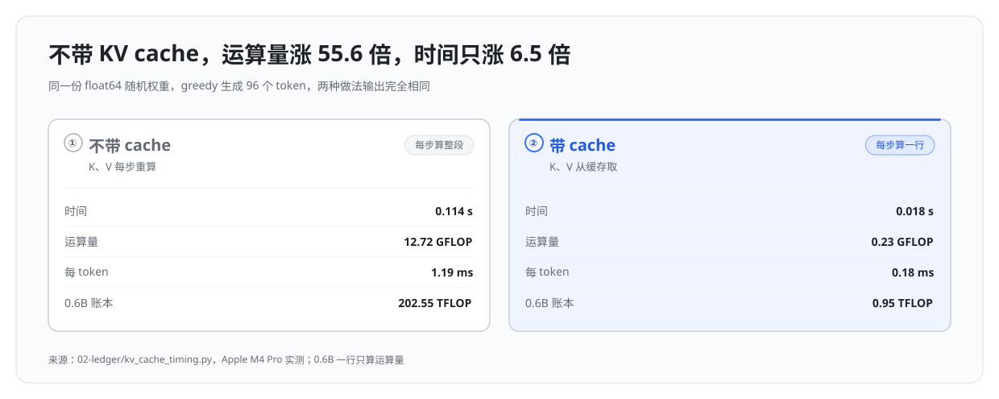
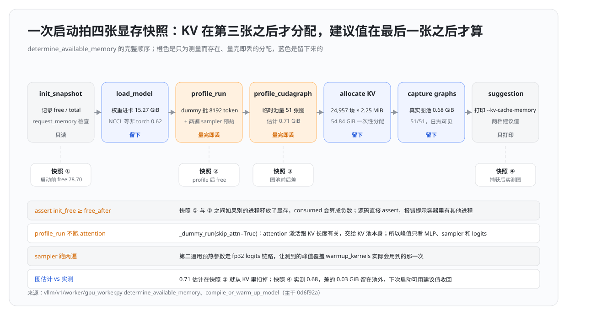
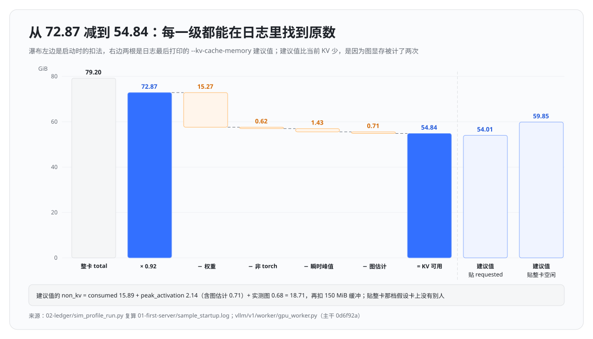
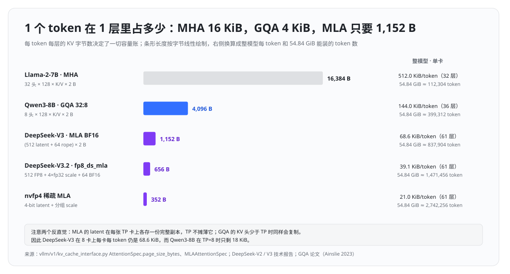
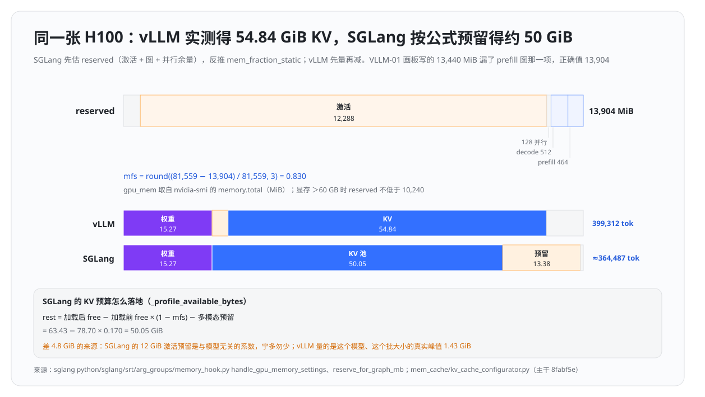
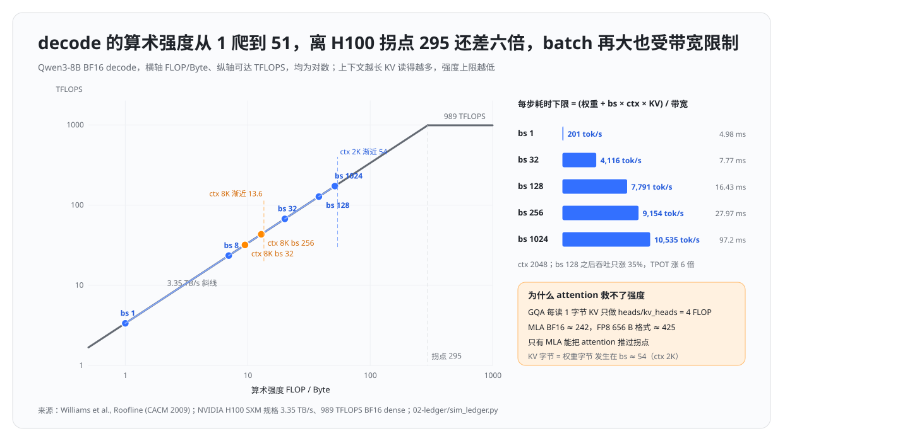
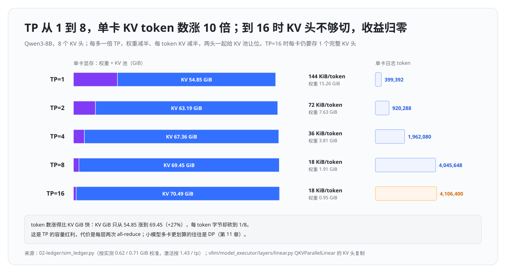
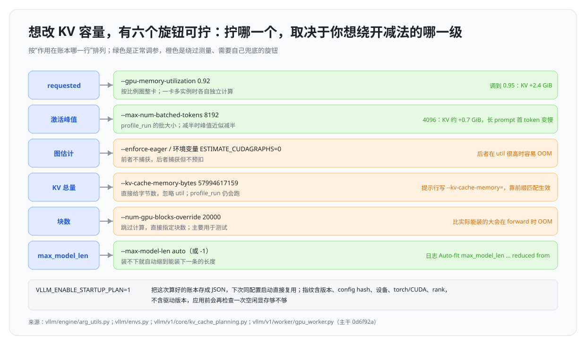

# VLLM-02｜上手｜推理账本：gpu_memory_utilization、KV 容量与 Roofline

> 🎯 **这篇文档解决什么问题**：VLLM-01 的启动日志里有一行 `Available KV cache memory: 54.84 GiB`，紧接着是 `GPU KV cache size: 399,312 tokens`。我们把这两个数从头推一遍：每一项扣了多少、怎么量的、在源码哪一行，再往下推到 decode 每一步最快能跑多快。读完以后，换一张卡、换一个模型、换一个 TP 度，你都能在启动前先估出 KV 容量和 decode 吞吐的天花板；估得准不准，要拿启动日志对账，具体偏差随模型和配置而变。
>
> **使用方式**：这一篇不需要 GPU。第 1、2 章对着 VLLM-01 的示意日志逐行对账。第 3 章把 GiB 换成 token。第 4 章和 SGLang 的公式法对照。第 5 章画 decode 的 Roofline。第 6 章讲 TP 和六个能改 KV 容量的旋钮。第 7 章用两个脚本自己算。基线不变：vLLM 主干 0d6f92a、H100 80GB SXM、Qwen3-8B BF16、`--gpu-memory-utilization 0.92`。SGLang 对照基于主干 8fabf5e。
>
> **代码**：[02-ledger](../02-ledger)。sim_profile_run.py 按 `determine_available_memory` 的顺序把启动日志复算一遍，每一步都打印对应的日志原文；sim_ledger.py 只看模型结构和 GPU 规格做事前估算。两个脚本都只依赖 Python 标准库。

# 导读 · 先给结论

## 双模型的 KV 与状态分别记账

Qwen3.8-27B 的 BF16 全注意力 KV 为 64 KiB/token；Qwen3.5-35B-A3B 为 20 KiB/token，均为 TP1。按卷积历史 3 位、BF16 卷积状态、FP32 时间状态及单份状态计算，前者每序列约 146.81 MiB，后者约 61.41 MiB。状态不能再乘上下文长度，也不能遗漏。

sim_ledger.py 已分别输出 KV 和 GDN 状态，不把混合模型套入固定 16-token 页池。原始容量上界不含 padding、前缀快照、MTP 回滚副本；不输出未经验证的块数与 decode 速度。MoE 权重按标称总量 35B 估算，3B 只描述每 token 激活规模。精确加载显存请传 --weights-gib。

双模型结构以固定版本配置核对[[Qwen3.8-27B config.json]](https://huggingface.co/Qwen/Qwen3.8-27B/blob/37561816e66b5b9153b1b64c10968c18c1e6f4a0/config.json)[[Qwen3.5-35B-A3B config.json]](https://huggingface.co/Qwen/Qwen3.5-35B-A3B/blob/59d61f3ce65a6d9863b86d2e96597125219dc754/config.json)。

```bash
python3 sim_ledger.py --model qwen3.8-27b --gpu h100-sxm --tp 2
python3 sim_ledger.py --model qwen3.5-35b-a3b --gpu h100-sxm --tp 2
```

1. **0.92 圈的是整张卡，KV 拿到的是减法的余数。**requested = ceil(79.20 GiB × 0.92) = 72.87 GiB，依次扣掉常驻的 15.89、瞬时峰值 1.43、CUDA Graph 估计 0.71，剩下 54.84 GiB 才是 KV。这三项分别用三种不同的方法量：`mem_get_info` 的差值、torch 分配器的高水位、一个用完就丢的临时图池。
2. **每 token 144 KiB 是一道乘法题。**2（K、V）× 8 个 KV 头 × 128 维 × 2 字节 × 36 层 = 147,456 B。16 个 token 拼成一块 2.25 MiB 的页，54.84 GiB 整除得 24,957 块。日志的 399,312 token 包含一块永远不分配的 null block，调度器能分出去的是 399,296。
3. **“9.75x”只是下限。**它假设每条请求都写满 40,960 token。平均上下文 4K 时，同一个池子能装大约 97 条；并发上限是 max_num_seqs 和 KV 可装条数里较小的那个。
4. **SGLang 先估后分，vLLM 先量后减。**同一张卡，SGLang 默认按公式预留 13,904 MiB（VLLM-01 画板写成 13,440，漏了 prefill 图那一项），mem_fraction_static 落在 0.830，KV 约 50.05 GiB；vLLM 按示意日志给出的 KV 是 54.84 GiB，多出的 4.8 GiB 基本来自激活：SGLang 的 12 GiB 激活预留与模型无关，vLLM 量的是这个模型的真实峰值[[1]](https://github.com/sgl-project/sglang/blob/8fabf5e/python/sglang/srt/arg_groups/memory_hook.py)[[2]](https://github.com/sgl-project/sglang/blob/8fabf5e/python/sglang/srt/mem_cache/kv_cache_configurator.py)。
5. **decode 是带宽题。**Qwen3-8B 在 H100 上做 decode，算术强度从 bs=1 的 1 FLOP/Byte 爬到 bs=1024 的 51，离拐点 295 还差六倍。上下文 2K 时吞吐上限约 10,500 tok/s，bs 过了 128 以后吞吐只涨 35%，每步耗时却涨 6 倍。batch 大小要按 TPOT 预算定，越大并不越好[[3]](https://dl.acm.org/doi/10.1145/1498765.1498785)[[4]](https://arxiv.org/abs/2402.16363)。
6. **改 KV 容量有六个旋钮，作用在账本的不同行。**util、max_num_batched_tokens、图估计开关作用在减数上。`--kv-cache-memory-bytes` 和 `--num-gpu-blocks-override` 直接跳过测量。`--max-model-len auto` 反过来让上下文去迁就容量。固定机型的集群还可以打开 startup plan，把这次量好的账存下来，下次同配置启动直接复用。

## 开场实验：KV cache 开和关

后面七章大半在算 KV 占多少显存、decode 能跑多快，先用一个小实验看清楚它省的是什么。[02-ledger](../02-ledger) 的 `kv_cache_timing.py` 用 numpy 写了一个 4 层的小 decoder（d=128，4 个头，d_ff=512，vocab=512，float64 随机权重），同一个 prompt 用两种做法各 greedy 生成 96 个 token：不带 cache 时，每生成一个 token 都把整段序列重新过一遍模型；带 cache 时只算新 token 一行，K、V 从缓存里取。两种做法生成的 token 必须完全相同，脚本会检查。



```bash
python3 kv_cache_timing.py
python3 kv_cache_timing.py --prompt 128 --gen 256
python3 kv_cache_timing.py --params-b 0.6 --layers 28 --d-model 1024 --prompt 512 --gen 256
python3 test_kv_cache_timing.py
```

在 Apple M4 Pro 上，prompt 32 个 token、每种做法跑 3 遍取最短：带 cache 用时 0.018 秒、0.23 GFLOP，每 token 0.18 毫秒；不带 cache 用时 0.114 秒、12.72 GFLOP，每 token 1.19 毫秒。运算量差 55.6 倍，时间只差 6.5 倍左右，本机多次运行在 6.5 到 6.9 倍之间。时间差得少，是因为带 cache 的每一步只算一行，矩阵太小，时间主要花在 Python 和 numpy 的调用开销上；把 prompt 和生成长度调大，两种做法的时间差会随之拉大。

第三条命令换成 Qwen3-0.6B 的尺寸只算账（28 层，d=1024，prompt 512，生成 256）：带 cache 0.95 TFLOP，不带 cache 202.55 TFLOP，差 212.3 倍。真实部署里没有人关掉 KV cache。这个实验说明的是另一件事：从「每步只算一个 token」开始，decode 的运算量小到喂不饱 GPU，瓶颈转到读权重和读 KV 的带宽上，第 5 章的 Roofline 就建立在这个前提上；而带宽的代价是显存，第 1 到 3 章算的就是这笔账。

# 第 1 章 · 问题：54.84 GiB 是怎么来的

VLLM-01 的示意日志里有两个对账用的数：54.84 GiB 和 399,312 token。上线前总有人问：能不能再多塞一点？换 H200 能多多少？开 TP=2 呢？要回答这些问题，得先知道这两个数是怎么算出来的。vLLM 不让你直接配置 KV 大小（除非你明确绕过测量，见第 6 章），它给你一个总预算，然后把能量到的非 KV 开销一项项扣掉，余下的全部给 KV。

这本账里，权重、非 torch 显存和峰值激活是启动时量出来的，CUDA Graph 那一项走临时池估计，只有最大的两张真捕获、其余按边际成本外推，没有一项靠查表取经验常数。这是 vLLM 和 SGLang 在显存管理上最根本的区别，也是为什么同一个 util 在不同模型、不同 batch 配置下会得到差别很大的 KV 容量。先看减数分几类、各用什么方法量。


## 1.1 三类非 KV 显存

`memory_profiling` 的文档字符串把一张卡上的显存分成三类：别的进程用的、当前 vLLM 实例里 torch 用的、当前实例里 torch 之外用的（NCCL、cuBLAS workspace、CUDA 上下文）（[mem_utils.py](https://github.com/vllm-project/vllm/blob/0d6f92a/vllm/utils/mem_utils.py)）。按“会不会留下来”再切一刀，就得到账本上的三项减数：

| 减数 | 示意日志里的值 | 量法 | 包含什么 |
|-|-|-|-|
| 常驻 total_consumed | 15.89 GiB | 启动前 free − profile 后 free，都取自 `mem_get_info` | 权重 15.27 + 非 torch 0.62；profile 之后还被引用的 torch 张量也算在这里 |
| 瞬时 transient_peak_headroom | 1.43 GiB | profile 后 torch 峰值 − profile 后 torch 常驻 | 一次最大批 forward 里的临时张量：MLP 中间结果、logits、sampler 工作区 |
| CUDA Graph 估计 | 0.71 GiB | 在独立临时池里捕获前后的 free 差 | 51 个捕获尺寸的图内存；FULL 图只真捕获两张，其余外推 |

常驻项为什么不用 `torch.cuda.memory_reserved()`，而用驱动层的 `mem_get_info`？源码注释说得很直接：使用可插拔分配器（比如 sleep mode 用的 cumem）时，分配会绕过 PyTorch 的记账，`memory_reserved` 甚至会算出负数；驱动层的空闲量则什么都看得见。代价是它也会看见别的进程：如果在快照 ① 和快照 ② 之间同一张卡上有别的进程释放了显存，consumed 会变成负数，源码在这里直接 assert 并提示“隔离到独立容器”（[gpu_worker.py](https://github.com/vllm-project/vllm/blob/0d6f92a/vllm/v1/worker/gpu_worker.py)）。

> 💡 **为什么权重 15.27 和 consumed 15.89 之间差了 0.62**：这 0.62 GiB 是 CUDA 上下文、NCCL 通信缓冲和 cuBLAS workspace 这类 torch 看不见的分配。单卡时它相对稳定；TP 多卡时 NCCL 缓冲会变大，所以 sim_ledger.py 把它单独列成 `--nontorch-gib`，用实测值校准。

# 第 2 章 · 原理：四张快照和一次减法

## 2.1 时间顺序：KV 在第三张快照之后才分配

`determine_available_memory` 的执行顺序决定了每个数是在什么状态下量出来的。下图把一次启动拆成七段，标出四次显存快照的位置。橙色是只为测量而存在、量完即丢的分配；蓝色是会留在卡上的。



顺序里有两个容易被忽略的细节。第一，profile_run 和图估计都发生在 KV 分配**之前**，这时卡上几乎是空的，量出来的峰值不会和 KV 打架。第二，CUDA Graph 的实际捕获发生在 KV 分配**之后**，所以估计值必须提前从 KV 里扣出来；如果不扣，KV 吃满 requested，捕获时就只能从 requested 之外的那 8% 里拿显存。v0.21.0 之前的版本就是这样做的，这也是为什么老版本在 util 调到 0.95 以上时经常在捕获阶段 OOM[[5]](https://docs.vllm.ai/en/latest/design/cuda_graphs/)。

## 2.2 第一步：request_memory

预算只有一行：`requested = ceil(total × util)`（[utils.py](https://github.com/vllm-project/vllm/blob/0d6f92a/vllm/v1/worker/utils.py)）。total 取自 `mem_get_info()[1]`，H100 80GB SXM 上是 85,045,231,616 B，也就是 79.20 GiB，和标称的 80 GB 对不上。乘以 0.92 向上取整得 78,241,613,087 B = 72.87 GiB。

同一个函数还做一次检查：启动前的空闲显存必须不小于 requested，否则直接报 `Free memory on device … is less than desired GPU memory utilization`。示意日志里启动前空闲 78.70 GiB，满足。这个检查意味着 util 是一个**绝对量**：同一张卡上跑两个实例，各设 0.45，加起来才是 0.9；第二个实例启动时看到的空闲显存已经少了第一个实例的那份，但它的 requested 仍按整卡算[[6]](https://docs.vllm.ai/en/latest/configuration/conserving_memory/)。

## 2.3 第二步：memory_profiling 和 profile_run

profile_run 用 `max_num_batched_tokens`（这里是 8192）个 dummy token 跑一次 forward，再跑 sampler（[model_runner.py](https://github.com/vllm-project/vllm/blob/0d6f92a/vllm/v1/worker/gpu/model_runner.py)）。它有三处设计要细看：

- **不跑 attention**。`_dummy_run(skip_attn=True)` 只在初始 profiling 时允许。attention 的工作区跟 KV 长度相关，而 KV 还没分配；这部分开销交给 KV 池本身和注意力后端的固定 workspace，不在峰值里算。所以测到的峰值基本由 MLP、logits 和 sampler 决定。
- **sampler 跑两遍**。第一遍是默认路径，logits 保持模型 dtype；第二遍用 `SamplingParams.for_sampler_warmup()` 走 fp32 logits 全链路。原因写在注释里：KV 分配之后的 `warmup_kernels` 会走 fp32 那条路，profile 的峰值必须覆盖它，否则 warmup 阶段会 OOM。
- **临时把分配器的 split 上限设成 20 MB**。MoE workspace 这类缓冲会阶梯式增长，每次释放小的、申请大的。不设上限时，后面一个小分配可能切进一个已释放的几 GiB 大块，把整段钉住，`empty_cache()` 也还不回去，于是被算成常驻、从 KV 里扣掉。设了上限，大块不会被切，就能干净释放。

1.43 GiB 的瞬时峰值大致能拆开：sampler 处理 min(max_num_seqs, 8192) = 1,024 条序列，fp32 logits 是 1,024 × 151,936 × 4 B ≈ 0.58 GiB。MLP 的 gate 和 up 投影输出是 8,192 × 2 × 12,288 × 2 B ≈ 0.38 GiB。剩下的是 SiLU 结果、残差和 sampler 的排序工作区。这也解释了第 6 章的一个旋钮：把 max_num_batched_tokens 减半，MLP 那部分跟着减半，logits 那部分不变。

```text
Memory profiling takes 6.84 seconds. Total non KV cache memory: 17.32GiB;
torch peak memory increase: 1.43GiB; total consumed (from mem_get_info): 15.89GiB;
weights memory: 15.27GiB.
```

这一行只在 `VLLM_LOGGING_LEVEL=DEBUG` 时打印。non_kv = consumed + transient = 15.89 + 1.43 = 17.32 GiB，注意 transient 用的是“峰值减常驻”，没有直接加整个峰值：常驻部分已经在 consumed 里算过一次，再加整个峰值就重复计了。源码里有一行注释专门说这件事。

## 2.4 第三步：CUDA Graph 估计


捕获尺寸来自 `_set_cudagraph_sizes`（[vllm.py](https://github.com/vllm-project/vllm/blob/0d6f92a/vllm/config/vllm.py)）：上限是 min(max_num_seqs × 每请求 decode token 数 × 2, 512)，Blackwell 上是 1024；网格是 1、2、4，然后 8 到 248 步长 8，256 到 512 步长 16，共 51 个，和日志里的 `51/51` 对上。PIECEWISE 和 FULL 两种模式各捕获一遍，所以日志里有两条进度条。

`profile_cudagraph_memory` 用一个独立的临时池和最小 KV（min(max_num_reqs, 最大捕获尺寸) 块）把捕获过程预演一遍，量池子前后的空闲差（[cudagraph_utils.py](https://github.com/vllm-project/vllm/blob/0d6f92a/vllm/v1/worker/gpu/cudagraph_utils.py)）。FULL 图逐张捕获太慢，所以只真捕获最大的两张，其余按 `s[0] + (n − 1) × max(s[1], 1 MiB)` 外推：第一张带上了池子的一次性开销，第二张的增量近似每多一张图的边际成本。PIECEWISE 图、多模态 encoder 图和投机解码的 drafter 图则逐张实测，它们共享同一个池，池内复用不会重复计。

示意日志这一算例里，估计值 0.71 GiB，临时池预演后量到 0.68 GiB，日志对应会打印一行 `CUDA graph pool memory: 0.68 GiB (actual), 0.71 GiB (estimated), difference: 0.03 GiB (4.4%)`。估计偏大是故意的：偏小会 OOM，偏大只浪费 0.03 GiB。

预扣图显存是 v0.21.0 才改成默认的，所以日志会额外打印一行提示，告诉你“按老口径你现在相当于设了多少”：delta = 0.71 / 79.20 = 0.008964，当前 0.92 等价于旧口径的 0.9110；想保持升级前的 KV 大小，就把 util 调到 0.9290。不想预扣可以设 `VLLM_MEMORY_PROFILER_ESTIMATE_CUDAGRAPHS=0`，KV 变成 55.55 GiB / 404,480 token，图显存从 requested 之外的余量里出[[7]](https://docs.vllm.ai/en/latest/configuration/env_vars/)。

## 2.5 减法和日志末尾的两个建议值



三项减完：72.87 − 17.32 − 0.71 = 54.84 GiB，精确到字节是 58,882,048,000 B。日志在捕获完真实图之后还会打印一行很长的建议：

```text
Free memory on device (78.7/79.2 GiB) on startup. Desired GPU memory utilization is (0.92, 72.87 GiB).
Actual usage is 15.89 GiB for consumed memory (weights + non-torch), 2.14 GiB for peak activation,
and 0.68 GiB for CUDAGraph memory. Replace gpu_memory_utilization config with
`--kv-cache-memory=57994617159` to fit into requested memory, or `--kv-cache-memory=64261364776`
to fully utilize gpu. Current kv cache memory in use is 58882048000 bytes.
```

两个建议值的 non_kv 都是 consumed 15.89 + peak_activation 2.14 + 实测图 0.68 = 18.71 GiB，再扣 150 MiB 缓冲。第一档贴着 requested：72.87 − 18.71 − 0.15 = 54.01 GiB；第二档贴着启动前的整卡空闲：78.70 − 18.71 − 0.15 = 59.85 GiB（[gpu_worker.py](https://github.com/vllm-project/vllm/blob/0d6f92a/vllm/v1/worker/gpu_worker.py)）。

第一档比当前的 54.84 还少 0.83 GiB，原因在 peak_activation 的定义：它等于 transient 1.43 加上**图估计** 0.71，再加实测图 0.68，图显存被算了两次。这是有意的保守：建议值会跳过测量直接用，宁可小一点。用第二档之前要确认卡上不会再有别的进程，并且你能接受只有 150 MiB 的余量。

> 💡 **参数名**：提示文案写的是 `--kv-cache-memory=`，正式参数名是 `--kv-cache-memory-bytes`（[arg_utils.py](https://github.com/vllm-project/vllm/blob/0d6f92a/vllm/engine/arg_utils.py)）。前者能用，只是因为 argparse 默认接受唯一前缀；部署脚本里写全名，免得哪天新增一个同前缀的参数时突然报 ambiguous option。

**主干补充：可扩展 KV 的余量还要覆盖分配器碎片。**上面的日志和数值仍属于 0d6f92a 基线。2026 年 11 月 13 日合入的 2cfbe17 在可扩展 KV 定容预热中，额外记录 PyTorch 保留显存的峰值增长，并扣除该步骤留下的常驻分配。定容时从预算与物理余量的较小值中，扣除瞬时分配峰值与保留显存增长的较大者；两者取最大值，不相加。原有安全余量仍按瞬时分配峰值计算，不能把这次修改理解成固定增加一笔显存[[[[Bugfix] Keep extensible KV cache headroom for measured allocator fragmentation]]](https://github.com/vllm-project/vllm/pull/67296)。上游纯算术用例在瞬时峰值为 1 GiB、保留显存增长为 2 GiB 时，得到 4 GiB 的 KV 预算；这只是给定输入下的函数结果，不是真机容量或 OOM 消除证明[[test_measure_kv_cache_bytes：可扩展 KV 预算测试]](https://github.com/vllm-project/vllm/blob/2cfbe17c928b45d9f70eb5e385c7f57533e466a4/tests/v1/worker/test_extensible_kv_cache.py)。

# 第 3 章 · 从 GiB 到 token

## 3.1 每 token 每层占多少

容量账的第二半是除法，除数是每个 token 的 KV 字节数。标准注意力的公式是 2 × num_kv_heads × head_dim × dtype_bytes × num_layers，前面的 2 是 K 和 V。vLLM 里对应 `AttentionSpec` 的 `page_size_bytes`：一页 block_size 个 token，每格存 (head_size + head_size_v) × dtype 字节（[kv_cache_interface.py](https://github.com/vllm-project/vllm/blob/0d6f92a/vllm/v1/kv_cache_interface.py)）。不同的注意力结构，这个数可以差 40 倍以上：



Qwen3-8B 是 32 个 query 头、8 个 KV 头的 GQA[[8]](https://arxiv.org/abs/2305.13245)[[9]](https://huggingface.co/Qwen/Qwen3-8B)：每层每 token 2 × 8 × 128 × 2 = 4,096 B，36 层合计 147,456 B = 144 KiB。如果它用的是 MHA，同样的 54.84 GiB 只能装下四分之一的 token；这正是 GQA 和更早的 MQA 被提出的动机[[10]](https://arxiv.org/abs/1911.02150)。

DeepSeek 的 MLA 走得更远：不存 K 和 V，只存一个 512 维的压缩 latent 加 64 维的 RoPE 部分，BF16 下每层每 token 1,152 B[[11]](https://arxiv.org/abs/2405.04434)[[12]](https://arxiv.org/abs/2412.19437)。DeepSeek-V3.2 的稀疏注意力格式 `fp8_ds_mla` 把 latent 存成 FP8，带 4 个 fp32 scale，RoPE 部分保持 BF16，每层 656 B；更激进的 nvfp4 格式只有 352 B。量化 KV 的精度问题留到第 12 章[[13]](https://vllm.ai/blog/2026-04-22-fp8-kvcache)。

## 3.2 块、token 和 null block



vLLM 按块分配 KV，默认 block_size = 16。一块 = 16 × 147,456 = 2,359,296 B（2.25 MiB），这是 36 层合在一起的大小；实际存储时每层各有一个张量，块号在各层之间共享[[14]](https://arxiv.org/abs/2309.06180)[[15]](https://docs.vllm.ai/en/latest/design/paged_attention/)。58,882,048,000 B 整除 2,359,296 得 24,957 块。

其中块 0 是 null block：`BlockPool` 构造时从空闲队列 popleft 的第一块，块表里所有占位项（滑窗跳过的块、padding）都指向它，永远不会分给真实请求（[block_pool.py](https://github.com/vllm-project/vllm/blob/0d6f92a/vllm/v1/core/block_pool.py)）。于是有两个口径：

| 口径 | 算法 | 结果 | 用在哪里 |
|-|-|-|-|
| 日志 | int(24,957 / ⌈40,960 / 16⌉ × 40,960) | 399,312 token | `GPU KV cache size` 那一行 |
| 可分配 | (24,957 − 1) × 16 | 399,296 token | 调度器实际能分出去的槽位；容量检查和 auto-fit 也按这个算 |

日志口径来自 `get_max_concurrency_for_kv_cache_config`（[kv_cache_utils.py](https://github.com/vllm-project/vllm/blob/0d6f92a/vllm/v1/core/kv_cache_utils.py)）：先算“能同时装几条打满 max_model_len 的请求”，得 24,957 / 2,560 = 9.7488，再乘回 40,960。它没扣 null block，所以永远比可分配口径多 16 的整数倍。容量检查在 [kv_cache_planning.py](https://github.com/vllm-project/vllm/blob/0d6f92a/vllm/v1/core/kv_cache_planning.py) 里，用的是扣掉 null block 之后的池子。

“9.75x”这个倍数最容易被误读。它是**最坏情况下**的并发数：每条请求都写满 40,960 token。线上的平均上下文通常小得多，平均 4K 时同一个池子能装 399,296 / 4,096 ≈ 97 条；平均 1K 时约 390 条，此时 max_num_seqs（这里是 1024）还不是瓶颈，但调度器的 token 预算和 decode 的带宽会先成为瓶颈，见第 5 章。

## 3.3 TP 对每 token 字节数的影响

TP 按头切 KV：每张卡只存 num_kv_heads / tp 个头，每 token 字节数随之减半[[16]](https://arxiv.org/abs/1909.08053)。但 KV 头不能切成半个：tp 大于 KV 头数时，`QKVParallelLinear` 让每张卡复制一份完整的 KV 头，`num_kv_head_replicas = tp / total_kv_heads`（[linear.py](https://github.com/vllm-project/vllm/blob/0d6f92a/vllm/model_executor/layers/linear.py)）。Qwen3-8B 有 8 个 KV 头，TP=16 时每卡仍存 1 个头，每 token 18 KiB，和 TP=8 一样。

MLA 更特殊：latent 不分头，每张 TP 卡都存一份完整副本，TP 完全不摊薄每 token 的 KV。DeepSeek-V3 在 8 卡上每卡每 token 仍是 61 × 1,152 B = 68.6 KiB。想在 MLA 上摊薄 KV，要用 decode context parallel（DCP）按 token 切，第 11 章再讲[[17]](https://vllm.ai/blog/2026-08-07-decode-context-parallelism)。

# 第 4 章 · 对照：SGLang 先估后分



## 4.1 SGLang 的公式

SGLang 的 `--mem-fraction-static` 定义为（权重 + KV 池）/ 整卡显存。不指定时，`handle_gpu_memory_settings` 先估出激活和 CUDA Graph 要留多少，再反推这个比例[[1]](https://github.com/sgl-project/sglang/blob/8fabf5e/python/sglang/srt/arg_groups/memory_hook.py)[[18]](https://docs.sglang.io/docs/advanced_features/server_arguments)。H100 80GB、TP=1 时：

| 项 | 公式 | MiB |
|-|-|-|
| 固定开销 | 注意力后端元数据等 | 512 |
| 激活 | max(chunked_prefill_size 8192, 2048) × 1.5 | 12,288 |
| 并行余量 | tp × pp / 8 × 1024 | 128 |
| decode 图 | cuda_graph_max_bs 256 × 2 | 512 |
| prefill 图 | 58 个捕获尺寸 × 8 | 464 |
| 合计 reserved | 显存大于 60 GB 时不低于 10,240 | 13,904 |

gpu_mem 取自 `nvidia-smi` 的 memory.total，H100 上是 81,559 MiB。mem_fraction_static = round((81,559 − 13,904) / 81,559, 3) = 0.830。VLLM-01 第 5 章的画板写的是 13,440 MiB，漏掉了 prefill 图那一项：SGLang 主干默认也捕获 prefill 的 CUDA Graph，58 个尺寸来自 `generate_prefill_cuda_graph_batch_sizes(8192)`[[19]](https://github.com/sgl-project/sglang/blob/8fabf5e/python/sglang/srt/arg_groups/cuda_graph_hook.py)，每个按 8 MiB 计（只算非 torch 部分，torch 部分在捕获时复用）。这里更正。

## 4.2 KV 预算怎么落地

比例算出来之后，加载完权重再看一次空闲显存：`rest = 加载后 free − 加载前 free × (1 − mfs)`，出自 SGLang 的 `_profile_available_bytes`[[2]](https://github.com/sgl-project/sglang/blob/8fabf5e/python/sglang/srt/mem_cache/kv_cache_configurator.py)。代入示意日志的数：63.43 − 78.70 × 0.170 = 50.05 GiB，按每 token 144 KiB 约 364,487 token。SGLang 的 page_size 默认是 1，没有块取整，也没有 null block 这一层。

同一张卡差了 4.8 GiB，几乎全部来自激活这一项：SGLang 按 1.5 MiB/token 留了 12 GiB，这是一个跟模型无关的系数，要同时罩住 70B 的大 hidden 和 0.6B 的小模型，只能往大了取；vLLM 量的是 Qwen3-8B 在 8192 token 批上的真实峰值 1.43 GiB。代价也很清楚：vLLM 启动要多跑一次 profile 和一次图预演，SGLang 不需要。

SGLang 也在往测量的方向走。主干里有一个 `SGLANG_ENABLE_POST_CAPTURE_KV_SIZING`，打开后先捕获图、再量剩余显存定 KV，公式里的图和激活预留就只剩 1,536 MiB 的底加并行余量[[1]](https://github.com/sgl-project/sglang/blob/8fabf5e/python/sglang/srt/arg_groups/memory_hook.py)。但它默认关闭，MLA、DCP、memory saver 等配置下也不会启用，写作时仍是 opt-in。

> 💡 **迁移时别直接搬数字**：SGLang 的 0.83 和 vLLM 的 0.92 不是同一个量。前者圈的是权重加 KV，后者圈的是整个实例。从 SGLang 迁过来想得到相近的 KV，不要把 mem_fraction_static 抄成 gpu_memory_utilization；先用默认 0.92 启动一次，看 `GPU KV cache size`，再按第 6 章的旋钮调。

# 第 5 章 · Roofline：decode 的天花板

## 5.1 每一步要读多少字节

容量回答的是“装得下多少”，Roofline 回答的是“跑得多快”[[3]](https://dl.acm.org/doi/10.1145/1498765.1498785)。decode 每一步对每条序列只生成一个 token，但必须把全部权重读一遍，再把每条序列的 KV 读一遍。忽略激活读写，每步的 HBM 流量和计算量是：

```text
bytes(bs) = W + bs × ctx × kv_per_token        W = 8.19e9 × 2 B = 16.38 GB
flops(bs) = 2 × params × bs                    （线性层；attention 另算）
AI(bs)    = flops / bytes
t_min(bs) = bytes / 3.35 TB/s                  （H100 SXM HBM3）
```

H100 SXM 的 BF16 稠密算力是 989 TFLOPS，带宽 3.35 TB/s，拐点在 989 / 3.35 ≈ 295 FLOP/Byte[[20]](https://www.nvidia.com/en-us/data-center/h100/)。算术强度低于 295 就是带宽受限，每步耗时由字节数决定，和算力无关。



| bs | 每步下限 (ms) | tok/s 上限 | 算术强度 | KV 占流量 |
|-|-|-|-|-|
| 1 | 4.98 | 201 | 1.0 | 2% |
| 32 | 7.77 | 4,116 | 20.1 | 37% |
| 128 | 16.43 | 7,791 | 38.1 | 70% |
| 256 | 27.97 | 9,154 | 44.8 | 83% |
| 1024 | 97.20 | 10,535 | 51.5 | 95% |

上表是上下文 2,048 时的数。随着 bs 增大，权重读取被摊薄，但 KV 读取跟 bs 成正比地涨，算术强度渐近于 2 × params / (ctx × kv_per_token)：ctx 2K 时是 54.2，ctx 8K 时只有 13.56。bs ≈ 54 时 KV 流量和权重流量持平；过了 128，吞吐只再涨 35%，每步耗时却涨 6 倍，TPOT 从 16 ms 变成 97 ms[[4]](https://arxiv.org/abs/2402.16363)。

## 5.2 为什么 attention 救不了强度

attention 自己的算术强度更低。GQA 下每读 1 字节 KV，要给共享它的 query 头各算一次，强度是 heads / kv_heads = 4。MLA 则不同：128 个头共享同一个 latent，BF16 下强度约 242，FP8 的 656 B 格式约 425，已经越过 H100 的拐点。MLA 在 decode 侧的价值就在这里：它把 attention 从带宽题变成了算力题[[11]](https://arxiv.org/abs/2405.04434)。

## 5.3 这张图怎么用

- **定 batch 上限**：先定 TPOT 预算，比如 30 ms，在表里找到对应的 bs（约 256），再和 KV 能装的条数取小。max_num_seqs 设得比这个大，只会让 TPOT 超标。
- **判断优化方向**：bs 小时权重读取占大头，量化权重（FP8、INT4）直接缩短每步时间；bs 大、上下文长时 KV 占大头，量化 KV 或换 MLA 模型更有效。第 12 章按这个思路展开。
- **认清这是下限**：表里只算了 HBM 读取，不含 kernel 启动、调度、采样和 detokenize。实测离这条线有多远，第 3 章用压测去量；差距大的地方，就是第 9、10 章的 CUDA Graph 和注意力后端要解决的问题[[21]](https://vllm.ai/blog/2025-09-05-anatomy-of-vllm)。

# 第 6 章 · TP 和六个旋钮

## 6.1 TP 从 1 到 16


TP 对 KV 容量有双重红利：权重按卡摊薄，给 KV 池让出空间；每 token KV 字节数也按卡摊薄。从 TP=1 到 TP=8，单卡 KV 只从 54.85 GiB 涨到 69.45 GiB（+27%），可装 token 却从 39.9 万涨到 404.6 万，涨了 10 倍。到 TP=16，KV 头不够切，每 token 字节数停在 18 KiB，收益基本归零。

代价是每层两次 all-reduce。对 8B 这样一张卡就放得下的模型，多卡时更划算的往往是 DP：每张卡一个完整副本，没有通信，容量按卡线性叠加。TP 适合的是单卡放不下权重，或者单请求的 TPOT 必须压到很低的场景[[22]](https://docs.vllm.ai/en/latest/serving/parallelism_scaling/)。第 11 章展开。

## 6.2 六个旋钮



| 旋钮 | 作用在账本哪一行 | 效果（示意日志基线） | 注意 |
|-|-|-|-|
| `--gpu-memory-utilization` | requested | 0.92 → 0.95：KV +2.4 GiB | 一卡多实例时各自独立按整卡算 |
| `--max-num-batched-tokens` | 瞬时峰值 | 8192 → 4096：KV 约 +0.7 GiB | 长 prompt 的 prefill 要分更多块，首 token 变慢 |
| `--enforce-eager` / `VLLM_MEMORY_PROFILER_ESTIMATE_CUDAGRAPHS=0` | 图估计 | 前者不捕获图，后者捕获但不预扣 | 前者 decode 小 batch 慢 1.5–3 倍；后者在 util 很高时容易 OOM |
| `--kv-cache-memory-bytes` | 整本账 | 直接给 KV 字节数，忽略 util | profile_run 仍会跑（为了编译），但跳过测量和图估计 |
| `--num-gpu-blocks-override` | 块数 | 跳过计算，直接指定块数 | 主要用于测试；比实际能装的大会在运行时 OOM |
| `--max-model-len auto`（或 -1） | 容量检查 | 装不下时自动缩短到能装下一条的长度 | 日志里有 `Auto-fit max_model_len`；上下文可能比你预期的短 |

前三个是正常调参，作用在减数上，测量照常跑；后三个是绕过测量，出了问题要自己兜底[[23]](https://docs.vllm.ai/en/latest/configuration/engine_args/)[[6]](https://docs.vllm.ai/en/latest/configuration/conserving_memory/)[[24]](https://docs.vllm.ai/en/latest/configuration/optimization/)。`--kv-cache-memory-bytes` 的典型用法是：在目标机型上用默认配置启动一次，拿日志末尾的第一档建议值写进部署脚本。这样启动会快几秒，KV 大小在每台机器上完全一致，便于横向对比。风险在于它不再看 util，也不再检查卡上有没有别人，日志里会明确写 `This does not respect the gpu_memory_utilization config`。

## 6.3 startup plan：把账本存下来

`VLLM_ENABLE_STARTUP_PLAN=1` 是更自动的做法（[startup_plan.py](https://github.com/vllm-project/vllm/blob/0d6f92a/vllm/v1/worker/startup_plan.py)）。每个 worker 在第一次启动后，把建议的 KV 字节数和启动前的空闲显存基线存成 JSON，放在 `VLLM_CACHE_ROOT/startup_plan/` 下；下次启动时，如果指纹匹配、并且当前空闲显存不少于记录的基线，就直接套用，跳过测量。

指纹包括 vLLM 版本、`VllmConfig.compute_hash()`（模型、cache、并行、编译配置）、设备名、总显存、计算能力、torch 和 CUDA 版本、rank 和 world_size，不包括驱动版本。源码注释承认了这一点：只升级驱动时 plan 仍会命中，残余风险由“空闲显存不少于基线”这道检查兜住。默认关闭，适合机型固定、配置不常变的生产集群；VLLM-01 里讲的 `VLLM_CACHE_ROOT` 卷，这里又多了一个必须挂的理由。

# 第 7 章 · 动手：自己算一遍

## 7.1 逐行复算启动日志

```bash
cd zero-to-vllm/02-ledger
python3 sim_profile_run.py                                              # 用示意日志的数字
python3 sim_profile_run.py --log ../01-first-server/sample_startup.log  # 从日志里抽数字
python3 sim_profile_run.py --sglang                                     # 追加 SGLang 默认 mem_fraction_static 的推导
python3 sim_profile_run.py --no-cg-estimate                             # 模拟 ESTIMATE_CUDAGRAPHS=0
```

输出按源码顺序分成 8 段：request_memory、memory_profiling、图估计、KV 可用、块与 token、util 提示行、建议值、SGLang 对照，每段都标了对应的源文件，数字和前四章一一对得上。用自己的日志跑 `--log` 时，日志里的 GiB 只保留两位小数，反推结果会有 0.01 GiB、几十个 token 的偏差，属于正常。

## 7.2 启动前估算

```bash
# 当前通用双模型：分别计算 KV 与 GDN 状态
python3 sim_ledger.py --model qwen3.8-27b --gpu h100-sxm --tp 2
python3 sim_ledger.py --model qwen3.5-35b-a3b --gpu h100-sxm --tp 2
# 下方历史表格仍对应旧模型；校准示意日志时必须显式选择原模型
python3 sim_ledger.py --model qwen3-8b --total-gib 79.2 --act-gib 1.43 --nontorch-gib 0.62 --graph-gib 0.71
# 双模型实际对账用 --weights-gib 传入每卡加载权重，不沿用历史激活值。
```

| 场景 | KV 可用 | 每卡每 token | 日志口径 token |
|-|-|-|-|
| Qwen3-8B，H100，默认粗估 | 55.43 GiB | 144 KiB | 403,616 |
| Qwen3-8B，H100，按示意日志值校准 | 54.85 GiB | 144 KiB | 399,392（日志 399,312，差 0.02%） |
| Qwen3-8B，2 × H100 | 63.31 GiB | 72 KiB | 921,968 |
| Llama-3.1-70B，4 × H100，FP8 KV | 38.15 GiB | 40 KiB | 1,000,048 |
| DeepSeek-V3，8 × H200，FP8 权重 | 48.61 GiB | 68.6 KiB | 742,672 |

粗估模式下，激活按 max_num_batched_tokens × hidden × 2 × 8 / tp 加 1,024 条 fp32 logits 估，非 torch 取 0.6 GiB，图取 0.5 GiB，总显存取标称的 99%。不校准时误差在 1% 左右；拿一次真实日志的三个数填进去，误差降到 0.02%。表中 2 × H100 一行是粗估模式，和第 6 章画板（按 1.43 / tp 校准激活）的 63.19 GiB 略有差别。

## 7.3 对不上日志时

1. 先对 `Available KV cache memory`。差得多，就用 `VLLM_LOGGING_LEVEL=DEBUG` 重启，从 `Memory profiling takes …` 那一行取 torch peak 和 consumed，分别填进 `--act-gib` 和 `--nontorch-gib`（consumed 减权重）[[25]](https://docs.vllm.ai/en/latest/usage/troubleshooting/)。
2. KV 对得上而 token 对不上，说明每 token 字节数算错了。依次检查 `--kv-dtype`、模型是否带滑窗或混合层（第 7 章），以及 MLA 后端的块大小和对齐。
3. 日志的 token 数比脚本的可分配口径多 16 的整数倍，是 null block 的口径差，脚本两种都打印了。
4. consumed 明显大于权重加 1 GiB，先查同卡上有没有别的进程，再查是否开了多模态（encoder cache 会在 profile 时一起分配）。

> 📌 **核对清单**
> - 能从 util 和 total 推出 requested，并说出三项减数各用什么方法量。
> - 能手算任意模型的每 token KV 字节数，知道 GQA 的 KV 头复制和 MLA 的 latent 副本在 TP 下怎么变。
> - 分得清日志口径和可分配口径的 token 数，不再用“9.75x”报并发能力。
> - 从 SGLang 迁移时，不把 mem_fraction_static 直接抄成 gpu_memory_utilization。
> - 能用 Roofline 表按 TPOT 预算反推 max_num_seqs 的上限。
> - 知道日志末尾两个建议值的区别，部署脚本里写的是 `--kv-cache-memory-bytes` 全名。
> - 在自己的机器上跑过 sim_profile_run.py --log，误差在 0.01 GiB 以内。

账本算的是理论上限。下一篇 VLLM-03 开始压测：用 `vllm bench serve` 量出 TTFT、TPOT 和吞吐，看看实测离第 5 章那条带宽线到底有多远，以及差出来的那部分时间花在了哪里。

# 参考文献

按正文首次引用顺序编号，资料截至 2026 年 10 月底。源码以 vllm-project/vllm 主干提交 0d6f92a（2026 年 10 月 29 日）和 v0.32.0 发行版为准。

[1] sgl-project. sglang/srt/arg_groups/memory_hook.py handle_gpu_memory_settings. GitHub (8fabf5e) [https://github.com/sgl-project/sglang/blob/8fabf5e/python/sglang/srt/arg_groups/memory_hook.py](https://github.com/sgl-project/sglang/blob/8fabf5e/python/sglang/srt/arg_groups/memory_hook.py)

[2] sgl-project. sglang/srt/mem_cache/kv_cache_configurator.py \_profile_available_bytes. GitHub (8fabf5e) [https://github.com/sgl-project/sglang/blob/8fabf5e/python/sglang/srt/mem_cache/kv_cache_configurator.py](https://github.com/sgl-project/sglang/blob/8fabf5e/python/sglang/srt/mem_cache/kv_cache_configurator.py)

[3] Williams S, Waterman A, Patterson D. Roofline: An Insightful Visual Performance Model for Multicore Architectures. Communications of the ACM (2009) [https://dl.acm.org/doi/10.1145/1498765.1498785](https://dl.acm.org/doi/10.1145/1498765.1498785)

[4] Yuan Z, et al. LLM Inference Unveiled: Survey and Roofline Model Insights. arXiv (2024) [https://arxiv.org/abs/2402.16363](https://arxiv.org/abs/2402.16363)

[5] vLLM Docs. CUDA Graphs [https://docs.vllm.ai/en/latest/design/cuda_graphs/](https://docs.vllm.ai/en/latest/design/cuda_graphs/)

[6] vLLM Docs. Conserving Memory [https://docs.vllm.ai/en/latest/configuration/conserving_memory/](https://docs.vllm.ai/en/latest/configuration/conserving_memory/)

[7] vLLM Docs. Environment Variables [https://docs.vllm.ai/en/latest/configuration/env_vars/](https://docs.vllm.ai/en/latest/configuration/env_vars/)

[8] Ainslie J, et al. GQA: Training Generalized Multi-Query Transformer Models from Multi-Head Checkpoints. EMNLP (2023) [https://arxiv.org/abs/2305.13245](https://arxiv.org/abs/2305.13245)

[9] Qwen. Qwen3-8B model card and generation_config.json. Hugging Face [https://huggingface.co/Qwen/Qwen3-8B](https://huggingface.co/Qwen/Qwen3-8B)

[10] Shazeer N. Fast Transformer Decoding: One Write-Head is All You Need. arXiv (2019) [https://arxiv.org/abs/1911.02150](https://arxiv.org/abs/1911.02150)

[11] DeepSeek-AI. DeepSeek-V2: A Strong, Economical, and Efficient Mixture-of-Experts Language Model. arXiv (2024) [https://arxiv.org/abs/2405.04434](https://arxiv.org/abs/2405.04434)

[12] DeepSeek-AI. DeepSeek-V3 Technical Report. arXiv (2024) [https://arxiv.org/abs/2412.19437](https://arxiv.org/abs/2412.19437)

[13] vLLM Team. The State of FP8 KV-Cache and Attention Quantization in vLLM. vLLM Blog (2026-04-22) [https://vllm.ai/blog/2026-04-22-fp8-kvcache](https://vllm.ai/blog/2026-04-22-fp8-kvcache)

[14] Kwon W, et al. Efficient Memory Management for Large Language Model Serving with PagedAttention. SOSP (2023) [https://arxiv.org/abs/2309.06180](https://arxiv.org/abs/2309.06180)

[15] vLLM Docs. Paged Attention [https://docs.vllm.ai/en/latest/design/paged_attention/](https://docs.vllm.ai/en/latest/design/paged_attention/)

[16] Shoeybi M, et al. Megatron-LM: Training Multi-Billion Parameter Language Models Using Model Parallelism. arXiv (2019) [https://arxiv.org/abs/1909.08053](https://arxiv.org/abs/1909.08053)

[17] vLLM Team. Efficient Decode Context Parallelism with vLLM for Long Context Workloads. vLLM Blog (2026-08-07) [https://vllm.ai/blog/2026-08-07-decode-context-parallelism](https://vllm.ai/blog/2026-08-07-decode-context-parallelism)

[18] SGLang Docs. Server Arguments [https://docs.sglang.io/docs/advanced_features/server_arguments](https://docs.sglang.io/docs/advanced_features/server_arguments)

[19] sgl-project. sglang/srt/arg_groups/cuda_graph_hook.py. GitHub (8fabf5e) [https://github.com/sgl-project/sglang/blob/8fabf5e/python/sglang/srt/arg_groups/cuda_graph_hook.py](https://github.com/sgl-project/sglang/blob/8fabf5e/python/sglang/srt/arg_groups/cuda_graph_hook.py)

[20] NVIDIA. H100 Tensor Core GPU datasheet [https://www.nvidia.com/en-us/data-center/h100/](https://www.nvidia.com/en-us/data-center/h100/)

[21] Kurtić A (vLLM Team). Inside vLLM: Anatomy of a High-Throughput LLM Inference System. vLLM Blog (2025-09-05) [https://vllm.ai/blog/2025-09-05-anatomy-of-vllm](https://vllm.ai/blog/2025-09-05-anatomy-of-vllm)

[22] vLLM Docs. Parallelism and Scaling [https://docs.vllm.ai/en/latest/serving/parallelism_scaling/](https://docs.vllm.ai/en/latest/serving/parallelism_scaling/)

[23] vLLM Docs. Engine Arguments [https://docs.vllm.ai/en/latest/configuration/engine_args/](https://docs.vllm.ai/en/latest/configuration/engine_args/)

[24] vLLM Docs. Optimization and Tuning [https://docs.vllm.ai/en/latest/configuration/optimization/](https://docs.vllm.ai/en/latest/configuration/optimization/)

[25] vLLM Docs. Troubleshooting [https://docs.vllm.ai/en/latest/usage/troubleshooting/](https://docs.vllm.ai/en/latest/usage/troubleshooting/)

---

[在 Colab 里跑本章 CPU 练习](https://colab.research.google.com/github/zyaochen/zero-to-vllm/blob/main/colab/02-ledger.ipynb) · 上一章：[VLLM-01｜上手｜第一个服务：安装、vllm serve 与读懂启动日志](./01-first-server.md) · [目录](./README.md) · 下一章：[VLLM-03｜上手｜指标与压测：vllm bench serve、TTFT、TPOT 与 goodput](./03-bench.md)
