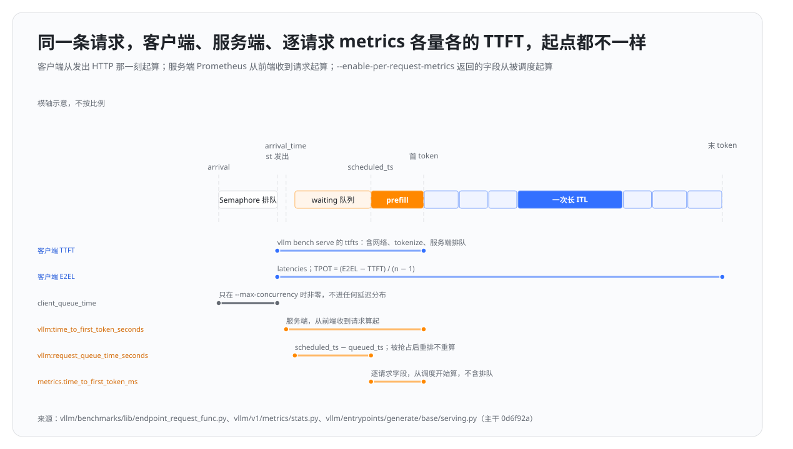
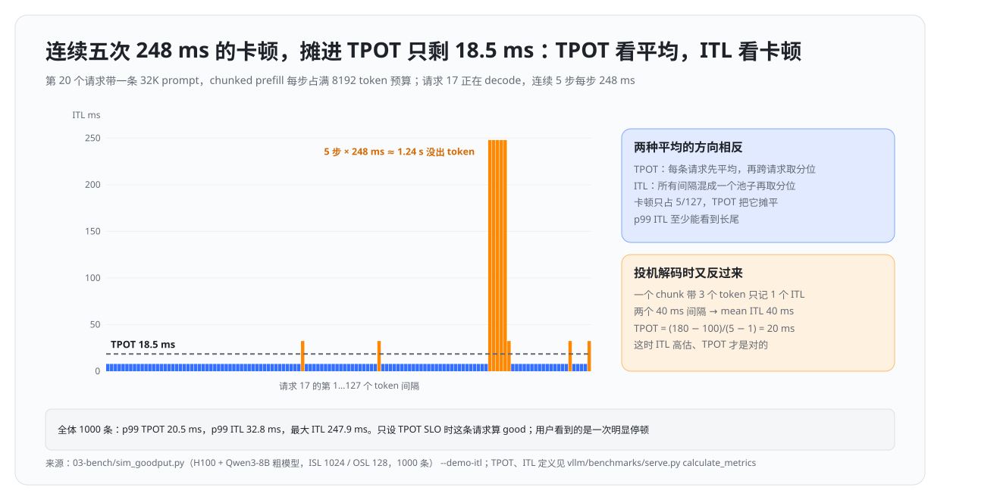
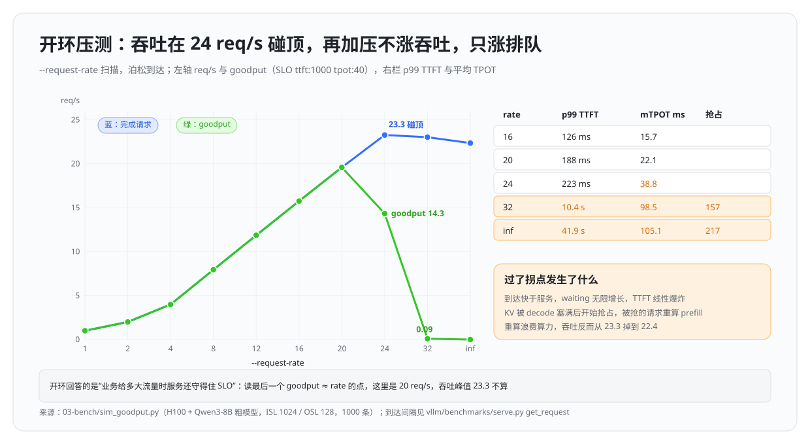
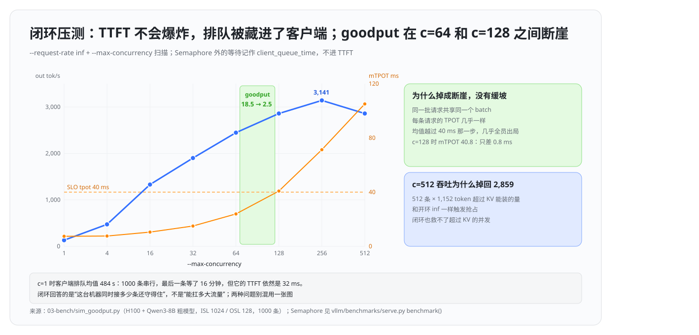
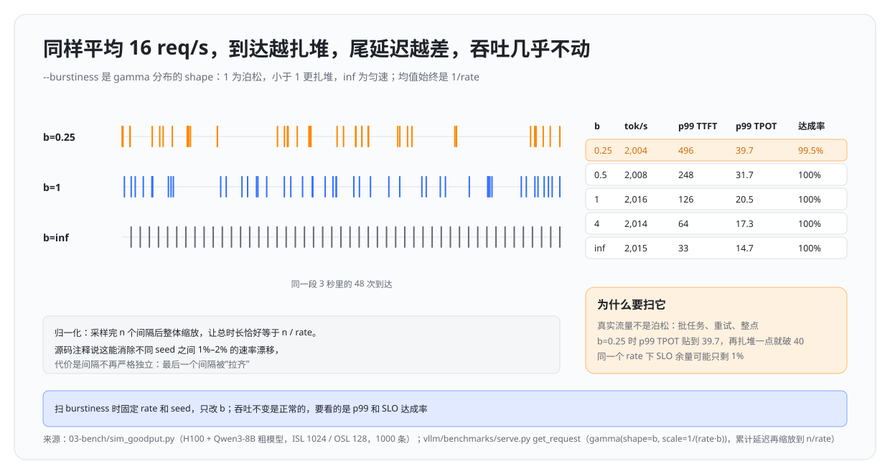
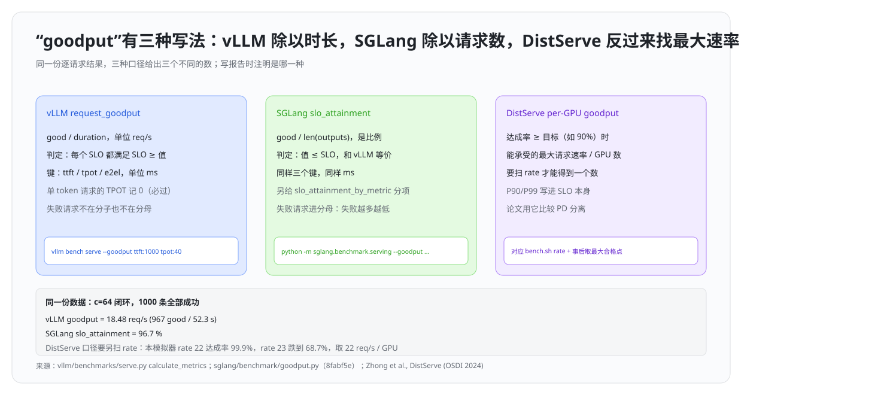
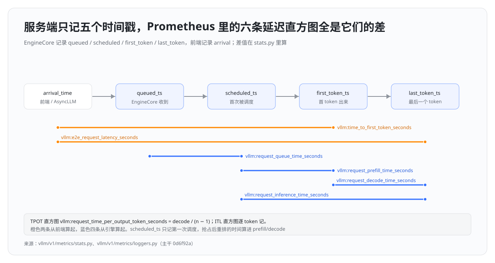
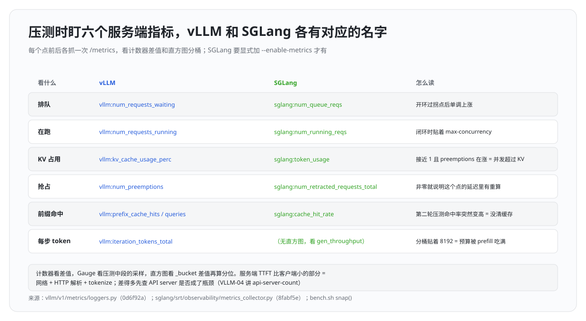
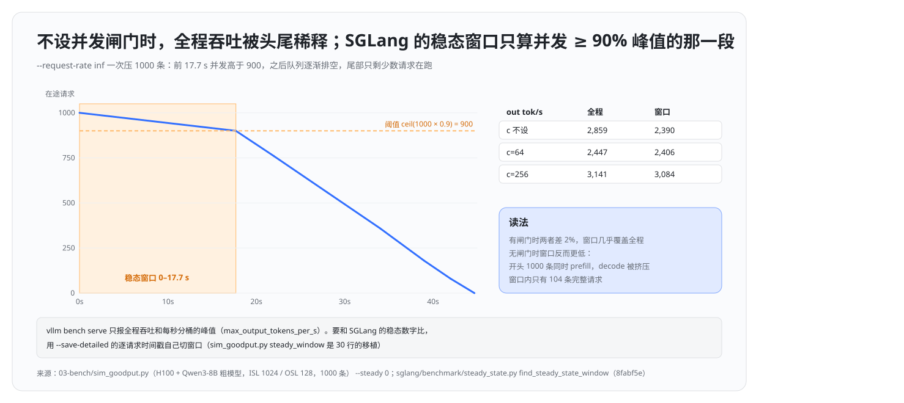

# VLLM-03｜上手｜指标与压测：vllm bench serve、TTFT、TPOT 与 goodput

> 🎯 **这篇文档解决什么问题**：VLLM-02 将双模型的全注意力 KV 与 GDN 状态分开核算，原始容量上界还需要真实请求验证。TTFT、TPOT、ITL 在客户端和服务端的统计起止点不同，开环与闭环也对应不同负载条件。本章对齐指标定义和实验条件，再分别运行 dense、moe；公共账本不输出未经验证的混合模型 decode 速度。
>
> 使用方式：先读延迟指标及开环、闭环定义，再看 goodput、服务端时间戳和直方图；最后使用公共脚本分别测 dense、moe。原模拟曲线仍属于 Qwen3-8B、H100、util 0.92、ISL 1024／OSL 128 的历史假设，不能改名为双模型性能。vLLM 0d6f92a 和 SGLang 8fabf5e 是历史源码定位，新实验必须另记实际安装版本。
>
> **代码**：[03-bench](../03-bench)。bench.sh 是一组固定好的 `vllm bench serve` 参数，每个点前后各抓一次 `/metrics`。sim_goodput.py 前半部分逐行照抄 `calculate_metrics`，可以用 `--save-detailed` 的 JSON 重算并核对。后半部分是一个只依赖标准库的连续批处理模拟器，文中不标“实测”的曲线都出自它。模拟器只为展示指标的形状，绝对值以真机为准。

# 导读 · 先给结论

## 双模型压测先固定实验条件

同一组随机输入输出长度分别运行 dense 和 moe，实际分词长度仍须从结果核对。bench.sh 的逐点压测按模型、批次、标签保存结果与所选 revision，拒绝复用已有结果或中间记录。同名标签的锁目录记录已尝试实验，失败后也不删除，重跑须更换 OUT。压测命令非零退出、详细 JSON 缺失或指标抓取失败都判为失败，已有 JSON 不能抵消命令错误。客户端记录不能证明服务端实际加载了该 revision，须另存启动日志。缓存重置端点不可用时会明确告警；这些结果不能与已清缓存的轮次直接比较。

至少同时报告 TTFT、TPOT、请求内 p99 ITL、吞吐、goodput、失败数和峰值显存。先比较相同精度、TP、缓存与 MTP 关闭的基线，再单独测优化收益。两个模型的层数和宽度不同，差值不能只归因于 MoE。SSE 片段间隔也不能直接当 token ITL。

双模型结构以固定版本配置核对[[Qwen3.8-27B config.json]](https://huggingface.co/Qwen/Qwen3.8-27B/blob/37561816e66b5b9153b1b64c10968c18c1e6f4a0/config.json)[[Qwen3.5-35B-A3B config.json]](https://huggingface.co/Qwen/Qwen3.5-35B-A3B/blob/59d61f3ce65a6d9863b86d2e96597125219dc754/config.json)。

```bash
MODEL_PROFILE=dense bash bench.sh smoke
# 对应模型服务就绪后，再运行另一组
MODEL_PROFILE=moe bash bench.sh smoke
```

1. **TTFT 有三个起点。**`vllm bench serve` 从客户端发出 HTTP 请求开始计时，Prometheus 的 `vllm:time_to_first_token_seconds` 从前端收到请求开始计时，`--enable-per-request-metrics` 返回的 `time_to_first_token_ms` 从请求被调度开始计时。三者之间差的是网络、tokenize 和排队，排队时间可以从几毫秒涨到几十秒[[1]](https://docs.vllm.ai/en/latest/benchmarking/cli/)[[2]](https://docs.vllm.ai/en/latest/features/per_request_metrics/)。
2. **TPOT 是先按请求平均、再取分位；ITL 是把所有间隔混在一起取分位。**一条请求连续卡顿五次、每次 248 ms，它的 TPOT 只有 18.5 ms，全体 p99 TPOT 20.5 ms，用户却实实在在等了 1.24 秒。投机解码时情况反过来：一个 chunk 里有多个 token 但只记一个 ITL，这时 ITL 偏高，TPOT 才是准的[[1]](https://docs.vllm.ai/en/latest/benchmarking/cli/)。
3. **开环压测看服务端的极限，闭环压测看给定并发下的体验。**开环（`--request-rate`）超过天花板后 TTFT 会无限增长；闭环（`--max-concurrency`）的排队发生在客户端的 Semaphore 里，不计入 TTFT。闭环报告“TTFT 只有 200 ms”时，要同时看客户端排队时间。
4. **goodput 往往在某个点断崖式下跌，不会缓慢下降。**模拟器里 c=64 时 goodput 是 18.48 req/s，c=128 时只剩 2.50：TPOT 均值越过 40 ms 的那一刻，几乎所有请求同时不达标。所以只报吞吐、不报 goodput 的压测，选出来的工作点往往在悬崖边上[[3]](https://arxiv.org/abs/2401.09670)[[4]](https://arxiv.org/abs/2410.14257)。
5. **SGLang 和 vLLM 的 bench 默认值几乎都不一样。**输出长度默认 1024 对 128，ignore-eos 默认开对默认关，seed 42 对 0，温度 0 对不设，warmup 1 对 0；ITL 遇到合并的 chunk 时，SGLang 按 token 数拆开，vLLM 记一个间隔。两边的数字要对比，先把这五个参数对齐[[5]](https://github.com/sgl-project/sglang/blob/8fabf5e/python/sglang/benchmark/serving.py)。
6. **Prometheus 的 ITL 直方图最小桶是 10 ms。**Qwen3-8B 在 H100 上 decode 一步约 7.8 ms，全部落在第一个桶里，从 Grafana 上算出来的 p50 基本是插值出来的。要看细粒度，用 `--custom-histogram-buckets` 加桶，每多一个桶就多一条时间序列。

# 第 1 章 · 四个延迟指标，各从哪里算起

VLLM-01 用一条 curl 验证了服务能用，VLLM-02 算出了每步 decode 的理论下限。现在换成一千条请求，问题就从“能不能跑”变成“跑得怎么样”。业界报告几乎都用同四个名字：TTFT（Time To First Token）、TPOT（Time Per Output Token）、ITL（Inter-Token Latency）、E2EL（End-to-End Latency）。名字是统一的，但每个数从哪一刻开始计时、怎么聚合，取决于是谁量的。

先说结论：**客户端量到的是用户体验，服务端量到的是引擎行为，两者之差就是网络、HTTP 层和排队。**下图是同一条请求在三套计时下的起止点。



## 1.1 客户端：vllm bench serve 怎么计时

所有后端的请求函数都在 [endpoint_request_func.py](https://github.com/vllm-project/vllm/blob/0d6f92a/vllm/benchmarks/lib/endpoint_request_func.py)，逻辑相同：发请求前记 `st = time.perf_counter()`，SSE 流每来一个非空 chunk 记一次时间戳。第一个 chunk 到达时 `ttft = timestamp − st`，之后每个 chunk 往 `itl` 列表里追加 `timestamp − most_recent_timestamp`，最后 `latency = most_recent_timestamp − st`。注意计时按“chunk”算：服务端一次推多个 token，客户端只记一个间隔。

汇总在 [serve.py](https://github.com/vllm-project/vllm/blob/0d6f92a/vllm/benchmarks/serve.py) 的 `calculate_metrics`，只统计成功的请求：

```python
# vllm/benchmarks/serve.py calculate_metrics（节选，0d6f92a）
if output_len > 1:
    latency_minus_ttft = outputs[i].latency - outputs[i].ttft
    tpot = latency_minus_ttft / (output_len - 1)     # 每条请求一个 TPOT
tpots.append(tpot)
itls += outputs[i].itl                               # 所有请求的 ITL 拼成一个大列表
ttfts.append(outputs[i].ttft)
e2els.append(outputs[i].latency)
```

| 指标 | 定义 | 聚合方式 | 受什么影响最大 |
|-|-|-|-|
| TTFT | 首个 chunk 到达 − 发出请求 | 每条请求一个值 | 排队、prefill 长度、chunked prefill 的切分 |
| TPOT | (E2EL − TTFT) / (输出 token 数 − 1) | 每条请求一个值；单 token 请求记 0 | batch 大小、decode 每步耗时 |
| ITL | 相邻两个 chunk 的到达间隔 | 所有请求的所有间隔混在一起 | 被别人的 prefill 插队、抢占、stream_interval |
| E2EL | 最后一个 chunk 到达 − 发出请求 | 每条请求一个值 | TTFT + 输出长度 × TPOT |

输出 token 数取自服务端返回的 usage，没有 usage 时用 tokenizer 重新数一遍。`--ignore-eos` 不开时，输出长度由模型决定，每条请求的 n 都不同，TPOT 的分母也跟着变。这一点放到第 6 章再说。

## 1.2 TPOT 和 ITL：两种平均，方向相反

vLLM 的 Benchmark CLI 文档专门讨论过这个问题：普通 decode 每个 chunk 一个 token，ITL 和 TPOT 很接近；文档示例里 mean TPOT 7.91 ms、mean ITL 7.74 ms[[1]](https://docs.vllm.ai/en/latest/benchmarking/cli/)。出问题的是两种情况。

**第一种是卡顿。**sim_goodput.py --demo-itl 在第 20 个请求处插入一条 32K token 的 prompt。chunked prefill 让它每步吃满 8192 token 的预算，正在 decode 的请求 17 因此连续 5 步、每步等 248 ms。按 TPOT 的算法，这 1.24 秒被摊到 127 个间隔上，TPOT 是 18.5 ms，在 40 ms 的 SLO 内，这条请求算 good。ITL 列表里则留下 5 个 247.9 ms，p99 ITL 是 32.8 ms，max 才看得出来。



**第二种是一个 chunk 带多个 token。**投机解码一次接受 3 个 token 时，服务端把它们放在一个 chunk 里推出。文档的例子：TTFT 100 ms、E2EL 180 ms、5 个 token 分两个 chunk，两个 ITL 都是 40 ms，mean ITL 40 ms；TPOT = (180 − 100) / (5 − 1) = 20 ms[[1]](https://docs.vllm.ai/en/latest/benchmarking/cli/)。这时 ITL 偏高，TPOT 才反映每个 token 的真实开销。`--stream-interval` 大于 1 时也一样，服务端攒够 N 个 token 才推一次（[scheduler.py](https://github.com/vllm-project/vllm/blob/0d6f92a/vllm/config/scheduler.py) 里 `stream_interval` 默认 1）。

> 💡 **报告怎么写**：TPOT 用来说明“平均每个 token 多快”，配合 SLO 判断请求是否 good；ITL 的 p99 和 max 用来说明“有没有卡顿”。开了投机解码或 stream_interval 的对比实验，用 TPOT 和输出吞吐，不用 ITL。

## 1.3 服务端和逐请求字段

服务端的 TTFT 在 [stats.py](https://github.com/vllm-project/vllm/blob/0d6f92a/vllm/v1/metrics/stats.py) 里计算，起点是前端（AsyncLLM）收到请求时记下的 `arrival_time`，比客户端少了网络和 HTTP 解析的时间。`--enable-per-request-metrics` 打开后，每个响应会带一个 `metrics` 字段，包括 `time_to_first_token_ms`、`queue_time_ms`、`generation_time_ms`、`mean_itl_ms`、`tokens_per_second`。这里的 TTFT 是从被调度开始算的，**不含排队**[[2]](https://docs.vllm.ai/en/latest/features/per_request_metrics/)。这个开关有三个限制：n > 1 时字段为空，高并发下有可见的 CPU 开销，不能和 `--disable-log-stats` 一起用。

vllm bench serve 用 openai、vllm、openai-chat 三个后端时，会把这两个字段读进 `server_queue_times` 和 `server_ttfts`（[endpoint_request_func.py](https://github.com/vllm-project/vllm/blob/0d6f92a/vllm/benchmarks/lib/endpoint_request_func.py)）。客户端 TTFT 减去 server_queue_time 再减去 server_ttft，差值就是网络加 tokenize 加 detokenize 的开销，这是定位“客户端 TTFT 比服务端日志高一截”最直接的办法。

# 第 2 章 · 开环、闭环与突发度

压测工具发请求的方式有两种。开环（open loop）按预先生成的到达时间表发，不管服务端处理完没有；闭环（closed loop）维持固定数量的在途请求，完成一条再补一条。vllm bench serve 两种都支持：`--request-rate` 控制到达速率，`--max-concurrency` 是一个 asyncio Semaphore，两个参数可以同时设置。

## 2.1 到达时间怎么生成

`get_request` 用 gamma 分布生成请求间隔：shape = burstiness，scale = 1 / (rate × burstiness)，均值恰好是 1/rate。burstiness = 1 时是泊松过程；小于 1 时请求更扎堆，大于 1 时更均匀。生成完以后，代码会把所有间隔按比例缩放，使总时长精确等于 n / rate，所以同一 seed 下改 burstiness 不会改变平均速率（[serve.py](https://github.com/vllm-project/vllm/blob/0d6f92a/vllm/benchmarks/serve.py)）。`--request-rate inf` 时所有请求在 0 时刻同时到达。

```python
# vllm/benchmarks/serve.py get_request（节选）
theta = 1.0 / (current_request_rate * burstiness)
delay_ts.append(np.random.gamma(shape=burstiness, scale=theta))
...
# 归一化：让累计延迟的终点精确落在 n / rate
```

还有两个不太常用的选项。`--ramp-up-strategy linear|exponential` 配合 `--ramp-up-start-rps` / `--ramp-up-end-rps`，可以在一次压测里让速率从低到高变化，适合粗略找拐点。`--probe-request-rate` 会在主负载之外，用独立连接定期发一条 prompt 为 "Hi"、输出 1 token 的探针请求，报告 `probe_median/p99/max_e2el_ms`，用来观察主负载下一个“空请求”要等多久。

## 2.2 开环：找服务端的天花板

开环扫描固定负载（ISL 1024、OSL 128、1000 条），只改 rate。下图是模拟器的结果：rate 20 以内，实际 req/s 跟着 rate 走，TTFT p99 在 200 ms 以内。rate 24 时实际吞吐 23.27 req/s，接近天花板，TPOT 均值涨到 38.8 ms。rate 32 时到达速率超过处理能力，waiting 队列越来越长，p99 TTFT 涨到 10.4 秒，KV 不够触发了 157 次抢占，吞吐反而下降。



开环的意义在于它能暴露过载行为：吞吐碰顶后，多出来的请求全部变成排队时间。生产环境的流量本身就是开环的，用户不会因为服务慢了就少发请求。所以“服务能扛多少 QPS”这个问题要用开环来回答，看吞吐曲线拐点左侧、SLO 还能满足的那个 rate。

## 2.3 闭环：排队藏进了客户端

闭环扫描 `--request-rate inf --max-concurrency c`。客户端同时最多有 c 条请求在途，其余的在 Semaphore 上等。关键在 [serve.py](https://github.com/vllm-project/vllm/blob/0d6f92a/vllm/benchmarks/serve.py) 的这一段：

```python
async with semaphore:
    output = await request_func(...)
# throughput calculations; record client-side semaphore delay separately.
output.client_queue_time = output.start_time - request_arrival_time
```

`start_time` 是拿到 Semaphore 之后才记的，所以客户端排队时间单独存在 `client_queue_time` 里，**不进 TTFT、不进 E2EL**。c=1 时，最后一条请求在客户端等了几百秒（模拟器里客户端排队均值 484 秒），报告上的 TTFT 却稳定在 32 ms。闭环的 TTFT 只衡量“已经被服务的请求”的体验，还在门外、“想被服务的请求”根本进不了统计。



闭环曲线的形状和开环不同：TTFT 不会爆炸，因为服务端看到的在途请求数被 c 限制住了。吞吐随 c 单调上升，直到 KV 或 max_num_seqs 成为瓶颈。TPOT 随 batch 变大而上升。模拟器里 c=64 时输出吞吐 2,447 tok/s，mTPOT 23.9 ms。c=128 时吞吐 2,859，mTPOT 40.8 ms，越过了 40 ms 的 SLO。c=256 吞吐 3,141，TPOT 71.3 ms。c=512 时并发已经超过 KV 能容纳的条数，开始抢占，吞吐回落。

> 💡 **闭环结果不要换算成 QPS 承诺**：c=64 时 19.11 req/s，不代表线上 19 QPS 的开环流量下 TTFT 也是 200 ms 级。泊松到达在短时间内会超过平均值，没有客户端闸门兜底，排队全部落在服务端。要给 QPS 承诺，用开环在目标 rate 下复测一次。

## 2.4 突发度：吞吐不变，尾延迟变了

固定 rate 16，只改 `--burstiness`。b=0.25 时请求成团到达，p99 TTFT 从泊松时的 126 ms 涨到 496 ms，p99 TPOT 从 20.5 涨到 39.7 ms，SLO 达成率 99.5%；b=inf（等间隔）时 p99 TTFT 只有 33 ms。输出吞吐始终在 2,004 到 2,016 tok/s 之间。



这说明只报平均速率的压测是不完整的。线上流量通常比泊松过程更扎堆（定时任务、批量调用、上游重试），用 b=1 压出来的 p99 会偏乐观。如果有线上 trace，用 `--dataset-name custom` 或 trace 回放更准；没有的话，至少在 b=0.5 下再跑一次。

# 第 3 章 · goodput：满足 SLO 的吞吐

吞吐只回答“一秒处理多少”，不管这些请求处理得好不好。DistServe 提出用 goodput 作为优化目标：在满足 SLO 达成率的前提下，每张 GPU 能承受的最大请求速率[[3]](https://arxiv.org/abs/2401.09670)。这个想法已经被各家 bench 工具接受，只是实现成了不同的口径。

## 3.1 vLLM 的实现

`--goodput ttft:1000 tpot:40` 的单位是毫秒，可用的键只有 ttft、tpot、e2el。对每条成功的请求，所有给定 SLO 都满足（SLO ≥ 实测值）才算 good，`request_goodput = good / duration`，单位 req/s。单 token 请求的 TPOT 记为 0，必然满足；失败的请求既不在分子也不在分母。

```python
# vllm/benchmarks/serve.py calculate_metrics（节选）
for req_metric in zip(*valid_metrics):
    is_good_req = all([s >= r for s, r in zip(slo_values, req_metric)])
    if is_good_req:
        good_completed += 1
...
request_goodput=good_completed / dur_s,
```

SLO 本身怎么定？MLPerf Inference v5.0 给 Llama 2 70B 的 Interactive 场景定的是 TTFT 450 ms、TPOT 40 ms[[6]](https://developer.nvidia.com/blog/nvidia-blackwell-delivers-massive-performance-leaps-in-mlperf-inference-v5-0/)，可以当作聊天类业务的参考起点。40 ms 的 TPOT 约等于每秒 25 个 token，比人的阅读速度快一些。代码补全、Agent 工具调用对 TTFT 更敏感，离线批处理只看 E2EL 甚至只看吞吐。

## 3.2 三种口径



SGLang 的 `sglang/benchmark/goodput.py`[[7]](https://github.com/sgl-project/sglang/blob/8fabf5e/python/sglang/benchmark/goodput.py) 判定条件和 vLLM 等价（实测值 ≤ SLO），但它报的是 `slo_attainment = good / len(outputs)`，是一个比例；失败请求也算在分母里，所以服务端大量报错时 SGLang 的达成率会明显下降，vLLM 的 goodput 却可能看不出问题。它还会按指标分别给出 `slo_attainment_by_metric`，方便看是哪一项拖了后腿。

DistServe 的 per-GPU goodput 需要扫 rate：找出达成率不低于目标（比如 90%）的最大 rate，再除以 GPU 数。模拟器里 rate 22 的达成率 99.9%，rate 23 跌到 68.7%，按 90% 的目标取 22 req/s。“Revisiting SLO and Goodput Metrics” 一文指出，这种二值判定会让“差一点达标”和“完全不可用”的请求被同等对待，建议同时报告延迟分布[[4]](https://arxiv.org/abs/2410.14257)。实际操作中，goodput 和 p99 一起报就够了。

## 3.3 为什么是断崖

回到闭环表：c=64 时 goodput 18.48 req/s（1000 条中 967 条 good，耗时 52.3 秒），c=128 时 goodput 只剩 2.50。原因在于 TPOT 是 batch 级的属性：同一步里所有 decode 请求共享同一个 step 耗时，batch 变大，所有人的 TPOT 一起变大。当 mTPOT 越过 SLO 时，几乎所有请求同时出局。TTFT 则不同，它和请求到达的时机有关，退化是渐进的。

所以选工作点时要在悬崖左侧留余量。工程上的做法是：先扫出 goodput 最高的 c，再往回退一档，用开环在对应 rate 下复测 p99。Sarathi-Serve 的 chunked prefill 正是为了把 TPOT 稳定下来，让这个悬崖不那么陡[[8]](https://arxiv.org/abs/2403.02310)，VLLM-06 会展开讲。

# 第 4 章 · 服务端怎么看：五个时间戳与 Prometheus

客户端的数字告诉你“慢”，服务端的数字告诉你“为什么慢”。vLLM 的请求级延迟全部来自五个时间戳：前端的 `arrival_time`，以及 EngineCore 记录的 `queued_ts`、`scheduled_ts`、`first_token_ts`、`last_token_ts`。前者是墙钟时间，后四个是 EngineCore 进程里的单调时钟，所以 TTFT 和 E2E 从 arrival 算，其余几段只在 EngineCore 内部做差（[stats.py](https://github.com/vllm-project/vllm/blob/0d6f92a/vllm/v1/metrics/stats.py)）[[9]](https://docs.vllm.ai/en/latest/design/metrics/)。



| Prometheus 直方图 | 计算 | 说明 |
|-|-|-|
| vllm:time_to_first_token_seconds | first_token − arrival | 含排队和 prefill |
| vllm:e2e_request_latency_seconds | 完成 − arrival | 服务端视角的 E2EL |
| vllm:request_queue_time_seconds | scheduled − queued | 只算第一次排队；被抢占后重排不重算 |
| vllm:request_prefill_time_seconds | first_token − scheduled | chunked prefill 被切开时包含中间等待 |
| vllm:request_decode_time_seconds | last_token − first_token | TPOT 的分子 |
| vllm:request_inference_time_seconds | last_token − scheduled | prefill + decode |
| vllm:request_time_per_output_token_seconds | decode / (n − 1) | 服务端 TPOT，每条请求一个值 |
| vllm:inter_token_latency_seconds | 本次输出时刻 − 上次输出时刻 | 按引擎输出记，不按 token；投机解码一步出多个 token 也只记一次 |

## 4.1 压测时盯哪几个

延迟直方图只能说明结果，解释原因还要看状态类指标。下图把压测中最有用的六个服务端指标和 SGLang 的对应名字放在一起；SGLang 要用 `--enable-metrics` 打开[[10]](https://github.com/sgl-project/sglang/blob/8fabf5e/python/sglang/srt/observability/metrics_collector.py)。



典型的读法：`num_requests_waiting` 持续大于 0 而 `kv_cache_usage_perc` 没满，说明瓶颈在 max_num_seqs 或 token 预算。KV 接近 100% 且 `num_preemptions` 在涨，说明 KV 不够，要么降并发，要么回到 VLLM-02 的六个旋钮。`iteration_tokens_total` 的分布贴着 max_num_batched_tokens，说明 prefill 在抢预算，TPOT 会受影响。新版本还提供了 `num_requests_waiting_by_reason`，直接告诉你请求卡在哪个原因上[[11]](https://docs.vllm.ai/en/latest/usage/metrics/)。

## 4.2 直方图的桶

所有引擎直方图的桶定义集中在 [buckets.py](https://github.com/vllm-project/vllm/blob/0d6f92a/vllm/v1/metrics/buckets.py)。ITL 和 TPOT 共用 `INTER_TOKEN_LATENCY_BUCKETS`，从 0.01、0.025、0.05、0.075、0.1 秒开始。TTFT 从 0.001 秒到 2560 秒。E2E 和排队时间共用 `REQUEST_LATENCY_BUCKETS`，最小 0.3 秒。

本章历史模拟用约 7.8 ms 的 decode 单步量级说明分桶问题：样本集中在 10 ms 以下时，桶内线性插值无法恢复真实分布。这不是双模型实测时延。应保留逐请求样本，按观察到的分布设置更细桶边界，再比较相同 SLO 下的分位数；只改桶不能消除采样口径差异。

```bash
# 在配套仓库 03-bench 目录执行；两模型使用相同桶边界
MODEL_PROFILE=dense TP=2 bash ../01-first-server/serve.sh \
  --custom-histogram-buckets '{"inter_token_latency":[0.002,0.004,0.006,0.008,0.01,0.015,0.02,0.04,0.08,0.2,0.5,1.0]}'
# 停止后将 MODEL_PROFILE 改为 moe 再启动；桶边界需按实测分布检查。
```

可覆盖的桶族有八个：request_latency、time_to_first_token、inter_token_latency、iteration_tokens、request_params_n、request_num_preemptions、request_tokens、kv_cache_residency。校验在 [observability.py](https://github.com/vllm-project/vllm/blob/0d6f92a/vllm/config/observability.py)，桶必须严格递增。每个桶在 Prometheus 里是一条独立的时间序列，再乘以 model_name、engine 等标签的组合数，桶加得太多会给 Prometheus 带来压力。

> 💡 **压测时用差值**：Prometheus 指标是累计值。bench.sh 在每个压测点前后各抓一次 `/metrics`，两次相减才是这一轮的分布。直接看压测结束后的快照，会把预热和上一轮的数据混进来。

# 第 5 章 · 和 SGLang 的 bench 对照

拿 vLLM 和 SGLang 的压测结果对比，是 AI infra 工作里最常见的需求之一，也是最容易出错的。两个工具的命令行参数名字大多相同，默认值却几乎都不同。下表对比 `vllm bench serve` 和 `python -m sglang.benchmark.serving`[[5]](https://github.com/sgl-project/sglang/blob/8fabf5e/python/sglang/benchmark/serving.py)：

| 参数 | vllm bench serve | sglang.benchmark.serving | 不对齐的后果 |
|-|-|-|-|
| --dataset-name | random | sharegpt | 负载形状完全不同 |
| --random-output-len | 128 | 1024 | SGLang 的 TPOT 权重大 8 倍，吞吐数字不可比 |
| ignore-eos | 默认关，`--ignore-eos` 打开 | 默认开，`--disable-ignore-eos` 关闭 | vLLM 的实际输出长度由模型决定 |
| --seed | 0 | 42 | random 数据集生成的 prompt 不同 |
| --temperature | 不设（服务端默认），会打 WARNING | 0.0 | 采样会改变输出长度和命中率 |
| warmup | `--num-warmups` 0 | `--warmup-requests` 1 | 首批请求撞上冷路径 |
| 前缀缓存 | 不清，需要自己调 /reset_prefix_cache | `--flush-cache` 可选 | 重复跑同一 seed 时命中率虚高 |
| --percentile-metrics | ttft,tpot,itl，只报 p99 | 报 mean / median / p99 等 | 报告里缺 e2el 和 p50/p90 |

## 5.1 ITL 的统计口径

两边对合并的 chunk 处理不同。vLLM 一个 chunk 记一个 ITL；SGLang 把 chunk 的间隔除以这个 chunk 里新增的 token 数，再重复记 token 数那么多次。所以投机解码或 stream_interval > 1 时，SGLang 的 ITL 会接近 TPOT，vLLM 的 ITL 会明显偏大。两边用同一组参数，ITL 也可能差几倍，差异来自统计口径，和引擎无关。

## 5.2 吞吐的口径：全程与稳态窗口

vLLM 的吞吐是总 token 数除以从第一条请求发出到最后一条完成的总时长。`--request-rate inf` 且不设并发时，开头几秒全是 prefill、几乎没有输出，结尾几秒只剩少数长请求在 decode，这两段把平均吞吐拉低了。SGLang 的 `steady_state.py`[[12]](https://github.com/sgl-project/sglang/blob/8fabf5e/python/sglang/benchmark/steady_state.py) 换了一种算法：取并发峰值 × ratio（默认 0.9，向上取整，至少为 1）作为阈值，找出并发 ≥ 阈值的最长连续区间，只在这个窗口里算吞吐。



模拟器里不设并发闸门时，全程输出吞吐 2,859 tok/s，稳态窗口 [0, 17.7] 秒内只有 2,390 tok/s，窗口里完整跑完的请求只有 104 条。差异的方向可能和直觉相反：这个窗口正好是 1000 条请求同时在 prefill、KV 被挤满的阶段。c=64 和 c=256 的闭环里，两种口径只差 2% 左右（2,447 对 2,406，3,141 对 3,084）。结论是：**闭环压测的全程吞吐已经足够稳定；只有 rate=inf 的一次性压测，两种口径才会明显不同。**SGLang 还有一个 stream_metrics 口径，取最后一条请求出首 token 到第一条请求完成之间的窗口，同时检查 finish_reason 里有没有 "NaN happened" 这类异常。

## 5.3 对齐两边的命令

```bash
# 在 03-bench 目录执行；服务端须先加载相同模型与 revision
MODEL_PROFILE=${MODEL_PROFILE:-dense}
source ../common/model_profile.sh
# vLLM
vllm bench serve --backend vllm --model "$MODEL" \
  --dataset-name random --random-input-len 1024 --random-output-len 128 --random-range-ratio 0 \
  --num-prompts 1000 --seed 42 --ignore-eos --temperature 0 --num-warmups 20 \
  --request-rate inf --max-concurrency 64 \
  --percentile-metrics ttft,tpot,itl,e2el --metric-percentiles 50,90,99 --goodput ttft:1000 tpot:40
# SGLang 对照仅在该引擎已验证模型兼容后执行；服务端同 revision
python -m sglang.benchmark.serving --backend sglang --model "$MODEL" \
  --dataset-name random --random-input-len 1024 --random-output-len 128 --random-range-ratio 0 \
  --num-prompts 1000 --seed 42 --warmup-requests 20 --flush-cache \
  --request-rate inf --max-concurrency 64 --goodput ttft:1000 tpot:40
```

即使对齐了这些参数，random 数据集的 prompt 生成逻辑在两边也不相同（token 采样方式、是否加前缀）。最稳妥的做法是用同一个 ShareGPT 文件，或者用 vLLM 生成的 prompt 存成 JSONL，两边都用 custom 数据集读入。然后用 sim_goodput.py --from-json 在 vLLM 的口径下重算 SGLang 的逐请求结果。

# 第 6 章 · 压测里的十个坑

下面这些问题都会让数字看起来合理但实际是错的。每一条都给出现象和处理办法。

| 坑 | 现象 | 原因 | 处理 |
|-|-|-|-|
| 前缀缓存复用 | 第二轮比第一轮快很多，TTFT 下降一半 | random 数据集在固定 seed 下每轮生成相同的 prompt，前缀缓存全部命中 | 每轮前 POST /reset_prefix_cache（需 VLLM_SERVER_DEV_MODE=1），或者换 seed |
| 没开 ignore-eos | TPOT 波动大，吞吐比预期高 | 模型提前输出 EOS，实际输出长度远小于 OSL | 加 `--ignore-eos`；对比实验先看 Total generated tokens 是否等于 N × OSL |
| 温度不固定 | 输出长度和缓存命中每轮都不同 | 新版不再默认贪心，用服务端默认采样参数 | 显式 `--temperature 0` |
| 没有预热 | 第一个点的 p99 TTFT 异常高 | 首批请求触发 CUDA Graph 之外的形状、分配器扩容 | `--num-warmups 20`，或者丢弃第一个点 |
| stream_interval > 1 | ITL 变大、TPOT 不变 | 服务端攒多个 token 才推一次 | 对比时用 TPOT，不用 ITL |
| 失败请求 | goodput 看起来正常，但 Successful requests 少于 N | vLLM 的指标只统计成功请求 | 先看 Failed requests 行；SGLang 的 slo_attainment 会把失败算进分母 |
| 客户端是瓶颈 | 加并发吞吐不涨，服务端 GPU 利用率不高 | 单进程 asyncio 处理不过来大量 SSE 流，tokenizer 计数也耗 CPU | 看 max_output_tokens_per_s 和 max_concurrent_requests；客户端放到另一台机器 |
| 闭环当开环用 | TTFT 很低，上线后被打爆 | 排队在客户端 Semaphore 里 | 看 client_queue_time；给 QPS 承诺前用开环复测 |
| 只看一个 percentile | 默认只报 p99 | `--metric-percentiles` 默认 99 | 改成 50,90,99，加上 e2el |
| per-request metrics 开销 | 开了以后吞吐下降 | 每个响应都要组装 metrics 字段 | 只在需要拆解 TTFT 时开 |

其中前缀缓存复用最隐蔽。`/reset_prefix_cache` 路由定义在 [api_router.py](https://github.com/vllm-project/vllm/blob/0d6f92a/vllm/entrypoints/serve/dev/cache/api_router.py)，只有设置了 `VLLM_SERVER_DEV_MODE=1` 才会注册，加上 `?reset_external=true` 还会清掉外部 KV 连接器（VLLM-14）里的缓存。生产环境不要开 dev mode，压测环境可以开。

## 6.1 扫服务端参数：vllm bench sweep

单个配置用 bench serve 就够了。要比较多组服务端参数（比如三种 max_num_batched_tokens），用 `vllm bench sweep serve`，它会依次启动服务、跑一组 bench、停服务[[13]](https://docs.vllm.ai/en/latest/benchmarking/sweeps/)：

```bash
# 在 03-bench 目录运行；此分支会起停服务，只能在目标 GPU 机器执行
MODEL_PROFILE=dense TP=2 bash bench.sh sweep
# 上一轮结束后再运行另一模型：
# MODEL_PROFILE=moe TP=2 bash bench.sh sweep
```

serve_params.json 和 bench_params.json 都是 JSON 列表，每一项可以带 `_benchmark_name` 作为标签。`--link-vars` 用来把两边的变量绑在一起，避免笛卡尔积。`--num-runs` 默认 3。`--dry-run` 只打印命令。`--resume` 跳过已完成的组合。`--after-bench-cmd` 可以在每轮后执行清缓存之类的操作。实现在 [sweep/](https://github.com/vllm-project/vllm/tree/0d6f92a/vllm/benchmarks/sweep/)。

`vllm bench sweep serve_workload` 会自动找负载点：先串行跑一次，再一次性发出全部请求，用 并发 ≈ 吞吐 × 平均 E2EL 估出饱和点，然后在中间均匀插值，总共跑 `--workload-iters`（默认 10）个点。`--workload-var` 可选 request_rate（默认，和 GuideLLM 保持一致）或 max_concurrency；文档的说法是 max_concurrency 的结果更稳定。只测一个配置时，sweeps 文档推荐直接用 GuideLLM[[14]](https://github.com/vllm-project/guidellm)。

# 第 7 章 · 动手：脚本与输出

## 7.1 不用 GPU：sim_goodput.py

```bash
cd zero-to-vllm/03-bench
python3 sim_goodput.py                         # 开环 / 闭环 / 突发度三组扫描
python3 sim_goodput.py --goodput ttft:500 tpot:30
python3 sim_goodput.py --demo-itl              # 32K prompt 插队时 TPOT 与 ITL 的差别
python3 sim_goodput.py --steady 0              # 全程吞吐 vs SGLang 稳态窗口
python3 sim_goodput.py --isl 1024 --osl 512    # 换负载
```

模拟器每步的耗时是 max(读字节 / 带宽, FLOP / 算力) + 1.2 ms 固定开销，按 VLLM-02 的账本计算 KV 容量，按 8192 token 预算做 chunked prefill，KV 不够时抢占最后加入的请求。它没有 CUDA Graph 档位、没有 attention 的二次项、没有采样开销，所以绝对值会偏乐观，拐点的具体位置也要用真机复测；它能可靠展示的是曲线的形状：开环的拐点、闭环的断崖、突发度对尾延迟的放大。输出节选：

```text
[闭环] --request-rate inf + --max-concurrency 扫描
             req/s out tok/s  p50 TTFT  p99 TTFT    mTPOT  p99TPOT  p99 ITL  goodput
       c=1    1.03       132        32        32      7.4      7.4      7.4     1.03
      c=16   10.39     1,330       217       248     10.5     11.6     63.3    10.39
      c=64   19.11     2,447       219      1735     23.9     25.4    247.9    18.48
     c=128   22.34     2,859       248      3718     40.8     43.5    247.9     2.50
     c=256   24.54     3,141       248      7932     71.3     79.3    247.9     2.13
     c=512   22.35     2,859      6693     19657    105.1    144.9    247.9     0.00
```

## 7.2 真机：bench.sh

```bash
# 在 03-bench 目录执行。终端 1：仅本地实验启用缓存重置端点
MODEL_PROFILE=dense TP=2 VLLM_SERVER_DEV_MODE=1 bash ../01-first-server/serve.sh
# 终端 2：profile 必须与服务端一致，分别保留输出
MODEL_PROFILE=dense bash bench.sh smoke
MODEL_PROFILE=dense OUT=results/dense/conc-run-01 bash bench.sh conc
python3 sim_goodput.py --from-json results/dense/conc-run-01/conc/c64.json --goodput ttft:1000 tpot:40
# 切到 moe 前停止并重启对应服务，再更换 profile 与输出目录。
```

每个点的固定参数是 `--ignore-eos --temperature 0 --percentile-metrics ttft,tpot,itl,e2el --metric-percentiles 50,90,99 --num-warmups 20 --goodput ttft:1000 tpot:40 --save-result --save-detailed`，每个点之前清前缀缓存，前后各抓一次 `/metrics`。`--from-json` 读取 --save-detailed 的逐请求字段重新计算，结果应该和 bench serve 打印的数逐位一致（百分位都是 numpy 默认的线性插值）。不一致时先检查有没有失败请求。

## 7.3 读一份 bench 输出

拿到输出后按这个顺序看：Successful requests 是否等于 N。Total generated tokens 是否等于 N × OSL（不等说明 ignore-eos 没生效）。Peak concurrent requests 是否等于你设的 c（不等说明客户端或服务端有瓶颈）。然后才看 TTFT、TPOT、ITL 的分位和 goodput。最后对照 /metrics 的差值：num_preemptions 不为 0 说明 KV 不够，iteration_tokens 的分布能告诉你每步装了多少 token。

> 📌 **核对清单**
> - 能说出客户端 TTFT、Prometheus TTFT、per-request TTFT 各自的起点，以及它们的差值分别是什么。
> - 知道 TPOT 先按请求平均、ITL 是混池取分位；能解释投机解码下为什么 ITL 偏高。
> - 能区分开环和闭环，闭环报告里会同时给出 client_queue_time。
> - 报告里的 goodput 注明是 vLLM（req/s）、SGLang（比例）还是 DistServe（最大合格 rate / GPU）口径。
> - 工作点选在 goodput 断崖左侧至少一档，并用开环在对应 rate 下复测过 p99。
> - 和 SGLang 对比前，对齐了 OSL、ignore-eos、seed、温度、warmup 和缓存清理。
> - Grafana 上的 ITL/TPOT 分位，确认过桶的分辨率够用。
> - 用 sim_goodput.py --from-json 复算过一次自己的压测结果。

到这里，你已经能把 vLLM 跑起来、算清楚它的显存、量准它的延迟。从下一篇开始进入原理部分。VLLM-04 跟着一条请求从 HTTP 进入，经过 API server、AsyncLLM、EngineCore，到 GPU worker 上的一次 forward，再一路流回客户端。我们在第 1 章见到的五个时间戳分别是在哪个进程、哪一行代码里记下的，到时会一一对上。

# 参考文献

按正文首次引用顺序编号，资料截至 2026 年 10 月底。源码以 vllm-project/vllm 主干提交 0d6f92a（2026 年 10 月 29 日）和 v0.32.0 发行版为准；SGLang 对照以 sgl-project/sglang 主干 8fabf5e 为准。

[1] vLLM Docs. Benchmark CLI [https://docs.vllm.ai/en/latest/benchmarking/cli/](https://docs.vllm.ai/en/latest/benchmarking/cli/)

[2] vLLM Docs. Per-Request Metrics [https://docs.vllm.ai/en/latest/features/per_request_metrics/](https://docs.vllm.ai/en/latest/features/per_request_metrics/)

[3] Zhong Y, et al. DistServe: Disaggregating Prefill and Decoding for Goodput-optimized Large Language Model Serving. OSDI (2024) [https://arxiv.org/abs/2401.09670](https://arxiv.org/abs/2401.09670)

[4] Wang Z, et al. Revisiting SLO and Goodput Metrics in LLM Serving. arXiv (2024) [https://arxiv.org/abs/2410.14257](https://arxiv.org/abs/2410.14257)

[5] sgl-project. sglang/benchmark/serving.py. GitHub (8fabf5e) [https://github.com/sgl-project/sglang/blob/8fabf5e/python/sglang/benchmark/serving.py](https://github.com/sgl-project/sglang/blob/8fabf5e/python/sglang/benchmark/serving.py)

[6] NVIDIA. NVIDIA Blackwell Delivers Massive Performance Leaps in MLPerf Inference v5.0. NVIDIA Technical Blog (2025-04) [https://developer.nvidia.com/blog/nvidia-blackwell-delivers-massive-performance-leaps-in-mlperf-inference-v5-0/](https://developer.nvidia.com/blog/nvidia-blackwell-delivers-massive-performance-leaps-in-mlperf-inference-v5-0/)

[7] sgl-project. sglang/benchmark/goodput.py. GitHub (8fabf5e) [https://github.com/sgl-project/sglang/blob/8fabf5e/python/sglang/benchmark/goodput.py](https://github.com/sgl-project/sglang/blob/8fabf5e/python/sglang/benchmark/goodput.py)

[8] Agrawal A, et al. Taming Throughput-Latency Tradeoff in LLM Inference with Sarathi-Serve. OSDI (2024) [https://arxiv.org/abs/2403.02310](https://arxiv.org/abs/2403.02310)

[9] vLLM Docs. Metrics (design) [https://docs.vllm.ai/en/latest/design/metrics/](https://docs.vllm.ai/en/latest/design/metrics/)

[10] sgl-project. sglang/srt/observability/metrics_collector.py. GitHub (8fabf5e) [https://github.com/sgl-project/sglang/blob/8fabf5e/python/sglang/srt/observability/metrics_collector.py](https://github.com/sgl-project/sglang/blob/8fabf5e/python/sglang/srt/observability/metrics_collector.py)

[11] vLLM Docs. Production Metrics [https://docs.vllm.ai/en/latest/usage/metrics/](https://docs.vllm.ai/en/latest/usage/metrics/)

[12] sgl-project. sglang/benchmark/steady_state.py. GitHub (8fabf5e) [https://github.com/sgl-project/sglang/blob/8fabf5e/python/sglang/benchmark/steady_state.py](https://github.com/sgl-project/sglang/blob/8fabf5e/python/sglang/benchmark/steady_state.py)

[13] vLLM Docs. Parameter Sweeps [https://docs.vllm.ai/en/latest/benchmarking/sweeps/](https://docs.vllm.ai/en/latest/benchmarking/sweeps/)

[14] vLLM Project. GuideLLM: Evaluate and Optimize Your LLM Deployments. GitHub [https://github.com/vllm-project/guidellm](https://github.com/vllm-project/guidellm)

---

[在 Colab 里跑本章 CPU 练习](https://colab.research.google.com/github/zyaochen/zero-to-vllm/blob/main/colab/03-bench.ipynb) · 上一章：[VLLM-02｜上手｜推理账本：gpu_memory_utilization、KV 容量与 Roofline](./02-ledger.md) · [目录](./README.md) · 下一章：[VLLM-04｜原理｜请求旅程：API server、EngineCore 与 GPU worker](./04-request-path.md)
