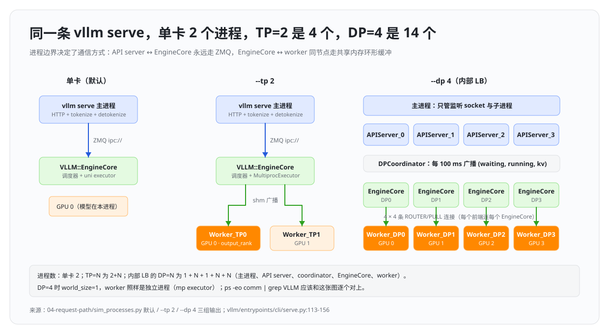
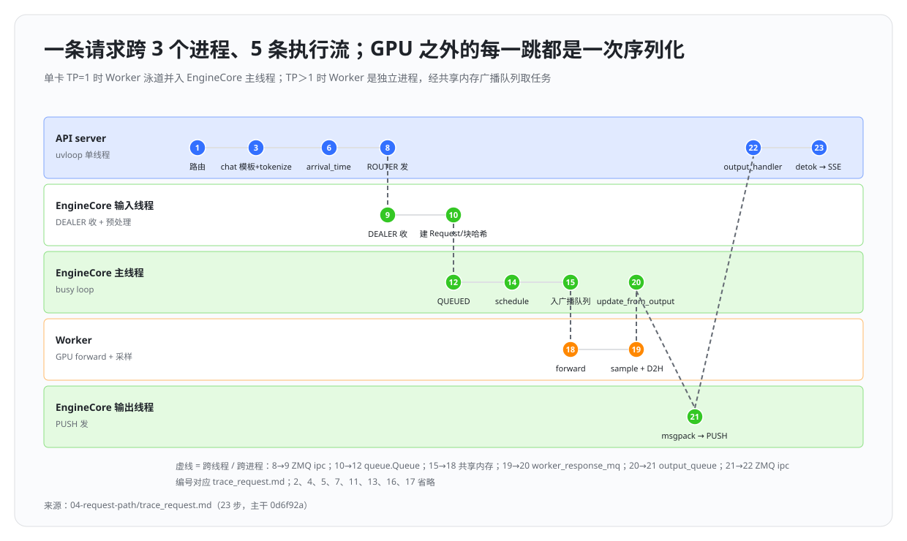
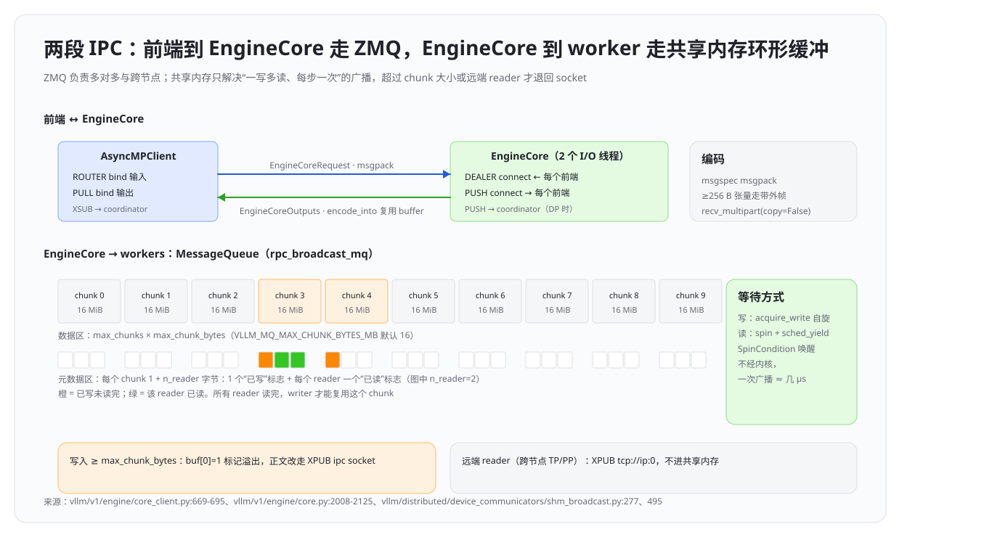
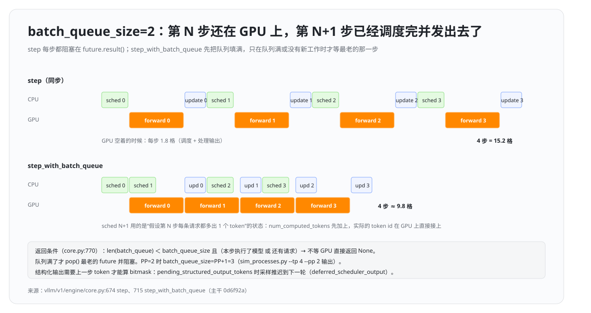
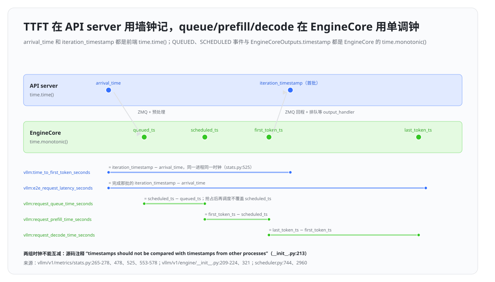
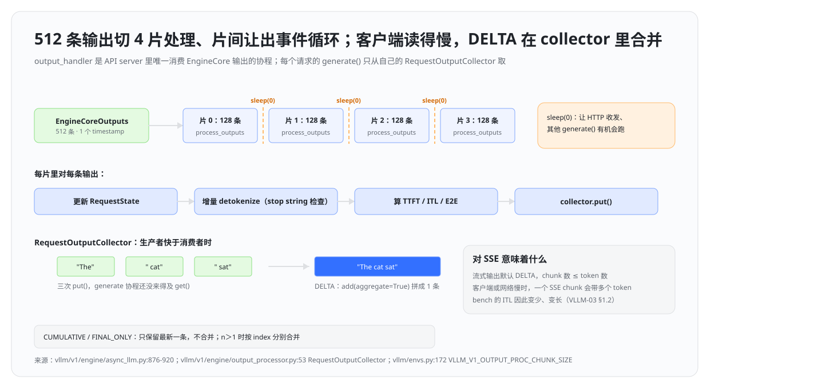
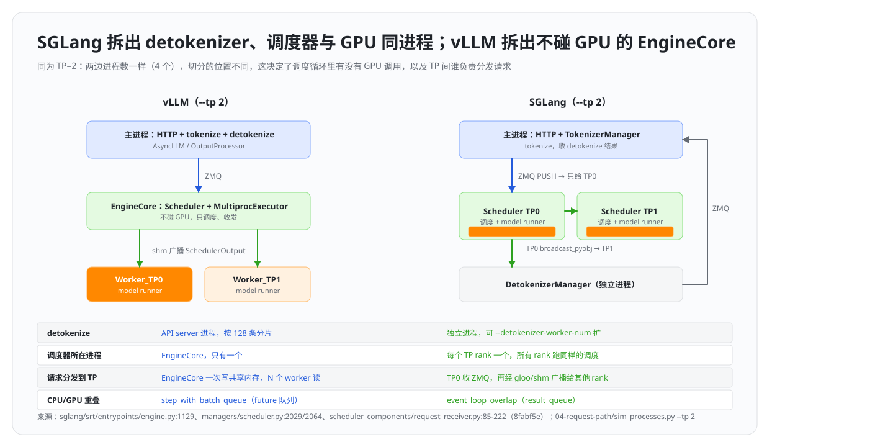
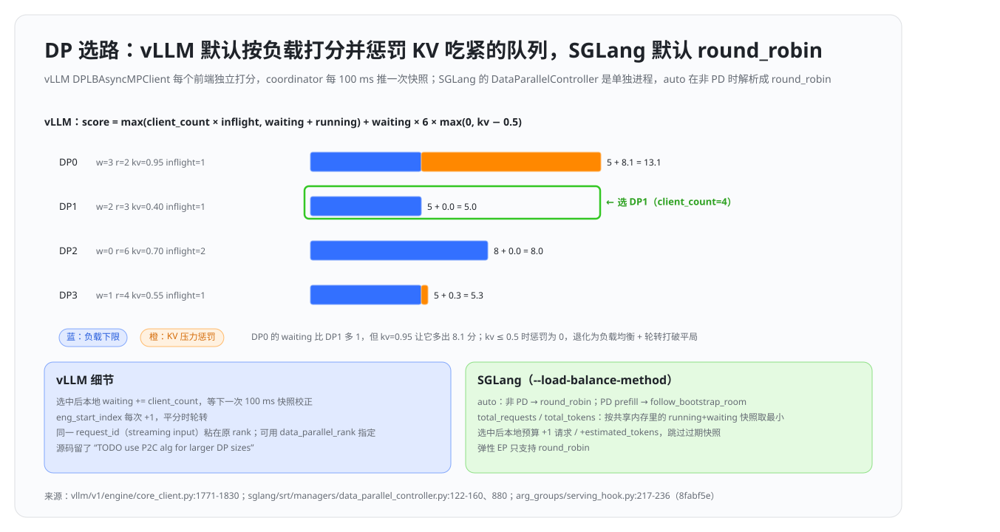
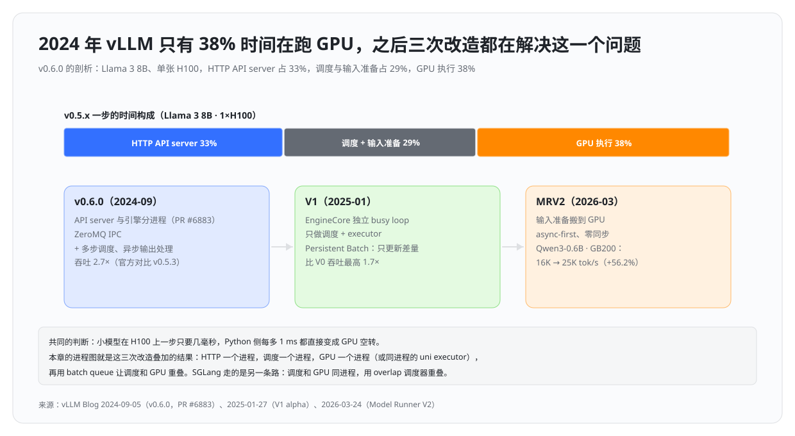

# VLLM-04｜原理｜请求旅程：API server、EngineCore 与 GPU worker

> 🎯 **这篇文档解决什么问题**：`vllm serve` 跑起来以后，`ps` 里会出现好几个叫 `VLLM::xxx` 的进程，压测时 Prometheus 的 TTFT 和客户端对不上，`py-spy` 抓出来的栈分不清是谁在等谁。这些问题的根子都在一条请求要跨几个进程、每一跳用什么通道、每个时间戳记在哪。我们跟着一条流式 chat 请求，从 FastAPI 路由走到 GPU 上的 forward，再回到 SSE chunk，一共 23 个函数，全部给到文件和行号。
>
> **使用方式**：第 1 章先数进程，给出单卡、TP、DP、跨节点四种拓扑。第 2 章走一遍 23 步。第 3 章拆两段 IPC：前端到 EngineCore 的 ZMQ，EngineCore 到 worker 的共享内存环形缓冲。第 4 章讲 EngineCore 的主循环和 batch queue。第 5 章把 VLLM-03 留下的五个时间戳对到进程和行号。第 6 章是输出侧。第 7 章对照 SGLang 的进程切法。第 8 章是 DP 选路。第 9 章回顾这套结构是怎么一步步演变来的。第 10 章动手核对。基线：vLLM 主干 0d6f92a，H100 80GB，Qwen3-8B BF16。SGLang 对照基于主干 8fabf5e。
>
> **代码**：[04-request-path](../04-request-path)。sim_processes.py 只依赖标准库，输入 TP/PP/DP/EP、LB 模式和节点数，按 serve.py 的分派逻辑打印进程树和通道；trace_request.md 是 23 步调用链和五个时间戳的速查表，可以对着 `py-spy dump` 的输出看。

# 导读 · 先给结论

## 请求进入两种混合模型

API、EngineCore、Scheduler 和 Worker 的进程链仍可共用。进入 Model Runner 后，按 layer_types 区分全注意力 KV 与 GDN 状态更新；FFN 再分稠密投影或路由专家。不要把 GDN 路径只画在 MoE 一侧。

排障时保存模型 revision 和实际 model class。MoE 另追踪 dispatch、专家计算与 combine；请求完成或取消后核对 KV 与状态是否都释放。原进程图中的历史模型名只标原例，不能据此推定新模型后端。

双模型结构以固定版本配置核对[[Qwen3.8-27B config.json]](https://huggingface.co/Qwen/Qwen3.8-27B/blob/37561816e66b5b9153b1b64c10968c18c1e6f4a0/config.json)[[Qwen3.5-35B-A3B config.json]](https://huggingface.co/Qwen/Qwen3.5-35B-A3B/blob/59d61f3ce65a6d9863b86d2e96597125219dc754/config.json)。

1. **单卡也是两个进程。**vllm serve 主进程就是 API server，负责 HTTP、tokenize 和 detokenize；调度器在另一个叫 `VLLM::EngineCore` 的进程里。TP=N 时再多出 N 个 worker；内部负载均衡的 DP=4 一共 14 个进程。`VLLM_ENABLE_V1_MULTIPROCESSING=0` 对 vllm serve 不起作用，`AsyncLLM` 总是走多进程客户端。
2. **两段 IPC 的做法不一样。**前端到 EngineCore 用 ZMQ（ROUTER/DEALER 进，PUSH/PULL 出），消息用 msgpack 编码，256 B 以上的张量走带外帧；EngineCore 到 worker 用共享内存环形缓冲广播，10 个 16 MiB 的 chunk，超过 chunk 大小的消息才退回 ZMQ。跨节点的 reader 一律走 TCP。
3. **EngineCore 不碰 GPU。**它只做调度和收发，forward 在 worker 进程里。默认开着异步调度，`batch_queue_size=2`：第 N 步还在 GPU 上跑时，第 N+1 步已经调度好、发出去了。只有 TP rank 0（PP 时是最后一个 stage 的第一个 rank）把结果送回来。
4. **Prometheus 的 TTFT 两端都在 API server 里，用的是墙钟。**`first_token_latency = iteration_timestamp − arrival_time`，所以它包含 ZMQ 回程和前端处理输出的排队时间；queue、prefill、decode 三段则全在 EngineCore 里用 `time.monotonic()` 算，两组时间戳不能互相相减。
5. **SGLang 切的位置不同。**SGLang 的调度器和 model runner 在同一个进程，每个 TP rank 各跑一份调度，请求由 TP0 收下再广播；detokenize 是独立进程。vLLM 则把调度单独拎成一个不碰 GPU 的进程，detokenize 留在前端。进程数一样，瓶颈出现的位置不一样。
6. **这套结构是被 CPU 开销逼出来的。**v0.5 时代 Llama 3 8B 在一张 H100 上只有 38% 的时间在跑 GPU，HTTP 服务占 33%，调度占 29%[[1]](https://vllm.ai/blog/2024-09-05-perf-update)。拆进程、隔离 EngineCore、把输入准备搬到 GPU 上，是三次针对同一个问题的改造。

# 第 1 章 · 先数进程

启动一个最普通的单卡服务，换个终端看进程：

```bash
$ vllm serve Qwen/Qwen3-8B --gpu-memory-utilization 0.92 &
$ ps -eo pid,ppid,comm,args | grep -E "VLLM|vllm serve" | grep -v grep
 41207  40311 vllm            /usr/bin/python3 /usr/local/bin/vllm serve Qwen/Qwen3-8B ...
 41391  41207 VLLM::EngineCor VLLM::EngineCore
```

只有一张卡，却有两个进程。父进程是 vllm serve 本身，它就是 API server：FastAPI 路由、chat template、tokenize、detokenize、拼 SSE 都在这里。子进程的名字是 `setproctitle` 改的，前缀默认 `VLLM`，可以用 `VLLM_PROCESS_NAME_PREFIX` 改；comm 字段只显示 15 个字符，所以被截成了 `VLLM::EngineCor`。调度器在这个进程里，单卡时模型也在这个进程里，executor 是 `uni`（[parallel.py](https://github.com/vllm-project/vllm/blob/0d6f92a/vllm/config/parallel.py) 里 `world_size == 1` 时默认 uni）。



## 1.1 分派：serve.py 决定起什么

起几个进程，由 [serve.py](https://github.com/vllm-project/vllm/blob/0d6f92a/vllm/entrypoints/cli/serve.py) 的 `ServeSubcommand.cmd` 决定。先算 `api_server_count` 的默认值（113–145 行）：外部 LB 或 multi-port 模式是 1，hybrid 模式是本节点的 DP rank 数，内部 LB 是 `data_parallel_size`。然后分四条路（147–156 行）：

| 条件 | 入口 | 结果 |
|-|-|-|
| multi-port LB | `run_dp_supervisor` | 每个本地 DP rank 一个 `APIServer_DP{r}` 子进程，各监听一个端口 |
| api_server_count < 1（--headless） | `run_headless`（181 行） | 只起 EngineCore，不监听 HTTP；`node_rank_within_dp > 0` 时连 EngineCore 都不起，只起 MultiprocExecutor（218 行） |
| api_server_count > 1 | `run_multi_api_server`（269 行） | 主进程只做监工，N 个 `APIServer_i` 子进程用 `SO_REUSEPORT` 共享一个监听端口（298 行 `reuse_port=num_api_servers>1`） |
| 其他（单卡、TP、PP） | `uvloop.run(run_server(args))` | 主进程自己就是 API server |

EngineCore 和 worker 是 API server 拉起来的：`AsyncLLM.__init__` 调 `EngineCoreClient.make_async_mp_client`（[async_llm.py](https://github.com/vllm-project/vllm/blob/0d6f92a/vllm/v1/engine/async_llm.py) 193 行），它再经 `launch_core_engines`（[utils.py](https://github.com/vllm-project/vllm/blob/0d6f92a/vllm/v1/engine/utils.py)）起 EngineCore 进程；EngineCore 构造 executor 时，`MultiprocExecutor` 再拉起 N 个 `WorkerProc`。所以进程树是三层：serve → EngineCore → Worker。

> 💡 **VLLM_ENABLE_V1_MULTIPROCESSING=0 管不到 vllm serve**：这个环境变量只在 `LLMEngine`（离线 `LLM()`）里起作用（[llm_engine.py](https://github.com/vllm-project/vllm/blob/0d6f92a/vllm/v1/engine/llm_engine.py) 170 行），设成 0 会退化成进程内的 `InprocClient`。`AsyncLLM` 直接调 `make_async_mp_client`，不看这个开关；`make_client` 里 asyncio 模式加非多进程的组合会直接抛 `NotImplementedError`（[core_client.py](https://github.com/vllm-project/vllm/blob/0d6f92a/vllm/v1/engine/core_client.py)）。想在单进程里调试 vllm serve 的调度逻辑，只能 attach 到 EngineCore 进程上，或者改用离线 LLM。

## 1.2 用 sim_processes.py 推进程树

sim_processes.py 把上面这些规则逐条翻成了 Python，输入并行参数，输出进程树和通道。TP=2：

```text
$ python3 sim_processes.py --tp 2
== 进程树（vLLM 0d6f92a，本节点 node_rank=0）
vllm serve 主进程            uvloop.run(run_server(args))（API server 就是 vllm serve 主进程）
│  （HTTP、tokenize、detokenize 都在这个进程里）
└─ VLLM::EngineCore           调度器 + executor；busy loop + 2 个 I/O 线程
      ├─ VLLM::Worker_TP0               GPU 0  ← output_rank，只有它回结果
      └─ VLLM::Worker_TP1               GPU 1

== 通道
前端 → EngineCore：每个前端 1 个 ROUTER（输入）+ 1 个 PULL（输出），共 1 对，地址 ipc://
EngineCore → workers：rpc_broadcast_mq = MessageQueue(n_reader=2, n_local_reader=2)
  本地 reader：共享内存环形缓冲，10 个 chunk × VLLM_MQ_MAX_CHUNK_BYTES_MB(16 MiB)
workers → EngineCore：每个 worker 一个 worker_response_mq；execute_model/sample_tokens 只等 rank 0
batch_queue_size=2 → EngineCore.step_fn = step_with_batch_queue（async scheduling + MRV2）
```

TP=2 之后 EngineCore 进程不再加载模型，executor 换成 `mp`，模型分到两个 worker 上。worker 的名字按 `_DP/_PP/_PCP/_TP/_DCP/_EP` 的顺序拼后缀，只有对应维度大于 1 才出现（[multiproc_executor.py](https://github.com/vllm-project/vllm/blob/0d6f92a/vllm/v1/executor/multiproc_executor.py) 的 `WorkerProc`）。DP=4 时情况又变了：

```text
$ python3 sim_processes.py --dp 4
vllm serve 主进程            run_multi_api_server（SO_REUSEPORT 共享监听 socket）
├─ VLLM::APIServer_0 … VLLM::APIServer_3
├─ VLLM::DPCoordinator         汇总各 rank 的 waiting/running/kv 用量，每 100 ms 推给前端
├─ VLLM::EngineCore_DP0       调度器 + executor；busy loop + 2 个 I/O 线程
│     └─ VLLM::Worker_DP0               GPU 0  ← output_rank，只有它回结果
…
前端客户端：DPLBAsyncMPClient（前端按 score 在多个 EngineCore 间选路）
```

数一下：主进程 1，API server 4，coordinator 1，EngineCore 4，worker 4，一共 14 个。DP 时每个 rank 的 world_size 只有 1，但 `world_size_across_dp > 1`，executor 默认仍是 mp，所以每个 EngineCore 底下还挂一个 worker（[parallel.py](https://github.com/vllm-project/vllm/blob/0d6f92a/vllm/config/parallel.py) 1075 行）。内部 LB 时 api_server_count 默认等于 DP 数，这是为了让 tokenize/detokenize 的 CPU 开销跟着 rank 数线性扩开，不让一个 Python 进程卡住四张卡。

| 配置 | 本节点进程数 | 前端客户端 | 要点 |
|-|-|-|-|
| 单卡 | 2 | AsyncMPClient | uni executor，模型在 EngineCore 里 |
| --tp N | 2 + N | AsyncMPClient | EngineCore 不碰 GPU；共享内存广播 |
| --dp N（内部 LB） | 1 + N + 1 + N + N | DPLBAsyncMPClient | N 个 API server 共享端口；coordinator 汇总负载 |
| --dp N --lb external | 每个 serve 3 | DPAsyncMPClient | 每个 vllm serve 只管自己的 rank；非 MoE 不起 coordinator |
| --dp N --moe（任意 LB） | +1 coordinator | 同上 | MoE 要 coordinator 发 `START_DP_WAVE`，空闲 rank 也得陪跑 dummy batch |
| --tp 4 --pp 2 --nnodes 2 | 主 6 / 从 5 | AsyncMPClient | 从节点只有 MultiprocExecutor，broadcast 走 TCP |

跨节点的 TP×PP 是最容易看错的一种。sim 给出的主节点有 4 个 worker，`MessageQueue(n_reader=8, n_local_reader=4)`，另外 4 个 reader 在从节点上，经 ZMQ TCP 订阅；output_rank 是 4，也就是最后一个 PP stage 的第一个 TP rank（`_get_output_rank = world_size − tp × pcp`），它在从节点上，结果要经 socket 回到主节点的 EngineCore。从节点的 vllm serve 进程既没有 API server 也没有 EngineCore（[serve.py](https://github.com/vllm-project/vllm/blob/0d6f92a/vllm/entrypoints/cli/serve.py) 218 行）。

# 第 2 章 · 一条请求的 23 步

下面跟着这条请求走：

```bash
curl -N localhost:8000/v1/chat/completions -H 'Content-Type: application/json' -d '{
  "model": "Qwen/Qwen3-8B", "stream": true, "max_tokens": 64,
  "messages": [{"role": "user", "content": "用一句话解释 PagedAttention"}]}'
```

它会经过 3 个进程、5 条执行流：API server 的 uvloop 事件循环，EngineCore 的输入线程、主线程、输出线程，以及 worker 的主线程（TP=1 时这一段在 EngineCore 主线程里直接调用）。下图是精简过的泳道图，完整的 23 步在下表和 trace_request.md 里。



## 2.1 API server：从 HTTP 到 msgpack 帧

| # | 位置 | 做什么 |
|-|-|-|
| 1 | [api_router.py:59](https://github.com/vllm-project/vllm/blob/0d6f92a/vllm/entrypoints/openai/chat_completion/api_router.py#L59) | `create_chat_completion`：FastAPI 路由 |
| 2 | [serving.py:287](https://github.com/vllm-project/vllm/blob/0d6f92a/vllm/entrypoints/openai/chat_completion/serving.py#L287) | 校验请求、解析 LoRA 和模型名 |
| 3 | [serving.py:302](https://github.com/vllm-project/vllm/blob/0d6f92a/vllm/entrypoints/openai/chat_completion/serving.py#L302) | `render_chat_request`：套 chat template，tokenize |
| 4 | [async_llm.py:726](https://github.com/vllm-project/vllm/blob/0d6f92a/vllm/v1/engine/async_llm.py#L726) | `AsyncLLM.generate`：建 `RequestOutputCollector` |
| 5 | [async_llm.py:325](https://github.com/vllm-project/vllm/blob/0d6f92a/vllm/v1/engine/async_llm.py#L325) | `check_admission`：超过 `--max-num-queued-reqs` / `--max-num-queued-tokens` 返回 503 |
| 6 | [input_processor.py:424](https://github.com/vllm-project/vllm/blob/0d6f92a/vllm/v1/engine/input_processor.py#L424) | `process_inputs`：`arrival_time = time.time()`，组 `EngineCoreRequest` |
| 7 | [async_llm.py:567](https://github.com/vllm-project/vllm/blob/0d6f92a/vllm/v1/engine/async_llm.py#L567) | `_add_request`：在 OutputProcessor 里登记，再 `add_request_async` |
| 8 | [core_client.py:1771](https://github.com/vllm-project/vllm/blob/0d6f92a/vllm/v1/engine/core_client.py#L1771) | DP>1 时选 rank；ROUTER 发出 msgpack 帧 |

第 3 步是 API server 里最重的 CPU 活：chat template 是 Jinja 渲染，tokenize 是 HuggingFace tokenizer。一条 4K token 的 prompt，tokenize 本身就要几毫秒，而且是在事件循环里同步执行的（多模态的预处理更重）。这就是 DP 时 api_server_count 默认跟着 rank 数走的原因。第 5 步的两个准入开关默认都是 None（[scheduler.py](https://github.com/vllm-project/vllm/blob/0d6f92a/vllm/config/scheduler.py) 92 行），不设就永远不会 503，请求只会在 EngineCore 的 waiting 队列里越排越长。`max_num_queued_tokens` 用 prompt 长度估算还在 prefill 的 token 数，不扣除前缀缓存命中，所以是偏保守的估计，宁可早拒也要保住 TTFT。

第 6 步记下的 `arrival_time` 是整条链上第一个时间戳，也是 Prometheus TTFT 的起点。注意它在 tokenize 之后才记，所以服务端 TTFT 不含 chat template 和 tokenize 的时间，这部分只能从客户端 TTFT 里看出来。

## 2.2 EngineCore：两个 I/O 线程夹着一个 busy loop

| # | 线程 | 位置 | 做什么 |
|-|-|-|-|
| 9 | 输入线程 | [core.py:1990](https://github.com/vllm-project/vllm/blob/0d6f92a/vllm/v1/engine/core.py#L1990) | `process_input_sockets`：DEALER 收帧，msgpack 解码 |
| 10 | 输入线程 | [core.py:1168](https://github.com/vllm-project/vllm/blob/0d6f92a/vllm/v1/engine/core.py#L1168) | `preprocess_add_request`：建 `Request`、算块哈希、启动 grammar 编译，放进 `input_queue` |
| 11 | 主线程 | [core.py:1669](https://github.com/vllm-project/vllm/blob/0d6f92a/vllm/v1/engine/core.py#L1669) | `run_busy_loop`：`_process_input_queue` → `_process_engine_step` |
| 12 | 主线程 | [scheduler.py:2929](https://github.com/vllm-project/vllm/blob/0d6f92a/vllm/v1/core/sched/scheduler.py#L2929) | `Scheduler.add_request`：进 waiting，记 `QUEUED` |
| 13 | 主线程 | [core.py:715](https://github.com/vllm-project/vllm/blob/0d6f92a/vllm/v1/engine/core.py#L715) | `step_with_batch_queue`：schedule → `execute_model(non_block=True)` |
| 14 | 主线程 | [scheduler.py:699](https://github.com/vllm-project/vllm/blob/0d6f92a/vllm/v1/core/sched/scheduler.py#L699) | `Scheduler.schedule`：分 token 预算，记 `SCHEDULED` |
| 15 | 主线程 | [multiproc_executor.py:406](https://github.com/vllm-project/vllm/blob/0d6f92a/vllm/v1/executor/multiproc_executor.py#L406) | `execute_model`：写入 `rpc_broadcast_mq` |

EngineCore 进程有三条执行流。主线程跑 busy loop，只和两个 `queue.Queue` 打交道；输入线程负责从 socket 读、解码，输出线程负责编码、往 socket 写。源码注释写得很直白：这两个线程的作用是让 ZMQ 收发和 GPU 计算重叠，因为 socket IO 会释放 GIL，同时把一部分序列化开销挪到和 forward 并行的地方（[core.py](https://github.com/vllm-project/vllm/blob/0d6f92a/vllm/v1/engine/core.py) 1292 行）。

第 10 步要多看一眼：块哈希是在**输入线程**里算的（`Request.from_engine_core_request(request, self.request_block_hasher)`），grammar 编译也在这里启动、异步跑。这意味着前缀缓存需要的哈希、结构化输出需要的 FSM，在请求进入调度器之前就已经在准备了，不占主线程的时间。代价是主线程和输入线程要抢 GIL，prompt 很长、并发很高时，输入线程算哈希会让 busy loop 变慢。

## 2.3 Worker：forward 和采样

| # | 位置 | 做什么 |
|-|-|-|
| 16 | [multiproc_executor.py:1154](https://github.com/vllm-project/vllm/blob/0d6f92a/vllm/v1/executor/multiproc_executor.py#L1154) | `worker_busy_loop`：从共享内存 `dequeue` 出 `(method, args, kwargs, output_rank)` |
| 17 | [gpu_worker.py:1337](https://github.com/vllm-project/vllm/blob/0d6f92a/vllm/v1/worker/gpu_worker.py#L1337) | `Worker.execute_model`：PP 时收发中间张量 |
| 18 | [model_runner.py:1794](https://github.com/vllm-project/vllm/blob/0d6f92a/vllm/v1/worker/gpu/model_runner.py#L1794) | MRV2 `execute_model`：更新请求状态 → prepare_inputs → forward |
| 19 | [model_runner.py:2181](https://github.com/vllm-project/vllm/blob/0d6f92a/vllm/v1/worker/gpu/model_runner.py#L2181) | `sample_tokens`：采样，返回 `AsyncModelRunnerOutput` |

worker 拿不到“这条请求的全部 prompt”，只拿到 `SchedulerOutput`：新请求的 token 和块表，老请求只有增量（这一步新分到的块、要算的 token 数）。worker 自己维护一份持久化的请求状态，每步只做 diff。这是 V1 的 Persistent Batch 设计，目的是让每步要广播的数据尽量小[[2]](https://vllm.ai/blog/2025-01-27-v1-alpha-release)。第 19 步在 output_rank 上由 `WorkerAsyncOutputCopy` 线程等 D2H 拷贝完成后再把结果放进 response 队列，worker 主线程不等，直接回去收下一步。

## 2.4 回程

| # | 进程 / 线程 | 位置 | 做什么 |
|-|-|-|-|
| 20 | EngineCore 主线程 | [scheduler.py:2260](https://github.com/vllm-project/vllm/blob/0d6f92a/vllm/v1/core/sched/scheduler.py#L2260) | `update_from_output`：追加 token，检查停止条件；`EngineCoreOutputs` 构造时打 timestamp |
| 21 | EngineCore 输出线程 | [core.py:2099](https://github.com/vllm-project/vllm/blob/0d6f92a/vllm/v1/engine/core.py#L2099) | `process_output_sockets`：msgpack `encode_into` 复用缓冲 → PUSH |
| 22 | API server | [async_llm.py:876](https://github.com/vllm-project/vllm/blob/0d6f92a/vllm/v1/engine/async_llm.py#L876) | `output_handler`：PULL 收到后按 128 条一片调 `process_outputs` |
| 23 | API server | [output_processor.py:728](https://github.com/vllm-project/vllm/blob/0d6f92a/vllm/v1/engine/output_processor.py#L728) | 算指标、增量 detokenize、放进 collector；[serving.py:472](https://github.com/vllm-project/vllm/blob/0d6f92a/vllm/entrypoints/openai/chat_completion/serving.py#L472) 拼 SSE chunk |

EngineCore 送回去的只有 token id。detokenize 发生在 API server 里，stop string 的匹配也在这里（第 23 步）。所以 stop string 命中之后，前端要反过来给 EngineCore 发一个 abort（`reqs_to_abort`），这中间 EngineCore 可能已经多算了一两步。stop token id 的判断则在 EngineCore 的 `update_from_output` 里，没有这个延迟。对时延敏感的场景，能用 `stop_token_ids` 就别用 `stop`。

> 💡 **每一跳都是一次序列化**：数一下这条链，HTTP JSON → Python 对象 → msgpack（前端到 EngineCore）→ pickle 进共享内存（EngineCore 到 worker）→ pickle 回来（worker 到 EngineCore）→ msgpack（EngineCore 到前端）→ JSON（SSE）。GPU 之外的每一跳都要编码一次、解码一次。V1 的很多优化（Persistent Batch 只发增量、msgpack 零拷贝、复用发送缓冲、I/O 线程）都是在减少这几跳的成本。

# 第 3 章 · 两段 IPC



## 3.1 前端 ↔ EngineCore：ZMQ 加 msgpack

前端（`AsyncMPClient`）bind 两个 socket：一个 ROUTER 用来发请求，一个 PULL 用来收输出（[core_client.py](https://github.com/vllm-project/vllm/blob/0d6f92a/vllm/v1/engine/core_client.py) 669–695 行）。EngineCore 那边由输入线程用 DEALER 去 connect 前端的 ROUTER，输出线程用 PUSH 去 connect 前端的 PULL（[core.py](https://github.com/vllm-project/vllm/blob/0d6f92a/vllm/v1/engine/core.py) 2008 行起）。输入方向为什么选 ROUTER/DEALER，没用 PUSH/PULL？因为 DP 时一个前端要连多个 EngineCore，ROUTER 能按 identity 把消息发到指定的那一个；多个 API server 时，每个 EngineCore 的输出线程会为每个前端各开一个 PUSH socket[[3]](https://zguide.zeromq.org/docs/chapter3/)。

地址默认是 `ipc://`（Unix domain socket）；只有 hybrid LB 这种前端要连别的节点上的 EngineCore 时才换成 `tcp://`（[utils.py](https://github.com/vllm-project/vllm/blob/0d6f92a/vllm/v1/engine/utils.py) 的 `get_engine_zmq_bind_addresses`）。

编码用 msgspec 的 msgpack[[4]](https://github.com/jcrist/msgspec)。[serial_utils.py](https://github.com/vllm-project/vllm/blob/0d6f92a/vllm/v1/serial_utils.py) 里的 `MsgpackEncoder` 对 tensor 和 ndarray 做了特殊处理：小于 `VLLM_MSGPACK_ZERO_COPY_THRESHOLD`（默认 256 B）的直接内联进 msgpack，大于它的作为单独的帧，用 `send_multipart(copy=False)` 零拷贝发出去，接收端 `recv_multipart(copy=False)` 拿到的是 zmq 帧的 buffer 视图。输出线程还维护了一个发送缓冲池，用 `encode_into` 往已有的 bytearray 里写，靠 zmq 的 `MessageTracker` 判断缓冲什么时候可以复用（core.py 2099 行起）。

## 3.2 EngineCore → worker：共享内存环形缓冲

TP=N 时，每一步的 `SchedulerOutput` 要同时给 N 个 worker。vLLM 没有用 N 次 ZMQ 发送，而是自己写了一个单写多读的共享内存环形缓冲：[shm_broadcast.py](https://github.com/vllm-project/vllm/blob/0d6f92a/vllm/distributed/device_communicators/shm_broadcast.py) 的 `ShmRingBuffer`（277 行）和外面包的 `MessageQueue`（495 行）。

```text
共享内存布局（ShmRingBuffer 文档字符串，301 行）
+-------------------------------+----------------------------------------+
| max_chunks x max_chunk_bytes  | max_chunks x (1 + n_reader) bytes      |
+-------------------------------+----------------------------------------+
  数据区：10 × 16 MiB              元数据：每个 chunk 1 个“已写”标志 + 每个 reader 1 个“已读”标志
```

协议很简单。写者在 `acquire_write` 里看当前 chunk 的元数据：如果“已写”为 1 且已读计数不等于 reader 数，说明还有 reader 没读完，就 `sched_yield()` 让出 CPU 再看（729 行起）；能写了就把数据写进去，置“已写”为 1、清掉所有“已读”，`current_idx` 往后挪一格。读端反过来，等“已写”为 1 且自己的“已读”为 0，读完置自己的“已读”为 1。整个过程没有锁，靠 `memory_fence()` 保证可见性。

读端怎么知道有新数据？一直自旋太费 CPU，一直等 socket 通知又太慢。`SpinCondition`（120 行）的做法是两者结合：读得频繁时一直自旋，空闲一段时间后才进入“idle 模式”，在一个 zmq socket 上等写者的通知。所以服务繁忙时 worker 进程的 CPU 占用会是 100%，这是正常的。

消息本身用 pickle 序列化，CPU tensor 通过自定义 reducer 作为 out-of-band buffer 输出，大于 1 MiB 的 buffer 不进 pickle 流（`enqueue`，912 行）。如果总大小超过一个 chunk（16 MiB），写者只在 chunk 里写一个字节 `buf[0]=1` 表示溢出，数据本身走 XPUB socket 发；读端看到溢出标志就去 socket 上收。跨节点的 reader 不读共享内存，写者每次都额外往一个 `tcp://ip:0` 的 XPUB socket 上发一份。

| 情形 | 走哪条路 | 触发场景 |
|-|-|-|
| 消息 < 16 MiB，同节点 | 共享内存 chunk | 绝大多数 decode 步 |
| 消息 ≥ 16 MiB，同节点 | chunk 里写溢出标志，数据走 XPUB ipc | 大批量多模态（pixel_values）、超长 prompt 的首步 |
| 跨节点 reader | XPUB tcp | TP/PP 跨节点 |
| 多模态大张量（可选） | `--enable-shm-tensor-arena` | 实验特性：大 CPU tensor 放进共享内存 arena，不再给每个 reader 拷一份 |

> 💡 **“No available shared memory broadcast block found in 60 seconds”**：这条日志来自 `acquire_write`，意思是写者等了 `VLLM_RINGBUFFER_WARNING_INTERVAL`（默认 60 秒）还没等到所有 reader 读完 10 个 chunk 中的下一个。最常见的原因是某个 worker 卡住了：在编译、在做 KV cache 量化、NCCL 死锁、或者直接挂了。它本身不是错误，但如果反复出现，先 `py-spy dump` 每个 worker，看谁没有回到 `worker_busy_loop`。

## 3.3 回程：只有 output_rank 说话

每个 worker 有自己的 `worker_response_mq`。`execute_model` 和 `sample_tokens` 调 `collective_rpc` 时传了 `unique_reply_rank=self.output_rank`（[multiproc_executor.py](https://github.com/vllm-project/vllm/blob/0d6f92a/vllm/v1/executor/multiproc_executor.py) 406–428 行），EngineCore 只读这一个 rank 的队列。TP 的各个 rank 采样结果本来就一样（同一个 logits、同一个随机种子），没必要都发回来。其他 rank 的 response 队列只在 `collective_rpc` 需要所有 rank 回复时才读，比如 `determine_available_memory`，这时 EngineCore 会取各 rank 的最小值。

# 第 4 章 · EngineCore 的主循环

busy loop 本身只有四行（[core.py](https://github.com/vllm-project/vllm/blob/0d6f92a/vllm/v1/engine/core.py) 1669 行）：

```python
def run_busy_loop(self):
    while self._handle_shutdown():
        self._process_input_queue()          # 没活干就阻塞在 input_queue.get() 上
        self._maybe_publish_request_counts() # DP 时把 (waiting, running, kv) 推给 coordinator
        self._process_engine_step()          # step_fn() → 结果放进 output_queue
        self._maybe_publish_request_counts()
```

`_process_input_queue` 在调度器里还有请求时不会阻塞，只是把队列里已有的消息取干净；调度器空了才阻塞等新请求。`step_fn` 在初始化时根据 `batch_queue_size` 二选一：等于 1 用 `step`，大于 1 用 `step_with_batch_queue`。

## 4.1 step：同步的一步

```python
# core.py:674（精简）
scheduler_output = self.scheduler.schedule(...)
future = self.model_executor.execute_model(scheduler_output, non_block=True)
grammar_output = self.scheduler.get_grammar_bitmask(scheduler_output)  # 和 forward 重叠
model_output = future.result()                                          # 阻塞等 GPU
if model_output is None:
    model_output = self.model_executor.sample_tokens(grammar_output)
engine_core_outputs = self.scheduler.update_from_output(scheduler_output, model_output)
```

即便是同步版本，也已经把一件事挪到了 forward 期间：grammar bitmask 的计算。execute_model 发出去以后不等结果，先算 bitmask，再等 forward 结束，然后带着 bitmask 去采样。但调度下一步、处理这一步的输出，这两件事都要等 GPU 跑完才能做，GPU 在这段时间是空的。

## 4.2 step_with_batch_queue：GPU 不等 CPU



```python
# core.py:715（精简）
if self.scheduler.has_requests():
    scheduler_output = self.scheduler.schedule(...)
    exec_future = self.model_executor.execute_model(scheduler_output, non_block=True)
    model_executed = scheduler_output.total_num_scheduled_tokens > 0
    if not scheduler_output.pending_structured_output_tokens:
        future = self.model_executor.sample_tokens(grammar_output, non_block=True)
    else:
        deferred_scheduler_output = scheduler_output   # 要等上一步的 token 才能算 bitmask
    if not deferred_scheduler_output:
        batch_queue.appendleft((future, scheduler_output, exec_future))
        if len(batch_queue) < self.batch_queue_size and (model_executed or self.scheduler.has_requests()):
            return None, model_executed                # 队列没满：不等 GPU，直接回去调度下一步
future, scheduler_output, _ = batch_queue.pop()        # 队列满了：等最老的那一步
model_output = future.result()
engine_core_outputs = self.scheduler.update_from_output(scheduler_output, model_output)
```

这里的关键是第 N+1 步在第 N 步的结果回来之前就调度了。调度器怎么知道第 N 步之后每个请求的状态？它不知道具体采样出了哪个 token，但知道每个 decode 请求一定会多出 1 个 token（不考虑投机解码），于是先把 `num_computed_tokens` 加上，下一步照常分配。token id 本身留在 GPU 上，MRV2 的输入准备直接从 GPU 上的采样结果里取，不经过 CPU[[5]](https://vllm.ai/blog/2026-03-24-mrv2)[[6]](https://docs.vllm.ai/en/latest/design/model_runner_v2/)。如果第 N 步某个请求其实已经遇到 EOS 结束了，第 N+1 步为它算的那个 token 会在 `update_from_output` 里被丢掉，浪费一个 slot，换来的是 GPU 一直有活干。

`batch_queue_size` 由 [vllm.py](https://github.com/vllm-project/vllm/blob/0d6f92a/vllm/config/vllm.py) 603 行的 `max_concurrent_batches` 决定：异步调度加 MRV2 时是 `pp_size + 1`，所以单卡是 2，PP=2 是 3。V1 model runner 不完全支持 PP 加异步调度，PP=1 时是 2，否则退回 `pp_size`。关掉异步调度时就是 `pp_size`。PP=2 时队列里同时有 3 个 batch：两个分别在两个 stage 上跑，一个已经调度好在等。

> 💡 **结构化输出会打断流水线**：bitmask 依赖 FSM 的当前状态，FSM 的状态依赖上一步采到的 token。异步调度下，调度第 N+1 步时第 N 步的 token 还没回来，所以 `pending_structured_output_tokens` 为真时，第 N+1 步的 forward 照样发出去，但采样推迟到处理完第 N 步的输出之后（`deferred_scheduler_output`）。forward 还是重叠的，采样不重叠。VLLM-16 会再回到这里。

# 第 5 章 · 五个时间戳

VLLM-03 留了一个问题：服务端记录了五个时间戳，Prometheus 的 TTFT、queue time、prefill time、decode time 都由它们算出来，可它们各自在哪个进程、用哪个时钟记录？两个进程，两种时钟。



| 字段 | 进程 | 时钟 | 写入位置 | 用在哪 |
|-|-|-|-|-|
| `arrival_time` | API server | `time.time()` | input_processor.py:424，经 output_processor.py:270 存进 `RequestStateStats` | TTFT、E2E 的起点 |
| `queued_ts` | EngineCore | `time.monotonic()` | scheduler.py:2960 记 `QUEUED` 事件；stats.py:574 取出 | queue time 的起点 |
| `scheduled_ts` | EngineCore | `time.monotonic()` | scheduler.py:744 取时间、1555 记 `SCHEDULED`；stats.py:577 只记第一次 | queue / prefill / inference |
| `first_token_ts` | EngineCore | `time.monotonic()` | `EngineCoreOutputs.timestamp`（\_\_init\_\_.py:321）；stats.py:553 | prefill time 的终点 |
| `last_token_ts` | EngineCore | `time.monotonic()` | 同上，每批更新（stats.py:558） | decode time、inference time |

后四个时间戳都是 EngineCore 进程的单调时钟，彼此可以相减（[stats.py](https://github.com/vllm-project/vllm/blob/0d6f92a/vllm/v1/metrics/stats.py) 597–609 行）：

```text
queue_time     = scheduled_ts − queued_ts
prefill_time   = first_token_ts − scheduled_ts
decode_time    = last_token_ts − first_token_ts
inference_time = last_token_ts − scheduled_ts
```

但 `arrival_time` 是另一个进程的墙钟，不能和它们相减。源码在 [\_\_init\_\_.py](https://github.com/vllm-project/vllm/blob/0d6f92a/vllm/v1/engine/__init__.py) 209–213 行特意写了注释：*timestamps should not be compared with timestamps from other processes*。那 TTFT 怎么算？源码用的是 `first_token_latency = iteration_timestamp − arrival_time`（stats.py:525），没有拿 `first_token_ts − arrival_time` 去减。`iteration_timestamp` 是 API server 的 output_handler 每收到一批输出就新建一个 `IterationStats` 时记下的 `time.time()`（stats.py:478，async_llm.py:883）。两端都在 API server，都是墙钟。

这带来三个实际后果。第一，Prometheus 的 TTFT 包含了 EngineCore 采样完到 API server 收到这一段：输出线程编码、ZMQ 传输、output_handler 前面还没处理完的批次。API server CPU 打满时，这一段可以涨到几十毫秒，而 prefill_time 看不出来。第二，`queue_time + prefill_time` 不等于 TTFT，差值是“前端 → EngineCore”和“EngineCore → 前端”两段 IPC 加前端排队，这个差值本身就是一个很好的前端健康度指标。第三，被抢占的请求重新调度时 `scheduled_ts` 不会被覆盖（stats.py:577 只记第一次），所以 prefill_time 会把抢占后重新排队的时间也算进去，queue_time 反而偏小。

> 💡 **用差值定位瓶颈**：在 Grafana 上并排画 `rate(vllm:time_to_first_token_seconds_sum)` 和 `rate(vllm:request_queue_time_seconds_sum) + rate(vllm:request_prefill_time_seconds_sum)`（都除以对应的 \_count）。前者明显高于后者时，问题在 API server 或 IPC，不在调度和 GPU；两者贴得很紧但都很高时，看 queue_time 和 prefill_time 哪个大，分别对应 KV 不够和 prefill 预算不够。QUEUED 事件只在开着 log_stats 时记录，`--disable-log-stats` 会让后四个指标全部消失[[7]](https://docs.vllm.ai/en/latest/design/metrics/)。

# 第 6 章 · 输出侧：分片、合并与背压



EngineCore 每步把所有请求的输出打成一个 `EngineCoreOutputs` 发回来。并发 512 时，一个包里就有 512 条。API server 的 output_handler 是一个常驻的 asyncio task（[async_llm.py](https://github.com/vllm-project/vllm/blob/0d6f92a/vllm/v1/engine/async_llm.py) 876–920 行），收到后按 `VLLM_V1_OUTPUT_PROC_CHUNK_SIZE`（默认 128）切片，每片调一次 `process_outputs`，片与片之间 `await asyncio.sleep(0)` 让出事件循环。不切的话，512 条增量 detokenize 一口气做完，这期间 HTTP 请求进不来、SSE 发不出去，所有客户端的 ITL 都会跳一下。

`process_outputs` 对每条输出做三件事：更新 `RequestState`，增量 detokenize 并检查 stop string，然后把 `RequestOutput` 放进这条请求的 `RequestOutputCollector`。HTTP handler 那边的 `generate()` 协程从 collector 里取。两边速度不一致时怎么办？看 [output_processor.py](https://github.com/vllm-project/vllm/blob/0d6f92a/vllm/v1/engine/output_processor.py) 53 行的 collector：

```python
class RequestOutputCollector:
    def __init__(self, output_kind, request_id):
        self.aggregate = output_kind == RequestOutputKind.DELTA
        self.output = None
        self.ready = asyncio.Event()

    def put(self, output):
        if self.output is None or isinstance(output, Exception):
            self.output = output
            self.ready.set()
        elif isinstance(self.output, RequestOutput):
            # 上一条还没被 get() 取走：DELTA 模式下合并，否则用新的覆盖
            self.output.add(output, aggregate=self.aggregate)
```

collector 只有一个槽位，没有队列。流式请求是 DELTA 模式，上一条还没被取走时，新来的增量直接拼到上一条上。结果是客户端或网络慢的时候，一个 SSE chunk 里会带多个 token，chunk 数少于 token 数。这是一种天然的背压：慢客户端不会让 API server 里堆积无限多的小对象，代价是客户端测到的 ITL 变少、变长，VLLM-03 讲过这会让 bench 的 ITL 分位失真。

同一个机制也解释了为什么 API server 的 CPU 是一个独立的瓶颈。输出处理的工作量和“并发数 × 每秒步数”成正比：Qwen3-8B 在 H100 上一步约 8 ms，并发 256 时每秒要处理 3 万条增量，每条都要 detokenize、算指标、包成 JSON。这个量级下单个 Python 事件循环会成为瓶颈，症状是 GPU 利用率掉下来、Prometheus TTFT 和 ITL 都变差，而 EngineCore 侧的 prefill_time 和 decode_time 没变。办法是加 `--api-server-count`（单卡也可以设大于 1，此时走 run_multi_api_server），或者在多卡时用 DP 让前端跟着扩。

| 开关 | 默认 | 作用 |
|-|-|-|
| `VLLM_V1_OUTPUT_PROC_CHUNK_SIZE` | 128 | 每片处理多少条；调小让事件循环更及时，调大减少切换开销 |
| `--api-server-count` | 1（内部 LB 时等于 DP） | 多个 API server 共享端口，分摊 tokenize/detokenize |
| `--max-num-queued-reqs` | None | 未完成请求数超限直接 503，交给上游 LB 重试 |
| `--max-num-queued-tokens` | None | 还在 prefill 的 prompt token 总数超限返回 503，保 TTFT |
| `--stream-interval` | 1 | 攒够 N 个 token 才推一次，减少 SSE chunk 数 |

# 第 7 章 · 对照 SGLang：切在不同的位置



SGLang 的进程结构在 [sglang engine.py](https://github.com/sgl-project/sglang/blob/8fabf5e/python/sglang/srt/entrypoints/engine.py) 的 `_launch_subprocesses`（1129 行）里，docstring 一句话说清了：TokenizerManager 在主进程，Scheduler 在子进程，DetokenizerManager 在另一个子进程[[8]](https://github.com/sgl-project/sglang/blob/8fabf5e/python/sglang/srt/entrypoints/engine.py)。TP=2 时 Scheduler 有两个，每个 TP rank 一个，所以也是 4 个进程：主进程、2 个 Scheduler、1 个 Detokenizer。数量和 vLLM 一样，切分的位置完全不同。

|  | vLLM | SGLang |
|-|-|-|
| 调度器在哪 | EngineCore，单独一个进程，不碰 GPU | 每个 TP rank 一份，和 model runner 同进程 |
| 请求怎么到 TP rank | EngineCore 写一次共享内存，N 个 worker 读 | 只有 TP0 从 ZMQ 收（NOBLOCK），再经 `broadcast_pyobj`（gloo）或共享内存 exchange 广播给其他 rank |
| 每步发给 GPU 的是什么 | `SchedulerOutput`（增量） | 不需要发：每个 rank 自己跑同样的调度，得到同样的 batch |
| detokenize | API server 进程内，按 128 条分片 | 独立进程，`--detokenizer-worker-num` 可扩 |
| CPU/GPU 重叠 | `step_with_batch_queue`，future 队列 | `event_loop_overlap`，`result_queue` 双端队列 |
| DP 默认选路 | 按 waiting/running/KV 打分 | `round_robin`（非 PD 时） |

SGLang 的请求入口在 [request_receiver.py](https://github.com/sgl-project/sglang/blob/8fabf5e/python/sglang/srt/managers/scheduler_components/request_receiver.py)：`recv_requests`（85 行）只在 TP0 上从 ZMQ 收，然后 `_broadcast_reqs_across_ranks`（168–222 行）把请求列表广播出去，默认用 tp cpu_group 上的 `broadcast_pyobj`，也可以走 `_broadcast_via_exchange`：先用共享内存 allgather 交换大小，再用 `torch.distributed.broadcast` 传数据[[9]](https://github.com/sgl-project/sglang/blob/8fabf5e/python/sglang/srt/managers/scheduler_components/request_receiver.py)。每个 rank 拿到同样的请求，跑同样的调度逻辑，得到同样的 batch，然后各自 forward。好处是每步不用广播调度结果；代价是调度在每个 rank 上都重复做一遍，而且必须保证确定性，任何一个 rank 的调度结果不一致都会导致 NCCL 挂死。

主循环对照（[scheduler.py](https://github.com/sgl-project/sglang/blob/8fabf5e/python/sglang/srt/managers/scheduler.py)）[[10]](https://github.com/sgl-project/sglang/blob/8fabf5e/python/sglang/srt/managers/scheduler.py)：

```python
# SGLang event_loop_overlap（scheduler.py:2064，精简）
while True:
    self.ingest_requests()                       # TP0 收 + 广播
    batch = self.get_next_batch_to_run(...)
    if disable_overlap_for_batch:
        pop_and_process()                        # 先处理上一批再发这一批
    if batch:
        result = self.run_batch(batch)           # 发出 forward，不等
        self.result_queue.append((batch, result))
    if self.last_batch:
        pop_and_process()                        # 处理上一批的结果，和这一批的 forward 重叠
    self.last_batch = batch
```

思路和 vLLM 的 batch queue 是一样的：第 N 批的输出处理和第 N+1 批的 forward 重叠，队列深度是 2。差别在于 SGLang 的调度和 GPU 在同一个进程里，CPU 侧的处理和 GPU 的 kernel launch 共享一个 Python 解释器、一个 GIL；vLLM 把调度放到了另一个进程，worker 进程里只有输入准备和 launch，调度器再慢也不会挡住 worker 发 kernel。反过来，vLLM 每步多了一次共享内存广播和一次结果回传，SGLang 没有这两跳。

detokenize 的位置也有取舍。SGLang 把它放进独立进程，主进程的事件循环只做 HTTP 和 tokenize，detokenize 再慢也不会挡住新请求进来；高并发时还能用 `--detokenizer-worker-num` 开多个[[11]](https://github.com/sgl-project/sglang/blob/8fabf5e/python/sglang/srt/managers/detokenizer_manager.py)。vLLM 把它留在 API server 里，少一跳 IPC，但 detokenize 和 HTTP 抢同一个事件循环，靠 128 条分片缓解，靠多 API server 扩展。两种结构在中低并发下差别不大；并发上千、输出很短的场景（比如分类、打分）里，前端 CPU 才会显出差别。

> 💡 **对比两边性能时先对齐前端**：vLLM 单卡默认 1 个 API server，SGLang 默认 1 个 tokenizer + 1 个 detokenizer。高并发压测里 vLLM 看起来“前端先饱和”，往往是因为 detokenize 和 HTTP 在一个进程里；给 vLLM 加 `--api-server-count 2` 后再比。SGLang 也有 `--tokenizer-worker-num` 多 tokenizer 模式，对比时把两边的前端进程数写进报告。

# 第 8 章 · DP 选路



内部 LB 的 DP 模式下，每个 API server 都持有一个 `DPLBAsyncMPClient`，连着所有 EngineCore，每来一条请求自己选一个 rank。选路逻辑在 [core_client.py](https://github.com/vllm-project/vllm/blob/0d6f92a/vllm/v1/engine/core_client.py) 1771–1830 行：

```python
score = max(self.client_count * inflight, waiting + running)
if waiting:
    score += waiting * 6.0 * max(0.0, kv_cache_usage - 0.5)
# 取 score 最小的 rank；选中后本地先把它的 waiting += client_count
# eng_start_index 每次 +1，打破平局时的固定偏向
```

三个输入的来源不同。`waiting`、`running`、`kv_cache_usage` 来自 DPCoordinator：每个 EngineCore 在 busy loop 里请求数变化时把 `SchedulerStats` 推给 coordinator（core.py 1682 行 `_maybe_publish_request_counts`），coordinator 汇总后每 100 ms 用 XPUB 发布给所有前端。`inflight` 是这个前端自己发出去还没结束的请求数，是精确的；乘以 `client_count`（API server 数）是为了估算所有前端加起来的量。取两者的较大值，意味着 coordinator 的快照过时了也不会低估。

KV 惩罚项是这个公式里最有意思的部分。KV 用量低于 50% 时惩罚为 0，退化成按请求数轮询；高于 50% 后，每条 waiting 请求的权重线性增加，到 100% 时额外加 3 倍。直觉是：KV 不紧张时 waiting 只是突发造成的暂时排队，很快就会被调度；KV 紧张时 waiting 意味着要等别的请求结束腾出块，排得很慢，新请求应该强烈避开。图中的例子里 DP0 和 DP1 的请求总数一样，但 DP0 的 KV 用到了 95%、还有 3 条在等，惩罚 8.1，新请求被导向 DP1。

源码里留着一句 `TODO use P2C alg for larger DP sizes`：现在是线性扫描所有 rank，DP 很大时可以换成 power-of-two-choices，随机挑两个比一比，在 O(1) 时间里得到接近最优的均衡。这个思路在 Llumnix 等调度系统里讨论过[[12]](https://arxiv.org/abs/2406.03243)。

SGLang 的 DP 由一个独立的 DataParallelController 进程分发[[13]](https://github.com/sgl-project/sglang/blob/8fabf5e/python/sglang/srt/managers/data_parallel_controller.py)。`--load-balance-method` 默认 auto，在 [serving_hook.py](https://github.com/sgl-project/sglang/blob/8fabf5e/python/sglang/srt/arg_groups/serving_hook.py) 217–236 行解析：非 PD 和 PD decode 都是 `round_robin`，PD prefill 是 `follow_bootstrap_room`[[14]](https://github.com/sgl-project/sglang/blob/8fabf5e/python/sglang/srt/arg_groups/serving_hook.py)。也可以选 `total_requests` 或 `total_tokens`，按各 rank 上报的 running+waiting 计数挑最小的，两次上报之间本地按 +1 或 +估计 token 数修正，思路和 vLLM 的“本地先加 client_count”相同。两边的差异在默认值：vLLM 默认就考虑负载和 KV 压力，SGLang 默认轮询，要负载感知得自己打开。

| 场景 | vLLM 建议 | 原因 |
|-|-|-|
| DP 在一台机器内，前面没有 LB | 默认内部 LB | 选路带 KV 惩罚，前端跟着 rank 数扩 |
| DP 跨机器，前面有 K8s Service / 网关 | `--data-parallel-external-lb`，每个 rank 一个 vllm serve | 选路交给外部 LB 或 router（VLLM-19）；非 MoE 不起 coordinator |
| MoE 宽 EP | 外部 LB 也要 coordinator | 空闲 rank 要陪跑 dummy batch 保持 all-to-all 同步（VLLM-11） |
| 多轮对话、前缀很长 | 外部用前缀感知的 router | 内部 LB 不看前缀，同一会话可能落到不同 rank，缓存命中率下降 |

# 第 9 章 · 这套结构是怎么来的



2024 年 9 月的 v0.6.0 发布博客给了一组很直接的数字：v0.5.3 上，Llama 3 8B 跑在一张 H100 上，HTTP API server 占 33% 的时间，调度和输入准备占 29%，GPU 实际在算的只有 38%[[1]](https://vllm.ai/blog/2024-09-05-perf-update)。原因是那时所有东西都在一个 Python 进程里：HTTP 请求的解析、tokenize、调度、准备输入张量、detokenize，全都和 GPU kernel 的 launch 串行。H100 太快了，一步 decode 只要几毫秒，Python 侧任何 1 ms 的开销都直接变成 GPU 空闲。

v0.6.0 做了三件事。第一件是 PR #6883，把 API server 和引擎拆成两个进程，中间用 ZeroMQ 通信[[15]](https://github.com/vllm-project/vllm/pull/6883)，HTTP 和 tokenize 不再和调度抢 GIL。第二件是 multi-step scheduling，调度一次跑多步 decode，摊薄调度开销。第三件是异步输出处理，把 detokenize 和下一步 forward 重叠。合起来是官方宣称的 2.7 倍吞吐。

2025 年 1 月的 V1 把这条路走到底[[2]](https://vllm.ai/blog/2025-01-27-v1-alpha-release)：EngineCore 成为一个独立的 busy loop 进程，只做调度和 executor 调度。请求状态在 worker 里持久化，每步只广播增量（Persistent Batch）。调度器不再区分 prefill 和 decode，统一用 `num_computed_tokens` 描述进度（VLLM-05 会展开）。官方给的数字是比 V0 最高 1.7 倍吞吐。multi-step scheduling 在 V1 里被去掉了，它带来的“一次调度跑多步”的收益，被异步调度加 batch queue 以更通用的方式取代。

2026 年 3 月的 Model Runner V2 处理的是剩下的那部分 CPU 开销：worker 里的输入准备[[5]](https://vllm.ai/blog/2026-03-24-mrv2)。V1 的 model runner 在 CPU 上用 numpy 拼 input_ids、positions、slot_mapping，再拷到 GPU；MRV2 把这些都搬到 GPU 上，用 Triton kernel 直接从持久化状态和上一步的采样结果生成，配合异步调度，CPU 不用等上一步的 token 回来。博客里 Qwen3-0.6B 在一张 GB200 上从 16K tok/s 涨到 25K tok/s（+56.2%）；模型越小、GPU 越快，这类改动的收益越大，因为 CPU 开销占比越高。

回头看这条线，每一次改造都在回答同一个问题：GPU 每步只要几毫秒，Python 侧的开销怎么藏起来。拆进程是把开销挪到别的核上，batch queue 是让开销和 GPU 并行，MRV2 是让一部分开销直接消失。SGLang 走了另一条路：它从一开始就用 overlap scheduler 让 CPU 和 GPU 重叠，把调度留在 GPU 进程里，靠零开销调度的工程细节压低 CPU 时间[[16]](https://arxiv.org/abs/2312.07104)。两条路最后收敛到了很接近的地方：深度为 2 的流水线，一个专门的进程处理文本。

# 第 10 章 · 动手核对

## 10.1 进程和线程

```bash
# 1. 进程树，和 sim_processes.py 的输出对一下
ps -eo pid,ppid,comm --forest | grep -E "VLLM|python|vllm"
python3 sim_processes.py --tp 2

# 2. EngineCore 里有几个线程（busy loop + 输入 + 输出，外加 zmq/torch 的线程）
ps -T -p $(pgrep -f "VLLM::EngineCore" | head -1) -o spid,comm

# 3. 空闲时 busy loop 停在哪：应该阻塞在 input_queue.get()
py-spy dump --pid $(pgrep -f "VLLM::EngineCore" | head -1)

# 4. 压测时再抓一次：主线程应该在 step_with_batch_queue 里，常见是 future.result() 或 schedule()
#    TP>1 时再 dump 一个 worker：应该在 worker_busy_loop 的 dequeue 或 execute_model 里
py-spy dump --pid $(pgrep -f "VLLM::Worker_TP0" | head -1)
```

py-spy 看到 EngineCore 主线程大部分时间停在 `future.result()` 上，说明 GPU 是瓶颈，这是健康的；停在 `schedule()` 或 `update_from_output()` 里，说明调度器自己成了瓶颈，通常是并发太高、请求太多。API server 主线程大部分时间在 `process_outputs` 或 detokenize 里，就该加 API server 了。

## 10.2 TTFT 的拆分

```bash
# 压测期间抓两次 /metrics，算区间平均
curl -s localhost:8000/metrics | grep -E "^vllm:(time_to_first_token|request_queue_time|request_prefill_time)_seconds_(sum|count)"
# 前端开销 ≈ mean(TTFT) − mean(queue_time) − mean(prefill_time)
```

把并发从 16 扫到 512，看这个差值怎么变。在 H100 + Qwen3-8B 上，它在低并发时应该只有一两毫秒；如果随并发明显上涨，同时 API server 进程的 CPU 接近 100%，就是前端瓶颈，加 `--api-server-count` 后再测一遍，差值应该回落。

## 10.3 读 sim_processes.py

脚本里每条规则都标了出处。建议按这个顺序改参数看输出：默认 → `--tp 2`（多出 worker 和共享内存队列）→ `--dp 4`（多出 API server 和 coordinator）→ `--dp 4 --lb external --dp-rank 0`（coordinator 消失）→ 加 `--moe`（coordinator 回来）→ `--tp 4 --pp 2 --nnodes 2` 和加 `--node-rank 1`（远端 reader，从节点只有 worker）。每一步都能在 serve.py、parallel.py、core_client.py 里找到对应的 if 分支，`--trace` 会打印 23 步调用链的 GitHub 行号链接。

> 📌 **核对清单**
> - 能说出单卡、TP=N、内部 LB DP=N 时各有几个进程，以及每个进程叫什么、干什么。
> - 知道 `VLLM_ENABLE_V1_MULTIPROCESSING=0` 只影响离线 LLM，不影响 vllm serve。
> - 能画出前端 ↔ EngineCore 的四个 socket（ROUTER/DEALER、PUSH/PULL）和 EngineCore → worker 的共享内存环形缓冲。
> - 看到 “No available shared memory broadcast block found” 时知道先去 dump 哪个进程。
> - 能解释 batch_queue_size=2 时第 N+1 步为什么可以在第 N 步结果回来之前调度，以及结构化输出为什么会打断它。
> - 知道 Prometheus TTFT 两端都在 API server、用墙钟。queue/prefill/decode 在 EngineCore、用单调钟。会用差值估算前端开销。
> - 知道 stop string 在前端匹配、stop token id 在 EngineCore 判断，前者会多算一两步。
> - 能说出 SGLang 和 vLLM 在调度器位置、TP 请求分发、detokenize 位置上的三处不同，并在对比压测时对齐前端进程数。
> - 能手算一次 DPLBAsyncMPClient 的 score，说清 KV 惩罚什么时候生效。

到这里，我们把请求在进程之间的流转走完了，但有一个地方一直当黑盒用：第 14 步的 `Scheduler.schedule`。它每步要决定哪些请求进 batch、每条请求算多少 token、KV 不够时踢掉谁。VLLM-05 打开这个黑盒，从 token 预算和 `num_computed_tokens` 讲起，一直讲到抢占。

# 参考文献

按正文首次引用顺序编号，资料截至 2026 年 10 月底。源码以 vllm-project/vllm 主干提交 0d6f92a（2026 年 10 月 29 日）和 v0.32.0 发行版为准；SGLang 对照以 sgl-project/sglang 主干 8fabf5e 为准。

[1] vLLM Team. vLLM v0.6.0: 2.7x Throughput Improvement and 5x Latency Reduction. vLLM Blog (2024-09-05) [https://vllm.ai/blog/2024-09-05-perf-update](https://vllm.ai/blog/2024-09-05-perf-update)

[2] vLLM Team. vLLM V1: A Major Upgrade to vLLM's Core Architecture. vLLM Blog (2025-01-27) [https://vllm.ai/blog/2025-01-27-v1-alpha-release](https://vllm.ai/blog/2025-01-27-v1-alpha-release)

[3] Hintjens P. ZeroMQ Guide, Chapter 3: Advanced Request-Reply Patterns. zguide.zeromq.org [https://zguide.zeromq.org/docs/chapter3/](https://zguide.zeromq.org/docs/chapter3/)

[4] Crist-Harif J. msgspec: A fast serialization and validation library. GitHub [https://github.com/jcrist/msgspec](https://github.com/jcrist/msgspec)

[5] vLLM Team. Model Runner V2: A Modular and Faster Core for vLLM. vLLM Blog (2026-03-24) [https://vllm.ai/blog/2026-03-24-mrv2](https://vllm.ai/blog/2026-03-24-mrv2)

[6] vLLM Docs. Model Runner V2 Design [https://docs.vllm.ai/en/latest/design/model_runner_v2/](https://docs.vllm.ai/en/latest/design/model_runner_v2/)

[7] vLLM Docs. Metrics (design) [https://docs.vllm.ai/en/latest/design/metrics/](https://docs.vllm.ai/en/latest/design/metrics/)

[8] sgl-project. sglang/srt/entrypoints/engine.py. GitHub (8fabf5e) [https://github.com/sgl-project/sglang/blob/8fabf5e/python/sglang/srt/entrypoints/engine.py](https://github.com/sgl-project/sglang/blob/8fabf5e/python/sglang/srt/entrypoints/engine.py)

[9] sgl-project. sglang/srt/managers/scheduler_components/request_receiver.py. GitHub (8fabf5e) [https://github.com/sgl-project/sglang/blob/8fabf5e/python/sglang/srt/managers/scheduler_components/request_receiver.py](https://github.com/sgl-project/sglang/blob/8fabf5e/python/sglang/srt/managers/scheduler_components/request_receiver.py)

[10] sgl-project. sglang/srt/managers/scheduler.py. GitHub (8fabf5e) [https://github.com/sgl-project/sglang/blob/8fabf5e/python/sglang/srt/managers/scheduler.py](https://github.com/sgl-project/sglang/blob/8fabf5e/python/sglang/srt/managers/scheduler.py)

[11] sgl-project. sglang/srt/managers/detokenizer_manager.py. GitHub (8fabf5e) [https://github.com/sgl-project/sglang/blob/8fabf5e/python/sglang/srt/managers/detokenizer_manager.py](https://github.com/sgl-project/sglang/blob/8fabf5e/python/sglang/srt/managers/detokenizer_manager.py)

[12] Sun B, et al. Llumnix: Dynamic Scheduling for Large Language Model Serving. OSDI (2024) [https://arxiv.org/abs/2406.03243](https://arxiv.org/abs/2406.03243)

[13] sgl-project. sglang/srt/managers/data_parallel_controller.py. GitHub (8fabf5e) [https://github.com/sgl-project/sglang/blob/8fabf5e/python/sglang/srt/managers/data_parallel_controller.py](https://github.com/sgl-project/sglang/blob/8fabf5e/python/sglang/srt/managers/data_parallel_controller.py)

[14] sgl-project. sglang/srt/arg_groups/serving_hook.py. GitHub (8fabf5e) [https://github.com/sgl-project/sglang/blob/8fabf5e/python/sglang/srt/arg_groups/serving_hook.py](https://github.com/sgl-project/sglang/blob/8fabf5e/python/sglang/srt/arg_groups/serving_hook.py)

[15] vllm-project. [Frontend] Multiprocessing for OpenAI Server with zeromq (PR #6883). GitHub (2024) [https://github.com/vllm-project/vllm/pull/6883](https://github.com/vllm-project/vllm/pull/6883)

[16] Zheng L, et al. SGLang: Efficient Execution of Structured Language Model Programs. NeurIPS (2024) [https://arxiv.org/abs/2312.07104](https://arxiv.org/abs/2312.07104)

---

上一章：[VLLM-03｜上手｜指标与压测：vllm bench serve、TTFT、TPOT 与 goodput](./03-bench.md) · [目录](./README.md) · 下一章：[VLLM-05｜原理｜调度器：token 预算、num_computed_tokens 与抢占](./05-scheduler.md)
