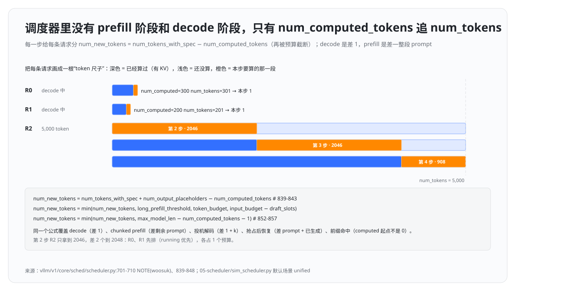
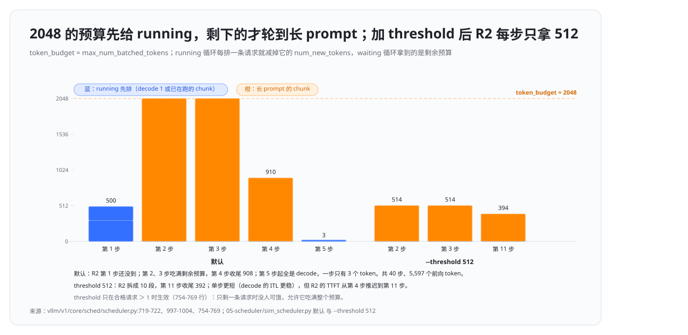
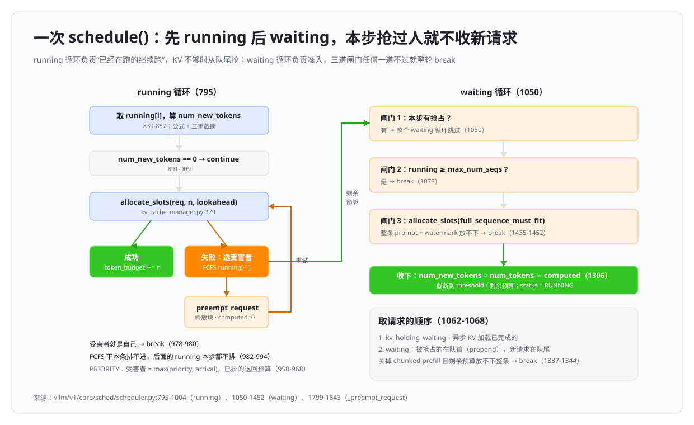
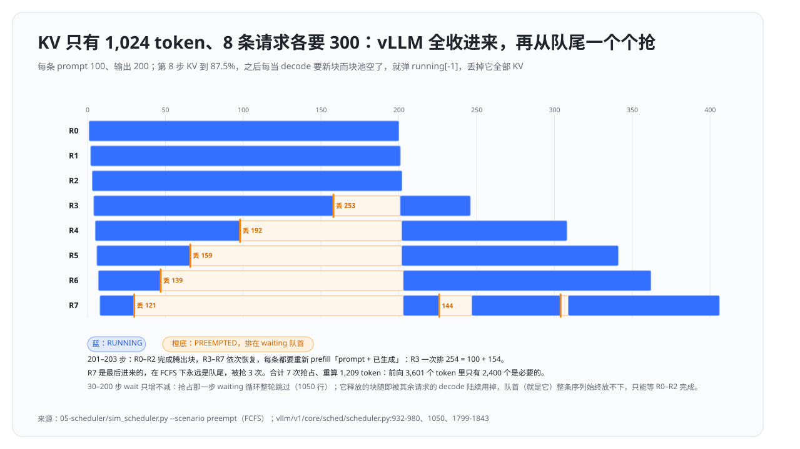
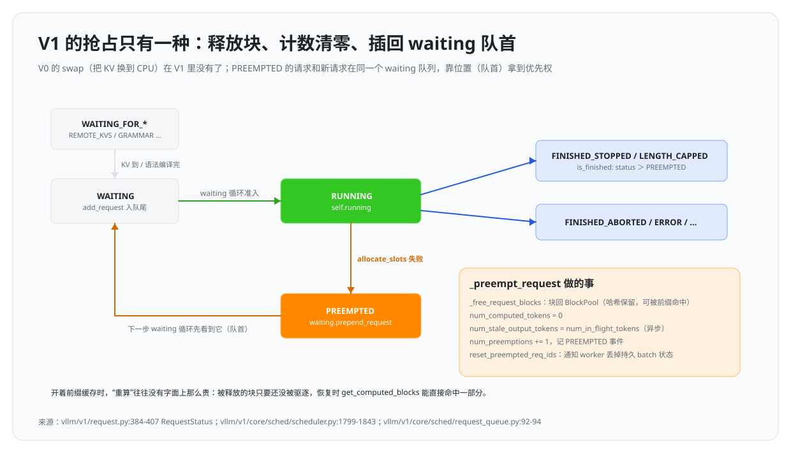
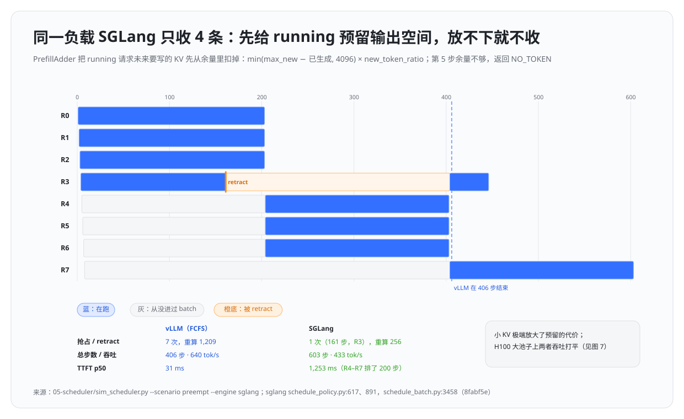
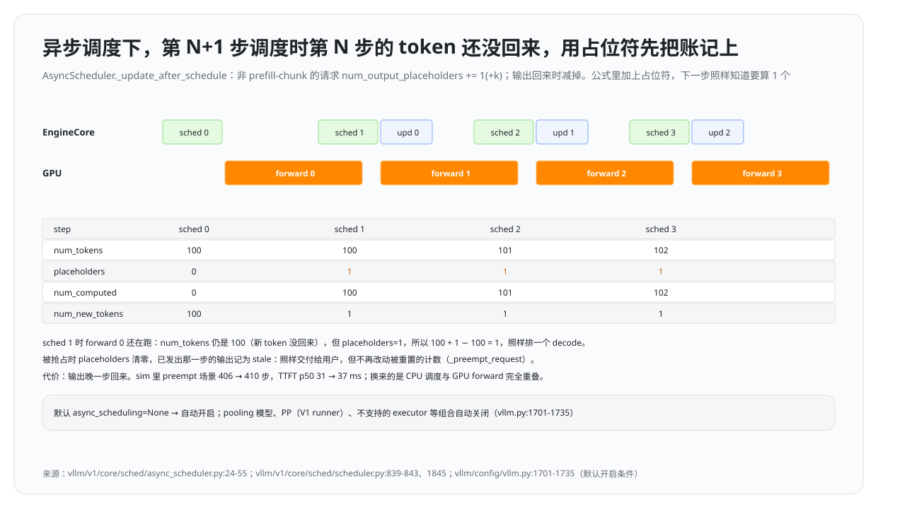
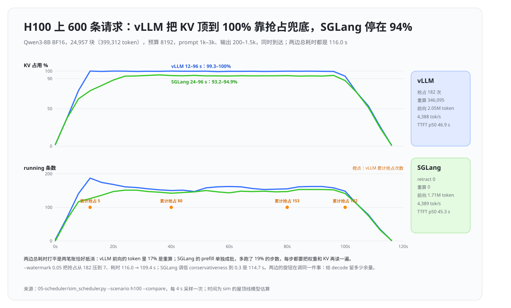
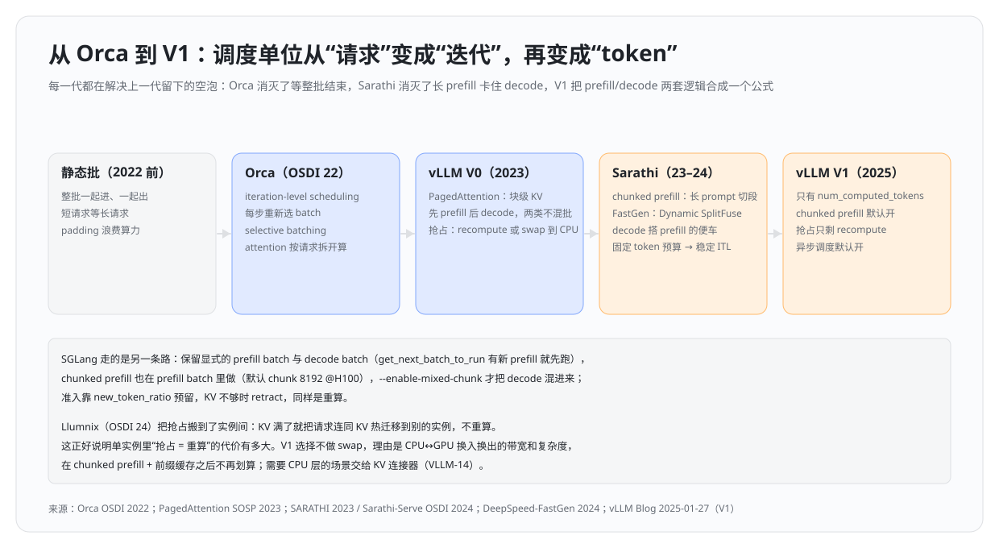

# VLLM-05｜原理｜调度器：token 预算、num_computed_tokens 与抢占

> 🎯 **这篇文档解决什么问题**：压测时日志里冒出 `Preemptions: 37`，KV 用量一直贴着 100%，TTFT 的 p99 比 p50 高出一截；把 `max_num_batched_tokens` 从 8192 改成 2048，吞吐反而涨了。要解释这些现象，就得读懂 `Scheduler.schedule()`：它每步决定谁进 batch、每条算多少 token、KV 不够时踢掉谁。我们把这个函数从 699 行读到 1452 行，再加上 1799 行的 `_preempt_request`，每个分支都给到行号，并且和 SGLang 的预留加 retract 做法放在同一个负载下比较。
>
> **使用方式**：第 1 章讲统一公式，V1 的调度器里没有 prefill 阶段。第 2 章讲 token 预算和长 prompt 阈值。第 3、4 章逐行走 running 循环和 waiting 循环。第 5 章讲抢占和请求状态机。第 6 章对照 SGLang。第 7 章讲异步调度下的占位符。第 8 章在 H100 的 KV 规模上跑 600 条请求，比较几个旋钮。第 9 章回顾调度器的演化。第 10 章动手核对。基线：vLLM 主干 0d6f92a，H100 80GB，Qwen3-8B BF16，`gpu_memory_utilization=0.92`，KV 24,957 块（399,312 token）。SGLang 对照基于主干 8fabf5e。
>
> **代码**：[05-scheduler](../05-scheduler)。sim_scheduler.py 只依赖标准库，把 vLLM 的 running/waiting 循环、抢占、异步占位符和 SGLang 的 PrefillAdder、retract_decode 按源码逻辑复刻了一遍，可以逐步打印每一步排了谁、各排多少 token；trace_schedule.md 是一次 schedule() 调用的逐行对照表。文中所有步号和计数都来自这个脚本的默认参数。

# 导读 · 先给结论

## 调度预算要覆盖 GDN 状态

双模型都要在调度前同时满足 token 预算、序列槽位和状态资源条件。KV 增长随上下文变化，GDN 常驻状态按活跃序列与副本计；仅用空闲 KV token 推并发会漏掉状态占用。

抢占恢复实验分别检查重算、状态恢复和最终输出一致性。MoE 的路由开销及专家负载会改变单步耗时，但 active parameters 不能替代驻留显存预算。原 CPU 调度器用于解释队列与预算，不代表已复刻混合状态分配。

双模型结构以固定版本配置核对[[Qwen3.8-27B config.json]](https://huggingface.co/Qwen/Qwen3.8-27B/blob/37561816e66b5b9153b1b64c10968c18c1e6f4a0/config.json)[[Qwen3.5-35B-A3B config.json]](https://huggingface.co/Qwen/Qwen3.5-35B-A3B/blob/59d61f3ce65a6d9863b86d2e96597125219dc754/config.json)。

1. **V1 调度器里没有 prefill 阶段。**每条请求只有两个数：`num_tokens`（prompt 加已生成的输出）和 `num_computed_tokens`（KV 里已经有的）。每步要算的 token 数就是两者之差，decode 时是 1，长 prompt 时是剩下没算的部分。chunked prefill、前缀缓存命中、抢占后恢复，全都由这一个差值表达。
2. **预算先给 running，剩下的才轮到 waiting。**每步有 `max_num_batched_tokens` 个 token 的预算（H100 上 API server 默认 8192）。running 循环先扣，长 prompt 会被预算截断成若干段；waiting 循环只能用剩下的。`long_prefill_token_threshold` 默认是 0，也就是不限，一条长 prompt 可以吃掉一步里除 decode 外的全部预算。
3. **准入是乐观的。**新请求只要整条 prompt 放得下就收（`scheduler_reserve_full_isl=True`），不为它以后要生成的 token 留位置，`watermark` 默认也是 0。KV 一直顶到 100%，decode 要新块而块池空了，才从 running 队尾抢一条。
4. **抢占只有重算，没有 swap。**被抢的请求释放全部块、`num_computed_tokens` 清零、插回 waiting 队首；恢复时重新 prefill「prompt + 已生成的输出」。只要这一步抢过人，waiting 循环整轮跳过，不收任何新请求。
5. **SGLang 是保守准入。**PrefillAdder 收新请求前，先从剩余 KV 里扣掉每条 running 请求未来还要写的量：`min(max_new − 已生成, 4096) × new_token_ratio`，扣完放不下就不收。代价是 KV 用不满，好处是几乎不 retract。在同一个 H100 负载上，vLLM 抢占 182 次、重算 34.6 万 token，SGLang retract 0 次，两边总耗时都是 116.0 s（模拟）。
6. **能调的就是那几个余量。**`--watermark 0.01` 把抢占从 182 压到 18，模拟耗时从 116.0 s 降到 109.1 s；`--max-num-seqs 128` 直接到 0 次。线上先看 `vllm:num_preemptions` 计数器，它持续增长，就说明这几个余量需要调。

# 第 1 章 · 一个公式：调度器里没有 prefill 阶段



打开 [scheduler.py](https://github.com/vllm-project/vllm/blob/0d6f92a/vllm/v1/core/sched/scheduler.py)，`schedule()` 在 699 行，函数体一开头是一段注释（701–710 行），原文大意是：调度器里没有“decode 阶段”或“prefill 阶段”，每条请求只有 `num_computed_tokens` 和 `num_tokens_with_spec`，每一步调度器都试着给请求分配 token，让前者追上后者；这种写法足够通用，可以覆盖 chunked prefill、前缀缓存、投机解码，以及将来的 jump decoding。

落到代码上就是 running 循环里的 839–843 行：

```python
# scheduler.py:839-848（精简）
num_new_tokens = (
    request.num_tokens_with_spec          # prompt + 已生成输出 + 本步的 draft token
    + request.num_output_placeholders     # 异步调度：已发出、还没回来的 token（第 7 章）
    - request.num_computed_tokens         # KV 里已经有的
)
if 0 < long_prefill_token_threshold < num_new_tokens:
    num_new_tokens = long_prefill_token_threshold
num_new_tokens = min(num_new_tokens, token_budget, input_budget - draft_slots)
```

一条正在 decode 的请求，`num_tokens` 比 `num_computed_tokens` 多 1（上一步采样出来的那个 token 还没算 KV），差值是 1。一条刚开始 prefill 的请求，差值是整个 prompt 长度。一条长 prompt 算了一半，差值是剩下的部分。前缀缓存命中 3,000 token 的请求，进 running 时 `num_computed_tokens` 已经是 3,000，差值只有没命中的部分。同一套代码路径处理所有情况，没有 if-else 去区分阶段。

我们用 sim_scheduler.py 的默认场景跑一遍。R0（prompt 300）和 R1（prompt 200）在第 1 步到达，R2 是一条 5,000 token 的 prompt，第 2 步到达；预算 2,048：

```text
$ python3 sim_scheduler.py
step  本步调度（请求:token 数）                             run wait   KV%  事件
   1  R0:300 R1:200                                  2    0   0.8
   2  R0:1 R1:1 R2:2046                              3    0   3.9
   3  R0:1 R1:1 R2:2046                              3    0   7.0
   4  R0:1 R1:1 R2:908                               3    0   8.4
   5  R0:1 R1:1 R2:1                                 3    0   8.4
[vLLM] 步数 40，抢占/retract 0 次（单条最多 0 次），重算 0 token，前向总 token 5,597（有效 5,600）
```

第 2 步是一个典型的混合 batch：R0、R1 各 1 个 decode token，R2 拿到剩下的 2,046 个。三条请求的 token 拼成一个 2,048 长的序列送进模型，attention 后端根据每条请求的 `query_start_loc` 和 `seq_lens` 分别处理。R2 前两段 prefill 的采样结果会被丢弃（第 4 步才算完整个 prompt），第 4 步的 908 个 token 算完后才产出第一个输出 token。2,046 + 2,046 + 908 = 5,000，正好是 R2 的 prompt 长度。

“有效 5,600、前向 5,597”差的 3 个 token 是每条请求最后一个输出 token：它被采样出来、请求就结束了，不需要再算它的 KV。后面看到前向总 token 比有效 token 多，多出来的就是重算。

这种统一写法不是 vLLM 首创。Sarathi 在 2023 年提出 chunked prefill 和“decode 搭便车”时，就是把 prefill 切成固定大小的段和 decode 混在一批里[[1]](https://arxiv.org/abs/2308.16369)；Sarathi-Serve 把它做成 stall-free 调度：每步固定 token 预算，先排 decode，再用剩余预算排 prefill 的 chunk[[2]](https://arxiv.org/abs/2403.02310)。DeepSpeed-FastGen 的 Dynamic SplitFuse 是同一个思路[[3]](https://arxiv.org/abs/2401.08671)。V1 的贡献是把它变成调度器唯一的抽象，连“这是不是 prefill”的状态都不存了[[4]](https://vllm.ai/blog/2025-01-27-v1-alpha-release)。

> 💡 **“prefill 请求”这个说法在 V1 的代码里要小心用**：调度器不区分，但别处还是会区分。比如异步调度要判断 `is_prefill_chunk`（这一段算完还不到 prompt 末尾，不产出 token），指标里 prefill 时间是从第一次被调度到产出第一个 token。读代码时，看到“prefill”先确认它指的是“这一步的差值大于 1”还是“还没产出第一个 token”。

# 第 2 章 · token 预算：一步装多少，长 prompt 怎么切



预算在 719–722 行初始化：

```python
token_budget = self.max_num_scheduled_tokens      # 默认等于 max_num_batched_tokens（139-143 行）
input_budget = self.max_num_batched_tokens        # 和 draft slot 一起算，投机解码时比 token_budget 先耗尽
```

每排一条请求，`token_budget -= num_new_tokens`（997–1004 行）。running 循环在前，waiting 循环在后，所以 decode 永远先拿到预算。图上的第 2 步：R0、R1 各扣 1，剩 2,046 全给 R2。假如有 300 条 running 请求在 decode，它们先扣掉 300，新请求只能分剩下的 7,892。

## 2.1 默认预算是按卡分档的

`max_num_batched_tokens` 和 `max_num_seqs` 没有显式设置时，由 [arg_utils.py](https://github.com/vllm-project/vllm/blob/0d6f92a/vllm/engine/arg_utils.py) 的 `get_batch_defaults`（2946 行起）按显存和卡型决定：

| 设备 | max_num_batched_tokens（LLM 类 / API server） | max_num_seqs | 备注 |
|-|-|-|-|
| 显存 ≥ 160 GiB（B200、MI300X 等） | 16384 / 16384 | 1024 |  |
| 显存 ≥ 70 GiB，且不是 A100、不是 GB10（H100、H200） | 16384 / 8192 | 1024 | vllm serve 走 API server 档，H100 是 8192 |
| 其他（A100、L40S、4090 等） | 8192 / 2048 | 256 | A100 被单独降档，依据是 PR #17885 的实测[[5]](https://github.com/vllm-project/vllm/pull/17885) |

SGLang 对应的旋钮是 `chunked_prefill_size`，在 memory_hook.py 的 `_handle_gpu_memory_settings` 里按显存分档：20 GiB 以下 2048，20–60 GiB 4096，60–160 GiB 8192[[6]](https://github.com/sgl-project/sglang/blob/8fabf5e/python/sglang/srt/arg_groups/memory_hook.py)。H100 上两边都是 8192，但含义不同：vLLM 的 8192 是一步里 decode 和 prefill 加起来的总数，SGLang 的 8192 只管 prefill batch，decode 默认单独成批（第 6 章）。

## 2.2 长 prompt 阈值

`long_prefill_token_threshold` 默认 0（[scheduler.py](https://github.com/vllm-project/vllm/blob/0d6f92a/vllm/config/scheduler.py) 79 行），也就是不限：一条 5,000 token 的 prompt 会吃掉一步里除 decode 外的全部预算。设成 512 以后，R2 每步只拿 512，分 10 步算完（第 2–10 步各 512，第 11 步 392）。注意 754–769 行的条件：只有合格请求多于 1 条时阈值才生效，只剩一条请求时没必要切，切了只会白白多跑几步。`--long-prefill-token-threshold-adaptive` 打开后，阈值的下限变成 `input_budget // n`，n 是合格请求数。

为什么要切？每一步的耗时由这一步的总 token 数决定。8,192 个 token 的一步在 H100 上要 200 多毫秒（模型算力成了瓶颈），同一步里所有 decode 请求的 ITL 都被拉长到这个数。阈值越小，decode 的 ITL 越平稳，但长 prompt 的 TTFT 越长，总步数也越多。Sarathi-Serve 的论文把这个权衡叫作 throughput-latency tradeoff，结论是在满足 TBT SLO 的前提下，取尽量大的 chunk[[2]](https://arxiv.org/abs/2403.02310)。VLLM-06 会在 H100 上实测这条曲线。

| 参数 | 默认 | 作用 | 什么时候动 |
|-|-|-|-|
| `--max-num-batched-tokens` | H100 API 8192 | 每步 token 总预算 | ITL 抖动大就调小，长 prompt 多、TTFT 要紧就调大 |
| `--long-prefill-token-threshold` | 0（不限） | 单条请求每步最多拿多少 | 长短 prompt 混合，想让多条 prefill 并行推进 |
| `--max-num-seqs` | H100 1024 | running 最多几条 | KV 小、抢占多时调小 |
| `--prefill-schedule-interval` | 1 | 每 N 步才跑一次 prefill（775–791 行 defer_prefills） | decode 要求极稳的场景，一般不动 |
| `--no-enable-chunked-prefill` | 开 | 关掉后放不下整条 prompt 就 break（1337–1344 行） | 几乎不需要；某些多模态或 pooling 模型会自动关 |

> 💡 **换卡复现时先核对日志里的预算**：同一条 `vllm serve` 命令，H100 上是 8192，A100 上是 2048，B200 上是 16384。启动日志里 `Chunked prefill is enabled with max_num_batched_tokens=...` 这一行要和压测结果一起贴出来，否则两份数据没法对比。

# 第 3 章 · running 循环：先保住已经在跑的



795 行的 `while req_index < len(self.running) and token_budget > 0` 是整个调度器的主体。按 running 队列的顺序（也就是进入 running 的先后）逐条处理：

```python
# scheduler.py:795-1004（精简，省略 encoder、spec、LoRA、structured output）
while req_index < len(self.running) and token_budget > 0:
    request = self.running[req_index]
    # 800-814：异步调度下，占位符已经顶到 max_tokens，跳过
    num_new_tokens = (request.num_tokens_with_spec
                      + request.num_output_placeholders
                      - request.num_computed_tokens)            # 839-843
    num_new_tokens = min(num_new_tokens, threshold, token_budget, ...)   # 844-848
    num_new_tokens = min(num_new_tokens,
                         max_model_len - num_computed_tokens - num_sampled_tokens_per_step)  # 852-857
    if num_new_tokens == 0:                                     # 891-909
        req_index += 1
        continue        # "we do not strictly follow the FCFS"
    while True:
        new_blocks = kv_cache_manager.allocate_slots(request, num_new_tokens, ...)  # 913-922
        if new_blocks is not None:
            break
        # 932-938：选受害者
        victim = max(self.running, key=lambda r: (r.priority, r.arrival_time)) \
                 if policy == PRIORITY else self.running[-1]
        # 950-968：PRIORITY 下受害者本步已排过，把它的预算退回来
        self.running.remove(victim)                             # FCFS 是 pop()，970
        self._preempt_request(victim, timestamp)                # 972-977
        preempted_reqs.append(victim)
        if victim == request:                                   # 978-980
            break
    if new_blocks is None:                                      # 982-994
        break           # FCFS：后面的 running 本步都不排了
    scheduled_running_reqs.append(request)
    token_budget -= num_new_tokens                              # 997-1004
    req_index += 1
```

这里有四个细节。

**差值为 0 时用的是 continue。**906 行的注释说得很直白：这里并不严格遵守 FCFS。什么时候差值会是 0？投机解码里 draft 被全部拒绝之后、请求正在等远端 KV、多模态请求的 encoder 预算用完了，等等。让这条请求跳过一步，后面的请求照样往下排，是为了不让一条卡住的请求拖住整个 batch。

**抢占是在给自己分配失败时发生的。**轮到某条 running 请求、它需要一个新块、块池里又没有了，才去抢。KV 用量超过某个阈值并不会触发踢人。FCFS 下抢的是 `running[-1]`，也就是最后进入 running 的那条。如果被抢的正好是自己（自己就是队尾），978 行 break：自己也排不了，这一步到此为止。

**FCFS 下一旦分配失败就 break。**982–994 行：`new_blocks is None` 时，FCFS 直接跳出 running 循环，后面的 running 请求本步都不排。这时候块池已经空了，后面的请求再试也只会接着触发抢占。PRIORITY 模式下如果被抢的是自己，就 continue 去看下一条，因为 PRIORITY 的受害者不一定在队尾。

**PRIORITY 模式会退还预算。**受害者是按 `(priority, arrival_time)` 取最大值选出来的，可能排在当前请求前面、本步已经分到了 token。950–968 行把它的 token 预算、已分配的块、encoder 预算都退回来，从 `scheduled_running_reqs` 里删掉。priority 数值越大越先被抢，这和 SGLang 的 `--schedule-low-priority-values-first` 一类开关的方向要对清楚。

running 循环里也没有任何“这一步最多排几条 decode”的限制，限制条数的是 waiting 循环里的 `max_num_running_reqs`：running 队列里有多少条，这一步就排多少条，只要预算和块够。300 条 decode 的步里，这 300 个 token 是 running 循环先扣掉的。

# 第 4 章 · waiting 循环：准入看的是“现在放得下”

running 循环结束后，1050 行决定要不要进 waiting 循环：

```python
# scheduler.py:1050-1073（精简）
if not preempted_reqs and not defer_prefills and ...:      # 本步抢过人，就不收新请求
    while (self.waiting or self.kv_holding_waiting) and token_budget > 0:
        # 1062-1068：先看 kv_holding_waiting（异步 KV 加载已完成的），再看 waiting
        if len(self.running) == self.max_num_running_reqs:  # 1073
            break
        request = queue.peek_request()
        ...
```

第一个条件最关键：只要 running 循环里发生过抢占，这一步不收任何新请求，也不恢复任何被抢的请求。理由很直接：刚刚因为块不够把人踢出去，马上再收一条进来，只会让下一步继续抢。

## 4.1 要算多少：按 num_tokens 算，含已生成的输出

1306 行：`num_new_tokens = request.num_tokens − num_computed_tokens`。这里用的是 `num_tokens`（prompt 加已生成的输出），没用 `num_prompt_tokens`，因为 waiting 队列里不只有新请求，还有被抢占后回来的请求，它们要重新 prefill 的是整个序列。前缀缓存命中的部分在这之前已经通过 `get_computed_blocks` 计入 `num_computed_tokens`，所以命中越多，差值越小。

之后是和 running 一样的截断：1311–1330 行在投机解码开启时给新的 decode 请求补 padding，让它凑满 1+k 个 token，保住 full CUDA graph；1332–1333 行应用长 prompt 阈值；1337–1344 行在关掉 chunked prefill 时，整条 prompt 放不下预算就 break。

## 4.2 准入条件：整条序列现在放得下

决定收不收的是 1435–1452 行的 `allocate_slots`，带了两个关键参数：

```python
new_blocks = self.kv_cache_manager.allocate_slots(
    request, num_new_tokens, ...,
    full_sequence_must_fit=self.scheduler_reserve_full_isl,   # 默认 True
    has_scheduled_reqs=bool(self.running),
)
if new_blocks is None:
    break        # 队首放不下，整个 waiting 循环停下（FCFS 不跳过队首）
```

在 [kv_cache_manager.py](https://github.com/vllm-project/vllm/blob/0d6f92a/vllm/v1/core/kv_cache_manager.py) 里：210 行 `watermark_blocks = int(watermark × num_blocks)`；517–524 行只在请求是 WAITING 或 PREEMPTED、并且已经有请求在跑时才扣水位；530–547 行在 `full_sequence_must_fit` 为真时，检查整条序列（连同本步之后还没算的部分）需要的块数加水位是否超过空闲块数，超过就返回 None。

这个“整条序列”指的是 `num_tokens`，也就是 prompt 加已生成的输出，**不包括它将来还要生成的 token**。一条 prompt 2,000、`max_tokens` 2,048 的请求，准入时只要 2,000 token 的空间。这就是“乐观准入”：调度器假设 KV 总会有请求结束腾出来，真不够了再抢占。`scheduler_reserve_full_isl` 只是防止一条长 prompt 被切成 chunk、算到一半才发现放不下（那样前面算的全白费）；它并不为输出预留空间。

| 条件 | 源码 | 放不下时 |
|-|-|-|
| running 条数达到 `max_num_seqs` | scheduler.py:1073 | break |
| 关掉 chunked prefill 且整条 prompt 超预算 | scheduler.py:1337-1344 | break |
| 整条序列 + 水位 大于 空闲块 | kv_cache_manager.py:530-547 | allocate_slots 返回 None → break |
| 本步发生过抢占 | scheduler.py:1050 | 整个 waiting 循环跳过 |

FCFS 下队首放不下就 break，后面的短请求也不会被跳过去先收。这避免了长请求饿死，代价是一条大请求能堵住队列。preempt 场景里能看得很清楚：30–200 步之间 wait 列只增不减，被抢的请求排在队首，它释放的块随即被其余请求的 decode 陆续用掉，它的整条序列始终放不下，后面的请求也跟着等，直到 R0–R2 完成。

> 💡 **水位默认是 0**：`--watermark` 默认 0.0（config/scheduler.py 196 行）。V0 时代的 BlockSpaceManager 默认留 1% 的水位，V1 把它去掉了，后来又以参数形式加回来。KV 紧张、抢占多的部署，第一个该试的就是 `--watermark 0.01` 到 `0.05`，第 8 章有模拟数据。

# 第 5 章 · 抢占：从队尾一个个踢，回来要重算



preempt 场景把 KV 压到只有 64 块（1,024 token），8 条请求各是 prompt 100、输出 200，每步到达一条：

```text
$ python3 sim_scheduler.py --scenario preempt
  30  R0:1 R1:1 R2:1 R3:1 R4:1 R5:1 R6:1             7    1  89.1  抢占 R7(丢 121 tok 的 KV)
  47  R0:1 R1:1 R2:1 R3:1 R4:1 R5:1                  6    2  87.5  抢占 R6(丢 139 tok 的 KV)
  66  R0:1 R1:1 R2:1 R3:1 R4:1                       5    3  85.9  抢占 R5(丢 159 tok 的 KV)
  98  R0:1 R1:1 R2:1 R3:1                            4    4  81.2  抢占 R4(丢 192 tok 的 KV)
 158  R0:1 R1:1 R2:1                                 3    5  76.6  抢占 R3(丢 253 tok 的 KV)
 201  R1:1 R2:1 R3:254                               2    4  54.7  恢复 R3；完成 R1
 202  R2:1 R3:1 R4:193 R5:160                        3    2  60.9  恢复 R4；恢复 R5；完成 R2
 203  R3:1 R4:1 R5:1 R6:140 R7:122                   5    0  89.1  恢复 R6；恢复 R7
 226  R3:1 R4:1 R5:1 R6:1                            4    1  85.9  抢占 R7(丢 144 tok 的 KV)
[vLLM] 步数 406，抢占/retract 7 次（单条最多 3 次），重算 1,209 token，前向总 token 3,601（有效 2,400）
         模型耗时 2.5 s，输出 640 tok/s，TTFT p50 31 ms / p99 43 ms
```

按块数算一遍就知道为什么是第 30 步。每条 prompt 100 token 占 7 块（112 token），8 条全收进来是 56 块，KV 87.5%，剩 8 块。每条请求再生成 12 个 token 就要第 8 块，8 条正好把剩下的 8 块分完；再往后要第 9 块时块池已经空了。R0 最先到，最先撞上，它从队尾抢走 R7，拿到 R7 的 8 块继续跑。之后每过一段时间，就有一条请求撞上空块池，再从队尾抢一条。

恢复的代价写在 201 步那一行：R3 一次排了 254 个 token，等于 prompt 100 加上被抢前已经生成的 154 个。这些 token 的 KV 原本在显存里，抢占时扔掉了，现在重新算一遍。整轮下来重算了 1,209 个 token，前向一共算了 3,601 个，必要的只有 2,400 个，三分之一的算力花在了重算上。

R7 被抢了 3 次，因为 FCFS 下它永远在 running 队尾。`--policy priority` 下，受害者按 `(priority, arrival_time)` 取最大值，场景里偶数号请求 priority 0、奇数号 priority 1，所以先被抢的是奇数号里最晚到的：第 30 步抢 R7，第 47 步抢 R5（不是 R6）。合计 6 次抢占、重算 1,013 token、404 步，比 FCFS 略好，单条最多被抢 2 次。

## 5.1 \_preempt_request 做了什么



1799–1843 行，按顺序：

```python
# scheduler.py:1799-1843（精简）
def _preempt_request(self, request, timestamp):
    # KV connector：通知 request_finished，让它有机会把 KV 存到别处
    self.kv_cache_manager.free(request)            # _free_request_blocks：块回 BlockPool
    self.encoder_cache_manager.free(request)
    request.status = RequestStatus.PREEMPTED
    request.num_computed_tokens = 0                # V1 只有重算
    request.spec_token_ids.clear()
    request.num_stale_output_tokens = request.num_in_flight_tokens   # 异步：已发出那一步的输出照样交付
    request.num_output_placeholders = 0
    request.num_preemptions += 1
    request.record_event(EngineCoreEventType.PREEMPTED, timestamp)
    self.waiting.prepend_request(request)          # FCFS：deque.appendleft（request_queue.py:92-94）
    self.reset_preempted_req_ids.add(request.request_id)   # 告诉 worker 丢掉这条请求的持久 batch 状态
```

状态定义在 [request.py](https://github.com/vllm-project/vllm/blob/0d6f92a/vllm/v1/request.py) 384–407 行。WAITING 之外还有三个 WAITING_FOR\_\*（等语法编译、等远端 KV、等流式输入），RUNNING，PREEMPTED，然后是六个 FINISHED\_\*。`is_finished` 的判断是 `status > PREEMPTED`，所以枚举的顺序本身就是语义。PREEMPTED 的请求和新请求在同一个 waiting 队列里，靠插在队首拿到优先权；PRIORITY 模式下 waiting 是一个堆，位置由 `(priority, arrival_time)` 决定，被抢的请求不一定排第一。

“块回 BlockPool”这一步在开着前缀缓存时有个重要的副作用：块被放回空闲队列，但它的哈希还在，只要没被别的请求驱逐，恢复时 `get_computed_blocks` 能直接命中。所以线上的“重算”往往没有 sim 里那么贵，sim 没有模拟前缀缓存，算的是上限。VLLM-08 会细讲块哈希和驱逐顺序。

## 5.2 为什么只剩重算

V0 的抢占有两种模式：RECOMPUTE 和 SWAP。SWAP 把被抢请求的 KV 拷到 CPU 内存，恢复时拷回来，PagedAttention 论文里专门讨论过两者的取舍：块小时 swap 的 PCIe 传输效率低，重算的开销则随序列变长而增加[[7]](https://arxiv.org/abs/2309.06180)。V1 去掉了 SWAP，官方调优文档的说法是 V1 架构下重算的开销更低[[8]](https://docs.vllm.ai/en/latest/configuration/optimization/)。原因有三：chunked prefill 让重算可以和 decode 混在一批里，不会单独占一步。前缀缓存让重算经常能命中一部分。swap 要在调度器里维护 CPU 块表和换入换出的时机，复杂度不小。需要 CPU 内存层的场景，交给 KV connector 和 offload（VLLM-14）。

> 💡 **线上怎么看抢占**：Prometheus 计数器 `vllm:num_preemptions`（loggers.py 739 行，导出时带 `_total` 后缀），日志里周期性的 `Preemptions: N`（311 行，只在非 0 时打印）。配合 `vllm:kv_cache_usage_perc` 和 `vllm:num_requests_waiting` 一起看：KV 贴着 100%、waiting 不为 0、抢占计数在涨，就是第 8 章那种状态。

# 第 6 章 · 对照 SGLang：先给 running 留位置，放不下就不收



同一个 preempt 负载交给 SGLang 的逻辑：

```text
$ python3 sim_scheduler.py --scenario preempt --engine sglang
   1  R0:100                                         1    0   9.8
   2  R1:100                                         2    0  19.5
   3  R2:100                                         3    0  29.3
   4  R3:100                                         4    0  39.1
   5  R0:1 R1:1 R2:1 R3:1                            4    1  39.5  NO_TOKEN（预留不够，新请求等待）
[SGLang] 步数 603，抢占/retract 1 次（单条最多 1 次），重算 256 token，前向总 token 2,648（有效 2,400）
         模型耗时 3.7 s，输出 433 tok/s，TTFT p50 1253 ms / p99 1253 ms
```

第 5 步 R4 到达时，KV 才用了 39.5%，SGLang 却不收。原因在 [schedule_policy.py](https://github.com/sgl-project/sglang/blob/8fabf5e/python/sglang/srt/managers/schedule_policy.py) 的 `PrefillAdder`（617 行）[[9]](https://github.com/sgl-project/sglang/blob/8fabf5e/python/sglang/srt/managers/schedule_policy.py)：构造时先遍历 running batch，从剩余 KV 里扣掉每条请求未来还要写的量，795–804 行：

```python
# schedule_policy.py:795-804
def _get_running_request_total_token_offset(self, req):
    ratio = 1.0 if req.sampling_params.ignore_eos else self.new_token_ratio
    return min(req.sampling_params.max_new_tokens - len(req.output_ids),
               CLIP_MAX_NEW_TOKENS) * ratio          # CLIP_MAX_NEW_TOKENS = 4096（89 行）
```

new_token_ratio 初值是 `min(0.7 × schedule_conservativeness, 1)`，conservativeness 默认 1.0，所以是 0.7[[10]](https://github.com/sgl-project/sglang/blob/8fabf5e/python/sglang/srt/managers/scheduler_components/new_token_ratio_tracker.py)[[11]](https://github.com/sgl-project/sglang/blob/8fabf5e/python/sglang/srt/environ.py)。4 条 running 请求每条还要生成大约 200 个，乘 0.7 是 140，4 条一共扣 560；再加上已经占用的 400，剩下 64。R4 要 100 个 prompt token 加 200 个输出的预留，放不下，`budget_state` 返回 `AddReqResult.NO_TOKEN`（884–903 行），这一步不再收。注意新请求自己也要预留：`_update_prefill_budget`（905 行）在收下一条请求时，同时扣掉它的 prompt 和 `min(max_new, 4096)`。

new_token_ratio 不是常数。每跑一步没有 retract 的 decode，它就衰减一点：`decay = (init − min) / 600`，下限 `min = init × 0.14`，大约 600 步后从 0.7 降到 0.098。意思是请求跑得越久越平稳，越相信它们不会写满 `max_new_tokens`，敢收的新请求越多。一旦发生 retract，ratio 被重设为 `(已生成 + 20 × n) / (Σ max_new + 1)`，基本上是“按实际生成的比例重新估计”，然后再开始衰减。

## 6.1 retract：SGLang 的抢占

预留只是估计，估低了还是会不够。SGLang 每次跑 decode 前在 `update_running_batch`（scheduler.py 4524 行）里调 `check_decode_mem`（schedule_batch.py 3439 行）检查这一步要的槽位，不够就 `retract_decode`（3458 行）[[12]](https://github.com/sgl-project/sglang/blob/8fabf5e/python/sglang/srt/managers/schedule_batch.py)[[13]](https://github.com/sgl-project/sglang/blob/8fabf5e/python/sglang/srt/managers/scheduler.py)：

|  | vLLM | SGLang |
|-|-|-|
| 什么时候踢 | running 循环里某条请求 allocate_slots 失败 | decode 前 check_decode_mem 不通过 |
| 踢谁 | FCFS：running[-1]；PRIORITY：max(priority, arrival_time) | 按 `(len(output_ids), −len(origin_input_ids))` 排序后从尾部弹：生成得最少的先踢，同样少时 prompt 最长的先踢；至少留 1 条 |
| 踢完放哪 | waiting 队首（appendleft） | waiting 队尾（`_add_request_to_queue(req, is_retracted=True)`，3540 行） |
| 之后 | 本步不收新请求 | 重设 new_token_ratio，下一轮 PrefillAdder 更保守 |
| 日志 / 指标 | `Preemptions: N`，`vllm:num_preemptions` | `KV cache pool is full. Retract requests. #retracted_reqs: …, #new_token_ratio: a -> b`（4591 行） |

放回队首还是队尾，决定了被踢的请求要等多久。sim 里 SGLang 在 161 步 retract 了 R3，它排到了 R4–R7 后面，404 步才重新开始，最后在 446 步完成；vLLM 被抢的请求都在队首，一有空间就先回来。

## 6.2 两种取舍

在这个极端的小 KV 场景里，SGLang 只 retract 了 1 次、重算 256 个 token，前向总量 2,648，比 vLLM 的 3,601 少得多；但它同一时刻只敢跑 4 条，总步数 603，比 vLLM 的 406 多一半，吞吐 433 tok/s 对 640 tok/s。R4–R7 在 waiting 里排了 200 步，TTFT p50 是 1,253 ms，vLLM 是 31 ms。

这是两种准入哲学：vLLM 假设大多数请求不会写满 `max_tokens`，先把 KV 用满，靠抢占兜底；SGLang 假设最坏情况的一部分会发生，先留余量，靠衰减慢慢放开。哪种更好取决于输出长度的分布和 `max_tokens` 设得有多宽：`max_tokens` 远大于实际输出时，SGLang 的预留会严重高估，KV 用不满；实际输出接近上限时，vLLM 会频繁抢占。第 8 章在 H100 的 KV 规模上会看到，KV 一大，两者的吞吐差距就几乎消失了。

还有一处结构差异：SGLang 的 `get_next_batch_to_run`（scheduler.py 3954 行）有新 prefill 就先跑 prefill batch（4053 行注释 “Run prefill first if possible”），没有才跑 decode；decode 请求不会搭 prefill 的车，除非打开 `--enable-mixed-chunk`（默认 False）[[14]](https://github.com/sgl-project/sglang/blob/8fabf5e/python/sglang/srt/arg_groups/fields/schedule.py)。vLLM 每一步都是混合的。所以同样的预算 8192，SGLang 的 prefill 步是纯 prefill，vLLM 的步里先扣掉了 decode。

> 💡 **SGLang 的调度策略默认也是 FCFS**：`--schedule-policy` 默认 `fcfs`，可选 lpm、dfs-weight、hrrn 等前缀感知策略；waiting 超过 128 条（`WAITING_QUEUE_PREFIX_MATCH_MAX`）时，lpm 和 hrrn 会自动退化成 FCFS，因为前缀匹配排序太贵。说“SGLang 默认按最长前缀调度”是旧资料，对比时以版本为准。

# 第 7 章 · 异步调度：输出还没回来，账先记上



VLLM-04 讲过，EngineCore 默认开着异步调度：第 N 步还在 GPU 上跑时，第 N+1 步已经调度好、发出去了。问题是第 N+1 步调度时，第 N 步采样出的 token 还没回来，`num_tokens` 还没加 1。按第 1 章的公式，一条 decode 请求的差值会是 0，它就会被 continue 跳过。

解法是 `num_output_placeholders`。[async_scheduler.py](https://github.com/vllm-project/vllm/blob/0d6f92a/vllm/v1/core/sched/async_scheduler.py) 24–55 行重写了 `_update_after_schedule`：对于不是 prefill 中间段的请求（`is_prefill_chunk` 为假），每次被调度就 `num_output_placeholders += 1 + 本步 draft 数`；第 N 步的输出回来时，`update_from_output` 把占位符减掉、把真 token 追加到 `num_tokens`。公式里加上占位符，差值就又是 1 了。图里的表格走了一遍：sched 1 时 num_tokens 还是 100，placeholders 是 1，100 + 1 − 100 = 1。

占位符带来几个边角情况，在源码里都有专门处理：

| 情况 | 处理 | 位置 |
|-|-|-|
| 占位符已经顶到 max_tokens | 跳过，不再调度（否则会多生成一个） | scheduler.py:800-814 |
| 请求在途时被抢占 | `num_stale_output_tokens = num_in_flight_tokens`：已发出那一步的输出照样交付给用户，只是不再动计数 | scheduler.py:1799-1843 |
| 结构化输出 | 语法状态要等真 token 回来才能推进，用 `pending_structured_output_tokens` 标记 | async_scheduler.py |
| 请求在 stop 条件上结束 | 多发出去的那一步结果被丢弃，代价是一步的算力 | update_from_output |

默认值在 [vllm.py](https://github.com/vllm-project/vllm/blob/0d6f92a/vllm/config/vllm.py) 1701–1735 行：`async_scheduling` 为 None 时自动开启，碰到 pooling 模型、不支持的 executor、和 V1 model runner 不兼容的组合（如 PP、`disable_padded_drafter_batch`）等情况自动关闭；如果显式设成 True 而组合不支持，直接报错。

sim 里打开 `--async`，preempt 场景从 406 步变成 410 步，抢占次数不变，重算从 1,209 变成 1,208，TTFT p50 从 31 ms 变成 37 ms。多出的几步来自请求结束时多发的那一步，以及抢占时在途的那一步。sim 里没有 CPU 开销，看不到异步调度的收益；真实系统里它把调度、输入准备的 CPU 时间藏在 GPU forward 后面，模型越小、GPU 越快，收益越大。Model Runner V2 更进一步，在 PP 下用 `next_decode_eligible_step = current_step + pp_size` 让 decode 交错进入各个 stage[[15]](https://vllm.ai/blog/2026-03-24-mrv2)。

SGLang 的对应物是 overlap scheduler：`event_loop_overlap` 把第 N 批的结果处理和第 N+1 批的 forward 重叠[[16]](https://arxiv.org/abs/2312.07104)。它不需要占位符，是因为 SGLang 在准备第 N+1 批时用的是 GPU 上的 future token id：下一批的 input_ids 直接引用上一批还没写出来的采样结果，CPU 不用知道具体值。两边解决的是同一个问题，vLLM 在调度器的账本里记，SGLang 在张量层面引用。

# 第 8 章 · 放到 H100 上：600 条请求，几个旋钮



小 KV 的例子把差异放大了。换成真实规模：H100 + Qwen3-8B BF16，24,957 块（399,312 token），预算 8192，`max_num_seqs` 1024；600 条请求同时到达，prompt 在 1,000–3,000 之间均匀分布，实际输出 200–1,500，`max_tokens` 统一是 2,048：

```text
$ python3 sim_scheduler.py --scenario h100 --compare
[vLLM ] 步数 3982，抢占/retract 182 次（单条最多 4 次），重算 346,095 token，前向总 token 2,053,448（有效 1,707,953）
         模型耗时 116.0 s，输出 4,388 tok/s，TTFT p50 46.9 s / p99 97.2 s
[SGLang] 步数 4744，抢占/retract 0 次（单条最多 0 次），重算 0 token，前向总 token 1,707,353（有效 1,707,953）
         模型耗时 116.0 s，输出 4,389 tok/s，TTFT p50 45.3 s / p99 97.6 s
```

时间模型很粗：每步耗时取“读权重 16.4 GB 加读 KV（144 KiB/token）按 3.35 TB/s”和“算力按 989 TFLOPS 的 60%”两者的较大值，再加 1.2 ms 固定开销。它只能用来比较相对快慢，绝对值不要拿去报数。

两条 KV 曲线的形状就是两种准入哲学的样子。vLLM 在 12 s 就把 KV 顶到 100%，此后 12–96 s 一直在 99.3%–100% 之间，靠抢占维持；running 条数在 12 s 冲到 187，之后被抢占压回 150–160。SGLang 的 KV 爬得慢，24 s 才到 93%，然后稳定在 93.2%–94.9%，一次 retract 都没有。

最后总耗时打平，是两笔账恰好抵消：vLLM 前向的 205 万 token 里有 17% 是重算，34.6 万个 token 白算了；SGLang 不重算，但它的 prefill 单独成批，总步数多了 19%（4,744 对 3,982），每多一步就要把 16 GB 权重和全部 KV 再读一遍。真实系统里这个平衡点会随模型大小、输出分布、`max_tokens` 的宽松程度移动，结论不能直接搬，但“vLLM 抢占换 KV 利用率、SGLang 预留换稳定”这个结构是普适的。

## 8.1 旋钮

同一负载，逐个改参数：

| 配置 | 抢占 / retract | 重算 token | 模型耗时 | 输出 tok/s | TTFT p50 |
|-|-|-|-|-|-|
| vLLM 默认 | 182 | 346,095 | 116.0 s | 4,388 | 46.9 s |
| vLLM `--watermark 0.01` | 18 | 39,164 | 109.1 s | 4,669 | 43.8 s |
| vLLM `--watermark 0.05` | 7 | 15,237 | 109.4 s | 4,654 | 43.4 s |
| vLLM `--max-num-batched-tokens 2048` | 152 | 282,968 | 107.7 s | 4,726 | 42.7 s |
| vLLM `--max-num-seqs 128` | 0 | 0 | 111.3 s | 4,573 | 43.6 s |
| vLLM `--max-num-seqs 256` | 182 | 346,095 | 116.0 s | 4,388 | 46.9 s |
| SGLang 默认 | 0 | 0 | 116.0 s | 4,389 | 45.3 s |
| SGLang `--schedule-conservativeness 0.3` | 0 | 0 | 114.7 s | 4,440 | 45.2 s |
| SGLang `--chunked-prefill-size 2048` | 0 | 0 | 117.5 s | 4,332 | 46.0 s |

几个读法。

**1% 的水位就够了。**24,957 块的 1% 是 249 块，约 4,000 token，相当于给 running 请求留出几十步的 decode 增长空间。抢占从 182 次降到 18 次，重算降了九成，模拟耗时降 6%。再加到 5%，抢占只再少 11 次，KV 利用率的损失开始抵消收益。这就是 vLLM 版的“预留”，只不过是按总量留，SGLang 那边按每条请求的 `max_new_tokens` 估。

**`max_num_seqs` 是硬上限。**128 条时 KV 永远用不满，所以 0 次抢占；但 256 条时和默认完全一样，因为 KV 在大约 150–190 条时就满了，256 这个上限根本碰不到。调这个参数之前，先用 KV 总量除以平均序列长度，算一下 KV 能撑多少条。

**小预算在这个负载上更快。**2048 的预算让每条 prompt 分几步进来，准入节奏变慢，KV 冲顶前有更多请求结束腾出空间，抢占少了 30 次；同时 decode 为主的步不会被 8,192 token 的大 prefill 拖慢。这和 PR #17885 在 A100 上观察到的方向一致[[5]](https://github.com/vllm-project/vllm/pull/17885)，但 sim 的时间模型不考虑小 batch 下 GEMM 效率下降，真实 H100 上要用 `vllm bench serve` 实测，VLLM-06 和 VLLM-17 会给出实测曲线。

**SGLang 这边旋钮的作用小。**KV 足够大时 PrefillAdder 很少卡住，new_token_ratio 衰减到下限后预留已经很小。conservativeness 调到 0.3（初值 0.21）快了 1%；它的作用主要在 retract 频繁的时候，SGLang 的参数说明原话是“如果经常看到请求被 retract，就调大”[[17]](https://docs.sglang.io/docs/advanced_features/server_arguments)。

> 💡 **TTFT 在这个场景里没有参考意义**：600 条同时到达，KV 只够 150 多条并发，TTFT p50 四五十秒全是排队。真实压测要用 `--request-rate` 控制到达速率（VLLM-03），在 KV 能承受的负载下比较抢占对 TTFT 和 ITL 尾部的影响。抢占对用户的伤害主要体现在被抢那条请求的 ITL 上：它在 waiting 里等的时间，全部计入它下一个 token 的间隔。

# 第 9 章 · 调度器是怎么一步步变成这样的



2022 年以前，Transformer 推理服务大多用静态批：一批请求一起进、一起出，短请求要等长请求生成完，batch 里先结束的位置只能空转。Orca（OSDI 2022）提出 iteration-level scheduling：调度粒度从“一批请求”降到“一次迭代”，每生成一个 token 就重新决定 batch 的组成，结束的请求立刻离开，新请求立刻加入[[18]](https://www.usenix.org/conference/osdi22/presentation/yu)。为了让不同长度的请求能放进一个 batch，Orca 还提出 selective batching：线性层把所有 token 拼在一起算，attention 按请求拆开算。今天所有推理引擎的 continuous batching 都是这个思路。

vLLM 的第一版（2023）在 Orca 的基础上加了 PagedAttention：KV 按块分配，不再为每条请求预留 `max_tokens` 长的连续空间，显存浪费从 60%–80% 降到 4% 以下[[7]](https://arxiv.org/abs/2309.06180)。但它的调度器还是分阶段的：有 waiting 请求时先跑一个纯 prefill 的 batch，没有时才跑 decode。KV 不够时可以 RECOMPUTE，也可以 SWAP 到 CPU。分阶段的问题是长 prompt 会让所有 decode 请求停下来等，ITL 出现尖刺。

Sarathi（2023）和 Sarathi-Serve（OSDI 2024）解决的就是这个尖刺：把 prefill 切成固定大小的 chunk，和 decode 混在一个 batch 里，每步的 token 数大致恒定，ITL 也就平稳了[[1]](https://arxiv.org/abs/2308.16369)[[2]](https://arxiv.org/abs/2403.02310)。DeepSpeed-FastGen 的 Dynamic SplitFuse 在同一时期做了同样的事[[3]](https://arxiv.org/abs/2401.08671)。vLLM 在 V0 后期以 `--enable-chunked-prefill` 的形式引入，但它和 prefix caching、spec decode 的组合有大量特殊情况。

V1（2025 年 1 月）把这些统一掉了：调度器只认 `num_computed_tokens`，chunked prefill 默认开启，抢占只剩重算[[4]](https://vllm.ai/blog/2025-01-27-v1-alpha-release)。官方的 Anatomy 博客用一个例子把这套逻辑讲得很清楚：调度器每步构造一个 `SchedulerOutput`，里面只有“每条请求这一步算多少 token”，其余全部交给 model runner[[19]](https://vllm.ai/blog/2025-09-05-anatomy-of-vllm)。异步调度是后来加上并在 2025 年下半年默认开启的。

同一时期，研究界在单实例调度之外又走出了两条路。一条是把抢占搬到实例之间：Llumnix（OSDI 2024）在 KV 满了的时候不重算，而是把请求连同 KV 热迁移到别的实例[[20]](https://arxiv.org/abs/2406.03243)，这恰好说明单实例里“抢占 = 重算”的代价有多大。另一条是把 prefill 和 decode 拆到不同的 GPU 上：DistServe 等工作证明，两个阶段的资源需求差别太大，混在一起调度永远有一方吃亏[[21]](https://arxiv.org/abs/2401.09670)。前者对应 VLLM-14 的 KV 连接器，后者对应 VLLM-15 的 PD 分离。

SGLang 选择保留显式的 prefill batch 和 decode batch，靠 overlap scheduler 隐藏 CPU 开销，靠 new_token_ratio 预留减少 retract[[16]](https://arxiv.org/abs/2312.07104)。两条路最后在吞吐上收敛到很接近的地方，差异主要体现在尾延迟的形状和调参的手感上。

# 第 10 章 · 动手核对

## 10.1 先在 sim 里把每个分支走一遍

```bash
cd zero-to-vllm/05-scheduler
python3 sim_scheduler.py                                       # 统一公式：R2 被切成 2046 + 2046 + 908
python3 sim_scheduler.py --threshold 512                       # 阈值：R2 每步 512，第 11 步收尾
python3 sim_scheduler.py --scenario preempt                    # FCFS 抢占：第 30 步抢 R7
python3 sim_scheduler.py --scenario preempt --policy priority  # PRIORITY：第 47 步抢的是 R5
python3 sim_scheduler.py --scenario preempt --async            # 异步：多出 4 步
python3 sim_scheduler.py --scenario preempt --engine sglang    # 预留：第 5 步 NO_TOKEN
python3 sim_scheduler.py --scenario h100 --compare             # 600 条：182 次抢占 vs 0 次 retract
python3 sim_scheduler.py --scenario h100 --watermark 0.01      # 18 次
```

每改一个参数，先猜输出再运行。猜错的地方，回到 trace_schedule.md 找对应行号，读源码。

## 10.2 在真实服务上制造抢占

```bash
# 在 05-scheduler 目录执行。终端 1：先建立正常容量基线
MODEL_PROFILE=dense TP=2 bash ../01-first-server/serve.sh --max-num-seqs 64
# 终端 2：profile 与服务端一致
MODEL_PROFILE=dense
source ../common/model_profile.sh
vllm bench serve --model "$MODEL" --dataset-name random \
  --random-input-len 512 --random-output-len 1024 --num-prompts 200 --max-concurrency 64
curl -fsS http://127.0.0.1:8000/metrics
# 逐次调小缓存预算并观察抢占；每次停掉旧服务后再启动。
# 不把 512 块直接解释成混合模型的 8192-token 总容量。
# moe 使用同样步骤，另存状态恢复、输出一致性和失败记录。
```

对照组用 SGLang：`python -m sglang.launch_server --model-path Qwen/Qwen3-8B --max-total-tokens 8192`，同样的压测命令，日志里搜 `KV cache pool is full. Retract requests.`，记下 `#new_token_ratio` 的变化。两边都记 TPOT 的 p50 和 p99：抢占对 p50 影响不大，主要拉高 p99。

## 10.3 读源码的顺序

建议按这个顺序读：scheduler.py 699–722（入口和预算）→ 795–1004（running 循环）→ 1050–1452（waiting 循环）→ 1799–1843（抢占）→ 1845 起的 `_update_after_schedule` → 2260 起的 `update_from_output`。然后 kv_cache_manager.py 379 起的 `allocate_slots`。最后 async_scheduler.py。SGLang 那边读 schedule_policy.py 的 `PrefillAdder` 和 schedule_batch.py 的 `retract_decode`，两个函数加起来不到 400 行。

> 📌 **核对清单**
> - 能写出 `num_new_tokens` 的公式，说清 decode、chunked prefill、前缀命中、抢占恢复时它分别等于多少。
> - 知道 H100 上 vllm serve 的默认预算是 8192、A100 是 2048，以及 `long_prefill_token_threshold` 默认不限、只在多于 1 条合格请求时生效。
> - 能说出 running 循环里 continue 和 break 各在什么时候发生，FCFS 和 PRIORITY 选受害者的规则。
> - 知道 `full_sequence_must_fit` 检查的是 prompt 加已生成输出，不为未来输出留空间；水位默认 0。
> - 知道本步发生过抢占就不收新请求，被抢的请求插回 waiting 队首，恢复时重算整个序列。
> - 能手算 SGLang PrefillAdder 的预留，说清 new_token_ratio 的初值、衰减和 retract 后的重设。
> - 能解释异步调度下 `num_output_placeholders` 的作用，以及在途时被抢占的输出怎么处理。
> - 线上看到 `vllm:num_preemptions` 持续增长时，知道先试 `--watermark 0.01`，再按 KV 容量核对 `max_num_seqs`。

这一篇我们一直把 token 预算当作给定的数。但 8192 是怎么来的、为什么 2048 在有些负载上反而更快、TTFT 和 ITL 之间的取舍到底是一条什么样的曲线，还没有回答。VLLM-06 专门讲 chunked prefill：预算怎么选，长短 prompt 混合时怎么切，异步调度和 decode 交错在 H100 上实测能省多少。

# 参考文献

按正文首次引用顺序编号，资料截至 2026 年 10 月底。源码以 vllm-project/vllm 主干提交 0d6f92a（2026 年 10 月 29 日）和 v0.32.0 发行版为准；SGLang 对照以 sgl-project/sglang 主干 8fabf5e 为准。

[1] Agrawal A, et al. SARATHI: Efficient LLM Inference by Piggybacking Decodes with Chunked Prefills. arXiv (2023) [https://arxiv.org/abs/2308.16369](https://arxiv.org/abs/2308.16369)

[2] Agrawal A, et al. Taming Throughput-Latency Tradeoff in LLM Inference with Sarathi-Serve. OSDI (2024) [https://arxiv.org/abs/2403.02310](https://arxiv.org/abs/2403.02310)

[3] Holmes C, et al. DeepSpeed-FastGen: High-throughput Text Generation for LLMs via MII and DeepSpeed-Inference. arXiv (2024) [https://arxiv.org/abs/2401.08671](https://arxiv.org/abs/2401.08671)

[4] vLLM Team. vLLM V1: A Major Upgrade to vLLM's Core Architecture. vLLM Blog (2025-01-27) [https://vllm.ai/blog/2025-01-27-v1-alpha-release](https://vllm.ai/blog/2025-01-27-v1-alpha-release)

[5] KuntaiDu. [Perf] Use small max_num_batched_tokens for A100. vLLM PR #17885 [https://github.com/vllm-project/vllm/pull/17885](https://github.com/vllm-project/vllm/pull/17885)

[6] sgl-project. sglang/srt/arg_groups/memory_hook.py \_handle_gpu_memory_settings. GitHub (8fabf5e) [https://github.com/sgl-project/sglang/blob/8fabf5e/python/sglang/srt/arg_groups/memory_hook.py](https://github.com/sgl-project/sglang/blob/8fabf5e/python/sglang/srt/arg_groups/memory_hook.py)

[7] Kwon W, et al. Efficient Memory Management for Large Language Model Serving with PagedAttention. SOSP (2023) [https://arxiv.org/abs/2309.06180](https://arxiv.org/abs/2309.06180)

[8] vLLM Docs. Optimization and Tuning [https://docs.vllm.ai/en/latest/configuration/optimization/](https://docs.vllm.ai/en/latest/configuration/optimization/)

[9] sgl-project. sglang/srt/managers/schedule_policy.py（PrefillAdder、SchedulePolicy）. GitHub (8fabf5e) [https://github.com/sgl-project/sglang/blob/8fabf5e/python/sglang/srt/managers/schedule_policy.py](https://github.com/sgl-project/sglang/blob/8fabf5e/python/sglang/srt/managers/schedule_policy.py)

[10] sgl-project. sglang/srt/managers/scheduler_components/new_token_ratio_tracker.py. GitHub (8fabf5e) [https://github.com/sgl-project/sglang/blob/8fabf5e/python/sglang/srt/managers/scheduler_components/new_token_ratio_tracker.py](https://github.com/sgl-project/sglang/blob/8fabf5e/python/sglang/srt/managers/scheduler_components/new_token_ratio_tracker.py)

[11] sgl-project. sglang/srt/environ.py（SGLANG_INIT_NEW_TOKEN_RATIO 等）. GitHub (8fabf5e) [https://github.com/sgl-project/sglang/blob/8fabf5e/python/sglang/srt/environ.py](https://github.com/sgl-project/sglang/blob/8fabf5e/python/sglang/srt/environ.py)

[12] sgl-project. sglang/srt/managers/schedule_batch.py（check_decode_mem、retract_decode）. GitHub (8fabf5e) [https://github.com/sgl-project/sglang/blob/8fabf5e/python/sglang/srt/managers/schedule_batch.py](https://github.com/sgl-project/sglang/blob/8fabf5e/python/sglang/srt/managers/schedule_batch.py)

[13] sgl-project. sglang/srt/managers/scheduler.py. GitHub (8fabf5e) [https://github.com/sgl-project/sglang/blob/8fabf5e/python/sglang/srt/managers/scheduler.py](https://github.com/sgl-project/sglang/blob/8fabf5e/python/sglang/srt/managers/scheduler.py)

[14] sgl-project. sglang/srt/arg_groups/fields/schedule.py. GitHub (8fabf5e) [https://github.com/sgl-project/sglang/blob/8fabf5e/python/sglang/srt/arg_groups/fields/schedule.py](https://github.com/sgl-project/sglang/blob/8fabf5e/python/sglang/srt/arg_groups/fields/schedule.py)

[15] vLLM Team. Model Runner V2: A Modular and Faster Core for vLLM. vLLM Blog (2026-03-24) [https://vllm.ai/blog/2026-03-24-mrv2](https://vllm.ai/blog/2026-03-24-mrv2)

[16] Zheng L, et al. SGLang: Efficient Execution of Structured Language Model Programs. NeurIPS (2024) [https://arxiv.org/abs/2312.07104](https://arxiv.org/abs/2312.07104)

[17] SGLang Docs. Server Arguments [https://docs.sglang.io/docs/advanced_features/server_arguments](https://docs.sglang.io/docs/advanced_features/server_arguments)

[18] Yu G-I, et al. Orca: A Distributed Serving System for Transformer-Based Generative Models. OSDI (2022) [https://www.usenix.org/conference/osdi22/presentation/yu](https://www.usenix.org/conference/osdi22/presentation/yu)

[19] Kurtić A (vLLM Team). Inside vLLM: Anatomy of a High-Throughput LLM Inference System. vLLM Blog (2025-09-05) [https://vllm.ai/blog/2025-09-05-anatomy-of-vllm](https://vllm.ai/blog/2025-09-05-anatomy-of-vllm)

[20] Sun B, et al. Llumnix: Dynamic Scheduling for Large Language Model Serving. OSDI (2024) [https://arxiv.org/abs/2406.03243](https://arxiv.org/abs/2406.03243)

[21] Zhong Y, et al. DistServe: Disaggregating Prefill and Decoding for Goodput-optimized Large Language Model Serving. OSDI (2024) [https://arxiv.org/abs/2401.09670](https://arxiv.org/abs/2401.09670)

---

上一章：[VLLM-04｜原理｜请求旅程：API server、EngineCore 与 GPU worker](./04-request-path.md) · [目录](./README.md) · 下一章：[VLLM-06｜原理｜Chunked prefill 与异步调度：一步装多少 token](./06-chunked-prefill.md)
