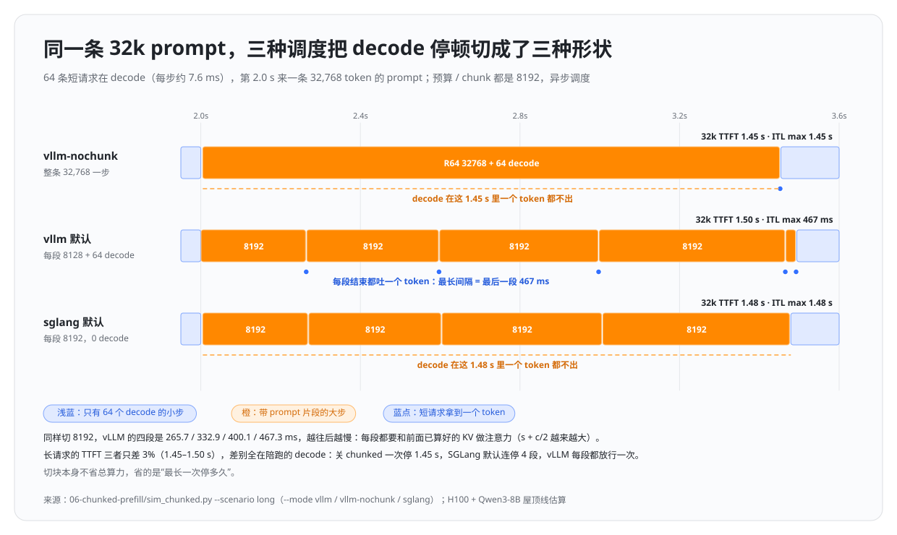
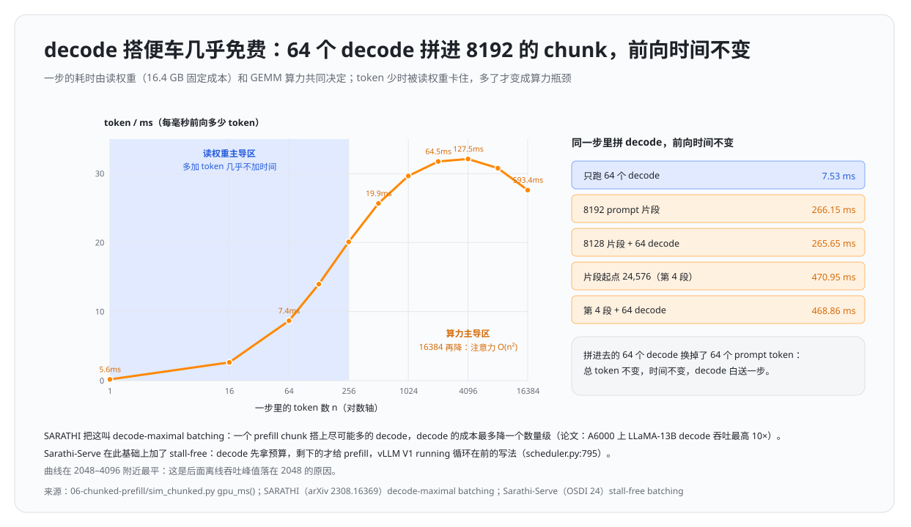
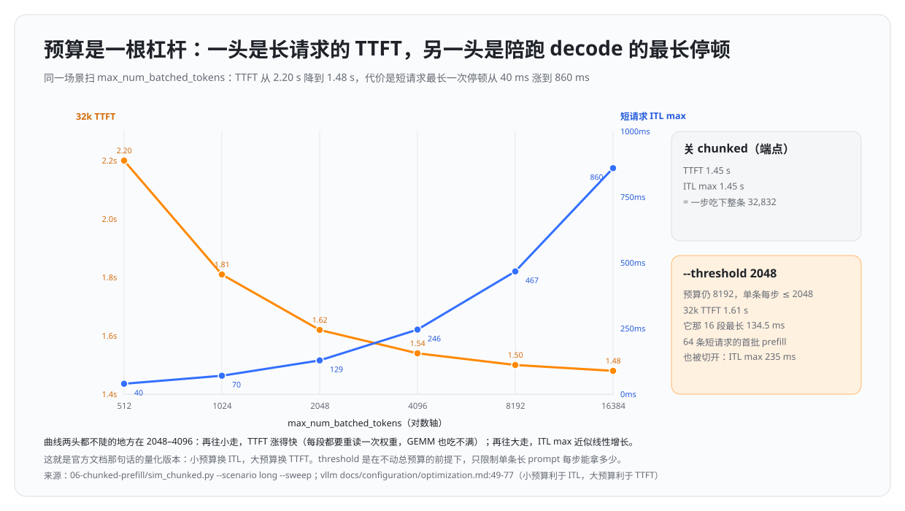
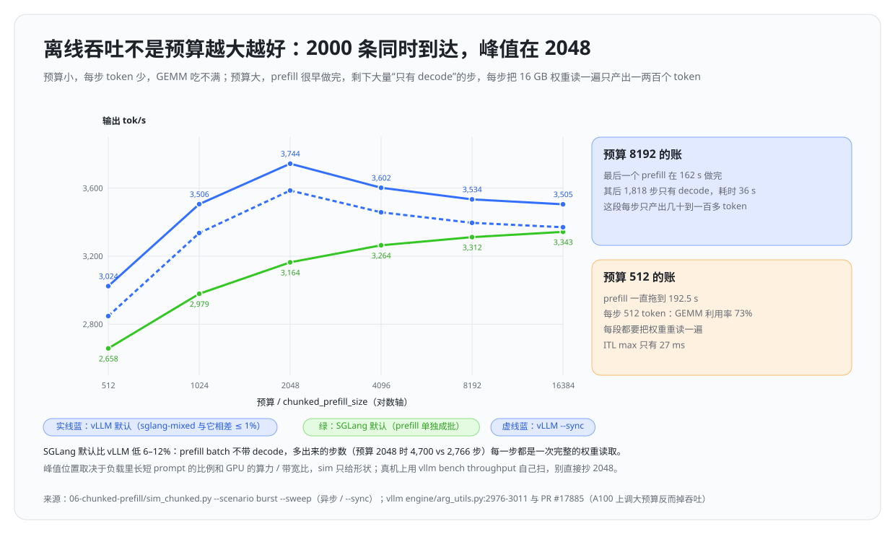
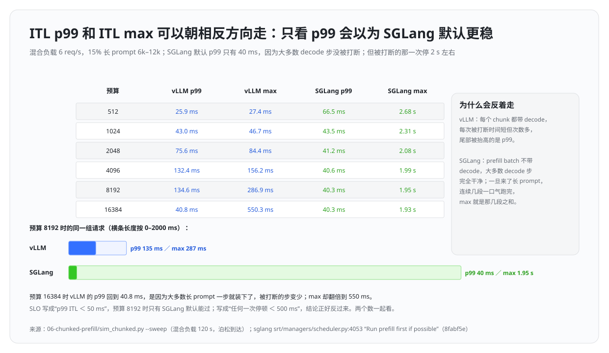
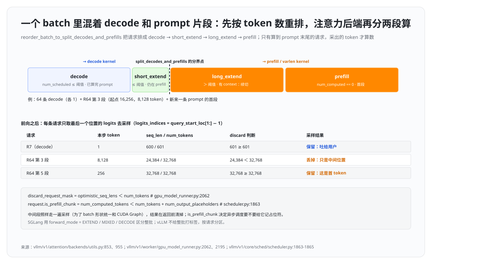
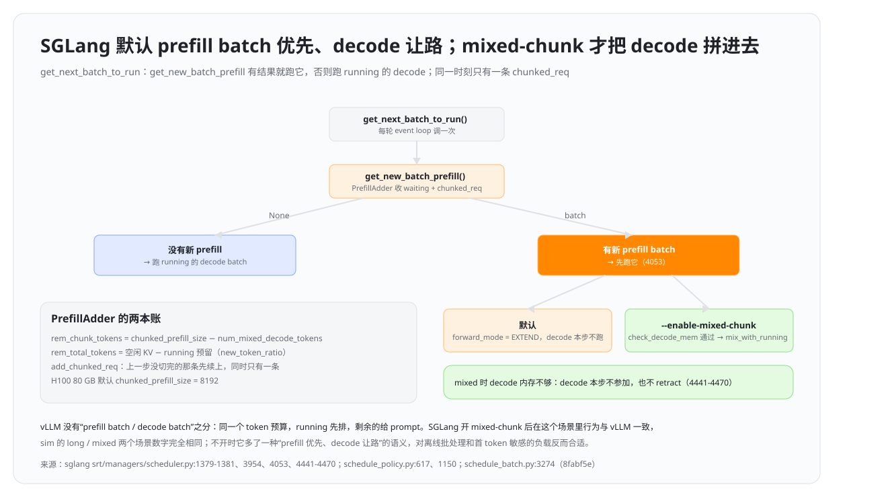
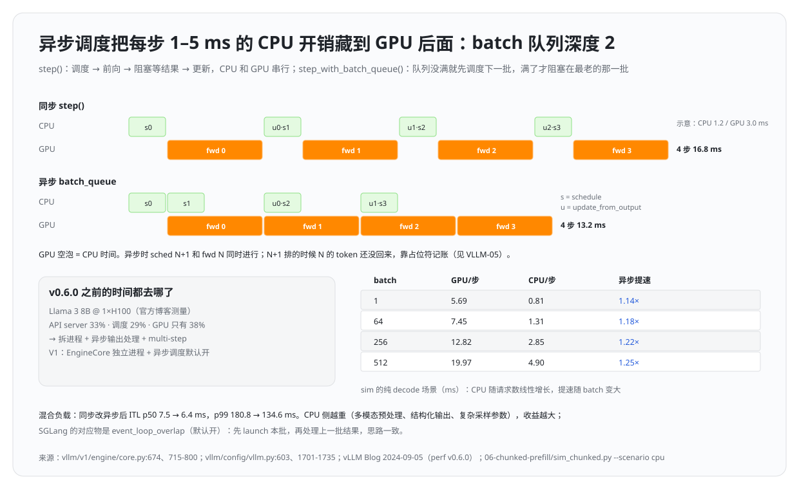
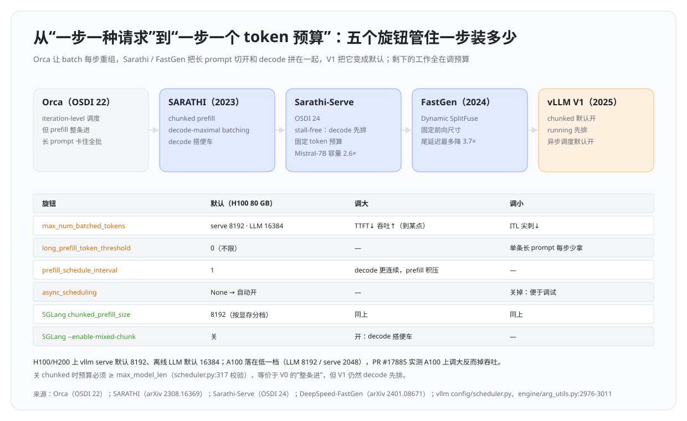

# VLLM-06｜原理｜Chunked prefill 与异步调度：一步装多少 token

> 🎯 **这篇文档解决什么问题**：线上有 64 条对话在流式输出，突然进来一条 32k 的 RAG prompt，所有人的打字机都卡了半秒。把 `max_num_batched_tokens` 从 8192 调到 2048，卡顿没了，但长请求的首 token 慢了 120 ms；离线批处理时同样的改动却让吞吐涨了 6%。这三件事背后是同一个问题：一步前向里装多少 token、装哪些 token。我们从 Sarathi 的成本模型讲起，读 vLLM 调度器里切块的那几行，再看 worker 侧怎么把一个混合 batch 交给注意力后端，最后讲异步调度怎么把 CPU 开销藏到 GPU 后面。全程和 SGLang 默认的 prefill 优先、以及它的 `--enable-mixed-chunk` 对照。
>
> **使用方式**：第 1 章用一条 32k prompt 演示三种切法。第 2 章讲 decode 为什么能免费搭车。第 3 章逐行读调度器里的切块代码。第 4、5 章分别扫在线延迟和离线吞吐，解释默认预算按显卡分档的原因。第 6 章讲 p99 和 max 为什么会给出相反的结论。第 7 章看 worker 侧的重排和丢弃。第 8 章对照 SGLang。第 9 章讲异步调度。第 10 章回顾演化、列旋钮并动手核对。基线：vLLM 主干 0d6f92a，H100 80GB，Qwen3-8B BF16，KV 24,957 块（399,312 token）。SGLang 对照基于主干 8fabf5e。
>
> **代码**：[06-chunked-prefill](../06-chunked-prefill)。sim_chunked.py 只依赖标准库，把 vLLM V1 默认、vLLM 关 chunked、SGLang 默认、SGLang mixed-chunk 四种调度按源码逻辑复刻，用 H100 屋顶线估每步耗时，同步和异步两种时间模型都能跑；trace_chunked.md 是相关代码的逐行对照表。文中的步号、毫秒数和吞吐都来自这个脚本，只用来比较相对快慢。

# 导读 · 先给结论

## 分块预填充需双模型分别测

对 dense、moe 分别扫描 max_num_batched_tokens，在相同长度和到达率下记录 TTFT、请求内 ITL 与状态占用。GDN prefill 和 decode kernel 不同，不能从纯注意力模型的 chunk 曲线推定其最优预算。

异步调度验证应覆盖状态写入与下一步读取的依赖，以及取消、抢占和恢复。MoE 再记录专家负载与通信。原模拟时间线只说明流水关系，不能将旧延迟替换模型名后作为新结果。

双模型结构以固定版本配置核对[[Qwen3.8-27B config.json]](https://huggingface.co/Qwen/Qwen3.8-27B/blob/37561816e66b5b9153b1b64c10968c18c1e6f4a0/config.json)[[Qwen3.5-35B-A3B config.json]](https://huggingface.co/Qwen/Qwen3.5-35B-A3B/blob/59d61f3ce65a6d9863b86d2e96597125219dc754/config.json)。

1. **切块不省总算力，省的是最长一次停多久。**32k prompt 插进 64 条 decode：关掉 chunked，一步 1.45 s，所有 decode 停 1.45 s；预算 8192 切成 4 段，每段带着 64 个 decode，最长停顿 467 ms。长请求自己的 TTFT 只差 3%。
2. **decode 搭便车几乎免费。**H100 上一步前向的下限是把 16.4 GB 权重读一遍，约 5 ms。64 个 decode 单独跑 7.5 ms；把它们拼进 8192 的 chunk，前向从 266.15 ms 变成 265.65 ms（总 token 不变）。这就是 SARATHI 的 decode-maximal batching。
3. **预算是一根杠杆。**同一场景从 512 扫到 16384，长请求 TTFT 从 2.20 s 降到 1.48 s，陪跑 decode 的最长停顿从 40 ms 涨到 860 ms。官方文档那句“小预算利于 ITL、大预算利于 TTFT”就是这条曲线。
4. **离线吞吐不是越大越好。**2000 条请求同时到达，吞吐在预算 2048 附近最高。预算太大，prefill 很早做完，后面剩下一千多步只有 decode，每步读一遍权重只产出一两百个 token。默认预算按显卡分档（H100 serve 8192、A100 serve 2048），PR #17885 就是 A100 上实测出来的。
5. **SGLang 默认 prefill 优先、decode 让路。**同样切成 8192，它的 prefill batch 一个 decode 都不带，四段连跑 1.48 s。混合负载下它的 ITL p99 只有 40 ms，max 却到 1.95 s。开 `--enable-mixed-chunk` 后与 vLLM 行为一致。
6. **异步调度把 CPU 那几毫秒藏起来。**V1 默认开异步，batch 队列深度 2：GPU 跑第 N 步时 CPU 已经在排第 N+1 步。模拟里同步改异步，ITL p50 从 7.5 ms 降到 6.4 ms，纯 decode 场景提速 1.14–1.25×。

# 第 1 章 · 一条 32k prompt，三种切法



先把场景固定下来。64 条短请求已经在 decode，prompt 200–1000 token，每条要生成 400 个；每一步 64 个 token，H100 上约 7.6 ms，用户看到的是每秒 130 个字左右的稳定输出。第 2.0 s 进来一条 32,768 token 的 prompt，只要 32 个输出。三种调度在 sim 里的时间线是这样的：

```text
$ python3 sim_chunked.py --scenario long
 step        时刻      本步耗时  token decode  prefill 段
  121    2.001s     7.6ms     64     64
  122    2.266s   265.7ms   8192     64  R64:8128
  123    2.599s   332.9ms   8192     64  R64:8128
  124    2.999s   400.1ms   8192     64  R64:8128
  125    3.467s   467.3ms   8192     64  R64:8128
  126    3.494s    27.8ms    320     64  R64:256
32k prompt 的 TTFT 1.50 s；短请求 ITL max 467.3 ms

$ python3 sim_chunked.py --scenario long --mode vllm-nochunk
  122    3.454s  1449.8ms  32832     64  R64:32768
32k prompt 的 TTFT 1.45 s；短请求 ITL max 1.45 s

$ python3 sim_chunked.py --scenario long --mode sglang
  123    2.271s   266.1ms   8192      0  R64:8192
  ...
  126    3.479s   470.9ms   8192      0  R64:8192
32k prompt 的 TTFT 1.48 s；短请求 ITL max 1.48 s
```

三行最后的 TTFT 只差 3%：32k 个 token 的前向总量摆在那里，怎么切都要算完。差别全在旁边那 64 条 decode 身上。

**关掉 chunked**（vLLM 里要显式 `--no-enable-chunked-prefill`，并且预算必须 ≥ `max_model_len`）时，整条 prompt 要么一步装下、要么不收。装下的那一步有 32,832 个 token，耗时 1.45 s，64 条 decode 在这一步里虽然也各算了一个 token，但它们的上一个 token 已经是 1.45 s 之前的事。用户感受到的是一次 1.45 s 的卡顿。

**vLLM 默认**：running 循环先给 64 条 decode 各 1 个 token，剩下 8128 给那条长 prompt。四段 8128 加最后一段 256，每段结束都吐一批 decode token，最长的一次间隔是第 4 段的 467 ms。注意四段越来越慢：265.7 → 332.9 → 400.1 → 467.3 ms。chunk 长度不变，但第 k 段的每个 query 要和前面 (k−1)×8128 个已算好的 key 做注意力，注意力 FLOPs 按 `c × (s + c/2)` 增长。切得越碎，后面的段占比越高；这也是切块唯一的额外代价：每段都重读一遍权重，前缀 KV 也被反复读取。

**SGLang 默认**：`chunked_prefill_size` 在 H100 80GB 上也是 8192[[1]](https://github.com/sgl-project/sglang/blob/8fabf5e/python/sglang/srt/arg_groups/memory_hook.py)，同样切四段。区别在于它的 prefill batch 不带 decode：scheduler.py 4053 行的注释是 `Run prefill first if possible`，有新 prefill batch 就跑它，否则才跑 decode[[2]](https://github.com/sgl-project/sglang/blob/8fabf5e/python/sglang/srt/managers/scheduler.py)。于是 123–126 四步连着跑 prefill，decode 一共停了 1.48 s，跟关 chunked 差不多。

> 💡 SGLang 的做法也有它的道理。prefill 优先让新请求更快拿到首 token，对离线批处理和“首 token 敏感、流式不敏感”的场景是合理的取舍；它也提供了 `--enable-mixed-chunk` 改成和 vLLM 一样的行为。第 6 章会看到，在混合负载下这两种策略的 p99 和 max 会给出相反的结论。

# 第 2 章 · 为什么 decode 能免费搭车



chunked prefill 能成立，靠的是一个成本不对称：一步前向的耗时不随 token 数线性增长。sim 的时间模型和 VLLM-02 的屋顶线一致：

```text
GPU 一步 = max( (16.4 GB 权重 + 144 KiB × KV token) / 3.35 TB/s ,
               (2·P·n + 注意力 FLOPs) / (989 TFLOPS × 60% × n/(n+192)) ) + 0.3 ms
```

第一项是访存，第二项是算力，`n/(n+192)` 描述 token 少时 GEMM 吃不满。n 小的时候耗时几乎是常数：不管这一步是 1 个 token 还是 200 个，16.4 GB 权重都要从 HBM 读一遍（约 4.9 ms），tensor core 也大半闲着。64 个 decode 单独跑一步是 7.53 ms，其中大部分就是这笔固定成本。n 大到一两千以后，耗时开始和 token 数成正比；每毫秒能处理的 token 数在 n = 2048–4096 附近到顶，约 32 token/ms，再往上注意力的平方项开始拖后腿。

把 64 个 decode 拼进一个 8192 的 chunk 会发生什么？总 token 数还是 8192（chunk 让出 64 个位置），整步在算力区，耗时由总 FLOPs 决定：

| 这一步装了什么 | token 数 | 前向耗时（模拟） |
|-|-|-|
| 只有 64 个 decode | 64 | 7.53 ms |
| 8192 的 prompt 片段（起点 0） | 8,192 | 266.15 ms |
| 8128 片段 + 64 个 decode | 8,192 | 265.65 ms |
| 第 4 段 8192（起点 24,576） | 8,192 | 470.95 ms |
| 第 4 段 8128 + 64 个 decode | 8,192 | 468.86 ms |

拼进去之后耗时几乎不变，甚至略少：decode token 只和自己序列里几百个 key 做注意力，比 prompt 末尾那几十个 token 便宜。单独跑一步 decode 要 7.53 ms，拼进去成本约等于零。这就是 SARATHI 的核心论证：prefill 是算力瓶颈，decode 是访存瓶颈，把两者放进同一步，decode 搭上 prefill 已经付过的权重读取[[3]](https://arxiv.org/abs/2308.16369)。论文把它叫 decode-maximal batching，在 A6000 上的 LLaMA-13B 上 decode 吞吐最高提升 10×，端到端 1.33×；A100 上 LLaMA-33B 端到端 1.25×、decode 4.25×，流水线并行的气泡减少 6.29×。

SARATHI 解决的是吞吐。Sarathi-Serve 往前走了一步，解决延迟：如果每一步都先把所有 decode 排进去，再用剩余预算去切 prompt，那么 decode 永远不会因为来了长 prompt 而停一整步，作者称之为 stall-free scheduling[[4]](https://arxiv.org/abs/2403.02310)。在 A100 上 Mistral-7B 的服务容量是 vLLM（当时的 V0）的 2.6×，Yi-34B 3.7×，Falcon-180B（流水线并行）5.6×。同一时期 DeepSpeed-FastGen 提出 Dynamic SplitFuse，思路一样，报告有效吞吐 2.3×、平均延迟降 2×、尾延迟降 3.7×[[5]](https://arxiv.org/abs/2401.08671)。

vLLM V1 的调度器就是 stall-free 的直接实现：running 循环在 waiting 循环前面，decode 先扣预算。官方文档里也是这么描述的：开 chunked 时调度策略优先 decode，先把所有 decode 排上，剩余预算再给 prefill，放不下就切[[6]](https://docs.vllm.ai/en/latest/configuration/optimization/)。

> 💡 “免费”是有条件的：总 token 数不变时时间不变，但 decode 占掉了预算里的位置。预算 512、running 里有 300 条 decode 时，每步只剩 212 个 token 给 prompt，长 prompt 的 TTFT 被拉得很长；decode 数接近预算时 prefill 几乎饿死。这是 config/scheduler.py:332–337 要求预算 ≥ `max_num_seqs` 的原因，也是大并发服务不能把预算设得太小的原因。屋顶线的形状随模型和显卡变：MoE 模型激活参数小、权重读取却不少，平坦段更长；换模型时先用 VLLM-02 的方法估一下再谈预算。

# 第 3 章 · 调度器里切块的那几行

VLLM-05 已经把 `schedule()` 整个走过一遍，这里只看和切块有关的分支。打开 [scheduler.py](https://github.com/vllm-project/vllm/blob/0d6f92a/vllm/v1/core/sched/scheduler.py)。

## 3.1 阈值：一条长 prompt 每步最多拿多少

```python
# scheduler.py:753-769
num_running, num_waiting = self.get_request_counts()
num_eligible_reqs = num_running + num_waiting
long_prefill_token_threshold = (
    self.scheduler_config.long_prefill_token_threshold
    if num_eligible_reqs > 1
    else 0
)
if long_prefill_token_threshold > 0 and self.adaptive_long_prefill_threshold:
    long_prefill_token_threshold = max(
        long_prefill_token_threshold, input_budget // num_eligible_reqs
    )
```

`long_prefill_token_threshold` 默认 0，表示不限（[scheduler.py](https://github.com/vllm-project/vllm/blob/0d6f92a/vllm/config/scheduler.py) 79 行）。设了以后，只有合格请求多于 1 条才生效：只有一条请求时没人会被饿着，让它用满预算。打开 `long_prefill_token_threshold_adaptive`（86 行，默认 False）后，阈值不低于 `预算 / 请求数`，避免请求多时把每条切得太碎。

## 3.2 running 循环：未切完的 chunk 也在这里

```python
# scheduler.py:822-848
if defer_prefills and request.is_prefill_chunk:
    req_index += 1
    continue
...
num_new_tokens = (
    request.num_tokens_with_spec
    + request.num_output_placeholders
    - request.num_computed_tokens
)
if 0 < long_prefill_token_threshold < num_new_tokens:
    num_new_tokens = long_prefill_token_threshold
num_new_tokens = min(
    num_new_tokens, token_budget, input_budget - draft_slots
)
```

一条长 prompt 第一次被收进来时只算了一段，之后它就待在 running 队列里，和 decode 一起排。下一步轮到它时，`num_new_tokens` 是剩下没算的部分，再被阈值和剩余预算截断。所以第 1 章里 R64 的第 2、3、4 段都是在 running 循环里被切出来的，排在它前面的 64 条 decode 已经各扣了 1 个 token。

running 队列是按到达顺序排的，长 prompt 进来得晚，排在 decode 后面；但如果同时有两条长 prompt 在切，先来的那条会把剩余预算吃光，后来的那条这一步一个 token 都拿不到。这就是阈值要解决的问题：设 `--long-prefill-token-threshold 2048`，每条每步最多 2048，预算 8192 可以同时推进四条。

## 3.3 waiting 循环：开与关的分叉

```python
# scheduler.py:1306, 1332-1346
num_new_tokens = request.num_tokens - num_computed_tokens
...
if 0 < long_prefill_token_threshold < num_new_tokens:
    num_new_tokens = long_prefill_token_threshold

if (
    not self.scheduler_config.enable_chunked_prefill
    and num_new_tokens > request_token_budget
    and not self.is_mm_encoder_only
):
    # If chunked_prefill is disabled, we can stop the scheduling here.
    break

num_new_tokens = min(num_new_tokens, request_token_budget)
```

`num_computed_tokens` 在这之前已经加上了前缀缓存命中的部分（VLLM-08 细讲），所以命中 30k 前缀的 32k prompt 只剩 2k 要算。关掉 chunked 时，整条放不下剩余预算就 `break`，后面的 waiting 请求这一步都不看了，也就是严格 FCFS，不会让短请求插队。开着时直接截断成剩余预算。

## 3.4 本步排完：is_prefill_chunk

```python
# scheduler.py:1863-1865，_update_after_schedule
request.is_prefill_chunk = request.num_computed_tokens < (
    request.num_tokens + request.num_output_placeholders
)
```

这里的 `num_computed_tokens` 已经加上了本步要算的量。加完还没追上，说明这一步只算了 prompt 的中间一段，下一步还要接着切。这个标记有三个用处：异步调度不给它记输出占位符（中间段不产出 token，见第 9 章）。worker 侧把它采出的 token 丢掉（第 7 章）。以及下面的 prefill 节拍判断。

## 3.5 prefill 节拍：prefill_schedule_interval

```python
# scheduler.py:771-791（节选）
if (
    not defer_prefills
    and self.local_prefill_interval > 1
    and not self.prefill_capacity_bound
    and (self.num_executed_steps + 1) - self.last_prefill_step
    < self.local_prefill_interval
    and any(not r.is_prefill_chunk for r in self.running)
):
    defer_prefills = True
```

主干新加的旋钮 `prefill_schedule_interval`（[scheduler.py](https://github.com/vllm-project/vllm/blob/0d6f92a/vllm/config/scheduler.py) 203 行，默认 1）：设成 N 时，上一次带 prefill 的步之后 N−1 步只跑 decode。被推迟的步里，不光不收新请求，连已经在 running 里的 chunk 也跳过（822 行）。这让 decode 能连续跑一段不被打断，代价是 prefill 积压。注释里专门写了 #44558 修过的问题：waiting 队列排不完时（`prefill_capacity_bound`）必须放开节拍，否则每 N 步只放一批 prefill，队列会无限增长。747–751 行的 `defer_prefills` 是同一机制在 DP 下的版本，用来让各个 DP rank 的 prefill 对齐。

完整的逐行对照见代码目录里的 trace_chunked.md。

# 第 4 章 · 预算是一根杠杆：TTFT 换 ITL



还是第 1 章的场景，只扫 `max_num_batched_tokens`：

| 预算 | 32k TTFT | 短请求 ITL max | 短请求 ITL p99 |
|-|-|-|-|
| 512 | 2.20 s | 39.7 ms | 38.9 ms |
| 1024 | 1.81 s | 70.4 ms | 67.1 ms |
| 2048 | 1.62 s | 128.6 ms | 115.8 ms |
| 4096 | 1.54 s | 245.7 ms | 195.0 ms |
| 8192 | 1.50 s | 467.3 ms | 265.7 ms |
| 16384 | 1.48 s | 860.2 ms | 19.3 ms |
| 关 chunked | 1.45 s | 1.45 s | — |

往小走，TTFT 涨得越来越快：512 时要切 65 段，每段都要重读一遍 16.4 GB 权重，GEMM 也只有 73% 的利用率（`n/(n+192)`），所以 32k 要 2.20 s。往大走，ITL max 近似线性增长，因为最长那一段的耗时和段长成正比。曲线两头都不陡的地方在 2048–4096。

16384 那一行的 p99 只有 19.3 ms，比 512 还低。数字没有写错：预算 16384 时 32k 只切两段，64 条短请求一共 400 步里只有两步被打断，落不进 p99；但被打断的那两步停得很久，最长一次 860 ms。p99 和 max 的这种背离第 6 章专门讲。

## 4.1 不动总预算，只限单条

```text
$ python3 sim_chunked.py --scenario long --threshold 2048
32k prompt 的 TTFT 1.61 s；最长一段 134.5 ms；短请求 ITL max 235 ms
```

预算还是 8192，但每条每步最多拿 2048。32k 被切成 16 段，每段最长 134.5 ms，TTFT 1.61 s，和直接把预算设成 2048 差不多。ITL max 235 ms 来自开头：64 条短请求的首批 prefill 也被阈值切开了，前几步凑不满预算。在混合负载里（6 req/s，15% 长 prompt），`--threshold 2048` 把 ITL p99 从 134.6 ms 压到 88.7 ms，max 从 286.9 ms 降到 264.1 ms，TTFT p99 从 758 ms 升到 876 ms。阈值的好处是：短 prompt 不受影响，新来的短请求依然能一步装完。

> 💡 预算和 CUDA Graph 有耦合。V1 的 cudagraph 捕获尺寸上限默认跟着预算走（VLLM-09），把预算从 8192 调到 32768 会让捕获列表变长、启动变慢、显存多占一点。另一个约束：预算必须 ≥ `max_num_seqs`（config/scheduler.py:332–337），否则每条 decode 分不到 1 个 token。

# 第 5 章 · 离线吞吐：为什么默认预算按显卡分档



换一个场景：2000 条请求同时到达，长短混合比例和在线一样（85% 短 prompt 200–1000，15% 长 prompt 6k–12k）。这时没人关心 ITL，只看总输出吞吐：

| 预算 | vLLM | SGLang 默认 | SGLang mixed | vLLM --sync |
|-|-|-|-|-|
| 512 | 3,024 | 2,658 | 3,024 | 2,848 |
| 1024 | 3,506 | 2,979 | 3,506 | 3,336 |
| 2048 | **3,744** | 3,164 | **3,757** | **3,586** |
| 4096 | 3,602 | 3,264 | 3,623 | 3,458 |
| 8192 | 3,534 | 3,312 | 3,563 | 3,396 |
| 16384 | 3,505 | 3,343 | 3,537 | 3,370 |
| 关 chunked | 3,498 | — | — | — |

单位是输出 tok/s（模拟）。峰值在 2048，两头都掉。左边好理解：每步只有 512 个 token，GEMM 利用率 73%，而且要很多步才能把 prefill 做完，prefill 一直拖到 192.5 s。右边反直觉：预算 8192 时最后一个 prefill 在 162 s 就做完了，之后还有 1,818 步只有 decode，耗时 36 s。这些步里 batch 从几百条慢慢降到几条，每步都把 16.4 GB 权重完整读一遍，只产出几十到一百多个 token，正落在屋顶线最左边最贵的那段。

预算 2048 时，prefill 被摊得更开，几乎每一步都有 prompt 片段垫底、decode 搭车，访存区的步数少得多。这正是 SARATHI 的论证：piggyback 的收益来自让每一步都有足够的算力型工作去摊薄权重读取[[3]](https://arxiv.org/abs/2308.16369)。

## 5.1 默认值怎么来的

```python
# vllm/engine/arg_utils.py:2976-3011（意译）
if device_memory >= 160 GiB:          # B200 / B300 / MI300X
    LLM: 16384    serve: 16384    max_num_seqs 1024
elif device_memory >= 70 GiB and not A100 and not GB10:   # H100 / H200
    LLM: 16384    serve: 8192     max_num_seqs 1024
else:                                  # A100、L40S、消费卡...
    LLM: 8192     serve: 2048     max_num_seqs 256
# NOTE(Kuntai): Setting large max_num_batched_tokens for A100 reduces
# throughput, see PR #17885 for more details.
```

两个维度：离线 `LLM` 类比 `vllm serve` 大一档，因为离线不关心 ITL；同一显存档里 A100 被专门挑出来降档，因为 PR #17885 实测 A100 上大预算掉吞吐[[7]](https://github.com/vllm-project/vllm/pull/17885)。A100 的算力只有 H100 的三分之一左右，屋顶线拐点更靠左，同样 8192 个 token 的一步要多花三倍时间，上面说的“prefill 早早做完、剩一堆纯 decode 步”更明显。SGLang 的 `chunked_prefill_size` 也按显存分档：小于 20 GB 2048，小于 60 GB 4096，小于 160 GB 8192，再往上 16384[[1]](https://github.com/sgl-project/sglang/blob/8fabf5e/python/sglang/srt/arg_groups/memory_hook.py)。两边在 H100 上恰好都是 8192。

官方调优文档的建议是：追求吞吐时预算设到 8192 以上，尤其是大卡上的小模型[[6]](https://docs.vllm.ai/en/latest/configuration/optimization/)。这和上面的模拟并不矛盾：文档说的是相对 2048 这个旧默认值；模拟显示峰值的位置取决于负载里长短 prompt 的比例和显卡的算力带宽比。真机上用 `vllm bench throughput` 按自己的数据扫一遍，别直接抄 2048 或 16384。

> 💡 burst 场景里 SGLang 默认低 6–12%：它的 prefill batch 不带 decode，预算 2048 时总步数 4,700，vLLM 只要 2,766，多出来的每一步都是一次完整的权重读取。代价换来的是 TTFT：SGLang prefill 优先，新请求更早拿到首 token。不过在 2000 条同时到达的场景下，排队时间压倒一切，模拟里预算 2048 时 TTFT p50 反而是 vLLM 75.0 s、SGLang 88.2 s。

# 第 6 章 · p99 和 max 给出相反的结论



回到在线：6 req/s 泊松到达，跑 120 s，15% 是 6k–12k 的长 prompt。四种调度在不同预算下的 ITL：

| 预算 | vLLM TTFT p99 | vLLM ITL p99 | vLLM ITL max | SGLang ITL p99 | SGLang ITL max |
|-|-|-|-|-|-|
| 512 | 1.28 s | 25.9 ms | 27.4 ms | 66.5 ms | 2.68 s |
| 1024 | 982 ms | 43.0 ms | 46.7 ms | 43.5 ms | 2.31 s |
| 2048 | 842 ms | 75.6 ms | 84.4 ms | 41.2 ms | 2.08 s |
| 4096 | 784 ms | 132.4 ms | 156.2 ms | 40.6 ms | 1.99 s |
| 8192 | 758 ms | 134.6 ms | 286.9 ms | 40.3 ms | 1.95 s |
| 16384 | 793 ms | 40.8 ms | 550.3 ms | 40.3 ms | 1.93 s |
| 关 chunked | 875 ms | 40.2 ms | 663.2 ms | — | — |

SGLang mixed-chunk 的数字和 vLLM 完全一样，省略。看预算 8192 那一行：SGLang 默认 p99 只有 40 ms，vLLM 是 134.6 ms；但 SGLang 的 max 是 1.95 s，vLLM 是 287 ms。

原因在打断的形状。vLLM 每一步都带 decode，来一条 10k 的长 prompt，会被切成两段，每段都拖慢一步、各吐一次 token，被打断的步数多、每次时间短。这些“稍慢的步”数量足以进入 p99。SGLang 默认的 prefill batch 不带 decode：长 prompt 来了，decode 停到 prefill 跑完为止。它停的次数少，大多数 decode 步完全干净，p99 由正常 decode 步决定，但每一次都停很久，而且如果连着来几条长 prompt，几次停顿会接在一起，变成秒级。

16384 那一行把这个现象推到另一个极端：vLLM 的 p99 降回 40.8 ms，因为大多数长 prompt 一步就装下了，被打断的步变少；max 翻倍到 550 ms。关 chunked 时 p99 是 40.2 ms，max 663 ms。

> 💡 SLO 怎么写决定了谁赢。写成“ITL p99 < 50 ms”，预算 8192 时只有 SGLang 默认能过；写成“任何一次停顿 < 500 ms”，只有 vLLM 能过。压测报告里 ITL 至少给 p50、p99、max 三个数，或者直接给 p99.9。`vllm bench serve` 默认打印 p99，加 `--metric-percentiles 50,90,99,99.9` 可以多给几档[[8]](https://docs.vllm.ai/en/latest/benchmarking/cli/)。

DistServe 的论证从另一个角度说明了同一件事：只要 prefill 和 decode 共享一块 GPU，两者就会互相干扰，调度能做的只是选择干扰的形状。要完全消掉，得把它们放到不同的 GPU 上[[9]](https://arxiv.org/abs/2401.09670)。这是 VLLM-15 PD 分离的出发点。

# 第 7 章 · Worker 侧：重排、分段和丢弃



调度器交给 worker 的是一张“每条请求本步算多少 token”的表。在 worker 里，这张表变成一个扁平的 token 序列，所有请求的 token 首尾相接，线性层不关心谁是谁，一次 GEMM 算完。麻烦在注意力：decode token 的 query 长度是 1，适合 FlashDecoding 式的 kernel；prompt 片段的 query 长度是几千，适合 FlashAttention 式的 kernel。混在一个 batch 里，要先分开。

## 7.1 四个区

[utils.py](https://github.com/vllm-project/vllm/blob/0d6f92a/vllm/v1/attention/backends/utils.py) 955 行的 `reorder_batch_to_split_decodes_and_prefills` 按每条请求本步的 token 数，把 batch 原地重排成四段：

| 区 | 条件 | 例子 |
|-|-|-|
| decode | 本步 token 数 ≤ 阈值，且 prompt 已算完 | 64 条短请求，各 1 个 token |
| short_extend | 本步 token 数 ≤ 阈值，prompt 还没算完 | 长 prompt 最后剩几个 token |
| long_extend | 本步 token 数 > 阈值，有已算好的前缀 | R64 的第 2、3、4 段；前缀命中后的剩余部分 |
| prefill | 本步 token 数 > 阈值，num_computed_tokens = 0 | 新来 prompt 的首段 |

阈值是 `reorder_batch_threshold`，由注意力后端声明：纯 decode kernel 只吃 query 长度 1 的后端设 1，支持投机解码的设成 1 + 草稿数。853 行的 `split_decodes_and_prefills` 找到分界点，返回 decode 区的请求数和 token 数，后端拿这两个数去分别调 decode kernel 和 prefill kernel。SGLang 不按请求分区，而是给整批打 `forward_mode`：EXTEND、DECODE，或 mixed-chunk 时的 MIXED[[10]](https://github.com/sgl-project/sglang/blob/8fabf5e/python/sglang/srt/managers/schedule_batch.py)。

## 7.2 中间段照样采样，然后丢掉

```python
# gpu_model_runner.py:2062
self.discard_request_mask.np[:num_reqs] = (
    self.optimistic_seq_lens_cpu[:num_reqs].numpy() < num_tokens_np
)
# gpu_model_runner.py:2195
logits_indices = query_start_loc[1:] - 1
```

前向结束后，每条请求只取最后一个位置的 hidden state 去算 logits（`query_start_loc[1:] − 1`）。R64 第 3 段的最后一个位置是 prompt 第 24,383 个 token，它的 logits 没有意义，但 runner 不为它开特例：所有请求统一走一遍采样，保持 batch 形状和 CUDA Graph 稳定，返回前把 `discard_request_mask` 为真的请求的结果清掉。判断条件就是“本步算完后的长度 < 请求总长度”，和调度器侧的 `is_prefill_chunk` 是同一件事的两面。多算 1 行 logits 的成本相对 8192 个 token 的前向可以忽略。

> 💡 有一个容易踩的坑：自己写 logits processor 或者在采样里做统计（比如记录每步熵）时，中间段也会被调用到，拿到的是“prompt 中间位置的下一 token 分布”。按请求做状态累积的代码要先检查这个请求本步是不是真的产出了 token。

# 第 8 章 · SGLang：prefill batch 与 mixed-chunk



SGLang 的调度器没有一个统一的 token 预算，而是两种 batch 交替：每轮 event loop 调一次 `get_next_batch_to_run`（scheduler.py:3954），它先调 `get_new_batch_prefill`（4112）试着组一个 prefill batch，组得出来就跑它，组不出来才跑 running 里的 decode[[2]](https://github.com/sgl-project/sglang/blob/8fabf5e/python/sglang/srt/managers/scheduler.py)：

```python
# sglang srt/managers/scheduler.py:4052-4064（8fabf5e）
if new_batch is not None:
    # Run prefill first if possible
    ret = new_batch
else:
    # Run decode (skip for prefill-only batches)
    if not running_batch.is_empty() and not running_batch.is_prefill_only:
        decode_batch = self.update_running_batch(running_batch)
        ...
```

组 prefill batch 的是 `PrefillAdder`（schedule_policy.py:617），它记两本账：`rem_chunk_tokens` 是本步还能塞多少 prompt token，初值 `chunked_prefill_size`；`rem_total_tokens` 是空闲 KV 扣掉 running 请求的预留（VLLM-05 第 6 章）[[11]](https://github.com/sgl-project/sglang/blob/8fabf5e/python/sglang/srt/managers/schedule_policy.py)。一条 prompt 放不下 `rem_chunk_tokens` 就切，切出来的这条记为 `chunked_req`；下一轮 `add_chunked_req`（1150）先把它续上。同一时刻只有一条请求在切块，这和 vLLM 可以同时推进多条长 prompt 不同。

## 8.1 mixed-chunk

```python
# scheduler.py:1379-1381
self.is_mixed_chunk = (
    self.chunked_prefill_size is not None and server_args.enable_mixed_chunk
)
# scheduler.py:4441-4470（意译）
if self.is_mixed_chunk and not self.running_batch.is_empty() and not new_batch.is_prefill_only:
    if self.running_batch.check_decode_mem():          # 内存够才拼
        self.running_batch.prepare_for_decode()
        new_batch.mix_with_running(self.running_batch) # forward_mode = MIXED
        new_batch.decoding_reqs = self.running_batch.reqs
        self.running_batch = ScheduleBatch(reqs=[], ...)
    # 内存不够：decode 本步不参加，也不 retract
```

开 `--enable-mixed-chunk` 后，PrefillAdder 的 `rem_chunk_tokens` 先扣掉 running decode 的数量，prefill batch 再把 running 的 decode 拼进来（schedule_batch.py:3274 `mix_with_running`），整批 `forward_mode = MIXED`。语义上和 vLLM 的 stall-free 一致：一个 token 预算，decode 先占，剩下给 prompt。sim 里 sglang-mixed 在 long 和 mixed 两个场景的数字和 vLLM 完全相同，burst 场景差 1% 以内。

为什么 SGLang 默认不开？从代码看，mixed 路径有一串限制条件（4441 行起）：请求要 `return_logprob` 时不混（源码里留着 `TODO (lianmin): support return_logprob + mixed chunked prefill`），带 `input_embeds` 的不混（`mix_with_running` 只拼 input_ids），beam search 的不混；投机解码加非 overlap 时还要额外搬运 bonus token。这些组合下默认开会让行为因请求而异，不如统一关掉。另一方面，SGLang 主打的前缀共享负载里 prompt 往往被 RadixCache 大量命中，剩下要算的 prefill 不长，prefill 优先的停顿不明显；长 prompt 干扰更重的部署，它推荐走 PD 分离。读 SGLang 的压测报告时，先确认有没有开 mixed-chunk，否则和 vLLM 的 ITL 不可比。

> 💡 SGLang 也有对应 `prefill_schedule_interval` 的旋钮：`_should_defer_prefill`（scheduler.py:1403）读 `prefill_decode_interval`，默认 None。两边都是近期加入，用来在 decode 连续性和 prefill 积压之间再调一档。

# 第 9 章 · 异步调度：把 CPU 藏到 GPU 后面



前面八章都在讨论 GPU 上一步装什么。还有一笔开销不在 GPU 上：每一步，CPU 要跑一遍 `schedule()`、准备输入张量、处理上一步的输出（detokenize、停止条件、更新状态）。vLLM v0.6.0 的性能博客给过一组测量：Llama 3 8B 在单张 H100 上，API server 占 33% 的时间，调度占 29%，GPU 实际在算的只有 38%[[12]](https://vllm.ai/blog/2024-09-05-perf-update)。当时的修法是拆进程、异步处理输出、multi-step 调度（一次调度跑多步），合计吞吐提升 2.7×，其中 multi-step 贡献 28%。V1 把 EngineCore 放到独立进程，再加上异步调度，multi-step 就不需要了[[13]](https://vllm.ai/blog/2025-01-27-v1-alpha-release)。

## 9.1 同步：step()

```python
# vllm/v1/engine/core.py:674，同步路径（简化）
scheduler_output = self.scheduler.schedule()
future = self.model_executor.execute_model(scheduler_output, non_block=True)
model_output = future.result()          # 阻塞，GPU 跑完才回来
outputs = self.scheduler.update_from_output(scheduler_output, model_output)
```

CPU 和 GPU 串行：GPU 跑完第 N 步，CPU 处理输出、排第 N+1 步，这段时间 GPU 闲着。一步的墙钟时间是 CPU + GPU。

## 9.2 异步：step_with_batch_queue()

```python
# core.py:715-800（简化）
if self.scheduler.has_requests():
    scheduler_output = self.scheduler.schedule(...)
    exec_future = self.model_executor.execute_model(scheduler_output, non_block=True)
    future = self.model_executor.sample_tokens(grammar_output, non_block=True)
    batch_queue.appendleft((future, scheduler_output, exec_future))
    if len(batch_queue) < self.batch_queue_size and (...):
        return None, model_executed       # 队列没满：不等结果，立刻回去排下一步
# 队列满了：阻塞在最老的那一批
future, scheduler_output, exec_model_fut = batch_queue.pop()
model_output = future.result()
engine_core_outputs = self.scheduler.update_from_output(scheduler_output, model_output)
```

队列深度 `batch_queue_size` 来自 [vllm.py](https://github.com/vllm-project/vllm/blob/0d6f92a/vllm/config/vllm.py) 603 行的 `max_concurrent_batches`：开异步、V1 runner、无流水线并行时是 2，MRV2 runner 是 pp + 1，不开异步时等于 pp_size。深度 2 的意思是：GPU 在跑第 N 步时，CPU 已经排好第 N+1 步并提交，然后阻塞在第 N 步的结果上；第 N 步一回来，处理输出的同时第 N+1 步已经在 GPU 上跑。一步的墙钟时间变成 max(CPU, GPU)。

难点在第 N+1 步排的时候，第 N 步的 token 还没回来，调度器不知道那些请求是不是已经生成了 EOS。async_scheduler.py:24–55 的做法是先记账：凡是本步不是 prefill 中间段的请求，`num_output_placeholders += 1`（有投机解码时再加草稿数），让下一步的 `num_new_tokens` 公式照常算出 1；结果回来后再用真实 token 替换占位符，如果第 N 步已经停止，第 N+1 步那 1 个 token 白算，丢掉即可（VLLM-05 第 7 章）。prefill 中间段不产出 token，所以不记占位符，这就是第 3 章 `is_prefill_chunk` 的第一个用处。

`async_scheduling` 默认 None，由 vllm.py:1701–1735 判断：pooling 模型、不支持的 executor 后端等情况下关掉，其他情况默认开。启动日志里能看到最终的取值。

## 9.3 收益有多大

| batch | GPU/步 | CPU/步 | 同步/步 | 异步/步 | 异步提速 |
|-|-|-|-|-|-|
| 1 | 5.69 ms | 0.81 ms | 6.50 ms | 5.69 ms | 1.14× |
| 64 | 7.45 ms | 1.31 ms | 8.76 ms | 7.45 ms | 1.18× |
| 256 | 12.82 ms | 2.85 ms | 15.66 ms | 12.82 ms | 1.22× |
| 512 | 19.97 ms | 4.90 ms | 24.86 ms | 19.97 ms | 1.25× |

`python3 sim_chunked.py --scenario cpu` 的输出（节选），模型是 CPU 每步 0.8 ms + 8 µs × 请求数。batch 越大，CPU 侧越重，提速越多。混合负载里同步改异步：步数从 11,193 增加到 12,977（同样 120 s 内多跑了 16% 的步），ITL p50 从 7.5 ms 降到 6.4 ms，p99 从 180.8 ms 降到 134.6 ms；long 场景吞吐从 4,135 到 4,519 tok/s。真实系统的 CPU 开销比这个模型更不均匀：多模态预处理、结构化输出的 bitmask、带大量 logit_bias 的请求都会让 CPU 一步涨到十几毫秒，这时异步的收益更大。

SGLang 的对应物是 `event_loop_overlap`（scheduler.py:2064），默认开启：先 launch 本批，再处理上一批放在 result_queue 里的结果，思路相同。它还有一个细节：连续两个 prefill batch 时可以关掉重叠（`is_disable_overlap_for_batch`，2139 行，由 `SGLANG_DISABLE_CONSECUTIVE_PREFILL_OVERLAP` 控制，默认 False）[[14]](https://github.com/sgl-project/sglang/blob/8fabf5e/python/sglang/srt/environ.py)，用于改善 prefill 密集时的 TTFT。

> 💡 异步调度和结构化输出有交互：如果下一步的 grammar bitmask 依赖上一步采样出的 token，sample 就得等。core.py 里 `pending_structured_output_tokens` 那个分支会把采样推迟到处理完上一步输出之后（`deferred_scheduler_output`），这一步实际上退化回同步。结构化输出比例高的服务，异步收益会打折，VLLM-16 再细讲。

# 第 10 章 · 演化、旋钮与动手



回头看这条线。Orca 提出 iteration-level 调度，batch 每步重组，请求可以随时加入和离开，但一条 prompt 的 prefill 必须一步做完[[15]](https://www.usenix.org/conference/osdi22/presentation/yu)。vLLM 早期（V0）继承了这个做法，并且 prefill 和 decode 分步跑：有新 prompt 就先跑一步纯 prefill，长 prompt 来了全批等它。SARATHI 把 prompt 切成 chunk、让 decode 搭车，从吞吐角度论证了混合 batch 的价值。Sarathi-Serve 加上 decode 先排，从延迟角度论证。DeepSpeed-FastGen 的 Dynamic SplitFuse 是同期的工业实现。vLLM V0 后期以可选项的形式加入 chunked prefill，V1 把它变成默认，并且把“prefill / decode 两种步”这个概念整个删掉，只剩一个 token 预算[[13]](https://vllm.ai/blog/2025-01-27-v1-alpha-release)。V1 发布之后，调度这条线的改动主要在“预算怎么分”：长 prompt 阈值、自适应阈值、prefill 节拍、DP 下的 prefill 对齐。

## 10.1 旋钮总表

| 参数 | 默认 | 调大 / 打开 | 调小 / 关闭 |
|-|-|-|-|
| `--max-num-batched-tokens` | H100 serve 8192，LLM 16384；A100 serve 2048 | TTFT 降，ITL max 升；离线吞吐先升后降 | ITL 稳，长 prompt TTFT 升；太小 GEMM 吃不满 |
| `--long-prefill-token-threshold` | 0（不限） | — | 单条长 prompt 每步少拿，多条长 prompt 并行推进，ITL p99 降 |
| `--long-prefill-token-threshold-adaptive` | False | 阈值不低于预算 / 请求数 | — |
| `--prefill-schedule-interval` | 1 | decode 连续跑更久，prefill 积压 | — |
| `--enable-chunked-prefill` | True | — | 整条进；预算必须 ≥ max_model_len |
| `--async-scheduling` | 自动（大多数情况开） | 藏 CPU 开销 | 调试、复现问题时关 |

SGLang 一侧对应的是 `--chunked-prefill-size`（H100 默认 8192，设 -1 关闭）、`--max-prefill-tokens`（单个 prefill batch 的 token 上限，默认 16384）、`--enable-mixed-chunk`（默认关）、`--disable-overlap-schedule`。

## 10.2 跑模拟

```bash
cd zero-to-vllm/06-chunked-prefill
python3 sim_chunked.py --scenario long                      # 第 1 章：三种切法，先跑 vllm
python3 sim_chunked.py --scenario long --mode sglang
python3 sim_chunked.py --scenario long --sweep              # 第 4 章：预算杠杆
python3 sim_chunked.py --scenario long --threshold 2048
python3 sim_chunked.py --scenario burst --sweep             # 第 5 章：离线吞吐峰值
python3 sim_chunked.py --sweep                              # 第 6 章：p99 vs max
python3 sim_chunked.py --sync                               # 第 9 章：关掉异步
python3 sim_chunked.py --scenario cpu
```

每改一个参数先猜结果再运行。可以试着把 `GEMM_HALF` 从 192 改成 512（模拟算力更强、拐点更靠右的卡），看 burst 场景的峰值往哪边移；或者把 burst 的长 prompt 比例从 15% 改成 50%，看 2048 还是不是最优。

## 10.3 在真实服务上扫预算

```bash
# 在 06-chunked-prefill 目录执行。每次只运行一个预算点，服务前台启动
MODEL_PROFILE=dense TP=2 bash ../01-first-server/serve.sh --max-num-batched-tokens 2048
# 另一终端：等待 /health 成功后执行
MODEL_PROFILE=dense
source ../common/model_profile.sh
vllm bench serve --model "$MODEL" --dataset-name random \
  --random-input-len 4000 --random-range-ratio 0.9 --random-output-len 256 \
  --request-rate 6 --num-prompts 600 \
  --percentile-metrics ttft,tpot,itl --metric-percentiles 50,99,99.9
# 保存日志和结果，停止服务；依次测 4096、8192、16384，再对 moe 重复。
# 对每次启动核对预算实际生效值，以及 GDN 状态和 CUDA Graph 的额外占用。
```

SGLang 对照组：`python -m sglang.launch_server --model-path Qwen/Qwen3-8B --chunked-prefill-size 8192` 跑一次，再加 `--enable-mixed-chunk` 跑一次，压测命令换成 `python -m sglang.bench_serving --backend sglang`，参数对齐。重点看 ITL 的 p99 和 max 在两次之间怎么变化：按第 6 章的分析，打开 mixed-chunk 后 p99 会升、max 会大幅下降。如果想单独看一条长 prompt 的影响，用一个脚本保持 64 路流式并发，再在中途发一条 32k 的请求，把每条流的 token 时间戳画出来，就是第 1 章那张图的真机版。

## 10.4 读源码的顺序

scheduler.py 747–791（三种 defer 和阈值）→ 822–848（running 侧切块）→ 1306–1346（waiting 侧切块和关 chunked 的 break）→ 1863（`is_prefill_chunk`）→ async_scheduler.py 全文 → core.py 674 和 715–800 → gpu_model_runner.py 2062、2195 → attention/backends/utils.py 853、955。配置在 config/scheduler.py 和 engine/arg_utils.py 2976 起。SGLang 读 scheduler.py 3954–4070 和 4441–4470，以及 schedule_policy.py 的 `PrefillAdder.add_chunked_req`。

> 📌 **核对清单**
> - 能解释为什么切块不改变长请求的 TTFT 量级，只改变陪跑 decode 的最长停顿；以及后面的 chunk 为什么比前面的慢。
> - 能用屋顶线说清 decode 搭车为什么几乎免费，以及这个结论在什么预算下失效。
> - 能指出 running 循环和 waiting 循环各自在哪一行切块，关 chunked 时哪一行 break，`long_prefill_token_threshold` 什么时候不生效。
> - 知道 H100 和 A100 上的默认预算，以及 A100 被单独降档的原因（PR #17885）。
> - 能解释离线吞吐为什么在中间某个预算达到峰值，预算再往上就不涨了。
> - 看压测报告时，ITL 同时要 p99 和 max；能说出 SGLang 默认为什么 p99 低、max 高。
> - 知道 worker 侧的四区重排，以及 prompt 中间段采出的 token 在哪里被丢掉。
> - 能画出 batch 队列深度 2 时 CPU 和 GPU 的时间线，说清占位符的作用和结构化输出时的退化。

这两篇一直把 KV cache 当成一个“够不够”的数：调度器问一句能不能分到块，能就排，不能就抢占。块从哪来、块表怎么组织、释放的块怎么回到池子里、为什么一个 block 是 16 个 token，都还没讲。VLLM-07 打开 KVCacheManager 和 BlockPool，从 PagedAttention 论文讲到 V1 的块分配代码。

# 参考文献

按正文首次引用顺序编号，资料截至 2026 年 10 月底。源码以 vllm-project/vllm 主干提交 0d6f92a（2026 年 10 月 29 日）和 v0.32.0 发行版为准；SGLang 对照以 sgl-project/sglang 主干 8fabf5e 为准。

[1] sgl-project. sglang/srt/arg_groups/memory_hook.py \_handle_gpu_memory_settings. GitHub (8fabf5e) [https://github.com/sgl-project/sglang/blob/8fabf5e/python/sglang/srt/arg_groups/memory_hook.py](https://github.com/sgl-project/sglang/blob/8fabf5e/python/sglang/srt/arg_groups/memory_hook.py)

[2] sgl-project. sglang/srt/managers/scheduler.py（get_next_batch_to_run、event_loop_overlap）. GitHub (8fabf5e) [https://github.com/sgl-project/sglang/blob/8fabf5e/python/sglang/srt/managers/scheduler.py](https://github.com/sgl-project/sglang/blob/8fabf5e/python/sglang/srt/managers/scheduler.py)

[3] Agrawal A, et al. SARATHI: Efficient LLM Inference by Piggybacking Decodes with Chunked Prefills. arXiv (2023) [https://arxiv.org/abs/2308.16369](https://arxiv.org/abs/2308.16369)

[4] Agrawal A, et al. Taming Throughput-Latency Tradeoff in LLM Inference with Sarathi-Serve. OSDI (2024) [https://arxiv.org/abs/2403.02310](https://arxiv.org/abs/2403.02310)

[5] Holmes C, et al. DeepSpeed-FastGen: High-throughput Text Generation for LLMs via MII and DeepSpeed-Inference. arXiv (2024) [https://arxiv.org/abs/2401.08671](https://arxiv.org/abs/2401.08671)

[6] vLLM Docs. Optimization and Tuning [https://docs.vllm.ai/en/latest/configuration/optimization/](https://docs.vllm.ai/en/latest/configuration/optimization/)

[7] KuntaiDu. [Perf] Use small max_num_batched_tokens for A100. vLLM PR #17885 [https://github.com/vllm-project/vllm/pull/17885](https://github.com/vllm-project/vllm/pull/17885)

[8] vLLM Docs. Benchmark CLI [https://docs.vllm.ai/en/latest/benchmarking/cli/](https://docs.vllm.ai/en/latest/benchmarking/cli/)

[9] Zhong Y, et al. DistServe: Disaggregating Prefill and Decoding for Goodput-optimized Large Language Model Serving. OSDI (2024) [https://arxiv.org/abs/2401.09670](https://arxiv.org/abs/2401.09670)

[10] sgl-project. sglang/srt/managers/schedule_batch.py（mix_with_running）. GitHub (8fabf5e) [https://github.com/sgl-project/sglang/blob/8fabf5e/python/sglang/srt/managers/schedule_batch.py](https://github.com/sgl-project/sglang/blob/8fabf5e/python/sglang/srt/managers/schedule_batch.py)

[11] sgl-project. sglang/srt/managers/schedule_policy.py（PrefillAdder、add_chunked_req）. GitHub (8fabf5e) [https://github.com/sgl-project/sglang/blob/8fabf5e/python/sglang/srt/managers/schedule_policy.py](https://github.com/sgl-project/sglang/blob/8fabf5e/python/sglang/srt/managers/schedule_policy.py)

[12] vLLM Team. vLLM v0.6.0: 2.7x Throughput Improvement and 5x Latency Reduction. vLLM Blog (2024-09-05) [https://vllm.ai/blog/2024-09-05-perf-update](https://vllm.ai/blog/2024-09-05-perf-update)

[13] vLLM Team. vLLM V1: A Major Upgrade to vLLM's Core Architecture. vLLM Blog (2025-01-27) [https://vllm.ai/blog/2025-01-27-v1-alpha-release](https://vllm.ai/blog/2025-01-27-v1-alpha-release)

[14] sgl-project. sglang/srt/environ.py. GitHub (8fabf5e) [https://github.com/sgl-project/sglang/blob/8fabf5e/python/sglang/srt/environ.py](https://github.com/sgl-project/sglang/blob/8fabf5e/python/sglang/srt/environ.py)

[15] Yu G-I, et al. Orca: A Distributed Serving System for Transformer-Based Generative Models. OSDI (2022) [https://www.usenix.org/conference/osdi22/presentation/yu](https://www.usenix.org/conference/osdi22/presentation/yu)

---

[在 Colab 里跑本章 CPU 练习](https://colab.research.google.com/github/zyaochen/zero-to-vllm/blob/main/colab/06-chunked-prefill.ipynb) · 上一章：[VLLM-05｜原理｜调度器：token 预算、num_computed_tokens 与抢占](./05-scheduler.md) · [目录](./README.md) · 下一章：[VLLM-07｜原理｜PagedAttention：BlockPool、块表与 KV 分配](./07-paged-kv.md)
