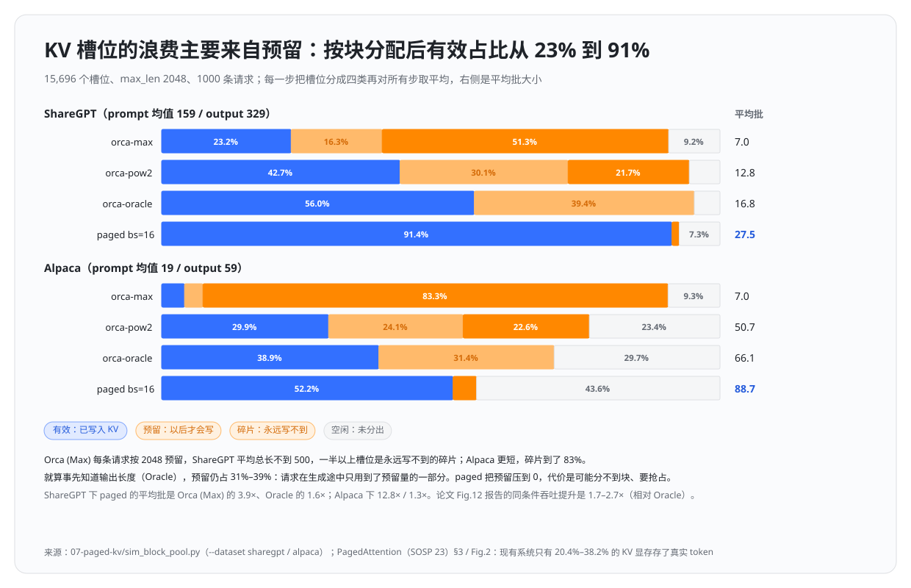
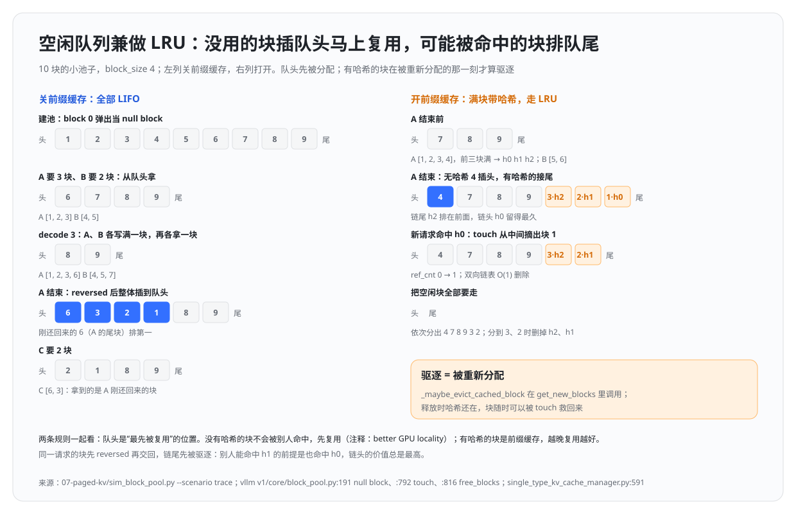
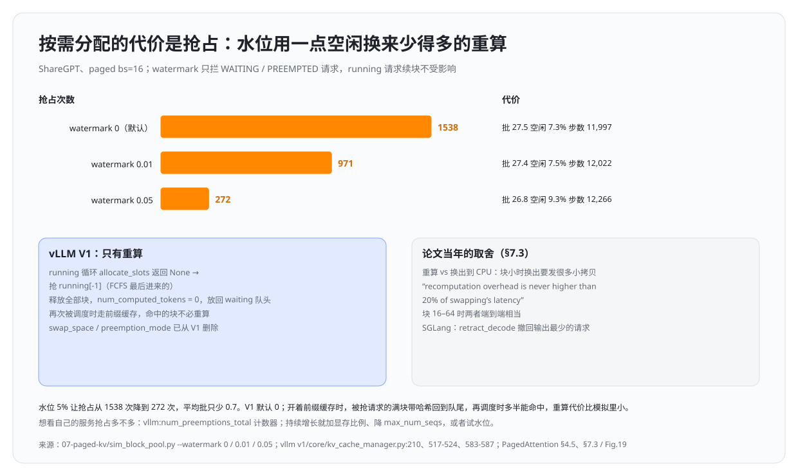
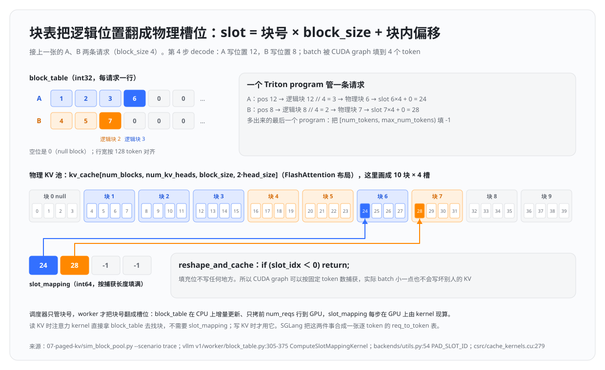
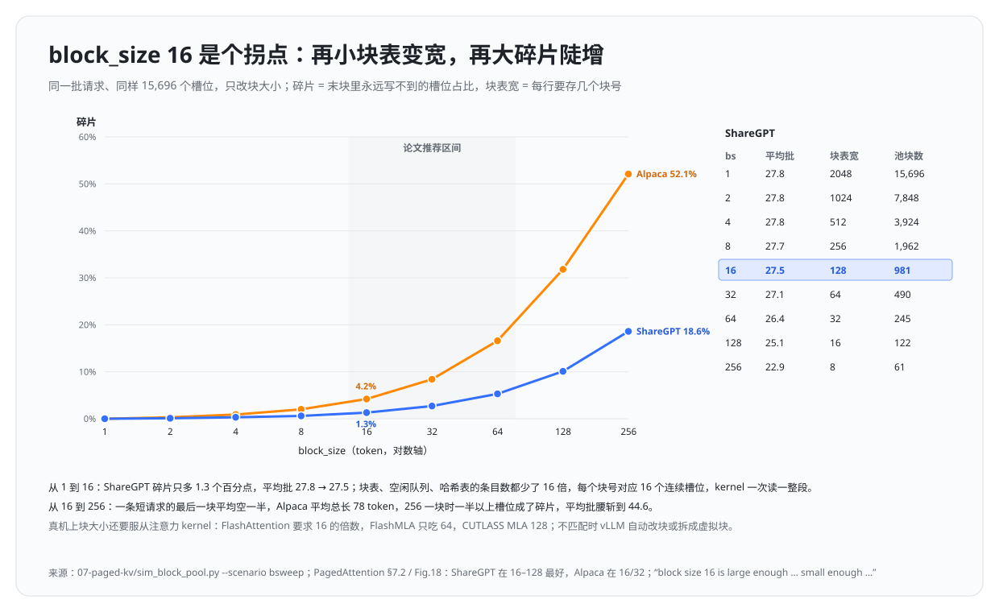
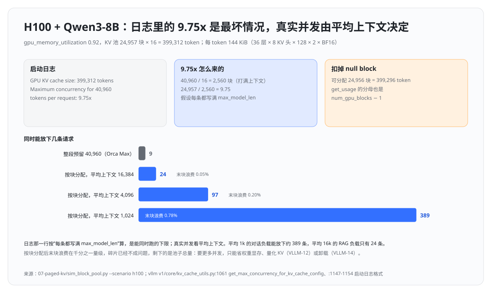
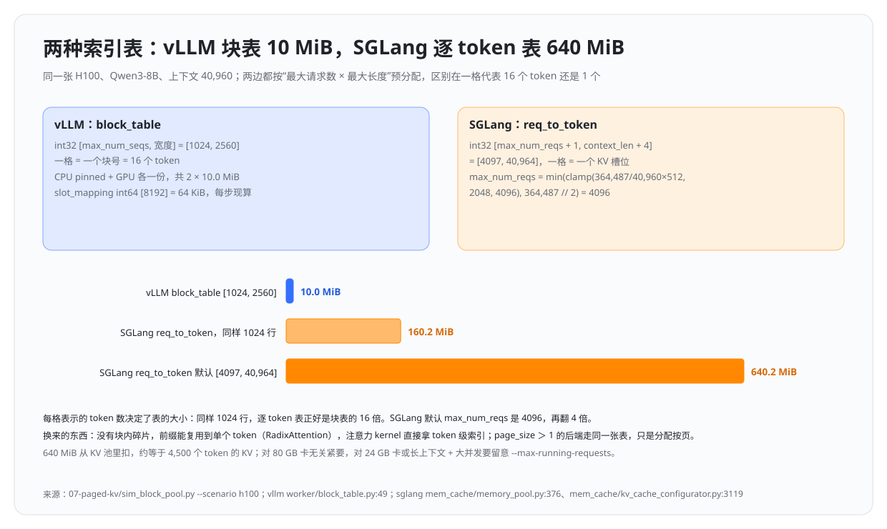
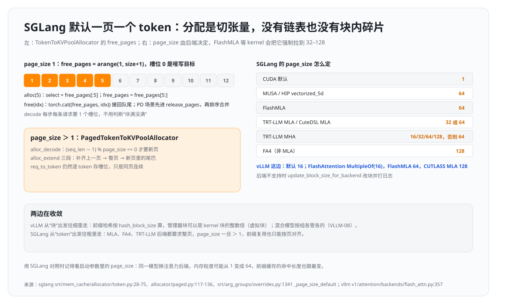
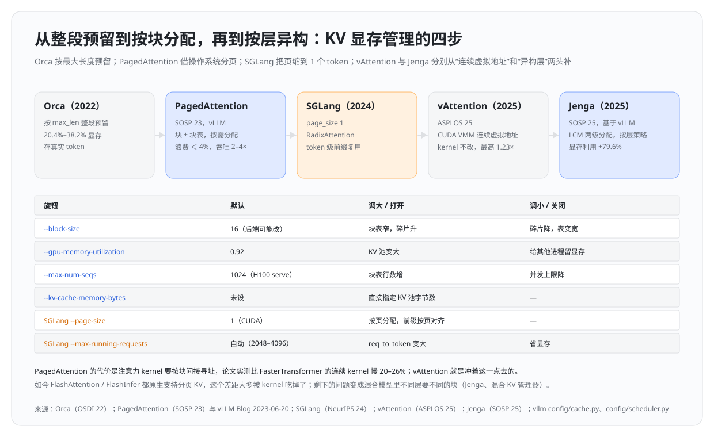

# VLLM-07｜原理｜PagedAttention：BlockPool、块表与 KV 分配

> 🎯 **这篇文档解决什么问题**：H100 上起 Qwen3-8B，启动日志写着 `Maximum concurrency for 40,960 tokens per request: 9.75x`，压测时却稳稳跑着三百多条并发；换一组长 RAG 请求，并发掉到二十几条，日志里开始出现 preemption。9.75 这个数从哪来、为什么不是上限，块从哪个队列里出来、还回去排在哪，抢占时哪条请求倒霉，都藏在 vLLM V1 的 `BlockPool` 和 `KVCacheManager` 里。我们从 PagedAttention 论文的浪费分析讲起，逐行读块池、空闲队列、`allocate_slots` 和 worker 侧的块表，最后和 SGLang 一页一个 token 的分配器对照。
>
> **使用方式**：第 1 章用模拟复现论文里 Orca 三种预留方式和 paged 的显存去向。第 2 章讲块和块表这个抽象。第 3 章读空闲队列和块池。第 4 章读 `allocate_slots` 的每个关卡。第 5 章讲抢占和水位。第 6 章看 worker 怎么把块号翻成槽位。第 7 章扫块大小。第 8 章在 H100 上算容量。第 9 章对照 SGLang。第 10 章回顾演化、列旋钮、动手核对。基线：vLLM 主干 0d6f92a，H100 80GB，Qwen3-8B BF16，KV 24,957 块（399,312 token）。SGLang 对照基于主干 8fabf5e。
>
> **代码**：[07-paged-kv](../07-paged-kv)。sim_block_pool.py 只依赖标准库，把 `KVCacheBlock`、`FreeKVCacheBlockQueue`、`BlockPool`、`allocate_slots` 按源码复刻，再加上 worker 侧的块表宽度和 slot_mapping 计算。test_sim_block_pool.py 有 13 个单测。trace_paged.md 是相关代码的逐行对照表。文中的批大小、占比和抢占次数都来自这个脚本。负载是合成的，只用来比较几种方案的相对差别。

# 导读 · 先给结论

## 块表只解释全注意力部分

双模型的全注意力层分别为 16 层和 10 层，GDN 层分别为 48 层和 30 层。Paged KV 的 token 块与 GDN 状态页需要分别解释，不能把全部层都代入 2×层数×KV头×head_dim 的公式。

保留本章 BlockPool 模拟器作为块管理练习。真实混合池还涉及 cache group、页大小对齐与 null block；以启动日志和实际 allocator 配置核对，不把公共账本的原始张量上界标成已分配块数。

双模型结构以固定版本配置核对[[Qwen3.8-27B config.json]](https://huggingface.co/Qwen/Qwen3.8-27B/blob/37561816e66b5b9153b1b64c10968c18c1e6f4a0/config.json)[[Qwen3.5-35B-A3B config.json]](https://huggingface.co/Qwen/Qwen3.5-35B-A3B/blob/59d61f3ce65a6d9863b86d2e96597125219dc754/config.json)。

1. **浪费主要来自预留，分块本身浪费很少。**论文条件下（15,696 个槽位、max_len 2048、ShareGPT 分布），按最大长度整段预留时只有 23.2% 的槽位存着真实 KV；即使提前知道输出长度，也有 39.4% 是“给以后留的”。按块分配把预留降到 0，有效占比 91.4%，平均批是整段预留的 3.9 倍。
2. **空闲队列有方向。**vLLM 的空闲块是一条手写双向链表。没有哈希的块释放时插到队头，马上复用。有哈希的块接到队尾，尽量晚复用。同一请求的块倒序交回，链尾的块先被驱逐。缓存块要等被重新分出去的那一刻才驱逐，释放时只是挂回队列。
3. **按需分配的代价是抢占。**同一负载下 paged 发生了 1538 次抢占，每次都要重算。V1 只有重算，没有换出；默认抢 running 队尾那条。watermark 0.05 把抢占降到 272 次，平均批只从 27.5 降到 26.8。
4. **调度器只认块号，槽位由 worker 现算。**`slot = block_table[pos // bs] × bs + pos % bs` 由一个 Triton kernel 在 GPU 上算，多出来的位置填 −1，写 KV 的 kernel 遇到负数直接返回。CUDA graph 按固定 token 数捕获也不会写坏别人的 KV，靠的就是这一点。
5. **block_size 16 附近几乎免费。**从 1 到 16，ShareGPT 的碎片只多了 1.3 个百分点，块表和池块数都缩小 16 倍；超过 64 以后碎片快速上升，Alpaca 这类短请求在 256 时碎片到 52.1%。这和论文 7.2 节的结论一致。
6. **日志里的并发倍数是下限。**9.75x 假设每条请求都写满 40,960；平均上下文 1,024 时同一个池子能放约 389 条。SGLang 默认一页一个 token，没有块内碎片，代价是要按 `max_num_reqs × max_context_len` 预分配一张逐 token 的表：同样配置下 640.2 MiB，vLLM 的块表是 10.0 MiB。

# 第 1 章 · 显存去哪了：复现论文的浪费分析



2023 年之前，主流服务系统给一条请求分 KV 显存的方式和分一个数组差不多：请求进来时按某个长度划出一段连续空间，请求结束时整段还回去。PagedAttention 论文第 3 节把这种做法的浪费拆成三类：给以后的 token **预留**的位置、预留过量造成的**内部碎片**、以及大小不一的连续段之间的**外部碎片**。论文的测量结果是，现有系统里只有 20.4%–38.2% 的 KV 显存存着真实的 token 状态[[1]](https://arxiv.org/abs/2309.06180)。

论文拿 Orca[[2]](https://www.usenix.org/conference/osdi22/presentation/yu) 当对照，并给它设计了三个变体，区别只在预留多少：**Orca (Max)** 一律预留到模型最大长度 2048。**Orca (Pow2)** 按真实长度向上取 2 的幂，最多多留一倍。**Orca (Oracle)** 假设事先知道输出会有多长，精确预留，这是不可能做到的上界。sim_block_pool.py 按同样的定义写了这三种方式，再加上 vLLM V1 的按块分配，在论文 Table 1 里 OPT-13B / A100-40GB 的 KV 容量（15.7K 个 token 槽位）下跑 1000 条合成请求：

```text
$ python3 sim_block_pool.py
负载：sharegpt 合成 1000 条，同时到达；prompt 均值 159，output 均值 329；KV 15,696 个 token 槽位，max_len 2048
模式               平均批    峰值     步数       有效       预留       碎片       空闲    抢占
orca-max           7.0     7  47335    23.2%    16.3%    51.3%     9.2%     0
orca-pow2         12.8    27  25691    42.7%    30.1%    21.7%     5.5%     0
orca-oracle       16.8    34  19598    56.0%    39.4%     0.0%     4.6%     0
paged bs=16       27.5    87  11997    91.4%     0.0%     1.3%     7.3%  1538
paged 的平均批是 orca-max 的 3.9×、orca-pow2 的 2.1×、orca-oracle 的 1.6×；步数 47335 → 11997
```

四列占比的口径是：每一步把池子里的槽位分成四类，再对所有步取平均。**有效**是已经写进 KV 的。**预留**是已经划给某条请求、它以后才会写的。**碎片**是划出去了但这条请求永远写不到的，对 Orca 是多留的部分，对 paged 是最后一块的空位。**空闲**是没划出去的。

Orca (Max) 的数字最直观：每条请求占 2048 个槽，15,696 个槽只够 7 条，可 ShareGPT 分布下一条请求的总长中位数只有 357。51.3% 的槽位是永远写不到的，另外 16.3% 是“以后会写”，加起来三分之二的显存在等。Orca (Oracle) 没有碎片，但预留仍然有 39.4%：一条请求生成到一半时，后一半的位置已经占着了，别的请求用不了。

按块分配之后，预留列变成 0。一条请求只持有已经写过的 token 所在的块，最后一块可能没写满，平均浪费半块，就是那 1.3% 的碎片。省下来的显存变成了批大小：平均批从 7.0 到 27.5，峰值从 7 到 87，同样 1000 条请求的步数从 47,335 降到 11,997。论文在 OPT-13B 上测的是 vLLM 同时处理的请求数是 Orca (Oracle) 的 2.2 倍、Orca (Max) 的 4.3 倍，ShareGPT 上能承受的请求率高 1.7–2.7 倍（对 Oracle）和 2.7–8 倍（对 Max）[[1]](https://arxiv.org/abs/2309.06180)；vLLM 发布博客里的说法是浪费从 60%–80% 降到 4% 以下[[3]](https://vllm.ai/blog/2023-06-20-vllm)。模拟的倍数和论文不完全一样，因为这里所有请求同时到达、没有时间维度，但方向和量级一致。

```text
$ python3 sim_block_pool.py --dataset alpaca
负载：alpaca 合成 1000 条，同时到达；prompt 均值 19，output 均值 59
orca-max           7.0     7   8456     4.1%     3.3%    83.3%     9.3%     0
orca-pow2         50.7   141   1159    29.9%    24.1%    22.6%    23.4%     0
orca-oracle       66.1   195    890    38.9%    31.4%     0.0%    29.7%     0
paged bs=16       88.7   578    663    52.2%     0.0%     4.2%    43.6%   343
```

Alpaca 的请求短得多（论文说 ShareGPT 的输入长 8.4 倍、输出长 5.8 倍[[1]](https://arxiv.org/abs/2309.06180)），Orca (Max) 的碎片到了 83.3%，paged 的平均批是它的 12.8 倍。但 paged 这里也有 43.6% 的空闲：1000 条请求在前几十步就几乎都收进来了，之后随着请求陆续结束，池子越来越空，后半程没有新请求可以填。到这一步，瓶颈已经从显存管理移到了负载本身。

> 💡 paged 那一行最后一列的 1538 不是笔误。按需分配意味着收请求时不知道它以后要多少块，收多了，后面 decode 要块时可能分不到，只能把某条请求踢出去重算。Orca 的几种方式都不会抢占，因为该留的提前留够了。这是按块分配最主要的代价，第 5 章专门讲。

# 第 2 章 · 块和块表：把操作系统的分页搬到 KV 上

PagedAttention 的想法直接来自操作系统的虚拟内存[[4]](https://dl.acm.org/doi/10.1145/356571.356573)：进程看到的是连续的虚拟地址，物理内存按固定大小的页分配，页表负责把虚拟页号翻成物理页号。换到 KV cache 上，一条请求的 token 序列被切成固定长度的**逻辑块**，每个逻辑块对应池子里任意一个**物理块**，**块表**记录这个映射[[1]](https://arxiv.org/abs/2309.06180)。物理块大小一样，所以不存在外部碎片。块只在第一个 token 要写进去时才分，所以没有预留。浪费只剩每条请求最后一块的空位。

论文同时给出了这个抽象带来的第二个好处：块可以共享。并行采样的多个候选、beam search 的多条分支、相同前缀的不同请求，都可以让多个逻辑块指向同一个物理块，靠引用计数管理，写的时候再复制（copy-on-write）。V1 里 beam search 已经不在引擎内部实现，并行采样在前端拆成多条子请求（`v1/engine/parallel_sampling.py`），共享主要通过前缀缓存完成，这是 VLLM-08 的内容。我们这里只看一条请求自己的块怎么来、怎么走。

V1 里一个块的元数据长这样（[kv_cache_utils.py](https://github.com/vllm-project/vllm/blob/0d6f92a/vllm/v1/core/kv_cache_utils.py) 162 行）：

```python
@dataclass
class KVCacheBlock:
    block_id: int                     # 0 … num_gpu_blocks-1，就是 GPU 上 kv_cache 张量第 0 维的下标
    ref_cnt: int = 0                  # 有几条请求在用；0 表示在空闲队列里
    _block_hash: BlockHashWithGroupId | None = None   # 只有写满且开了前缀缓存才有
    prev_free_block: "KVCacheBlock | None" = None     # 空闲链表指针，只由 FreeKVCacheBlockQueue 改
    next_free_block: "KVCacheBlock | None" = None
    is_null: bool = False
```

有几件事要注意。第一，这里没有任何张量，`KVCacheBlock` 是调度器进程里的纯 Python 对象，它只代表“GPU 上第 `block_id` 号块归谁”。KV 张量本身在 worker 进程里，形状是 `[num_blocks, num_kv_heads, block_size, 2·head_size]`（FlashAttention 后端，[flash_attn.py](https://github.com/vllm-project/vllm/blob/0d6f92a/vllm/v1/attention/backends/flash_attn.py) 1202 行），启动时按 `KVCacheConfig` 一次分配完（`gpu_model_runner.py` 6914 行 `initialize_kv_cache_tensors`），之后不再申请或释放显存。分配和释放都只是改这些 Python 对象的字段。

第二，块里没有“写了几个 token”的字段。论文的块表每一项记了物理块号和已填数量，V1 不需要：请求自己的 `num_computed_tokens` 除以 `block_size` 就知道写到第几块的第几个位置。块表也不在这个对象里，调度器这边每条请求的块列表存在 `SingleTypeKVCacheManager.req_to_blocks` 里，worker 那边另有一张 int32 张量（第 6 章）。

第三，`is_null`。建池时 block 0 被弹出来作为 **null block**（[block_pool.py](https://github.com/vllm-project/vllm/blob/0d6f92a/vllm/v1/core/block_pool.py) 189–192 行），表示“这个位置不需要 KV”。滑动窗口外的块、跳过的块都换成它，块表里的空位也是 0。源码注释写着 `ref_cnt of null_block is not maintained`：它永远不进空闲队列，释放时直接跳过。所以 vLLM 日志里的 KV 容量和实际可分配的差一块，`get_usage` 的分母也是 `num_gpu_blocks − 1`（921 行）。

| 概念 | 论文 | vLLM V1 里的对应物 |
|-|-|-|
| 物理块 | physical KV block | `KVCacheBlock`（调度器侧元数据）+ `kv_cache[block_id]`（worker 侧张量切片） |
| 逻辑块 → 物理块 | block table，每项含块号与已填数 | 调度器：`req_to_blocks[req_id]`；worker：`BlockTable.block_table` int32 |
| 空闲块管理 | block allocator | `BlockPool` + `FreeKVCacheBlockQueue` |
| 分配入口 | KV block manager | `KVCacheManager.allocate_slots` |
| 空位 | — | null block（block 0） |
| 换出 | CPU block allocator | V1 已删除；卸载走 KV connector（VLLM-14） |

# 第 3 章 · 空闲队列和块池：块从哪来、回到哪去



## 3.1 为什么手写双向链表

`FreeKVCacheBlockQueue`（kv_cache_utils.py 258 行）的 docstring 第一句就说明了为什么不用 Python 自带的 `deque`：要支持 O(1) 从队列**中间**摘掉一个块。前缀缓存命中时，命中的块可能正躺在空闲队列中间（引用计数为 0，但哈希还在），要把它摘出来给新请求用，`deque.remove` 是 O(n)。为了不输给 C 实现的 `deque`，它不分配任何链表节点对象，直接改块上的 `prev_free_block` / `next_free_block` 两个指针；另外放了一对假头假尾（297 行），保证每个真实块都有前驱和后继，少写几个分支。

```python
# kv_cache_utils.py 391：从中间摘块，三行指针操作
def remove(self, block):
    prev_block, next_block = block.prev_free_block, block.next_free_block
    prev_block.next_free_block = next_block
    next_block.prev_free_block = prev_block
    block.prev_free_block = block.next_free_block = None
    self.num_free_blocks -= 1
```

队列只有四种操作：`popleft_n` 从队头取 n 块，`remove` 从中间摘一块，`prepend_n`（438 行）把一批块插到队头，`append_n`（459 行）把一批块接到队尾。队头是下一个被分出去的位置。建池时所有块按 id 顺序入队，block 0 马上被弹出当 null block，所以第一个请求拿到的是 1、2、3……

## 3.2 分配：get_new_blocks

```python
# block_pool.py 706
def get_new_blocks(self, num_blocks):
    if num_blocks > self.get_num_free_blocks():
        raise ValueError(...)
    ret = self.free_block_queue.popleft_n(num_blocks)
    if self.enable_caching:
        for block in ret:
            self._maybe_evict_cached_block(block)   # 769：块上还挂着旧哈希就从表里删掉
            block.ref_cnt += 1                      # 0 → 1
    ...
    return ret
```

这里没有“能不能分”的判断，数量够不够在上一层 `allocate_slots` 里就算好了，走到这里不够就是 bug。要多看一眼的是 `_maybe_evict_cached_block`：前缀缓存的**驱逐要等到这个块被重新分出去的那一刻**，释放时什么都不删。一个带哈希的块释放后进空闲队列，只要还没被别人拿走，哈希表里就还能查到它，新请求命中时再用 `touch`（792 行）把它从队列中间摘出来、引用计数加 1。空闲队列同时也是前缀缓存的 LRU 链表。

## 3.3 释放：两个方向

```python
# block_pool.py 816
def free_blocks(self, ordered_blocks):
    blocks_to_evict_last, blocks_to_evict_first = [], []
    for block in ordered_blocks:
        if block.is_null:
            continue
        block.ref_cnt -= 1
        if block.ref_cnt == 0:
            if block.block_hash is None or not self.enable_caching:
                # LIFO reuse of non-cached blocks for better GPU locality.
                blocks_to_evict_first.append(block)
            else:
                # FIFO reuse of cached blocks for LRU eviction behavior.
                blocks_to_evict_last.append(block)
    self.free_block_queue.prepend_n(blocks_to_evict_first)
    self.free_block_queue.append_n(blocks_to_evict_last)
```

两段注释把设计意图说完了。没有哈希的块（没写满的最后一块，或者关了前缀缓存）不可能被别人命中，留着没有意义，插到队头马上复用，注释给的理由是 GPU 局部性；有哈希的块可能被后来的请求命中，接到队尾，越晚复用越好，空闲队列从头到尾就是从“最久没用”到“最近刚用”。

调用方还做了一件事：请求级的 `free`（[single_type_kv_cache_manager.py](https://github.com/vllm-project/vllm/blob/0d6f92a/vllm/v1/core/single_type_kv_cache_manager.py) 591 行）把块列表**反转**后再交给 `free_blocks`，注释是 `tail blocks are freed first`。对有哈希的块，反转后 append，链尾排在前面先被驱逐，链头（最可能被别人共享的系统提示词部分）留得最久。前缀匹配必须从头连续命中，链头没了后面的块都用不上，反过来不成立，所以这个顺序是对的。对没哈希的块，反转后 prepend，结果是原来的尾块排在队头。

## 3.4 在小池子上走一遍

```text
$ python3 sim_block_pool.py --scenario trace
小池子：10 块（block 0 是 null），block_size 4，关前缀缓存
  建池后空闲队列 [1, 2, 3, 4, 5, 6, 7, 8, 9]，null block = 0
  A prompt 10 → 块 [1, 2, 3]；B prompt 6 → 块 [4, 5]；队列 [6, 7, 8, 9]
  decode 3：A 写位置 12 新块 [6]；B 写位置 8 新块 [7]
  块表：A [1, 2, 3, 6]，B [4, 5, 7]
  A 结束，释放 [1, 2, 3, 6]（按 reversed 交回）→ 队列 [6, 3, 2, 1, 8, 9]：尾块 6 排第一，马上被复用
  C prompt 5 → 块 [6, 3]（LIFO：刚还回来的块）

同样的流程打开前缀缓存，A 的 3 个满块各带一个哈希
  A 块 [1, 2, 3, 4]（前 3 块满、有哈希 h0 h1 h2，第 4 块只写了 1 个 token），B 块 [5, 6]
  A 结束 → 队列 [4, 7, 8, 9, 3, 2, 1]：无哈希的块 4 进队头；h2 h1 h0 进队尾（链尾先被驱逐）
  新请求命中 h0：touch 把块 1 从队列中间摘掉，ref_cnt=1 → 队列 [4, 7, 8, 9, 3, 2]
  把空闲块全部要走：被踢出缓存的哈希 ['h2', 'h1']
```

关缓存那一段里，C 拿到的 [6, 3] 正是 A 刚还回来的块。开缓存那一段里，A 那个只写了 1 个 token 的第 4 块进了队头，下一个请求就会拿走它；三个带哈希的块排到 7、8、9 后面，顺序是 3、2、1，也就是 h2、h1、h0。一条新请求命中 h0 时，`touch` 把块 1 从队尾摘走；之后再要块，要到第 5、6 块时 h2 和 h1 才被驱逐。

> 💡 V1 默认开前缀缓存（`enable_prefix_caching = True`，config/cache.py 257 行），所以线上跑的基本是第二种行为：结束的请求把块挂到 LRU 队尾，显存并没有“释放”。`vllm:kv_cache_usage_perc` 统计的是被请求持有的块，挂在队里的缓存块算空闲。看到用量不高、前缀命中率却很高，说的就是这批块。

还有一个细节和异步有关。开着 KV connector 等需要延迟释放的场景时，调度器的 `_free_request_blocks`（scheduler.py 3082 行）不会马上还块，而是先放进 `deferred_frees`，等到可能还在写这些块的那一步 GPU 确认跑完，再交回池子。否则一个块刚还回去就被别人分走，旧的写入还没落地，KV 就被写坏了。

# 第 4 章 · allocate_slots：一个请求要块时过几道关

调度器每给一条请求排 token，都调一次 `KVCacheManager.allocate_slots`（[kv_cache_manager.py](https://github.com/vllm-project/vllm/blob/0d6f92a/vllm/v1/core/kv_cache_manager.py) 379 行）。返回 `None` 表示分不到，running 请求会触发抢占，waiting 请求就停在队里。这个函数的 docstring 画了一张块布局图，把一条请求的 token 分成五段：

```text
| < comp > | < new_comp > | < ext_comp >  | < new >  | < lookahead > |
                                          |   < to be computed >     |
                          |            < to be allocated >           |

comp      = request.num_computed_tokens          已经算过、块已经在手里
new_comp  = 本次前缀缓存命中的 token               块已存在，只要 touch
ext_comp  = KV connector 能提供的 token            块要分，但不用算（VLLM-14/15）
new       = 本步要算的 token（含未验证的草稿 token）
lookahead = 投机解码提前占的位置（VLLM-13）
```

只看普通的 decode 和 prefill，后三段为 0，函数做的事情可以压缩成下面这几步：

```python
# kv_cache_manager.py，删掉了 connector / encoder / 投机解码相关分支
watermark_blocks = 0
if has_scheduled_reqs and request.status in (WAITING, PREEMPTED):     # 517-524
    watermark_blocks = self.watermark_blocks                          # 210：int(watermark × num_blocks)

if full_sequence_must_fit:                                            # 530-547
    n = get_num_blocks_to_allocate(num_tokens=min(request.num_tokens, max_model_len), ...)
    if n + watermark_blocks > free_blocks:
        return None

self.coordinator.remove_skipped_blocks(...)                           # 563：滑动窗口外的块先还掉
n = get_num_blocks_to_allocate(num_tokens=computed + num_new_tokens, ...)
available_blocks = free_blocks - reserved_blocks                      # 583
required_blocks  = n + watermark_blocks                               # 584
if required_blocks > available_blocks:
    return None
new_blocks = self.coordinator.allocate_new_blocks(...)                # → BlockPool.get_new_blocks
self.coordinator.cache_blocks(request, min(computed + num_new_tokens, request.num_tokens))
```

**要几块**：`cdiv(num_tokens, block_size)` 减去已经持有的。decode 时每 `block_size` 步才需要一块新的，其余步数这个差是 0，直接通过。

**水位只拦新人**。`watermark` 默认 0.0（config/scheduler.py 196 行），设成 0.05 就是给池子留 5% 的空闲。它只对 WAITING 和 PREEMPTED 状态生效，而且只在本步已经排了别的请求时才生效（源码注释：`only when there's at least one request already scheduled`）。running 请求续块不受限制，否则水位本身就会制造抢占；系统空闲时第一条请求也不受限制，否则一条超长请求可能永远进不来。

**整条放得下才收**。`full_sequence_must_fit` 由调度器的 waiting 循环传入，取值是 `scheduler_reserve_full_isl`（config/scheduler.py 190 行，默认 True；scheduler.py 1449 行）。开了 chunked prefill 之后，一条 32k 的 prompt 第一步可能只算 8k，如果只按 8k 判断，就会把一条后面根本放不下的请求收进来，算到一半再被抢占。这个关卡按整条 prompt 的块数（扣掉前缀命中）先判一次。

**先还再要**。`remove_skipped_blocks` 在判断之前执行，滑动窗口外的块先换成 null block 还给池子，再算还缺几块。注释说这样做可以“减少被驱逐的块”：先还的块回到空闲队列，接下来 `get_new_blocks` 优先拿到它们，就不用从队尾踢掉别人的缓存。

**只缓存定稿的 token**。最后 `cache_blocks` 给写满的块算哈希、登记到哈希表，数量上限是 `request.num_tokens`，投机解码里还没验证的草稿 token 不会被缓存。

| 关卡 | 源码 | 对谁生效 | 默认 |
|-|-|-|-|
| full_sequence_must_fit | kv_cache_manager.py 530–547 | waiting 请求接收时 | 开（scheduler_reserve_full_isl=True） |
| watermark | kv_cache_manager.py 517–524、584 | WAITING / PREEMPTED，且本步已排了别人 | 0.0 |
| reserved_blocks | kv_cache_manager.py 583 | 异步 KV connector 加载 | 0 |
| remove_skipped_blocks | kv_cache_manager.py 563 | 滑动窗口 / chunked local 层 | — |
| max_num_seqs | 调度器 | running 条数上限 | H100 serve 1024 |

# 第 5 章 · 抢占：分不到块时谁让路



running 循环里某条请求 `allocate_slots` 返回 `None` 时，调度器开始抢占（[scheduler.py](https://github.com/vllm-project/vllm/blob/0d6f92a/vllm/v1/core/sched/scheduler.py) 911–975 行）。默认 FCFS 策略下被抢的是 `self.running[-1]`，也就是最后进入 running 的那条；priority 策略下是 `(priority, arrival_time)` 最大的那条。抢完再试一次，还不够就继续抢；如果被抢的正好是自己，这条请求本步就不排了。这和论文 4.5 节的描述一致：先到先服务，后到的先被抢[[1]](https://arxiv.org/abs/2309.06180)。

```python
# scheduler.py 1799，删掉了 connector / encoder 相关
def _preempt_request(self, request, timestamp):
    self._free_request_blocks(request)       # 所有块还给池子（带哈希的进 LRU 队尾）
    request.status = RequestStatus.PREEMPTED
    request.num_computed_tokens = 0          # 从头重算
    request.spec_token_ids = []
    ...
    self.waiting.prepend_request(request)    # 放回 waiting 队头，下一轮最先被考虑
```

V1 只有重算这一条路。论文里 vLLM 同时支持换出（把块拷到 CPU 内存，见 4.5 节和 Fig.4 的 CPU block allocator）和重算；V0 时代有 `swap_space` 和 `preemption_mode` 两个参数，V1 里都删掉了。论文 7.3 节的测量给了理由：块小的时候换出要发很多次小的 PCIe 拷贝，开销很大；重算的开销和块大小无关，“recomputation overhead is never higher than 20% of swapping’s latency”，块大小在 16–64 时两者端到端表现相当[[1]](https://arxiv.org/abs/2309.06180)。再加上前缀缓存：被抢请求的满块带着哈希回到 LRU 队尾，重新调度时只要没被驱逐就能直接命中，重算实际上只补被驱逐的那部分。

重算还有一个容易忽略的性质：被抢的请求重新进来时，prompt 加上已经生成的 token 一起当成一次 prefill，一步就能把 KV 补回来，比当初逐个 decode 快得多（论文 4.5 节）。代价是这一步要算的 token 多，会挤占本步的 token 预算，和 VLLM-06 讲的 chunked prefill 叠在一起。

## 5.1 用水位换抢占

```text
$ python3 sim_block_pool.py --watermark 0.01
paged bs=16       27.4    87  12022    91.2%     0.0%     1.3%     7.5%   971
$ python3 sim_block_pool.py --watermark 0.05
paged bs=16       26.8    83  12266    89.4%     0.0%     1.3%     9.3%   272
```

模拟里 1000 条请求同时到达，是抢占最严重的情形。默认水位 0 时抢占 1538 次；0.01 降到 971，0.05 降到 272，平均批从 27.5 降到 26.8，空闲从 7.3% 升到 9.3%，步数多了 2%。水位的作用是收新请求时留余量，让已经在跑的请求续块时有块可用。把 `--max-num-seqs` 降到 256 在这个负载下没有任何变化，因为峰值批只有 87，根本碰不到上限。

> 💡 模拟里的抢占没有算前缀缓存，每次都是全量重算，所以高估了抢占的代价；但它也没算时间，一次抢占在真实服务上意味着这条请求的输出停顿一段时间，再加一次 prefill。判断自己的服务要不要调，先看 `vllm:num_preemptions` 计数器的增长速度和 KV 用量。偶尔几次不用管；持续增长，按影响从大到小依次考虑：提高 `gpu_memory_utilization`、降低 `max_num_seqs`、设一个小的 `watermark`。

SGLang 的对应机制叫撤回（retract）。decode 步发现显存不够时，`retract_decode`（[[5]](https://github.com/sgl-project/sglang/blob/8fabf5e/python/sglang/srt/managers/schedule_batch.py) schedule_batch.py 3458 行）按 `(len(output_ids), −len(origin_input_ids))` 从大到小排序，从末尾开始撤，也就是**输出最少的先撤**，输出一样多时输入更长的先撤，至少保留一条。撤回的请求释放 KV、回到等待队列。它还配了一个 `new_token_ratio`：收请求时按“每条 running 请求以后还要多少 token”的估计值预留，初值 0.7，600 步内衰减到 0.7 × 0.14，发生撤回时再调高。vLLM 不做这种估计，收请求时只看当前要多少块，靠抢占兜底，水位是唯一的预留手段。

# 第 6 章 · worker 侧：块表与 slot_mapping



调度器每一步发给 worker 的是每条请求**新增**的块号（`SchedulerOutput` 里的 `new_block_ids`），worker 自己维护一份完整的块表（[block_table.py](https://github.com/vllm-project/vllm/blob/0d6f92a/vllm/v1/worker/block_table.py)）。`BlockTable`（49 行）里有两块缓冲：

| 缓冲 | dtype / 形状 | 放在哪 | 谁用 |
|-|-|-|-|
| `block_table` | int32 [max_num_reqs, width] | CPU pinned + GPU 各一份；`commit_block_table`（181 行）只拷前 num_reqs 行 | 注意力 kernel 读 KV |
| `slot_mapping` | int64 [max_num_batched_tokens] | GPU，每步由 Triton kernel 现算（153 行） | reshape_and_cache 写 KV |

块表的宽度在 `cdiv(max_model_len, block_size)` 之上再按 128 个 token 对齐（29 行 `get_block_table_width`）：`block_alignment = 128 // gcd(128, block_size)`，block_size 16 时宽度凑成 8 的倍数。H100 + Qwen3-8B 下 `max_model_len` 40,960 正好 2,560 块，已经对齐。

slot_mapping 回答的是“本步每个新 token 的 KV 写到池子的第几个槽”。`ComputeSlotMappingKernel`（305–375 行）的 grid 是 `num_reqs + 1`，每条请求一个 program：

```python
# block_table.py ComputeSlotMappingKernel，去掉 context parallel 部分
req_idx = tl.program_id(0)
if req_idx == tl.num_programs(0) - 1:
    # Pad remaining slots for CUDA graph compatibility.
    for i in range(num_tokens, max_num_tokens, BLOCK_SIZE):
        tl.store(slot_mapping_ptr + offsets, PAD_ID, mask=offsets < max_num_tokens)
    return
start_idx, end_idx = query_start_loc[req_idx], query_start_loc[req_idx + 1]
pos = positions[start_idx:end_idx]
block_numbers = block_table[req_idx, pos // KV_CACHE_BLOCK_SIZE]
slot_ids = block_numbers * KV_CACHE_BLOCK_SIZE + pos % KV_CACHE_BLOCK_SIZE
```

多出来的最后一个 program 把 `[num_tokens, max_num_tokens)` 全部填成 `PAD_ID`，也就是 `PAD_SLOT_ID = −1`（[utils.py](https://github.com/vllm-project/vllm/blob/0d6f92a/vllm/v1/attention/backends/utils.py) 54 行）。写 KV 的 `reshape_and_cache` 系列 kernel 在 [cache_kernels.cu](https://github.com/vllm-project/vllm/blob/0d6f92a/csrc/cache_kernels.cu) 的 279、350、444、510、560 行都有同一句 `if (slot_idx < 0) return;`。CUDA graph 按固定的 token 数捕获（VLLM-09），实际 batch 只有 2 个 token 时，graph 里那 4 个 token 的写入照样执行，填充位的槽号是 −1，什么都不写。SGLang 的做法不同：它把槽位 0 留作哑写目标（allocator 的 free_pages 从 1 开始），填充位直接写进去，再也不会被读到。两种办法都在保证同一件事，填充位不能落在任何真实请求的槽位上。

上图的例子接着第 3 章的小池子：第 4 步 decode 时 A 写位置 12，12 // 4 = 3，A 的第 3 个逻辑块是物理块 6，槽号 6 × 4 + 0 = 24；B 写位置 8，落在物理块 7，槽号 28。batch 被填到 4 个 token，slot_mapping = [24, 28, −1, −1]。sim 里的 `slot_mapping()` 函数和单测都按这个逻辑写。

读 KV 不需要 slot_mapping。PagedAttention 类的 kernel（FlashAttention、FlashInfer 的 paged 模式）直接拿块表：第 i 个 key 在 `kv_cache[block_table[req, i // bs], :, i % bs]`。论文测到，因为多了查块表和变长处理，自家 kernel 比 FasterTransformer 的注意力 kernel 慢 20–26%，但只影响注意力这一个算子，端到端还是快得多[[1]](https://arxiv.org/abs/2309.06180)。现在 vLLM 默认用的 FlashAttention 和 FlashInfer 都原生支持分页 KV，这个差距基本没有了，VLLM-10 再展开。

混合模型（比如滑动窗口层 + 全注意力层，或者 Mamba 层）每个 KV 组一张块表，由 `MultiGroupBlockTable`（208 行）管。Mamba / GDN 这类组的 `SlotMappingMode` 是 `NONE`，块表被当成状态槽的索引，不按 token 算槽号。

# 第 7 章 · block_size：为什么是 16



```text
$ python3 sim_block_pool.py --scenario bsweep
数据集          bs     平均批     步数      有效      碎片    抢占     块表宽     池里块数
sharegpt      1    27.8  11829   92.7%    0.0%  1608    2048   15,696
sharegpt     16    27.5  11997   91.4%    1.3%  1538     128      981
sharegpt     64    26.4  12467   88.1%    5.3%  1373      32      245
sharegpt    128    25.1  13127   84.0%   10.1%  1157      16      122
sharegpt    256    22.9  14388   76.6%   18.6%   806       8       61
alpaca       16    88.7    663   52.2%    4.2%   343     128      981
alpaca      256    44.6   1319   26.4%   52.1%    14       8       61
```

块越小，最后一块的浪费越少。一条请求平均浪费半块，block_size 1 时没有碎片，16 时浪费 8 个槽。ShareGPT 的请求总长中位数 357，8 个槽不到 3%，平摊下来碎片 1.3%，平均批只少了 0.3。但从 1 到 16，块表宽度从 2048 降到 128，池里的块数从 15,696 降到 981，调度器要管的 Python 对象、空闲队列的长度、每步要发给 worker 的块号都缩小 16 倍。

超过 64 以后碎片开始明显上升：128 时 10.1%，256 时 18.6%，平均批从 27.5 掉到 22.9。Alpaca 更敏感，总长中位数只有 55，block_size 256 时绝大多数请求一块都写不满，碎片 52.1%，平均批减半。注意抢占次数是反过来的：块越大，碎片越多，能收的请求越少，后面分不到块的情况反而少。批小了，抢占少了，吞吐也跟着掉。

论文 7.2 节的实验得出了同样的形状：ShareGPT 在 16–128 之间性能最好，Alpaca 在 16 和 32 最好，更大的块会让序列比块还短。论文的原话是“block size 16 is large enough to efficiently utilize the GPU and small enough to avoid significant internal fragmentation in most workloads”[[1]](https://arxiv.org/abs/2309.06180)。上限这一头模拟看不出来：块太小时，注意力 kernel 每次只能从一个块里读很少的数据，GPU 的并行度用不满。这笔账要记在 kernel 头上，和分配器无关。

所以今天 vLLM 的块大小其实由注意力后端决定。`CacheConfig.DEFAULT_BLOCK_SIZE = 16`（config/cache.py 185 行），但启动时 `update_block_size_for_backend`（platforms/interface.py 754 行）会问每个后端支持什么：FlashAttention 是 `MultipleOf(16)`（XPU 上 64），FlashMLA 只支持 64，CUTLASS MLA 只支持 128。用户没指定 `--block-size` 时自动换成后端偏好的值，日志里是 `Setting kv cache block size to %d for %s backend(s).`。如果管理器的块大小和 kernel 的块大小不一致，`prepare_kernel_block_sizes`（worker/utils.py 630 行）会把一个管理器块拆成几个 kernel 块，称为虚拟块。所以跑 DeepSeek 这类 MLA 模型时块大小通常是 64 或更大，Alpaca 那种短请求的碎片问题会真实出现。

# 第 8 章 · 回到 H100：9.75x 是怎么算的



VLLM-01 里第一次看到这行日志：

```text
GPU KV cache size: 399,312 tokens
Maximum concurrency for 40,960 tokens per request: 9.75x
```

日志格式在 kv_cache_utils.py 1147–1154 行。token 数是池子块数乘块大小：24,957 × 16 = 399,312，包含 null block，可分配的是 399,296。Qwen3-8B 每个 token 的 KV 是 36 层 × 8 个 KV 头 × 128 维 × 2（K 和 V）× 2 字节 = 147,456 字节 = 144 KiB，一块 16 个 token 是 2,304 KiB。

并发倍数来自 `get_max_concurrency_for_kv_cache_config`（1061 行）：对每个 KV 组算一条请求最多要多少块，`cdiv(max_memory_usage_bytes, page_size_bytes)`，全注意力层就是 `cdiv(max_model_len, block_size)` = 40,960 / 16 = 2,560 块；池子块数除以它，24,957 / 2,560 = 9.75。也就是说，**如果每条请求都写满 max_model_len**，最多同时放 9 条多。

```text
$ python3 sim_block_pool.py --scenario h100
  如果像 Orca (Max) 那样整段预留：只能同时跑 9 条
  按块分配、平均上下文  1,024：约 389 条（最后一块平均空 8 个槽，占 0.78%）
  按块分配、平均上下文  4,096：约 97 条（最后一块平均空 8 个槽，占 0.20%）
  按块分配、平均上下文 16,384：约 24 条（最后一块平均空 8 个槽，占 0.05%）
```

按块分配之后，并发由平均上下文长度决定。平均 1k 的对话负载约 389 条，平均 4k 约 97 条，平均 16k 的 RAG 负载约 24 条。9.75x 是下限，也是整段预留时代的上限。碎片在这个尺度上已经可以忽略：最后一块平均空 8 个槽，相对 1k 上下文是 0.78%。要更多并发，碎片里已经抠不出东西了，只能扩大池子（省权重显存、提高 `gpu_memory_utilization`）、缩小每个 token（KV 量化，VLLM-12），或者把一部分 KV 挪出 GPU（VLLM-14）。

max_num_seqs 也要对着这个数看。H100 serve 默认 1024，平均 1k 上下文时池子只够 389 条，KV 先到顶；如果是平均 256 token 的分类类负载，池子能放 1,500 多条，那 1024 的上限就会先到。



块表本身也占显存，和 SGLang 对比时差别很大。vLLM 的 `block_table` 是 int32 [1024, 2560] = 10.0 MiB，CPU 和 GPU 各一份；slot_mapping 是 int64 [8192] = 64 KiB。SGLang 没有块表，它的 `req_to_token`（[[6]](https://github.com/sgl-project/sglang/blob/8fabf5e/python/sglang/srt/mem_cache/memory_pool.py) memory_pool.py 376 行）逐 token 存槽号，形状 `[max_num_reqs + 1, max_context_len]`，int32，第 0 行是给 CUDA graph 填充 batch 用的哑行。`max_num_reqs` 由 `resolve_max_num_reqs`（[[7]](https://github.com/sgl-project/sglang/blob/8fabf5e/python/sglang/srt/mem_cache/kv_cache_configurator.py) kv_cache_configurator.py 3119 行）决定：`clamp(int(cap / context_len × 512), 2048, 4096)`，再和 `cap // 2` 取小。代入 SGLang 在这张卡上约 364,487 token 的池子和 40,960 的上下文，得到 4096；`max_context_len` 是上下文加 4，于是 req_to_token 是 [4097, 40,964] = 640.2 MiB。同样按 1024 行算也有 160.2 MiB，是 vLLM 块表的 16 倍，正好是块大小。

> 💡 640 MiB 是从 KV 池里扣的，折合约 4,500 个 token 的 KV。对 80 GB 卡影响不大；24 GB 卡跑长上下文时要留意，SGLang 可以用 `--max-running-requests` 把行数压下来。反过来，vLLM 的块表宽度也随 `max_model_len` 线性增长，128k 上下文的模型块表宽 8,192，[1024, 8192] int32 是 32 MiB，仍然不大。

# 第 9 章 · SGLang 的另一种取舍：一页一个 token



SGLang 在 CUDA 上默认 `page_size = 1`（[[8]](https://github.com/sgl-project/sglang/blob/8fabf5e/python/sglang/srt/arg_groups/overrides.py) overrides.py 1341 行 `_page_size_default`），也就是一个 token 一页。分配器 `TokenToKVPoolAllocator`（[[9]](https://github.com/sgl-project/sglang/blob/8fabf5e/python/sglang/srt/mem_cache/allocator/token.py) token.py 28 行）简单到几乎没有数据结构：

```python
# allocator/token.py
self.free_pages = torch.arange(1, self.size + 1, dtype=torch.int64, device=self.device)   # 槽位 0 是哑写目标

def alloc(self, need_size):
    if self.need_sort and need_size > len(self.free_pages):
        self.merge_and_sort_free()
    if need_size > len(self.free_pages):
        return None
    select_index = self.free_pages[:need_size]
    self.free_pages = self.free_pages[need_size:]
    return select_index

def free(self, free_index):
    if self.need_sort:
        self.release_pages = torch.cat((self.release_pages, free_index))
    else:
        self.free_pages = torch.cat((self.free_pages, free_index))
```

空闲表是一个 GPU 上的 int64 张量，分配是切片，释放是拼接，没有链表、没有引用计数（引用计数在 RadixCache 的树节点上）。`need_sort` 打开时（PD 分离等场景），释放的槽先进 `release_pages`，下次分配不够时再合并排序（allocator/base.py 227 行 `merge_and_sort_free`），让分出去的槽号尽量连续。因为一页一个 token，不存在块内碎片，decode 每步每条请求就要 1 个槽，不用判断“这块满没满”；RadixAttention 的前缀复用也能精确到 token[[10]](https://arxiv.org/abs/2312.07104)。

page_size 大于 1 时换成 `PagedTokenToKVPoolAllocator`（[[11]](https://github.com/sgl-project/sglang/blob/8fabf5e/python/sglang/srt/mem_cache/allocator/paged.py) paged.py 136 行）。decode 时只有 `(seq_lens − 1) % page_size == 0` 的请求要新页（117–128 行）；extend 分三段处理：先补满上一页剩下的位置，再分整页，最后在新页里放尾巴。这和 vLLM 的按块分配是同一个思路，但 `req_to_token` 还是逐 token 存槽号，只是同一页里的槽号连续。

page_size 由后端决定的情况越来越多：MUSA 和 HIP vectorized_5d 默认 64。FlashMLA 强制 64。TRT-LLM MLA 和 CuteDSL MLA 是 32 或 64。TRT-LLM MHA 支持 16/32/64/128，否则改成 64。FA4 非 MLA 是 128。换句话说，跑 DeepSeek 这类模型时 SGLang 的内存粒度和 vLLM 差不多，“没有碎片”的优势只在默认的 CUDA + FlashInfer/FA3 路径上成立。

|  | vLLM V1 | SGLang |
|-|-|-|
| 默认粒度 | 16 token / 块（后端可改到 64、128） | 1 token / 页（MLA、FA4、TRT-LLM 后端 32–128） |
| 空闲结构 | Python 双向链表，带假头假尾 | GPU int64 张量，切片 / 拼接 |
| 映射表 | block_table int32 [reqs, 块数]，CPU + GPU | req_to_token int32 [reqs+1, ctx+4]，GPU |
| 写 KV 的槽号 | 每步 Triton kernel 现算 slot_mapping | 分配时直接得到 out_cache_loc |
| 前缀缓存 | 块哈希 + LRU 空闲队列（VLLM-08） | RadixCache 树，token 粒度（page_size 1 时） |
| 分不到时 | 抢占 running 队尾，重算 | retract 输出最少的；new_token_ratio 提前预留 |

两边在往中间走。vLLM 从块出发往细里做：前缀匹配可以按 `prefix_match_unit`（即 `hash_block_size`）对齐，比物理块更细。管理器块可以是 kernel 块的整数倍。混合模型每个 KV 组各管各的（VLLM-08）。SGLang 从 token 出发往粗里做：越来越多的高性能 kernel 要求整页，page_size 一旦大于 1，前缀复用也只能按页对齐。用 SGLang 做对照实验时，记得在启动日志里确认 page_size，同一个模型换注意力后端，内存粒度可能从 1 变成 64。

# 第 10 章 · 演化、旋钮与动手



## 10.1 演化

**Orca（OSDI 2022）**提出迭代级调度，但 KV 仍然按请求整段预留[[2]](https://www.usenix.org/conference/osdi22/presentation/yu)。**PagedAttention（SOSP 2023）**把分页引入 KV，配合 vLLM 开源，吞吐比当时的系统高 2–4 倍[[1]](https://arxiv.org/abs/2309.06180)[[3]](https://vllm.ai/blog/2023-06-20-vllm)。**SGLang（NeurIPS 2024）**把粒度降到 1 个 token，配合 RadixAttention 做 token 级前缀复用[[10]](https://arxiv.org/abs/2312.07104)。**vAttention（ASPLOS 2025）**反过来问：能不能不改 kernel？它用 CUDA 虚拟内存 API，让 KV 在虚拟地址上保持连续、物理上按需映射，现成的非分页 kernel 直接可用，和基于 PagedAttention 的 FlashAttention / FlashInfer kernel 相比，吞吐最多高 1.23 倍[[12]](https://arxiv.org/abs/2405.04437)。**Jenga（SOSP 2025）**在 vLLM 上做，处理同一个模型里不同层 KV 大小和生命周期不一样的情况（滑动窗口、Mamba、多模态 encoder），用两级分配器（按各层页大小的最小公倍数切大页），显存利用率最多提高 79.6%，吞吐最多 4.92 倍[[13]](https://arxiv.org/abs/2503.18292)。V1 的混合 KV 管理器就是这条路，下一篇展开。

## 10.2 旋钮

| 参数 | 默认 | 作用 | 什么时候动 |
|-|-|-|-|
| `--block-size` | 16（后端可改） | 块大小 | 一般不动；短请求 + MLA 后端时注意碎片 |
| `--gpu-memory-utilization` | 0.92 | 决定 KV 池大小 | 抢占多、池子不够时调高 |
| `--kv-cache-memory-bytes` | 未设 | 直接指定 KV 池字节数，覆盖上一项 | 多实例共卡、要精确控制时 |
| `--num-gpu-blocks-override` | 未设 | 直接指定块数 | 复现实验、测试 |
| `--max-num-seqs` | H100 serve 1024 | running 条数上限 | 短请求负载下可能先于 KV 到顶 |
| `--watermark` | 0.0 | 收新请求时给池子留的空闲比例 | 抢占计数持续增长时试 0.01–0.05 |
| `--enable-prefix-caching` | 开 | 块哈希 + LRU | VLLM-08 |
| SGLang `--page-size` | CUDA 1 | 页大小 | 换后端时确认 |
| SGLang `--max-running-requests` | 按公式 2048–4096 | 也决定 req_to_token 行数 | 小显存长上下文时压低 |

## 10.3 跑模拟

```bash
cd zero-to-vllm/07-paged-kv
python3 sim_block_pool.py                         # 第 1 章：四种方式的显存去向
python3 sim_block_pool.py --dataset alpaca
python3 sim_block_pool.py --scenario trace        # 第 3、6 章：空闲队列顺序与 slot_mapping
python3 sim_block_pool.py --watermark 0.05        # 第 5 章
python3 sim_block_pool.py --scenario bsweep       # 第 7 章
python3 sim_block_pool.py --scenario h100         # 第 8 章
python3 -m unittest test_sim_block_pool
```

每改一个参数先猜结果再运行。可以试着把 `BlockPool.free_blocks` 里没哈希的块也改成 append，看 trace 场景里 C 拿到的块号怎么变；或者把 `make_requests` 的 sigma 从 1.0 调到 2.0，让长度分布的尾巴更长，看 paged 的抢占次数和 Orca (Pow2) 的碎片各自怎么变。

## 10.4 在真实服务上核对

```bash
# 在 07-paged-kv 目录执行；先保存完整启动日志，不用 grep 管道掩盖启动失败
MODEL_PROFILE=dense TP=2 bash ../01-first-server/serve.sh
# 另一终端，服务就绪后：
MODEL_PROFILE=dense
source ../common/model_profile.sh
vllm bench serve --model "$MODEL" --dataset-name random \
  --random-input-len 4000 --random-output-len 1000 --request-rate inf --num-prompts 800
curl -fsS http://127.0.0.1:8000/metrics
# 日志分别核对 full-attention cache group、GDN 状态页及对齐；不要只读 token 块数。
# 每次停止旧服务后再改参数，对 moe 单独重复并检查抢占后的输出一致性。
```

第 2 步用 `--request-rate inf` 一次灌满，最容易看到抢占。平均上下文约 4,500 token 时，按第 8 章的算法池子大约能放 88 条，`num_requests_running` 应该在这个数附近波动，`kv_cache_usage_perc` 贴近 100%。SGLang 对照组用 `python -m sglang.launch_server --model-path Qwen/Qwen3-8B`，启动日志里找 `max_total_num_tokens` 和 `max_running_requests`，压测时日志里出现 `retract` 就是撤回。

## 10.5 读源码的顺序

kv_cache_utils.py 162（`KVCacheBlock`）→ 258–470（`FreeKVCacheBlockQueue`）→ block_pool.py 137–192（建池、null block）→ 706、769、792、816（分配、驱逐、touch、释放）→ single_type_kv_cache_manager.py 176、370、591 → kv_cache_manager.py 379–620（`allocate_slots`）→ scheduler.py 911–975、1799（抢占）→ worker/block_table.py 29、49、153、305 → csrc/cache_kernels.cu 279。容量相关看 kv_cache_utils.py 1061–1154。SGLang 读 mem_cache/allocator/token.py、paged.py、memory_pool.py 376 和 schedule_batch.py 3458。trace_paged.md 里有逐行对照表。

> 📌 **核对清单**
> - 能把 KV 显存分成有效、预留、碎片、空闲四类，说清 Orca (Oracle) 为什么没有碎片仍然浪费近四成。
> - 知道 `KVCacheBlock` 只是调度器里的元数据，KV 张量启动时一次分配；能说出 null block 的作用和它对容量统计的影响。
> - 能画出空闲队列：没哈希的块 prepend、有哈希的块 append、请求级释放先反转；知道缓存驱逐发生在 `get_new_blocks`，释放时并不驱逐。
> - 能列出 `allocate_slots` 的几道关：整条放得下、水位只拦新人、先还滑动窗口外的块、只缓存定稿 token。
> - 知道 V1 只有重算没有换出，默认抢 running 队尾；知道水位的代价和收益，以及 SGLang 撤回谁。
> - 能手算 slot_mapping，解释 −1 填充为什么让 CUDA graph 安全。
> - 能解释 block_size 16 的依据，以及块大小如何被注意力后端改掉。
> - 能从启动日志算出 9.75x，并按平均上下文估真实并发；能算出 req_to_token 和块表各占多少显存。

这一篇里前缀缓存一直在背景里出现：块的哈希、LRU 队尾、`touch`、驱逐时机。哈希怎么算、怎么从头逐块匹配、多模态和 LoRA 怎么进哈希、滑动窗口和 Mamba 层混在一个模型里时块怎么分，都留到 VLLM-08：前缀缓存与混合 KV 管理。

# 参考文献

按正文首次引用顺序编号，资料截至 2026 年 10 月底。源码以 vllm-project/vllm 主干提交 0d6f92a（2026 年 10 月 29 日）和 v0.32.0 发行版为准；SGLang 对照以 sgl-project/sglang 主干 8fabf5e 为准。

[1] Kwon W, et al. Efficient Memory Management for Large Language Model Serving with PagedAttention. SOSP (2023) [https://arxiv.org/abs/2309.06180](https://arxiv.org/abs/2309.06180)

[2] Yu G-I, et al. Orca: A Distributed Serving System for Transformer-Based Generative Models. OSDI (2022) [https://www.usenix.org/conference/osdi22/presentation/yu](https://www.usenix.org/conference/osdi22/presentation/yu)

[3] vLLM Team. vLLM: Easy, Fast, and Cheap LLM Serving with PagedAttention. vLLM Blog (2023-06-20) [https://vllm.ai/blog/2023-06-20-vllm](https://vllm.ai/blog/2023-06-20-vllm)

[4] Denning P J. Virtual Memory. ACM Computing Surveys 2(3) (1970) [https://dl.acm.org/doi/10.1145/356571.356573](https://dl.acm.org/doi/10.1145/356571.356573)

[5] sgl-project. sglang/srt/managers/schedule_batch.py（retract_decode）. GitHub (8fabf5e) [https://github.com/sgl-project/sglang/blob/8fabf5e/python/sglang/srt/managers/schedule_batch.py](https://github.com/sgl-project/sglang/blob/8fabf5e/python/sglang/srt/managers/schedule_batch.py)

[6] sgl-project. sglang/srt/mem_cache/memory_pool.py（ReqToTokenPool）. GitHub (8fabf5e) [https://github.com/sgl-project/sglang/blob/8fabf5e/python/sglang/srt/mem_cache/memory_pool.py](https://github.com/sgl-project/sglang/blob/8fabf5e/python/sglang/srt/mem_cache/memory_pool.py)

[7] sgl-project. sglang/srt/mem_cache/kv_cache_configurator.py（resolve_max_num_reqs）. GitHub (8fabf5e) [https://github.com/sgl-project/sglang/blob/8fabf5e/python/sglang/srt/mem_cache/kv_cache_configurator.py](https://github.com/sgl-project/sglang/blob/8fabf5e/python/sglang/srt/mem_cache/kv_cache_configurator.py)

[8] sgl-project. sglang/srt/arg_groups/overrides.py（\_page_size_default）. GitHub (8fabf5e) [https://github.com/sgl-project/sglang/blob/8fabf5e/python/sglang/srt/arg_groups/overrides.py](https://github.com/sgl-project/sglang/blob/8fabf5e/python/sglang/srt/arg_groups/overrides.py)

[9] sgl-project. sglang/srt/mem_cache/allocator/token.py（TokenToKVPoolAllocator）. GitHub (8fabf5e) [https://github.com/sgl-project/sglang/blob/8fabf5e/python/sglang/srt/mem_cache/allocator/token.py](https://github.com/sgl-project/sglang/blob/8fabf5e/python/sglang/srt/mem_cache/allocator/token.py)

[10] Zheng L, et al. SGLang: Efficient Execution of Structured Language Model Programs. NeurIPS (2024) [https://arxiv.org/abs/2312.07104](https://arxiv.org/abs/2312.07104)

[11] sgl-project. sglang/srt/mem_cache/allocator/paged.py（PagedTokenToKVPoolAllocator）. GitHub (8fabf5e) [https://github.com/sgl-project/sglang/blob/8fabf5e/python/sglang/srt/mem_cache/allocator/paged.py](https://github.com/sgl-project/sglang/blob/8fabf5e/python/sglang/srt/mem_cache/allocator/paged.py)

[12] Prabhu R, et al. vAttention: Dynamic Memory Management for Serving LLMs without PagedAttention. ASPLOS (2025) [https://arxiv.org/abs/2405.04437](https://arxiv.org/abs/2405.04437)

[13] Zhang C, et al. Jenga: Effective Memory Management for Serving LLM with Heterogeneity. SOSP (2025) [https://arxiv.org/abs/2503.18292](https://arxiv.org/abs/2503.18292)

---

[在 Colab 里跑本章 CPU 练习](https://colab.research.google.com/github/zyaochen/zero-to-vllm/blob/main/colab/07-paged-kv.ipynb) · 上一章：[VLLM-06｜原理｜Chunked prefill 与异步调度：一步装多少 token](./06-chunked-prefill.md) · [目录](./README.md) · 下一章：[VLLM-08｜原理｜前缀缓存与混合 KV 管理：块哈希、驱逐与 Jenga](./08-prefix-caching.md)
