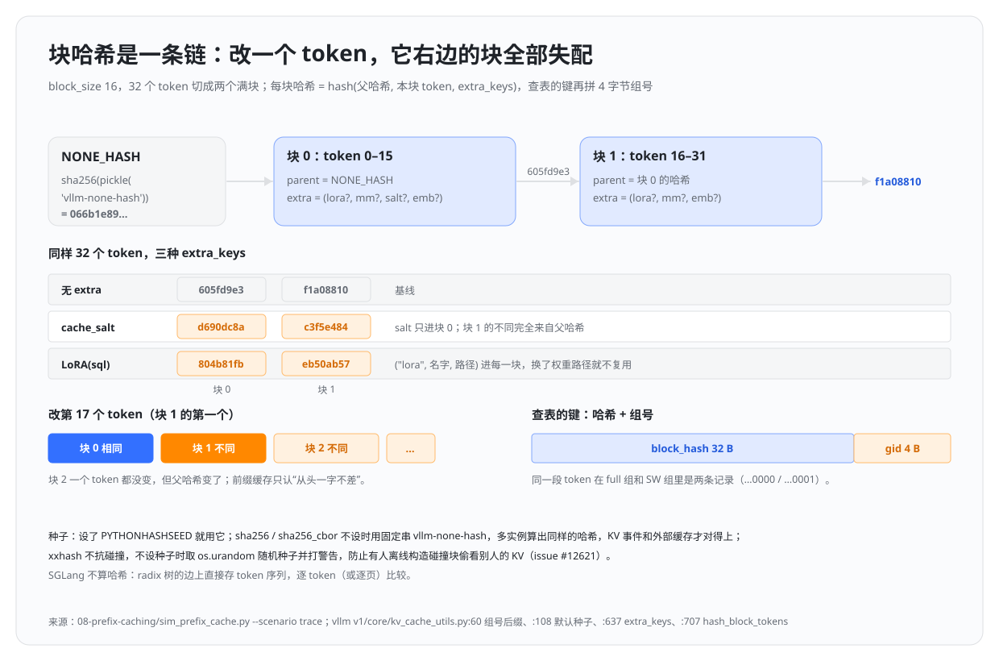
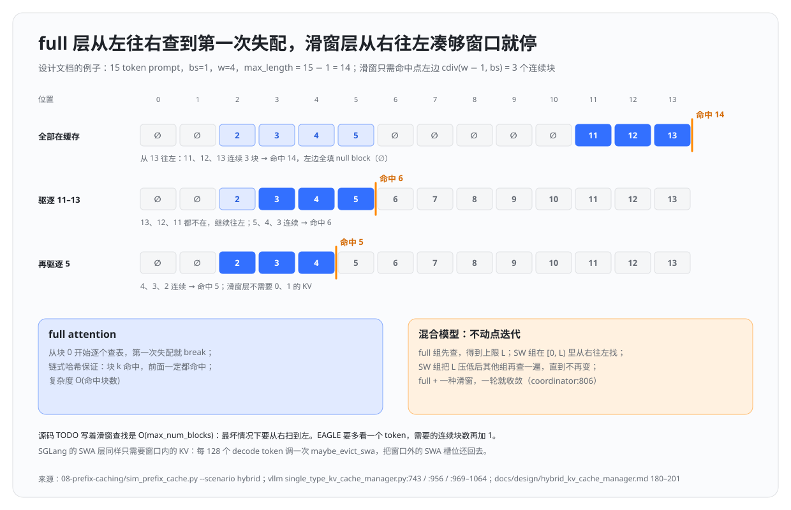
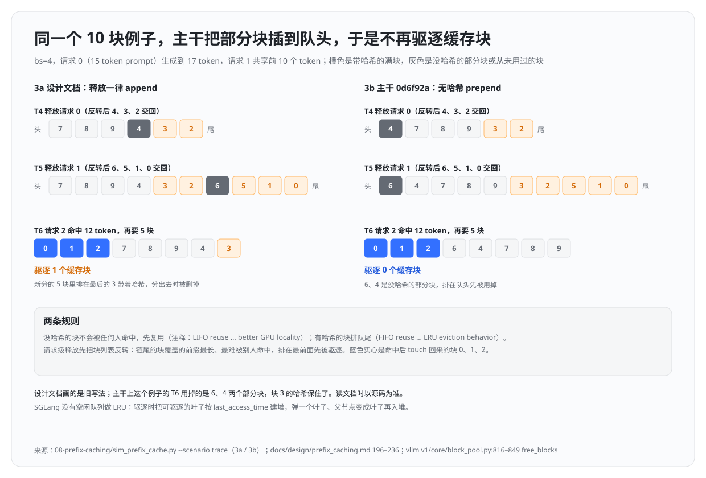
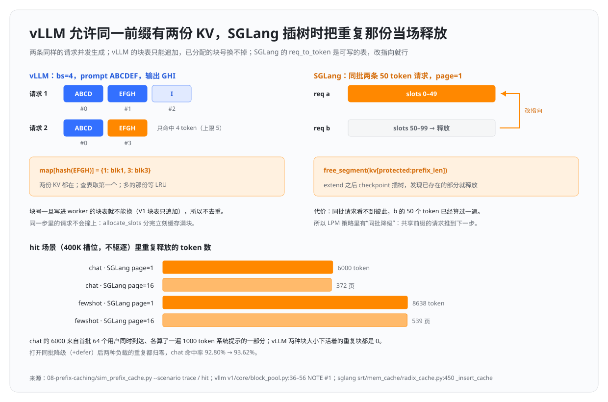
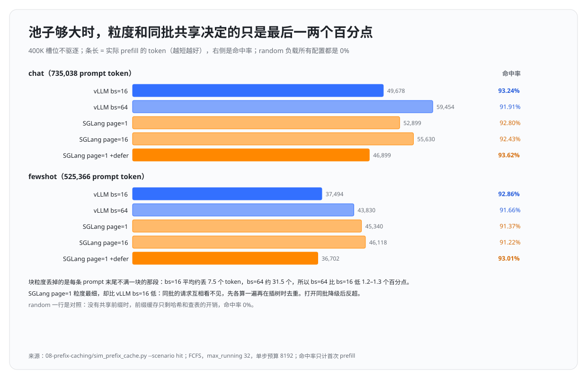
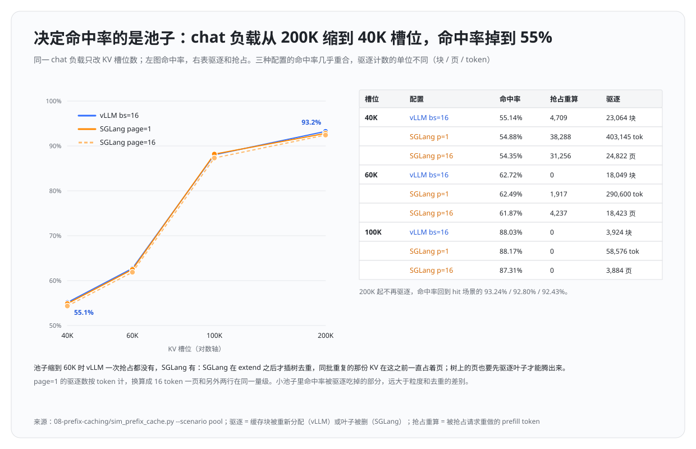
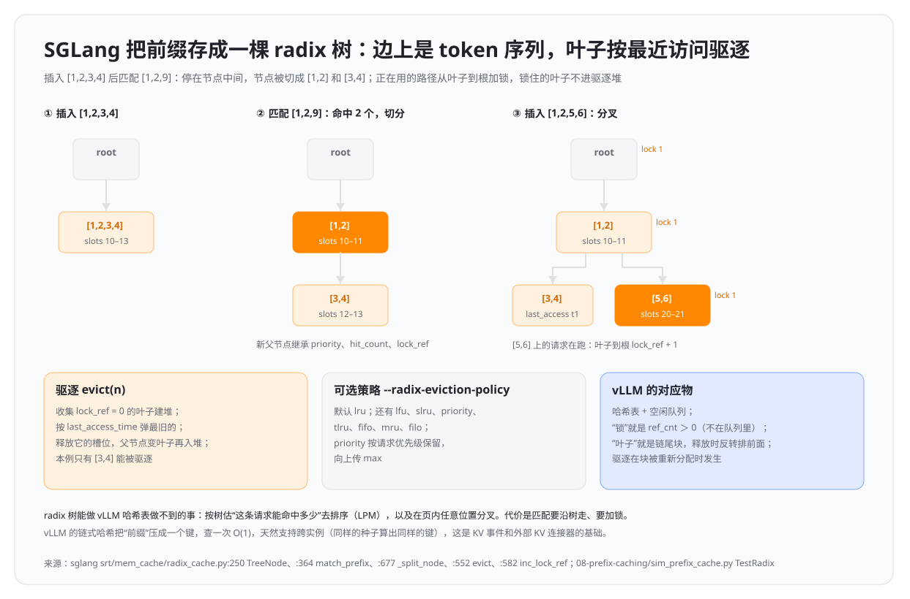
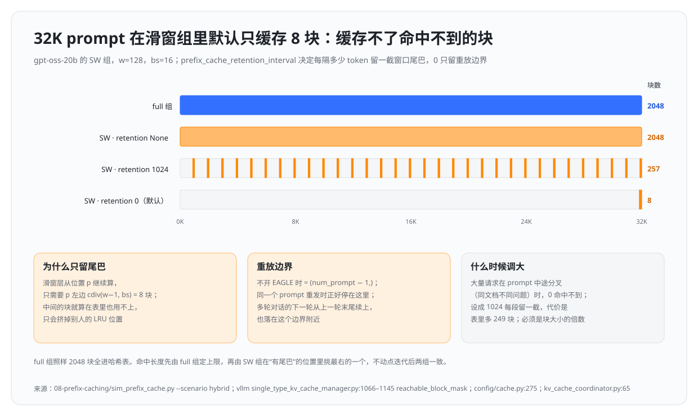
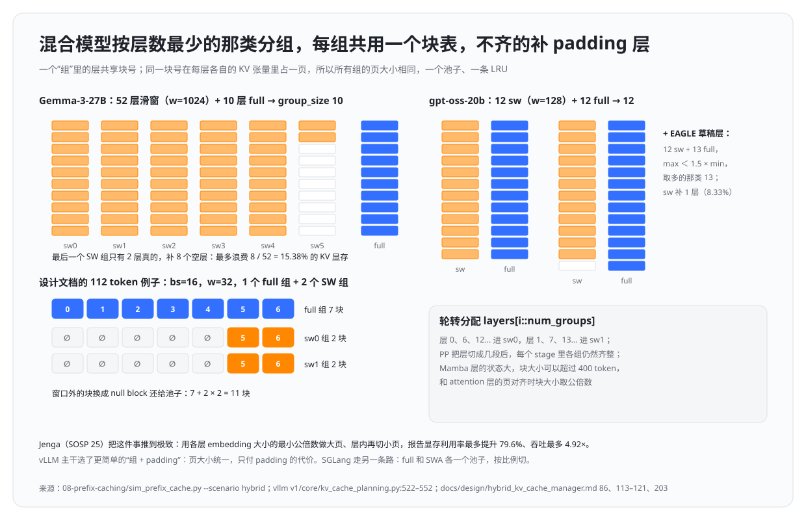
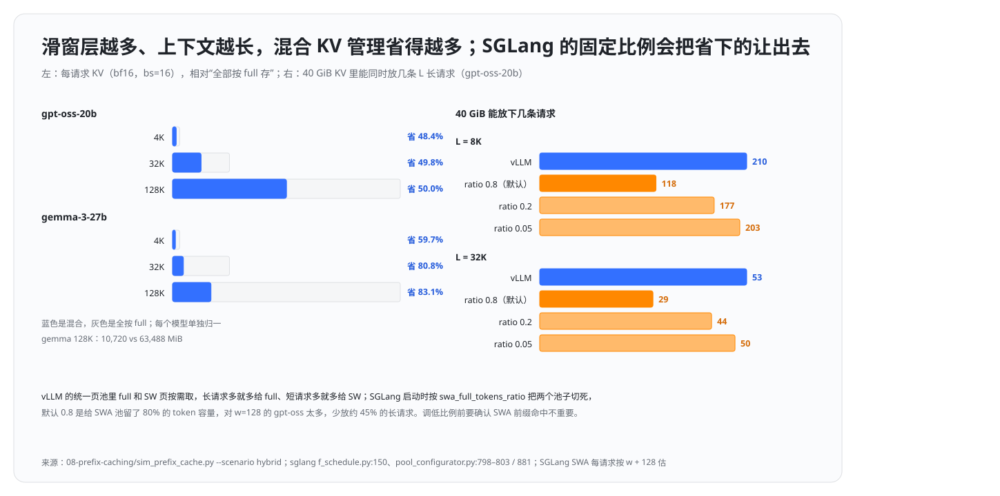

# VLLM-08｜原理｜前缀缓存与混合 KV 管理：块哈希、驱逐与 Jenga

> 🎯 **这篇文档解决什么问题**：同一个 1000 token 的系统提示，64 个用户轮流聊天，`vllm:prefix_cache_hits` 除以 `queries` 稳在 93% 上下；把 `gpu_memory_utilization` 往下调一点，命中率掉到五成，TTFT 翻倍。前缀缓存到底存在哪、按什么粒度匹配、谁先被挤掉、为什么同样的 prompt 发两遍还要重算最后一块，Gemma-3 这种 52 层滑窗 + 10 层全注意力的模型又是怎么缓存的，都在 vLLM V1 的块哈希、`BlockPool` 和 `HybridKVCacheCoordinator` 里。我们逐行读这几处代码，再和 SGLang 的 RadixAttention 放进同一个调度循环比较。
>
> **使用方式**：第 1 章讲块哈希怎么算。第 2 章讲查表和 `num_tokens − 1` 上限。第 3 章讲空闲队列和驱逐顺序。第 4 章讲重复块和 SGLang 的去重。第 5、6 章用模拟比较粒度、同批共享和池子大小。第 7 章读 SGLang 的 radix 树和 cache-aware 调度。第 8–10 章讲混合模型：滑窗查找、retention、分组、Jenga 和 SGLang 的 SWA 比例。第 11 章回顾演化、列旋钮、动手核对。基线：vLLM 主干 0d6f92a，SGLang 主干 8fabf5e。
>
> **代码**：[08-prefix-caching](../08-prefix-caching)。sim_prefix_cache.py 只依赖标准库，按源码复刻了 vLLM 的链式块哈希（sha256 + pickle、NONE_HASH、extra_keys、组号后缀）、不去重的哈希表和 LRU 空闲队列，以及 SGLang 的 radix 树（split、插入去重、叶子堆 LRU、lock_ref、extend 后 checkpoint），两边跑同一个调度循环；混合模型部分有滑窗查找、`reachable_block_mask`、分组 padding 和显存账。test_sim_prefix_cache.py 有 16 个单测；trace_prefix.md 是逐行对照表。文中的哈希值、命中率和块号都来自这个脚本。负载是合成的，只用来比较方案之间的相对差别。

# 导读 · 先给结论

## 前缀命中还要恢复状态

同一前缀在全注意力层可复用 KV，在 GDN 层还需要边界状态或相应重算。两种主例都适用这一限制，不能只验证 token 哈希命中就认定整个模型免于重算。

实验应区分冷请求、相同前缀、不同后缀和驱逐后重访，固定缓存开关与状态快照策略，检查输出一致性。公共账本 state_copies 是显式假设，不能默认等同引擎 align 模式的全部页面。

双模型结构以固定版本配置核对[[Qwen3.8-27B config.json]](https://huggingface.co/Qwen/Qwen3.8-27B/blob/37561816e66b5b9153b1b64c10968c18c1e6f4a0/config.json)[[Qwen3.5-35B-A3B config.json]](https://huggingface.co/Qwen/Qwen3.5-35B-A3B/blob/59d61f3ce65a6d9863b86d2e96597125219dc754/config.json)。

1. **前缀缓存的单位是满块，键是一条哈希链。**每块哈希 = hash(父块哈希, 本块 token, extra_keys)。改一个 token，它所在的块和右边所有块都失配。`cache_salt` 只进第一块，靠父哈希传到最后一块。LoRA 的名字和路径进每一块。默认 sha256 加固定种子，多实例之间哈希一致。
2. **同一个 prompt 发两遍，也只能命中到 n − 1。**最后一个 token 必须重新前向一次才有 logits。prompt 长度正好是块大小的倍数时，最后一整块都要重算。
3. **缓存块挂在空闲队列里，被重新分配时才驱逐。**请求结束后，有哈希的块倒序接到队尾，尾块先走；没有哈希的部分块插到队头，马上复用。主干的这个 prepend 让设计文档那个 10 块例子少驱逐了一个缓存块。
4. **vLLM 不去重，SGLang 去重。**vLLM 的块表只能追加，两条同样的请求各算一份时哈希表里挂两个块，等 LRU 挤掉多余那份。SGLang 在 extend 之后插树，发现前缀已在树里就当场释放自己那份。反过来，vLLM 分配完立刻把满块登记进哈希表，同一批后面的请求就能命中；SGLang 同批请求互相看不见，要靠 LPM 里的同批降级补回来。
5. **粒度只影响最后一两个百分点，池子大小才决定命中率。**池子够大时，vLLM bs=16 和 SGLang page=1 在 chat 负载上的命中率是 93.24% 和 92.80%；同一负载把池子从 200K 缩到 40K token，两边都掉到 55% 左右。
6. **滑窗层从右往左查，只缓存能被命中的块。**full 层从左往右查到第一次失配；滑窗层只要求最后 `cdiv(w−1, bs)` 个块连续命中。默认 retention 0 下，一个 32K prompt 在 w=128 的滑窗组里只把 8 块放进哈希表，full 组是 2048 块。
7. **混合模型按层数最少的那类分组，组间共用一个页池。**Gemma-3-27B 分成 6 个滑窗组加 1 个 full 组，补了 8 个 padding 层；128K 上下文时每请求 KV 比全按 full 存少 83.1%。SGLang 按固定比例切 SWA 池，默认 0.8，同样 40 GiB 下 gpt-oss-20b 的 32K 请求能放 29 条，vLLM 是 53 条。

# 第 1 章 · 块哈希：一条从第一块开始的链



前缀缓存要回答的问题只有一个：新请求的前 k 个 token 的 KV，是不是已经在显存里某几个块上。SGLang 论文的回答是一棵 radix 树，token 序列就是树上的路径[[1]](https://arxiv.org/abs/2312.07104)；vLLM V1 的回答是给每个满块算一个哈希，哈希里包含它前面所有 token 的信息，于是“前缀相同”就变成“逐块哈希相同”[[2]](https://docs.vllm.ai/en/latest/design/prefix_caching/)。只算满块，是因为块是分配和共享的最小单位，一个没写满的块还会被这条请求继续写，不能让别人引用。

哈希函数本身很短（[kv_cache_utils.py](https://github.com/vllm-project/vllm/blob/0d6f92a/vllm/v1/core/kv_cache_utils.py) 707 行）：

```python
def hash_block_tokens(hash_function, parent_block_hash, curr_block_token_ids, extra_keys=None):
    if not parent_block_hash:
        parent_block_hash = NONE_HASH
    curr_block_token_ids_tuple = tuple(curr_block_token_ids)
    return BlockHash(hash_function((parent_block_hash, curr_block_token_ids_tuple, extra_keys)))
```

父哈希放在三元组的第一位，第 i 块的哈希就依赖第 0 到 i−1 块的全部内容。这就是“前缀”的含义：改第 17 个 token（bs=16 时在块 1），块 0 不变，块 1 变；块 2 的 token 一个没动，但父哈希变了，它也变。模拟里的单测 `test_change_propagates_right_only` 验证的就是这件事。第一块没有父亲，用 `NONE_HASH` 代替。

## 1.1 种子：为什么默认不随机

`NONE_HASH` 是链的起点，它怎么来决定了不同进程、不同机器算出的哈希是否一致（[kv_cache_utils.py](https://github.com/vllm-project/vllm/blob/0d6f92a/vllm/v1/core/kv_cache_utils.py) 96–160 行）。规则是三层：设置了 `PYTHONHASHSEED` 就用它。没设、且哈希算法是 sha256 或 sha256_cbor 这类密码学哈希，用固定字符串 `"vllm-none-hash"`（108 行 `DEFAULT_NONE_HASH_SEED`）。算法是 xxhash 这类非密码学哈希，用 `os.urandom` 随机种子并打一条警告。

这个设计来自一次安全讨论：如果哈希可以离线预测，攻击者就能构造出和别人的块哈希相同的 token 序列，让自己的请求复用别人的 KV，或者通过 TTFT 的差别推断别人发过什么[[3]](https://github.com/vllm-project/vllm/issues/12621)。sha256 抗碰撞，种子公开也构造不出碰撞，所以可以用固定种子换来多实例一致：KV 事件发给外部路由器、KV 存进 LMCache 这类外部缓存时，不同实例对同一段前缀算出同一个键，才对得上。xxhash 快但不抗碰撞，只能靠随机种子让攻击者猜不到起点，代价是多实例之间哈希不再一致。

```text
$ python3 sim_prefix_cache.py --scenario trace
== 1. 哈希链：同样 32 个 token，bs=16 → 2 个块
  NONE_HASH = sha256(pickle('vllm-none-hash')) = 066b1e89
  无 extra      : 605fd9e3 → f1a08810
  cache_salt    : d690dc8a → c3f5e484   salt 只进块 0，块 1 因父哈希不同也变了
  LoRA(sql)     : 804b81fb → eb50ab57   LoRA 进每个块
  group 0 / 1   : …00000000 / …00000001   键长 36 字节 = 32 + 4
  改第 17 个 token：块 0 相同，块 1 不同
```

sha256 的输入是 `pickle.dumps(obj, HIGHEST_PROTOCOL)`（[hashing.py](https://github.com/vllm-project/vllm/blob/0d6f92a/vllm/utils/hashing.py) 26 行），所以模拟只要按同样的方式序列化，就能算出和 vLLM 一字不差的 `NONE_HASH`：066b1e89 开头。sha256_cbor 换成 CBOR 序列化，好处是不依赖 Python 的 pickle 格式，别的语言也能复现同一个哈希。

## 1.2 extra_keys：token 相同但 KV 不同的情况

两段 token 完全一样，KV 也可能不一样：用了不同的 LoRA 适配器、同一个占位 token 背后是不同的图片、属于不同租户不该共享。这些信息放进 `extra_keys`（[kv_cache_utils.py](https://github.com/vllm-project/vllm/blob/0d6f92a/vllm/v1/core/kv_cache_utils.py) 637–671 行 `generate_block_hash_extra_keys`），顺序是 LoRA、多模态、cache_salt、prompt_embeds：

| extra key | 内容 | 进哪些块 | 为什么 |
|-|-|-|-|
| LoRA | `("lora", lora_name, lora_path)`（590–607 行） | 每一块 | 适配器改变每层输出，KV 跟着变；路径也进哈希，同名适配器换了权重不会复用旧 KV |
| 多模态 | 块覆盖到的多模态输入的哈希和起始偏移 | 与该输入重叠的块 | 图片占位 token 都一样，内容差异在 mm 哈希里 |
| cache_salt | `("cache_salt", salt)` | 只有 `start_token_idx == 0` 的块 | 第一块不同，后面所有块的父哈希都不同，一处足够 |
| prompt_embeds | 直接输入的 embedding 张量的哈希 | 对应块 | 没有 token id 可哈希 |

cache_salt 是多租户隔离的开关。设计文档的说法是：把 salt 注入第一块的哈希，只有带相同 salt 的请求才能复用彼此的块，从而防止通过延迟差别推断缓存内容的时序攻击[[2]](https://docs.vllm.ai/en/latest/design/prefix_caching/)。OpenAI 兼容接口的请求体里直接写 `"cache_salt": "tenant-a"` 就行。trace 里 salt 那一行的块 1 哈希是 c3f5e484，它等于用 d690dc8a 当父哈希、不带任何 extra_keys 算出来的值，单测 `test_salt_and_lora` 断言了这一点。

## 1.3 组号后缀

哈希表的键是哈希后面再拼上 4 字节大端组号（60–69 行 `make_block_hash_with_group_id`），sha256 的 32 字节加 4 字节，共 36 字节。普通模型只有一个 KV 组，后缀永远是 0；混合模型（第 9 章）里同一段 token 在 full 组和滑窗组各有一份 KV，必须是两个不同的表项。块哈希在请求创建和追加 token 时增量计算（953 行 `get_request_block_hasher`），每次只算新凑满的块，所以哈希的开销和 prefill 的 token 数成正比，不会每步重算整条序列。

# 第 2 章 · 查表：命中上限是 n − 1



请求第一次被调度时，`KVCacheManager.get_computed_blocks`（[kv_cache_manager.py](https://github.com/vllm-project/vllm/blob/0d6f92a/vllm/v1/core/kv_cache_manager.py) 266–328 行）拿它的块哈希列表去查表。full attention 层的查法最直观（[single_type_kv_cache_manager.py](https://github.com/vllm-project/vllm/blob/0d6f92a/vllm/v1/core/single_type_kv_cache_manager.py) 743 行）：从第 0 块开始，逐块拼上组号查 `BlockHashToBlockMap`，命中就收下，第一次失配就 break。哈希是链式的，块 i 失配意味着前缀在块 i 或更早的地方已经分叉，后面不可能再命中，所以不需要往后看。

查之前先定上限（[request.py](https://github.com/vllm-project/vllm/blob/0d6f92a/vllm/v1/request.py) 314 行）：

```python
def get_max_cache_hit_length(self, bound=None):
    # The last token is always recomputed to produce logits.
    limits = (self.num_tokens - 1, self.prefix_cache_hit_limit, bound)
    return min(limit for limit in limits if limit is not None)
```

采样要用最后一个位置的 logits，而 logits 只在前向时产生，KV cache 里没有。所以即使整条 prompt 都在缓存里，也必须至少喂一个 token 进模型。命中又只能以块为单位，上限 n − 1 向下对齐到块边界，后果是：prompt 长度恰好是块大小的整数倍时，最后一整块都要重算。trace 里 bs=4、8 个 token 的 prompt 第二次来只命中 4 个，9 个 token 的 prompt 能命中 8 个（单测 `test_hit_cap_is_n_minus_1`）。对 bs=16、几千 token 的 prompt，这最多多算 16 个 token，可以忽略；但在复现命中率时，如果发现“完全相同的请求”命中率不是 100%，原因就在这里。

命中的块拿到后，`BlockPool.touch`（[block_pool.py](https://github.com/vllm-project/vllm/blob/0d6f92a/vllm/v1/core/block_pool.py) 792 行）把它们的 ref_cnt 加一；如果某块原来 ref_cnt 是 0，说明它正挂在空闲队列里当缓存，要从链表中间摘下来，不再参与驱逐。空闲队列是手写双向链表，摘中间节点是 O(1)，这是 VLLM-07 讲过的设计。

## 2.1 什么时候登记：分配完立刻缓存

另一半是写入。`allocate_slots`（kv_cache_manager.py 379 行）给这一步要算的 token 分配完块，紧接着在 612–626 行调用 `cache_blocks`，把所有已经满的块写进哈希表：

```python
if self.delay_cache_blocks:          # P/D 分离时远端 KV 还没到，先不登记
    return new_blocks
num_tokens_to_cache = min(num_computed_tokens + num_new_tokens, request.num_tokens)
self.coordinator.cache_blocks(request, num_tokens_to_cache)
```

注意这时候 KV 还没算，前向在后面才跑。设计文档明确说满块在分配时就缓存，这样同一批后面的请求在调度时就能命中它们[[2]](https://docs.vllm.ai/en/latest/design/prefix_caching/)：同一步里两个请求共享一个系统提示，第二个请求查表时第一个请求的块已经登记了，两者在同一次前向里共用这些块，第一个请求写 KV，第二个请求读。`min(…, request.num_tokens)` 的作用是不缓存投机解码的草稿 token，它们可能被拒绝。第 5 章会看到，这个“立刻登记”是 vLLM 和 SGLang 在同批共享上拉开差距的原因。

full attention 的查找只有这么多。滑动窗口层的查法正好反过来，从右往左，图里右半边就是它，第 8 章再讲。混合模型要在多个组之间取一个大家都能接受的命中长度，`HybridKVCacheCoordinator.find_longest_cache_hit`（[kv_cache_coordinator.py](https://github.com/vllm-project/vllm/blob/0d6f92a/vllm/v1/core/kv_cache_coordinator.py) 806–941 行）做的是不动点迭代：各组轮流把命中长度往下压，直到没有组再压。full 组的命中是前缀封闭的（长度 k 能命中，任何更短的也能），所以只查一次，之后直接截断；full 加一种其他注意力类型时一轮就收敛。

# 第 3 章 · 驱逐：缓存块就挂在空闲队列里



vLLM 没有单独的“缓存区”。一个请求结束，它的块 ref_cnt 归零，回到 VLLM-07 讲过的空闲队列；块上的哈希不清，哈希表里的条目也不删。这些块在队列里既是空闲块，又是缓存块：新请求查表命中，就 `touch` 把它摘出来复用；分配新块时从队头弹出，如果弹出的块还带着哈希，`_maybe_evict_cached_block`（block_pool.py 769 行）才把它从哈希表里删掉，并发一条 BlockRemoved 事件。驱逐要等到块被重新分配的那一刻才发生。

所以驱逐顺序就是空闲队列的顺序，由 `free_blocks`（[block_pool.py](https://github.com/vllm-project/vllm/blob/0d6f92a/vllm/v1/core/block_pool.py) 816–849 行）决定：

```python
if block.ref_cnt == 0:
    if block.block_hash is None or not self.enable_caching:
        # LIFO reuse of non-cached blocks for better GPU locality.
        blocks_to_evict_first.append(block)
    else:
        # FIFO reuse of cached blocks for LRU eviction behavior.
        blocks_to_evict_last.append(block)
self.free_block_queue.prepend_n(blocks_to_evict_first)
self.free_block_queue.append_n(blocks_to_evict_last)
```

有哈希的块接到队尾，最晚被重新分配，这是 LRU：最近释放的最晚驱逐，命中时 touch 摘出、用完再接到队尾，相当于刷新了访问时间。没有哈希的块（请求最后那个没写满的部分块）永远不会被命中，插到队头，下一次分配直接拿走，注释里说的理由是 GPU 局部性。调用方传进来的块列表是倒序的（设计文档 196 行），一条请求的尾块排在最前面：尾块的哈希覆盖最长的前缀，最不可能被别的请求复用，先驱逐它；第一块是系统提示的开头，最可能被复用，留到最后。

## 3.1 设计文档的 10 块例子，在主干上跑一遍

设计文档用一个 10 块、bs=4 的池子演示驱逐（prefix_caching.md 212–236 行）：请求 0 有 15 个 prompt token，生成 3 个。请求 1 的 14 个 token 里前 10 个和请求 0 相同。两者都结束后，请求 2 的 29 个 token 里前 12 个相同。文档里的释放一律接到队尾。主干 0d6f92a 的 `free_blocks` 对没有哈希的块改成了插到队头，同一个例子结果就不一样了。模拟把两种写法都跑了一遍，块号按文档从 0 编：

```text
== 3a. 设计文档 10 块例子，设计文档的写法（释放一律 append）
  T2 请求 0：块表 [0, 1, 2, 3, 4]
  T3 请求 1（14 token，前 10 个相同）：命中 8 token，块表 [0, 1, 5, 6]
  T4 释放请求 0：空闲队列 7-8-9-4-3-2
  T5 释放请求 1：空闲队列 7-8-9-4-3-2-6-5-1-0
  T6 请求 2（29 token，前 12 个相同）：命中 12 token，块表 [0, 1, 2, 7, 8, 9, 4, 3]，驱逐 1 个缓存块

== 3b. 设计文档 10 块例子，0d6f92a 的 free_blocks（无哈希块 prepend）
  T2 请求 0：块表 [0, 1, 2, 3, 4]
  T3 请求 1（14 token，前 10 个相同）：命中 8 token，块表 [0, 1, 5, 6]
  T4 释放请求 0：空闲队列 4-7-8-9-3-2
  T5 释放请求 1：空闲队列 6-4-7-8-9-3-2-5-1-0
  T6 请求 2（29 token，前 12 个相同）：命中 12 token，块表 [0, 1, 2, 6, 4, 7, 8, 9]，驱逐 0 个缓存块
```

T3 请求 1 只命中 8 个 token，没到 10 个：块 2 装的是 token 9–12，请求 1 只有 9、10 相同，块哈希不同。T4 请求 0 释放时，块 4 只写了 18 − 16 = 2 个 token，没有哈希。3a 里它跟着倒序接到队尾，排在 7、8、9 后面；3b 里它插到队头。到 T6，请求 2 需要 5 个新块：3a 从队头拿 7、8、9、4，再拿第五块时碰到了块 3，它带着哈希，被驱逐；3b 里队头是请求 1 的部分块 6 和请求 0 的部分块 4，加上 7、8、9 正好 5 块，一个缓存块都没碰。

> 💡 设计文档的例子画的是“释放一律 append”的行为，主干代码已经不是这样。读文档时以 `free_blocks` 的代码为准：部分块插队头，满块倒序接队尾。对线上服务的含义是，部分块总是先被重用，缓存块被挤掉的时间推迟了；在池子紧张的负载下，这个差别会体现在命中率上，但量级取决于请求长度分布，模拟里的单个例子只能说明方向。单测 `test_doc_example_queue` 断言了 3a 的完整队列顺序，`test_free_reversed_tail_first` 断言了倒序。

还有一个容易忽略的推论：vLLM 的驱逐不看树结构。一条前缀中间的块被驱逐，它后面的块哈希还在表里，但查表从左往右遇到第一个失配就停，这些块再也不可能被命中，只能等 LRU 轮到它们。倒序释放让这种情况少见，因为同一条请求里靠后的块总是先走。但不同请求共享前缀时，一个被频繁 touch 的中间块可能比它下游的块更晚回到队尾，于是下游块先被驱逐，这没问题。反过来的情况在 LRU 下也可能发生。SGLang 的 radix 树只驱逐叶子（第 7 章），结构上排除了这种浪费。

# 第 4 章 · 重复块：vLLM 不去重，SGLang 插树时去重



`BlockHashToBlockMap` 的 docstring 第一条 NOTE 写得很直白（[block_pool.py](https://github.com/vllm-project/vllm/blob/0d6f92a/vllm/v1/core/block_pool.py) 36–56 行）：不去重。一个块写满了就登记，不检查表里是不是已经有一个哈希相同的块。原因是块表只能追加：块号已经交给 worker，worker 的块表、slot_mapping 都按这个块号写 KV，调度器不能事后把它换成另一个块号。于是同一个哈希可以对应多个块，表项的值从单个块升级成 `{block_id: block}` 的字典（84–96 行 `insert`），查表时取第一个（62–71 行）。

重复块什么时候出现？设计文档举的例子（prefix_caching.md 157–194 行）是两条完全相同的请求一前一后：prompt ABCDEF，bs=4，输出 GHI。

```text
== 2. 重复块：bs=4，prompt ABCDEF，输出 GHI（设计文档 Duplicated blocks）
  请求 1 Time 2：块表 [0, 1, 2]，已写 KV 9 token
  请求 2 Time 0：命中 4 token（ABCDEF 的上限是 5，只够 1 块），块表 [0, 3]
  请求 2 Time 1：块表 [0, 3]；哈希 EFGH 挂着块 [1, 3]，重复 1 个
  两个请求都释放后：哈希 EFGH 仍挂着块 [1, 3]（free_blocks 只动 ref_cnt 和队列，不删哈希；多余那份等 LRU 轮到它）
```

请求 2 到达时，请求 1 的块 1 已经是满块 EFGH，但请求 2 只有 ABCDEF 六个 prompt token，上限 5，只能命中块 0；EF 两个 token 写进新分配的块 3。等请求 2 生成了 G、H，块 3 也写成 EFGH，登记进表，于是同一个哈希挂了两个块。两个请求结束后两块都回到队列，多余那份要等 LRU 把它挤掉。

SGLang 的处理完全不同。它的 KV 是按 token 槽位管的（VLLM-07 讲过 `req_to_token` 表），请求的每个位置指向哪个槽位可以随时改。一个 extend chunk 算完后，`checkpoint_kv_cache`（[[4]](https://github.com/sgl-project/sglang/blob/8fabf5e/python/sglang/srt/mem_cache/common.py)，271 行）把这条请求已算的部分插进 radix 树；`_insert_cache`（[[5]](https://github.com/sgl-project/sglang/blob/8fabf5e/python/sglang/srt/mem_cache/radix_cache.py)，450 行）发现前缀已经在树里，就调 `free_segment(kv_indices[cache_protected_len:prefix_len])` 把自己那份槽位释放，再把 `req_to_token` 那一行改指向树里的槽位。重复只存在于这一个 chunk 的计算期间，算完就消失。

模拟里同时送进两条相同的 50 token 请求，SGLang 插树时释放了 50 个重复 token，两条请求最后指向同一组槽位（单测 `test_sglang_dedup_on_checkpoint`）。两条同样的请求在 vLLM 里各自生成到第二块写满，哈希表里会有 1 个重复块（`test_no_dedup`）。图下半部分是第 5 章 hit 场景的统计：chat 负载上 SGLang page=1 释放了 6000 个重复 token，page=16 释放了 372 页；fewshot 上是 8638 个 token 和 539 页。vLLM 那一列是 0，原因是第 2 章的“分配完立刻登记”：同批后面的请求直接命中前面请求刚登记的块，根本不会算出第二份。

|  | vLLM V1 | SGLang |
|-|-|-|
| 重复怎么产生 | 命中上限截断（上例）；或两条请求在登记前各自分到新块 | 同一批里共享前缀的请求互相看不见，各算一份 |
| 重复怎么消失 | 不主动消失，多余那份等 LRU 驱逐 | extend 后插树时当场 `free_segment` |
| 为什么 | 块表只追加，块号不能换 | `req_to_token` 可以改写，槽位能换 |
| 同批共享 | 天然支持：分配时登记，同步后面的请求立刻命中 | 需要调度器配合：LPM 的同批降级（第 7 章） |

被抢占的请求也有差别。SGLang retract 一条请求时走 `release_kv_cache(…, checkpoint=False)`（common.py 418 行），不把它已经算出的 KV 插进树，代码里留了 TODO 说以后可以插；vLLM 被抢占请求的满块早在分配时就登记过，释放后照样挂在 LRU 里，重新调度时能命中自己之前的块。第 6 章池子很小时抢占重算量差一个数量级，这是原因之一。

# 第 5 章 · 命中率实验：粒度与同批共享



块粒度丢掉的是每段前缀最后不满一块的那部分。SGLang 默认一页一个 token，理论上能命中到最后一个相同的 token；vLLM bs=16 平均每次少命中约 8 个 token。这个差别在真实负载上有多大？模拟把 vLLM 和 SGLang 的缓存结构放进同一个调度循环：FCFS，最多 32 条 running，单步 prefill 预算 8192 token，块不够时从 running 队尾抢占并重算。命中率 = 首次 prefill 时命中的 token / prompt token 总数，抢占后的重算不计入分母，这和 vLLM 的 `PrefixCacheStats` 把 preempted 请求单独记账的口径一致（[stats.py](https://github.com/vllm-project/vllm/blob/0d6f92a/vllm/v1/metrics/stats.py) 121 行）。

三种负载：**chat** 是 64 个用户共用 1000 token 系统提示，各聊 6 轮，每轮 prompt = 上一轮 prompt + 上一轮输出 + 新消息（均值 120），输出均值 200。**fewshot** 是 400 条请求随机套用 4 个 1234 token 的模板，问题均值 80，输出均值 150。**random** 是 400 条互不相同的请求，prompt 均值 1300。池子开到 400K token，保证不发生驱逐，只看粒度和同批共享。

```text
$ python3 sim_prefix_cache.py --scenario hit
[chat] prompt token 总数 735038
            配置 |   命中率 | 实际 prefill | 重复块/页 |  步数
    vLLM bs=16 |  93.24% |        49678 |         0 |  2757
    vLLM bs=64 |  91.91% |        59454 |         0 |  2757
  SGLang page=1 |  92.80% |        52899 |      6000 |  2773
  SGLang page=16 |  92.43% |        55630 |       372 |  2773
  SGLang page=1 +defer |  93.62% |  46899 |         0 |  2773

[fewshot] prompt token 总数 525366
    vLLM bs=16 |  92.86% |        37494 |         0 |  2087
    vLLM bs=64 |  91.66% |        43830 |         0 |  2087
  SGLang page=1 |  91.37% |        45340 |      8638 |  2088
  SGLang page=16 |  91.22% |        46118 |       539 |  2088
  SGLang page=1 +defer |  93.01% |  36702 |         0 |  2088

[random] prompt token 总数 555925：所有配置命中率 0.00%，prefill 555925，2169 步
```

第一个结论：**粒度影响很小**。vLLM 从 bs=16 换到 bs=64，chat 命中率掉 1.33 个百分点，实际 prefill 从 49,678 涨到 59,454 token，多出约 20%；但相对 735,038 的 prompt 总量，这是零头。SGLang page=1 和 page=16 之间只差 0.37 个百分点。前缀缓存的收益主要来自几百上千 token 的系统提示和对话历史，块尾那几个 token 不是主角。

第二个结论：**同批共享比粒度更重要**。按粒度，SGLang page=1 应该比 vLLM bs=16 命中更多，结果反而少 0.44 个百分点，prefill 多 3,221 token。差距正好来自重复：第一步的 8192 预算能收下 7 条首轮请求，它们共用的 1000 token 系统提示在 SGLang 里被算了 7 遍，插树时释放 6 份，就是 6000 个重复 token；page=16 时 1000 token 里只有 62 个满页可共享，6 份就是 372 页。vLLM 第一条请求的块分配完就登记，后面 6 条在同一步里直接命中。

SGLang 自己知道这个问题。LPM 调度策略里有一段同批前缀检查（[[6]](https://github.com/sgl-project/sglang/blob/8fabf5e/python/sglang/srt/managers/schedule_policy.py)，106–118 行和 356–406 行）：一条请求在树里的已命中长度不超过 `IN_BATCH_PREFIX_CACHING_CHECK_THRESHOLD = 32` 时，再拿它去和本批已经收下的请求建的临时树匹配，如果共享前缀达到 `IN_BATCH_PREFIX_CACHING_DEPRIORITIZE_THRESHOLD = 32`，就把它推到下一步，等前一条算完插树后再来命中。模拟的 `+defer` 一行打开了这个降级：chat 命中率升到 93.62%，fewshot 升到 93.01%，都超过了 vLLM bs=16，重复归零。这时 token 粒度的优势才显出来。代价是被推迟的请求多等一步，步数 2773 比 vLLM 的 2757 多 16 步。

> 💡 SGLang 的默认调度策略是 fcfs（[[7]](https://github.com/sgl-project/sglang/blob/8fabf5e/python/sglang/srt/arg_groups/f_schedule.py)，86–102 行），不做同批降级；lpm、dfs-weight 这些 cache-aware 策略要显式打开。所以默认配置下，SGLang 更接近 page=1 那一行，离 +defer 那一行远。random 负载三边都是 0%，说明在没有共享前缀的负载上，两套前缀缓存都不会凭空多出命中，开销只剩算哈希和维护数据结构。V1 发布时把前缀缓存改成默认开启，理由就是命中率为 0 时开销也很小[[8]](https://vllm.ai/blog/2025-01-27-v1-alpha-release)。

# 第 6 章 · 命中率由池子大小决定



上一章的池子足够大，什么都不驱逐。线上的 KV 池是 `gpu_memory_utilization` 减去权重和激活剩下的那块，正在跑的请求要用，缓存只能占剩下的。把 chat 负载的池子从 200K token 缩到 40K：

```text
$ python3 sim_prefix_cache.py --scenario pool
          槽位 |         配置 |  命中率 | 抢占重算 | 驱逐块/页 |  步数
         40000 |   vLLM bs=16 |  55.14% |     4709 |     23064 |  3004
         40000 | SGLang page=1 |  54.88% |    38288 |    403145 |  3007
         40000 | SGLang page=16 |  54.35% |    31256 |     24822 |  3014
         60000 |   vLLM bs=16 |  62.72% |        0 |     18049 |  2757
         60000 | SGLang page=1 |  62.49% |     1917 |    290600 |  2773
         60000 | SGLang page=16 |  61.87% |     4237 |     18423 |  2773
        100000 |   vLLM bs=16 |  88.03% |        0 |      3924 |  2757
        100000 | SGLang page=1 |  88.17% |        0 |     58576 |  2773
        100000 | SGLang page=16 |  87.31% |        0 |      3884 |  2773
        200000 |   vLLM bs=16 |  93.24% |        0 |         0 |  2757
        200000 | SGLang page=1 |  92.80% |        0 |         0 |  2773
        200000 | SGLang page=16 |  92.43% |        0 |         0 |  2773
```

200K 时没有驱逐，命中率就是上一章的数。100K 时开始驱逐，命中率还在 88% 左右；60K 掉到 62% 左右，40K 掉到 55% 左右。三种配置在每个池子大小上的差距都不超过 1 个百分点，而同一配置在 200K 和 40K 之间差了 38 个百分点。chat 负载的工作集是 64 个用户各自不断增长的对话历史，池子装不下全部历史时，LRU 会把很快又要被续写的历史挤掉。

驱逐列的单位不同：vLLM 和 SGLang page=16 是块或页（16 token），SGLang page=1 是 token，所以 403,145 和 23,064 不能直接比，折成 token 后 vLLM 的 23,064 块约是 369K token，量级相当。抢占重算差得多：40K 时 vLLM 重算 4,709 个 token，SGLang 是 3 万多。一个原因是第 4 章说的被 retract 的请求不插树，重来时没有缓存可用；另一个是 SGLang 在 extend 之后才去重，一个 chunk 计算期间重复的那份也占着槽位，池子紧张时更容易挤出抢占，60K 时 vLLM 已经不抢占而 SGLang 还有一两千 token 的重算，主要是后者。

> 💡 这一章的结论直接对应调参：命中率掉了，先看 KV 池大小和并发，块大小往后放。`vllm:kv_cache_usage_perc` 只统计被请求持有的块，挂在 LRU 里的缓存块算空闲，所以它不高也不代表缓存够用。判断缓存是否被挤，要看命中率随负载上升是否下降。能做的事按效果排：提高 `gpu_memory_utilization`，降低 `max_num_seqs` 让 running 少占块，或者用 VLLM-14 的 CPU 卸载把缓存层扩到主存。

# 第 7 章 · SGLang 的 radix 树与 cache-aware 调度



RadixAttention 把所有缓存的前缀存成一棵 radix 树：每条边是一段 token 序列，节点的 value 是这段 token 对应的 KV 槽位，从根到某个节点的路径就是一段完整前缀[[1]](https://arxiv.org/abs/2312.07104)。节点结构在 [[5]](https://github.com/sgl-project/sglang/blob/8fabf5e/python/sglang/srt/mem_cache/radix_cache.py) 250 行 `TreeNode`：key、value（槽位张量）、children、parent、`lock_ref`、`last_access_time`、`hit_count`、`priority`；277 行的 `__lt__` 按 `last_access_time` 比较，堆里最久没访问的排最前。

四个操作：

| 操作 | 源码 | 做什么 |
|-|-|-|
| 匹配 | `match_prefix` 364，`_match_prefix_helper` 651 | 按 page 对齐后沿树走，返回命中的槽位和最后一个节点。沿途更新访问时间。命中停在某条边中间时调 `_split_node` 把边切开 |
| 切分 | `_split_node` 677 | 新建一个父节点承接前半段，原节点保留后半段；新父节点继承 priority、hit_count 和 lock_ref |
| 插入 | `insert` 428，`_insert_helper` 705 | 沿树走到分叉点，剩下的部分挂成新叶子。返回已在树里的长度，调用方据此释放重复槽位。新节点计入 `evictable_size_` |
| 驱逐 | `evict` 552 | 收集所有 lock_ref 为 0 的叶子建堆，弹出最旧的释放槽位；父节点如果因此变成叶子，再入堆 |

正在跑的请求用 `inc_lock_ref` / `dec_lock_ref`（582 / 597 行）锁住从它的最后一个节点到根的整条路径，路径上的节点 lock_ref 从 0 变 1 时从 `evictable_size_` 里减掉，变回 0 时加回去。被锁的节点不会被驱逐。模拟里的单测 `test_lru_leaf_and_lock` 复现了这三件事：最近访问的叶子最后走，被锁的叶子驱逐不了，解锁后可以。

和 vLLM 对照，两边其实在存同一棵树。vLLM 的链式哈希把路径编码进了每个块的哈希，哈希表就是把这棵树拍平成一张表，查表从左往右逐块走，等价于沿树往下走。区别在边界上：radix 树的节点可以从任意 token 处切开，vLLM 只能在块边界分叉。radix 树只驱逐叶子，vLLM 的 LRU 可能先驱逐中间块，让下游块白占着。radix 树要在插入时去重，vLLM 用重复换来了块表只追加。

## 7.1 驱逐策略

SGLang 的驱逐策略可以换（[[9]](https://github.com/sgl-project/sglang/blob/8fabf5e/python/sglang/srt/arg_groups/f_memory.py)，25–42 行 `--radix-eviction-policy`）：默认 lru。lfu 按命中次数。slru 是分段 LRU，命中次数超过阈值的进保护段。priority 先驱逐低优先级请求留下的节点。tlru 是 Tail-Optimized LRU[[10]](https://arxiv.org/abs/2510.15152)，优先驱逐对话里不会影响尾部 TTFT 的部分，再退回 LRU。另外还有 fifo、mru、filo。vLLM 只有一种：空闲队列的顺序就是驱逐顺序，所有 KV 组共用这一个 LRU（hybrid_kv_cache_manager.md 203 行）。

## 7.2 cache-aware 调度

radix 树让 SGLang 可以按命中长度排等待队列。LPM（longest prefix match）把命中最长的请求排前面，dfs-weight 按树的深度优先顺序调度，让共享前缀的请求挨着跑（[[6]](https://github.com/sgl-project/sglang/blob/8fabf5e/python/sglang/srt/managers/schedule_policy.py)，172 行 `CacheAwarePolicy`，213 行 `calc_priority`）。代价是每次调度都要对等待队列里的每条请求做一次树匹配，所以 `_determine_active_policy`（314–325 行）在等待队列超过 128 条时把 LPM 退回 FCFS。

vLLM V1 的调度策略只有 fcfs 和 priority（[scheduler.py](https://github.com/vllm-project/vllm/blob/0d6f92a/vllm/config/scheduler.py) 21 行），不按命中长度重排。它在同批共享上的优势来自第 2 章的立刻登记，不来自调度；跨批次的前缀局部性则交给集群层：路由器按前缀把请求发到同一个实例，VLLM-19 再讲。

# 第 8 章 · 滑动窗口层：从右往左查，只缓存能命中的块



gpt-oss-20b 的 24 层里一半是窗口 128 的滑动窗口注意力，Gemma-3-27B 的 62 层里 52 层是窗口 1024 的滑窗。滑窗层算第 t 个 token 时只看最近 w 个 token 的 KV，更早的块对它没用。这改变了“命中”的定义：full 层要命中 [0, k) 的全部块，滑窗层只需要 [k − w + 1, k) 这一段在缓存里。

所以滑窗层的查找从右往左（[single_type_kv_cache_manager.py](https://github.com/vllm-project/vllm/blob/0d6f92a/vllm/v1/core/single_type_kv_cache_manager.py) 969–1064 行）：先把整条块表填成 null block，从上限位置往左扫，连续命中的块数凑够 `_contiguous_blocks_for_hit`（956 行，`cdiv(w − 1, bs)`，开 EAGLE 再加 1）就停，命中长度就是那段连续块的右端；中途遇到缺失就清零重数。设计文档的例子是 w=4、bs=1、15 个 token，缓存了位置 2–5 和 11–13（hybrid_kv_cache_manager.md 180–188 行）：

```text
$ python3 sim_prefix_cache.py --scenario hybrid
== 1. 滑窗命中（设计文档：w=4，bs=1，15 token prompt）
  缓存位置 [2, 3, 4, 5, 11, 12, 13]，max_length=14（15-1）
  从右往左：命中长度 14
  块 11-13 被驱逐后：6
  再驱逐块 5：5
```

w=4 需要 3 个连续块。11–13 正好 3 个，命中 14。它们被驱逐后，2–5 的右端 3–5 凑够，命中 6。再驱逐 5，只剩 2–4，命中 5。命中长度左边那些位置不需要在缓存里，块表里填 null block 占位。源码的 TODO 注明这个扫描是 O(max_num_blocks)。

## 8.1 只缓存能被命中的块

既然滑窗层只需要命中点前面的 w 个 token，那一个 32K prompt 在滑窗组里的 2048 个块，绝大多数永远不会被用到：命中点只可能出现在少数几个位置。`prefix_cache_retention_interval`（[cache.py](https://github.com/vllm-project/vllm/blob/0d6f92a/vllm/config/cache.py) 275 行）控制滑窗组和 Mamba 组把哪些块登记进哈希表，由 `reachable_block_mask`（single_type_kv_cache_manager.py 1066–1145 行）算出一个掩码交给 `cache_full_blocks`：

| 取值 | 含义 | 32K prompt，w=128，bs=16 |
|-|-|-|
| None | 稠密，全部登记 | 2048 / 2048 |
| 0（默认） | 只留语义检查点：最近的重放边界 + 与其他请求的分叉点 | 8 / 2048 |
| 正数（如 1024） | 另外每隔这么多 token 留一段窗口尾巴，必须是 scheduler block size 的倍数 | 257 / 2048 |

重放边界是 `replay_boundaries`（kv_cache_coordinator.py 65 行），不用 EAGLE 时等于 `(num_prompt − 1,)`，也就是同一个 prompt 再发一遍时的命中位置（第 2 章的 n − 1 上限）。它前面 `cdiv(127, 16) = 8` 个块就是 retention 0 时登记的全部。分叉点是 `get_computed_blocks` 里的 `shared_prefix_boundary`（kv_cache_manager.py 323 行）：这条请求查表时 full 组命中得更长、滑窗组因为稀疏保留落在后面，二者之差就是它和别的请求共享、但滑窗组还没留检查点的那段前缀，注释里称为 junction，要给这里也留一段窗口尾巴。Marconi 论文对混合模型的前缀缓存提出了同样的思路：只在可能被复用的位置（比如共享前缀的分叉点）保存状态检查点，报告最多 34.4 倍的 token 命中率提升和最多 71.1%（617 ms）的 TTFT 降低[[11]](https://arxiv.org/abs/2411.19379)。

> 💡 retention 0 的含义是：一条新请求只有在恰好落在别人的重放边界或分叉点上时，滑窗组才能命中。多轮对话里第 k+1 轮的 prompt 包含第 k 轮的全部 prompt 和输出，第 k 轮的重放边界在 prompt 末尾，第 k+1 轮查表时 full 组能命中到第 k 轮的输出末尾，滑窗组却只能命中到第 k 轮 prompt 末尾，混合模型的命中长度取两者的最小值。如果你的负载是这种多轮续写，又发现混合模型的命中率明显低于纯 full 模型，试一个正的 retention（比如 1024 或 2048），代价是滑窗组多登记一些块，在 LRU 里多占一些位置。

滑窗层的另一个优化在分配侧：`get_num_skipped_tokens`（1148 行）返回 `max(0, n − w + 1)`，窗口以外的块在请求还在跑的时候就可以还给池子。VLLM-07 第 4 章提到的“先还滑动窗口外的块”就是这个。

# 第 9 章 · 分组：一个页池放下几种注意力



混合模型的麻烦在于，不同类型的层每个 token 需要的 KV 不一样多，保留的范围也不一样。最朴素的做法是每类层各开一个池子，但池子之间不能互相借用，比例定死了就会一边满一边空。vLLM 的混合 KV 管理器选择了另一条路：所有层共用一个页池，每页字节数相同，靠分组让每个块表管理同样多的层[[12]](https://docs.vllm.ai/en/latest/design/hybrid_kv_cache_manager/)。

分组规则在 [kv_cache_planning.py](https://github.com/vllm-project/vllm/blob/0d6f92a/vllm/v1/core/kv_cache_planning.py) 522–552 行。先定 group_size：取层数最少的那类注意力的层数；如果最多的那类不到最少那类的 1.5 倍，就取最多的那类，避免组太多。然后每类层按 group_size 切成若干组，凑不齐的补 padding 层，并打出警告 `Add %d padding layers, may waste at most %.2f%% KV cache memory`，百分比是 padding 层数除以该类层数。分组用 `layers[i::num_groups]` 轮转分配，PP 把层切到不同 stage 后，每个 stage 的组仍然齐整。

```text
== 3. 分组与 padding（kv_cache_planning.py:522）
  gpt-oss-20b        group_size=12：sw 1 组 + 0 padding 层 (0.00%)，full 1 组 + 0 padding 层 (0.00%)
  gpt-oss-20b+eagle  group_size=13：sw 1 组 + 1 padding 层 (8.33%)，full 1 组 + 0 padding 层 (0.00%)
  gemma-3-27b        group_size=10：sw 6 组 + 8 padding 层 (15.38%)，full 1 组 + 0 padding 层 (0.00%)

== 4. 设计文档 112 token 例子（bs=16，w=32，1 full 组 + 2 sw 组）
  full 组 7 块，每个 sw 组 2 块，共 11 块
```

gpt-oss-20b 是 12 层滑窗加 12 层 full，正好两组。加上 EAGLE 草稿层后 full 变成 13 层，13  1.5 × 10，group_size 取 10，滑窗切成 6 组共 60 个位置，补 8 层，最多浪费 15.38%（设计文档 113–121 行）。

每组一个块表，同一组的层共用块号，一个块号对应组里每层各一页，所以每组每块的字节数相同，可以从同一个池子里分。112 token 的例子里，full 组 7 块全留着，两个滑窗组各只需要窗口覆盖的 2 块，一共 11 块（设计文档 86 行）。同一段 token 在每个组里各有一个块，哈希表的键带组号区分（第 1 章），`get_cached_block`（block_pool.py 202–228 行）对每个组拼键查，任何一组缺失就算未命中。所有组共用一个 LRU。

Mamba 层把这个机制推到了边界：一层 Mamba 的状态是固定大小，跟 token 数无关，为了和注意力层的页对齐，Mamba 组的块大小可能超过 400 个 token（设计文档 144 行）；命中时的对齐粒度由 `_cache_hit_alignment_tokens`（kv_cache_coordinator.py 709 行）给出，默认是 scheduler block size，即各组块大小的公倍数。retention 的正数取值必须是它的倍数，校验在 kv_cache_coordinator.py 33–62 行。

同样的问题，Jenga 的方案走得更远：按各层 embedding 大小的最小公倍数切大页，大页里再按各层需要切小页，同时按层的类型定制驱逐和前缀匹配，论文报告显存利用率最多提高 79.6%，吞吐最多 4.92 倍[[13]](https://arxiv.org/abs/2503.18292)。vLLM 的分组 + padding 是一个更简单的近似：页大小统一，代价就是那几个 padding 层。

# 第 10 章 · 混合 KV 的显存账：vLLM 统一页池 vs SGLang 固定比例



分组之后，滑窗层每条请求只占窗口那几块，省下的显存全部回到统一页池，给别的请求用。模拟按 bf16、bs=16 算每条请求的 KV 占用，和“所有层都按 full attention 存”比较：

```text
== 5. 每请求 KV 占用（bf16，bs=16），相对全部按 full attention 存
  gpt-oss-20b  L=  4096：混合     99.0 MiB，全 full    192.0 MiB，省  48.4%（页 384 KiB）
  gpt-oss-20b  L= 32768：混合    771.0 MiB，全 full   1536.0 MiB，省  49.8%（页 384 KiB）
  gpt-oss-20b  L=131072：混合   3075.0 MiB，全 full   6144.0 MiB，省  50.0%（页 384 KiB）
  gemma-3-27b  L=  4096：混合    800.0 MiB，全 full   1984.0 MiB，省  59.7%（页 1280 KiB）
  gemma-3-27b  L= 32768：混合   3040.0 MiB，全 full  15872.0 MiB，省  80.8%（页 1280 KiB）
  gemma-3-27b  L=131072：混合  10720.0 MiB，全 full  63488.0 MiB，省  83.1%（页 1280 KiB）
```

gpt-oss-20b 每层每 token 的 KV 是 2 × 8 头 × 64 维 × 2 字节 = 2 KiB，一组 12 层、一页 16 token，就是 384 KiB。它一半层是滑窗，上下文越长越接近省一半。Gemma-3-27B 每层每 token 是 2 × 16 × 128 × 2 = 8 KiB，组大小 10，一页 1280 KiB；它 52/62 的层是滑窗，但窗口 1024 比 gpt-oss 大 8 倍，4K 时只省 59.7%，128K 时省到 83.1%。

SGLang 对 SWA 模型的处理是两个池子：full 层一个，滑窗层一个，大小按 `--swa-full-tokens-ratio` 固定比例切（[[7]](https://github.com/sgl-project/sglang/blob/8fabf5e/python/sglang/srt/arg_groups/f_schedule.py) 150 行，默认 0.8，范围 (0, 1]）。`pool_configurator.py`（[[14]](https://github.com/sgl-project/sglang/blob/8fabf5e/python/sglang/srt/mem_cache/pool_configurator.py)，798–803 和 881 行）把每 token 的字节数算成 full_cell + ratio × swa_cell，用可用显存除出 full 池的 token 数，SWA 池取 `align(int(full × ratio))`。滑窗外的 SWA 槽位由 `maybe_evict_swa`（[[15]](https://github.com/sgl-project/sglang/blob/8fabf5e/python/sglang/srt/managers/schedule_batch.py)，4075 行）每 `SGLANG_SWA_EVICTION_INTERVAL = 128` 个 decode token 回收一次。

```text
== 6. 同样 40 GiB，能同时放下几条 L 长请求（gpt-oss-20b）
  L= 8192：vLLM 210；ratio 0.8: 118；ratio 0.2: 177；ratio 0.05: 203
  L=32768：vLLM 53；ratio 0.8: 29；ratio 0.2: 44；ratio 0.05: 50
```

默认 0.8 意味着 SWA 池能放 full 池 80% 的 token，对 w=128 的 gpt-oss 来说远多于需要：每条长请求在 SWA 池里只占窗口加回收间隔那么点，大部分 SWA 池空着，full 池先满。同样 40 GiB，32K 请求 vLLM 能放 53 条，SGLang 默认 29 条，把比例调到 0.05 才到 50 条。这里 SGLang 每请求的 SWA 占用按 w + 128 估，只作量级参考。

> 💡 调低 `swa_full_tokens_ratio` 不是免费的：SWA 池小了，能保留的滑窗前缀检查点也少，混合模型的前缀命中会下降。vLLM 统一页池没有这个比例要调，代价是第 8 章的 retention 和第 9 章的 padding。两边都在用不同方式回答同一个问题：滑窗层省下来的显存，给并发还是给缓存。Marconi 讨论的也是这个权衡" + R("marconi") + "。

# 第 11 章 · 演化、旋钮与动手核对

## 11.1 演化

vLLM 最早的前缀共享，来自 PagedAttention 论文里的块共享和引用计数[[16]](https://arxiv.org/abs/2309.06180)；SGLang 随后用 RadixAttention 把前缀复用做成了运行时的核心机制，并配套了 cache-aware 调度[[1]](https://arxiv.org/abs/2312.07104)。V0 的自动前缀缓存默认关闭，V1 重写调度器时把哈希表、LRU 空闲队列和 `allocate_slots` 整合在一起，改成默认开启[[8]](https://vllm.ai/blog/2025-01-27-v1-alpha-release)。之后的几步主要是安全和混合模型：默认哈希改为 sha256、种子规则可配置、加入 cache_salt[[3]](https://github.com/vllm-project/vllm/issues/12621)[[2]](https://docs.vllm.ai/en/latest/design/prefix_caching/)。混合 KV 管理器支持滑窗、Mamba 与 full 混排[[12]](https://docs.vllm.ai/en/latest/design/hybrid_kv_cache_manager/)。滑窗与 Mamba 组的稀疏保留（retention）和分叉点登记。学术界同期的 Jenga 和 Marconi 分别从显存布局和缓存准入两个方向处理混合模型[[13]](https://arxiv.org/abs/2503.18292)[[11]](https://arxiv.org/abs/2411.19379)。

## 11.2 旋钮

| 参数 | 默认 | 作用 | 什么时候动 |
|-|-|-|-|
| `--enable-prefix-caching` | 开（CacheConfig 257 行） | 块哈希 + LRU | 做确定性对比实验时关掉；`--no-enable-prefix-caching` |
| `--prefix-caching-hash-algo` | sha256 | sha256 / sha256_cbor / xxhash / xxhash_cbor | 跨语言复现用 sha256_cbor；xxhash 更快但不抗碰撞，多租户别用 |
| `PYTHONHASHSEED` | 未设 | 覆盖 NONE_HASH 种子 | 多实例共享外部 KV 缓存时各实例要一致 |
| `--prefix-cache-retention-interval` | 0 | 滑窗 / Mamba 组的稀疏保留 | 混合模型多轮续写命中低时试 1024–4096 |
| 请求体 `cache_salt` | 无 | 隔离不同租户的前缀缓存 | 多租户共享一个实例 |
| `--block-size` | 按后端 | 命中粒度 | 一般不动，第 5 章说明粒度影响很小 |
| `/reset_prefix_cache` | 需 `VLLM_SERVER_DEV_MODE=1` | 清空缓存，块还被占用时返回 false | RL 换权重后、基准测试之间 |
| SGLang `--disable-radix-cache` | 关 | 关掉前缀缓存 | 对照实验 |
| SGLang `--schedule-policy` | fcfs | lpm / dfs-weight 等 cache-aware 策略 | 前缀共享多、等待队列不长时试 lpm |
| SGLang `--radix-eviction-policy` | lru | lfu / slru / priority / tlru 等 | 多轮对话尾延迟敏感时看 tlru |
| SGLang `--swa-full-tokens-ratio` | 0.8 | SWA 池相对 full 池的大小 | 窗口小、上下文长的 SWA 模型可以调低 |

## 11.3 跑模拟

```bash
cd zero-to-vllm/08-prefix-caching
python3 sim_prefix_cache.py --scenario trace     # 第 1–4 章：哈希链、重复块、10 块例子
python3 sim_prefix_cache.py --scenario hit       # 第 5 章（约 70 s）
python3 sim_prefix_cache.py --scenario pool      # 第 6 章（约 45 s）
python3 sim_prefix_cache.py --scenario hybrid    # 第 8–10 章
python3 -m unittest test_sim_prefix_cache
```

可以试着做几件事：把 `VllmCache` 的 `lifo_uncached` 关掉，看 pool 场景 40K 时的驱逐数变不变。把 chat 负载的系统提示从 1000 改成 2000，看 SGLang page=1 的重复数是不是翻倍。把 retention 从 0 改成 1024，数一下 32K prompt 登记了几块，再用第 8 章的多轮例子推一推命中长度。

## 11.4 在真实服务上核对

```bash
# 在 08-prefix-caching 目录执行。终端 1：仅本地实验启用重置端点
MODEL_PROFILE=dense TP=2 VLLM_SERVER_DEV_MODE=1 bash ../01-first-server/serve.sh --enable-prefix-caching
# 终端 2：相同 profile，先确认服务就绪
MODEL_PROFILE=dense
source ../common/model_profile.sh
curl -fsS -X POST http://127.0.0.1:8000/reset_prefix_cache
vllm bench serve --model "$MODEL" --dataset-name prefix_repetition \
  --prefix-repetition-prefix-len 2048 --prefix-repetition-suffix-len 256 \
  --prefix-repetition-num-prefixes 10 --prefix-repetition-output-len 128 --num-prompts 500
curl -fsS http://127.0.0.1:8000/metrics
# 保存冷请求、重复前缀、不同后缀和驱逐后重访的逐请求数据。
# KV 命中不能证明 GDN 边界状态已正确恢复；另做固定提示的输出一致性检查。
# 切换 moe 时停止并重启服务，不混用两种模型的缓存或记录。
```

服务日志里每隔几秒有一行 `Prefix cache hit rate: x%`，是最近一段窗口内的命中率；Prometheus 计数器是累计值，算区间命中率要对两个计数器分别求增量再相除[[17]](https://docs.vllm.ai/en/latest/usage/metrics/)。接了 KV 连接器（VLLM-14）后还有 `vllm:external_prefix_cache_queries` 和 `_hits`，统计外部缓存层的命中。SGLang 的对照：`python -m sglang.launch_server --model-path Qwen/Qwen3-8B --schedule-policy lpm`，用同一个 bench 命令压测，对比两边的 TTFT。

## 11.5 读源码的顺序

kv_cache_utils.py 60（组号后缀）→ 96–160（种子）→ 637–707（extra_keys、`hash_block_tokens`）→ 953（增量哈希）→ block_pool.py 36–96（不去重的哈希表）→ 202–300（查、登记）→ 706、769、792、816（分配、驱逐、touch、释放）→ kv_cache_manager.py 266–328、612–626 → single_type_kv_cache_manager.py 743、956–1064、1066–1145 → kv_cache_coordinator.py 806–941 → kv_cache_planning.py 522–552。设计文档读 prefix_caching.md 和 hybrid_kv_cache_manager.md。SGLang 读 mem_cache/radix_cache.py、common.py、managers/schedule_policy.py。trace_prefix.md 里有逐行对照表。

> 📌 **核对清单**
> - 能写出块哈希的三元组，解释为什么改一个 token 右边全部失配、cache_salt 为什么只进第一块。
> - 知道 NONE_HASH 的三层种子规则，以及 sha256 用固定种子、xxhash 用随机种子的理由。
> - 能解释为什么完全相同的 prompt 也只命中到 n − 1，块对齐时要重算一整块。
> - 知道满块在 `allocate_slots` 里分配完就登记，这让同一批的请求能互相命中。
> - 能画出缓存块在空闲队列里的位置：满块倒序接队尾，部分块插队头，驱逐发生在 `get_new_blocks`。
> - 能对比 vLLM 的不去重和 SGLang 的插树去重，说出各自的原因和代价。
> - 知道命中率主要由池子大小决定，粒度和同批共享只影响最后一两个百分点。
> - 能说出 SGLang radix 树的四个操作、lock_ref 的作用、LPM 在 128 条以上退回 FCFS。
> - 能解释滑窗层为什么从右往左查、retention 0 时一个 32K prompt 只登记 8 块。
> - 能按 kv_cache_planning.py 的规则算出 Gemma-3-27B 的分组和 padding，并估算混合 KV 省下多少显存。

到这里，调度器这一侧的事情讲完了：请求怎么排队、块怎么分、前缀怎么复用。调度器每一步交出去的是一个 `SchedulerOutput`，里面有块表、slot_mapping 和这一步要算的 token。它在 worker 里怎么变成一次前向，为什么启动时要花几十秒做 torch.compile 和 CUDA graph 捕获，都在 VLLM-09：Model Runner、torch.compile 与 CUDA Graph。

# 参考文献

按正文首次引用顺序编号，资料截至 2026 年 10 月底。源码以 vllm-project/vllm 主干提交 0d6f92a（2026 年 10 月 29 日）和 v0.32.0 发行版为准；SGLang 对照以 sgl-project/sglang 主干 8fabf5e 为准。

[1] Zheng L, et al. SGLang: Efficient Execution of Structured Language Model Programs. NeurIPS (2024) [https://arxiv.org/abs/2312.07104](https://arxiv.org/abs/2312.07104)

[2] vLLM Docs. Automatic Prefix Caching (design) [https://docs.vllm.ai/en/latest/design/prefix_caching/](https://docs.vllm.ai/en/latest/design/prefix_caching/)

[3] vllm-project. vLLM Issue #12621（块哈希种子与碰撞）. GitHub [https://github.com/vllm-project/vllm/issues/12621](https://github.com/vllm-project/vllm/issues/12621)

[4] sgl-project. sglang/srt/mem_cache/common.py（checkpoint_kv_cache、release_kv_cache）. GitHub (8fabf5e) [https://github.com/sgl-project/sglang/blob/8fabf5e/python/sglang/srt/mem_cache/common.py](https://github.com/sgl-project/sglang/blob/8fabf5e/python/sglang/srt/mem_cache/common.py)

[5] sgl-project. sglang/srt/mem_cache/radix_cache.py（RadixCache）. GitHub (8fabf5e) [https://github.com/sgl-project/sglang/blob/8fabf5e/python/sglang/srt/mem_cache/radix_cache.py](https://github.com/sgl-project/sglang/blob/8fabf5e/python/sglang/srt/mem_cache/radix_cache.py)

[6] sgl-project. sglang/srt/managers/schedule_policy.py（SchedulePolicy）. GitHub (8fabf5e) [https://github.com/sgl-project/sglang/blob/8fabf5e/python/sglang/srt/managers/schedule_policy.py](https://github.com/sgl-project/sglang/blob/8fabf5e/python/sglang/srt/managers/schedule_policy.py)

[7] sgl-project. sglang/srt/arg_groups/f_schedule.py（--schedule-policy、--swa-full-tokens-ratio）. GitHub (8fabf5e) [https://github.com/sgl-project/sglang/blob/8fabf5e/python/sglang/srt/arg_groups/f_schedule.py](https://github.com/sgl-project/sglang/blob/8fabf5e/python/sglang/srt/arg_groups/f_schedule.py)

[8] vLLM Team. vLLM V1: A Major Upgrade to vLLM's Core Architecture. vLLM Blog (2025-01-27) [https://vllm.ai/blog/2025-01-27-v1-alpha-release](https://vllm.ai/blog/2025-01-27-v1-alpha-release)

[9] sgl-project. sglang/srt/arg_groups/f_memory.py（--radix-eviction-policy）. GitHub (8fabf5e) [https://github.com/sgl-project/sglang/blob/8fabf5e/python/sglang/srt/arg_groups/f_memory.py](https://github.com/sgl-project/sglang/blob/8fabf5e/python/sglang/srt/arg_groups/f_memory.py)

[10] Tail-Optimized LRU for prefix cache eviction. arXiv:2510.15152 (2025) [https://arxiv.org/abs/2510.15152](https://arxiv.org/abs/2510.15152)

[11] Pan R, et al. Marconi: Prefix Caching for the Era of Hybrid LLMs. MLSys (2025) [https://arxiv.org/abs/2411.19379](https://arxiv.org/abs/2411.19379)

[12] vLLM Docs. Hybrid KV Cache Manager [https://docs.vllm.ai/en/latest/design/hybrid_kv_cache_manager/](https://docs.vllm.ai/en/latest/design/hybrid_kv_cache_manager/)

[13] Zhang C, et al. Jenga: Effective Memory Management for Serving LLM with Heterogeneity. SOSP (2025) [https://arxiv.org/abs/2503.18292](https://arxiv.org/abs/2503.18292)

[14] sgl-project. sglang/srt/mem_cache/pool_configurator.py（SWA 池切分）. GitHub (8fabf5e) [https://github.com/sgl-project/sglang/blob/8fabf5e/python/sglang/srt/mem_cache/pool_configurator.py](https://github.com/sgl-project/sglang/blob/8fabf5e/python/sglang/srt/mem_cache/pool_configurator.py)

[15] sgl-project. sglang/srt/managers/schedule_batch.py（maybe_evict_swa）. GitHub (8fabf5e) [https://github.com/sgl-project/sglang/blob/8fabf5e/python/sglang/srt/managers/schedule_batch.py](https://github.com/sgl-project/sglang/blob/8fabf5e/python/sglang/srt/managers/schedule_batch.py)

[16] Kwon W, et al. Efficient Memory Management for Large Language Model Serving with PagedAttention. SOSP (2023) [https://arxiv.org/abs/2309.06180](https://arxiv.org/abs/2309.06180)

[17] vLLM Docs. Production Metrics [https://docs.vllm.ai/en/latest/usage/metrics/](https://docs.vllm.ai/en/latest/usage/metrics/)

---

上一章：[VLLM-07｜原理｜PagedAttention：BlockPool、块表与 KV 分配](./07-paged-kv.md) · [目录](./README.md) · 下一章：[VLLM-09｜原理｜Model Runner、torch.compile 与 CUDA Graph](./09-model-runner.md)
