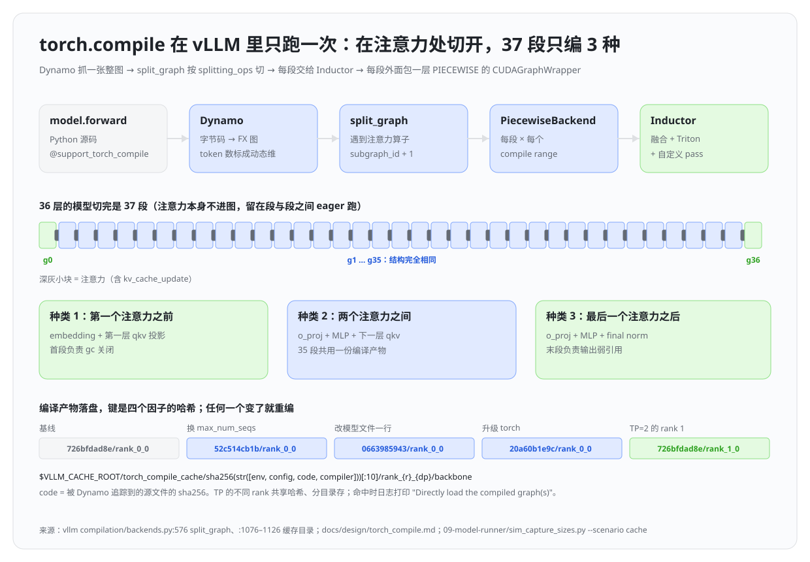
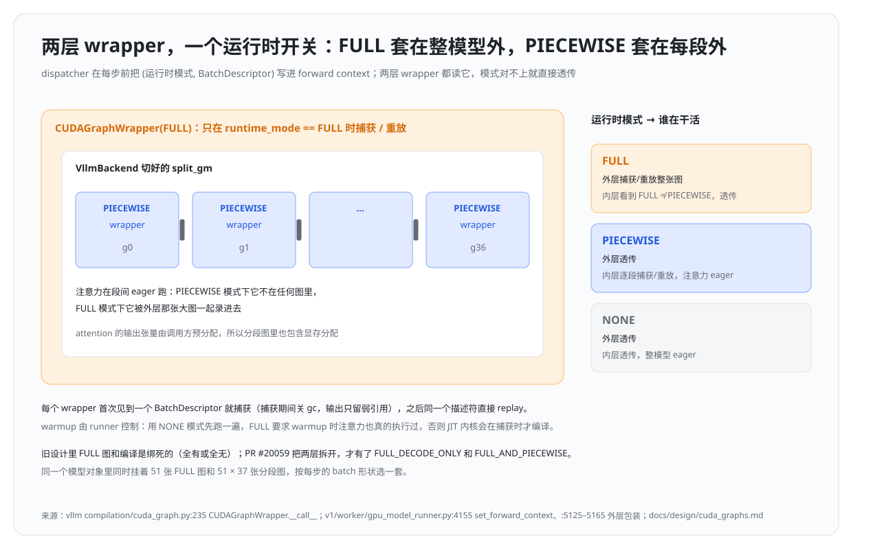
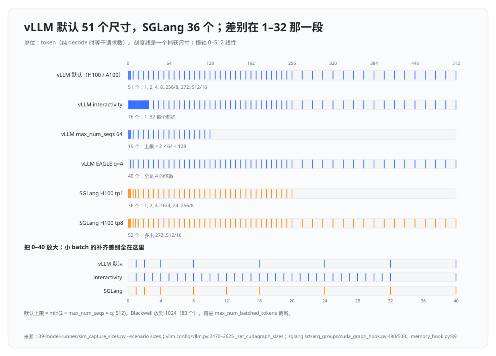
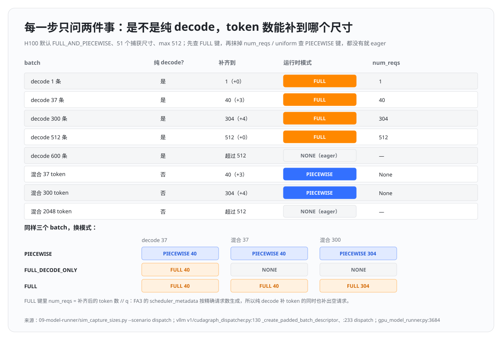
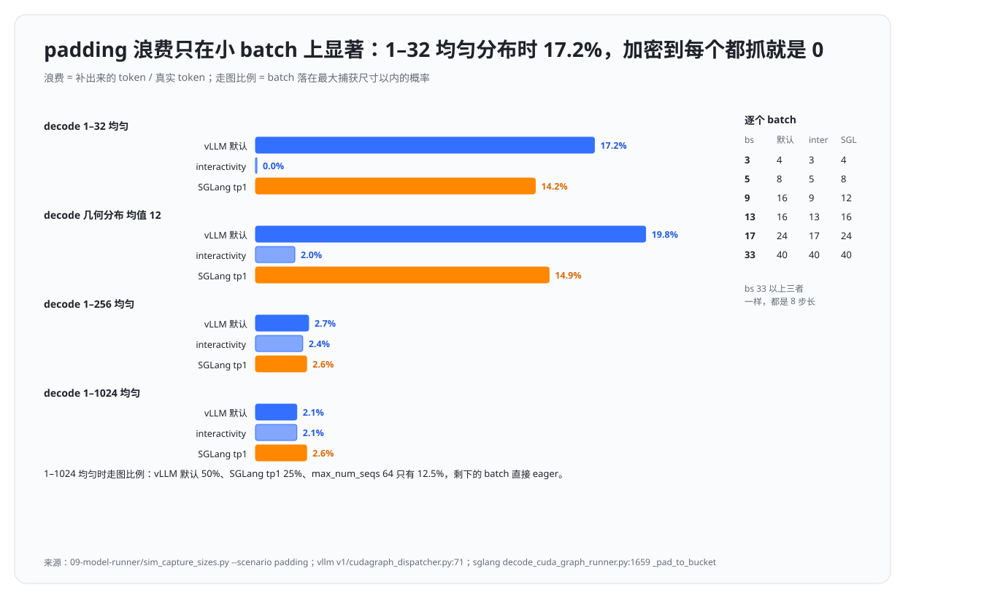
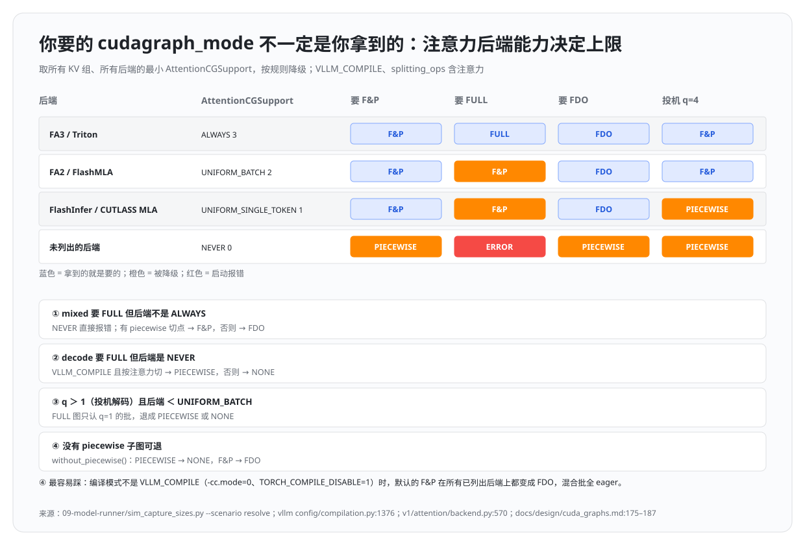
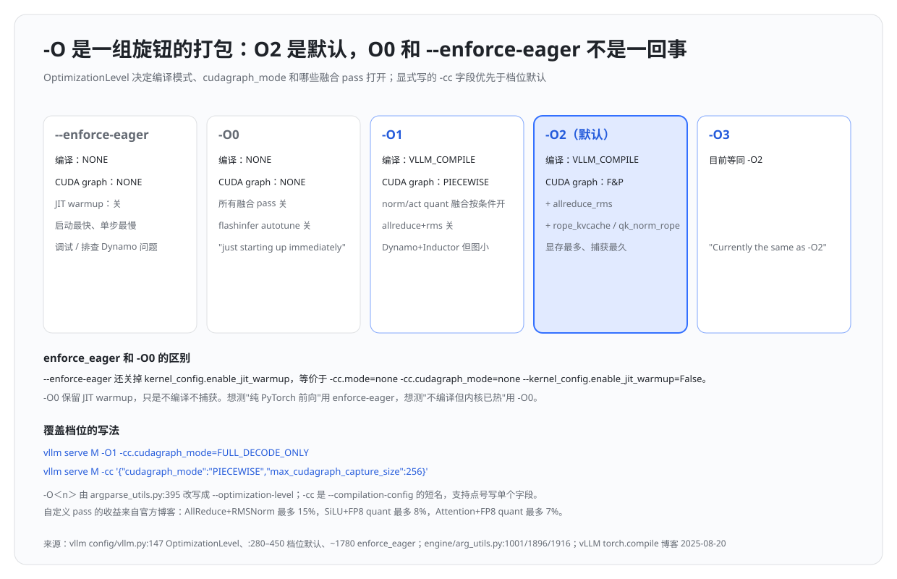
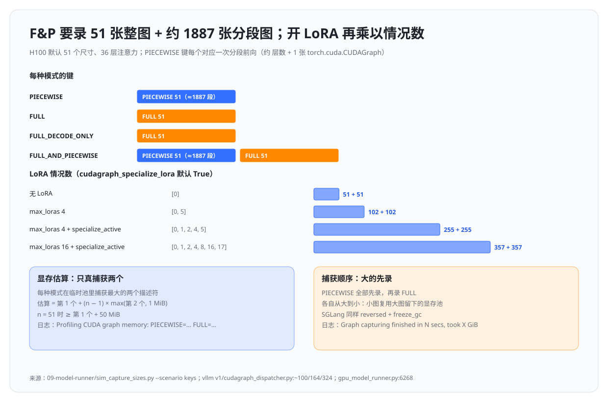
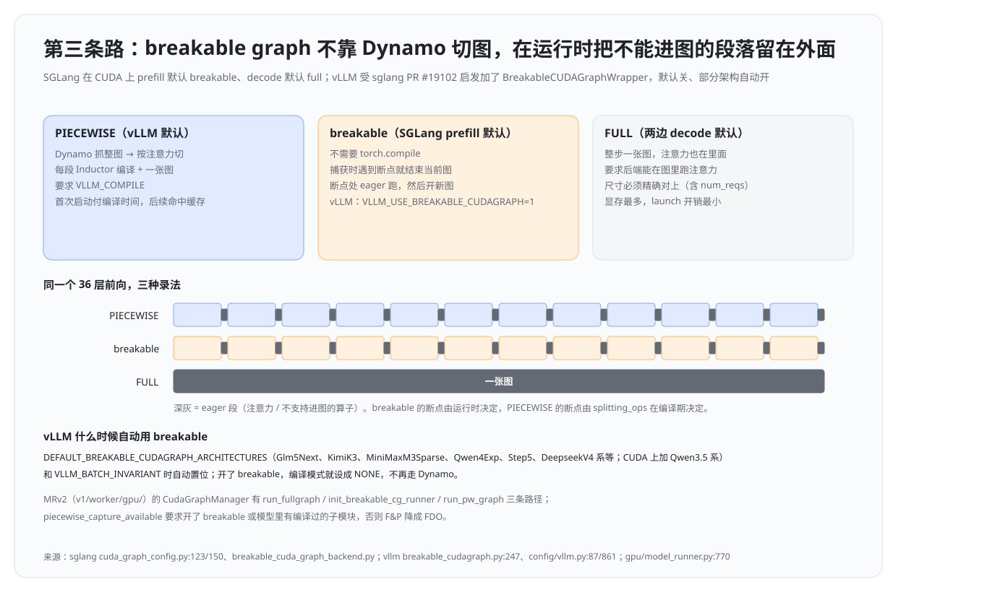

# VLLM-09｜原理｜Model Runner、torch.compile 与 CUDA Graph

> 🎯 **这篇文档解决什么问题**：`vllm serve Qwen/Qwen3-8B` 起服务，日志里先刷一行 `torch.compile took … s in total`，再刷一行 `Graph capturing finished in … secs, took … GiB`，第二次启动编译那行变短了，捕获那行没变。加上 `--enforce-eager` 启动快了，但单条请求的 TPOT 明显变长。换成 FlashInfer 后端，日志说你要的 `FULL` 被改成了 `FULL_AND_PIECEWISE`。开 LoRA 后捕获时间翻倍。这些都发生在 GPU worker 的 model runner 里：它把调度器交来的一批 token 拼成张量，选一张预先录好的 CUDA graph 回放，或者老老实实 eager 跑。我们逐行读 vLLM 的编译和捕获链路，并和 SGLang 的 decode / prefill 两套 graph runner 对比。
>
> **使用方式**：第 1 章讲为什么要录图、model runner 一步做什么。第 2 章讲 torch.compile 怎么在注意力处切图、产物怎么缓存。第 3 章讲两层 wrapper 和 forward context。第 4、5 章讲捕获尺寸、dispatcher 和 padding。第 6 章讲注意力后端能力怎么让模式降级。第 7 章讲 `-O` 档位和 `--enforce-eager`。第 8 章讲键数、LoRA 和图的显存账。第 9 章讲 breakable graph、SGLang 的默认值和 MRv2。第 10 章回顾演化、列旋钮、动手核对。基线：vLLM 主干 0d6f92a，SGLang 主干 8fabf5e。
>
> **代码**：[09-model-runner](../09-model-runner)。sim_capture_sizes.py 只依赖标准库，按源码复刻了 vLLM 的捕获尺寸生成（`_set_cudagraph_sizes`、performance mode、投机解码取倍数）、模式降级（`resolve_cudagraph_mode_and_sizes`）、dispatcher 的键和 padding、LoRA 情况数、编译缓存目录哈希和 compile range，以及 SGLang 的 decode / prefill 尺寸表和按显存的默认档位。test_sim_capture_sizes.py 有 22 个单测。trace_runner.md 是逐行对照表。gpu_cudagraph_modes.sh 用 MODEL_PROFILE=dense/moe 选择双模型，默认 TP=2、上下文 8192，记录启动日志和含 prefill 的端到端生成延迟；显存容量与引擎支持须另行核对。文中的尺寸、键数、padding 比例和目录名来自 sim_capture_sizes.py 的历史源码模拟，尚无新增双模型 GPU 实测。

# 导读 · 先给结论

## 捕获范围分别覆盖注意力与专家

gpu_cudagraph_modes.sh 通过 MODEL_PROFILE 选模型，并固定 revision。分别保存全注意力、GDN prefill/decode 的编译和捕获日志；MoE 另看专家 kernel 与通信是否进入捕获范围。

FULL、PIECEWISE 等档位要以实际降级日志为准。只看到 CUDA Graph 初始化成功不能证明所有路径都被捕获。原 CPU 捕获尺寸模拟继续解释档位生成，不推断两个新模型的真实启动秒数或显存。

双模型结构以固定版本配置核对[[Qwen3.8-27B config.json]](https://huggingface.co/Qwen/Qwen3.8-27B/blob/37561816e66b5b9153b1b64c10968c18c1e6f4a0/config.json)[[Qwen3.5-35B-A3B config.json]](https://huggingface.co/Qwen/Qwen3.5-35B-A3B/blob/59d61f3ce65a6d9863b86d2e96597125219dc754/config.json)。

1. **录图省的是 CPU，kernel 本身并没有变快。**vLLM v0.6.0 之前，Llama 3 8B 在一张 H100 上只有 38% 的时间在 GPU 上算，其余是 API server 和调度。CUDA graph 把一步前向几百次 kernel launch 压成一次回放，batch 越小越划算。
2. **torch.compile 只在启动时跑，在注意力处切开。**Dynamo 抓一张整图，`split_graph` 按 `splitting_ops`（默认注意力和 kv_cache_update）切成层数 + 1 段，结构相同的段共用一份 Inductor 产物：36 层 37 段，只编 3 种。产物按 env、config、代码、编译器四个因子哈希落盘，任何一个变了就重编；服务期间不会触发新编译。
3. **两层 wrapper，一个运行时开关。**FULL 的 `CUDAGraphWrapper` 套在整个模型外，PIECEWISE 的套在每个编译段外。每一步 runner 把模式和 `BatchDescriptor` 写进 forward context，只有模式对上的那一层会捕获或回放，其他层直通。
4. **每一步只问两件事：是不是纯 decode，token 数能补到哪个尺寸。**H100 默认 51 个尺寸，最大 512；纯 decode 37 条补到 40 走 FULL，同样 37 token 的混合 batch 补到 40 走 PIECEWISE，超过 512 一律 eager。SGLang decode 默认 36 个尺寸，最大 256，单位是请求数。
5. **padding 只在小 batch 显著。**decode 1–32 均匀分布时，vLLM 默认补 17.2% 的空 token，SGLang 14.2%，`--performance-mode interactivity` 把 1–32 每个都录，降到 0；到 1–256 均匀分布，三者都在 2–3%。
6. **你要的模式不一定是你拿到的。**注意力后端声明自己能在图里跑到什么程度（ALWAYS / UNIFORM_BATCH / UNIFORM_SINGLE_TOKEN_DECODE / NEVER），vLLM 取所有层的最小值降级：FlashInfer 要 FULL 拿到 F&P，投机解码 q=4 时只剩 PIECEWISE；关了 VLLM_COMPILE 就没有分段图可退，F&P 变 FULL_DECODE_ONLY。
7. **-O 是一组旋钮的打包。**O2 是默认（VLLM_COMPILE + F&P + 几个融合 pass），O1 只有 PIECEWISE，O0 不编译不录图；`--enforce-eager` 和 O0 相近，但还会关掉 JIT warmup。
8. **F&P 要录 51 张整图 + 约 1887 张分段图，LoRA 再乘以情况数。**max_loras 4 时键数翻倍，开 `specialize_active_lora` 变 5 倍。图的显存从 v0.21.0 起默认在 profile 阶段估算并从 KV 预算里扣掉：每种模式只真录最大的两个尺寸，其余线性外推。
9. **还有第三条路。**SGLang 在 CUDA 上 prefill 默认用 breakable graph：不靠编译器切图，捕获时遇到不能进图的算子就结束当前图、eager 跑完再开新图。vLLM 受它启发加了 `BreakableCUDAGraphWrapper`，默认关，部分新架构自动开。MRv2 把输入准备和采样也搬到 GPU 上，消掉每步的 CPU-GPU 同步。

# 第 1 章 · 为什么要录图：model runner 的一步

## 1.1 小 batch 的瓶颈在 CPU

一个 36 层的 decoder 做一步 decode，每层有 qkv 投影、RoPE、kv cache 写入、注意力、o_proj、两次 norm、gate/up、激活、down，加上 TP 下的 all-reduce，一步下来几百个 kernel。batch 为 1 时每个 kernel 只有几微秒的活，CPU 侧 Python 调度、PyTorch dispatcher 和 `cudaLaunchKernel` 的开销加起来比 GPU 干活还长，GPU 在 kernel 之间空转。CUDA graph 的做法是先把这串 launch 录成一张图，之后每步只需要一次 `cudaGraphLaunch`，参数和地址都在图里固定好[[1]](https://developer.nvidia.com/blog/cuda-graphs/)。代价也来自这里：图里的张量地址、形状、kernel 参数都是录制时的值，换一个 batch 大小就要换一张图。

vLLM 团队在 v0.6.0 的性能博客里拆过一次时间：Llama 3 8B 跑在一张 H100 上，API server 占 33%，调度占 29%，GPU 实际执行的只有 38%[[2]](https://vllm.ai/blog/2024-09-05-perf-update)。那次的修复是多步调度和异步输出处理，属于 VLLM-04 和 VLLM-06 讲过的进程拆分和重叠；剩下那 38% 里面，kernel launch 的空隙要靠 CUDA graph 和编译融合去压。torch.compile 博客给的数是 TorchBench 上 1.8–2 倍加速，自定义融合 pass 再各贡献几个百分点[[3]](https://vllm.ai/blog/2025-08-20-torch-compile)。

## 1.2 model runner 一步做什么

VLLM-04 讲过，EngineCore 每一步把 `SchedulerOutput` 交给 worker，worker 交给 `GPUModelRunner`（[gpu_model_runner.py](https://github.com/vllm-project/vllm/blob/0d6f92a/vllm/v1/worker/gpu_model_runner.py)，7192 行）。`execute_model`（3906 行）是一步的主体，按顺序做这几件事：

1. `_prepare_inputs`（1924 行）：把新请求、续跑请求、被抢占后恢复的请求合并进持久的 batch 状态，拼出 `input_ids`、`positions`、`slot_mapping`、`query_start_loc`，再让每个 KV 组的注意力后端构建自己的 metadata。
2. `_determine_batch_execution_and_padding`（3684 行）：调 dispatcher，决定这一步用哪种 graph、补到多少 token。DP 大于 1 时各 rank 先对齐补齐后的 token 数和模式。
3. `set_forward_context`（4155 行）：把 attn_metadata、运行时模式、`BatchDescriptor` 放进全局上下文，后面的 wrapper 和注意力层都从这里读。
4. `_model_forward`（3586 行）：调模型。外层 wrapper 决定是回放整图、逐段回放，还是 eager。
5. `sample_tokens`（4270 行）：采样和前向分开，好让异步调度把下一步的 CPU 工作和这一步的 GPU 采样重叠。

启动时还有三件和编译捕获相关的事：`load_model`（4967 行）加载权重后按模式在模型外面包一层 wrapper（5125–5165 行）。`profile_run`（6072 行）用最大 batch 跑一次测激活峰值。`capture_model`（6417 行）按 dispatcher 给出的键逐个用假输入录图，每个键走一次 `_dummy_run`（5447 行）。第一次前向会触发 Dynamo 追踪和 Inductor 编译，所以编译发生在 profile_run 里，录图在 KV cache 分配之后。

SGLang 的结构类似但拆得更开：`ModelRunner` 下面挂 `DecodeCudaGraphRunner`（[[4]](https://github.com/sgl-project/sglang/blob/8fabf5e/python/sglang/srt/model_executor/runner/decode_cuda_graph_runner.py)，252 行）专管 decode，prefill 交给另一套 runner backend。`can_run_graph`（877 行）在 batch 超过最大捕获尺寸、有多模态 embedding 替换、投机宽度不匹配时返回 False，回退 eager。两边的差别会在第 4 章和第 9 章展开。

# 第 2 章 · torch.compile：一次追踪，在注意力处切开



## 2.1 Dynamo 抓图，Inductor 生成 kernel

torch.compile 由两部分组成：TorchDynamo 在 Python 字节码层面拦截函数执行，把张量操作记成 FX 图，遇到不能追踪的代码就打断成多张图；TorchInductor 把 FX 图降成循环级 IR，做算子融合，为 GPU 生成 Triton kernel[[5]](https://dl.acm.org/doi/10.1145/3620665.3640366)。通用用法的问题是：每遇到一个新形状、或者 guard 失败，Dynamo 就重新追踪、重新编译，在线服务里这意味着某个请求突然卡几十秒。

vLLM 的做法是只追踪一次，而且在启动时完成。模型类加 `@support_torch_compile`，token 数这一维标成动态维度；编译模式 `CompilationMode.VLLM_COMPILE`（[compilation.py](https://github.com/vllm-project/vllm/blob/0d6f92a/vllm/config/compilation.py) 37 行，值 3）下，vLLM 接管 Dynamo 的回调，自己做切图、缓存和自定义 pass。设计文档的原话是：所有编译在服务第一个请求之前完成，没有请求会触发新的编译[[6]](https://docs.vllm.ai/en/latest/design/torch_compile/)。另外三个模式是 NONE（0）、STOCK_TORCH_COMPILE（1，原生 torch.compile）、DYNAMO_TRACE_ONCE（2，只追踪一次但不切图），只有 3 会切图和做自定义 pass。

## 2.2 split_graph：注意力不进编译图

注意力不适合交给 Inductor：它的 kernel 来自 FlashAttention、FlashInfer 这些手写库，输入长度每步都变，metadata 里还有块表这种不定长结构。vLLM 把注意力注册成自定义算子，`VllmBackend`（[backends.py](https://github.com/vllm-project/vllm/blob/0d6f92a/vllm/compilation/backends.py) 828 行）拿到 Dynamo 的整图后调 `split_graph`（576 行）：顺序扫描节点，遇到 `splitting_ops` 里的算子就把 subgraph_id 加一，连续的切点放进同一个子图，`getitem` 跟着它的输入走，最后用 `split_module(keep_original_order=True)` 切开。`splitting_ops` 为 None 时用默认的注意力算子表（compilation.py 768 行 `_attention_ops`），设成 `[]` 则整图不切。

不开 Inductor 自己的图分区时，`set_splitting_ops_for_v1`（1162–1212 行）会把 `unified_kv_cache_update` 也加进切点，原因是 kv cache 写入要在注意力前完成、而且写入的 slot_mapping 每步不同[[7]](https://github.com/vllm-project/vllm/issues/33267)；代价是 RoPE + kv cache 写入的融合 pass 随之关闭。`use_inductor_graph_partition`（672 行）是另一条路：不切 FX 图，让 Inductor 在自己的调度图里把注意力分出去，好处是融合 pass 能跨过切点，要求 torch 2.9 以上[[8]](https://docs.vllm.ai/en/latest/design/cuda_graphs/)。

一个 36 层模型切完是 37 段：第一个注意力之前一段（embedding + 第一层的 qkv 投影），两个注意力之间 35 段（o_proj + MLP + 下一层 qkv），最后一个注意力之后一段（o_proj + MLP + final norm）。中间 35 段结构完全一样，Inductor 编译时的哈希也一样，只编一次。设计文档里的例子就是 17 段图、3 种独立产物：第 1 段和第 15 段 key 相同，第 0 段和第 16 段各不相同[[6]](https://docs.vllm.ai/en/latest/design/torch_compile/)。`PiecewiseBackend`（[piecewise_backend.py](https://github.com/vllm-project/vllm/blob/0d6f92a/vllm/compilation/piecewise_backend.py) 86 行）为每段挂一个编译器，第一段和最后一段额外承担 gc 关闭和输出弱引用（backends.py 703–705 行）。

## 2.3 compile range 与 compile_sizes

Dynamo 追踪出的是符号形状的图，Inductor 可以按动态形状编一份通用产物，也可以对具体尺寸再特化。vLLM 有两个旋钮：`compile_ranges_endpoints`（578–583 行）把 token 数切成区间，每个区间各编一份；`compile_sizes` 对具体尺寸额外特化编译。默认 endpoints 是 `[max_num_batched_tokens]`（[vllm.py](https://github.com/vllm-project/vllm/blob/0d6f92a/vllm/config/vllm.py) 2676 行），也就是只有一个区间：

```text
== compile range：endpoints 切成左开右闭的区间，每个区间编译一份 Inductor 产物
  endpoints [8192]         → [1, 8192]
  endpoints [2048]         → [1, 2048]
  endpoints [512, 8192]    → [1, 512], [513, 8192]
```

多切一个区间的意义在于，有些融合 pass 只在小 token 数时划算（比如 AllReduce + RMSNorm 用 FlashInfer 的融合 kernel），区间划开后可以各自决定开不开。每多一个区间，编译时间就多一份。日志里每编一段打印一行 `Compiling a graph for compile range %s takes %.2f s`（backends.py 418 行），全部结束打印 `torch.compile took %.2f s in total`（[monitor.py](https://github.com/vllm-project/vllm/blob/0d6f92a/vllm/compilation/monitor.py) 20 行）。

## 2.4 编译缓存：四个因子的哈希

编译产物落盘，目录名由四个因子决定（backends.py 1076–1107 行）：环境变量里影响编译的那部分、vLLM 配置里影响计算图的那部分、被 Dynamo 追踪到的所有源文件的 sha256、编译器（torch / Inductor）版本。四者拼成列表转字符串，取 sha256 前 10 位。模拟用示例字符串演示了哪些改动会换目录：

```text
== 编译缓存目录 = sha256(str([env, config, code, compiler]))[:10]（四个因子用示例字符串）
  基线                 ~/.cache/vllm/torch_compile_cache/726bfdad8e/rank_0_0/backbone
  换 max_num_seqs      ~/.cache/vllm/torch_compile_cache/52c514cb1b/rank_0_0/backbone
  改了模型文件一行     ~/.cache/vllm/torch_compile_cache/0663985943/rank_0_0/backbone
  升级 torch           ~/.cache/vllm/torch_compile_cache/20a60b1e9c/rank_0_0/backbone
  TP=2 的 rank 1       ~/.cache/vllm/torch_compile_cache/726bfdad8e/rank_1_0/backbone
```

实际的哈希值取决于你的环境，这里只看规律：改 `max_num_seqs` 会改变捕获尺寸、进而改变 config 因子，目录变。改模型文件一行，code 因子变。升级 torch，compiler 因子变。TP 的不同 rank 哈希相同，只是分子目录存。命中缓存时日志打印 `Directly load the compiled graph(s) for compile range`（311 行），启动时打印 `Using cache directory: %s for vLLM's torch.compile`（1126 行）。设计文档建议把这个目录直接拷到部署机器上省掉冷启动编译；调试编译问题时用 `VLLM_DISABLE_COMPILE_CACHE=1` 关掉缓存[[6]](https://docs.vllm.ai/en/latest/design/torch_compile/)。Inductor 的 max-autotune 默认关闭，开了能多挤一点 kernel 性能，但编译时间会长很多。

> 💡 缓存只省编译，不省录图。CUDA graph 里固定的是显存地址，进程重启后地址全变，每次启动都要重录。所以第二次启动 `torch.compile took` 那行变短，`Graph capturing finished` 那行基本不变。

# 第 3 章 · 两层 wrapper 与 forward context



## 3.1 外层包整模型，内层包每一段

CUDA graph 有两种粒度。PIECEWISE 在每个编译段外面包一层 `CUDAGraphWrapper(PIECEWISE)`（backends.py \~650 行 `wrap_with_cudagraph_if_needed`），注意力夹在段与段之间 eager 跑，所以任何注意力后端都能用，batch 里混着 prefill 也没关系。FULL 在整个模型外面包一层 `CUDAGraphWrapper(FULL)`（gpu_model_runner.py 5125–5165 行），注意力也录进去，一步只有一次 launch，但要求注意力后端能在图里跑这种 batch。

F&P 两层都有。关键是同一时刻只有一层生效：`CUDAGraphWrapper.__call__`（[cuda_graph.py](https://github.com/vllm-project/vllm/blob/0d6f92a/vllm/compilation/cuda_graph.py) 235 行）先读 forward context，没有上下文就直接调 runnable。运行时模式是 NONE 或者和自己的模式不一致，也直接调 runnable。模式一致时，用 `BatchDescriptor` 查自己的表，第一次见到这个描述符就录，之后回放。所以 FULL 步里外层回放整图，内层 PIECEWISE wrapper 根本没被执行到；PIECEWISE 步里外层直通，37 个内层 wrapper 各自回放自己那段。

```text
CUDAGraphWrapper.__call__ (cuda_graph.py:235)
  ctx = get_forward_context()
  if ctx is None or ctx.cudagraph_runtime_mode in (NONE, 不是自己的模式):
      return self.runnable(*args)             # 直通
  desc = ctx.batch_descriptor
  if desc not in self.entries:                # 第一次见到：录
      gc.collect / empty_cache 暂时换成空函数（避免每张图都触发 GC）
      with torch.cuda.graph(g, pool=全局共享池):
          out = self.runnable(*args)
      entry.output = weak_ref(out)            # 输出只留弱引用，显存还给池
  else:
      entry.graph.replay()                    # 之后：回放
```

## 3.2 为什么要全局共享显存池

每张图录制时用到的中间张量都分配在图的私有显存池里。51 个尺寸 × 37 段，如果每张图一个池，显存会爆。vLLM 让所有图共用一个池，并且从大到小录：大尺寸的图先占好显存，小尺寸的图复用这些块。输出只存弱引用，也是为了让下一张图能复用上一张图的输出缓冲。这样做成立的前提是图之间严格串行回放、上一张图的输出在下一张图开始前已经被消费，model runner 的单流执行保证了这一点。

## 3.3 forward context 是唯一的开关

wrapper 本身不做决策，决策在 runner 的 `_determine_batch_execution_and_padding`：它调 dispatcher 拿到 `(runtime_mode, batch_descriptor)`，写进 forward context，然后调模型。这个设计来自 PR #20059，它引入了 `CUDAGraphDispatcher` 和 F&P 模式，把以前散在 runner 里的 if-else 收拢成一张键表[[9]](https://github.com/vllm-project/vllm/pull/20059)。好处是 profile、录图、正常推理走同一条代码路径：录图时 `_dummy_run` 只是用假输入、指定好的描述符跑一次前向，wrapper 发现描述符没见过就录下来。

SGLang 没有这层间接：`DecodeCudaGraphRunner` 自己持有 `graphs[bs]` 字典，`capture`（1281 行）里按尺寸从大到小调 `capture_one_shape`（1401 行），捕获期间用 `freeze_gc`（1325 行）冻结垃圾回收，回放时 `_pad_to_bucket`（1659 行）二分查找补到最近的桶[[4]](https://github.com/sgl-project/sglang/blob/8fabf5e/python/sglang/srt/model_executor/runner/decode_cuda_graph_runner.py)。结构更直白，代价是 decode 和 prefill 两条路径各写一份。

# 第 4 章 · 录哪些尺寸：vLLM 51 个，SGLang 36 个



## 4.1 vLLM 的默认列表

`_set_cudagraph_sizes`（[vllm.py](https://github.com/vllm-project/vllm/blob/0d6f92a/vllm/config/vllm.py) 2470–2625 行）先定上限：用户给了 `max_cudagraph_capture_size` 就用它；否则取 min(2 × max_num_seqs × query_len, 512)，Blackwell 上是 1024，再被 `max_num_batched_tokens` 截断。然后按 [1, 2, 4] + 8 到 248 步长 8 + 256 到上限步长 16 生成，截到上限。单位是 token；纯 decode 每条请求一个 token，所以也等于请求数。

```text
== 1. vLLM 默认捕获尺寸（单位 token；decode 一个请求 1 个 token，所以也等于 decode 的请求数）
  H100 API server（max_num_seqs 1024，预算 8192）
    51 个，max 512：1, 2, 4, 8..256/8, 272..512/16
  A100 API server（256，预算 2048）
    51 个，max 512：1, 2, 4, 8..256/8, 272..512/16
  B200（1024，预算 16384，上限 1024）
    83 个，max 1024：1, 2, 4, 8..256/8, 272..1024/16
  H100 --performance-mode interactivity
    76 个，max 512：1..32/1, 40..256/8, 272..512/16
  H100 max_num_seqs 64
    19 个，max 128：1, 2, 4, 8..128/8
  H100 EAGLE 3 个草稿（query_len 4，256 条）
    49 个，max 512：4, 8..256/8, 272..512/16
```

有几个细节。A100 默认 max_num_seqs 256，2 × 256 = 512，和 H100 撞到同一个上限，所以列表一样。max_num_seqs 调到 64 时上限变成 128，只剩 19 个尺寸，第 65 条 decode 请求开始就走 eager。投机解码时一条请求一步要验证 q = 1 + 草稿数个 token，尺寸必须是 q 的倍数，否则补齐后的 batch 拆不回整数条请求；MRv1 在 `adjust_cudagraph_sizes_for_spec_decode`（compilation.py 1537 行）里把列表过滤成 q 的倍数[[10]](https://github.com/vllm-project/vllm/issues/28207)，MRv2 在 `_init_candidates` 里处理。`--performance-mode interactivity`（arg_utils.py 1918 行）把 1–32 每个整数都录，代价是多 25 个尺寸。

## 4.2 SGLang 的默认列表

SGLang 的 decode 尺寸单位是请求数（[[11]](https://github.com/sgl-project/sglang/blob/8fabf5e/python/sglang/srt/arg_groups/cuda_graph_hook.py) 500 行）：[1, 2, 4, 8, 12] + 16 到 256 步长 8 + 272 到 511 步长 16 + 512 以上步长 32，截到 `cuda_graph_max_bs`。上限按显存档位定（[[12]](https://github.com/sgl-project/sglang/blob/8fabf5e/python/sglang/srt/arg_groups/memory_hook.py) 89 行）：H100 80G 单卡 256，TP 大于等于 4 时 512；24G 卡只有 48。prefill 也录图，单位是 token，按 chunked_prefill_size 生成一串越往后越稀的尺寸（480 行）。

```text
== 2. SGLang 默认 decode 捕获尺寸（单位：请求数）与 prefill 捕获尺寸（单位：token）
  H100 80G tp1：chunked_prefill_size 8192，decode max_bs 256
    decode 36 个：1, 2, 4..16/4, 24..256/8
  H100 80G tp8：chunked_prefill_size 8192，decode max_bs 512
    decode 52 个：1, 2, 4..16/4, 24..256/8, 272..512/16
  B200 180G：chunked_prefill_size 16384，decode max_bs 512
    decode 52 个：1, 2, 4..16/4, 24..256/8, 272..512/16
  RTX 4090 24G：chunked_prefill_size 4096，decode max_bs 48
    decode 10 个：1, 2, 4..16/4, 24..48/8
  prefill（max_bs = chunked_prefill_size 8192）58 个：4..32/4, 48..256/16, 288..512/32, 576..1024/64, 1280..4096/256, 4608..8192/512
  投机解码 decode（max_bs 256）51 个：1..8/1, 10..32/2, 40..64/4, 72..256/8
```

两边最大的差别在 1–32 这一段：vLLM 是 1, 2, 4, 8, 16, 24, 32，SGLang 多了一个 12。另一个差别是覆盖范围：vLLM 的混合 batch 也能用 PIECEWISE 图，但上限同样是 512 token，chunked prefill 一步 8192 token 时整步 eager；SGLang 的 prefill 图一直录到 8192 token。投机解码时 SGLang 换一套更密的表，1–8 每个都录。`--disable-cuda-graph-padding` 时 SGLang 把 1 到 max 每个都录[[13]](https://github.com/sgl-project/sglang/blob/8fabf5e/python/sglang/srt/arg_groups/f_exec_.py)。

# 第 5 章 · Dispatcher 与 padding



## 5.1 dispatch 的查表顺序

`CUDAGraphDispatcher`（[cudagraph_dispatcher.py](https://github.com/vllm-project/vllm/blob/0d6f92a/vllm/v1/cudagraph_dispatcher.py)）启动时由 `initialize_cudagraph_keys`（164 行）建表：混合模式（PIECEWISE 或 FULL）每个尺寸一个键；F&P 这种 decode 和 mixed 分开的模式（`separate_routine`）另外为纯 decode 建一套 FULL 键，尺寸落在 [q, q × max_num_seqs] 之间。`_compute_bs_to_padded_graph_size`（71 行）预先算好 0 到 max 每个 token 数该补到哪个尺寸。

每一步 `dispatch`（233 行）的逻辑：token 数超过最大尺寸，直接 NONE；否则补齐，用 `_create_padded_batch_descriptor`（130 行）造描述符。纯 decode 且有 FULL 键时，`num_reqs = min(padded // q, max_num_seqs)`、uniform 为真，先查 FULL 表。没查到，把 num_reqs 抹成 None、uniform 置假，再查 PIECEWISE 表。都没有就 NONE。FULL 键要带精确请求数，是因为 FA3 这类后端的 scheduler_metadata 按请求数分配，录进图里就固定了；PIECEWISE 段里没有注意力，只需要 token 数对上。

```text
== H100 默认：FULL_AND_PIECEWISE，max_num_seqs 1024，捕获尺寸 51 个，max 512
  decode 1 条                         → FULL      补到 1（+0），num_reqs=1，uniform=True
  decode 37 条                        → FULL      补到 40（+3），num_reqs=40，uniform=True
  decode 300 条                       → FULL      补到 304（+4），num_reqs=304，uniform=True
  decode 512 条                       → FULL      补到 512（+0），num_reqs=512，uniform=True
  decode 600 条                       → NONE   eager（超过 max 512），不补齐
  混合 37 token（1 个短 prefill + decode） → PIECEWISE 补到 40（+3），num_reqs=None，uniform=False
  混合 300 token                       → PIECEWISE 补到 304（+4），num_reqs=None，uniform=False
  混合 2048 token（chunked prefill）     → NONE   eager（超过 max 512），不补齐

== 同样的 batch，其他模式
  PIECEWISE            decode 37 → PIECEWISE 40；混合 37 → PIECEWISE 40；混合 300 → PIECEWISE 304
  FULL_DECODE_ONLY     decode 37 → FULL 40；混合 37 → NONE；混合 300 → NONE
  FULL                 decode 37 → FULL 40；混合 37 → FULL 40；混合 300 → FULL 304

== SGLang H100 tp1：decode max_bs 256，36 个尺寸
  decode   1 条 → 图 bs=1（+0）
  decode  37 条 → 图 bs=40（+3）
  decode 300 条 → 超过 256，不用图
```

FULL_DECODE_ONLY 在混合 batch 上直接 eager，这是它省显存的来源：不录任何分段图。设计文档推荐它用在 PD 分离的 decode 实例上，那里几乎没有 prefill。FULL 模式只录混合 batch 的整图，纯 decode batch 复用同尺寸的那张，适合小模型或短 prompt。F&P 是默认，通常最快，但显存和录图时间最多[[8]](https://docs.vllm.ai/en/latest/design/cuda_graphs/)。

## 5.2 DP 下要对齐

数据并行时每个 rank 各自有 batch，但 MoE 层的 all-to-all 要求所有 rank 同步进入同一种前向。`_determine_batch_execution_and_padding` 在 DP 大于 1 时先各自 dispatch，再用 `coordinate_batch_across_dp` 同步补齐后的 token 数和模式，然后以同步结果为唯一合法模式重新 dispatch。效果是一个 rank 上只有 3 条 decode，另一个 rank 有 300 条，前者也要补到 304；一个 rank 是混合 batch，所有 rank 都退到 PIECEWISE。这是 VLLM-11 讲宽 EP 时要回来看的地方。编码器-解码器模型在有编码器输出的那一步禁用 FULL。打开 `observability_config.cudagraph_metrics` 后，每一步的补齐数会记成 `CUDAGraphStat`。

## 5.3 padding 浪费



补进去的空 token 也要算一遍。浪费多少取决于 batch 大小的分布，模拟用几种分布算了补齐 token 占真实 token 的比例，以及有多少步能走图：

```text
== decode batch 的 padding 浪费（补的 token / 真实 token）与走图比例
  分布                  vLLM 默认 (51)        vLLM interactivity    vLLM max_num_seqs 64   SGLang tp1 (36)       SGLang tp≥4 (52)
  decode 1–32 均匀       17.2% / 走图 100.0%   0.0% / 走图 100.0%    17.2% / 走图 100.0%    14.2% / 走图 100.0%   14.2% / 走图 100.0%
  decode 几何 均值 12     19.8% / 走图 100.0%   2.0% / 走图 100.0%    19.8% / 走图 100.0%    14.9% / 走图 100.0%   14.9% / 走图 100.0%
  decode 1–256 均匀      2.7% / 走图 100.0%    2.4% / 走图 100.0%    5.2% / 走图  50.0%     2.6% / 走图 100.0%    2.6% / 走图 100.0%
  decode 1–1024 均匀     2.1% / 走图  50.0%    2.1% / 走图  50.0%    5.2% / 走图  12.5%     2.6% / 走图  25.0%    2.1% / 走图  50.0%

== interactivity 只改 1–32 段：逐个 batch 看补齐
  bs=3   默认 → 4    interactivity → 3    SGLang → 4
  bs=5   默认 → 8    interactivity → 5    SGLang → 8
  bs=9   默认 → 16   interactivity → 9    SGLang → 12
  bs=13  默认 → 16   interactivity → 13   SGLang → 16
  bs=17  默认 → 24   interactivity → 17   SGLang → 24
  bs=33  默认 → 40   interactivity → 40   SGLang → 40
```

在本节合成分布中，decode batch 均匀落在 1–32 时，vLLM 默认尺寸表的补齐比例为 17.2%，SGLang 为 14.2%；均匀落在 1–256 时，两者约为 2–3%。补齐比例只反映额外 token 数，不能按相同比例换算延迟。当前 `gpu_cudagraph_modes.sh latency` 比较编译档位和 CUDA graph 模式，记录含 prefill 的端到端生成延迟，未设置 interactivity 对照组，也不测 decode 单步延迟。要判断尺寸表的收益，须固定模型、调度负载与实际生效模式，另测 decode 时间、走图比例和图显存。在 1–256 均匀分布下，`max_num_seqs=64` 对应的模拟捕获上限仅覆盖一半 batch；是否提高捕获上限，应结合真实 batch 分布及显存余量判断。

# 第 6 章 · 注意力后端能力与模式降级



## 6.1 后端自报能力

FULL 图里注意力也在图中，后端的 metadata 构建方式决定它能不能被录。每个后端的 metadata builder 声明一个 `AttentionCGSupport`（[backend.py](https://github.com/vllm-project/vllm/blob/0d6f92a/vllm/v1/attention/backend.py) 570 行）：ALWAYS（3）表示任意 batch 都能进整图。UNIFORM_BATCH（2）表示每条请求 query 长度相同时可以，投机解码的 1 + k 也算。UNIFORM_SINGLE_TOKEN_DECODE（1）只支持每条 1 个 token 的纯 decode。NEVER（0）不能进图。设计文档里的表：FA3 和 Triton 是 ALWAYS。FA2、AITER FA、FlashMLA、FlashInferMLA 是 UNIFORM_BATCH。FlashInfer 是 UNIFORM_SINGLE_TOKEN_DECODE（Blackwell 上走 TRTLLM kernel 时是 UNIFORM_BATCH）。AITER MLA、CUTLASS MLA、Mamba 也是 UNIFORM_SINGLE_TOKEN_DECODE[[8]](https://docs.vllm.ai/en/latest/design/cuda_graphs/)。

## 6.2 resolve：取最小值再降级

runner 的 `_check_and_update_cudagraph_mode`（gpu_model_runner.py 6760 行）遍历所有 KV 组、所有后端取最小能力，交给 `resolve_cudagraph_mode_and_sizes`（compilation.py 1376 行）。规则按顺序：

1. mixed 部分要 FULL、后端不是 ALWAYS：后端是 NEVER 直接报错；有分段图可退时改成 F&P，否则 FULL_DECODE_ONLY。
2. decode 部分要 FULL、后端是 NEVER：退成 PIECEWISE，没有分段图时退成 NONE。
3. 投机解码 q 大于 1、后端低于 UNIFORM_BATCH：FULL 录不了 1 + k 的 decode，退成 PIECEWISE。
4. 编译模式不是 VLLM_COMPILE、或者 `splitting_ops` 没切注意力：根本没有分段图，`without_piecewise()` 把 PIECEWISE 变 NONE、F&P 变 FULL_DECODE_ONLY（vllm.py 1144 行）。

```text
== 后端能力 × 请求的 cudagraph_mode → 实际模式（VLLM_COMPILE，splitting_ops 含注意力）
  后端                    AttentionCGSupport            FULL_AND_PIECEWISE    FULL                  FULL_DECODE_ONLY      投机解码 q=4
  FlashAttention 3      ALWAYS                        FULL_AND_PIECEWISE    FULL                  FULL_DECODE_ONLY      FULL_AND_PIECEWISE
  Triton                ALWAYS                        FULL_AND_PIECEWISE    FULL                  FULL_DECODE_ONLY      FULL_AND_PIECEWISE
  FlashAttention 2      UNIFORM_BATCH                 FULL_AND_PIECEWISE    FULL_AND_PIECEWISE    FULL_DECODE_ONLY      FULL_AND_PIECEWISE
  FlashMLA              UNIFORM_BATCH                 FULL_AND_PIECEWISE    FULL_AND_PIECEWISE    FULL_DECODE_ONLY      FULL_AND_PIECEWISE
  FlashInfer            UNIFORM_SINGLE_TOKEN_DECODE   FULL_AND_PIECEWISE    FULL_AND_PIECEWISE    FULL_DECODE_ONLY      PIECEWISE
  CUTLASS MLA / Mamba   UNIFORM_SINGLE_TOKEN_DECODE   FULL_AND_PIECEWISE    FULL_AND_PIECEWISE    FULL_DECODE_ONLY      PIECEWISE
  未列出的后端                NEVER                         PIECEWISE             ERROR                 PIECEWISE             PIECEWISE

  compilation mode 不是 VLLM_COMPILE（比如 mode=0 但仍要 CUDA graph）时没有 piecewise 子图可退：
    FlashAttention 3       FULL_AND_PIECEWISE → FULL_DECODE_ONLY
    FlashInfer             FULL_AND_PIECEWISE → FULL_DECODE_ONLY
    未列出的后端                 FULL_AND_PIECEWISE → NONE
```

投机解码那一列最容易踩：用 FlashInfer 或 CUTLASS MLA 跑 EAGLE 时，decode 步每条请求 4 个 token，超出了单 token decode 的形状，FULL 键全部作废，只剩 PIECEWISE。这时候注意力在段间 eager，每层一次 launch 又回来了，小 batch 的收益会打折扣。混合模型（比如带 Mamba 层的）同理：KV 组里有一个后端是 UNIFORM_SINGLE_TOKEN_DECODE，整个模型就按它来。降级时日志会打一行 `Cudagraph mode … is not compatible …` 或 `setting cudagraph_mode=…`，上线前 grep 一下。

> 💡 还有一种隐性降级：用了 AttnQuantFusionPass 这类需要跨过注意力做融合的 pass 时，vLLM 会把 `splitting_ops` 设成 `[]`，整图不切，于是没有分段图，F&P 退成 FULL_DECODE_ONLY，混合 batch 全部 eager。想同时要融合和分段图，就得开 `use_inductor_graph_partition`，要求 torch 2.9 以上" + R("cgdoc") + "。

SGLang 没有这一层自动降级。decode 默认 FULL，后端不支持时由各自的 attention backend 在 `init_cuda_graph_state` 里处理或报错；`can_run_graph` 只在运行时按 batch 判断要不要回退 eager。两种风格各有代价：vLLM 启动时就告诉你最终模式，但你可能没注意那行日志；SGLang 更直接，但组合不支持时更可能直接起不来。

# 第 7 章 · -O 档位与 --enforce-eager



编译和录图相关的旋钮有十几个，vLLM 用 `OptimizationLevel`（[vllm.py](https://github.com/vllm-project/vllm/blob/0d6f92a/vllm/config/vllm.py) 147 行）把它们打包成几档，档位默认值在 280–450 行：

| 档位 | 编译模式 | cudagraph_mode | 融合 pass | 适合 |
|-|-|-|-|-|
| O0 | NONE | NONE | 全关，FlashInfer autotune 也关 | 调试、快速验证模型能跑 |
| O1 | VLLM_COMPILE | PIECEWISE | 基础 Inductor 融合 | 启动时间敏感、显存紧 |
| O2（默认） | VLLM_COMPILE | FULL_AND_PIECEWISE | 加 allreduce_rms、rope_kvcache、qk_norm_rope 等 | 生产默认 |
| O3 | 同 O2 | 同 O2 | 同 O2（预留给更激进的优化） | 目前和 O2 无差别 |

命令行写 `-O0` 到 `-O3`，argparse 会改写成 `--optimization-level`（arg_utils.py 1916 行，argparse_utils.py 395 行）。档位只设默认值，`-cc`（`--compilation-config`，1896 行）里显式给的字段优先，比如 `-O2 -cc.cudagraph_mode=PIECEWISE` 是 O2 的融合 + 只录分段图。

`--enforce-eager`（1001 行）不是 O0 的别名。它把编译模式和 cudagraph_mode 都设成 NONE，效果接近 O0，但还会关掉 JIT warmup，启动更快、首批请求可能更慢。编译博客给的融合收益可以用来判断关掉融合损失多少：AllReduce + RMSNorm 最多 15%，SiLU + FP8 量化最多 8%，Attention + FP8 量化最多 7%，序列并行 + AsyncTP 最多 10%[[3]](https://vllm.ai/blog/2025-08-20-torch-compile)。这些数字都是“最多”，取决于模型和 batch，实际收益要自己测。

SGLang 默认不开 torch.compile，`--enable-torch-compile` 是实验选项，只对 `--torch-compile-max-bs`（默认 32）以内的 batch 生效[[13]](https://github.com/sgl-project/sglang/blob/8fabf5e/python/sglang/srt/arg_groups/f_exec_.py)。它的性能主要靠手写 kernel 和 CUDA graph，不靠 Inductor 融合。这也是两边启动时间差别的主要来源：vLLM 冷启动多一段编译，换来的是自动融合。

# 第 8 章 · 键数、LoRA 与图的显存账



## 8.1 每种模式录多少张图

dispatcher 的一个键对应一次前向。FULL 键一次前向就是一张图；PIECEWISE 键一次前向要录 37 张分段图（36 层模型）。`get_capture_descs`（cudagraph_dispatcher.py 324 行）给出录制顺序：PIECEWISE 在前、FULL 在后，各自从大到小。

```text
== 每种模式的 dispatcher 键（H100 默认 51 个尺寸，模型 36 层注意力）
   PIECEWISE 键每个对应一次分段前向：注意力把图切成约 层数 + 1 段，每段一个 torch.cuda.CUDAGraph
  PIECEWISE            PIECEWISE 键  51（≈ 1887 段图）  FULL 键   0
  FULL                 PIECEWISE 键   0（≈    0 段图）  FULL 键  51
  FULL_DECODE_ONLY     PIECEWISE 键   0（≈    0 段图）  FULL 键  51
  FULL_AND_PIECEWISE   PIECEWISE 键  51（≈ 1887 段图）  FULL 键  51

== LoRA：键数按 LoRA 情况翻倍（cudagraph_specialize_lora 默认 True）
  无 LoRA                               lora 情况 [0]  → PIECEWISE 51 + FULL 51
  max_loras 4                          lora 情况 [0, 5]  → PIECEWISE 102 + FULL 102
  max_loras 4，specialize_active_lora   lora 情况 [0, 1, 2, 4, 5]  → PIECEWISE 255 + FULL 255
  max_loras 16，specialize_active_lora  lora 情况 [0, 1, 2, 4, 8, 16, 17]  → PIECEWISE 357 + FULL 357
```

LoRA 的 kernel（Punica 的 SGMV / BGMV 这一类[[14]](https://arxiv.org/abs/2310.18547)）参数里有活跃 adapter 数，录进图就固定了。`_get_lora_cases`（\~100 行）决定为哪些 adapter 数各录一套：默认 specialize 时是 0（这一步没有 LoRA 请求，走不带 LoRA 的快路径）和 max_loras + 1（容纳所有槽位）；开 `specialize_active_lora` 再加上 2 的幂。dispatch 时活跃数按这个列表向上取整，3 个活跃 adapter 用 4 那套图。所以开 LoRA 后录图时间翻倍是正常的，开 specialize_active 时是 5 倍。VLLM-16 会再回到多 LoRA。

## 8.2 图的显存从 KV 预算里扣

每张图录制时占的显存池不小，F&P 在大模型上常常是几 GiB。旧版本先分配 KV cache、再录图，图的显存挤占了预留的余量，偶尔 OOM。从 v0.21.0 起 `VLLM_MEMORY_PROFILER_ESTIMATE_CUDAGRAPHS` 默认为 1（envs.py 334 行）：profile 阶段先在一个临时池里估算，`profile_cudagraph_memory`（gpu_model_runner.py 6268 行）对每种模式只真录最大的两个描述符，估算 = 第 1 个 + (n − 1) × max(第 2 个, 1 MiB)，然后 gpu_worker.py（712–800 行）把估算值从可用显存里扣掉，再算 KV cache 能分多少。

```text
== 显存估算（profile_cudagraph_memory）：每种模式只真捕获最大的两个，其余线性外推
  PIECEWISE n=51：估算 = 第 1 个 + 50 × max(第 2 个, 1 MiB) ≥ 第 1 个 + 50 MiB
  FULL      n=51：估算 = 第 1 个 + 50 × max(第 2 个, 1 MiB) ≥ 第 1 个 + 50 MiB
  捕获顺序：PIECEWISE 先、FULL 后，各自从大到小，小图复用大图留下的显存池
```

用第 2 个外推、跳过第 1 个，是因为共享池里最大那张图占了大头，后面的小图主要是增量。日志里有三行要看：`Profiling CUDA graph memory: PIECEWISE=… FULL=…` 是估算值。`Available KV cache memory: … GiB` 是扣完之后给 KV 的。`Graph capturing finished in … secs, took … GiB` 是实际录完的占用。估算和实际差得多时，worker 会建议你把 `gpu_memory_utilization` 调高大约 估算 / 总显存 那么多，以拿回升级前的 KV 容量；或者设 `VLLM_MEMORY_PROFILER_ESTIMATE_CUDAGRAPHS=0` 回到旧行为[[15]](https://docs.vllm.ai/en/latest/configuration/env_vars/)。

这本账直接连着 VLLM-07 的 KV 容量：同一张卡，F&P 比 FULL_DECODE_ONLY 多录 1887 张分段图，KV 就少一点。PD 分离的 decode 实例只跑纯 decode，用 FULL_DECODE_ONLY 能把这部分显存还给 KV cache，这是设计文档推荐它的原因[[8]](https://docs.vllm.ai/en/latest/design/cuda_graphs/)。SGLang 有 `--enable-profile-cuda-graph` 打印每个尺寸的录制开销，显存余量则靠 `mem_fraction_static` 按显存档位预留[[12]](https://github.com/sgl-project/sglang/blob/8fabf5e/python/sglang/srt/arg_groups/memory_hook.py)。

# 第 9 章 · breakable graph、SGLang 默认值与 MRv2



## 9.1 不靠编译器切图

PIECEWISE 的切点在编译期由 `splitting_ops` 决定，前提是模型能被 Dynamo 完整追踪。新架构里常有 Dynamo 处理不好的东西：动态控制流、稀疏注意力的索引计算、自定义的 kv 管理。SGLang 的 breakable CUDA graph 换了思路[[16]](https://github.com/sgl-project/sglang/pull/19102)[[17]](https://github.com/sgl-project/sglang/blob/8fabf5e/python/sglang/srt/model_executor/runner_backend/breakable_cuda_graph_backend.py)：在一个捕获上下文里正常跑 eager 前向，遇到不能进图的算子就结束当前图，把这个算子记成一个 eager 调用，再开一张新图继续录。回放时按顺序执行“图、eager、图、eager……”。SGLang 在 CUDA 上 prefill 默认 breakable，decode 默认 full（[[18]](https://github.com/sgl-project/sglang/blob/8fabf5e/python/sglang/srt/model_executor/cuda_graph_config.py) 123、150 行）。

vLLM 的 `BreakableCUDAGraphWrapper`（[breakable_cudagraph.py](https://github.com/vllm-project/vllm/blob/0d6f92a/vllm/compilation/breakable_cudagraph.py) 247 行）注释里写明受 sglang#19102 启发。它在 PyTorch dispatcher 层拦截注意力和 kv cache 相关的自定义算子：拦到就结束捕获、eager 执行、恢复捕获，最后得到一串可回放的 callable。开关是 `VLLM_USE_BREAKABLE_CUDAGRAPH`，默认关；但 vllm.py 87 行列了一组默认开启的架构（几个新的稀疏注意力 / MoE 模型），`VLLM_BATCH_INVARIANT` 时也自动开。开了 breakable，编译模式就设成 NONE，不再走 Dynamo。

| 方式 | 切点由谁定 | 需要 torch.compile | 启动开销 | 代表默认 |
|-|-|-|-|-|
| PIECEWISE | 编译期 splitting_ops | 是（VLLM_COMPILE） | 编译 + 录图，编译可缓存 | vLLM 混合 batch |
| breakable | 运行时拦截到的算子 | 否 | 只录图 | SGLang prefill；vLLM 部分新架构 |
| FULL | 不切 | 否 | 只录图，显存最多 | 两边的纯 decode |

## 9.2 MRv2：把 CPU 工作也搬走

录图消掉的是前向里的 launch，前向前后的输入准备和采样还在 CPU 上，而且每步有一次 GPU 到 CPU 的同步。Model Runner V2（[gpu/](https://github.com/vllm-project/vllm/tree/0d6f92a/vllm/v1/worker/gpu/)）按三条原则重写：模块化、GPU 原生、异步优先[[19]](https://vllm.ai/blog/2026-03-24-mrv2)。请求状态放在 GPU 上的持久表里，每步用 gather 取出本批的行。输入准备用 Triton kernel。采样器也是 Triton，用 Gumbel-Max 技巧避免排序。整步没有 CPU-GPU 同步，输出在单独的流上拷回。博客给的数据是 GLM-4.7-FP8 开 MTP=1 在 4 张 GB200 上 TPOT 降 6.3%。

MRv2 的图管理在 `CudaGraphManager`（cudagraph_utils.py 150 行），键是 `BatchExecutionDescriptor`（71 行），有 `run_fullgraph`、`init_breakable_cg_runner`、`run_pw_graph` 三条路径（561–584 行），投机解码的倍数在 `_init_candidates`（259 行）里处理，显存估算有自己的 `_extrapolate_full_graph_memory`（1037 行）。`piecewise_capture_available`（model_runner.py 770–786 行）要求开了 breakable 或模型里有编译过的子模块，否则 F&P 也会降成 FULL_DECODE_ONLY。目前在支持的配置下 `use_v2_model_runner` 默认打开（vllm.py 746 行），不支持的特性列在 3071 行；也可以用 `VLLM_USE_V2_MODEL_RUNNER=1` 显式开[[20]](https://docs.vllm.ai/en/latest/design/model_runner_v2/)。

主干更新（截至 c07d58d，2026 年 11 月 13 日）：MRV1 已在 2026 年 11 月 7 日随 [#63373](https://github.com/vllm-project/vllm/pull/63373) 整体删除，`gpu_model_runner.py` 等 V1 专用文件与 `VLLM_USE_V2_MODEL_RUNNER` 开关一并移除，主干只保留 MRV2 这一份 model runner；原来仅 V1 支持、未移植的特性直接下线，Dual Batch Overlap 改为在 MRV2 上默认开启，`parallel_drafting` 废弃。本节上面的双 runner 描述与 `gpu_model_runner.py` 行号仍对应基线 0d6f92a，读新源码时以 `model_runner.py` 为准。

# 第 10 章 · 演化、旋钮与动手核对

## 10.1 演化

vLLM 早期只录 decode 的整图，prefill 一律 eager，`--enforce-eager` 就是那时候的开关。V1 重写时引入 torch.compile 和按注意力切图的 PIECEWISE，让混合 batch 也能走图，PIECEWISE 一度是默认[[21]](https://vllm.ai/blog/2025-01-27-v1-alpha-release)[[6]](https://docs.vllm.ai/en/latest/design/torch_compile/)。PR #20059 加了 dispatcher 和 F&P，纯 decode 回到整图、其余走分段图，后来成为默认[[9]](https://github.com/vllm-project/vllm/pull/20059)；之后是 `-O` 档位、compile range、Inductor 图分区、显存估算默认开启。SGLang 那边走的是另一条路：decode 一直是整图，prefill 从 eager 到 piecewise 再到 breakable，最近 vLLM 又把 breakable 学了回去。MRv2 把同样的“消掉 CPU 开销”的思路从前向扩展到了输入准备和采样[[19]](https://vllm.ai/blog/2026-03-24-mrv2)。

## 10.2 旋钮

| 参数 | 默认 | 作用 | 什么时候动 |
|-|-|-|-|
| `-O0` … `-O3` | O2 | 编译、录图、融合的打包档位 | 调试用 O0；启动时间敏感试 O1 |
| `--enforce-eager` | 关 | 不编译、不录图、不做 JIT warmup | 排查是否是图或编译导致的问题 |
| `-cc.cudagraph_mode` | FULL_AND_PIECEWISE | NONE / PIECEWISE / FULL / FULL_DECODE_ONLY / F&P | PD decode 实例用 FULL_DECODE_ONLY；显存紧用 PIECEWISE |
| `--max-cudagraph-capture-size` | min(2 × seqs × q, 512) | 最大录图尺寸 | 高并发 decode 走 eager 时调大 |
| `--cudagraph-capture-sizes` | 自动 | 显式给尺寸列表 | batch 分布很集中时只录那几个 |
| `--performance-mode` | balanced | interactivity 把 1–32 全录 | 低并发、低延迟场景 |
| `-cc.splitting_ops` | 注意力 + kv_cache_update | 切点；`[]` 整图不切 | 跨注意力融合时配合 inductor 分区 |
| `-cc.compile_ranges_endpoints` | [max_num_batched_tokens] | 按 token 数分区间编译 | 某些融合只在小 batch 划算时 |
| `VLLM_CACHE_ROOT` / `VLLM_DISABLE_COMPILE_CACHE` | \~/.cache/vllm / 0 | 编译缓存位置与开关 | 镜像里预置缓存；调试编译 |
| `VLLM_MEMORY_PROFILER_ESTIMATE_CUDAGRAPHS` | 1 | 图显存从 KV 预算里扣 | 升级后 KV 变少、想要旧行为时设 0 |
| `VLLM_USE_BREAKABLE_CUDAGRAPH` | 0（部分架构自动开） | breakable 录图 | 模型不能被 Dynamo 完整追踪时 |
| SGLang `--cuda-graph-max-bs` / `--cuda-graph-bs` | 按显存档位 | decode 最大尺寸 / 显式列表 | 高并发、或显存紧 |
| SGLang `--cuda-graph-backend-decode/prefill` | full / breakable | full、breakable、disabled | 对照实验 |
| SGLang `--disable-cuda-graph` | 关 | 整体关闭 | 排查 |

## 10.3 跑模拟

```bash
cd zero-to-vllm/09-model-runner
python3 sim_capture_sizes.py --scenario sizes      # 第 4 章：两边的尺寸表
python3 sim_capture_sizes.py --scenario dispatch   # 第 5 章：查表与补齐
python3 sim_capture_sizes.py --scenario padding    # 第 5 章：浪费与走图比例
python3 sim_capture_sizes.py --scenario resolve    # 第 6 章：后端能力 × 模式
python3 sim_capture_sizes.py --scenario keys       # 第 8 章：键数、LoRA、显存估算
python3 sim_capture_sizes.py --scenario cache      # 第 2 章：缓存目录与 compile range
python3 -m unittest test_sim_capture_sizes -v
```

可以试几件事：把你线上 decode batch 大小的直方图喂给 padding 场景，看默认列表和 interactivity 差多少。把 max_num_seqs 改成你的实际配置，看第几条请求开始走 eager。在 resolve 场景里把 query_len 改成你的投机步数，确认最终模式。

## 10.4 在真实服务上核对

```bash
# 在 09-model-runner 目录执行；每组单独指定输出目录
MODEL_PROFILE=dense OUT=results/dense/startup-run-01 bash gpu_cudagraph_modes.sh startup
MODEL_PROFILE=moe OUT=results/moe/startup-run-01 bash gpu_cudagraph_modes.sh startup
# 冷热缓存和 latency 模式也按 profile 分开，不复用结果目录。
# 核对全注意力、GDN prefill/decode 与专家 kernel 是否捕获或降级。
# 旧模式曲线继续属于原 CPU 模拟器，不代替双模型实测。
```

读结果时，先核对请求的档位与实际生效模式、降级原因，再比较同一模型、提交号和负载下的测量。`vllm bench latency` 记录含 prefill 的端到端生成延迟，不能直接当成 decode 单步延迟；纯 decode 或混合调度的差异须另做对应测量。`gpu_cudagraph_modes.sh` 默认 TP=2、上下文 8192，每批独占结果目录，保留完整日志并在引擎失败时停止。冷热缓存实验只使用本批次的新目录，不删除外部缓存；disabled 仅关闭 vLLM 编译缓存。双模型的编译、捕获、KV/GDN 状态分配和模式收益仍须真机验证。

## 10.5 读源码的顺序

config/compilation.py 37、53（两个枚举）→ 1376（resolve）→ config/vllm.py 147、280–450（档位）→ 2470–2625（尺寸）→ compilation/backends.py 576（split_graph）→ 828、1076–1126（VllmBackend、缓存）→ compilation/cuda_graph.py 235（wrapper）→ v1/cudagraph_dispatcher.py 130、164、233 → v1/worker/gpu_model_runner.py 3684、4155、6268、6417 → compilation/breakable_cudagraph.py 247 → v1/worker/gpu/cudagraph_utils.py。设计文档读 cuda_graphs.md 和 torch_compile.md。SGLang 读 model_executor/runner/decode_cuda_graph_runner.py、cuda_graph_config.py、arg_groups/cuda_graph_hook.py。trace_runner.md 里有逐行对照表。

> 📌 **核对清单**
> - 能说清 CUDA graph 省的是什么，为什么 batch 越小收益越大。
> - 能解释 36 层模型为什么切成 37 段、只编 3 种，kv_cache_update 为什么也是切点。
> - 知道编译缓存目录由哪四个因子决定，为什么第二次启动编译变快、录图不变。
> - 能画出两层 wrapper，说明 forward context 怎么决定哪一层生效。
> - 能写出 vLLM 默认尺寸的生成规则，算出给定 max_num_seqs 时的上限和个数，并和 SGLang 对比。
> - 知道 FULL 键为什么带 num_reqs，PIECEWISE 键为什么不带。
> - 能判断自己的 batch 分布下 padding 浪费和走图比例，知道什么时候该调 interactivity、什么时候该调 max size。
> - 能根据注意力后端能力和投机步数推出最终的 cudagraph_mode。
> - 能区分 O0、O1、O2 和 --enforce-eager。
> - 能算出 F&P 和开 LoRA 时的键数，知道图的显存怎么从 KV 预算里扣、日志在哪看。
> - 能说出 PIECEWISE、breakable、FULL 三种录法的切点来源和适用场景。

这一篇我们一直把注意力当黑盒：它决定了切点在哪、能不能进整图、投机解码时还剩什么模式。下一篇 VLLM-10 打开这个黑盒：FlashAttention、FlashInfer、Triton 和 MLA 几类后端怎么组织 metadata，为什么它们的 CUDA graph 能力不一样，vLLM 怎么为一个模型选后端。

# 参考文献

按正文首次引用顺序编号，资料截至 2026 年 10 月底。源码以 vllm-project/vllm 主干提交 0d6f92a（2026 年 10 月 29 日）和 v0.32.0 发行版为准；SGLang 对照以 sgl-project/sglang 主干 8fabf5e 为准。

[1] Gray A. Getting Started with CUDA Graphs. NVIDIA Technical Blog (2019) [https://developer.nvidia.com/blog/cuda-graphs/](https://developer.nvidia.com/blog/cuda-graphs/)

[2] vLLM Team. vLLM v0.6.0: 2.7x Throughput Improvement and 5x Latency Reduction. vLLM Blog (2024-09-05) [https://vllm.ai/blog/2024-09-05-perf-update](https://vllm.ai/blog/2024-09-05-perf-update)

[3] vLLM Team. Introduction to torch.compile and How It Works with vLLM. vLLM Blog (2025-08-20) [https://vllm.ai/blog/2025-08-20-torch-compile](https://vllm.ai/blog/2025-08-20-torch-compile)

[4] sgl-project. sglang/srt/model_executor/runner/decode_cuda_graph_runner.py. GitHub (8fabf5e) [https://github.com/sgl-project/sglang/blob/8fabf5e/python/sglang/srt/model_executor/runner/decode_cuda_graph_runner.py](https://github.com/sgl-project/sglang/blob/8fabf5e/python/sglang/srt/model_executor/runner/decode_cuda_graph_runner.py)

[5] Ansel J, et al. PyTorch 2: Faster Machine Learning Through Dynamic Python Bytecode Transformation and Graph Compilation. ASPLOS (2024) [https://dl.acm.org/doi/10.1145/3620665.3640366](https://dl.acm.org/doi/10.1145/3620665.3640366)

[6] vLLM Docs. torch.compile integration (design) [https://docs.vllm.ai/en/latest/design/torch_compile/](https://docs.vllm.ai/en/latest/design/torch_compile/)

[7] vllm-project. vLLM Issue #33267（kv_cache_update 加入切点）. GitHub [https://github.com/vllm-project/vllm/issues/33267](https://github.com/vllm-project/vllm/issues/33267)

[8] vLLM Docs. CUDA Graphs [https://docs.vllm.ai/en/latest/design/cuda_graphs/](https://docs.vllm.ai/en/latest/design/cuda_graphs/)

[9] vllm-project. vLLM PR #20059（FULL_AND_PIECEWISE 与 CUDAGraphDispatcher）. GitHub [https://github.com/vllm-project/vllm/pull/20059](https://github.com/vllm-project/vllm/pull/20059)

[10] vllm-project. vLLM Issue #28207（投机解码下捕获尺寸取 q 的倍数）. GitHub [https://github.com/vllm-project/vllm/issues/28207](https://github.com/vllm-project/vllm/issues/28207)

[11] sgl-project. sglang/srt/arg_groups/cuda_graph_hook.py. GitHub (8fabf5e) [https://github.com/sgl-project/sglang/blob/8fabf5e/python/sglang/srt/arg_groups/cuda_graph_hook.py](https://github.com/sgl-project/sglang/blob/8fabf5e/python/sglang/srt/arg_groups/cuda_graph_hook.py)

[12] sgl-project. sglang/srt/arg_groups/memory_hook.py handle_gpu_memory_settings. GitHub (8fabf5e) [https://github.com/sgl-project/sglang/blob/8fabf5e/python/sglang/srt/arg_groups/memory_hook.py](https://github.com/sgl-project/sglang/blob/8fabf5e/python/sglang/srt/arg_groups/memory_hook.py)

[13] sgl-project. sglang/srt/arg_groups/f_exec\_.py（--cuda-graph-\* 参数）. GitHub (8fabf5e) [https://github.com/sgl-project/sglang/blob/8fabf5e/python/sglang/srt/arg_groups/f_exec\_.py](https://github.com/sgl-project/sglang/blob/8fabf5e/python/sglang/srt/arg_groups/f_exec_.py)

[14] Chen L, et al. Punica: Multi-Tenant LoRA Serving. MLSys (2024) [https://arxiv.org/abs/2310.18547](https://arxiv.org/abs/2310.18547)

[15] vLLM Docs. Environment Variables [https://docs.vllm.ai/en/latest/configuration/env_vars/](https://docs.vllm.ai/en/latest/configuration/env_vars/)

[16] sgl-project. SGLang PR #19102（breakable CUDA graph）. GitHub [https://github.com/sgl-project/sglang/pull/19102](https://github.com/sgl-project/sglang/pull/19102)

[17] sgl-project. sglang/srt/model_executor/runner_backend/breakable_cuda_graph_backend.py. GitHub (8fabf5e) [https://github.com/sgl-project/sglang/blob/8fabf5e/python/sglang/srt/model_executor/runner_backend/breakable_cuda_graph_backend.py](https://github.com/sgl-project/sglang/blob/8fabf5e/python/sglang/srt/model_executor/runner_backend/breakable_cuda_graph_backend.py)

[18] sgl-project. sglang/srt/model_executor/cuda_graph_config.py. GitHub (8fabf5e) [https://github.com/sgl-project/sglang/blob/8fabf5e/python/sglang/srt/model_executor/cuda_graph_config.py](https://github.com/sgl-project/sglang/blob/8fabf5e/python/sglang/srt/model_executor/cuda_graph_config.py)

[19] vLLM Team. Model Runner V2: A Modular and Faster Core for vLLM. vLLM Blog (2026-03-24) [https://vllm.ai/blog/2026-03-24-mrv2](https://vllm.ai/blog/2026-03-24-mrv2)

[20] vLLM Docs. Model Runner V2 Design [https://docs.vllm.ai/en/latest/design/model_runner_v2/](https://docs.vllm.ai/en/latest/design/model_runner_v2/)

[21] vLLM Team. vLLM V1: A Major Upgrade to vLLM's Core Architecture. vLLM Blog (2025-01-27) [https://vllm.ai/blog/2025-01-27-v1-alpha-release](https://vllm.ai/blog/2025-01-27-v1-alpha-release)

[22] vLLM Project. [Core] Remove Model Runner V1 (PR #63373). GitHub (2026-11-07) [https://github.com/vllm-project/vllm/pull/63373](https://github.com/vllm-project/vllm/pull/63373)

---

[在 Colab 里跑本章 CPU 练习](https://colab.research.google.com/github/chenziyaos/zero-to-vllm/blob/main/colab/09-model-runner.ipynb) · 上一章：[VLLM-08｜原理｜前缀缓存与混合 KV 管理：块哈希、驱逐与 Jenga](./08-prefix-caching.md) · [目录](./README.md) · 下一章：[VLLM-10｜原理｜注意力后端：FlashAttention、FlashInfer、Triton 与 MLA](./10-attention-backend.md)
