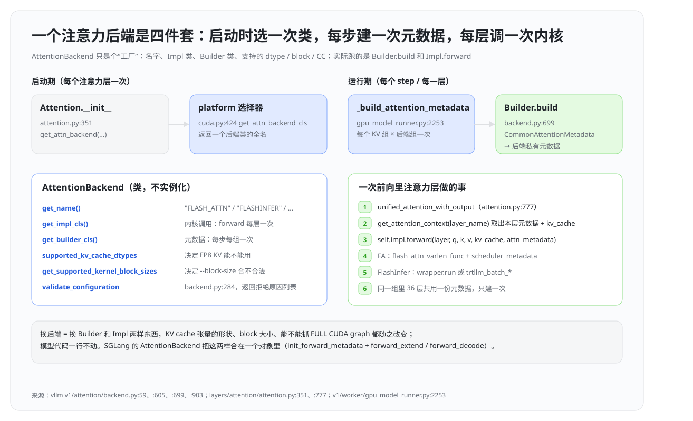
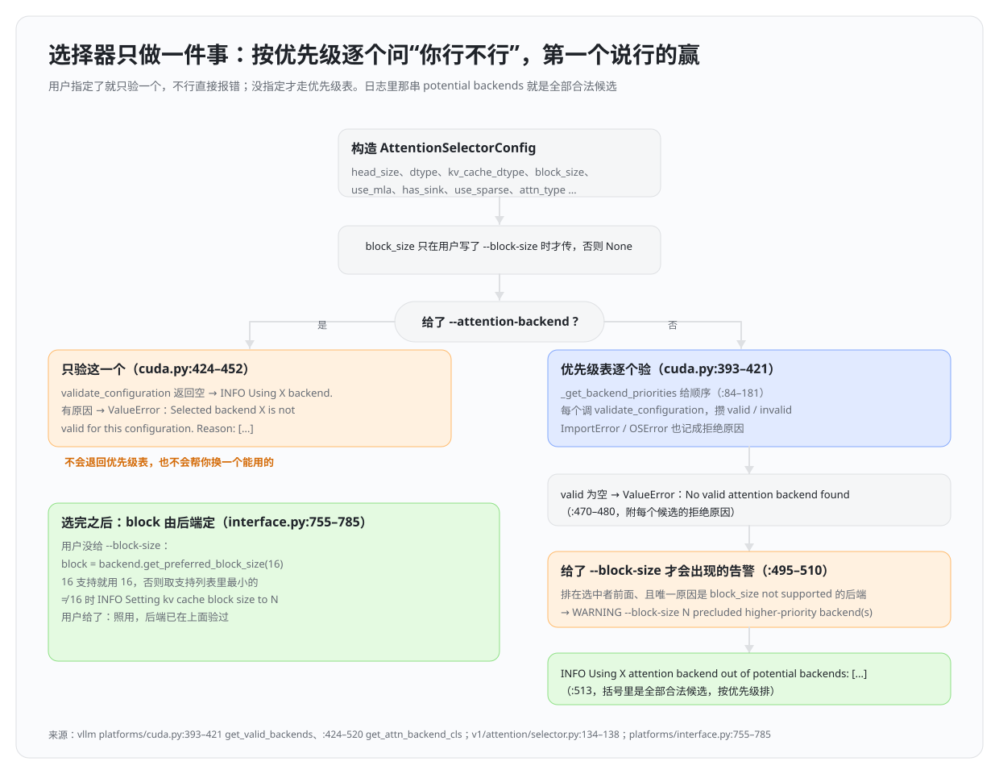
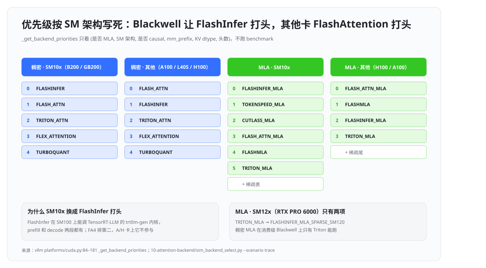
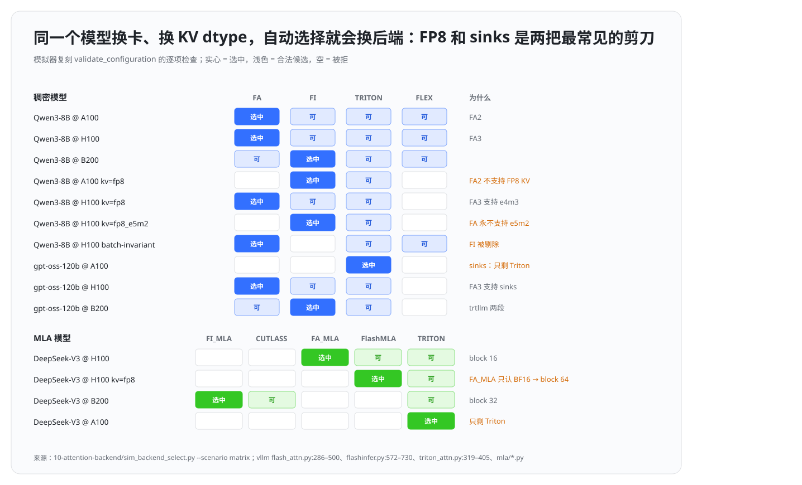
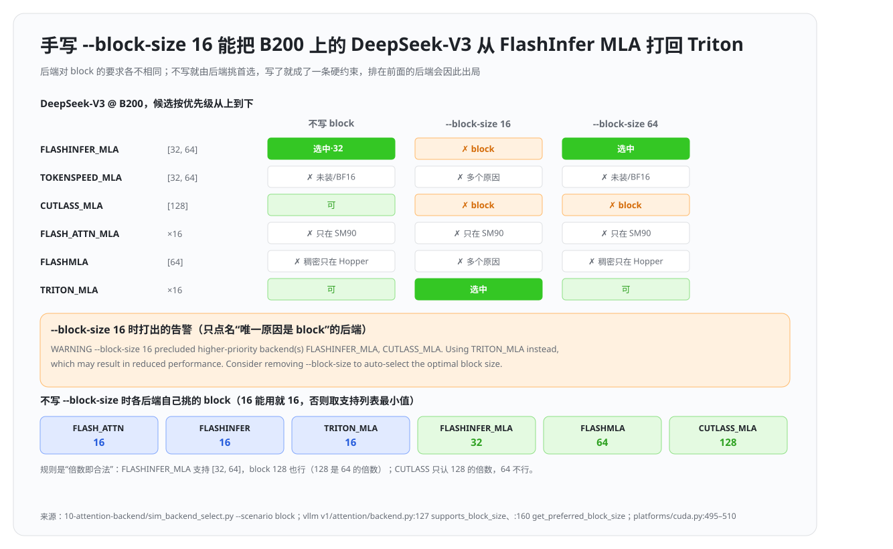
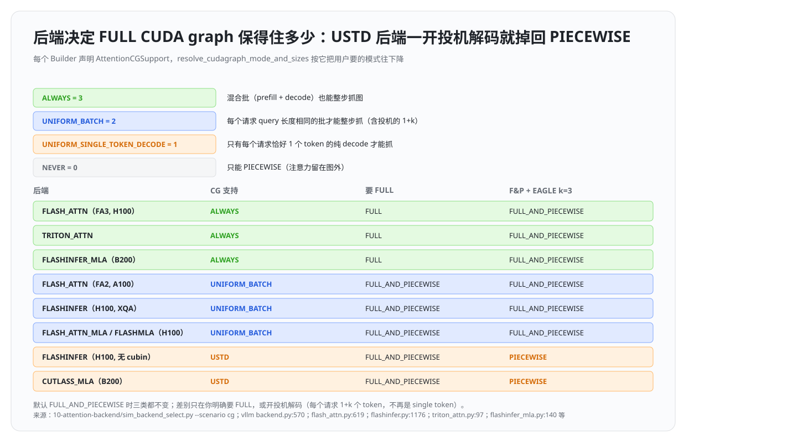
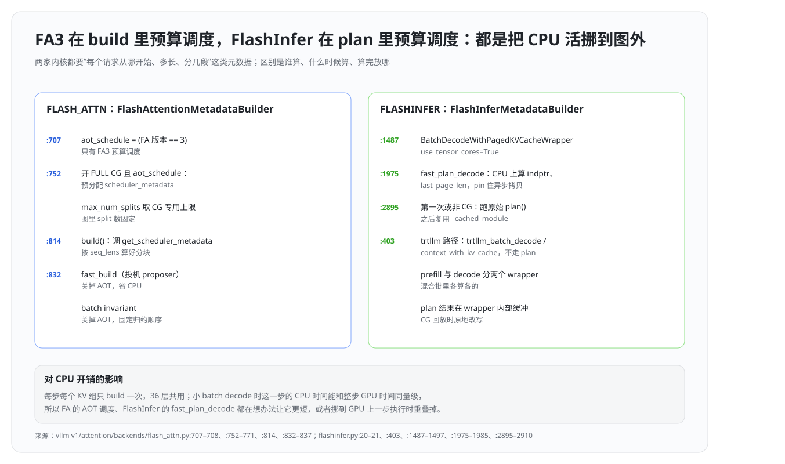
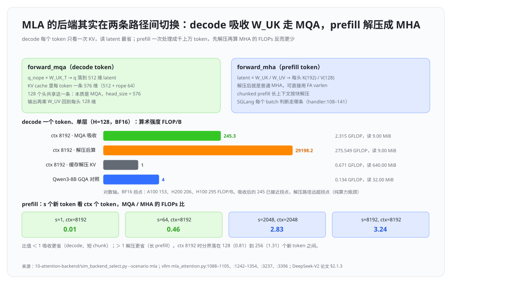
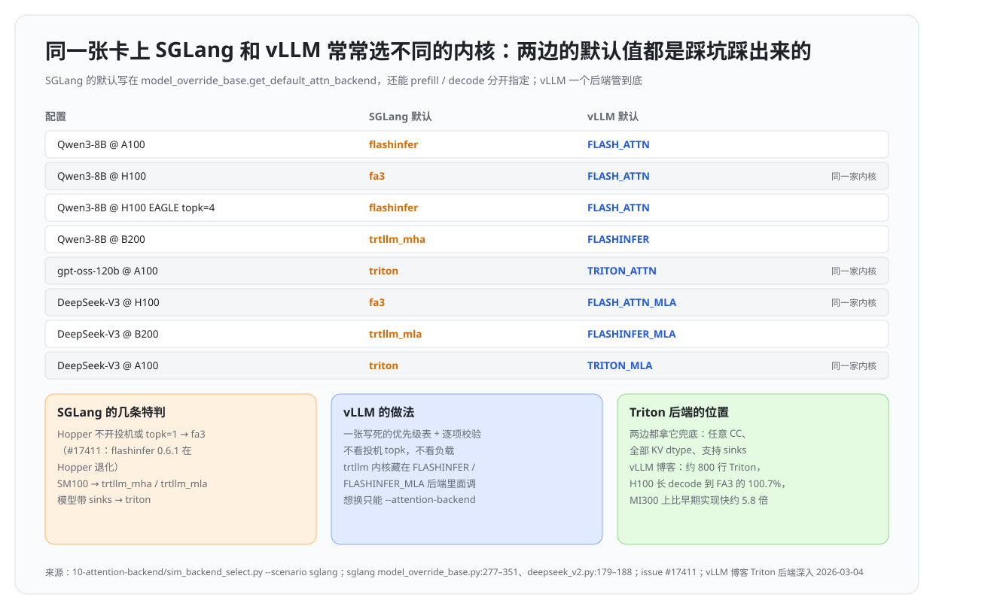

# VLLM-10｜原理｜注意力后端：FlashAttention、FlashInfer、Triton 与 MLA

> 🎯 **这篇文档解决什么问题**：同一个 Qwen3-8B，在 A100 上启动日志写 `Using FLASH_ATTN attention backend`，搬到 B200 上变成 `FLASHINFER`。加一个 `--kv-cache-dtype fp8`，A100 上又换成了 FLASHINFER。换成 gpt-oss-120b，A100 上只剩 TRITON_ATTN 一个候选。DeepSeek-V3 在 B200 上自动把 block 改成 32，你手动给了 `--block-size 16`，日志多出一行 WARNING，说你把两个更快的后端挤掉了。上一篇里 FlashInfer 让 FULL 变成 F&P，也是这个层面的事。我们打开注意力这个黑盒：vLLM 怎么定义一个后端、怎么在十几个后端里挑一个、每一步怎么为它准备元数据、MLA 为什么在两条计算路径之间切换，并和 SGLang 的默认选择逐项对比。
>
> **使用方式**：第 1 章讲为什么注意力要单独做成可替换的后端。第 2 章拆一个后端的四件套。第 3、4 章讲选择器的流程和候选顺序。第 5 章讲 FP8、sinks、batch invariance 这些条件怎样筛掉候选。第 6 章讲 block size。第 7 章讲后端的 CUDA graph 能力。第 8 章讲 FA 和 FlashInfer 的元数据构建。第 9 章讲 MLA 的两条路径和 KV 账。第 10 章对照 SGLang、讲 Triton 后端，最后动手核对。基线：vLLM 主干 0d6f92a，SGLang 主干 8fabf5e。
>
> **代码**：[10-attention-backend](../10-attention-backend)。sim_backend_select.py 只依赖标准库，按源码复刻了 CUDA 平台的候选顺序（`_get_backend_priorities`）、逐项校验（`validate_configuration`）、选择日志和 block 挤占告警、各后端的首选 block 与 CUDA graph 支持级别，另外算了 MLA 两条路径的 FLOPs / 字节、每 token KV，以及 SGLang 的 `get_default_attn_backend`。test_sim_backend_select.py 有 24 个单测。backend_matrix.md 是逐行对照表和能力表。gpu_backend_bench.sh 在一张卡上切换后端，抓选择日志并跑延迟和服务基准。文中的选择结果、拒绝原因、block、FLOPs 和 KV 字节数都来自这个脚本。

# 导读 · 先给结论

## 注意力后端不覆盖全部计算

通用后端脚本已接入 dense/moe。--attention-backend 的对照要注明作用于哪些全注意力层，同时记录 GDN 与 MoE kernel，不能把全模型耗时都归因于 FlashAttention 或 FlashInfer。

block-size 与 FP8 KV 组合须逐模型验证；混合分配可能改变对齐或拒绝配置。进程退出、后端不兼容、JSON 缺失分别记录，不把缺失结果当作零延迟。旧 GQA、MLA 选择表仍是专项对照。

双模型结构以固定版本配置核对[[Qwen3.8-27B config.json]](https://huggingface.co/Qwen/Qwen3.8-27B/blob/37561816e66b5b9153b1b64c10968c18c1e6f4a0/config.json)[[Qwen3.5-35B-A3B config.json]](https://huggingface.co/Qwen/Qwen3.5-35B-A3B/blob/59d61f3ce65a6d9863b86d2e96597125219dc754/config.json)。

1. **decode 注意力是带宽活，prefill 是算力活，内核好坏直接决定 TPOT。**Qwen3-8B 在 8192 上下文 decode 一个 token，单层注意力只有 0.134 GFLOP，却要读 32 MiB KV，算术强度 4.0 FLOP/B，H100 BF16 的拐点是 295。这一步谁更接近显存带宽上限，谁就赢。
2. **一个后端是四件套。**`AttentionBackend` 是工厂，声明名字、dtype、KV dtype、block、CC。`AttentionMetadataBuilder.build` 每步在 CPU 上把通用元数据翻译成内核要的格式。`AttentionImpl.forward` 每层调内核。KV 写入单独拆成 `do_kv_cache_update`，也是 torch.compile 的切点。
3. **选择器按优先级逐个问“你行不行”，第一个说行的赢。**用户给了 `--attention-backend` 就只验那一个，不合法直接报错；否则按 SM 架构写死的顺序走一遍 `validate_configuration`，日志括号里列出全部合法候选。
4. **Blackwell 让 FlashInfer 打头，其他卡 FlashAttention 打头。**MLA 在 SM10x 上是 FLASHINFER_MLA → TOKENSPEED_MLA → CUTLASS_MLA → …，在 Hopper 上是 FLASH_ATTN_MLA → FLASHMLA → …，SM12x 只有 TRITON_MLA。
5. **FP8 KV 和 attention sinks 是两把最常见的剪刀。**A100 上 FP8 KV 让 FA2 出局，换成 FLASHINFER。fp8_e5m2 在任何卡上都不被 FA 接受。gpt-oss 带 sinks，A100 上只剩 TRITON_ATTN。开 batch invariance，FlashInfer 出局。
6. **不要随手给 --block-size。**不给时后端自己挑首选：FLASHINFER_MLA 32、FLASHMLA 64、CUTLASS_MLA 128。DeepSeek-V3 在 B200 上给 16，FLASHINFER_MLA 和 CUTLASS_MLA 都出局，只剩 TRITON_MLA，日志会告警。
7. **后端决定 FULL CUDA graph 保得住多少。**FA3、Triton、FLASHINFER_MLA 是 ALWAYS，要 FULL 给 FULL。FA2、FlashInfer、FLASHMLA 是 UNIFORM_BATCH，降到 F&P。CUTLASS_MLA 和拿不到 cubin 的 FlashInfer 只支持单 token decode，开 EAGLE k=3 就掉回 PIECEWISE。
8. **MLA 其实是两种注意力。**decode 把 W_UK 吸收进 query，128 个头共享一条 576 维的潜向量，本质是 MQA，8192 上下文时算术强度 245 FLOP/B，已经贴近 H100 拐点；prefill 把潜向量解压成每头 K/V 走 MHA。s 个新 token 看 8192 上下文时，s 在 128 到 256 之间两条路径的 FLOPs 交叉。DeepSeek-V3 每 token KV 70,272 字节，只有存 MHA 的 1/71.1。
9. **SGLang 常常选不同的内核。**Qwen3-8B 在 A100 上 SGLang 默认 flashinfer、vLLM 默认 FLASH_ATTN。H100 上两边都是 FA3，但 SGLang 一开 EAGLE topk>1 就换 flashinfer。B200 上 SGLang 走 trtllm_mha / trtllm_mla。两边都拿 Triton 兜底：vLLM 的 Triton 后端约 800 行，长 decode 在 H100 上做到 FA3 的 100.7%。

# 第 1 章 · 为什么注意力要单独做成后端

## 1.1 从 FlashAttention 开始：注意力的瓶颈是搬数据

朴素的注意力先算出 N×N 的分数矩阵写回 HBM，再读回来做 softmax，再读回来乘 V。FlashAttention 的观察是这个过程的瓶颈在 HBM 读写，乘加反倒不贵：把 Q、K、V 切成能放进 SRAM 的块，在片上做 online softmax，分数矩阵从不落地，反向时直接重算，不存[[1]](https://arxiv.org/abs/2205.14135)。FlashAttention-2 重排了循环顺序和 warp 间的分工，减少非矩阵乘的 FLOPs，在 A100 上比第一版快约 2 倍，达到理论峰值的 50–73%[[2]](https://arxiv.org/abs/2307.08691)。FlashAttention-3 专为 Hopper 写：用 TMA 和 wgmma 做异步流水，让 softmax 和矩阵乘交错，FP16 到 740 TFLOPS（75% 利用率），FP8 接近 1.2 PFLOPS[[3]](https://arxiv.org/abs/2407.08608)。

这三代都是训练和 prefill 视角：Q 很长，算力是瓶颈。推理服务的 decode 是另一回事：每个请求每步只有 1 个新 token（投机解码时几个），却要把整段历史 KV 读一遍。用本章的模拟器算一层：

```text
Qwen3-8B（GQA 32/8，head 128，BF16），ctx 8192，decode 1 个 token、单层：
  0.134 GFLOP，读 KV 32.00 MiB，算术强度 4.0 FLOP/B
BF16 拐点：A100 80GB SXM 153 FLOP/B，H100 SXM 295 FLOP/B，H200 206 FLOP/B
```

4.0 对 295，差了将近两个数量级，GPU 的算力几乎全闲着，时间全花在把 KV 从 HBM 搬到 SM 上。decode 注意力内核的好坏，就看它离显存带宽上限有多近：KV 怎么切块分给 SM、长序列怎么 split-KV 再归约、短序列会不会让一半的 SM 空着。这和 prefill 内核要的东西完全不一样，所以一个推理引擎里同时存在好几套注意力内核并不奇怪。

## 1.2 分页 KV 让内核必须认识 block table

VLLM-02 讲过 PagedAttention：KV cache 按固定大小的 block 分配，一个请求的 KV 在显存里不连续，靠 block table 把逻辑位置映射到物理 block[[4]](https://arxiv.org/abs/2309.06180)。这让碎片率降到几个百分点，但也意味着注意力内核不能再假设 K、V 是一块连续张量，它必须接收 block table 和 slot mapping，在内核里做一次间接寻址。FlashAttention 的 varlen 接口后来加了分页 KV 支持；FlashInfer 干脆把分页 KV、前缀共享、树形投机统一成块稀疏矩阵格式，用 JIT 编译出不同变体的内核，再配一个负载均衡的调度器[[5]](https://arxiv.org/abs/2501.01005)。

模型结构也在变。GQA 让多个 query 头共享一组 KV 头[[6]](https://arxiv.org/abs/2305.13245)，MQA 是它的极端情形[[7]](https://arxiv.org/abs/1911.02150)。DeepSeek-V2 的 MLA 把 KV 压成一条低秩潜向量[[8]](https://arxiv.org/abs/2405.04434)。gpt-oss 在 softmax 分母里加了 attention sinks。滑动窗口、交错的全局/局部层、encoder-decoder 的 cross attention 各有各的要求。没有一个内核能覆盖全部组合，引擎能做的是定一个接口，让每个内核库声明自己支持什么，再在启动时挑一个。

## 1.3 vLLM 有哪些后端

vLLM 在 CUDA 上常见的稠密后端有四个：FLASH_ATTN（vLLM 自己 fork 的 FlashAttention，按架构用 FA2 / FA3 / FA4）、FLASHINFER、TRITON_ATTN（纯 Triton 写的统一内核）、FLEX_ATTENTION（PyTorch FlexAttention，主要用于非 causal 和特殊 mask）；还有只处理 TurboQuant KV 的 TURBOQUANT。MLA 一侧有 FLASH_ATTN_MLA、FLASHMLA、FLASHINFER_MLA、CUTLASS_MLA、TOKENSPEED_MLA、TRITON_MLA，以及一组稀疏 MLA 后端。设计文档列了全部后端和能力[[9]](https://docs.vllm.ai/en/latest/design/attention_backends/)。版本固定方面，0d6f92a 用的是 FA fork b273a02、FlashMLA fork e2afa5fd、flashinfer 0.7.2.post1。

SGLang 的注册表在 attention_registry.py[[10]](https://github.com/sgl-project/sglang/blob/8fabf5e/python/sglang/srt/layers/attention/attention_registry.py)，名字是小写的 fa3、fa4、flashinfer、triton、trtllm_mha、trtllm_mla、flashmla、cutlass_mla、aiter 等，同样由 `--attention-backend` 指定；它还允许 `--prefill-attention-backend` 和 `--decode-attention-backend` 分别指定，按 forward mode 分派[[11]](https://github.com/sgl-project/sglang/blob/8fabf5e/python/sglang/srt/layers/attention/hybrid_attn_backend.py)。vLLM 没有这个开关，prefill 和 decode 的分工是后端内部的事，第 9 章会看到 MLA 是怎么做的。

# 第 2 章 · 一个后端的四件套



## 2.1 AttentionBackend：只是个工厂

[backend.py](https://github.com/vllm-project/vllm/blob/0d6f92a/vllm/v1/attention/backend.py) 59 行的 `AttentionBackend` 不跑任何计算，只回答问题：`get_name`（83 行）、`get_impl_cls`（88 行）、`get_builder_cls`（93 行）给出名字和两个实际干活的类；类属性 `supported_dtypes`、`supported_kv_cache_dtypes` 和一组 `supports_*` 类方法声明能力，`supports_block_size`（127 行）和 `get_preferred_block_size`（160 行）管 block，`validate_configuration`（284 行）把所有检查串起来，返回一个拒绝原因列表，空列表就是合法。

注意力层在构造时调 `get_attn_backend`（[attention.py](https://github.com/vllm-project/vllm/blob/0d6f92a/vllm/model_executor/layers/attention/attention.py) 351 行）拿到后端类，再实例化 Impl。所以后端是按层选的，但同一个模型的所有同类层传进去的参数一样，实际结果也一样；混合模型里 Mamba 层、滑动窗口层、MLA 层各自走自己的选择。

## 2.2 CommonAttentionMetadata：每步的通用描述

runner 每一步先构造一份与后端无关的 `CommonAttentionMetadata`（backend.py 395 行），核心字段就这几个：

| 字段 | 含义 |
|-|-|
| `query_start_loc`（GPU / CPU 各一份） | 每个请求本步新 token 在拼接后的 batch 里的起止位置，长度 num_reqs + 1 |
| `seq_lens` | 每个请求算上本步之后的总长度（历史 + 新 token） |
| `num_reqs`、`num_actual_tokens` | 请求数、本步实际 token 数（不含 CUDA graph 的 padding） |
| `max_query_len`、`max_seq_len` | 最长的新 token 段、最长的总长度，内核据此选分块策略 |
| `block_table_tensor` | 每个请求的物理 block 号列表 |
| `slot_mapping` | 每个新 token 的 KV 要写到哪个槽位（block 号 × block_size + 偏移） |
| `causal` | 是否 causal，DFlash 一类非 causal 草稿模型会用到 |

这些量在 VLLM-03 和 VLLM-05 里分别出现过：调度器决定每个请求本步跑几个 token，KV cache manager 决定 block table。`_build_attention_metadata`（[gpu_model_runner.py](https://github.com/vllm-project/vllm/blob/0d6f92a/vllm/v1/worker/gpu_model_runner.py) 2253 行）按 KV cache 组和注意力组遍历，每组调一次自己的 builder。

## 2.3 MetadataBuilder：把通用描述翻译成内核参数

`AttentionMetadataBuilder`（backend.py 605 行）的 `build`（699 行）接收 CommonAttentionMetadata，产出后端私有的元数据对象。FA 要的是 cu_seqlens 和可选的 scheduler_metadata。FlashInfer 要的是 indptr / indices / last_page_len 三件套，再调一次 `plan()`。MLA 后端要先把 batch 切成 decode 段和 prefill 段，两段各建一份。这一步在 CPU 上、在 CUDA graph 之外执行，它的耗时直接算进每步的 CPU 开销，第 8 章专门看。

builder 还声明两件影响 runner 的事。一是 `_cudagraph_support`，即第 7 章的 CG 支持级别。二是 `reorder_batch_threshold`：query 长度不超过它的请求算 decode。runner 的 `calculate_reorder_batch_threshold`（6817 行）汇总各组 builder 的阈值，`_may_reorder_batch`（1105 行）在每步开始前把 batch 重排成 decode → 短 extend → 长 extend → prefill 的顺序（[utils.py](https://github.com/vllm-project/vllm/blob/0d6f92a/vllm/v1/attention/backends/utils.py) 955 行），这样 builder 用 `split_decodes_and_prefills`（853 行）一刀就能切开，decode 段和 prefill 段各调各的内核。开了投机解码时，支持多 token decode 的后端会把阈值抬到最大的 decode query 长度（backend.py 671–690 行），让 1 + k 个 token 的验证请求也走 decode 内核。

## 2.4 AttentionImpl 与 KV 写入

`AttentionImpl`（backend.py 903 行）的 `forward`（930 行）是每层实际调内核的地方，FA 在 flash_attn.py 1182 行，FlashInfer 在 flashinfer.py 2186 行。注意力层自己并不直接调它：编译图里注意力是一个自定义算子 `unified_attention_with_output`（attention.py 777 行），它先 `get_attention_context` 从 forward context 取出本层的元数据和 KV cache，再调 `self.impl.forward`。这就是上一篇里注意力成为切点的原因：它的输入里有每步都变的元数据，编译器看不见。

新 token 的 K、V 写进分页 cache 这一步被单独拆出来。FA、FlashInfer、Triton 三个后端都把 `forward_includes_kv_cache_update` 设成 False，由另一个自定义算子 `unified_kv_cache_update`（attention.py 734 行）调各自的 `do_kv_cache_update`（flash_attn.py 1432 行，内部是 `reshape_and_cache_flash`）。拆开以后，KV 写入也成了切点，可以和前面的 RoPE、后面的注意力分别调度，这是 VLLM-09 第 2 章提到的 Issue #33267 的背景。

还有一个已经消失的东西要提一句：cascade attention。它曾经让共享长前缀的一批请求先对前缀做一次注意力、再各自对后缀做一次，再合并；0d6f92a 里 runner 只留下一行 `self.cascade_attn_enabled = False` 和一句注释“cascade attention has been removed”（539 行）。前缀共享的收益现在主要靠 prefix caching 省 prefill，decode 内核这一侧已经不再靠它省带宽。

# 第 3 章 · 选择器：按顺序问“你行不行”



## 3.1 入口：block 只在你给了的时候参与

注意力层构造时，[selector.py](https://github.com/vllm-project/vllm/blob/0d6f92a/vllm/v1/attention/selector.py) 把 head_size、dtype、KV dtype、是否 MLA、是否有 sinks、是否稀疏、attn_type 等打包成选择参数，交给平台的 `get_attn_backend_cls`。134–138 行有个容易忽略的细节：只有用户显式给了 `--block-size`，block_size 才传进去；否则传 None，block 不参与筛选，等选完再由后端自己定。这个设计让“block 由后端决定”成为默认路径，第 6 章细说。

## 3.2 用户指定：只验一个，不合法就报错

`--attention-backend`（[arg_utils.py](https://github.com/vllm-project/vllm/blob/0d6f92a/vllm/engine/arg_utils.py) 1119 行）给了值，[cuda.py](https://github.com/vllm-project/vllm/blob/0d6f92a/vllm/platforms/cuda.py) 424–452 行只对这一个后端调 `validate_configuration`。合法打一行 `Using %s backend.`（452 行），不合法抛 ValueError（447 行），不会悄悄回退。模拟器里两个例子：

```text
== DeepSeek-V3 @ A100 80GB SXM -ab FLASHMLA
  ValueError: Selected backend AttentionBackendEnum.FLASHMLA is not valid for this configuration. Reason: ['compute capability not supported', 'FlashMLA Dense is only supported on Hopper devices.']

== Qwen3-8B @ H100 SXM kv=fp8_e5m2 -ab FLASHINFER
  INFO Using AttentionBackendEnum.FLASHINFER backend.
```

注意两种日志的措辞不同：用户指定时是 `Using AttentionBackendEnum.X backend.`，自动选择时是 `Using X attention backend out of potential backends: [...]`。线上排查时看到前一种，说明有人在启动参数或配置文件里写死了后端。

## 3.3 自动选择：逐个校验，第一个合法的赢

没指定时，先由 `_get_backend_priorities`（cuda.py 84–181 行）给出候选顺序，再由 `get_valid_backends`（393–421 行）逐个调 `validate_configuration`。导入失败（ImportError、OSError，比如 wheel 里没编这个内核）也被转成 `"类型: 信息"` 形式的原因，不会让启动崩掉。`validate_configuration`（backend.py 284–373 行）的检查顺序是：head_size、dtype、kv_cache_dtype、block_size、mm_prefix、MLA、sinks、sparse、per-head 量化 scale、compute capability、attn_type、滑动窗口、R-SWA、non-causal、MLA + DCP 的非 causal、batch invariance、KV connector、PCP、DCP、自适应验证，最后是后端自定义的 `supports_combination`。每一项不满足就往列表里加一条原因，所以一个后端可能同时有好几条拒绝原因。

```text
== Qwen3-8B @ A100 80GB SXM kv=fp8
  [0] FLASH_ATTN                   ✗ ['kv_cache_dtype not supported', 'FP8 KV cache requires FA3 on SM90, FA4 with head_size=512 on SM90, or FA4 on SM100']
  [1] FLASHINFER                   ✓
  [2] TRITON_ATTN                  ✓
  [3] FLEX_ATTENTION               ✗ ['kv_cache_dtype not supported']
  [4] TURBOQUANT                   ✗ ['kv_cache_dtype not supported']
  INFO Using FLASHINFER attention backend out of potential backends: ['FLASHINFER', 'TRITON_ATTN'].
```

全部不合法时（470–480 行）抛 `No valid attention backend found`，并附上每个候选的原因字典。选中后打成功日志（513 行），括号里是全部合法候选，按优先级排列：这一行是读后端问题时最有用的一行，它同时告诉你选了谁、备胎是谁。

## 3.4 选完以后：block 由后端定

选择结束后 `update_block_size_for_backend`（[interface.py](https://github.com/vllm-project/vllm/blob/0d6f92a/vllm/platforms/interface.py) 755–785 行）处理 block。用户没给 `--block-size` 时取 `backend.get_preferred_block_size(16)`：默认 16 能用就用 16，否则取支持列表里最小的；结果不是 16 时打 `Setting kv cache block size to %d for %s backend(s).`（782 行）。用户给了 block、并且排在前面的后端唯一的拒绝原因是 `block_size not supported` 时，495–510 行打一条 WARNING，第 6 章展开。

# 第 4 章 · 候选顺序：按架构写死



## 4.1 稠密模型

| 情形 | 顺序 |
|-|-|
| SM10x（B200 / GB200），causal | FLASHINFER → FLASH_ATTN → TRITON_ATTN → FLEX_ATTENTION → TURBOQUANT（mm_prefix 时最前加 TRITON_FLASHINFER） |
| 其他（A100、L40S、H100、H200、SM12x） | FLASH_ATTN → FLASHINFER → TRITON_ATTN → FLEX_ATTENTION → TURBOQUANT（SM90 + mm_prefix 时最前加 TRITON_FLASH_ATTN） |

Blackwell 上 FlashInfer 打头，是因为它带着 TensorRT-LLM 的 trtllm-gen 内核：FlashInfer 下载预编译的 cubin，在 SM100 上 prefill 和 decode 都走 `trtllm_batch_context_with_kv_cache` / `trtllm_batch_decode_with_kv_cache`（flashinfer.py 20–21、403 行）。判定逻辑在 [flashinfer.py](https://github.com/vllm-project/vllm/blob/0d6f92a/vllm/utils/flashinfer.py) 719–765 行：batch invariant 或拿不到 cubin 时直接不用 trtllm；SM90 和 SM12x 只有 decode 能用（XQA 内核），SM100 两段都有。FA 的版本由 fa_utils 决定：SM9x 用 FA3，SM10x 用 FA4，其余用 FA2。所以 H100 上的 FLASH_ATTN 是 FA3，A100 和 L40S 上是 FA2，这一点会在第 5、7 章反复出现。

## 4.2 MLA 模型

| 情形 | 顺序 |
|-|-|
| SM10x | FLASHINFER_MLA → TOKENSPEED_MLA → CUTLASS_MLA → FLASH_ATTN_MLA → FLASHMLA → TRITON_MLA → 稀疏表 |
| SM12x（RTX PRO 6000 等） | TRITON_MLA → FLASHINFER_MLA_SPARSE_SM120 |
| 其他（Hopper、Ampere） | FLASH_ATTN_MLA → FLASHMLA → FLASHINFER_MLA → TRITON_MLA → 稀疏尾 |

TOKENSPEED_MLA 排第二，但源码注释（cuda.py 125–127 行）写得很直白：它只在 R1 的维度加 FP8 KV 时才用，batch 大约 8 以上占优，batch 不超过 2 时反而退化。它还要额外装包，没装时的拒绝原因就是一句安装提示。稀疏表随 KV dtype 和头数变化，服务于 DeepSeek-V3.2 一类的 DSA 模型，这里不展开。

MLA 还有第二个选择器：prefill 段用什么内核。`get_mla_prefill_backend_cls`（interface.py 440 行）的默认实现是：Hopper 及更早只有 FLASH_ATTN；SM10x 上通常是 FLASH_ATTN → TRTLLM_RAGGED → FLASHINFER → TOKENSPEED_MLA，只有 qk_nope 192 / rope 64 / v 256 这种更宽的维度才让 TRTLLM_RAGGED 排第一。选中后打 `Using %s MLA prefill backend.`（[selector.py](https://github.com/vllm-project/vllm/blob/0d6f92a/vllm/v1/attention/backends/mla/prefill/selector.py) 106、131 行），可以用 `mla_prefill_backend` 配置覆盖。所以 DeepSeek-V3 的启动日志里会有两行后端信息：一行 decode 侧的 MLA 后端，一行 prefill 侧。

## 4.3 顺序不是性能排名

候选顺序是 vLLM 维护者对“典型负载下谁更快、谁更稳”的判断，写死在代码里，不会根据你的负载动态调整。它解释了默认行为，但不等于你的场景下的最优解：长上下文小 batch、短上下文大 batch、投机解码、FP8 KV，排第一的后端都可能不是最快的。第 10 章的基准脚本就是为了在你的卡上把候选逐个跑一遍。

# 第 5 章 · 能力矩阵：哪些条件会换掉后端



## 5.1 典型配置的选择结果

把几种常见模型放到几种卡上跑一遍模拟器（`--scenario matrix`）：

| 配置 | 选中 | block | CG 支持 | 全部合法候选 |
|-|-|-|-|-|
| Qwen3-8B @ A100 / L40S | FLASH_ATTN（FA2） | 16 | UNIFORM_BATCH | FLASH_ATTN, FLASHINFER, TRITON_ATTN, FLEX_ATTENTION |
| Qwen3-8B @ H100 | FLASH_ATTN（FA3） | 16 | ALWAYS | 同上 |
| Qwen3-8B @ B200 | FLASHINFER | 16 | UNIFORM_BATCH | FLASHINFER, FLASH_ATTN, TRITON_ATTN, FLEX_ATTENTION |
| Qwen3-8B @ A100 kv=fp8 | FLASHINFER | 16 | UNIFORM_BATCH | FLASHINFER, TRITON_ATTN |
| Qwen3-8B @ H100 kv=fp8 | FLASH_ATTN（FA3） | 16 | ALWAYS | FLASH_ATTN, FLASHINFER, TRITON_ATTN |
| Qwen3-8B @ H100 kv=fp8_e5m2 | FLASHINFER | 16 | UNIFORM_BATCH | FLASHINFER, TRITON_ATTN |
| Qwen3-8B @ H100 batch-invariant | FLASH_ATTN（FA3） | 16 | ALWAYS | FLASH_ATTN, TRITON_ATTN, FLEX_ATTENTION |
| gpt-oss-120b @ A100 | TRITON_ATTN | 16 | ALWAYS | TRITON_ATTN |
| gpt-oss-120b @ H100 | FLASH_ATTN（FA3） | 16 | ALWAYS | FLASH_ATTN, FLASHINFER, TRITON_ATTN |
| gpt-oss-120b @ B200 | FLASHINFER | 16 | UNIFORM_BATCH | FLASHINFER, FLASH_ATTN, TRITON_ATTN |
| DeepSeek-V3 @ H100 | FLASH_ATTN_MLA | 16 | UNIFORM_BATCH | FLASH_ATTN_MLA, FLASHMLA, TRITON_MLA |
| DeepSeek-V3 @ H100 kv=fp8 | FLASHMLA | 64 | UNIFORM_BATCH | FLASHMLA, TRITON_MLA |
| DeepSeek-V3 @ B200 | FLASHINFER_MLA | 32 | ALWAYS | FLASHINFER_MLA, CUTLASS_MLA, TRITON_MLA |
| DeepSeek-V3 @ A100 / RTX PRO 6000 | TRITON_MLA | 16 | UNIFORM_BATCH | TRITON_MLA |

这张表里能读出几条规律。换卡会换后端，主要因为候选顺序按架构写死；同一张卡上换后端，基本是 KV dtype、sinks、batch invariance 三类条件在起作用。下面逐个看。

## 5.2 FP8 KV cache

FP8 KV 把每 token KV 字节数减半，Qwen3-8B 从 147,456 字节降到 73,728 字节，同样的显存能放下两倍的上下文，decode 读的字节也减半。vLLM 博客对 FP8 KV 和 FP8 注意力的现状做过一次梳理：哪些后端在注意力里直接用 FP8 做矩阵乘、哪些只是存储时量化、读出来再反量化，精度和速度的取舍各不相同[[12]](https://vllm.ai/blog/2026-04-22-fp8-kvcache)。选择器只关心能不能跑：FA 接受 fp8 / fp8_e4m3，但要求 FA3@SM90、或 head_size 512 的 FA4@SM90、或 FA4@SM100，FA2 不行；`flash_attn_supports_kv_cache_dtype` 对 fp8_e5m2 永远返回 False。于是 A100 上 FP8 KV 让 FLASH_ATTN 出局，FLASHINFER 接手；H100 上 FA3 支持 e4m3，FLASH_ATTN 保住，但换成 e5m2 就让位给 FLASHINFER。FLEX_ATTENTION 只认 auto / fp16 / bf16，FP8 一开就出局。FP8 两种格式的区别（e4m3 精度高、e5m2 范围大）见 FP8 格式论文[[13]](https://arxiv.org/abs/2209.05433)，量化的细节留给 VLLM-12。

## 5.3 attention sinks

gpt-oss 在每个头的 softmax 分母里加了一个可学习的 sink 项，内核必须支持它。FA 要求 FA3 / FA4 且 CC ≥ 9.0。FlashInfer 在 SM90 / SM12x 要靠 XQA decode，SM100 要 trtllm 两段都在。FLEX_ATTENTION 不支持。TRITON_ATTN 支持。于是：

```text
== gpt-oss-120b @ A100 80GB SXM
  [0] FLASH_ATTN                   ✗ ['attention sinks not supported', 'sink not supported on compute capability < 9.0']
  [1] FLASHINFER                   ✗ ['attention sinks not supported']
  [2] TRITON_ATTN                  ✓
  [3] FLEX_ATTENTION               ✗ ['attention sinks not supported']
  [4] TURBOQUANT                   ✗ ['kv_cache_dtype not supported', 'attention sinks not supported', 'sliding window not supported']
  INFO Using TRITON_ATTN attention backend out of potential backends: ['TRITON_ATTN'].
```

A100 上跑 gpt-oss，只有 Triton 一条路。这也是 Triton 后端存在的意义之一：新模型带来新的注意力变体时，Triton 内核改起来比 CUDA / CUTLASS 内核快得多，往往是第一个支持的。

## 5.4 batch invariance

开 `VLLM_BATCH_INVARIANT` 要求同一个请求无论和谁拼 batch、batch 多大，输出逐比特一致，RL 训推一致性需要它（VLLM-19 会再讲）。split-KV 的分块数随 batch 变化，归约顺序就会变，浮点结果跟着变。后端要声明 `supports_batch_invariance`：基类默认 False（backend.py 214 行），FA（flash_attn.py 394 行）和 Triton（triton_attn.py 367 行）返回 True，FlashInfer 没有覆盖。所以 H100 上开 batch invariance，合法候选从四个变成 FLASH_ATTN、TRITON_ATTN、FLEX_ATTENTION 三个，FLASHINFER 的拒绝原因是 `batch invariance not supported`；B200 上 FlashInfer 出局，FLASH_ATTN 接手。FA 的 builder 在 batch invariant 时还会关掉 AOT 调度（flash_attn.py 832–837 行），因为预算的分块数也会随 batch 变。

## 5.5 head_size 和其他

head_size 也会筛：FA 要求能被 8 整除且不超过 256（FA4 可到 512），FlashInfer 只认 64 / 128 / 256 / 512，Triton 要求 ≥ 32。MLA 层传给选择器的 head_size 是 kv_lora_rank + qk_rope_head_dim，DeepSeek-V3 为 512 + 64 = 576，这个数只有 MLA 后端认。FLASH_ATTN_MLA 的 `supports_combination` 还要求 FA3 + SM90，所以它只在 Hopper 上出现；FLASHMLA 稠密内核也只在 Hopper 上合法，上游 FlashMLA 的 README 记录了它在 H800 上 660 TFLOPS 的成绩，2026 年 9 月 30 日的更新把 Hopper 稠密内核移出了上游主线（旧代码留在 ba89a34）[[14]](https://github.com/deepseek-ai/FlashMLA)，vLLM 用的是自己固定在 e2afa5fd 的 fork，Hopper 上照常可用。

# 第 6 章 · block size：框架 block 和内核 block 解耦



## 6.1 倍数即合法

KV cache manager 分配的 block（框架 block）和内核按多大的页去读 KV（内核 block）要分开看。`supports_block_size`（backend.py 127–143 行）的规则是：框架 block 是任一支持尺寸的倍数（或是 MultipleOf 基数的倍数）就合法，内核把一个大 block 当成几个连续的小页来读。FLASH_ATTN、TRITON_ATTN、TRITON_MLA 声明 `MultipleOf(16)`。FLASHINFER 支持 16 / 32 / 64，SM100 + trtllm + GQA 时到 1024。FLASHINFER_MLA 支持 [32, 64]，所以 128 也行。CUTLASS_MLA 只认 [128]，64 不行。FLASHMLA 只认 [64]。

不给 `--block-size` 时，每个后端自动取的 block（`get_preferred_block_size`，默认值 16）：

```text
FLASH_ATTN       支持 ['mult:16']                                                  → 16
FLASHINFER       支持 ['fix:16', 'fix:32', 'fix:64', 'fix:128', 'fix:256', 'fix:512', 'fix:1024'] → 16
FLASHINFER_MLA   支持 ['fix:32', 'fix:64']                                         → 32
CUTLASS_MLA      支持 ['fix:128']                                                  → 128
FLASHMLA         支持 ['fix:64']                                                   → 64
TRITON_MLA       支持 ['mult:16']                                                  → 16
```

DeepSeek-V3 在 B200 上自动选择 FLASHINFER_MLA，日志会多一行 `Setting kv cache block size to 32 for FLASHINFER_MLA backend(s).`；H100 上 FP8 KV 选中 FLASHMLA，block 变成 64。

## 6.2 你给的 block 会挤掉更快的后端

用户显式给了 `--block-size`，它就进入筛选。DeepSeek-V3 在 B200 上给 16：

```text
== DeepSeek-V3 @ B200 --block-size 16
  [0] FLASHINFER_MLA               ✗ ['block_size not supported']
  [1] TOKENSPEED_MLA               ✗ ['kv_cache_dtype not supported', 'block_size not supported', 'tokenspeed_mla package is not installed. Install it with: `uv pip install tokenspeed-mla`']
  [2] CUTLASS_MLA                  ✗ ['block_size not supported']
  [3] FLASH_ATTN_MLA               ✗ ['compute capability not supported', 'FlashAttention MLA not supported on this device']
  [4] FLASHMLA                     ✗ ['block_size not supported', 'FlashMLA Dense is only supported on Hopper devices.']
  [5] TRITON_MLA                   ✓
  WARNING --block-size 16 precluded higher-priority backend(s) FLASHINFER_MLA, CUTLASS_MLA. Using TRITON_MLA instead, which may result in reduced performance. Consider removing --block-size to auto-select the optimal block size.
  INFO Using TRITON_MLA attention backend out of potential backends: ['TRITON_MLA'].
```

告警只列出“唯一原因是 block_size”的后端：FLASHINFER_MLA 和 CUTLASS_MLA 列进去了，TOKENSPEED_MLA 和 FLASHMLA 还有别的原因，就算换个 block 也选不上，不列。改成 64，FLASHINFER_MLA 回来了，CUTLASS_MLA 仍然出局，合法候选是 FLASHINFER_MLA、TRITON_MLA。H100 上 DeepSeek-V3 开 FP8 KV 再给 16，FLASHMLA 被挤掉，同样退到 TRITON_MLA，告警里只有 FLASHMLA。稠密模型宽松得多：Qwen3-8B 在 B200 上给 128，四个后端都合法；但给 8 就谁都不认，直接 `No valid attention backend found`。

## 6.3 什么时候需要手动给 block

默认路径已经让后端选首选 block，大多数时候不需要手动给。会让人想改 block 的场景主要是：KV 连接器或卸载方案按某个块大小做传输和哈希（VLLM-14、VLLM-15），PD 两端要求 block 一致，或者想用更大的 block 降低 block table 长度。这时先确认目标后端支持这个尺寸，再看启动日志有没有 `precluded` 那行；有，就说明你在用性能换兼容。

# 第 7 章 · CUDA graph 能力：后端决定 FULL 保得住多少



## 7.1 四个级别

VLLM-09 第 6 章讲过降级规则，这里从后端一侧看。`AttentionCGSupport`（backend.py 570 行）有四档：ALWAYS（3）表示任意 batch，混合 prefill / decode 也能进整图。UNIFORM_BATCH（2）表示所有请求 query 长度相同的 batch 能进，包括投机解码的 1 + k。UNIFORM_SINGLE_TOKEN_DECODE（1，简称 USTD）只有每个请求恰好 1 个 token 的纯 decode 能进。NEVER（0）不能进整图。级别取决于内核能不能在固定地址、固定 launch 参数下处理变化的输入：FA3 / FA4 的 varlen 内核用预分配的 scheduler_metadata 处理任意 batch，所以 ALWAYS（flash_attn.py 619 行）；FA2 在 decode 和 prefill 混合时 launch 配置会变，只到 UNIFORM_BATCH。

| 后端 | CG 支持 | 源码 |
|-|-|-|
| FLASH_ATTN（FA3 / FA4） | ALWAYS | flash_attn.py 619 |
| FLASH_ATTN（FA2） | UNIFORM_BATCH | flash_attn.py 619 |
| FLASHINFER | trtllm / XQA 可用或 SM8x FA2 decode 时 UNIFORM_BATCH，否则 USTD | flashinfer.py 1176 |
| TRITON_ATTN、FLEX_ATTENTION | ALWAYS | triton_attn.py 97，flex_attention.py 836 |
| FLASHINFER_MLA | ALWAYS | mla/flashinfer_mla.py 140 |
| FLASH_ATTN_MLA、FLASHMLA、TRITON_MLA | UNIFORM_BATCH | flashattn_mla.py 127，flashmla.py 110，triton_mla.py 77 |
| CUTLASS_MLA | USTD | cutlass_mla.py 33 |

## 7.2 你要的模式和你拿到的模式

模拟器（`--scenario cg`）把后端级别、请求的模式和投机解码组合起来，用 VLLM-09 的降级规则推出最终模式：

```text
后端                               CG 支持                        默认 F&P               要 FULL               F&P + EAGLE k=3
FLASH_ATTN (FA2, A100)           UNIFORM_BATCH                FULL_AND_PIECEWISE   FULL_AND_PIECEWISE   FULL_AND_PIECEWISE
FLASH_ATTN (FA3, H100)           ALWAYS                       FULL_AND_PIECEWISE   FULL                 FULL_AND_PIECEWISE
FLASHINFER (A100, FA2 decode)    UNIFORM_BATCH                FULL_AND_PIECEWISE   FULL_AND_PIECEWISE   FULL_AND_PIECEWISE
FLASHINFER (H100, XQA)           UNIFORM_BATCH                FULL_AND_PIECEWISE   FULL_AND_PIECEWISE   FULL_AND_PIECEWISE
FLASHINFER (H100, 无 cubin)       UNIFORM_SINGLE_TOKEN_DECODE  FULL_AND_PIECEWISE   FULL_AND_PIECEWISE   PIECEWISE
FLASHINFER (B200, trtllm)        UNIFORM_BATCH                FULL_AND_PIECEWISE   FULL_AND_PIECEWISE   FULL_AND_PIECEWISE
TRITON_ATTN                      ALWAYS                       FULL_AND_PIECEWISE   FULL                 FULL_AND_PIECEWISE
FLASHINFER_MLA (B200)            ALWAYS                       FULL_AND_PIECEWISE   FULL                 FULL_AND_PIECEWISE
FLASH_ATTN_MLA (H100)            UNIFORM_BATCH                FULL_AND_PIECEWISE   FULL_AND_PIECEWISE   FULL_AND_PIECEWISE
FLASHMLA (H100)                  UNIFORM_BATCH                FULL_AND_PIECEWISE   FULL_AND_PIECEWISE   FULL_AND_PIECEWISE
CUTLASS_MLA (B200)               UNIFORM_SINGLE_TOKEN_DECODE  FULL_AND_PIECEWISE   FULL_AND_PIECEWISE   PIECEWISE
```

三列各说明一件事。默认的 F&P 对所有后端都成立，因为 F&P 只要求纯 decode 能进整图，其余走分段图。要 FULL 时只有 ALWAYS 后端能给，其他降成 F&P。开 EAGLE k=3 后，每个 decode 请求一次验证 4 个 token，UNIFORM_BATCH 后端仍然能把它当成均匀 batch 录整图；USTD 后端只认 1 个 token，整图用不上了，只剩 PIECEWISE。H100 上 FlashInfer 有没有 cubin 这件事，平时看不出差别，一开投机解码就是 F&P 和 PIECEWISE 的差别，小 batch TPOT 会明显变长。CUDA graph 的设计文档列了这套级别和降级规则[[15]](https://docs.vllm.ai/en/latest/design/cuda_graphs/)。

## 7.3 和 reorder 阈值联动

第 2 章说过，支持多 token decode 的后端会把 reorder 阈值抬到 1 + k。这和 CG 级别是一体的：阈值决定哪些请求进 decode 段，CG 级别决定 decode 段能不能进整图。MLA 后端用 `query_len_support` 表达这一点：FLASH_ATTN_MLA 和 FLASHINFER_MLA 是 VARLEN，FLASHMLA 和 TRITON_MLA 是 UNIFORM，只支持单 token 的是 SINGLE_ONLY，这时阈值强制为 1（mla_attention.py 2503–2512 行）。第 9 章会看到，MLA 后端把这个阈值设得远大于投机步数，有更深的用意。

# 第 8 章 · 元数据构建：把 CPU 活挪到图外



## 8.1 build 为什么要单独看

CUDA graph 回放省掉了 kernel launch，但元数据构建省不掉：每一步 batch 组成都变，cu_seqlens、block table、分块调度都得重新算，而且得在回放之前写进图里那几块固定地址的缓冲区。小 batch 时一步 decode 只有几毫秒，build 多花几百微秒就是可见的 TPOT。FA 和 FlashInfer 走了两条不同的路，但思路一样：把能预先算的调度信息在 CPU 上算好，让 GPU 内核里不需要再做调度决策。

## 8.2 FlashAttention：AOT 调度

FA3 的 varlen 内核接受一个可选的 `scheduler_metadata`：每个请求切几块、split-KV 分几份、哪个 CTA 处理哪一块。不传时内核自己现算，传了就直接用。[flash_attn.py](https://github.com/vllm-project/vllm/blob/0d6f92a/vllm/v1/attention/backends/flash_attn.py) 707–708 行 `aot_schedule = (FA 版本 == 3)`，只有 FA3 在 build 时预算。开 FULL CUDA graph 时 752–771 行预分配 scheduler_metadata 缓冲区，`max_num_splits` 取 `flash_attn_max_num_splits_for_cuda_graph`，保证图里的 launch 参数固定。`build`（814 行）调 `get_scheduler_metadata` 按 seq_lens 算好分块。投机解码的 proposer 用 fast_build 跳过 AOT，batch invariant 也关掉它（832–837 行）。

## 8.3 FlashInfer：plan / run 两段式

FlashInfer 的 API 天生分两段：`plan()` 在 CPU 上根据 indptr、last_page_len 等算出调度计划，`run()` 在 GPU 上执行[[5]](https://arxiv.org/abs/2501.01005)。[flashinfer.py](https://github.com/vllm-project/vllm/blob/0d6f92a/vllm/v1/attention/backends/flashinfer.py) 1487–1497 行创建 decode wrapper `BatchDecodeWithPagedKVCacheWrapper(use_tensor_cores=True)`，GQA 下用 tensor core 做 decode。1975–1985 行的 `fast_plan_decode` 是 vLLM 自己的精简版 plan：indptr 和 last_page_len 在 CPU 上算，放进 pinned 内存再异步拷到 GPU，不阻塞；2895–2910 行第一次调用或不在 CUDA graph 里时跑原始 `plan()`，之后复用缓存的模块。走 trtllm 路径时（20–21、403 行）直接调 `trtllm_batch_decode_with_kv_cache` / `trtllm_batch_context_with_kv_cache`，不经过 wrapper.plan，build 开销更小。

这也解释了 FlashInfer 的 CG 级别为什么跟 cubin 挂钩：trtllm / XQA 内核能在图里处理均匀的多 token decode，wrapper 路径的 decode 只能处理单 token，前者 UNIFORM_BATCH，后者 USTD。

## 8.4 SGLang 的做法

SGLang 的 FlashInfer 后端同样走 plan / run，并为 CUDA graph 预分配 indptr 缓冲区、在回放前调 `init_forward_metadata_replay_cuda_graph` 填充；FA3 后端则自己维护 page table 和 cu_seqlens。两边在这一层的差别不大，差别主要在选谁，第 10 章看。

# 第 9 章 · MLA：一个后端里的两种注意力



## 9.1 KV 压到一条潜向量

MLA 把每个 token 的 K、V 压成一条 kv_lora_rank 维的潜向量 c_KV，外加一段解耦的 RoPE 键 k_pe；需要时用 W_UK、W_UV 把 c_KV 升回每头的 K_nope 和 V[[8]](https://arxiv.org/abs/2405.04434)。DeepSeek-V3 的维度是 128 个头、qk_nope 128、qk_rope 64、v 128、kv_lora_rank 512[[16]](https://arxiv.org/abs/2412.19437)。cache 里只存 512 + 64 = 576 维，每 token KV 账（`--scenario kv`）：

```text
模型               结构                     每 token KV（BF16）          FP8     128K 上下文 GiB
Qwen3-8B         GQA 32/8                        147,456       73,728            18.00
Llama-3.1-8B     GQA 32/8                        131,072       65,536            16.00
Llama-3.1-70B    GQA 64/8                        327,680      163,840            40.00
DeepSeek-V3      MLA 512+64                       70,272       35,136             8.58
DSV3 若存 MHA      128 头 K192+V128               4,997,120    2,498,560           610.00
  MLA 相对 MHA 缩小 71.1 倍
```

一个 671B 的模型，每 token KV 比 8B 的 Qwen3 还小一半。代价是计算：cache 里存的是压缩形式，注意力要么在压缩空间里算，要么先解压再算。

## 9.2 decode：吸收 W_UK，变成 MQA

q·k 里的 k_nope = W_UK·c_KV，可以把 W_UK 结合到 q 一侧：q' = W_UK^T·q_nope，直接和 c_KV 做点积。`process_weights_after_loading`（[mla_attention.py](https://github.com/vllm-project/vllm/blob/0d6f92a/vllm/model_executor/layers/attention/mla_attention.py) 1242–1354 行）在加载权重后把 W_UK 转置存成 `W_UK_T`，`forward_mqa`（3396 行）里 1088–1105 行用一次 bmm 完成吸收。吸收以后 128 个头共享同一条 576 维的 KV，本质是 head_size 576 的 MQA，输出再乘 W_UV 回到每头 128 维。这就是 MLA 后端的 head_size 是 576 的原因。

算一层 decode 一个 token（`--scenario mla`）：

```text
ctx 路径              GFLOP   读 KV MiB   FLOP/B
  1024 mqa             0.319       1.12    270.2
  1024 mha            34.444       1.12  29198.2
  1024 mha_cached      0.084      80.00      1.0
  8192 mqa             2.315       9.00    245.3
  8192 mha           275.549       9.00  29198.2
  8192 mha_cached      0.671     640.00      1.0
 32768 mqa             9.160      36.00    242.7
 32768 mha          1102.196      36.00  29198.2
 32768 mha_cached      2.684    2560.00      1.0
  对照 Qwen3-8B（GQA 32/8）ctx 8192：0.134 GFLOP，读 32.00 MiB，4.0 FLOP/B
```

三行分别是：吸收后的 MQA 路径，每步把历史 c_KV 解压成 128 头 K/V 再做 MHA，以及假如 cache 里直接存解压后的 MHA KV。吸收路径在 8192 上下文时算术强度 245.3 FLOP/B，比 GQA 的 4.0 高了 60 倍，已经接近 H100 的 295、超过 A100 的 153 和 H200 的 206。也就是说，MLA 的 decode 注意力在 Hopper 上几乎已经撞上算力瓶颈。这也是 FlashMLA 拿 TFLOPS 报成绩的原因：660 TFLOPS 这样的数字对 GQA decode 内核没有意义，对 MLA decode 内核有意义[[14]](https://github.com/deepseek-ai/FlashMLA)。解压路径每步要把整段历史乘一遍 W_UK、W_UV，FLOPs 高两个数量级，decode 时完全不可取；存 MHA 则读的字节多 71 倍，回到带宽瓶颈。

## 9.3 prefill：解压成 MHA

prefill 时 s 个新 token 一起算，情况反过来。吸收路径的 FLOPs 与 s × ctx × 576 × 128 头成正比，解压路径多出一次性的解压成本（ctx × 512 × 128 头 × 256），但之后每个头只用 192 / 128 维做点积。s 小时解压成本占大头，吸收合算；s 大时 576 维点积的成本占大头，解压合算：

```text
s=    1 ctx= 8192  MHA      275.5  MQA        2.3  MQA/MHA  0.01
  s=   64 ctx= 8192  MHA      317.8  MQA      146.0  MQA/MHA  0.46
  s= 2048 ctx= 2048  MHA      412.3  MQA     1168.2  MQA/MHA  2.83
  s= 8192 ctx= 8192  MHA     5772.4  MQA    18691.7  MQA/MHA  3.24
```

8192 上下文时，s=128 的比值是 0.81，s=256 是 1.31，交叉点在两者之间。vLLM 的做法是：`forward_impl`（mla_attention.py 900 行）里按 builder 切好的边界，前 `num_decode_tokens` 个 token 走 `forward_mqa`，其余走 `forward_mha`（3237 行，985–987 行算分界）。分界由 reorder 阈值决定，而 MLA 后端故意把阈值设大：FLASH_ATTN_MLA 是 512，注释写着“process small prefills with decode pathway”（flashattn_mla.py 129 行）；FLASHMLA 是 128（flashmla.py 112 行，后面跟着一句 TODO：tune this）。短 prefill 和 chunked prefill 的小尾巴因此走吸收路径，和上面的 FLOPs 账方向一致。prefill 路径本身用哪个内核，由第 4 章的 MLA prefill 选择器决定。

## 9.4 SGLang 按 batch 选路径

SGLang 的 DeepSeek 实现把同一个问题放在模型侧：`attention_backend_handler.py` 108–141 行每个 batch 选一次计算路径[[17]](https://github.com/sgl-project/sglang/blob/8fabf5e/python/sglang/srt/models/deepseek_common/attention_backend_handler.py)。在 piecewise / breakable CUDA graph 里或开了 context parallel 时走 MLA（吸收）。无投机的 extend，且前缀长度达到 `chunked_prefix_cache_threshold` 或根本没有前缀时，走 MHA_ONE_SHOT（总长不超过一个 chunk 的容量）或 MHA_CHUNKED_KV（分块读历史 KV 再合并）。其余走 MLA。vLLM 是按 token 切分，同一个 batch 里 decode 和 prefill 各走各的；SGLang 是按 batch 选，规则里多了前缀长度这个维度。两边都承认同一个事实：MLA 没有一条路径能在所有 s 上都最优。

# 第 10 章 · 对照 SGLang，动手核对



## 10.1 同一配置，两边默认选谁

| 配置 | SGLang 默认 | vLLM 默认 |
|-|-|-|
| Qwen3-8B @ A100 | flashinfer | FLASH_ATTN |
| Qwen3-8B @ H100 | fa3 | FLASH_ATTN |
| Qwen3-8B @ H100 EAGLE topk=4 | flashinfer | FLASH_ATTN |
| Qwen3-8B @ B200 | trtllm_mha | FLASHINFER |
| Qwen3-8B @ A100 无 flashinfer | triton | FLASH_ATTN |
| gpt-oss-120b @ A100 | triton | TRITON_ATTN |
| gpt-oss-120b @ H100 | fa3 | FLASH_ATTN |
| DeepSeek-V3 @ H100 | fa3 | FLASH_ATTN_MLA |
| DeepSeek-V3 @ B200 | trtllm_mla | FLASHINFER_MLA |
| DeepSeek-V3 @ A100 | triton | TRITON_MLA |

SGLang 的规则在 `get_default_attn_backend`（model_override_base.py 277–351 行）[[18]](https://github.com/sgl-project/sglang/blob/8fabf5e/python/sglang/srt/arg_groups/model_override_base.py)：MHA 模型在 Hopper（CUDA ≥ 12.3）上，不开投机或 topk=1 时用 fa3，注释引用 Issue #17411，flashinfer 0.6.1 在 Hopper 上有性能退化[[19]](https://github.com/sgl-project/sglang/issues/17411)。SM100 用 trtllm_mha（K、V head 维度不对称时用 fa4）。HIP 用 aiter。其余用 flashinfer，模型带 sinks 时用 triton。MLA 模型在 Hopper 上用 fa3，SM100 用 flashinfer，HIP 上头数 16 或 128 时用 aiter，其余用 triton；DeepSeek V3 / R1 在 SM100 上、三个后端参数都没给时，模型级覆盖改成 trtllm_mla（deepseek_v2.py 179–188 行），DSA 模型（V3.2 / GLM-5）没给后端时用 dsa（99–104 行）[[20]](https://github.com/sgl-project/sglang/blob/8fabf5e/python/sglang/srt/arg_groups/model_overrides/deepseek_v2.py)。

把两套规则放在一起看，差别有三处。第一，Ampere 上 SGLang 选 flashinfer、vLLM 选 FA2，两边都有道理，差距要在你的负载上测。第二，SGLang 会因为投机解码的 topk 换后端，因为 EAGLE 的树形 draft 需要自定义 mask，FA3 不方便；vLLM 不在选择阶段看投机配置，而是在第 7 章的 CG 降级里体现影响。第三，B200 上 SGLang 直接调 TensorRT-LLM 的内核，vLLM 经 FlashInfer 间接调同一批 trtllm-gen 内核，名字不同，底下很可能是同一个 cubin。SGLang 的参数说明见文档[[21]](https://docs.sglang.io/docs/advanced_features/server_arguments)。

## 10.2 Triton：两边共同的兜底

表里 A100 上的 gpt-oss 和 DeepSeek-V3，两边都落到 Triton。vLLM 博客 2026 年 3 月的一篇文章专门讲 Triton 后端：它用约 800 行 Triton 写出了统一的分页注意力内核（FA3 约 70,000 行），在 H100 的长 decode 上做到 FA3 的 100.7%，同一份内核源码在 MI300 上比早先的实现快约 5.8 倍[[22]](https://vllm.ai/blog/2026-03-04-vllm-triton-backend-deep-dive)。Triton 后端支持的 KV dtype 最全（含 fp8_e5m2 和 int4 / int8 / fp8 的 per-token-head 量化），支持 sinks 和 batch invariance，CG 级别是 ALWAYS。它不在大多数卡上排第一，但新模型、新硬件、新量化格式出来时，它往往是第一个能跑的。

## 10.3 在模拟器上核对

```bash
cd zero-to-vllm/10-attention-backend
python3 sim_backend_select.py --scenario matrix   # 第 5 章：模型 × GPU × KV dtype 的选择结果
python3 sim_backend_select.py --scenario trace    # 第 3、5 章：每个候选的拒绝原因和日志
python3 sim_backend_select.py --scenario block    # 第 6 章：--block-size 挤占与首选 block
python3 sim_backend_select.py --scenario cg       # 第 7 章：CG 支持 × 请求模式 × 投机解码
python3 sim_backend_select.py --scenario mla      # 第 9 章：MLA 两条路径的 FLOPs 与算术强度
python3 sim_backend_select.py --scenario kv       # 第 9 章：每 token KV 字节
python3 sim_backend_select.py --scenario sglang   # 第 10 章：SGLang 默认
python3 -m unittest test_sim_backend_select -v
```

可以试几件事：把你的模型参数（头数、head_size、是否 sinks、KV dtype）加进 matrix 的配置表，看选择结果和备胎。在 block 场景里试你想用的 block 大小，看会不会挤掉谁。在 mla 场景里把上下文改成你的线上分布，看吸收路径的算术强度离拐点多远。

## 10.4 在真实服务上核对

```bash
# 在 10-attention-backend 目录执行；两个 profile 分开保存
MODEL_PROFILE=dense OUT=results/dense/select-run-01 bash gpu_backend_bench.sh select
MODEL_PROFILE=moe OUT=results/moe/select-run-01 bash gpu_backend_bench.sh select
# latency、serve、blocksize、kvfp8 模式按同样方式逐项验证。
# --attention-backend 只描述对应全注意力路径；另保存 GDN 和专家 kernel 日志。
# MLA 后端对照保留在 DeepSeek 专项，不作为双模型默认后端。
```

读结果时注意三件事。第一，batch 1 的延迟差异主要来自 decode 内核贴近带宽的程度和 CG 模式，batch 128 时差异变小，prefill 占比上来后又会拉开。第二，FLEX_ATTENTION 在常规 causal 负载上通常最慢，它的价值在特殊 mask，不必在意它的名次。第三，换后端时 CG 模式可能跟着变：在 H100 上把 FLASH_ATTN 换成 FLASHINFER，日志里 cudagraph_mode 的那一行要一起看，否则会把 CG 模式的差别误当成内核的差别。

## 10.5 读源码的顺序

v1/attention/backend.py 59、127、160、284、395、570、605、699、903 → v1/attention/selector.py 134–138 → platforms/cuda.py 84–181、393–421、424–520 → platforms/interface.py 440、755–785 → v1/attention/backends/flash_attn.py 286–500、619、707–837、1182、1432 → flashinfer.py 572–730、1176、1487、1975、2186、2895 → utils/flashinfer.py 719–765 → triton_attn.py 97、319–405 → model_executor/layers/attention/attention.py 351、734、777 → mla_attention.py 900、1088–1105、1242–1354、3237、3396 → v1/attention/backends/mla/\*.py → v1/worker/gpu_model_runner.py 1105、2253、6817。设计文档读 attention_backends.md。SGLang 读 arg_groups/model_override_base.py、model_overrides/deepseek_v2.py、models/deepseek_common/attention_backend_handler.py、layers/attention/attention_registry.py。backend_matrix.md 里有逐行对照表和完整能力表。

> 📌 **核对清单**
> - 能算出 GQA decode 注意力的算术强度，说明为什么 decode 内核比的是带宽利用率。
> - 能说出一个后端的四件套各自在什么时候执行：启动一次、每步一次、每层一次。
> - 知道 KV 写入为什么拆成单独的算子，以及 reorder 阈值怎样决定 decode 段和 prefill 段。
> - 能区分用户指定和自动选择的两种日志，知道不合法时各自的行为。
> - 能写出 SM10x 和其他架构的候选顺序，知道 H100 上的 FLASH_ATTN 是 FA3、A100 上是 FA2。
> - 能解释 FP8 KV、fp8_e5m2、sinks、batch invariance 分别筛掉了哪些后端。
> - 能说明“倍数即合法”的 block 规则，看懂 precluded 告警，知道什么时候不该给 --block-size。
> - 能根据后端的 CG 级别和投机步数推出最终的 cudagraph_mode。
> - 能说出 FA3 AOT 调度和 FlashInfer plan 的区别，以及它们为什么都要预分配缓冲区。
> - 能推导 MLA 吸收 W_UK 后为什么是 head_size 576 的 MQA，算出 DeepSeek-V3 的每 token KV。
> - 能解释 MLA decode 为什么接近算力瓶颈，prefill 在多大的 s 上该切到 MHA，vLLM 和 SGLang 各在哪一层做这个切换。
> - 能对照 SGLang 的默认规则，说出同一张卡上两边选不同内核的原因。

到这里，单卡上一步前向的每一层都打开了：调度器决定算哪些 token，KV cache manager 决定放在哪，model runner 决定怎么录图，注意力后端决定用哪个内核。下一篇 VLLM-11 走出单卡：TP、PP、DP、EP 怎样切模型，EPLB 怎样给专家做负载均衡，DCP 怎样把长上下文的 KV 切到多张卡上，以及这些并行方式和注意力后端之间的约束。

# 参考文献

按正文首次引用顺序编号，资料截至 2026 年 10 月底。源码以 vllm-project/vllm 主干提交 0d6f92a（2026 年 10 月 29 日）和 v0.32.0 发行版为准；SGLang 对照以 sgl-project/sglang 主干 8fabf5e 为准。

[1] Dao T, et al. FlashAttention: Fast and Memory-Efficient Exact Attention with IO-Awareness. NeurIPS (2022) [https://arxiv.org/abs/2205.14135](https://arxiv.org/abs/2205.14135)

[2] Dao T. FlashAttention-2: Faster Attention with Better Parallelism and Work Partitioning. ICLR (2024) [https://arxiv.org/abs/2307.08691](https://arxiv.org/abs/2307.08691)

[3] Shah J, et al. FlashAttention-3: Fast and Accurate Attention with Asynchrony and Low-precision. NeurIPS (2024) [https://arxiv.org/abs/2407.08608](https://arxiv.org/abs/2407.08608)

[4] Kwon W, et al. Efficient Memory Management for Large Language Model Serving with PagedAttention. SOSP (2023) [https://arxiv.org/abs/2309.06180](https://arxiv.org/abs/2309.06180)

[5] Ye Z, et al. FlashInfer: Efficient and Customizable Attention Engine for LLM Inference Serving. MLSys (2025) [https://arxiv.org/abs/2501.01005](https://arxiv.org/abs/2501.01005)

[6] Ainslie J, et al. GQA: Training Generalized Multi-Query Transformer Models from Multi-Head Checkpoints. EMNLP (2023) [https://arxiv.org/abs/2305.13245](https://arxiv.org/abs/2305.13245)

[7] Shazeer N. Fast Transformer Decoding: One Write-Head is All You Need. arXiv (2019) [https://arxiv.org/abs/1911.02150](https://arxiv.org/abs/1911.02150)

[8] DeepSeek-AI. DeepSeek-V2: A Strong, Economical, and Efficient Mixture-of-Experts Language Model. arXiv (2024) [https://arxiv.org/abs/2405.04434](https://arxiv.org/abs/2405.04434)

[9] vLLM Docs. Attention Backends [https://docs.vllm.ai/en/latest/design/attention_backends/](https://docs.vllm.ai/en/latest/design/attention_backends/)

[10] sgl-project. sglang/srt/layers/attention/attention_registry.py. GitHub (8fabf5e) [https://github.com/sgl-project/sglang/blob/8fabf5e/python/sglang/srt/layers/attention/attention_registry.py](https://github.com/sgl-project/sglang/blob/8fabf5e/python/sglang/srt/layers/attention/attention_registry.py)

[11] sgl-project. sglang/srt/layers/attention/hybrid_attn_backend.py. GitHub (8fabf5e) [https://github.com/sgl-project/sglang/blob/8fabf5e/python/sglang/srt/layers/attention/hybrid_attn_backend.py](https://github.com/sgl-project/sglang/blob/8fabf5e/python/sglang/srt/layers/attention/hybrid_attn_backend.py)

[12] vLLM Team. The State of FP8 KV-Cache and Attention Quantization in vLLM. vLLM Blog (2026-04-22) [https://vllm.ai/blog/2026-04-22-fp8-kvcache](https://vllm.ai/blog/2026-04-22-fp8-kvcache)

[13] Micikevicius P, et al. FP8 Formats for Deep Learning. arXiv (2022) [https://arxiv.org/abs/2209.05433](https://arxiv.org/abs/2209.05433)

[14] DeepSeek-AI. FlashMLA: Efficient Multi-head Latent Attention Kernels. GitHub [https://github.com/deepseek-ai/FlashMLA](https://github.com/deepseek-ai/FlashMLA)

[15] vLLM Docs. CUDA Graphs [https://docs.vllm.ai/en/latest/design/cuda_graphs/](https://docs.vllm.ai/en/latest/design/cuda_graphs/)

[16] DeepSeek-AI. DeepSeek-V3 Technical Report. arXiv (2024) [https://arxiv.org/abs/2412.19437](https://arxiv.org/abs/2412.19437)

[17] sgl-project. sglang/srt/models/deepseek_common/attention_backend_handler.py. GitHub (8fabf5e) [https://github.com/sgl-project/sglang/blob/8fabf5e/python/sglang/srt/models/deepseek_common/attention_backend_handler.py](https://github.com/sgl-project/sglang/blob/8fabf5e/python/sglang/srt/models/deepseek_common/attention_backend_handler.py)

[18] sgl-project. sglang/srt/arg_groups/model_override_base.py（get_default_attn_backend）. GitHub (8fabf5e) [https://github.com/sgl-project/sglang/blob/8fabf5e/python/sglang/srt/arg_groups/model_override_base.py](https://github.com/sgl-project/sglang/blob/8fabf5e/python/sglang/srt/arg_groups/model_override_base.py)

[19] sgl-project. SGLang Issue #17411（flashinfer 0.6.1 在 Hopper 上的性能退化）. GitHub [https://github.com/sgl-project/sglang/issues/17411](https://github.com/sgl-project/sglang/issues/17411)

[20] sgl-project. sglang/srt/arg_groups/model_overrides/deepseek_v2.py. GitHub (8fabf5e) [https://github.com/sgl-project/sglang/blob/8fabf5e/python/sglang/srt/arg_groups/model_overrides/deepseek_v2.py](https://github.com/sgl-project/sglang/blob/8fabf5e/python/sglang/srt/arg_groups/model_overrides/deepseek_v2.py)

[21] SGLang Docs. Server Arguments [https://docs.sglang.io/docs/advanced_features/server_arguments](https://docs.sglang.io/docs/advanced_features/server_arguments)

[22] vLLM Team. vLLM Triton Attention Backend Deep Dive. vLLM Blog (2026-03-04) [https://vllm.ai/blog/2026-03-04-vllm-triton-backend-deep-dive](https://vllm.ai/blog/2026-03-04-vllm-triton-backend-deep-dive)

---

[在 Colab 里跑本章 CPU 练习](https://colab.research.google.com/github/zyaochen/zero-to-vllm/blob/main/colab/10-attention-backend.ipynb) · 上一章：[VLLM-09｜原理｜Model Runner、torch.compile 与 CUDA Graph](./09-model-runner.md) · [目录](./README.md) · 下一章：[VLLM-11｜规模｜并行：TP、PP、DP、EP 与 EPLB、DCP](./11-parallelism.md)
