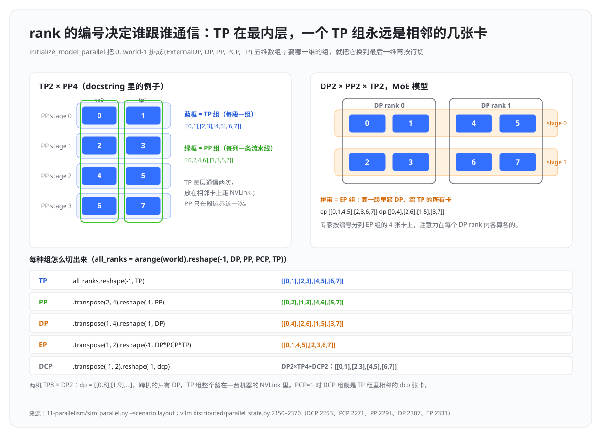
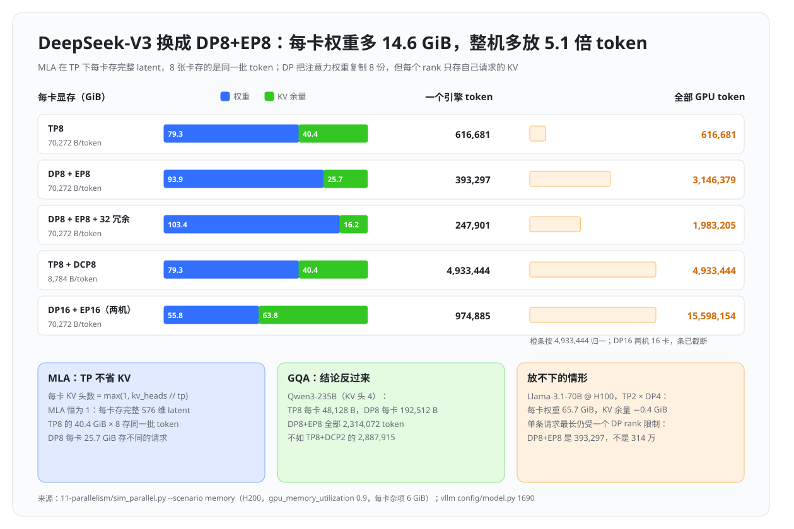
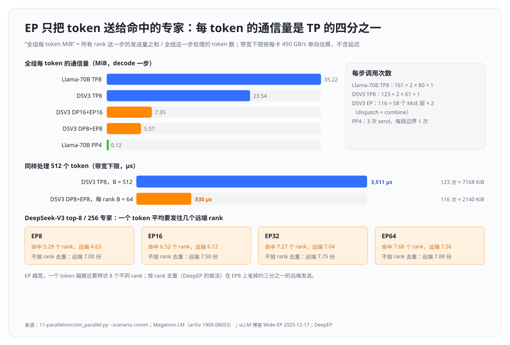
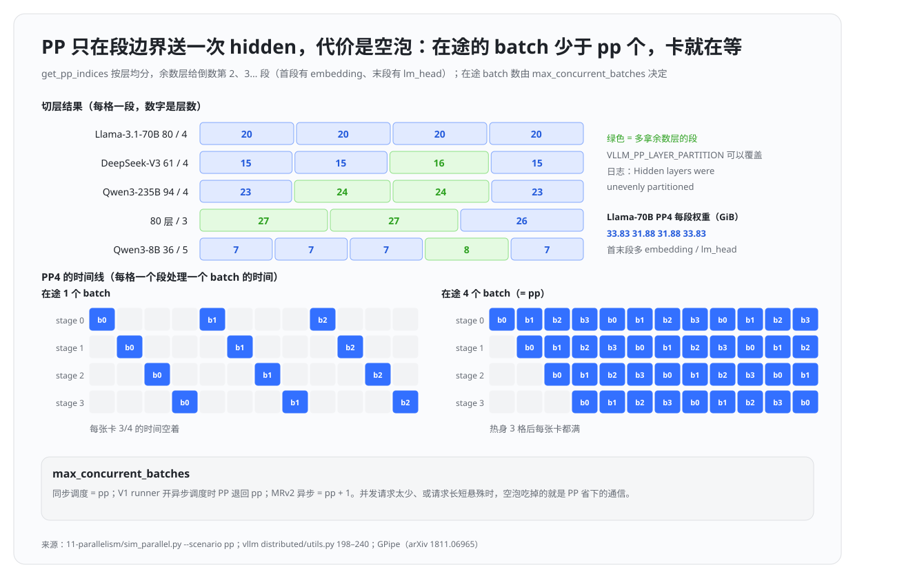
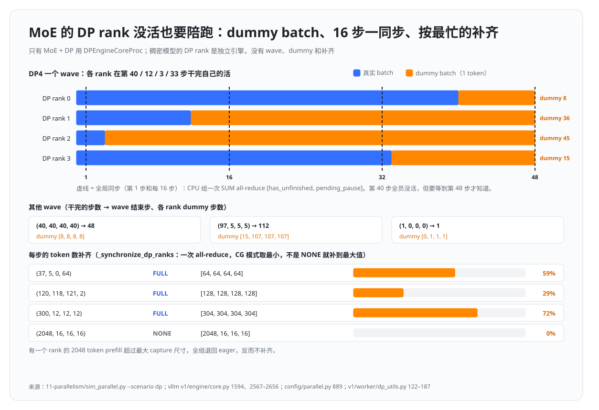
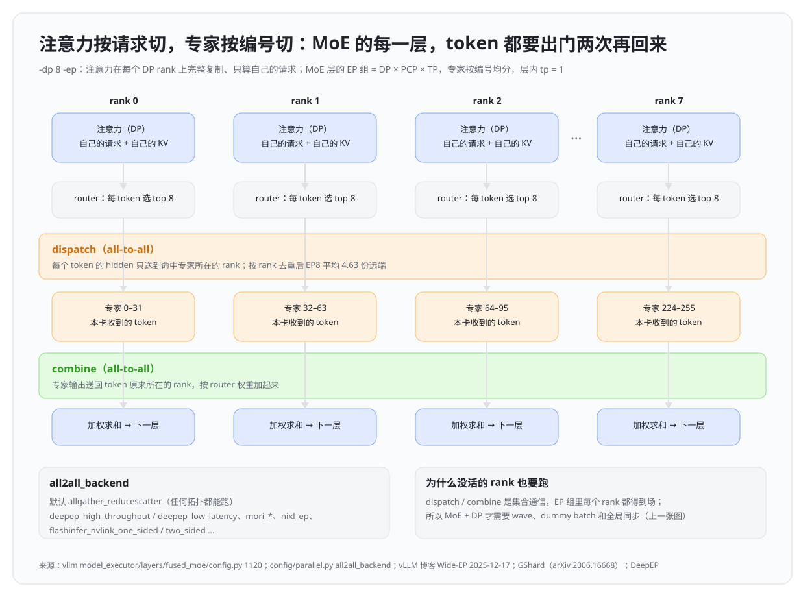
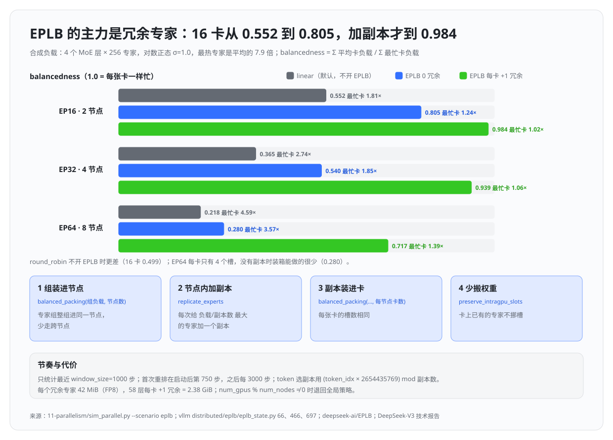
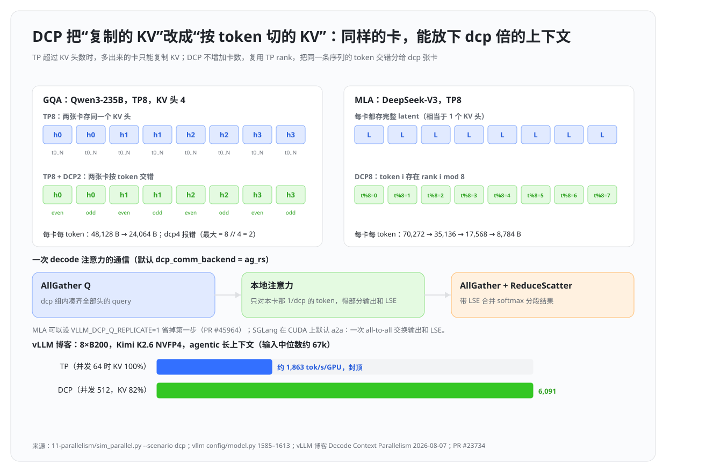
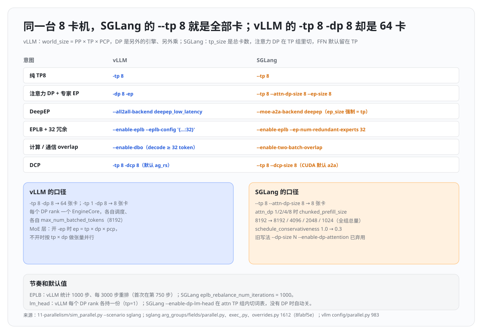

# VLLM-11｜规模｜并行：TP、PP、DP、EP 与 EPLB、DCP

> 🎯 **这篇文档解决什么问题**：一台 8×H200 跑 DeepSeek-V3，`-tp 8` 起来日志写 KV cache 61 万 token。换成 `-dp 8 -ep`，每个 DP rank 只剩 39 万，可 8 个加起来是 314 万。再加 32 个冗余专家，又掉到 25 万一个。换成 `-tp 8 -dcp 8`，一个引擎能放 493 万 token。Llama-3.1-70B 用 `-tp 2 -dp 4` 直接起不来，`-tp 8 -dcp 2` 报 KV 头数不够。这些数字和报错，背后是同一套东西：rank 怎么分组、权重和 KV 怎么在卡之间切、每一步要做哪些集合通信、各个 DP rank 怎么保持步调一致。我们按 vLLM 的源码把 TP、PP、DP、EP、EPLB、DCP 逐个拆开，每一处都和 SGLang 的同类设计对照。
>
> **使用方式**：第 1 章讲各种并行分别切了什么、为什么推理和训练的选法不同。第 2 章讲 rank 排布和分组。第 3 章算每卡权重和 KV 余量。第 4 章算 TP 的 all-reduce 和实现路径。第 5 章讲 PP 的切层和流水线空泡。第 6 章讲 DP 引擎、wave、dummy batch 和 token 补齐。第 7 章讲 EP 的 dispatch / combine 和 all2all 后端。第 8 章讲 EPLB。第 9 章讲 DCP。第 10 章对照 SGLang 并动手核对。基线：vLLM 主干 0d6f92a，SGLang 主干 8fabf5e。
>
> **代码**：[11-parallelism](../11-parallelism)。sim_parallel.py 只依赖标准库，按源码复刻了 `initialize_model_parallel` 的分组、`get_pp_indices` 的切层、每卡权重和 KV 的账（GQA 复制 KV 头、MLA 每卡存完整 latent、DCP 按 token 切）、TP all-reduce / EP a2a / PP send 的字节数、DCP 合法性校验、EPLB default policy、DP wave 和 CUDA Graph 补齐，以及 SGLang 的参数换算。test_sim_parallel.py 有 19 个单测。parallel_matrix.md 是源码行号和参数对照表。serve_dp_ep.sh 在一台 8 卡机器上切换并行方式、抓日志并压测。文中的分组、显存、字节、balancedness 和 wave 步数都来自这个脚本。

# 导读 · 先给结论

## 稠密 TP 与 MoE EP 分开比较

dense 用 TP 基线；moe 另测 TP 与 DP/EP 组合。专家并行分支要求 MODEL_PROFILE=moe，不能把稠密模型送进 EP。MoE 的 35B 总权重仍须驻留，各 rank 权重分配还受共享专家、复制层及并行方式影响。

先核对 query heads、KV heads 和 GDN heads 的分片约束，再保存 rank 分组与通信日志。公共账本只估 TP 均分，不是 EP 规划器。旧 MLA DCP 参数不直接迁入双模型；通用 DCP 分支在混合状态支持核验前明确停止。

双模型结构以固定版本配置核对[[Qwen3.8-27B config.json]](https://huggingface.co/Qwen/Qwen3.8-27B/blob/37561816e66b5b9153b1b64c10968c18c1e6f4a0/config.json)[[Qwen3.5-35B-A3B config.json]](https://huggingface.co/Qwen/Qwen3.5-35B-A3B/blob/59d61f3ce65a6d9863b86d2e96597125219dc754/config.json)。

```bash
MODEL_PROFILE=dense bash serve_dp_ep.sh tp8
MODEL_PROFILE=moe bash serve_dp_ep.sh tp8
MODEL_PROFILE=moe bash serve_dp_ep.sh dpep
```

1. **推理里每种并行都在换一样东西。**TP 用每层两次 all-reduce 换每卡更少的权重和 KV。PP 用流水线空泡换跨机时极少的通信。DP 用重复的权重换互不干扰的批次。EP 用 all-to-all 换不重复存放的专家。DCP 用一次额外的注意力合并换不重复存放的 KV。先问瓶颈是权重、KV、通信还是 TPOT，再选并行方式。
2. **rank 的排布是 ExternalDP × DP × PP × PCP × TP，TP 在最内层。**`all_ranks.reshape(-1, DP, PP, PCP, TP)`，要哪个维度的组，就把那一维换到最后再按组大小切。所以一个 TP 组总是相邻的 GPU，落在同一台机器的 NVLink 上；EP 组是 DP×PCP×TP 合起来。
3. **vLLM 的 world_size 不含 DP。**`-tp 8 -dp 8` 是 64 张卡；SGLang 的 `--tp 8 --attn-dp-size 8` 是 8 张卡，attn DP 在 TP 组里面切。两边迁移时最容易把卡数算错。
4. **MLA 在 TP 下不省 KV。**每张 TP 卡都存完整的 latent，DeepSeek-V3 每卡每 token 70,272 B，TP8 时 8 张卡存的是同一批 token。DP8+EP8 把这份重复去掉，8×H200 上全部 KV 从 61.7 万 token 变成 314.6 万，单个引擎反而只剩 39.3 万。
5. **TP 的通信次数跟层数走，EP 的字节跟 batch 和 top-k 走。**Llama-70B TP8 每个 decode step 161 次 all-reduce，和 batch 无关；DeepSeek-V3 DP8+EP8 是 116 次 a2a，全组摊到每个 token 5.57 MiB，TP8 是 23.54 MiB。
6. **MoE 的 DP rank 必须一起走。**只要全局还有活，没活的 rank 也要跑 1 token 的 dummy batch，因为 dispatch / combine 要 EP 组里每个 rank 到场。全局状态每 16 步同步一次，所以一个 wave 最多多跑 15 步空转；token 数会被补齐到全组最大的 CUDA Graph 尺寸，一个 rank 走 eager，全组都走 eager。
7. **EPLB 主要靠冗余专家。**EP16 两节点的合成负载下，不开 EPLB balancedness 0.552，只重新装箱 0.805，每卡加 1 个冗余专家到 0.984。默认每 3000 步重排一次，计数器从 2250 起步，所以首次在启动后第 750 步。
8. **DCP 把“复制的 KV”改成“按 token 切的 KV”。**GQA 只有在 tp 大于 KV 头数时才能开，最大 dcp = tp // kv_heads；MLA 最大到 tp。DeepSeek-V3 TP8+DCP8 每卡每 token 8,784 B，一个引擎能放 493 万 token。代价是每层 decode 注意力多一次带 LSE 的合并通信。
9. **SGLang 把注意力 DP 当作 TP 组里的一种切法，vLLM 把 DP 当作独立的引擎副本。**这导致两边的默认值不同：SGLang 开 attn DP 后 chunked_prefill_size 按 attn_dp_size 除、schedule_conservativeness 乘 0.3；vLLM 每个 DP rank 各有一份完整的调度预算。

# 第 1 章 · 一张卡不够时，先问不够的是什么

## 1.1 四种“不够”

Llama-3.1-70B 的 BF16 权重 131 GiB，一张 H100 80 GB 放不下，这是权重不够。Qwen3-8B 一张卡放得下，但 32k 上下文、200 并发时 KV 需要 900 GiB 以上，这是 KV 不够。DeepSeek-V3 FP8 权重 640 GiB，8 张 H200 刚好放下，放下以后每卡剩的 KV 只够几十万 token，这是放下以后 KV 不够。还有一种不是容量问题：模型放得下，KV 也够，但 TPOT 要压到 20 ms 以下，单卡的显存带宽读不完一层权重，这是带宽不够。

每种不够对应的切法不同。权重不够要切权重（TP、PP、EP）。KV 不够要么切 KV 头（TP），要么切 token（DCP），要么干脆多开副本，让每个副本处理一部分请求（DP）。带宽不够只能让更多卡同时读同一层的权重（TP）。训练时还有激活和优化器状态要切，推理没有这些，选法也就和训练不同[[1]](https://arxiv.org/abs/1909.08053)[[2]](https://docs.vllm.ai/en/latest/serving/parallelism_scaling/)。

| 并行 | 切什么 | 每步通信 | 推理里的典型用途 |
|-|-|-|-|
| TP（张量并行） | 每层的权重矩阵按列 / 行切；注意力按头切 | 每层 2 次 all-reduce（attention 输出、MLP 输出） | 单机内放下大模型，压低 TPOT |
| PP（流水线并行） | 按层切段 | 段边界一次 send / recv | 跨机、没有 NVLink、层数不整除卡数 |
| DP（数据并行） | 不切模型，按请求分 | 稠密模型无；MoE 有 EP 通信和状态同步 | 吞吐随副本线性扩展 |
| EP（专家并行） | MoE 的专家分到不同卡，每卡存整只专家 | 每个 MoE 层 dispatch + combine 两次 all-to-all | 大 MoE 的专家层，配合注意力 DP |
| DCP（decode 上下文并行） | KV 按 token 交错切到多张卡 | 每层 decode 注意力一次带 LSE 的合并 | 长上下文、MLA、TP 已经大于 KV 头数 |

## 1.2 vLLM 文档给的选法

vLLM 的并行文档给的经验规则很直接：单机放得下就不并行。单机放不下、多卡能放下就用 TP，TP 取单机卡数。多机时 TP 取每机卡数、PP 取机器数[[2]](https://docs.vllm.ai/en/latest/serving/parallelism_scaling/)[[3]](https://vllm.ai/blog/2025-02-17-distributed-inference)。理由是 TP 每层都要 all-reduce，只有在 NVLink 这种几百 GB/s 的互联上才划算；PP 只在段边界发一次激活，跨机的 InfiniBand 也撑得住。文档还点了两种该用 PP 的情况：没有 NVLink 的卡（比如 L40S），以及卡数不能整除模型的头数或层数时。

MoE 模型的选法在 2025 年以后变了。DeepSeek-V3 的技术报告里，推理部署的 decode 阶段用的是注意力 DP、专家 EP（EP320，每卡一个专家）[[4]](https://arxiv.org/abs/2412.19437)；vLLM 的 Wide-EP 博客和 LMSYS 的大规模 EP 博客都走了同一条路：注意力用 DP，专家用 EP，再用 EPLB 平衡负载[[5]](https://vllm.ai/blog/2025-12-17-large-scale-serving)[[6]](https://lmsys.org/blog/2025-05-05-large-scale-ep/)。原因第 3、7 章会算：MLA 在 TP 下每卡存同一份 latent，TP 越大浪费越多；专家层的 GEMM 在 TP 下被切得太窄，EP 下每卡算整只专家，形状更好。

## 1.3 三个模型和两种卡

为了让数字可以互相比较，我们固定用三个模型：Llama-3.1-70B（稠密，80 层，8 个 KV 头，BF16）、Qwen3-235B-A22B（MoE，94 层，4 个 KV 头，128 专家 top-8，BF16）、DeepSeek-V3（MoE，61 层，前 3 层稠密，MLA，256 专家 top-8，线性层 FP8）[[4]](https://arxiv.org/abs/2412.19437)[[7]](https://arxiv.org/abs/2505.09388)。卡用 H100 SXM 80 GB 和 H200 141 GB，`--gpu-memory-utilization 0.9`，每卡激活、非 torch 显存和 CUDA Graph 合计按 6 GiB 估算。这个量级取自第 2 篇显存账那套示意口径，不是这三个模型在 H100 / H200 上的实测预留值；换模型规模、TP 度或捕获尺寸后要重新量，再替换这个常数。

模拟器只算字节，不算时间里的启动延迟、内核效率和 RDMA 细节。通信的带宽下限按 NVLink 单向 450 GB/s 算，真机会比下限慢，但不同方案之间的比例关系是可靠的。真机日志和模拟器不一致时，以真机为准。

# 第 2 章 · rank 排布：一张卡同时属于几个组



## 2.1 一个五维数组

vLLM 启动时每个 worker 都会调用 `initialize_model_parallel`（[parallel_state.py](https://github.com/vllm-project/vllm/blob/0d6f92a/vllm/distributed/parallel_state.py) 2150–2370 行）。函数开头的注释写明了排布顺序：`ExternalDP x DP x PP x PCP x TP`，并且强调同一个 DP 组里的 rank 必须一起生成，否则会死锁。实现只有几行：把 `arange(world)` reshape 成 `(-1, DP, PP, PCP, TP)` 的五维数组，要 TP 组就直接 `view(-1, tp)`；要别的组，就把对应维度 transpose 到最后，再 `reshape(-1, size)`。

| 组 | 取法 | 源码位置 |
|-|-|-|
| TP | `all_ranks.view(-1, tp)` | parallel_state.py \~2240 |
| DCP | dcp > 1 时先 `transpose(-1, -2)`（先跨 PCP 再跨 TP），再 `reshape(-1, dcp)` | \~2253–2258 |
| PCP | `transpose(3, 4)` | \~2271 |
| PP | `transpose(2, 4)` | \~2291 |
| DP | `transpose(1, 4)` | \~2307 |
| EP | `transpose(1, 2).reshape(-1, DP*PCP*TP)`；稠密模型不建 | \~2331 |

换句话说，rank 号 = ((dp×PP + pp)×PCP + pcp)×TP + tp。TP 是最内层的维度，所以一个 TP 组总是相邻的若干张卡，在 8 卡机器上就是同一台机器的 NVLink 域。PP 和 DP 在外层，跨机时先跨的是它们。这也是“TP 取每机卡数、PP 取机器数”这条经验在代码层面的落点。

## 2.2 四个例子

模拟器的 `layout` 场景按同样的 reshape / transpose 生成分组，第一个例子就是 parallel_state.py 注释里的 TP2×PP4，单测会核对分组和注释里写的一致：

```text
== TP2 x PP4（parallel_state.py docstring 的例子）  world=8
  tp   [[0, 1], [2, 3], [4, 5], [6, 7]]
  pp   [[0, 2, 4, 6], [1, 3, 5, 7]]

== DP2 x PP2 x TP2，MoE 模型  world=8
  tp   [[0, 1], [2, 3], [4, 5], [6, 7]]
  pp   [[0, 2], [1, 3], [4, 6], [5, 7]]
  dp   [[0, 4], [2, 6], [1, 5], [3, 7]]
  ep   [[0, 1, 4, 5], [2, 3, 6, 7]]

== DP2 x TP4 + DCP2，MoE 模型  world=8
  tp   [[0, 1, 2, 3], [4, 5, 6, 7]]
  dp   [[0, 4], [1, 5], [2, 6], [3, 7]]
  dcp  [[0, 1], [2, 3], [4, 5], [6, 7]]
  ep   [[0, 1, 2, 3, 4, 5, 6, 7]]

== TP8 x DP2（两机 16 卡，稠密模型）  world=16
  tp   [[0, 1, 2, 3, 4, 5, 6, 7], [8, 9, 10, 11, 12, 13, 14, 15]]
  dp   [[0, 8], [1, 9], [2, 10], [3, 11], [4, 12], [5, 13], [6, 14], [7, 15]]

读法：rank = ((dp*PP + pp)*PCP + pcp)*TP + tp，TP 在最内层，所以一个 TP 组总是相邻的 GPU（同一台机器的 NVLink）。
```

第二个例子要多看一眼。DP2×PP2×TP2 的 MoE 模型，EP 组是 `[0, 1, 4, 5]` 和 `[2, 3, 6, 7]`：EP 组把 DP 和 TP 合并，但不跨 PP。每个 PP 段各有自己的一组专家，这和直觉一致，第 0 段的 MoE 层只在第 0 段的卡上。

第三个例子是 DP2×TP4+DCP2。DCP 组是 `[0, 1]`、`[2, 3]`……，也就是 TP 组里相邻的两张卡。PCP=1 时 DCP 组就是 TP 组的子组，所以 DCP 不增加卡数，`tp % dcp` 必须为 0。EP 组是全部 8 张卡，DCP 不影响 EP。

第四个例子是稠密模型的 TP8×DP2，两台机器。没有 EP 组，DP 组是 `[0, 8]`、`[1, 9]`……，跨机。稠密模型开 DP 时，两台机器之间不做任何集合通信，DP 组只在启动阶段用到，第 6 章会讲。

## 2.3 world_size 不含 DP

`ParallelConfig.__post_init__`（[parallel.py](https://github.com/vllm-project/vllm/blob/0d6f92a/vllm/config/parallel.py) 983 行起）里，`world_size = pipeline_parallel_size * tensor_parallel_size * prefill_context_parallel_size`。DP 不在里面，DP 的每个 rank 是一个独立的引擎进程组，各自有 world_size 张卡。所以 `vllm serve -tp 8 -dp 8` 要 64 张卡，`-tp 1 -dp 8` 要 8 张卡。启动日志里每个 DP rank 都会打一遍自己的 world_size。

开 `-ep` 时，MoE 层的并行方式由 `FusedMoEParallelConfig.make`（[config.py](https://github.com/vllm-project/vllm/blob/0d6f92a/vllm/model_executor/layers/fused_moe/config.py) 1120 行）决定：`ep_size = tp × dp × pcp`，MoE 层内部 tp_size 置为 1。不开 `-ep` 时，MoE 层按 tp × dp 做张量并行，也就是每只专家切成 tp×dp 份。注意，不开 EP 时 DP 也会被并进 MoE 的 TP 组，这一点经常被忽略：`-tp 1 -dp 8` 的 MoE 模型不开 EP，专家层仍然是 TP8。

# 第 3 章 · 显存账：权重切多少、KV 剩多少



## 3.1 TP 切权重的方式

Megatron-LM 给出的 Transformer 层切法沿用到现在：QKV 和 MLP 的上投影按列切（`ColumnParallelLinear`、`QKVParallelLinear`、`MergedColumnParallelLinear`），输出投影和 MLP 的下投影按行切（`RowParallelLinear`），两者之间不需要通信，行切的输出做一次 all-reduce[[1]](https://arxiv.org/abs/1909.08053)。vLLM 的实现在 [linear.py](https://github.com/vllm-project/vllm/blob/0d6f92a/vllm/model_executor/layers/linear.py)，`RowParallelLinear.forward` 里 `reduce_results and tp_size > 1` 时调 `tensor_model_parallel_all_reduce`（1817 行）。embedding 用 `VocabParallelEmbedding` 按词表切，每卡查自己那段，查不到的位置填 0，最后再 all-reduce 一次（[vocab_parallel_embedding.py](https://github.com/vllm-project/vllm/blob/0d6f92a/vllm/model_executor/layers/vocab_parallel_embedding.py) 562 行）。

KV 头不能切成半个。TP 大于 KV 头数时，`QKVParallelLinear` 让多张卡各存一份相同的 KV 头，每卡 KV 头数是 `max(1, kv_heads // tp)`（[model.py](https://github.com/vllm-project/vllm/blob/0d6f92a/vllm/config/model.py) 1690 行）[[8]](https://arxiv.org/abs/2305.13245)。Qwen3-235B 只有 4 个 KV 头，TP8 时每两张卡存同一个头，KV 复制 2 倍。MLA 是极端情况：latent 不分头，等价于 1 个 KV 头，TP 多大都是每卡一份完整的 latent[[9]](https://arxiv.org/abs/2405.04434)。

## 3.2 三个模型的账

模拟器的 `memory` 场景按这些规则算每卡权重，用 util 0.9 减去权重和 6 GiB 杂项得到 KV 余量，再除以每卡每 token 的 KV 字节，得到一个引擎能放多少 token：

```text
== Llama-3.1-70B（70.6B，BF16）@ H100 SXM，util 0.9，每卡杂项 6 GiB
方案                      GPU     每卡权重 GiB     每卡 KV 余量 GiB    每卡每 token KV B     一个引擎 token    全部 GPU token
TP8                       8         16.4             48.9            40,960      1,280,658       1,280,658
TP4 x DP2                 8         32.9             32.4            81,920        425,020         850,041
TP2 x DP4                 8         65.7             -0.4           163,840              0               0
PP2 x TP4                 8         16.4             48.9            40,960      1,280,658       1,280,658
PP8                       8         17.9             47.4            40,960      1,242,182       1,242,182

== DeepSeek-V3（671.0B，FP8 线性层）@ H200，util 0.9，每卡杂项 6 GiB
方案                      GPU     每卡权重 GiB     每卡 KV 余量 GiB    每卡每 token KV B     一个引擎 token    全部 GPU token
TP8                       8         79.3             40.4            70,272        616,681         616,681
TP8 + EP                  8         79.3             40.4            70,272        616,681         616,681
DP8 + EP8                 8         93.9             25.7            70,272        393,297       3,146,379
DP8 + EP8 + 32 冗余         8        103.4             16.2            70,272        247,901       1,983,205
TP8 + DCP8                8         79.3             40.4             8,784      4,933,444       4,933,444
DP16 + EP16（两机）          16         55.8             63.8            70,272        974,885      15,598,154

== Qwen3-235B-A22B（235.1B，BF16）@ H200，util 0.9，每卡杂项 6 GiB
方案                      GPU     每卡权重 GiB     每卡 KV 余量 GiB    每卡每 token KV B     一个引擎 token    全部 GPU token
TP8                       8         54.9             64.7            48,128      1,443,958       1,443,958
TP8 + DCP2                8         54.9             64.7            24,064      2,887,915       2,887,915
TP4 x DP2 + EP            8         56.7             63.0            48,128      1,404,724       2,809,448
DP8 + EP8                 8         67.8             51.9           192,512        289,259       2,314,072

DP 行的 "一个引擎" 指一个 DP rank；"全部 GPU" 是所有 DP rank 加起来。MLA 在 TP 下每卡存完整 latent，8 张卡存的是同一批 token。
```

Llama-3.1-70B 这块，TP2×DP4 每卡权重 65.7 GiB，加上 6 GiB 杂项已经超过 H100 的 0.9 份额，KV 余量是负数，引擎起不来。TP4×DP2 起得来，但每卡每 token KV 81,920 B 是 TP8 的两倍，两个引擎加起来 85 万 token，比 TP8 的 128 万少。原因是 TP8 时权重切得更薄，每卡多出 16 GiB 给 KV。对 70B 这种稠密模型，8 卡单机 TP8 在容量上更划算，TP4×DP2 的好处是两个引擎互不干扰、每层 all-reduce 的组更小，代价是总 KV 少三分之一。

PP2×TP4 和 TP8 的数字完全相同，原因很简单：PP 切层、TP 切每层，每卡分到的权重和 KV 都是 1/8。两者的差别出在通信和流水线空泡上，第 4、5 章再算。PP8 每卡权重多了 1.5 GiB，因为首段和末段各自要放整份 embedding 或 lm_head，第 5 章有每段的账。

## 3.3 DeepSeek-V3：TP8 的 KV 是同一份的 8 个副本

DeepSeek-V3 的 TP8 每卡每 token 70,272 B，就是 61 层 × 1,152 B，和单卡一样。8 张卡存的是同一批 token，整机 61.7 万 token。DP8+EP8 时注意力不切，每卡要放完整的注意力权重、前 3 层稠密 MLP、embedding 和 lm_head，每卡权重从 79.3 GiB 涨到 93.9 GiB，KV 余量从 40.4 GiB 降到 25.7 GiB，一个 DP rank 只能放 39.3 万 token；但 8 个 rank 各存各的请求，加起来 314.6 万，是 TP8 的 5.1 倍。

Wide-EP 博客原话是“TP deployment is not optimal for MLA since latent projections are duplicated across shards”[[5]](https://vllm.ai/blog/2025-12-17-large-scale-serving)。LMSYS 的博客从另一个方向讲了同一件事：DP attention 去掉了 KV 的重复，所以能放更大的 batch[[6]](https://lmsys.org/blog/2025-05-05-large-scale-ep/)。代价也写在表里：单条请求的最长上下文受一个 DP rank 的 39.3 万 token 限制，比 TP8 小。长上下文和高并发要的不是同一种部署。

TP8+EP 和 TP8 每卡权重相同，这一点容易误解。不开 EP 时 MoE 层也按 tp×dp=8 切，每只专家切 8 份；开 EP 后每卡 32 只完整专家。总字节一样，区别在通信（all-reduce 换成 a2a）和 GEMM 的形状。加 32 个冗余专家每卡多 9.5 GiB 权重，一个 DP rank 的 KV 从 39.3 万降到 24.8 万；冗余专家值不值，第 8 章用 balancedness 来算。

DP16+EP16 两机时每卡只放 16 只专家，权重降到 55.8 GiB，每个 DP rank 的 KV 涨到 97.5 万 token，16 个 rank 合计 1560 万。这就是大规模 EP 的显存逻辑：卡越多，每卡的专家越少，留给 KV 的空间越大，整个集群能并发的请求数超线性增长。DeepSeek 在 decode 上用 EP320，每卡只放一只专家，走的是这条路的终点[[4]](https://arxiv.org/abs/2412.19437)。

## 3.4 Qwen3-235B：GQA 的复制

Qwen3-235B 有 4 个 KV 头，TP8 时 KV 复制 2 倍，每卡每 token 48,128 B。DP8+EP8 时每卡存全部 4 个头，每 token 192,512 B，是 TP8 的 4 倍。一个 DP rank 只有 28.9 万 token，8 个加起来 231 万，还比 TP4×DP2+EP 的 281 万少。GQA 模型的 KV 本来就小，DP 去掉的重复只有 2 倍，换来的是每卡多存一份完整注意力权重，不一定划算。TP8+DCP2 把那 2 倍复制改成按 token 切，一个引擎直接到 289 万，第 9 章细讲。

# 第 4 章 · TP 的通信：每层两次 all-reduce



## 4.1 次数和字节

TP 每层有两次 all-reduce：注意力的输出投影之后一次，MLP 的下投影之后一次；embedding 查表之后再加一次。Llama-70B 80 层，一个 decode step 是 80×2+1 = 161 次。每次的消息是 batch × hidden × 2 字节，B=64 时 64×8192×2 = 1 MiB。ring all-reduce 每张卡要发送 2(n−1)/n 倍的消息，TP8 时每次 1.75 MiB，161 次就是 281.8 MiB，按 450 GB/s 的单向带宽是 657 µs。模拟器的 `comm` 场景：

```text
== 每个 decode step 的集合通信（一个 rank 的视角，batch = 每个 DP rank 上的 token 数）
配置                                    次数       每次消息      本卡发送 MiB      带宽下限 us    全组每 token MiB
Llama-70B TP8 all-reduce B=64        161     1024KiB         281.8          657            35.22
Llama-70B TP8 all-reduce B=256       161     4096KiB        1127.0         2626            35.22
Llama-70B PP4 send B=64                3     2048KiB           2.0            5             0.12
Llama-70B PP4 send B=256               3     8192KiB           8.0           19             0.12
DSV3 TP8 all-reduce B=64             123      896KiB         188.3          439            23.54
DSV3 TP8 all-reduce B=256            123     3584KiB         753.4         1755            23.54
DSV3 TP8 all-reduce B=512            123     7168KiB        1506.8         3511            23.54
DSV3 DP8+EP8 a2a B=64                116     2140KiB         356.3          830             5.57
DSV3 DP16+EP16 a2a B=64              116     2825KiB         470.4         1096             7.35
DSV3 DP8+EP8 a2a B=256               116     8561KiB        1425.4         3321             5.57
DSV3 DP16+EP16 a2a B=256             116    11302KiB        1881.6         4384             7.35

== DeepSeek-V3 top-8 / 256 专家：一个 token 平均要发往几个远端 rank
  EP8   命中  5.29 个 rank，其中远端  4.63；按专家发不去重则远端 7.00 份
  EP16  命中  6.52 个 rank，其中远端  6.12；按专家发不去重则远端 7.50 份
  EP32  命中  7.27 个 rank，其中远端  7.04；按专家发不去重则远端 7.75 份
  EP64  命中  7.68 个 rank，其中远端  7.56；按专家发不去重则远端 7.88 份

TP 的 all-reduce 次数和层数成正比、和 batch 无关；EP 的字节数和 batch、top-k 成正比；PP 只在段边界送一次。
"全组每 token" = 所有 rank 发送量之和 / 全组这一步处理的 token 数：TP8 的 B 是全组的 batch，DP8 的 B 是每个 rank 的 batch。
```

三个规律从表里直接读出来。第一，TP 的次数和层数成正比、和 batch 无关；字节和 batch 成正比。B 从 64 到 256，带宽下限从 657 µs 到 2626 µs，decode 一步的权重读取（16.4 GiB / 4.8 TB/s ≈ 3.6 ms）只比这多一点，TP8 的 all-reduce 在大 batch 下已经是 decode 时间里不可忽略的一块。第二，PP 的通信少两个数量级：PP4 每步只在 3 个段边界各发一次 hidden + residual，B=256 也只有 8 MiB。第三，DeepSeek-V3 的 EP a2a 摊到全组每个 token 是 5.57 MiB，TP8 all-reduce 是 23.54 MiB，差 4 倍。

“全组每 token”这一列要注意口径：TP8 的 B 是全组处理的 batch，DP8 的 B 是每个 DP rank 的 batch，全组处理 8B 个 token。按 token 摊下来比较才公平。EP 的字节随 top-k 走：DeepSeek-V3 每个 token 选 8 只专家，EP8 时平均命中 5.29 个 rank、其中远端 4.63 个。按 rank 去重发送（DeepEP 的做法）比按专家逐份发送少三分之一的字节[[10]](https://github.com/deepseek-ai/DeepEP)。EP 越大，去重的收益越小，EP64 时 7.68 个 rank 已经接近 8。

## 4.2 vLLM 的 all-reduce 不是一个实现

同样一次 `tensor_model_parallel_all_reduce`，在 vLLM 里会按消息大小和硬件走不同的实现。`CudaCommunicator.all_reduce`（[cuda_communicator.py](https://github.com/vllm-project/vllm/blob/0d6f92a/vllm/distributed/device_communicators/cuda_communicator.py) \~369–445 行）的判断顺序是：FlashInfer all-reduce（默认开，`VLLM_ALLREDUCE_USE_FLASHINFER=1`）→ NCCL symmetric memory → quick all-reduce（ROCm）→ FlashInfer PCIe IPC → AITER（ROCm）→ vLLM 自己的 custom all-reduce → torch symm_mem → PyNccl。前面哪一个说“这个尺寸我能做”，就用哪一个。

custom all-reduce 是 vLLM 早期为小消息写的 one-shot / two-shot 内核，靠 CUDA IPC 直接读写别的卡的显存，绕开 NCCL 的启动开销。它的上限按卡和 TP 大小查表（[all_reduce_utils.py](https://github.com/vllm-project/vllm/blob/0d6f92a/vllm/distributed/device_communicators/all_reduce_utils.py) 31 行起）：H100（9.0）TP8 只到 256 KiB，TP2 到 64 MiB；B200（10.0）TP8 到 1 MiB。H100 TP8、B=64 的 1 MiB 消息已经超出 custom all-reduce 的范围，会落到 symm_mem 或 NCCL。`should_nccl_symm_mem_allreduce` 的注释说明了取舍：小于 16K 和大于 128K（8 卡）时 NCCL symm mem 更快，中间段 custom all-reduce 的 P2P 更省。

这解释了一个常见现象：同一个模型，decode batch 从 16 涨到 64，TPOT 上升的幅度不是线性的，中间会有台阶，台阶的位置就是 all-reduce 换实现的边界。用 nsys 看 decode step 时，内核名会告诉你走的是哪一条：`cross_device_reduce_1stage` 是 custom all-reduce，`ncclDevKernel_AllReduce` 是 NCCL。第 18 篇讲 profiling 时会再用到。

## 4.3 SGLang 的 TP 通信

SGLang 的 TP 切法同样来自 Megatron，线性层的实现最早就是从 vLLM 移植过去的。差别在 MoE 模型上：SGLang 可以让注意力用 DP、稠密 MLP 和共享专家用另一个 TP 大小（`--moe-dense-tp-size`）[[11]](https://github.com/sgl-project/sglang/blob/8fabf5e/python/sglang/srt/arg_groups/fields/parallel.py)。LMSYS 的博客解释了为什么要把它设成 1：DeepSeek-V3 稠密 MLP 的中间维 18432，TP32 时切成 576 宽，凑不成 128 的倍数，GEMM 效率差；改成 DP 后，原来的两次 all-reduce 换成一次 reduce-scatter 加一次 all-gather，通信量减半[[6]](https://lmsys.org/blog/2025-05-05-large-scale-ep/)。vLLM 在 `-dp N -ep` 下注意力和稠密层都是 DP（tp=1），等价于 SGLang 的 `moe_dense_tp_size=1`。

# 第 5 章 · PP：切层和流水线空泡



## 5.1 余数层给谁

PP 按层切段，每段一组卡。层数不能被 pp 整除时，多出来的层给谁，决定了每段的显存是否均衡。`get_pp_indices`（[utils.py](https://github.com/vllm-project/vllm/blob/0d6f92a/vllm/distributed/utils.py) 198–240 行）的做法是把余数层从倒数第 2 段开始往前分，docstring 写了原因：最后一段有 final norm 和 lm_head，第一段有 embedding，这两段本来就重，余数层避开它们。切分不均时会打一行 INFO：“Hidden layers were unevenly partitioned: [...]”。也可以用 `VLLM_PP_LAYER_PARTITION="15,16,15,15"` 手动指定。模拟器的 `pp` 场景：

```text
层数  PP 切分（get_pp_indices）           说明
  80   4 [20, 20, 20, 20]             Llama-3.1-70B，整除
  61   4 [15, 15, 16, 15]             DeepSeek-V3：余 1 层给倒数第 2 段
  94   4 [23, 24, 24, 23]             Qwen3-235B：余 2 层给倒数第 2、3 段
  80   3 [27, 27, 26]                 余 2 层：倒数第 2、3 段，第 3 段就是第 1 段
  36   5 [7, 7, 7, 8, 7]              Qwen3-8B：余 1

== Llama-3.1-70B PP4 每段权重（BF16）：首段多 embedding，末段多 lm_head
  stage 0: 20 层，33.83 GiB
  stage 1: 20 层，31.88 GiB
  stage 2: 20 层，31.88 GiB
  stage 3: 20 层，33.83 GiB

max_concurrent_batches：同步调度 = pp；V1 runner 异步 + PP 退回 pp；MRv2 异步 = pp + 1。
batch 不够 pp 个时流水线有空泡：in-flight 1 个 batch 的 PP4，每张卡 3/4 的时间在等。
```

DeepSeek-V3 61 层 PP4 是 [15, 15, 16, 15]，余 1 层给第 3 段。80 层 PP3 是 [27, 27, 26]：余 2 层，从倒数第 2 段往前分，第 2 段和第 1 段各多一层。PP3 时“倒数第 3 段”就是第一段，这是唯一会让首段变重的情况。Llama-70B PP4 每段 20 层，首末两段各多 1.95 GiB（embedding 和 lm_head 各 128256×8192×2 字节），中间两段一样重。KV 余量由最重的那一段决定。

## 5.2 段之间送什么

段边界送的是 `IntermediateTensors`（[sequence.py](https://github.com/vllm-project/vllm/blob/0d6f92a/vllm/sequence.py) 12 行），对 Llama 是 hidden_states 和 residual 两个张量。每步只送一次，B=256 时 8 MiB，跨 InfiniBand 的 400 Gb/s 也只要 0.17 ms。这就是 PP 适合跨机的原因：它的通信和层数无关，只和段数有关。GPipe 最早把这种切法用在训练上，靠 micro-batch 把流水线填满[[12]](https://arxiv.org/abs/1811.06965)；推理没有反向，填满流水线靠的是同时在飞的多个 batch。

## 5.3 同时在飞几个 batch

PP4 时，如果引擎一次只有一个 batch 在跑，第 1 段算完交给第 2 段以后就闲着，等这个 batch 跑完四段、采样完、调度出下一个 batch 才能接着算，每张卡 3/4 的时间在等。vLLM 用 batch queue 解决：`EngineCore` 里 `batch_queue_size = max_concurrent_batches`，大于 1 时走 `step_with_batch_queue`（[core.py](https://github.com/vllm-project/vllm/blob/0d6f92a/vllm/v1/engine/core.py) 215、715 行），调度器不等上一个 batch 的结果就调度下一个。

`max_concurrent_batches`（[vllm.py](https://github.com/vllm-project/vllm/blob/0d6f92a/vllm/config/vllm.py) 603–613 行）的取值是：开异步调度且用 Model Runner V2 时为 pp+1，V1 runner 开异步调度、pp ≤ 1 时为 2，其余情况为 pp。PP4 同步调度时 4 个 batch 在飞，每段各算一个，理论上没有空泡。前提是 running 队列里的请求够分成 4 个 batch：并发只有 8 个请求时，每个 batch 2 个请求，decode 阶段每段的 GEMM 极小，PP 的吞吐优势完全没有。PP 适合高并发；低并发、要低 TPOT 的场景，PP 的每个 token 要串行走完所有段，延迟只会比 TP 高。

SGLang 的 PP 用 `--pp-size`，实现上同样是多个 micro-batch 在段间流动，参数说明里把它定位为跨机部署和长上下文 prefill 的手段[[11]](https://github.com/sgl-project/sglang/blob/8fabf5e/python/sglang/srt/arg_groups/fields/parallel.py)[[13]](https://docs.sglang.io/docs/advanced_features/server_arguments)。两边在推理 PP 上的思路没有本质差别，差别更多在调度：vLLM 的 batch queue 由引擎核心统一管理，SGLang 的 PP 调度器给每个 micro-batch 单独维护状态。

# 第 6 章 · DP：独立引擎、wave 和 dummy batch



## 6.1 稠密模型和 MoE 模型走两条路

DP 在 vLLM 里有两种完全不同的含义。引擎类在 [core.py](https://github.com/vllm-project/vllm/blob/0d6f92a/vllm/v1/engine/core.py) 1594–1603 行选择：只有 MoE 模型且 dp > 1 时用 `DPEngineCoreProc`；稠密模型的每个 DP rank 调 `reconfigure_for_independent_dp_rank()`，当成独立的 `EngineCoreProc` 跑。稠密模型的 DP 和起 N 个 `vllm serve` 前面挂一个负载均衡器没有区别，各 rank 之间不做任何集合通信。离线模式（`LLM` 类）下对稠密模型开 DP 会直接报错：“Offline data parallel mode is not supported/useful for dense models.”（[parallel.py](https://github.com/vllm-project/vllm/blob/0d6f92a/vllm/config/parallel.py) 1050 行）。

MoE 模型就不行了。每个 MoE 层的 dispatch 和 combine 是 EP 组上的集合通信，组里每个 rank 都必须到场，哪怕它这一步没有请求。vLLM 的 DP 文档原话是：MoE 模型的 DP rank 之间“需要同步”，空闲的 rank 要执行 dummy forward pass[[14]](https://docs.vllm.ai/en/latest/serving/data_parallel_deployment/)。Wide-EP 博客也提到，一个计算密集的 prefill 会拖慢整个 EP 组[[5]](https://vllm.ai/blog/2025-12-17-large-scale-serving)。

## 6.2 wave：全局有活就一起走

`DPEngineCoreProc.run_busy_loop`（core.py 2567 行起）每一步做三件事：本地有活就正常执行。本地没活、但全局还有活，就调 `execute_dummy_batch`（[gpu_worker.py](https://github.com/vllm-project/vllm/blob/0d6f92a/vllm/v1/worker/gpu_worker.py) 1469 行，内部是 `_dummy_run(1, uniform_decode=True)`）。全局都没活了，就结束这个 wave，`current_wave += 1`，通知 coordinator。新请求到来时，coordinator 给所有 rank 广播 START_DP_WAVE，大家一起进入下一个 wave。

“全局还有没有活”靠 `sync_dp_state`（parallel.py 889–914 行）在 CPU 组上做一次 SUM all-reduce，交换 `[has_unfinished, pending_pause]`。这个同步不是每步做：`_has_global_unfinished_reqs`（core.py 2656 行）只在第 1 步和每 `dp_sync_interval`（16）步同步一次，其余步直接返回 True。源码注释解释了为什么第 1 步也同步：空闲时的一次 pause 只需要一个 dummy batch，不用等满 16 步。模拟器的 `dp` 场景：

```text
== DP4 一个 wave：各 rank 的活在不同步数干完（dp_sync_interval=16）
  干完的步数 (40, 40, 40, 40)   wave 在第  48 步结束，各 rank dummy 步数 [8, 8, 8, 8]
  干完的步数 (40, 12, 3, 33)    wave 在第  48 步结束，各 rank dummy 步数 [8, 36, 45, 15]
  干完的步数 (97, 5, 5, 5)      wave 在第 112 步结束，各 rank dummy 步数 [15, 107, 107, 107]
  干完的步数 (1, 0, 0, 0)       wave 在第   1 步结束，各 rank dummy 步数 [0, 1, 1, 1]

== 每步 token 数的 DP 补齐（CUDA Graph 尺寸 1,2,4,8..248 步长 8，256..512 步长 16）
各 rank 实际 token            同步后 CG     各 rank 实际跑                     补齐浪费
(37, 5, 0, 64)             FULL       [64, 64, 64, 64]               59%
(120, 118, 121, 2)         FULL       [128, 128, 128, 128]           29%
(300, 12, 12, 12)          FULL       [304, 304, 304, 304]           72%
(2048, 16, 16, 16)         NONE       [2048, 16, 16, 16]              0%
(8, 8, 8, 8)               FULL       [8, 8, 8, 8]                    0%

没活的 rank 也要跑一个 1 token 的 dummy batch，因为 MoE 的 dispatch/combine 需要 EP 组里每个 rank 到场。
只要有一个 rank 走 eager（比如 2048 token 的 prefill 超过最大 capture），所有 rank 都退回 NONE，不再补齐。
稠密模型开 DP 时每个 rank 是独立引擎（EngineCoreProc），没有 wave、dummy 和补齐。
```

四个 rank 都在第 40 步干完时，wave 要等到第 48 步的同步才能发现，每个 rank 多跑 8 步 dummy。(97, 5, 5, 5) 是最差的情况：一个 rank 有一条长请求，另外三个 rank 早早干完，却要陪跑 107 步 dummy。dummy batch 是 1 token 的 uniform decode，代价很小，但 MoE 层的 a2a 一次不少，整个 EP 组的步长由最慢的那个 rank 决定。这就是 DP 负载均衡重要的原因。

## 6.3 每步 token 数要补齐

dummy batch 解决的是“到场”，补齐解决的是“形状”。每一步开始前，`_synchronize_dp_ranks`（[dp_utils.py](https://github.com/vllm-project/vllm/blob/0d6f92a/vllm/v1/worker/dp_utils.py) 122–187 行）做一次 all-reduce，拿到各 rank 的 token 数、是否切 microbatch、CUDA Graph 模式。CUDA Graph 模式取全组最小值；只要不是 NONE，所有 rank 都把 token 数补到全组最大值对应的 CUDA Graph 尺寸。原因是 a2a 内核（尤其 DeepEP 的 low latency 模式）在 CUDA Graph 里录的是固定的缓冲区大小，各 rank 必须一致。

表里第一行 (37, 5, 0, 64)，补齐后每个 rank 都跑 64 个 token，浪费 59%。(300, 12, 12, 12) 浪费 72%。(2048, 16, 16, 16) 里有一个 rank 在做 2048 token 的 prefill，超过最大 capture 尺寸，它只能走 eager，于是全组的 CG 模式退化为 NONE，不再补齐，但其他三个 rank 这一步也失去了 CUDA Graph。混合负载下，prefill 会让整个 EP 组的 decode 变慢，这是第 15 篇要讲 PD 分离的一个直接原因。

## 6.4 请求分到哪个 rank

前端把请求分给 DP rank 的逻辑在 [core_client.py](https://github.com/vllm-project/vllm/blob/0d6f92a/vllm/v1/engine/core_client.py) \~1790–1825 行。每个 rank 的分数是 `max(client_count × inflight, waiting + running)`，有排队时再加 `waiting × 6.0 × max(0, kv_usage − 0.5)`：KV 用量低于 50% 时排队不罚分，高于 50% 后线性加罚，到 100% 时罚 3 倍。分数最低的 rank 得到请求，扫描起点每次轮转，避免平局总选同一个。coordinator 每 100 ms 推送一次各 rank 的 waiting / running；两次推送之间，前端自己累加刚分出去的请求数。源码里留了一个 TODO：DP 很大时改用 power-of-two-choices。

这套均衡只看请求数和 KV 压力，不看前缀缓存命中。多轮对话的请求被分到不同 rank，前缀缓存就失效了。需要缓存感知路由时，vLLM 提供 `--data-parallel-external-lb` / `--data-parallel-hybrid-lb`，每个 DP rank 暴露自己的端口，交给外部路由器（vLLM Router、llm-d）做 KV 感知调度[[14]](https://docs.vllm.ai/en/latest/serving/data_parallel_deployment/)[[15]](https://vllm.ai/blog/2025-12-13-vllm-router-release)，第 19 篇再展开。`--max-num-seqs` 和 `--max-num-batched-tokens` 都按每个 DP rank 各算一份，全局总量要乘以 DP 数。

# 第 7 章 · EP：dispatch、combine 和 all2all 后端



## 7.1 一个 MoE 层里发生了什么

GShard 把 MoE 的专家分到不同设备上，token 经过路由后用 all-to-all 发到专家所在的设备，算完再 all-to-all 发回来[[16]](https://arxiv.org/abs/2006.16668)。推理沿用这套结构：router 给每个 token 选 top-k 只专家 → dispatch 把 token 发到专家所在的 rank → 每个 rank 对收到的 token 跑本地专家的 grouped GEMM → combine 把结果发回原 rank 并按路由权重加权求和。DeepSeek-V3 有 58 个 MoE 层，每层 dispatch 和 combine 各一次，所以表里是 116 次 a2a。

dispatch 发的是 FP8 激活加每 128 维一个 fp32 scale，每 token 7,392 B；combine 发回 BF16，每 token 14,336 B。combine 比 dispatch 重一倍，这也是 DeepEP 区分两个方向分别优化的原因[[10]](https://github.com/deepseek-ai/DeepEP)。

## 7.2 vLLM 的 all2all 后端

`--all2all-backend` 的候选在 [parallel.py](https://github.com/vllm-project/vllm/blob/0d6f92a/vllm/config/parallel.py) 45–60 行，默认 `allgather_reducescatter`（220 行）。vLLM 的 EP 部署文档给的选法[[17]](https://docs.vllm.ai/en/latest/serving/expert_parallel_deployment/)：

| 后端 | 做法 | 适用场景 |
|-|-|-|
| allgather_reducescatter（默认） | 先 all-gather 全部 token，各 rank 只算本地专家，再 reduce-scatter | 通用，单机；不依赖额外库 |
| deepep_high_throughput | DeepEP normal 内核，连续布局，NVLink + RDMA 分层转发 | 多机 prefill，大 batch |
| deepep_low_latency | DeepEP low-latency 内核，masked 布局，纯 RDMA，可录 CUDA Graph | 多机 decode，小 batch |
| deepep_v2 | DeepEP 新版内核，需 NCCL ≥ 2.30.4 | 同上，新版本 |
| flashinfer_nvlink_one_sided / two_sided | FlashInfer 的 NVLink 内核 | GB200 NVL72 这类多节点 NVLink 域（MNNVL） |
| mori\_\* / moonep / nixl_ep / pplx / naive | AMD MORI、Moonshot、NIXL、PPLX 等实现；naive 只用于调试 | 对应硬件或研究对比 |

allgather_reducescatter 在单机 8 卡上够用：NVLink 带宽高，all-gather 发全部 token 虽然比 a2a 多发，但实现简单、对 batch 形状不挑。跨机时它的字节随 EP 线性增长，必须换 DeepEP。DeepEP 的 low-latency 模式把 dispatch 做成 masked 布局：每个本地专家预留固定大小的接收缓冲区，用掩码标出有效 token，形状固定所以能录进 CUDA Graph，代价是缓冲区按最大 batch 预留[[10]](https://github.com/deepseek-ai/DeepEP)。这正是第 6 章里“所有 rank 补齐到同一个 CG 尺寸”的来源。

## 7.3 单机和两机的命令

vLLM 文档给的单机命令（H200 或 H20）[[17]](https://docs.vllm.ai/en/latest/serving/expert_parallel_deployment/)：

```bash
# 在 11-parallelism 目录执行；先比较相同 TP，再单独研究专家并行
MODEL_PROFILE=dense bash serve_dp_ep.sh tp8
# 停止旧服务后：
# MODEL_PROFILE=moe bash serve_dp_ep.sh tp8
# 专家并行仅选择 moe；rank 映射和通信后端需在目标机器验证
# MODEL_PROFILE=moe bash serve_dp_ep.sh dpep
```

两机 16 卡，第二台机器加 `--data-parallel-start-rank 8 --headless`，不起 API server：

```bash
# 节点 1
vllm serve deepseek-ai/DeepSeek-V3-0324 --all2all-backend deepep_low_latency \
  -tp 1 -ep --data-parallel-size 16 --data-parallel-size-local 8 \
  --data-parallel-address $NODE1_IP --data-parallel-rpc-port 13345 --api-server-count=8
# 节点 2
vllm serve deepseek-ai/DeepSeek-V3-0324 --all2all-backend deepep_low_latency \
  -tp 1 -ep --data-parallel-size 16 --data-parallel-size-local 8 \
  --data-parallel-address $NODE1_IP --data-parallel-rpc-port 13345 \
  --data-parallel-start-rank 8 --headless
```

`--api-server-count=8` 起 8 个 API server 进程，分摊 tokenize 和 HTTP 处理。DP16 时单个前端进程会先成为瓶颈，这在第 3 篇讲进程模型时提过。TP=1 时注意力在每个 DP rank 上完整复制；TP>1 时注意力在每个 DP 组内按 TP 切，EP 大小始终是 TP×DP。

## 7.4 DBO：两个 microbatch 交错

a2a 期间 GPU 的计算单元闲着。`--enable-dbo`（dual batch overlap）把一个 batch 切成两个 microbatch，一个在算注意力和专家 GEMM 时，另一个在做 dispatch / combine。触发门槛在 `check_ubatch_thresholds`（[ubatch_utils.py](https://github.com/vllm-project/vllm/blob/0d6f92a/vllm/v1/worker/ubatch_utils.py) 140 行起）：decode ≥ 32 token（`--dbo-decode-token-threshold`）、prefill ≥ 512 token 才切；如果补齐后第二个 microbatch 是空的，就放弃切分。是否切分也要全组一致，是第 6 章那次 all-reduce 交换的字段之一。Wide-EP 博客描述了实现：每个 microbatch 一个 worker 线程，用 CUDA event 在两个线程之间交接 GPU[[5]](https://vllm.ai/blog/2025-12-17-large-scale-serving)。

Wide-EP 博客报告，在 CoreWeave 的 H200 + InfiniBand CX-7 集群上，DeepSeek 的 decode 吞吐从约 1.5k 提升到 2.2k tok/s/H200，来源是 silu-mul-quant 融合、Cutlass QKV 内核、TP 注意力的修复和 DBO 几项合起来[[5]](https://vllm.ai/blog/2025-12-17-large-scale-serving)。DBO 的收益依赖 batch 足够大，小 batch 时切成两半反而让每个 GEMM 更小；32 token 的门槛就是为此设的。SGLang 的对应功能是 `--enable-two-batch-overlap`，切分时用 `tbo_token_distribution_threshold=0.48` 控制两半的 token 比例[[18]](https://github.com/sgl-project/sglang/blob/8fabf5e/python/sglang/srt/arg_groups/fields/exec_.py)。

# 第 8 章 · EPLB：专家的负载均衡



## 8.1 为什么不均衡

router 选专家看的是 token 内容，不看专家在哪张卡上。真实流量下，少数专家被调用的次数是平均值的好几倍，而 EP 下一个 MoE 层的耗时由最忙的那张卡决定。DeepSeek-V3 的技术报告专门讲了推理侧的冗余专家：根据线上统计找出高负载专家，复制到别的卡上，并定期调整[[4]](https://arxiv.org/abs/2412.19437)。对应的算法开源成了 EPLB[[19]](https://github.com/deepseek-ai/EPLB)，vLLM 的 default policy 就是它的移植（[default.py](https://github.com/vllm-project/vllm/blob/0d6f92a/vllm/distributed/eplb/policy/default.py)）。

## 8.2 四步算法

| 步骤 | 函数（default.py 行号） | 做什么 |
|-|-|-|
| 1 | `balanced_packing`（22） | 把专家组（DeepSeek-V3 n_group=8）按组负载贪心装进节点；同一组的专家放同一节点，配合 group-limited routing 减少跨节点流量 |
| 2 | `replicate_experts`（75） | 在每个节点内，每次给“负载 / 副本数”最大的逻辑专家加一个副本，直到填满物理槽位 |
| 3 | `balanced_packing`（22） | 把物理专家（含副本）装进节点内的 GPU，每卡槽数相同 |
| 4 | `preserve_intragpu_slots`（191） | 同一张卡上已经存在的专家不挪槽位，减少权重搬运 |

第 1 步的分层（`rebalance_experts_hierarchical`，103 行）要求 GPU 数能被节点数整除；不能整除时告警“num_gpus % num_nodes != 0, not using hierarchical rearrangement algorithm.”（[eplb_state.py](https://github.com/vllm-project/vllm/blob/0d6f92a/vllm/distributed/eplb/eplb_state.py) 850 行），退回全局策略。路由时一个 token 选到有多个副本的专家，用 Knuth 乘法哈希 `(token_idx × 2654435769) & 0xFFFFFFFF % 副本数` 选副本（[base_router.py](https://github.com/vllm-project/vllm/blob/0d6f92a/vllm/model_executor/layers/fused_moe/router/base_router.py) 54 行），不看各副本的实时负载。

## 8.3 合成负载下的效果

模拟器的 `eplb` 场景用对数正态分布合成每层 256 只专家的负载（最热专家是平均值的 7.9 倍），比较默认的 linear 放置、round_robin、EPLB 不加冗余和加冗余几种情况。balancedness 的定义和 vLLM 日志一致：各层平均卡负载之和 / 各层最忙卡负载之和（eplb_state.py 631 行）。

```text
== 合成负载：4 个 MoE 层，每层 256 专家，对数正态 sigma=1.0，一个 step 32,768 次专家调用
   最热专家 / 平均 = 7.9x（第 0 层）
  EP   节点 放置                             物理专家  balancedness      最忙卡 / 平均
  16    2 linear（默认，不开 EPLB）              256         0.552          1.81
  16    2 round_robin                     256         0.499          2.00
  16    2 EPLB 0 冗余                       256         0.805          1.24
  16    2 EPLB 16 冗余（每卡 +1）               272         0.984          1.02
  16    2 EPLB 32 冗余（每卡 +2）               288         0.984          1.02

  32    4 linear（默认，不开 EPLB）              256         0.365          2.74
  32    4 round_robin                     256         0.315          3.17
  32    4 EPLB 0 冗余                       256         0.540          1.85
  32    4 EPLB 32 冗余（每卡 +1）               288         0.939          1.07
  32    4 EPLB 64 冗余（每卡 +2）               320         0.941          1.06

  64    8 linear（默认，不开 EPLB）              256         0.218          4.59
  64    8 round_robin                     256         0.203          4.94
  64    8 EPLB 0 冗余                       256         0.280          3.57
  64    8 EPLB 64 冗余（每卡 +1）               320         0.717          1.39
  64    8 EPLB 128 冗余（每卡 +2）              384         0.721          1.39

每个冗余专家多占 42 MiB（FP8），58 层每卡 +1 冗余 = 2.38 GiB 权重。
vLLM 默认 window_size=1000、step_interval=3000，计数器从 3000 - 3000//4 = 2250 起步、到 3000 触发，首次重排在启动后第 750 步；SGLang eplb_rebalance_num_iterations=1000。
```

三个结论。第一，不开 EPLB 时 EP 越大越不均衡：EP16 是 0.552，EP64 掉到 0.218，最忙的卡是平均值的 4.59 倍，也就是说 EP64 时 MoE 层的耗时是理想情况的 4.6 倍。第二，只重排不加冗余，EP16 能到 0.805，EP64 只到 0.280：EP64 时每卡只有 4 个槽，装箱能腾挪的空间很小。第三，每卡加 1 个冗余专家效果最大，EP16 到 0.984、EP32 到 0.939；加第 2 个几乎没有额外收益。代价是显存：一个冗余专家 42 MiB（FP8），58 层每卡加 1 个就是 2.38 GiB。第 3 章算过 DP8 加 32 个冗余（每卡 +4）时 KV 从 39.3 万降到 24.8 万 token，冗余多了是在拿 KV 换均衡。

合成负载只能说明趋势。真实流量的倾斜程度和变化速度因业务而异，以 `log_balancedness` 的日志为准。round_robin 放置在这组数据上比 linear 还差，这只是这组数据的结果，它的作用是在相邻专家负载相关时打散热点；`--expert-placement-strategy round_robin` 只在没有冗余专家时有意义。

## 8.4 什么时候重排

默认配置：`window_size=1000`、`step_interval=3000`、`num_redundant_experts=0`、`use_async=True`。计数器初值是 `step_interval − step_interval // 4` = 2250（eplb_state.py 466–471 行），每步加 1（dummy 步也算），到 3000 触发重排并清零（682–693 行）。所以首次重排在启动后第 750 步，之后每 3000 步一次。负载只在重排前的最后 1000 步记录（`_should_record_current_step`，697 行起），开 `log_balancedness` 时还会在日志步记录。

`use_async=True` 时权重搬运在在后台跑，新的放置在搬完后才生效，不阻塞前向。开 `log_balancedness` 后，日志会每隔 `log_balancedness_interval` 步打一行“EPLB step: N for model M: avg_tokens=…, max_tokens=…, balancedness=…”（eplb_state.py 635 行），这是线上判断要不要加冗余专家的唯一依据。

```bash
vllm serve deepseek-ai/DeepSeek-V3-0324 -dp 8 -ep --enable-eplb \
  --eplb-config '{"num_redundant_experts":32,"log_balancedness":true,"log_balancedness_interval":100}'
```

校验在 parallel.py 542–630 行：开 EPLB 必须开 EP；`num_redundant_experts > 0` 必须开 EPLB。SGLang 的对应参数是 `--enable-eplb --ep-num-redundant-experts 32`，默认每 `eplb_rebalance_num_iterations=1000` 步重排一次，比 vLLM 更频繁，另有 `eplb_rebalance_layers_per_chunk` 控制每次搬几层[[18]](https://github.com/sgl-project/sglang/blob/8fabf5e/python/sglang/srt/arg_groups/fields/exec_.py)。vLLM 的 Elastic EP 还支持在运行中增减 EP rank，重排逻辑复用同一套 policy[[20]](https://vllm.ai/blog/2026-05-14-elastic-expert-parallelism)。

# 第 9 章 · DCP：把复制的 KV 改成按 token 切



## 9.1 从哪里来

第 3 章算过，TP 大于 KV 头数以后，多出来的卡只能复制 KV；MLA 更是每张 TP 卡一份完整的 latent。decode context parallel（DCP）的想法是：既然这些卡存的是同样的头，不如让它们存不同的 token。初版由 Moonshot AI 贡献（PR #23734），NVIDIA 的 Helix 是同一类思路[[21]](https://github.com/vllm-project/vllm/pull/23734)[[22]](https://vllm.ai/blog/2026-08-07-decode-context-parallelism)。开法是 `-dcp N`，DCP 组是 TP 组里相邻的 N 张卡（第 2 章），不增加卡数。

## 9.2 一步 decode 怎么算

KV 按 token 交错切：`cp_kv_cache_interleave_size=1` 时，第 i 个 token 的 KV 写到 DCP 组里第 i % dcp 张卡。decode 时每张卡只有 1/dcp 的 KV，算出的是局部注意力。vLLM 的 DCP 博客描述了完整流程[[22]](https://vllm.ai/blog/2026-08-07-decode-context-parallelism)：DCP 组内先 all-gather query（每张卡原本只有自己那份头的 query），每张卡用全部 query 对本地 KV 算注意力，同时返回 log-sum-exp（LSE）；再用 LSE 做数值稳定的合并，把局部输出合成完整输出，最后按头 reduce-scatter 回各卡。

合并内核有两种实现，由 `--dcp-comm-backend` 选择（`DCPCommBackend = ["ag_rs", "a2a"]`，默认 ag_rs，parallel.py 631 行 `set_dcp_defaults`）：`cp_lse_ag_out_rs` 是 all-gather LSE、reduce-scatter 输出；`dcp_a2a_lse_reduce` 用一次 all-to-all（[dcp.py](https://github.com/vllm-project/vllm/blob/0d6f92a/vllm/v1/attention/ops/dcp.py) 471、939 行）。FlashAttention 后端在构造时根据这个配置选合并函数（[flash_attn.py](https://github.com/vllm-project/vllm/blob/0d6f92a/vllm/v1/attention/backends/flash_attn.py) 1167–1172 行）。后端必须声明 `supports_dcp`，并能在 decode 时返回 LSE（`can_return_lse_for_decode`），否则选择器把它列为不合法，原因写“DCP not supported”（[backend.py](https://github.com/vllm-project/vllm/blob/0d6f92a/vllm/v1/attention/backend.py) 351 行）。目前声明支持的有 FLASH_ATTN、FLASHINFER，以及 FLASHMLA、FLASH_ATTN_MLA、FLASHINFER_MLA、CUTLASS_MLA、TRITON_MLA 等 MLA 后端。这是上一篇说的“并行方式和注意力后端之间的约束”最直接的一例。另一个约束是不支持变长 decode 的后端开 DCP 时 `reorder_batch_threshold` 被强制设为 1（backend.py 692–695 行），投机解码的多 token 验证会被当成 prefill 处理。

## 9.3 合法性

GQA 模型的校验在 [model.py](https://github.com/vllm-project/vllm/blob/0d6f92a/vllm/config/model.py) 1585–1613 行，三条：tp 必须大于 KV 头数（否则没有复制可以改切），dcp 不能超过 `tp // kv_heads`，每个 KV 头对应的 query 头数必须能被 dcp 整除。MLA 等价于 1 个 KV 头，dcp 最大到 tp。模拟器的 `dcp` 场景：

```text
模型                  TP  DCP 结果                                              每卡每 token KV B
Qwen3-235B-A22B      8    1 OK，KV 头复制 2x                                            48,128
Qwen3-235B-A22B      8    2 OK，2 张卡分摊同一条序列，KV 头复制 2x                                24,064
Qwen3-235B-A22B      8    4 ERROR exceeds the maximum supported value (2)                 -
Llama-3.1-70B        8    2 ERROR requires --tensor-parallel-size (8) > KV heads (8)                 -
Llama-3.1-70B       16    2 OK，2 张卡分摊同一条序列，KV 头复制 2x                                20,480
DeepSeek-V3          8    1 OK                                                      70,272
DeepSeek-V3          8    2 OK，2 张卡分摊同一条序列                                          35,136
DeepSeek-V3          8    4 OK，4 张卡分摊同一条序列                                          17,568
DeepSeek-V3          8    8 OK，8 张卡分摊同一条序列                                           8,784

GQA：TP 超过 KV 头数时多出来的卡只能复制 KV 头；DCP 把这份复制改成按 token 切，最大 dcp = tp // kv_heads。
MLA：每个 TP rank 本来就存完整 latent（等价于 1 个 KV 头），所以 dcp 最多到 tp。
```

Llama-3.1-70B 有 8 个 KV 头，TP8 时每卡正好 1 个头，没有复制，开 DCP2 直接报错；TP16 时才有 2 倍复制可以改切。Qwen3-235B 4 个 KV 头，TP8 最多 DCP2。DeepSeek-V3 TP8 可以开到 DCP8，每卡每 token 从 70,272 B 降到 8,784 B，第 3 章的表里一个引擎从 61.7 万 token 变成 493 万。

## 9.4 收益和代价

vLLM 的 DCP 博客在 8×B200 上跑 Kimi K2.6（NVFP4，MLA），输入中位数约 67k token：TP8 在并发 64 时 KV 已经用满 100%，吞吐约 1,863 tok/s/GPU；TP8+DCP8 能把并发开到 512，KV 用量 82%，吞吐 6,091 tok/s/GPU[[22]](https://vllm.ai/blog/2026-08-07-decode-context-parallelism)。收益来自 batch 能开大，单步反而更慢：DCP 每层 decode 多一次 query all-gather 和一次 LSE 合并，单个请求的 TPOT 会变差。博客也提到了 `VLLM_DCP_Q_REPLICATE=1`，让每卡直接计算全部 query 头、省掉 query 的 all-gather，适合 query 头不多的情况。

所以 DCP 和第 3 章的 DP+EP 是两种去重方式。DP+EP 按请求分，每个 rank 存自己的请求的全部 KV，适合大量中短请求；DCP 按 token 分，每条请求的 KV 散在 dcp 张卡上，适合少量超长请求。两者可以叠加：`-dp 2 -tp 4 -dcp 2` 就是第 2 章的第三个例子。SGLang 的对应参数是 `--dcp-size`，`dcp_comm_backend` 有 ag_rs、a2a、fi_a2a 三种，默认在支持的硬件上用 fi_a2a、否则在 CUDA 上用 a2a，和 vLLM 默认的 ag_rs 不同[[11]](https://github.com/sgl-project/sglang/blob/8fabf5e/python/sglang/srt/arg_groups/fields/parallel.py)。

# 第 10 章 · 对照 SGLang，动手核对



## 10.1 同一种部署两边怎么写

模拟器的 `sglang` 场景把 8×H200 跑 DeepSeek-V3 的几种部署按两边的参数写出来：

```text
== 8 x H200 跑 DeepSeek-V3：同一种部署两边怎么写
  纯 TP8              vLLM:   vllm serve DSV3 -tp 8
                     SGLang: python -m sglang.launch_server --tp 8
  注意力 DP + 专家 EP     vLLM:   vllm serve DSV3 -dp 8 -ep
                     SGLang: --tp 8 --attn-dp-size 8 --ep-size 8
  同上 + DeepEP        vLLM:   ... --all2all-backend deepep_low_latency
                     SGLang: ... --moe-a2a-backend deepep（ep_size 强制 = tp）
  EPLB + 冗余          vLLM:   --enable-eplb --eplb-config '{"num_redundant_experts":32}'
                     SGLang: --enable-eplb --ep-num-redundant-experts 32
  计算/通信 overlap      vLLM:   --enable-dbo（decode >= 32 token 才切）
                     SGLang: --enable-two-batch-overlap
  DCP                vLLM:   -tp 8 -dcp 8
                     SGLang: --tp 8 --dcp-size 8

== world size 的口径
  vLLM -tp 8 -dp 8  → 64 张卡（world_size = PP x TP x PCP，DP 另乘）
  vLLM -tp 1 -dp 8  → 8 张卡（world_size = PP x TP x PCP，DP 另乘）
  SGLang --tp 8 --attn-dp-size 8 → 8 张卡（tp_size 就是总卡数，attn_dp 在里面切）

== 注意力 DP 下的默认值
  attn_dp_size=1: SGLang chunked_prefill_size 8192 →  8192，schedule_conservativeness 1.0；vLLM 每个 DP rank 各自 max_num_batched_tokens 8192
  attn_dp_size=2: SGLang chunked_prefill_size 8192 →  4096，schedule_conservativeness 0.3；vLLM 每个 DP rank 各自 max_num_batched_tokens 8192
  attn_dp_size=4: SGLang chunked_prefill_size 8192 →  2048，schedule_conservativeness 0.3；vLLM 每个 DP rank 各自 max_num_batched_tokens 8192
  attn_dp_size=8: SGLang chunked_prefill_size 8192 →  1024，schedule_conservativeness 0.3；vLLM 每个 DP rank 各自 max_num_batched_tokens 8192

  EPLB 节奏：vLLM window 1000 / interval 3000（计数器从 2250 起步，首次在第 750 步）；SGLang 每 1000 iteration 重排一次。
  enable_dp_lm_head：SGLang 在 attn TP 组内切词表，没有 DP 时自动关掉；vLLM DP rank 各自持有完整 lm_head（tp=1 时）。
```

最大的差别在口径。SGLang 的 `attn_dp_size` 定义为“TP 组内的注意力 DP 组数，每组一个 scheduler，FFN 仍然是张量并行”[[11]](https://github.com/sgl-project/sglang/blob/8fabf5e/python/sglang/srt/arg_groups/fields/parallel.py)，`tp_size` 就是总卡数。旧写法 `--dp-size N --enable-dp-attention` 已标为废弃，计划 2026-12-31 后移除。vLLM 的 DP 是 world_size 之外的副本数。把 SGLang 的启动脚本搬到 vLLM，`--tp 8 --attn-dp-size 8` 要改成 `-tp 1 -dp 8 -ep`，照搬成 `-tp 8 -dp 8` 就错了。

第二个差别是 a2a 后端对 EP 大小的处理。SGLang 选 deepep、mooncake、nixl 这类后端时，`_a2a_ep_size`（overrides.py 1612–1621 行）会把 `ep_size` 强制改成 `tp_size`，日志写“The expert parallel size is adjusted from X to the tensor parallel size”[[23]](https://github.com/sgl-project/sglang/blob/8fabf5e/python/sglang/srt/arg_groups/overrides.py)。vLLM 没有单独的 ep_size 参数，开 `-ep` 就是 TP×DP×PCP。

第三个差别是调度预算。SGLang 开 attn DP 后，`_handle_data_parallelism`（parallel_hook.py \~318–335 行）把 `schedule_conservativeness` 乘 0.3，把 `chunked_prefill_size` 除以 attn_dp_size，并打一行 warning“DP attention is enabled. chunked prefill size is adjusted from X to Y”[[24]](https://github.com/sgl-project/sglang/blob/8fabf5e/python/sglang/srt/arg_groups/parallel_hook.py)。SGLang 的 chunk 是全组的总量，分到每个 attn DP 组就要除；vLLM 的 `max_num_batched_tokens` 是每个 DP rank 各自一份，不需要除。拿两边对比 TTFT 时，attn_dp_size=8 的 SGLang 每组 prefill chunk 只有 1024，vLLM 每个 rank 是 8192，这会直接体现在长 prompt 的 TTFT 上。

第四个差别是 lm_head。SGLang 的 `--enable-dp-lm-head` 在 attn TP 组内按词表切 lm_head，没有 DP 时自动关闭[[11]](https://github.com/sgl-project/sglang/blob/8fabf5e/python/sglang/srt/arg_groups/fields/parallel.py)；vLLM 在 tp=1 的 DP rank 上每个 rank 持有完整的 lm_head。DeepSeek-V3 的 lm_head 是 129280×7168 的 BF16 矩阵，约 1.73 GiB，这部分在第 3 章 DP8+EP8 的每卡权重里。

| 意图 | vLLM | SGLang |
|-|-|-|
| 注意力 DP + 专家 EP | `-dp 8 -ep` | `--tp 8 --attn-dp-size 8 --ep-size 8` |
| 稠密 MLP 的并行 | 随注意力，tp=1 时就是 DP | `--moe-dense-tp-size` 单独设 |
| a2a 后端 | `--all2all-backend`，默认 allgather_reducescatter | `--moe-a2a-backend`，deepep 等强制 ep_size = tp_size |
| EPLB 节奏 | 每 3000 步，首次在第 750 步 | 每 1000 iteration |
| overlap | `--enable-dbo`，decode ≥ 32 token | `--enable-two-batch-overlap` |
| DCP 合并 | 默认 ag_rs | 默认 fi_a2a / a2a |
| DP 负载均衡 | 内置：请求数 + KV 压力打分；可交给外部路由 | 内置 round-robin / 最短队列，外部用 sgl-router |

## 10.2 选型的顺序

把前面九章压成一个决策顺序。第一步看权重：单卡放得下就不切。单机放得下就 TP（稠密）或 DP+EP（MoE）。单机放不下就加机器，稠密模型 TP=每机卡数、PP=机器数，MoE 模型 DP+EP 跨机、换 DeepEP 后端。第二步看 KV：MLA 或 KV 头少的模型，TP 下 KV 是复制的，并发上不去就考虑 DP+EP（请求多）或 DCP（上下文长）。第三步看负载：MoE 开 EPLB 并打开 balancedness 日志，低于 0.8 再加冗余专家，每卡 1 个通常够用。第四步看延迟：DP+EP 和 DCP 都在用单请求的延迟换吞吐，TPOT 有硬要求时 TP 仍然是最稳的选择。

## 10.3 在模拟器上核对

```bash
cd zero-to-vllm/11-parallelism
python3 sim_parallel.py --scenario layout   # 第 2 章：rank 排布
python3 sim_parallel.py --scenario memory   # 第 3 章：每卡权重 / KV 余量
python3 sim_parallel.py --scenario comm     # 第 4、7 章：TP all-reduce、EP a2a、PP send
python3 sim_parallel.py --scenario pp       # 第 5 章：get_pp_indices 切层
python3 sim_parallel.py --scenario dp       # 第 6 章：wave、dummy、补齐
python3 sim_parallel.py --scenario eplb     # 第 8 章：balancedness
python3 sim_parallel.py --scenario dcp      # 第 9 章：DCP 合法性
python3 sim_parallel.py --scenario sglang   # 第 10 章：两边参数
python3 -m unittest test_sim_parallel -v
```

可以试几件事：把你的模型（层数、KV 头、专家数、dtype）加进模拟器的模型表，看 TP8、DP8+EP8、TP8+DCP 三种方案的单引擎和全部 token。把 eplb 场景的 sigma 调到 0.5 或 1.5，看冗余专家的收益怎么变。在 dp 场景里换几组各 rank 的完成步数，看 dummy 步数和 dp_sync_interval 的关系。

## 10.4 在真实服务上核对

```bash
# 每条启动命令独立运行；停止旧服务后再切换配置
MODEL_PROFILE=dense bash serve_dp_ep.sh tp8
# 服务就绪后，另一终端对同一模型压测：随机 1024/256，并发 256
MODEL_PROFILE=dense bash serve_dp_ep.sh bench
# moe 先测相同 TP8，再单独研究专家并行
# MODEL_PROFILE=moe bash serve_dp_ep.sh tp8
# MODEL_PROFILE=moe bash serve_dp_ep.sh dpep
# MODEL_PROFILE=moe bash serve_dp_ep.sh eplb
# MODEL_PROFILE=moe bash serve_dp_ep.sh dbo
# PP 对照：MODEL_PROFILE=dense bash serve_dp_ep.sh pp
# SGLang 按需选择 sgl_tp8、sgl_dpep 或 sgl_eplb；专家并行仅允许 moe
# 双模型 DCP 暂停，不沿用历史 MLA 参数
# 默认 HOST=127.0.0.1、PORT=8000、MAX_MODEL_LEN=8192；客户端 VLLM 可覆盖完整 URL
# 每次新建 results/<profile>/<时间戳>_<PID>；自定义 OUT 也必须尚不存在
# 完整输出写入 OUT；bench 要求非空的详细 bench.json，命令非零退出仍算失败
# 失败后重跑须换 OUT；run.txt 只记录所选配置，需另行核对服务端版本
# 分析时配对本轮服务端与客户端目录；启动能力和性能仍须在目标机器验证
```

读结果时注意三件事。第一，DP 模式下 “GPU KV cache size: N tokens” 每个 DP rank 各打一行（[kv_cache_utils.py](https://github.com/vllm-project/vllm/blob/0d6f92a/vllm/v1/core/kv_cache_utils.py) 1148 行），要把 N 加起来再和 TP8 比；单条请求能用的上限仍是一个 rank 的 N。第二，EPLB 的 balancedness 日志在启动后约 750 步才反映第一次重排，之前看到的是默认 linear 放置的值，压测要跑够步数。第三，bench 的并发 256 对 DP8 来说每个 rank 只有 32 个请求，正好卡在 DBO 的 decode 门槛上；比较 DBO 开关时要把并发调到 512 以上，否则看不到差别。

## 10.5 读源码的顺序

config/parallel.py 45–60、220、542–630、631、889–914、983、1050 → distributed/parallel_state.py 2150–2370 → model_executor/layers/linear.py 436、1011、1653、1817 → vocab_parallel_embedding.py 206、562 → config/model.py 1585–1613、1690 → distributed/device_communicators/cuda_communicator.py 369–445 → all_reduce_utils.py 31、123 → distributed/utils.py 198–240 → config/vllm.py 603–613 → v1/engine/core.py 215、715、1594–1603、2567–2675 → v1/engine/core_client.py 1785–1830 → v1/worker/dp_utils.py 122–187 → ubatch_utils.py 129–148 → model_executor/layers/fused_moe/config.py 1120 → fused_moe/router/base_router.py 45–60 → distributed/eplb/eplb_state.py 466–471、631–642、666–716、850 → eplb/policy/default.py 22、75、103、191、273 → v1/attention/ops/dcp.py 471、939 → v1/attention/backend.py 351、692、822–889。SGLang 读 arg_groups/fields/parallel.py、fields/exec\_.py、overrides.py 1612–1621、parallel_hook.py 318–335。parallel_matrix.md 里有逐行对照。

> 📌 **核对清单**
> - 能说出 TP、PP、DP、EP、DCP 各自切的是什么、每步多了什么通信。
> - 能按 ExternalDP × DP × PP × PCP × TP 的排布，手算任意配置下某张卡属于哪个 TP / PP / DP / EP / DCP 组。
> - 知道 vLLM 的 world_size 不含 DP，能把 SGLang 的 `--tp 8 --attn-dp-size 8` 换算成 vLLM 的参数。
> - 能算出 GQA 和 MLA 在 TP 下每卡每 token 的 KV，解释为什么 MLA 的 TP8 不省 KV。
> - 能解释 DeepSeek-V3 从 TP8 换到 DP8+EP8 时，单引擎 token 变少、全部 token 变多的原因。
> - 能算 TP 每步的 all-reduce 次数和字节，知道 vLLM 按消息大小在几种 all-reduce 实现之间切换。
> - 能说出 get_pp_indices 把余数层给谁、max_concurrent_batches 怎么取值，以及 PP 什么时候有空泡。
> - 能解释 MoE 的 DP rank 为什么要跑 dummy batch、为什么要补齐 token 数、16 步同步带来多少空转。
> - 能为单机和多机 MoE 部署选 all2all 后端，知道 DBO 的触发门槛。
> - 能说出 EPLB 的四步算法、首次重排的步数，以及冗余专家和 KV 容量之间的取舍。
> - 能判断一个模型在给定 TP 下能不能开 DCP、最大开多少，以及 DCP 对注意力后端的要求。
> - 能列出 vLLM 和 SGLang 在注意力 DP 下调度预算、EP 大小、lm_head 处理上的差别。

到这里，模型已经能切到多张卡、多台机器上。下一篇 VLLM-12 换一个方向压显存和带宽：FP8、INT4、NVFP4 的权重量化在 vLLM 里怎么接入、哪些内核负责计算、KV cache 量化怎么影响注意力后端的选择，以及量化之后精度怎么验。第 3 章里那些每卡权重的数字，换一种 dtype 会整体改写。

# 参考文献

按正文首次引用顺序编号，资料截至 2026 年 10 月底。源码以 vllm-project/vllm 主干提交 0d6f92a（2026 年 10 月 29 日）和 v0.32.0 发行版为准；SGLang 对照以 sgl-project/sglang 主干 8fabf5e 为准。

[1] Shoeybi M, et al. Megatron-LM: Training Multi-Billion Parameter Language Models Using Model Parallelism. arXiv (2019) [https://arxiv.org/abs/1909.08053](https://arxiv.org/abs/1909.08053)

[2] vLLM Docs. Parallelism and Scaling [https://docs.vllm.ai/en/latest/serving/parallelism_scaling/](https://docs.vllm.ai/en/latest/serving/parallelism_scaling/)

[3] vLLM Team. Distributed Inference with vLLM. vLLM Blog (2025-02-17) [https://vllm.ai/blog/2025-02-17-distributed-inference](https://vllm.ai/blog/2025-02-17-distributed-inference)

[4] DeepSeek-AI. DeepSeek-V3 Technical Report. arXiv (2024) [https://arxiv.org/abs/2412.19437](https://arxiv.org/abs/2412.19437)

[5] vLLM Team. vLLM Large Scale Serving: DeepSeek @ 2.2k tok/s/H200 with Wide-EP. vLLM Blog (2025-12-17) [https://vllm.ai/blog/2025-12-17-large-scale-serving](https://vllm.ai/blog/2025-12-17-large-scale-serving)

[6] LMSYS Org. Deploying DeepSeek with PD Disaggregation and Large-Scale Expert Parallelism on 96 H100 GPUs. LMSYS Blog (2025-05-05) [https://lmsys.org/blog/2025-05-05-large-scale-ep/](https://lmsys.org/blog/2025-05-05-large-scale-ep/)

[7] Qwen Team. Qwen3 Technical Report. arXiv (2025) [https://arxiv.org/abs/2505.09388](https://arxiv.org/abs/2505.09388)

[8] Ainslie J, et al. GQA: Training Generalized Multi-Query Transformer Models from Multi-Head Checkpoints. EMNLP (2023) [https://arxiv.org/abs/2305.13245](https://arxiv.org/abs/2305.13245)

[9] DeepSeek-AI. DeepSeek-V2: A Strong, Economical, and Efficient Mixture-of-Experts Language Model. arXiv (2024) [https://arxiv.org/abs/2405.04434](https://arxiv.org/abs/2405.04434)

[10] DeepSeek-AI. DeepEP: an efficient expert-parallel communication library. GitHub [https://github.com/deepseek-ai/DeepEP](https://github.com/deepseek-ai/DeepEP)

[11] sgl-project. sglang/srt/arg_groups/fields/parallel.py. GitHub (8fabf5e) [https://github.com/sgl-project/sglang/blob/8fabf5e/python/sglang/srt/arg_groups/fields/parallel.py](https://github.com/sgl-project/sglang/blob/8fabf5e/python/sglang/srt/arg_groups/fields/parallel.py)

[12] Huang Y, et al. GPipe: Efficient Training of Giant Neural Networks using Pipeline Parallelism. NeurIPS (2019) [https://arxiv.org/abs/1811.06965](https://arxiv.org/abs/1811.06965)

[13] SGLang Docs. Server Arguments [https://docs.sglang.io/docs/advanced_features/server_arguments](https://docs.sglang.io/docs/advanced_features/server_arguments)

[14] vLLM Docs. Data Parallel Deployment [https://docs.vllm.ai/en/latest/serving/data_parallel_deployment/](https://docs.vllm.ai/en/latest/serving/data_parallel_deployment/)

[15] vLLM Team. vLLM Router: A High-Performance and Prefill/Decode Aware Load Balancer for Large-scale Serving. vLLM Blog (2025-12-13) [https://vllm.ai/blog/2025-12-13-vllm-router-release](https://vllm.ai/blog/2025-12-13-vllm-router-release)

[16] Lepikhin D, et al. GShard: Scaling Giant Models with Conditional Computation and Automatic Sharding. ICLR (2021) [https://arxiv.org/abs/2006.16668](https://arxiv.org/abs/2006.16668)

[17] vLLM Docs. Expert Parallel Deployment [https://docs.vllm.ai/en/latest/serving/expert_parallel_deployment/](https://docs.vllm.ai/en/latest/serving/expert_parallel_deployment/)

[18] sgl-project. sglang/srt/arg_groups/fields/exec\_.py. GitHub (8fabf5e) [https://github.com/sgl-project/sglang/blob/8fabf5e/python/sglang/srt/arg_groups/fields/exec\_.py](https://github.com/sgl-project/sglang/blob/8fabf5e/python/sglang/srt/arg_groups/fields/exec_.py)

[19] DeepSeek-AI. EPLB: Expert Parallelism Load Balancer. GitHub [https://github.com/deepseek-ai/EPLB](https://github.com/deepseek-ai/EPLB)

[20] vLLM Team. Elastic Expert Parallelism in vLLM. vLLM Blog (2026-05-14) [https://vllm.ai/blog/2026-05-14-elastic-expert-parallelism](https://vllm.ai/blog/2026-05-14-elastic-expert-parallelism)

[21] vLLM. PR #23734: Decode Context Parallel（Moonshot AI 贡献的初版实现）. GitHub [https://github.com/vllm-project/vllm/pull/23734](https://github.com/vllm-project/vllm/pull/23734)

[22] vLLM Team. Efficient Decode Context Parallelism with vLLM for Long Context Workloads. vLLM Blog (2026-08-07) [https://vllm.ai/blog/2026-08-07-decode-context-parallelism](https://vllm.ai/blog/2026-08-07-decode-context-parallelism)

[23] sgl-project. sglang/srt/arg_groups/overrides.py. GitHub (8fabf5e) [https://github.com/sgl-project/sglang/blob/8fabf5e/python/sglang/srt/arg_groups/overrides.py](https://github.com/sgl-project/sglang/blob/8fabf5e/python/sglang/srt/arg_groups/overrides.py)

[24] sgl-project. sglang/srt/arg_groups/parallel_hook.py. GitHub (8fabf5e) [https://github.com/sgl-project/sglang/blob/8fabf5e/python/sglang/srt/arg_groups/parallel_hook.py](https://github.com/sgl-project/sglang/blob/8fabf5e/python/sglang/srt/arg_groups/parallel_hook.py)

---

上一章：[VLLM-10｜原理｜注意力后端：FlashAttention、FlashInfer、Triton 与 MLA](./10-attention-backend.md) · [目录](./README.md) · 下一章：[VLLM-12｜规模｜量化：FP8、INT4、NVFP4 与 KV cache 量化](./12-quantization.md)
