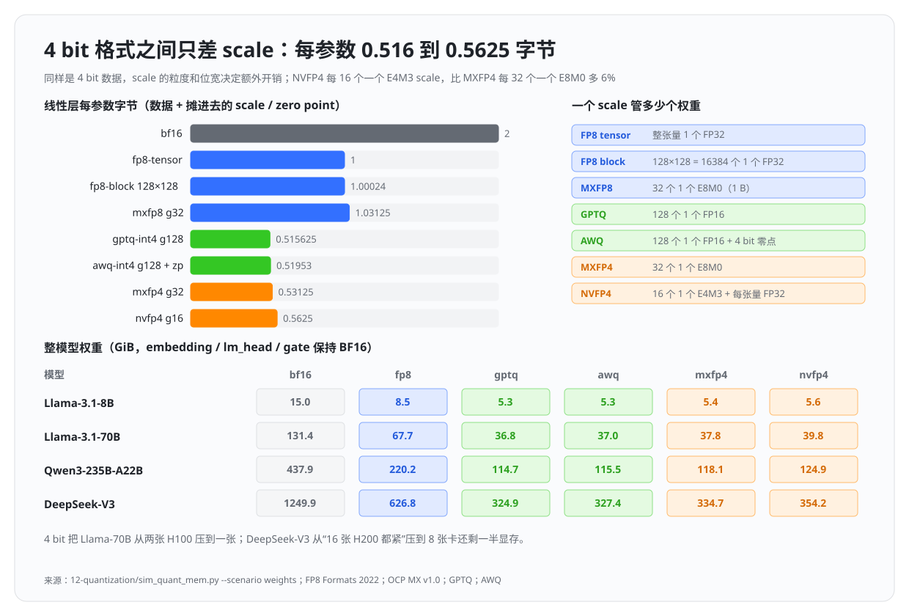
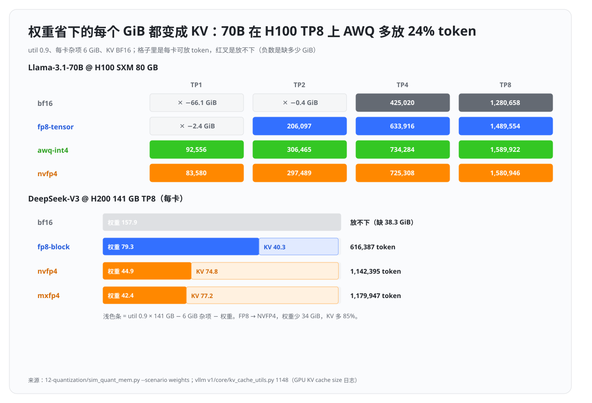
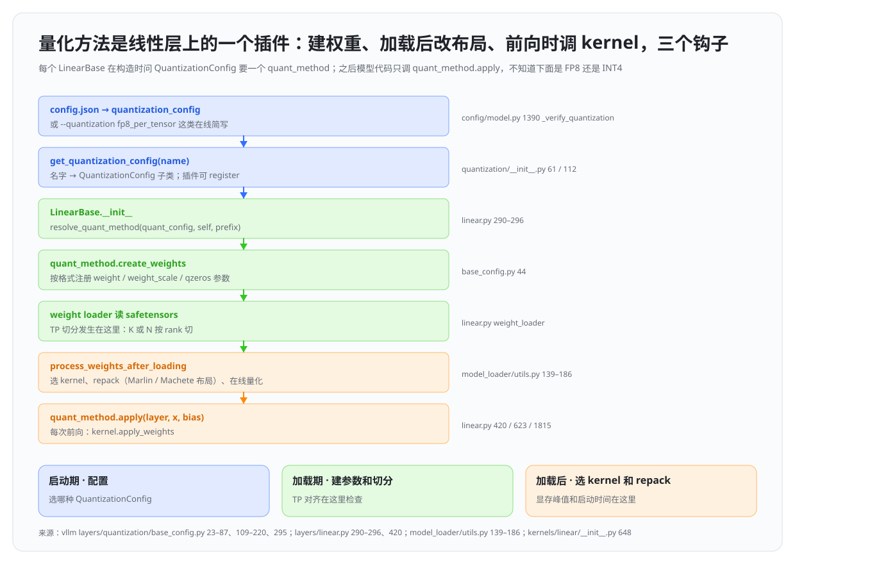
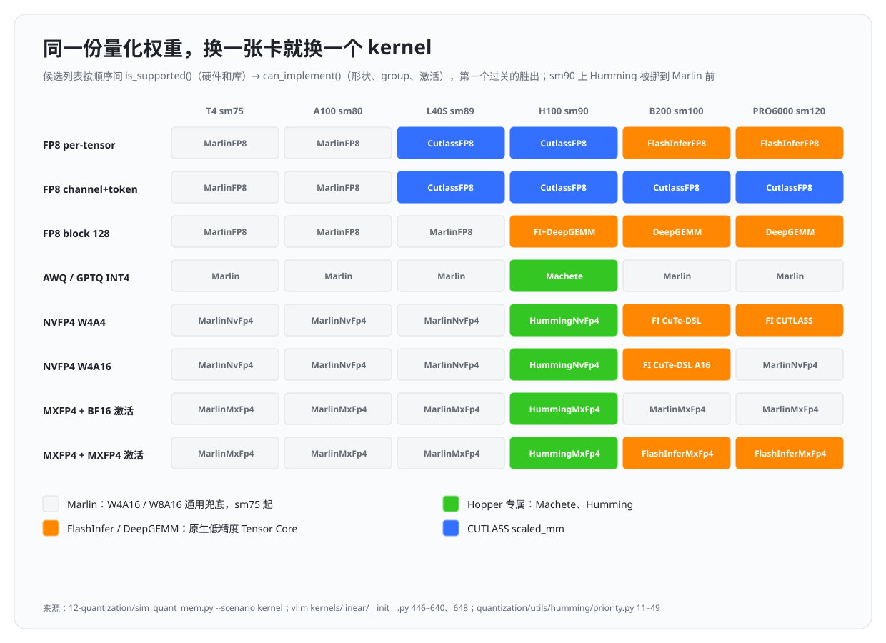
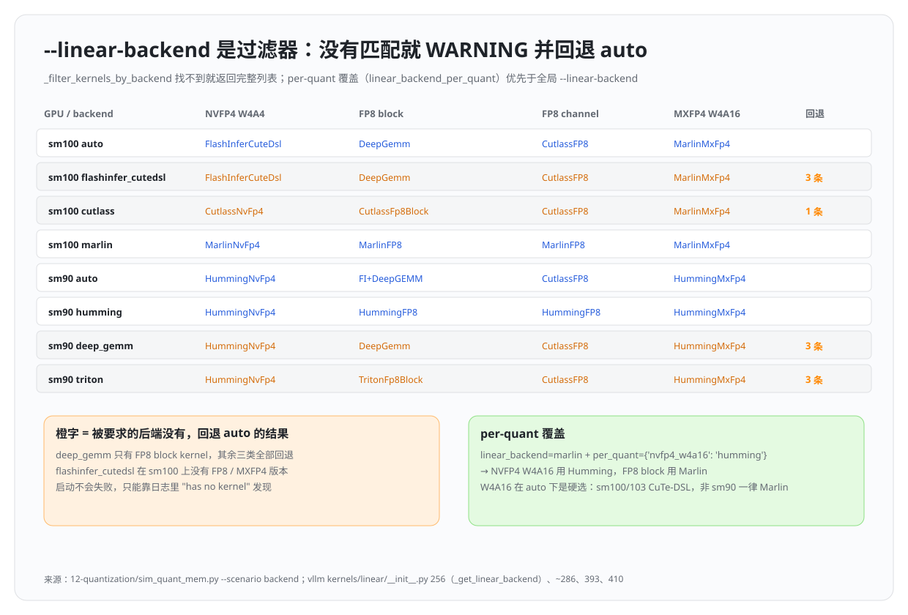
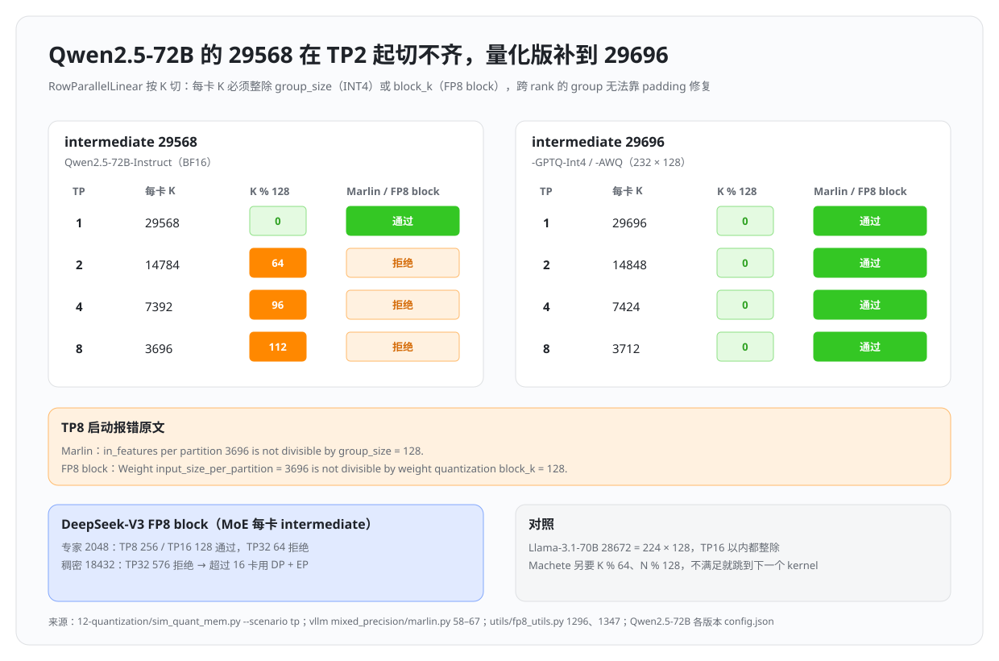
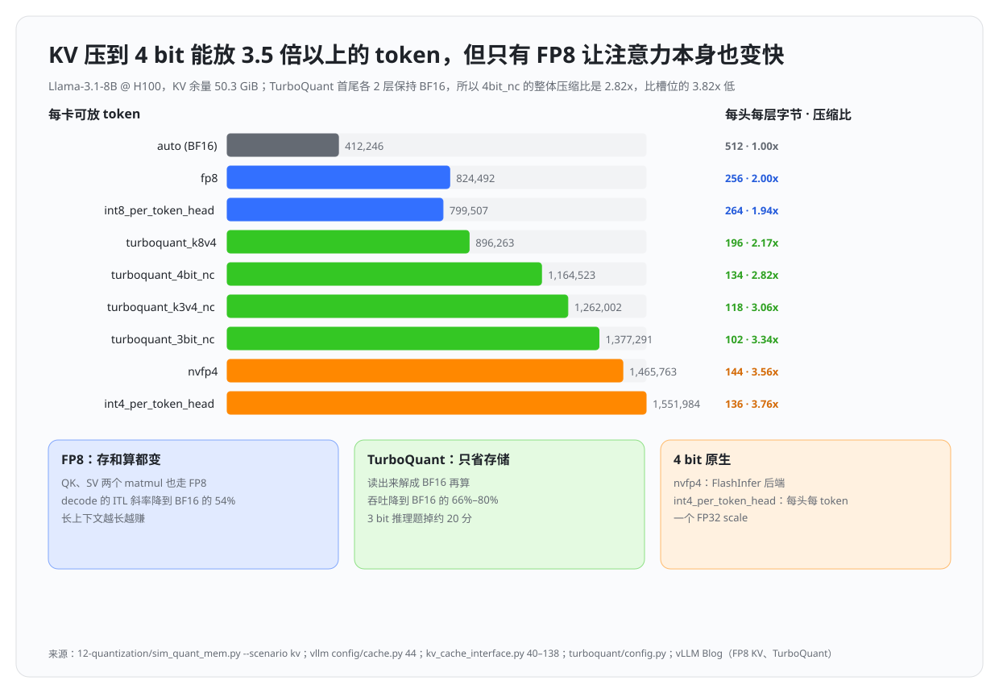
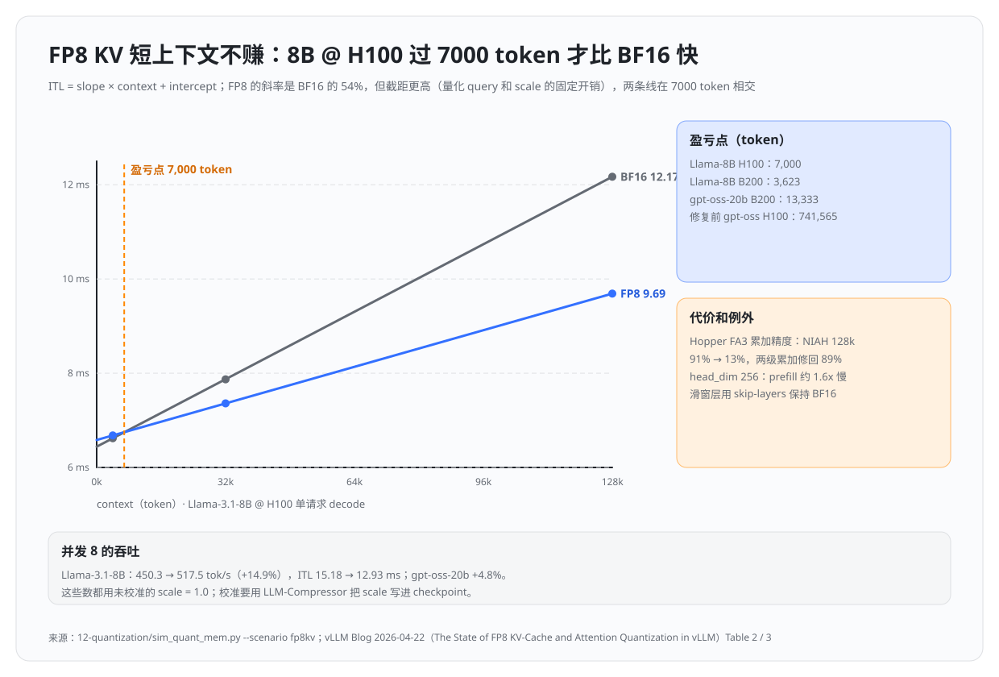
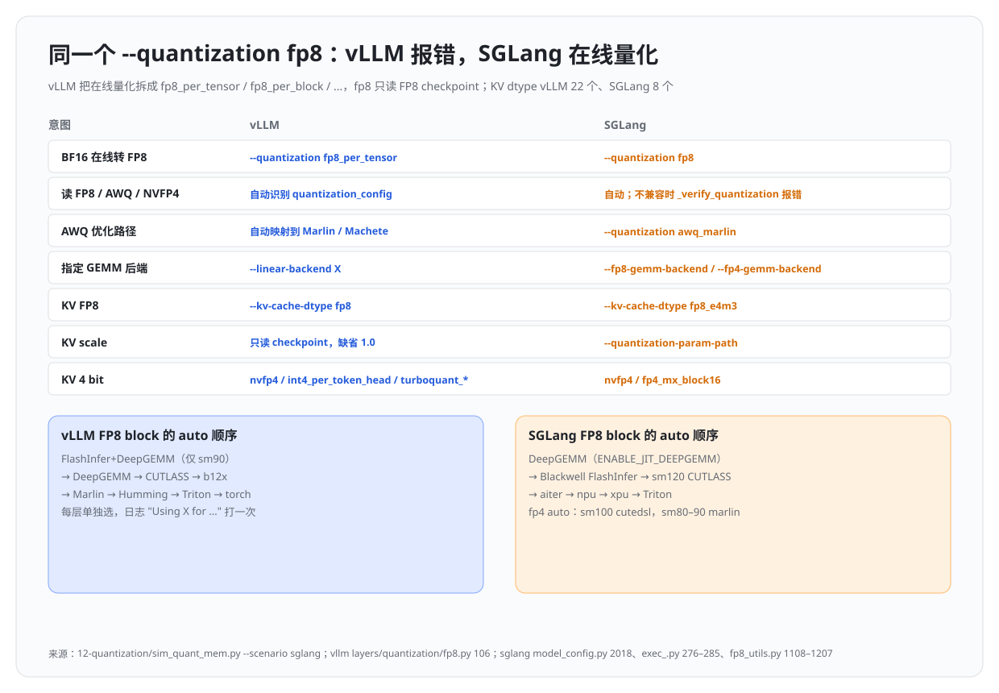

# VLLM-12｜规模｜量化：FP8、INT4、NVFP4 与 KV cache 量化

> 🎯 **这篇文档解决什么问题**：Llama-3.1-70B 的 BF16 权重放两张 H100 上差 0.4 GiB 起不来，换成 AWQ 一张卡就能起，还剩 92,556 个 token 的 KV。照着旧教程敲 `--quantization fp8`，日志直接报 “The fp8 quantization method no longer supports online quantization”。Qwen2.5-72B 自己做 INT4 再开 TP8，启动报 “in_features per partition 3696 is not divisible by group_size = 128”。同一份 NVFP4 权重在 H100 上走 Humming，在 B200 上走 FlashInfer CuTe-DSL，在 RTX PRO 6000 上又换成 FlashInfer CUTLASS。`--kv-cache-dtype fp8` 能让 KV 容量翻倍，可在 4k 上下文上 decode 反而慢了 0.06 ms。我们按 vLLM 的源码讲清楚量化怎么挂到线性层上、每种格式在每代卡上落到哪个 kernel、TP 切分为什么会把量化权重切坏、KV cache 量化在容量和速度上各换来什么，每一处都和 SGLang 对照。
>
> **使用方式**：第 1 章讲各种格式的位宽和 scale。第 2 章算权重省下的显存变成多少 KV。第 3 章讲 quant_method 的三个钩子。第 4 章逐代卡回放 kernel 选择。第 5 章讲 `--linear-backend`。第 6 章讲 TP 切分的对齐。第 7 章讲 KV cache 量化的字节账和 TurboQuant。第 8 章讲 FP8 KV 什么时候真的变快、精度怎么验。第 9 章对照 SGLang 并动手核对。基线：vLLM 主干 0d6f92a，SGLang 主干 8fabf5e。
>
> **代码**：[12-quantization](../12-quantization)。sim_quant_mem.py 只依赖标准库，按源码复刻了这些内容：每种格式每参数的字节数，四个模型在 H100 / H200 上的权重与 KV 余量，13 种常用 KV dtype 的每 token 字节（含 TurboQuant 槽位和首尾层保护、DeepSeek 稀疏 MLA 布局），`kernels/linear/__init__.py` 的候选列表与 `is_supported` / `can_implement` 判断（SM75 到 SM120），`--linear-backend` 的过滤与回退，TP 切分后 group / block 的对齐，FP8 KV 的 ITL 直线与盈亏点，以及 SGLang 的参数换算。test_sim_quant_mem.py 有 14 个单测。quant_matrix.md 是源码行号和参数对照表。gpu_quant_eval.sh 按 MODEL_PROFILE=dense/moe 选择双模型基座，默认 TP=2、上下文 8192；它提供格式对照、完整日志、随机压测和 GSM8K 评测入口，硬件容量与当前版本支持须另行核对。文中的字节、token 和盈亏点保留 sim_quant_mem.py 的历史模拟假设，kernel 候选按所标源码版本解释，不能当作双模型 GPU 实测结果。

# 导读 · 先给结论

## 量化必须保持基座一致

量化入口随 dense/moe 选择基座。AWQ、GPTQ、NVFP4 checkpoint 需显式提供并固定 QUANT_REVISION，不再默认拿 Llama NVFP4 和 Qwen 比较。先核对 config、量化元数据、层覆盖范围及校准集。

分别记录权重、全注意力 KV 和 GDN 状态的 dtype，不能把 --kv-cache-dtype 当作所有状态都变成 FP8。吞吐对比之外必须做同提示集质量评估，记录回退 kernel；未核验的格式只列候选，不宣称可用或更快。

双模型结构以固定版本配置核对[[Qwen3.8-27B config.json]](https://huggingface.co/Qwen/Qwen3.8-27B/blob/37561816e66b5b9153b1b64c10968c18c1e6f4a0/config.json)[[Qwen3.5-35B-A3B config.json]](https://huggingface.co/Qwen/Qwen3.5-35B-A3B/blob/59d61f3ce65a6d9863b86d2e96597125219dc754/config.json)。

1. **推理里的量化先是显存问题，然后才是算力问题。**decode 每步要把全部权重从 HBM 读一遍，batch 小时线性层是带宽瓶颈，权重字节减半，这一步的时间就接近减半。省下的显存全部变成 KV：Llama-3.1-70B 在 H100 TP8 上，AWQ 比 BF16 每卡多放 24% 的 token；DeepSeek-V3 在 8×H200 上，FP8 block 换成 NVFP4，KV 从 61.6 万 token 涨到 114.2 万。
2. **4 bit 格式之间的差别在 scale。**GPTQ g128 每参数 0.516 字节，AWQ 多一个 4 bit 零点到 0.520，MXFP4 每 32 个值一个 E8M0 scale 到 0.531，NVFP4 每 16 个值一个 E4M3 scale 到 0.5625。NVFP4 多花 6% 的字节换更细的 scale 和非 2 的幂次的缩放。
3. **vLLM 的量化是线性层上的插件。**每个 `LinearBase` 构造时向 `QuantizationConfig` 要一个 `quant_method`，之后只有三个钩子：`create_weights` 建参数，`process_weights_after_loading` 把 checkpoint 的布局改成 kernel 要的布局，`apply` 前向时调 kernel。模型代码不知道下面是 FP8 还是 INT4。
4. **kernel 是按候选列表的顺序选出来的。**每种量化有一张有序的候选表，按顺序问 `is_supported()`（硬件、库）和 `can_implement()`（形状、group、激活），第一个通过的胜出。SM90 上 Humming 会被挪到 Marlin 前面。所以同一份 AWQ 权重在 A100 上走 Marlin，在 H100 上走 Machete，N 不是 128 的倍数时又落到 Humming。
5. **`--linear-backend` 只起过滤作用。**指定的后端在某种线性层上没有 kernel，就打一条 WARNING 回退到 auto，不会启动失败。要知道实际用了哪个，只能看日志里每种线性层第一次选中时打的 “Using X for …”。
6. **TP 会把量化权重切坏。**`RowParallelLinear` 按 K 切，每卡的 K 必须整除 group_size 或 block_k。Qwen2.5-72B 的 intermediate 29568 在 TP2 起就切不齐，官方量化版补零到 29696；DeepSeek-V3 的 FP8 block 权重到 TP32 就切不齐，超过 16 卡要用 DP + EP。
7. **KV cache 压到 4 bit 能放 3.3 倍以上的 token，但只有 FP8 让注意力本身变快。**vLLM 有 22 种 KV dtype。FP8 把 QK 和 SV 两个矩阵乘也放到 FP8 上算；TurboQuant 只压存储，读出来解压回 BF16 再算，所以吞吐比 BF16 低。TurboQuant 首尾各 2 层保持 BF16，4bit_nc 的整体压缩比只有 2.82x，低于槽位的 3.82x。
8. **FP8 KV 的速度收益有盈亏点。**FP8 的 ITL 斜率是 BF16 的 54%，截距更高，Llama-3.1-8B 在 H100 上要过 7000 token 才比 BF16 快，在 B200 上是 3623 token。Hopper 上 FP8 注意力曾经因为累加精度把 128k 大海捞针从 91% 打到 13%，两级累加修好后回到 89%。默认 scale 是 1.0，没有校准，日志会打一条 WARNING。
9. **SGLang 和 vLLM 的参数名已经分叉。**同一个 `--quantization fp8`，vLLM 报错，SGLang 在线量化。SGLang 的 FP8 / FP4 GEMM 后端用 `--fp8-gemm-backend` 和 `--fp4-gemm-backend` 分开指定。KV dtype vLLM 22 个，SGLang 8 个。迁移部署时要逐个参数对照，不能照抄。

# 第 1 章 · 量化省的是字节：位宽、scale 和粒度



## 1.1 decode 为什么吃量化

decode 每步每个序列只来一个 token，线性层是 [batch, K] 乘 [K, N]。batch 小时激活只有几 KB，权重有几十 GB，时间几乎全花在把权重从 HBM 搬进 SM 上。H100 SXM 的带宽是 3.35 TB/s，Llama-3.1-70B 在 TP8 下每卡 16.4 GiB 的 BF16 权重，光读一遍就要约 5.3 ms；AWQ 只有 4.6 GiB，约 1.5 ms。MARLIN 论文给出的数字是 4 bit 权重在 batch 16 到 32 时仍能拿到接近 4 倍的加速，到 64 到 128 时逐渐下降[[1]](https://arxiv.org/abs/2408.11743)。batch 再大，矩阵乘变成算力瓶颈，权重字节就不重要了，这时候能不能用低精度 Tensor Core（FP8、FP4）才决定速度。

所以量化格式分两类。一类只压权重，计算前在寄存器里解压回 BF16 / FP16，叫 W4A16、W8A16，收益全在带宽，代表是 GPTQ[[2]](https://arxiv.org/abs/2210.17323) 和 AWQ[[3]](https://arxiv.org/abs/2306.00978)。另一类权重和激活都压，直接用 FP8 / FP4 Tensor Core 算，叫 W8A8、W4A4，带宽和算力都省，代价是激活也要量化。激活里有离群值，INT8 激活量化要先用 SmoothQuant 一类方法把难度从激活挪到权重[[4]](https://arxiv.org/abs/2211.10438)；FP8 有指数位，动态范围大得多，per-tensor 或 per-token 一个 scale 通常就够[[5]](https://arxiv.org/abs/2209.05433)。

## 1.2 scale 的粒度决定额外字节

模拟器的 `weights` 场景先算每种格式每参数几字节：

```text
== 每参数字节（线性层；embedding / lm_head / gate 保持 BF16）
  bf16         2.00000 B   BF16 原样
  fp8-tensor   1.00000 B   FP8 E4M3，每张量 1 个 FP32 scale
  fp8-block    1.00024 B   FP8 E4M3，128x128 块 1 个 FP32 scale（DeepSeek-V3）
  mxfp8        1.03125 B   MXFP8，每 32 个 1 字节 E8M0 scale
  gptq-int4    0.51562 B   INT4 g128 对称，FP16 scale
  awq-int4     0.51953 B   INT4 g128 非对称，FP16 scale + 4-bit zero point
  nvfp4        0.56250 B   NVFP4 E2M1，每 16 个 1 字节 E4M3 scale + 每张量 FP32
  mxfp4        0.53125 B   MXFP4 E2M1，每 32 个 1 字节 E8M0 scale
```

FP8 E4M3 有 4 位指数、3 位尾数，不表示无穷，只留一个 NaN 位型，最大值 448[[5]](https://arxiv.org/abs/2209.05433)。per-tensor 一个 FP32 scale，额外开销可以忽略；DeepSeek-V3 的 128×128 block 每 16384 个参数一个 FP32 scale，多 0.024%[[6]](https://arxiv.org/abs/2412.19437)。block 的好处是 scale 跟着局部分布走，训练时就能用；坏处是 TP 切分必须和 block 对齐，第 6 章会看到这个代价。

INT4 格式按 group 存 scale。GPTQ g128 对称量化，每 128 个参数一个 FP16 scale，0.5 + 2/128 = 0.5156 字节；AWQ 非对称，再加一个 4 bit 零点，0.5195 字节。OCP 的 MX 规范把 scale 统一成每 32 个元素一个 8 位 E8M0（只有指数，即 2 的幂次），MXFP8 是 1.03125 字节，MXFP4 是 0.53125 字节[[7]](https://arxiv.org/abs/2310.10537)。NVIDIA 的 NVFP4 把块缩小到 16 个，scale 换成 E4M3，再加一个每张量的 FP32 二级 scale，0.5625 字节。NVIDIA 的说法是 E4M3 scale 能取非 2 的幂次的值，在 16 个元素上的均方误差比 E8M0 小，DeepSeek-R1-0528 上相对 FP8 的精度损失在 1% 以内[[8]](https://developer.nvidia.com/blog/introducing-nvfp4-for-efficient-and-accurate-low-precision-inference/)。

| 格式 | 数据 | scale | 每参数字节 | 计算方式 | 典型来源 |
|-|-|-|-|-|-|
| FP8 per-tensor | E4M3 | 每张量 FP32 | 1.00000 | W8A8 FP8 Tensor Core | ModelOpt FP8、在线 `fp8_per_tensor` |
| FP8 block 128 | E4M3 | 128×128 一个 FP32 | 1.00024 | W8A8，激活按 1×128 动态量化 | DeepSeek-V3 / R1 官方权重 |
| GPTQ g128 | INT4 对称 | 每 128 个 FP16 | 0.51562 | W4A16（H100 可 W4A8） | GPTQ、AutoRound |
| AWQ g128 | INT4 + 零点 | 每 128 个 FP16 + 4 bit zp | 0.51953 | W4A16 | AutoAWQ |
| MXFP4 | E2M1 | 每 32 个 E8M0 | 0.53125 | Blackwell 上 W4A4，之前 W4A16 | gpt-oss |
| NVFP4 | E2M1 | 每 16 个 E4M3 + 每张量 FP32 | 0.56250 | Blackwell 上 W4A4 | ModelOpt NVFP4、LLM Compressor |

embedding、lm_head、MoE 的 gate 通常不量化。模拟器按这个口径算整个模型：DeepSeek-V3 的 BF16 是 1249.9 GiB，FP8 block 626.9 GiB，正好一半；NVFP4 354.2 GiB，比 FP8 再少 43%。Llama-3.1-8B 从 15.0 GiB 降到 AWQ 的 5.3 GiB，压缩比只有 2.8 倍，到不了 4 倍，因为 128K 词表的 embedding 和 lm_head 一共约 2 GiB 仍是 BF16，小模型里它们的占比高。

# 第 2 章 · 放得下：省下的每个 GiB 都变成 KV



## 2.1 显存账

vLLM 启动时 profile 一次峰值显存，把 `gpu_memory_utilization` 份额减去权重、激活峰值和 CUDA Graph 等杂项，剩下的全部分给 KV cache，日志打 “GPU KV cache size: N tokens”（[kv_cache_utils.py](https://github.com/vllm-project/vllm/blob/0d6f92a/vllm/v1/core/kv_cache_utils.py) 1148 行）。模拟器按 util 0.9、每卡杂项 6 GiB、KV BF16 算三个模型：

```text
== Llama-3.1-70B @ H100 SXM，util 0.9，每卡杂项 6 GiB，KV BF16
格式           TP     每卡权重 GiB     每卡 KV 余量 GiB     每卡可放 token
bf16          1        131.4            -66.1          放不下
bf16          2         65.7             -0.4          放不下
bf16          4         32.9             32.4        425,020
bf16          8         16.4             48.9      1,280,658
fp8-tensor    1         67.7             -2.4          放不下
fp8-tensor    2         33.8             31.4        206,097
fp8-tensor    4         16.9             48.4        633,916
fp8-tensor    8          8.5             56.8      1,489,554
awq-int4      1         37.0             28.2         92,556
awq-int4      2         18.5             46.8        306,465
awq-int4      4          9.3             56.0        734,284
awq-int4      8          4.6             60.7      1,589,922
nvfp4         1         39.8             25.5         83,580
nvfp4         2         19.9             45.4        297,489
nvfp4         4          9.9             55.3        725,308
nvfp4         8          5.0             60.3      1,580,946

== Qwen3-235B-A22B @ H200，util 0.9，每卡杂项 6 GiB，KV BF16
格式           TP     每卡权重 GiB     每卡 KV 余量 GiB     每卡可放 token
bf16          2        219.0            -99.4          放不下
bf16          4        109.5             10.1        225,076
bf16          8         54.9             64.7      1,443,958
fp8-block     2        110.1              9.5        105,776
fp8-block     4         55.1             64.5      1,439,244
fp8-block     8         27.7             92.0      2,052,065
awq-int4      2         57.8             61.8        689,585
awq-int4      4         29.0             90.7      2,023,052
awq-int4      8         14.5            105.1      2,344,462
nvfp4         2         62.5             57.1        637,401
nvfp4         4         31.3             88.3      1,970,868
nvfp4         8         15.7            103.9      2,318,326

== DeepSeek-V3 @ H200，util 0.9，每卡杂项 6 GiB，KV BF16
格式           TP     每卡权重 GiB     每卡 KV 余量 GiB     每卡可放 token
bf16          8        157.9            -38.3          放不下
fp8-block     8         79.3             40.3        616,387
nvfp4         8         44.9             74.8      1,142,395
mxfp4         8         42.4             77.2      1,179,947

读法：同一张卡上，权重省下来的每个 GiB 都变成 KV；KV 余量翻倍 ≈ 能同时跑的长请求翻倍。
```

## 2.2 读这张表

Llama-3.1-70B 这一块最直观。BF16 TP2 每卡 65.7 GiB 权重，加 6 GiB 杂项超出 H100 的 0.9 份额 0.4 GiB，起不来。FP8 单卡差 2.4 GiB，也起不来。AWQ 单卡 37.0 GiB 权重，还剩 28.2 GiB 给 KV。到 TP8，BF16 每卡 KV 余量 48.9 GiB，AWQ 60.7 GiB，可放 token 多 24%，FP8 多 16%。这 24% 来自同一张卡上多放了请求，和线性层快不快无关：同样 32k 上下文，能同时 decode 的序列数多四分之一，吞吐在 KV 受限的负载下大致按这个比例涨。

Qwen3-235B 在 H200 上，BF16 TP4 每卡只剩 10.1 GiB，225,076 个 token；FP8 block TP4 剩 64.5 GiB，1,439,244 个 token，是 6.4 倍。权重减半，KV 余量远不止翻倍，从“勉强能起”变成了“宽裕”，因为 KV 余量是总份额减去权重后的差，权重越接近份额，省下的那部分占余量的比例越大。

DeepSeek-V3 是 MoE 模型里最典型的例子。BF16 在 8×H200 上根本放不下，每卡缺 38.3 GiB；官方发布的就是 FP8 block 权重，每卡 79.3 GiB，KV 616,387 个 token。换成 NVFP4，每卡权重 44.9 GiB，KV 1,142,395 个 token，多 85%。NVIDIA 发布 NVFP4 版 DeepSeek-R1 的出发点就是这个：同样的机器能并发更多长序列[[8]](https://developer.nvidia.com/blog/introducing-nvfp4-for-efficient-and-accurate-low-precision-inference/)。

## 2.3 省下的显存不一定换成速度

容量涨了，速度未必跟着涨。W4A16 在大 batch 下要在寄存器里解压，解压开销会吃掉带宽收益，MARLIN 论文测到 batch 64 到 128 时加速比逐渐下降[[1]](https://arxiv.org/abs/2408.11743)。Machete 博客给出的端到端数字是 4 bit Llama-3.1-70B 单卡 H100，高请求率下输入吞吐几何平均提升 29%、输出 32%，405B 四卡提升 42%[[9]](https://neuralmagic.com/blog/introducing-machete-a-mixed-input-gemm-kernel-optimized-for-nvidia-hopper-gpus/)，比权重字节的 4 倍小得多。所以选格式先问瓶颈：显存放不下或 KV 不够，任何 4 bit 都能救；要的是大 batch 的吞吐，看卡上有没有对应的低精度 Tensor Core，Hopper 上是 FP8，Blackwell 上是 FP8 和 FP4。

# 第 3 章 · 接入：quant_method 的三个钩子



## 3.1 从 config.json 到 QuantizationConfig

量化 checkpoint 的 config.json 里有一段 `quantization_config`，`quant_method` 字段写着 fp8、awq、gptq、modelopt_fp4、compressed-tensors 之类。`ModelConfig._verify_quantization`（[model.py](https://github.com/vllm-project/vllm/blob/0d6f92a/vllm/config/model.py) 1390 行）读出这个字段，和命令行的 `--quantization` 对比，再让每个量化方法的 `override_quantization_method`（1437 行）有机会改写，例如把 `gptq` 改成 `gptq_marlin`。然后 `get_quantization_config`（[\_\_init\_\_.py](https://github.com/vllm-project/vllm/blob/0d6f92a/vllm/model_executor/layers/quantization/__init__.py) 112 行）把名字映射到类：`awq`、`awq_marlin`、`auto_awq` 都映射到 `AutoAWQConfig`，`gptq`、`gptq_marlin`、`auto_gptq` 都映射到 `AutoGPTQConfig`。早年的 Marlin 专用名现在只是别名，kernel 选择挪到了后面统一做。

插件可以用 `register_quantization_config`（同文件 61 行）注册自己的方法，名字会加进合法值。`fbgemm_fp8` 和 `fp_quant` 在废弃名单里（52 行）。启动时 `config/vllm.py` 945 行检查 `get_min_capability()`，不满足直接报 “is not supported for the current GPU. Minimum capability”。各方法的门槛：FP8 75、ModelOpt FP8 80、ModelOpt NVFP4 75、AWQ 75、GPTQ 60、MXFP4 80、compressed-tensors 70。V100 是 sm70，AWQ 直接拒绝，GPTQ 能起。

## 3.2 在线量化换了名字

BF16 checkpoint 加载时量化成 FP8，以前写 `--quantization fp8`。0d6f92a 上 `Fp8Config.__init__` 发现 checkpoint 不是 FP8 序列化的，直接抛错：“The \`fp8\` quantization method no longer supports online quantization. Please use \`--quantization fp8_per_tensor\` instead”（[fp8.py](https://github.com/vllm-project/vllm/blob/0d6f92a/vllm/model_executor/layers/quantization/fp8.py) 106–111 行）。在线量化统一挪到了 `config/quantization.py` 的 `_ONLINE_SHORTHANDS`（195–228 行）[[10]](https://docs.vllm.ai/en/latest/features/quantization/online/)：

| 简写 | 线性层 | MoE | 说明 |
|-|-|-|-|
| `fp8_per_tensor` | FP8 静态 per-tensor | 同左 | 替代旧的在线 `fp8` |
| `fp8_per_block` | FP8 128 block | 同左 | 和 DeepSeek-V3 同一种布局 |
| `fp8_per_channel` | per-channel 权重 + 动态 per-token 激活 | 同左 | 等价 LLM Compressor 的 FP8_DYNAMIC |
| `mxfp8` / `mxfp4` | MX 格式 | 同左 | checkpoint 自带量化元数据时不生效，按 checkpoint 走 |
| `int8_per_channel_weight_only` | 不量化 | INT8 仅权重 | 只动 MoE |
| `nvfp4_per_token` | 不量化 | NVFP4 + 动态 per-token 激活 scale | 只动 MoE，要 Blackwell + FlashInfer TRTLLM |

在线量化的权重先按 BF16 读进来，`process_weights_after_loading` 里再量化，加载时峰值显存比直接读 FP8 checkpoint 高；而且在线量化没有校准，精度通常不如离线工具（LLM Compressor、ModelOpt）做的版本[[11]](https://github.com/vllm-project/llm-compressor)。生产上还是读离线量化好的 checkpoint，在线量化适合快速试一个模型。

## 3.3 三个钩子

`QuantizeMethodBase`（[base_config.py](https://github.com/vllm-project/vllm/blob/0d6f92a/vllm/model_executor/layers/quantization/base_config.py) 23 行）只有几个方法。`LinearBase.__init__` 调 `resolve_quant_method(quant_config, self, prefix)`（[linear.py](https://github.com/vllm-project/vllm/blob/0d6f92a/vllm/model_executor/layers/linear.py) 290–296 行），后者调 `QuantizationConfig.get_quant_method(layer, prefix)`（base_config.py 203 行）。`Fp8Config.get_quant_method` 先用 `is_layer_skipped` 查 `ignored_layers`，命中就返回 `UnquantizedLinearMethod`，否则返回 `Fp8LinearMethod`；MoE 层返回 MoE 的方法（fp8.py 177–202 行）。prefix 是 `model.layers.0.self_attn.qkv_proj` 这样的完整名字，所以 checkpoint 可以指定哪些层不量化。

拿到 quant_method 后，线性层调 `quant_method.create_weights`（base_config.py 44 行）注册参数：FP8 注册 `weight`（float8_e4m3fn）和 `weight_scale`，AWQ 注册 `qweight`（int32 打包 8 个 4 bit）、`scales`、`qzeros`。每个参数带一个 `weight_loader`，知道自己按哪一维切 TP、scale 要不要跟着切。safetensors 里的张量按名字找到参数，loader 只拷贝本 rank 那一片。

全部权重读完后，`process_weights_after_loading`（[utils.py](https://github.com/vllm-project/vllm/blob/0d6f92a/vllm/model_executor/model_loader/utils.py) 139–186 行）遍历所有模块，调每个 quant_method 的同名钩子（base_config.py 80 行）。这一步是量化接入的关键：checkpoint 的布局是给人和工具看的，kernel 要的布局是给 Tensor Core 看的。Marlin 要把 4 bit 权重重排成每个 warp 一次 ldmatrix 能拿到的顺序；Machete 博客专门讲了为什么 PyTorch 的行主序和 wgmma 的寄存器布局不匹配，必须预先重排[[9]](https://neuralmagic.com/blog/introducing-machete-a-mixed-input-gemm-kernel-optimized-for-nvidia-hopper-gpus/)。FP8 per-tensor 的 QKV 合并层要把三个 scale 取最大值重新量化。kernel 也是在这一步之前选好的，因为重排的方式取决于 kernel。

前向时模型代码只调 `self.quant_method.apply(self, x, bias)`（linear.py 420、623、1815 行），`apply` 再调选中 kernel 的 `apply_weights`。所以加一种新格式，模型文件一行不用改；加一个新 kernel，量化方法也不用改，只要把 kernel 类放进候选列表。

KV cache 的 scale 走同一套机制。`BaseKVCacheMethod`（[kv_cache.py](https://github.com/vllm-project/vllm/blob/0d6f92a/vllm/model_executor/layers/quantization/kv_cache.py) 45 行）给注意力层建 `q_scale`、`k_scale`、`v_scale`、`prob_scale`，初值 -1.0 表示无效；加载后 checkpoint 里有就用，没有就用 1.0 并打 “Using KV cache scaling factor 1.0 for fp8_e4m3”（110–162 行）。第 8 章会回到这个 1.0。

# 第 4 章 · kernel 选择：同一份权重，换一张卡就换一个 kernel



## 4.1 候选列表和两道检查

vLLM 把线性层 kernel 的选择收到了 [\_\_init\_\_.py](https://github.com/vllm-project/vllm/blob/0d6f92a/vllm/model_executor/kernels/linear/__init__.py)。每种量化一张按优先级排好的候选表：INT8 446 行、FP8 per-tensor / channel 458 行、FP8 block 494 行、W8A16 522 行、WnA16（AWQ / GPTQ）539 行、MXFP8 568 行、NVFP4 592 行、MXFP6 615 行、MXFP4 625 行。以 FP8 block 的 CUDA 列表为例，顺序是 FlashInfer+DeepGEMM 组合、DeepGEMM、CUTLASS、b12x、Marlin、Humming、Triton、torch。

选择时先经过 `_resolve_backend_kernels`（410 行）：`prioritize_humming` 在 SM90 上把 Humming 挪到 Marlin 前面（[priority.py](https://github.com/vllm-project/vllm/blob/0d6f92a/vllm/model_executor/layers/quantization/utils/humming/priority.py) 11 行的 `_HUMMING_PREFERRED_CAPABILITIES = {90}`，27–49 行），再按 `--linear-backend` 过滤。然后逐个调 `is_supported_and_can_implement_kernel`（648 行）：`is_supported()` 看硬件和库（算力、有没有装 FlashInfer、DeepGEMM 能不能 JIT），`can_implement()` 看这一层的形状、group 大小、激活 dtype、scale 类型。第一个两道都过的胜出，日志打一行 “Using X for …”。

## 4.2 逐代卡回放

模拟器的 `kernel` 场景按 0d6f92a 的列表和检查条件，在 6 代卡上回放 8 种线性层（假设官方 CUDA 13 wheel，flashinfer、cutlass-dsl、humming-kernels 已装，DeepGEMM 可用）：

```text
== 每种量化在不同 GPU 上落到哪个线性层 kernel（默认环境：官方 CUDA 13 wheel，flashinfer + humming 已装）
-- FP8 静态 per-tensor（ModelOpt FP8）
  T4 / sm75              MarlinFP8ScaledMM（前面跳过 5 个，第一个原因：FlashInferFP8ScaledMM: FlashInfer + >=sm_100）
  A100 / sm80            MarlinFP8ScaledMM（前面跳过 5 个，第一个原因：FlashInferFP8ScaledMM: FlashInfer + >=sm_100）
  L40S / sm89            CutlassFP8ScaledMM（前面跳过 1 个，第一个原因：FlashInferFP8ScaledMM: FlashInfer + >=sm_100）
  H100 / sm90            CutlassFP8ScaledMM（前面跳过 1 个，第一个原因：FlashInferFP8ScaledMM: FlashInfer + >=sm_100）
  B200 / sm100           FlashInferFP8ScaledMM
  RTX PRO 6000 / sm120   FlashInferFP8ScaledMM
-- FP8 per-channel + 动态 per-token（FP8_DYNAMIC）
  T4 / sm75              MarlinFP8ScaledMM（前面跳过 5 个，第一个原因：FlashInferFP8ScaledMM: FlashInfer + >=sm_100）
  A100 / sm80            MarlinFP8ScaledMM（前面跳过 5 个，第一个原因：FlashInferFP8ScaledMM: FlashInfer + >=sm_100）
  L40S / sm89            CutlassFP8ScaledMM（前面跳过 1 个，第一个原因：FlashInferFP8ScaledMM: FlashInfer + >=sm_100）
  H100 / sm90            CutlassFP8ScaledMM（前面跳过 1 个，第一个原因：FlashInferFP8ScaledMM: FlashInfer + >=sm_100）
  B200 / sm100           CutlassFP8ScaledMM（前面跳过 1 个，第一个原因：FlashInferFP8ScaledMM: needs per-tensor scales）
  RTX PRO 6000 / sm120   CutlassFP8ScaledMM（前面跳过 1 个，第一个原因：FlashInferFP8ScaledMM: needs per-tensor scales）
-- FP8 block 128（DeepSeek-V3）
  T4 / sm75              MarlinFP8ScaledMM（前面跳过 4 个，第一个原因：FlashInferFp8DeepGEMMDynamicBlockScaled: needs FlashInfer sm90 blockscale AND DeepGEMM）
  A100 / sm80            MarlinFP8ScaledMM（前面跳过 4 个，第一个原因：FlashInferFp8DeepGEMMDynamicBlockScaled: needs FlashInfer sm90 blockscale AND DeepGEMM）
  L40S / sm89            MarlinFP8ScaledMM（前面跳过 4 个，第一个原因：FlashInferFp8DeepGEMMDynamicBlockScaled: needs FlashInfer sm90 blockscale AND DeepGEMM）
  H100 / sm90            FlashInferFp8DeepGEMMDynamicBlockScaled
  B200 / sm100           DeepGemmFp8BlockScaledMM（前面跳过 1 个，第一个原因：FlashInferFp8DeepGEMMDynamicBlockScaled: needs FlashInfer sm90 blockscale AND DeepGEMM）
  RTX PRO 6000 / sm120   DeepGemmFp8BlockScaledMM（前面跳过 1 个，第一个原因：FlashInferFp8DeepGEMMDynamicBlockScaled: needs FlashInfer sm90 blockscale AND DeepGEMM）
-- AWQ INT4 g128 + zp（BF16 激活）
  T4 / sm75              Marlin（前面跳过 2 个，第一个原因：CutlassW4A8 min capability 90）
  A100 / sm80            Marlin（前面跳过 2 个，第一个原因：CutlassW4A8 min capability 90）
  L40S / sm89            Marlin（前面跳过 2 个，第一个原因：CutlassW4A8 min capability 90）
  H100 / sm90            Machete（前面跳过 1 个，第一个原因：CutlassW4A8: needs sm90 + FP8 activation）
  B200 / sm100           Marlin（前面跳过 2 个，第一个原因：CutlassW4A8: needs sm90 + FP8 activation）
  RTX PRO 6000 / sm120   Marlin（前面跳过 2 个，第一个原因：CutlassW4A8: needs sm90 + FP8 activation）
-- GPTQ INT4 g128（FP16 激活）
  T4 / sm75              Marlin（前面跳过 2 个，第一个原因：CutlassW4A8 min capability 90）
  A100 / sm80            Marlin（前面跳过 2 个，第一个原因：CutlassW4A8 min capability 90）
  L40S / sm89            Marlin（前面跳过 2 个，第一个原因：CutlassW4A8 min capability 90）
  H100 / sm90            Machete（前面跳过 1 个，第一个原因：CutlassW4A8: needs sm90 + FP8 activation）
  B200 / sm100           Marlin（前面跳过 2 个，第一个原因：CutlassW4A8: needs sm90 + FP8 activation）
  RTX PRO 6000 / sm120   Marlin（前面跳过 2 个，第一个原因：CutlassW4A8: needs sm90 + FP8 activation）
-- NVFP4 W4A4（ModelOpt NVFP4）
  T4 / sm75              MarlinNvFp4（前面跳过 5 个，第一个原因：FlashInferCuteDslNvFp4: sm10x + FlashInfer CuTe-DSL）
  A100 / sm80            MarlinNvFp4（前面跳过 5 个，第一个原因：FlashInferCuteDslNvFp4: sm10x + FlashInfer CuTe-DSL）
  L40S / sm89            MarlinNvFp4（前面跳过 5 个，第一个原因：FlashInferCuteDslNvFp4: sm10x + FlashInfer CuTe-DSL）
  H100 / sm90            HummingNvFp4（前面跳过 5 个，第一个原因：FlashInferCuteDslNvFp4: sm10x + FlashInfer CuTe-DSL）
  B200 / sm100           FlashInferCuteDslNvFp4
  RTX PRO 6000 / sm120   FlashInferCutlassNvFp4（前面跳过 1 个，第一个原因：FlashInferCuteDslNvFp4: sm10x + FlashInfer CuTe-DSL）
-- NVFP4 W4A16
  T4 / sm75              MarlinNvFp4
  A100 / sm80            MarlinNvFp4
  L40S / sm89            MarlinNvFp4
  H100 / sm90            HummingNvFp4（前面跳过 1 个，第一个原因：FlashInferCuteDslNvFp4W4A16: sm100/103/12x）
  B200 / sm100           FlashInferCuteDslNvFp4W4A16
  RTX PRO 6000 / sm120   MarlinNvFp4
-- MXFP4 权重 + BF16 激活
  T4 / sm75              MarlinMxFp4（前面跳过 1 个，第一个原因：FlashInferMxFp4: FlashInfer + >=sm_100）
  A100 / sm80            MarlinMxFp4（前面跳过 1 个，第一个原因：FlashInferMxFp4: FlashInfer + >=sm_100）
  L40S / sm89            MarlinMxFp4（前面跳过 1 个，第一个原因：FlashInferMxFp4: FlashInfer + >=sm_100）
  H100 / sm90            HummingMxFp4（前面跳过 1 个，第一个原因：FlashInferMxFp4: FlashInfer + >=sm_100）
  B200 / sm100           MarlinMxFp4（前面跳过 1 个，第一个原因：FlashInferMxFp4: only supports MXFP4 dynamic activation）
  RTX PRO 6000 / sm120   MarlinMxFp4（前面跳过 1 个，第一个原因：FlashInferMxFp4: only supports MXFP4 dynamic activation）
-- MXFP4 权重 + MXFP4 激活
  T4 / sm75              MarlinMxFp4（前面跳过 1 个，第一个原因：FlashInferMxFp4: FlashInfer + >=sm_100）
  A100 / sm80            MarlinMxFp4（前面跳过 1 个，第一个原因：FlashInferMxFp4: FlashInfer + >=sm_100）
  L40S / sm89            MarlinMxFp4（前面跳过 1 个，第一个原因：FlashInferMxFp4: FlashInfer + >=sm_100）
  H100 / sm90            HummingMxFp4（前面跳过 1 个，第一个原因：FlashInferMxFp4: FlashInfer + >=sm_100）
  B200 / sm100           FlashInferMxFp4
  RTX PRO 6000 / sm120   FlashInferMxFp4
```

几个规律。第一，SM75 到 SM89 上几乎全是 Marlin。Marlin 是 W4A16 / W8A16 的通用实现，只要求 sm75，FP8 权重也能用它在没有 FP8 Tensor Core 的卡上跑（权重解压成 FP16 再算）[[1]](https://arxiv.org/abs/2408.11743)。L40S 有 FP8 Tensor Core，所以 FP8 per-tensor 和 channel 走 CUTLASS，但 FP8 block 的 CUTLASS 实现只给 sm90 以上，L40S 还是 Marlin。

第二，Hopper 是 kernel 最多样的一代。FP8 block 走 FlashInfer 和 DeepGEMM 的组合。AWQ / GPTQ 走 Machete，这是 Neural Magic 为 Hopper 写的混合输入 GEMM，用 wgmma 和 TMA，Marlin 在 Hopper 上用不上这两样[[9]](https://neuralmagic.com/blog/introducing-machete-a-mixed-input-gemm-kernel-optimized-for-nvidia-hopper-gpus/)。NVFP4 和 MXFP4 Hopper 没有原生 FP4 Tensor Core，走 Humming。按 Humming 博客的说法，在 Blackwell 之前，它把 MXFP4 在 kernel 里解成 INT8 / FP8 再算，kernel 由组件 JIT 编译出来，一种实现覆盖 W4A16、W4A8、W8A8 多种组合[[12]](https://vllm.ai/blog/2026-10-21-humming)。

第三，Blackwell 上原生 FP4 和 FP8 交给 FlashInfer。B200 的 NVFP4 W4A4 走 FlashInfer CuTe-DSL，RTX PRO 6000（sm120）走 FlashInfer CUTLASS；FP8 per-tensor 走 FlashInfer，但 FP8 per-channel 的 FlashInfer kernel 只接受 per-tensor scale，`can_implement` 拒绝，落到 CUTLASS。MXFP4 权重配 BF16 激活时，FlashInfer 的 MXFP4 kernel 只支持 MXFP4 动态激活，所以 B200 上反而走 Marlin。这一格最容易误判：gpt-oss 的权重是 MXFP4，激活是否也量化成 MXFP4 决定了 B200 上用不用得上 FP4 Tensor Core。

第四，NVFP4 W4A16 是特例。`init_nvfp4_linear_kernel`（1191 行）在 auto 下强制选：sm100 / 103 有 CuTe-DSL 就用 CuTe-DSL，非 sm90 一律 Marlin，只有 sm90 走列表，Humming 在 Marlin 前。另外 `VLLM_BATCH_INVARIANT=1` 时 NVFP4 强制用 CUTLASS 的批不变实现，没有就用 emulation，并且覆盖 `--linear-backend`（同函数 1205–1230 行）；批不变性在 VLLM-08 讲过，这里只要记住它会改 kernel。

## 4.3 H100 上的三个开关

```text
== H100 上的三个开关
  FP8 block，默认                             → FlashInferFp8DeepGEMMDynamicBlockScaled
  FP8 block，没有 nvcc（DeepGEMM JIT 不可用）      → CutlassFp8BlockScaledMM
  FP8 block，VLLM_USE_DEEP_GEMM=0           → CutlassFp8BlockScaledMM
  NVFP4 W4A4，默认（humming 已装）               → HummingNvFp4
  NVFP4 W4A4，卸掉 humming-kernels           → MarlinNvFp4
  AWQ 但 N=8200（Machete 要求 N%128）            → Humming
  同上，VLLM_DISABLED_KERNELS=Machete（N=8192）   → Humming

== Blackwell 上 DeepGEMM 的模型黑名单（utils/deep_gemm.py:29）
  B200 model_type=llama             FP8 block → DeepGemmFp8BlockScaledMM
  B200 model_type=qwen3_5_moe_text  FP8 block → CutlassFp8BlockScaledMM
  B200 model_type=kolibri1          FP8 block → DeepGemmFp8BlockScaledMM

== 量化方法自己的最低算力（config/vllm.py:945，不满足直接启动报错）
  FP8 75，ModelOpt FP8 80，ModelOpt NVFP4 75，AWQ 75，GPTQ 60，MXFP4 80，compressed-tensors 70
  V100（sm70）上 AWQ 直接拒绝；GPTQ 能起：Marlin 要 75 跳过，FP16 激活落到 Exllama，BF16 激活落到 TritonW4A16。
  sm70 GPTQ fp16 → Exllama
  sm70 GPTQ bf16 → TritonW4A16
```

DeepGEMM 要用 nvcc 做 JIT，容器里没装 CUDA toolkit，FP8 block 会悄悄退到 CUTLASS；`VLLM_USE_DEEP_GEMM=0` 效果一样。卸掉 humming-kernels，H100 的 NVFP4 退回 Marlin。AWQ 权重的 N 不是 128 的倍数，Machete 的 `can_implement` 不通过（[machete_utils.py](https://github.com/vllm-project/vllm/blob/0d6f92a/vllm/model_executor/layers/quantization/utils/machete_utils.py) 37 行，要求 K % 64、N % 128），落到 Humming；`VLLM_DISABLED_KERNELS=Machete` 也一样。Blackwell 上 DeepGEMM 还有一张模型黑名单（utils/deep_gemm.py 29 行），qwen3_5_moe_text 的 FP8 block 走 CUTLASS。

这些都不会报错，只会改日志里那行 “Using X for …”。压测数字和别人对不上，先比这一行。

## 4.4 kernel 之间差多少

Humming 博客给了一组和现有 kernel 的对比[[12]](https://vllm.ai/blog/2026-10-21-humming)：稠密 W4A16 小 batch 约为 cuBLAS BF16 的 3 到 4 倍。大 batch 在 H200 上约为 Marlin 的 2 倍，B300 上部分形状超过 3 倍。MoE 的 MXFP4 W4A16 在 H20 / H200 上约为 Marlin 的 2 倍，B300 grouped GEMM 约 5 倍。FP8 W8A8 block 在 H20 上是 DeepGEMM contiguous 的 2.6 倍，H200 上 2.5 倍。SM121 上 W4A8 比 FlashInfer CUTLASS 快 19%，W4A4 快 9%。端到端的例子是 DeepSeek-V4.1-Flash：在 8×H20 TP8 上，从 Marlin W4A16 换成 Humming W4A8，吞吐提升 14% 到 43%，TTFT 降 25% 到 32%。并发 64 时输出吞吐从 442.37 tok/s 到 633.94 tok/s，TPOT 降 30.5%。

这组数字说明了两件事。一是同一种格式换 kernel 的差距可以比换格式还大，SM90 把 Humming 挪到 Marlin 前就是因为这个。二是 W4A8 是 Hopper 上一个实用的折中：权重 4 bit 省显存和带宽，激活 8 bit 用 FP8 Tensor Core 算，比 W4A16 在大 batch 下解压回 BF16 更快。

# 第 5 章 · --linear-backend：过滤器和回退



## 5.1 两级覆盖

`_get_linear_backend`（kernels/linear/\_\_init\_\_.py 256 行）先看 `kernel_config.linear_backend_per_quant`，里面有当前量化 key（如 `nvfp4_w4a16`、`fp8_block`）就用它，并打 “Applied linear backend override for %r: %r”；否则用全局的 `--linear-backend`。`_LINEAR_BACKEND_KERNEL_MAP`（约 286 行）把 backend 名映射到一组 kernel 类，`_filter_kernels_by_backend`（393 行）只保留集合里的候选，一个都没有时打 “--linear-backend=%s has no kernel for this linear layer type; using automatic selection for that layer type.” 然后返回完整列表。

为什么不报错，源码注释写得很直接：一个后端通常只给一种量化提供 kernel，而一个模型里可能同时有几种线性层，比如 NVFP4 的 MoE 投影旁边是 FP8 的注意力投影。如果严格报错，指定一个后端就起不来混合精度模型。

## 5.2 回放

```text
== --linear-backend 只是过滤候选列表，没有匹配就回退到 auto（不会启动失败）
GPU    --linear-backend     NVFP4 W4A4                     FP8 block                                FP8 channel                    MXFP4 W4A16     
sm100  auto                 FlashInferCuteDslNvFp4         DeepGemmFp8BlockScaledMM                 CutlassFP8ScaledMM             MarlinMxFp4     
sm100  flashinfer_cutedsl   FlashInferCuteDslNvFp4         DeepGemmFp8BlockScaledMM                 CutlassFP8ScaledMM             MarlinMxFp4       （3 条回退 WARNING）
sm100  cutlass              CutlassNvFp4                   CutlassFp8BlockScaledMM                  CutlassFP8ScaledMM             MarlinMxFp4       （1 条回退 WARNING）
sm100  marlin               MarlinNvFp4                    MarlinFP8ScaledMM                        MarlinFP8ScaledMM              MarlinMxFp4     
sm90   auto                 HummingNvFp4                   FlashInferFp8DeepGEMMDynamicBlockScaled  CutlassFP8ScaledMM             HummingMxFp4    
sm90   marlin               MarlinNvFp4                    MarlinFP8ScaledMM                        MarlinFP8ScaledMM              MarlinMxFp4     
sm90   humming              HummingNvFp4                   HummingFP8ScaledMM                       HummingFP8ScaledMM             HummingMxFp4    
sm90   deep_gemm            HummingNvFp4                   DeepGemmFp8BlockScaledMM                 CutlassFP8ScaledMM             HummingMxFp4      （3 条回退 WARNING）
sm90   triton               HummingNvFp4                   TritonFp8BlockScaledMM                   CutlassFP8ScaledMM             HummingMxFp4      （3 条回退 WARNING）

== linear_backend_per_quant 优先于 linear_backend（_get_linear_backend）
  sm100 linear_backend=auto    per_quant=None                         NVFP4 W4A16 → FlashInferCuteDslNvFp4W4A16  FP8 block → DeepGemmFp8BlockScaledMM
  sm100 linear_backend=auto    per_quant={'nvfp4_w4a16': 'humming'}   NVFP4 W4A16 → HummingNvFp4                 FP8 block → DeepGemmFp8BlockScaledMM
  sm100 linear_backend=marlin  per_quant={'nvfp4_w4a16': 'humming'}   NVFP4 W4A16 → HummingNvFp4                 FP8 block → MarlinFP8ScaledMM
  sm120 linear_backend=auto    per_quant=None                         NVFP4 W4A16 → MarlinNvFp4                  FP8 block → DeepGemmFp8BlockScaledMM
  W4A16 在 auto 下是 "强制" 选：sm100/103 有 CuTe-DSL 就用它，非 sm90 一律 Marlin，只有 sm90 走列表（Humming 在 Marlin 前）。

== VLLM_BATCH_INVARIANT=1 时 NVFP4 线性层
  sm100 → CutlassNvFp4
  sm90 → EmulationNvFp4
```

B200 上指定 `flashinfer_cutedsl`，只有 NVFP4 W4A4 命中，另外三种线性层各打一条 WARNING 回退 auto，结果和 auto 一模一样。指定 `cutlass`，NVFP4 从 CuTe-DSL 换成 CUTLASS，FP8 block 从 DeepGEMM 换成 CUTLASS，只有 MXFP4 W4A16 没有 CUTLASS 实现，回退一次。H100 上 `humming` 能覆盖全部四种，`deep_gemm` 和 `triton` 都只覆盖 FP8 block。

实际用法有两种。排查精度问题时，`--linear-backend marlin` 把能换的全部换成 Marlin，Marlin 覆盖面最广、实现最老，是一个稳定的参照；比较两个 kernel 时，用 `linear_backend_per_quant` 只换一种层，其他保持 auto，避免把别的层也拖进来。不管哪种，都要 grep 日志里的 “Using X for” 和 “has no kernel”，确认改动真的生效了。

# 第 6 章 · TP 切分：量化权重切不齐就起不来



## 6.1 行切遇上 group

VLLM-11 讲过，MLP 的 down_proj 是 `RowParallelLinear`，按输入维度 K 切，每卡拿 K / tp 列。BF16 权重怎么切都行；量化权重的 scale 是沿 K 每 group_size 个一组，如果一个 group 跨了两张卡，两张卡各拿半组，scale 属于谁就说不清了，也没有办法靠 padding 修：padding 改变的是数据，不改变 checkpoint 里已经算好的 group 边界。所以 Marlin 在 [marlin.py](https://github.com/vllm-project/vllm/blob/0d6f92a/vllm/model_executor/kernels/linear/mixed_precision/marlin.py) 58–67 行检查每卡 K 能不能整除 group，FP8 block 在 [fp8_utils.py](https://github.com/vllm-project/vllm/blob/0d6f92a/vllm/model_executor/layers/quantization/utils/fp8_utils.py) 1296 行检查能不能整除 block_k，MoE 的 FP8 block 在 1347 行的 `validate_fp8_block_shape_moe` 检查每卡 intermediate。

```text
== Qwen2.5-72B：down_proj 的 in_features = intermediate_size，按 TP 切 K（RowParallelLinear）
intermediate  TP    每卡 K  K%128   Marlin INT4 g128  FP8 block 128
       29568   1   29568      0               通过           通过
       29568   2   14784     64               拒绝           拒绝
       29568   4    7392     96               拒绝           拒绝
       29568   8    3696    112               拒绝           拒绝
  ↑ Qwen2.5-72B-Instruct（BF16）
       29696   1   29696      0               通过           通过
       29696   2   14848      0               通过           通过
       29696   4    7424      0               通过           通过
       29696   8    3712      0               通过           通过
  ↑ Qwen2.5-72B-Instruct-GPTQ-Int4 / AWQ

  Marlin 的拒绝原因：in_features per partition 3696 is not divisible by group_size = 128.
  FP8 block 的拒绝原因：Weight input_size_per_partition = 3696 is not divisible by weight quantization block_k = 128.
  量化发布版把 29568 补零到 29696 = 232 x 128，TP 2/4/8 每卡都是整数个 group。

== DeepSeek-V3 FP8 block 128：MoE 专家 intermediate 2048、稠密 MLP 18432（validate_fp8_block_shape_moe）
  TP8   专家每卡  256（通过）  稠密每卡  2304（通过）
  TP16  专家每卡  128（通过）  稠密每卡  1152（通过）
  TP32  专家每卡   64（拒绝）  稠密每卡   576（拒绝）
  所以 TP32 跑不了 DeepSeek-V3 的 FP8 block 权重；超过 16 卡要用 DP + EP（专家整块放，不切 intermediate）。

== Llama-3.1-70B（28672）
  TP2   每卡 K  14336  K%128 =   0  通过
  TP4   每卡 K   7168  K%128 =   0  通过
  TP8   每卡 K   3584  K%128 =   0  通过
  TP16  每卡 K   1792  K%128 =   0  通过
```

## 6.2 三个例子

Qwen2.5-72B 的 intermediate_size 是 29568 = 231 × 128，单卡没问题；TP2 每卡 14784，模 128 余 64，从这里起就全部拒绝。拿 BF16 权重自己做 GPTQ / AWQ 或在线 FP8 block，开 TP8 必然报错。Qwen 官方的 -GPTQ-Int4 和 -AWQ 版本把 intermediate 补零到 29696 = 232 × 128，TP 1 / 2 / 4 / 8 每卡都是整数个 group。补零的那 128 列权重全是 0，不影响输出，只多了 0.4% 的 MLP 参数。自己做量化时，要么在量化前做同样的补零，要么换 group_size 更小的方案，要么降 TP。

DeepSeek-V3 的专家 intermediate 是 2048，稠密 MLP 是 18432。TP16 时每卡 128，正好一个 block；TP32 时每卡 64，半个 block，拒绝。这就是为什么跨 4 台机器部署 DeepSeek-V3 不用 TP32：专家按 EP 整块放到卡上，不切 intermediate，VLLM-11 的 DP + EP 正好绕开这个限制。

Llama-3.1-70B 的 28672 = 224 × 128，到 TP16 都切得齐。Machete 还要求 K % 64、N % 128，不满足不报错，而是跳到下一个 kernel，第 4 章 AWQ N = 8200 落到 Humming 就是这个情况。所以 TP 对齐问题有两种表现：group / block 切不齐直接启动失败；kernel 的形状偏好不满足，换一个慢一点的 kernel，没有报错，只有日志里的 kernel 名变了。

# 第 7 章 · KV cache 量化：22 种 dtype 的字节账



## 7.1 vLLM 的 KV dtype

`CacheDType`（[cache.py](https://github.com/vllm-project/vllm/blob/0d6f92a/vllm/config/cache.py) 44 行）有 22 个取值：auto / float16 / bfloat16，三种 FP8（fp8、fp8_e4m3、fp8_e5m2）加 Intel Gaudi 的 fp8_inc，DeepSeek 稀疏 MLA 的 fp8_ds_mla 和 nvfp4_ds_mla，四种 TurboQuant，三种 octave，ultraquant_4bit，三种 per-token-head（INT4、INT8、FP8），以及 nvfp4 和 nvfp4_4over6。`KVQuantMode`（[kv_cache_interface.py](https://github.com/vllm-project/vllm/blob/0d6f92a/vllm/v1/kv_cache_interface.py) 40–138 行）把它们归成几类布局，决定每头每 token 存多少字节、scale 放在哪里。

每种 dtype 只有部分注意力后端支持。FlashAttention 后端支持 auto / float16 / bfloat16 / fp8 / fp8_e4m3（[flash_attn.py](https://github.com/vllm-project/vllm/blob/0d6f92a/vllm/v1/attention/backends/flash_attn.py) 290 行）。FlashInfer 多了 fp8_e5m2、nvfp4、nvfp4_4over6（[flashinfer.py](https://github.com/vllm-project/vllm/blob/0d6f92a/vllm/v1/attention/backends/flashinfer.py) 573 行）。Triton 后端支持三种 per-token-head（[triton_attn.py](https://github.com/vllm-project/vllm/blob/0d6f92a/vllm/v1/attention/backends/triton_attn.py) 326 行）。TurboQuant 只能用自己的后端（turboquant_attn.py 133 行）。VLLM-07 讲过后端选择按优先级逐个问 `supported_kv_cache_dtypes`，所以改 KV dtype 会改注意力后端，Hopper 上设 nvfp4 会从 FlashAttention 换到 FlashInfer。

## 7.2 每 token 字节

```text
== Llama-3.1-8B（32 层，8 个 KV 头，head_dim 128）@ H100 TP1，BF16 权重，KV 余量 50.3 GiB
--kv-cache-dtype           每头每层 B  每 token KB     压缩比     可放 token  说明
auto                          512      128.00   1.00x      412,246  跟随模型 dtype
fp8                           256       64.00   2.00x      824,492  E4M3，scale 默认 1.0，校准后才准
int8_per_token_head           264       66.00   1.94x      799,507  每头每 token 一个 FP32 scale
int4_per_token_head           136       34.00   3.76x    1,551,984  同上，4 bit
nvfp4                         144       36.00   3.56x    1,465,763  FlashInfer 后端，每 16 个一个 E4M3 scale
turboquant_k8v4               196       58.88   2.17x      896,263  首尾各 2 层保持 BF16；docstring：2.6x, +1.17% PPL
turboquant_4bit_nc            134       45.31   2.82x    1,164,523  首尾各 2 层保持 BF16；docstring：3.8x, +2.71%
turboquant_k3v4_nc            118       41.81   3.06x    1,262,002  首尾各 2 层保持 BF16；docstring：~3.5x, +10.63%
turboquant_3bit_nc            102       38.31   3.34x    1,377,291  首尾各 2 层保持 BF16；docstring：4.9x, +20.59%

== TurboQuant 槽位字节（head_dim 128）：key = FP8 时 hd，否则 ceil(hd*b/8)+2；value = ceil(hd*b/8)+4；对齐到偶数
  turboquant_k8v4      K8 V4 NC=False 槽位 196 B / BF16 512 B = 2.61x
  turboquant_4bit_nc   K4 V4 NC=True  槽位 134 B / BF16 512 B = 3.82x
  turboquant_k3v4_nc   K3 V4 NC=True  槽位 118 B / BF16 512 B = 4.34x
  turboquant_3bit_nc   K3 V3 NC=True  槽位 102 B / BF16 512 B = 5.02x
  首尾保护：32 层的稠密模型跳过 [0, 1, 30, 31]；混合模型（Mamba / 线性注意力）返回 []

== MLA（DeepSeek 系）每层每 token 字节：latent 512 + rope 64
  auto            1152 B  x61 层 =   68.6 KB/token  1.00x
  fp8              576 B  x61 层 =   34.3 KB/token  2.00x
  fp8_ds_mla       656 B  x61 层 =   39.1 KB/token  1.76x
  nvfp4_ds_mla     352 B  x61 层 =   21.0 KB/token  3.27x
  fp8_ds_mla / nvfp4_ds_mla 是 DeepSeek-V3.2 稀疏 MLA（FlashMLA sparse）的专用布局，nvfp4_ds_mla 只在 SM100。
```

FP8 每头每层 256 字节，正好一半，容量 2 倍。per-token-head 的 INT8 每个 (token, head) 带一个 FP32 scale，多 8 字节，1.94x；INT4 136 字节，3.76x，是不改注意力后端的 4 bit 方案里压得最多的。这个思路和 KIVI 一致：KV 的数值分布沿 token 和沿 channel 不同，细粒度的 scale 比一个全局 scale 精度高很多[[13]](https://arxiv.org/abs/2402.02750)。nvfp4 每 16 个值一个 E4M3 scale，144 字节，3.56x。

MLA 的 KV 本来就小，DeepSeek-V3 每层每 token 是 512 维 latent 加 64 维 RoPE key，BF16 1152 字节，61 层 68.6 KB。fp8_ds_mla 是 DeepSeek-V3.2 稀疏注意力（FlashMLA sparse）专用的布局，latent 用 FP8、RoPE 部分保留 BF16 并带 scale，656 字节，1.76x；nvfp4_ds_mla 352 字节，3.27x，只在 SM100（[flashmla_sparse.py](https://github.com/vllm-project/vllm/blob/0d6f92a/vllm/v1/attention/backends/mla/flashmla_sparse.py) 79、112 行）。

## 7.3 TurboQuant：只压存储

TurboQuant 论文的方法是先做随机旋转让坐标分布接近独立，再逐坐标做标量量化，证明了失真率接近信息论下界[[14]](https://arxiv.org/abs/2504.19874)。vLLM 的实现在 [config.py](https://github.com/vllm-project/vllm/blob/0d6f92a/vllm/model_executor/layers/quantization/turboquant/config.py)：key 用 Hadamard 旋转加 Lloyd-Max 标量量化（或直接 FP8），value 用均匀量化，nc 后缀表示做范数修正（norm correction）。四种预设在 `TQ_PRESETS`（20 行），槽位大小由 `key_packed_size`、`value_packed_size`、`slot_size`（129、151、160 行）算出：head_dim 128 时 k8v4 196 字节，4bit_nc 134，k3v4_nc 118，3bit_nc 102。

槽位压缩比和整体压缩比不是一回事。`get_boundary_skip_layers`（178–215 行）让稠密模型首尾各 2 层保持 BF16，32 层的 Llama 跳过 [0, 1, 30, 31]，混合模型（Mamba、线性注意力）返回空表。所以 4bit_nc 槽位是 3.82x，整体是 2.82x；3bit_nc 槽位 5.02x，整体 3.34x。docstring 里写的 4bit_nc “3.8x、PPL +2.71%”是槽位口径，规划容量要用整体口径。

vLLM 博客对 TurboQuant 做了第一次系统评测[[15]](https://vllm.ai/blog/2026-05-11-turboquant)，结论比 docstring 保守。TurboQuant 只压存储，注意力计算前解压回 BF16，所以吞吐都比 BF16 低：Qwen 系模型从 BF16 的 80% 降到 73%，Llama 从 75% 降到 66%，延迟开销 10% 到 68%。Qwen3-30B 在 2×H100 上容量是 BF16 的 2.3 到 3.7 倍，吞吐低 40% 到 52%。k8v4 相对 FP8 没有优势。4bit_nc 是实用的那一档，容量最多 3.4 倍，精度降 1 到 4 分。k3v4 和 3bit 在推理任务上降约 20 分，256k 检索 AUC 从 45.8% 降到 33.5% 和 31.2%。Llama-3.3-70B 在 4×H100 上，FP8 的突发吞吐是 BF16 的 2.6 倍、容量 2 倍；突发负载下 P99 TTFT，BF16 约 17 秒，TurboQuant 不到 3.5 秒，FP8 约 1.3 秒。

在本节对比负载下，KV 不够、排队严重时，TurboQuant 4bit_nc 以额外解码开销换取容量，可能压低排队造成的长尾 TTFT；KV 充足时，这部分开销未必能被抵消。FP8 能减少 KV 存储，但速度收益受硬件、注意力后端和上下文长度影响。第 8 章给出的盈亏点只适用于对应测试配置，不能据此认定 FP8 在所有负载下都更快。

# 第 8 章 · FP8 KV：盈亏点和精度



## 8.1 FP8 注意力也算 FP8

`--kv-cache-dtype fp8` 除了把 KV 存成 FP8，还动了注意力的计算精度。vLLM 博客写的是这个开关会量化 KV cache，并且把整个注意力计算（QK 和 Score·V 两个矩阵乘）都放到 FP8 上[[16]](https://vllm.ai/blog/2026-04-22-fp8-kvcache)。query 也要量化成 FP8，这是一笔固定开销；以前在注意力后端里做，后来挪到 torch 里让 `torch.compile` 和前面的算子融合（vllm#24914）。FlashAttention-3 原生支持 FP8，Hopper 上的 FP8 KV 就是走它[[17]](https://arxiv.org/abs/2407.08608)。

## 8.2 盈亏点

单请求 decode 的 ITL 可以拟合成 slope × context + intercept。slope 是每多一个 token 的 KV 多读的时间，FP8 读一半字节，slope 接近减半；intercept 是和上下文无关的固定开销，FP8 多了 query 量化和 scale 处理，略高。两条线相交的地方就是盈亏点：

```text
== ITL = slope x context + intercept（单请求 decode，vLLM 博客 2026-04-22 的拟合值）
模型             GPU    slope 比    盈亏点 token       ITL@4k BF16/FP8 ms      ITL@32k BF16/FP8 ms     ITL@128k BF16/FP8 ms
Llama-3.1-8B   H100      54%        7,000        6.62 / 6.68              7.87 / 7.36             12.17 / 9.69      
Llama-3.1-8B   B200      54%        3,623        4.00 / 4.00              4.52 / 4.28              6.29 / 5.23      
gpt-oss-20b    B200      58%       13,333        3.16 / 3.18              3.27 / 3.24              3.62 / 3.44      

== 博客 Table 3（H100）：两级累加修好精度之后，kernel 调优把盈亏点拉回来
  Llama-3.1-8B   v0.10.2   FP8          盈亏点   24,889 token  slope 63% of BF16
  Llama-3.1-8B   v0.19.1   FP8          盈亏点    7,010 token  slope 54% of BF16
  gpt-oss-20b    v0.10.2   FP8          盈亏点  741,565 token  slope 96% of BF16
  gpt-oss-20b    v0.19.1   FP8          盈亏点   22,109 token  slope 80% of BF16
  gpt-oss-20b    v0.19.1   FP8 skip-SW  盈亏点    7,659 token  slope 71% of BF16

  并发 8 的吞吐：Llama-3.1-8B +14.9%（450.3 → 517.5 tok/s，ITL 15.18 → 12.93 ms），gpt-oss-20b +4.8%。
  gemma-4-E2B（head_dim 256）：decode slope 68%，但 prefill TTFT 二次项 6.93e-07 → 1.12e-06（约 1.6x 更慢）。
```

Llama-3.1-8B 在 H100 上，slope 从 4.37e-05 降到 2.37e-05 ms/token，是 BF16 的 54%。intercept 从 6.44 涨到 6.58 ms，差 0.14 ms。盈亏点约 7000 token。4k 时 FP8 慢 0.06 ms，32k 时快 0.51 ms，128k 时快 2.48 ms。B200 上 FlashInfer 的 intercept 几乎不变，盈亏点降到 3623 token。gpt-oss-20b 有一半层是滑动窗口注意力，窗口里的 KV 有上限，量化只付开销不得收益；用 `--kv-cache-dtype-skip-layers sliding_window`（vllm#33695，对应 [cache.py](https://github.com/vllm-project/vllm/blob/0d6f92a/vllm/config/cache.py) 282 行的 `kv_cache_dtype_skip_layers`）把这些层留在 BF16，H100 上盈亏点从 22,109 降到 7,659 token。

这组数字也记录了 kernel 调优的过程。v0.10.2 时 Llama-3.1-8B 的盈亏点在 24,889 token，gpt-oss-20b 在 741,565 token，等于在实际负载上永远不赚；到 v0.19.1 分别降到 7,010 和 22,109。并发 8、每请求约 20k 输入 2k 输出的吞吐测试里，Llama-3.1-8B 从 450.3 涨到 517.5 tok/s，提升 14.9%，ITL 从 15.18 降到 12.93 ms；gpt-oss-20b 提升 4.8%[[16]](https://vllm.ai/blog/2026-04-22-fp8-kvcache)。

## 8.3 Hopper 上的累加精度

同一篇博客记录了一次严重回归。Hopper 的 FP8 Tensor Core 文档上写累加到 FP32，但收缩维度大时中间累加会丢精度，DeepSeek-V3 训练时也遇到过同样的问题[[6]](https://arxiv.org/abs/2412.19437)。128k 的大海捞针任务上，BF16 是 91%，FP8 只有 13%。修法是 SageAttention2 提出的两级累加：分块累加后写进FP32 寄存器再继续[[18]](https://arxiv.org/abs/2411.10958)，在 vLLM 的 flash-attention fork 里（flash-attention#104）默认打开，精度回到 89%；两级累加增加寄存器压力，又调了 head_dim 64 / 128 的 prefill tile 减少溢出（flash-attention#125）[[16]](https://vllm.ai/blog/2026-04-22-fp8-kvcache)。

head_dim 256 的模型没调好。gemma-4-E2B 的 decode slope 是 BF16 的 68%，但 prefill 的 TTFT 二次项从 6.93e-07 涨到 1.12e-06，长上下文 prefill 约慢 1.6 倍。博客的建议是 prefill 占主导、head_dim 256 的负载先别开 FP8 KV，或者关掉两级累加后自己做充分的精度测试。B200 的 FlashInfer kernel 没有这个累加问题，不需要两级累加。

## 8.4 scale 默认是 1.0

博客所有精度评测都用未校准的 per-tensor scale，即 scale = 1.0，作为最坏情况[[16]](https://vllm.ai/blog/2026-04-22-fp8-kvcache)。结果：Qwen3-30B-A3B-Thinking 推理任务最多掉 1 到 2 分，最低恢复率 97%。Qwen3.5-27B 最多掉 0.7 分。Llama-3.3-70B 的 128k 长上下文 AUC 恢复 97% 到 98%。Qwen3.5-27B 到 1M token 完全恢复。例外是 Kimi-K2.5（FlashMLA 后端），在 H200 上各个长度桶都系统性偏低。

vLLM 里 scale 只从 checkpoint 读（第 3 章的 `BaseKVCacheMethod`）。没有就用 1.0，日志打 “Using KV cache scaling factor 1.0 for fp8_e4m3”；q_scale 缺失时还会打一条 “Checkpoint does not provide a q scaling factor. Setting it to k_scale”。要校准，就用 LLM Compressor 带一个校准数据集把 k / v scale 写进 checkpoint[[11]](https://github.com/vllm-project/llm-compressor)；更细的 per-head scale 也已经支持（vllm#30141、#30833），FlashAttention-3 可以接受每个 KV 头一个 scale。判断要不要校准，博客给的标准是在真实负载上看到持续的下移，个别长度桶的噪声不算。

| 情况 | 建议 | 依据 |
|-|-|-|
| decode 为主、上下文 > 盈亏点 | 开 FP8 KV | slope 54%，容量 2 倍 |
| 上下文短于盈亏点、只追延迟 | 保持 BF16 | intercept 更高，H100 上 4k 慢 0.06 ms |
| 有滑动窗口层（gpt-oss、gemma） | FP8 + `--kv-cache-dtype-skip-layers sliding_window` | 窗口层不受益只付开销 |
| head_dim 256 且 prefill 占主导 | 先别开，或关两级累加后测精度 | prefill 慢约 1.6 倍 |
| FlashMLA 等非常规后端 | 先测，精度系统性下移就校准 | Kimi-K2.5 在 H200 上的结果 |
| KV 严重不够、排队长 | TurboQuant 4bit_nc | 容量最多 3.4 倍，吞吐降 40%\~52% |

# 第 9 章 · 对照 SGLang，动手核对



## 9.1 同一份 checkpoint 两边怎么起

```text
== 同一份 checkpoint 两边怎么起
  BF16 权重在线转 FP8         vLLM:   --quantization fp8_per_tensor（fp8 已不做在线量化，会报错）
                         SGLang: --quantization fp8（仍然在线量化）
  FP8 checkpoint（DeepSeek-V3） vLLM:   自动识别 quantization_config，不用传
                         SGLang: 同左；传了不兼容的方法会报 does not match
  AWQ / GPTQ             vLLM:   自动；awq / awq_marlin / auto_awq 都映射到 AutoAWQConfig
                         SGLang: awq_marlin / gptq_marlin，awq 走非优化路径会 WARNING
  ModelOpt NVFP4         vLLM:   自动（modelopt_fp4）
                         SGLang: --quantization modelopt_fp4，或 nvfp4_online 在线转
  指定 GEMM 后端             vLLM:   --linear-backend X，或 kernel_config.linear_backend_per_quant
                         SGLang: --fp8-gemm-backend / --fp4-gemm-backend
  KV cache FP8           vLLM:   --kv-cache-dtype fp8（scale 读 checkpoint，没有就 1.0 + WARNING）
                         SGLang: --kv-cache-dtype fp8_e4m3 + --quantization-param-path
  KV cache 4 bit         vLLM:   nvfp4 / int4_per_token_head / turboquant_*
                         SGLang: nvfp4 / fp4_mx_block16

== FP8 GEMM 的 auto 顺序
  vLLM  block：FlashInfer+DeepGEMM 组合（仅 sm90）→ DeepGEMM → CUTLASS → b12x → Marlin → Humming → Triton → torch
  SGLang block：DeepGEMM（ENABLE_JIT_DEEPGEMM）→ Blackwell + FlashInfer → sm120 CUTLASS → aiter → npu → xpu → Triton
  SGLang --fp4-gemm-backend auto：sm100 flashinfer_cutedsl，sm80~sm90 marlin，其它 flashinfer_cutlass

== KV cache dtype 选项个数
  vLLM 22 个（config/cache.py:44）；SGLang 8 个（srt/arg_groups/fields/model.py:197）
```

最容易踩的是 `--quantization fp8`。SGLang 的 fp8 对 BF16 权重仍然在线量化，vLLM 已经拆成 `fp8_per_tensor` / `fp8_per_block` / `fp8_per_channel`，fp8 只读 FP8 checkpoint。从 SGLang 迁过来的启动脚本，在 vLLM 上会直接启动失败。反过来，SGLang 的 `_verify_quantization`（model_config.py 2018 行）在命令行的方法和 checkpoint 不兼容时报错[[19]](https://github.com/sgl-project/sglang/blob/8fabf5e/python/sglang/srt/configs/model_config.py)；AWQ / GPTQ 在 SGLang 要显式写 `awq_marlin` / `gptq_marlin` 才走优化路径，vLLM 里这些名字都映射到同一个配置类，kernel 另外选。

指定 GEMM 后端的方式也不同。SGLang 按格式分开：`--fp8-gemm-backend` 和 `--fp4-gemm-backend`（exec\_.py 276、285 行）[[20]](https://github.com/sgl-project/sglang/blob/8fabf5e/python/sglang/srt/arg_groups/fields/exec_.py)，fp4 的 auto 在 sm100 选 flashinfer_cutedsl、sm80 到 sm90 选 marlin、其他选 flashinfer_cutlass。vLLM 是一个 `--linear-backend` 加按量化 key 覆盖的字典。FP8 block 的 auto 顺序两边不同：SGLang 是 DeepGEMM、Blackwell FlashInfer、sm120 CUTLASS、aiter、npu、xpu、Triton（fp8_utils.py 1108–1207 行）[[21]](https://github.com/sgl-project/sglang/blob/8fabf5e/python/sglang/srt/layers/quantization/fp8_utils.py)，没有 Humming 和 Marlin 这一档。

| 意图 | vLLM | SGLang |
|-|-|-|
| BF16 在线转 FP8 | `--quantization fp8_per_tensor` | `--quantization fp8` |
| 在线转 NVFP4 | `nvfp4_per_token`（只动 MoE） | `nvfp4_online` |
| 读量化 checkpoint | 自动识别 `quantization_config` | 自动；方法不兼容时报错 |
| 指定 GEMM 后端 | `--linear-backend`、`linear_backend_per_quant` | `--fp8-gemm-backend`、`--fp4-gemm-backend` |
| FP8 KV | `--kv-cache-dtype fp8`，scale 读 checkpoint | `--kv-cache-dtype fp8_e4m3` + `--quantization-param-path` |
| 4 bit KV | nvfp4 / int4_per_token_head / turboquant\_\* | nvfp4 / fp4_mx_block16 |
| KV dtype 个数 | 22（config/cache.py 44） | 8（arg_groups/fields/model.py 197） |

KV dtype 的差距反映了两边的取向。vLLM 把 TurboQuant、per-token-head、稀疏 MLA 布局都收进主干，每种配一个注意力后端；SGLang 收得少[[22]](https://github.com/sgl-project/sglang/blob/8fabf5e/python/sglang/srt/arg_groups/fields/model.py)，FP8 KV 的 scale 用单独的参数文件传入。在 vLLM 上要用校准过的 KV scale，是把 scale 写进 checkpoint；在 SGLang 上是给一个 JSON。

## 9.2 选型的顺序

1. 先算放不放得下：权重 + 6 GiB 杂项要小于 util 份额，剩下的 KV 要够目标并发 × 平均上下文。模拟器 `weights` 场景改模型和卡就能算。
2. 有官方量化 checkpoint 就用官方的（DeepSeek FP8、gpt-oss MXFP4、Qwen 的 AWQ / GPTQ、NVIDIA 的 NVFP4），它们的形状已经为常见 TP 补齐过。自己量化先查 TP 对齐。
3. 按卡选格式：Ampere / Ada 上 INT4 走 Marlin 是最稳的省显存方案。Hopper 上 FP8 有原生 Tensor Core，INT4 走 Machete，可以试 W4A8。Blackwell 上 NVFP4 / MXFP4 W4A4 能同时省显存和算力。
4. KV 先开 FP8，看上下文是否过盈亏点，有滑动窗口层就跳过；KV 仍不够再考虑 int4_per_token_head 或 TurboQuant 4bit_nc，接受吞吐下降。
5. 起来后看日志里每种线性层的 “Using X for”、注意力后端、KV cache size，和预期对一遍，再跑精度。

## 9.3 模拟器

```bash
cd zero-to-vllm/12-quantization
python3 sim_quant_mem.py --scenario weights   # 每参数字节，四个模型放不放得下，剩多少 KV
python3 sim_quant_mem.py --scenario kv        # 13 种 KV dtype 每 token 字节，TurboQuant 首尾层，MLA 布局
python3 sim_quant_mem.py --scenario kernel    # SM75 ~ SM120 上每种量化落到哪个 kernel，H100 的三个开关
python3 sim_quant_mem.py --scenario backend   # --linear-backend 过滤与回退，per-quant 覆盖
python3 sim_quant_mem.py --scenario tp        # Qwen2.5-72B / DeepSeek-V3 / Llama-70B 的 TP 对齐
python3 sim_quant_mem.py --scenario fp8kv     # FP8 KV 的 ITL 直线和盈亏点
python3 sim_quant_mem.py --scenario sglang    # 和 SGLang 的参数对照
python3 -m unittest test_sim_quant_mem -v     # 14 个单测
```

## 9.4 真机实验

gpu_quant_eval.sh 默认选择 Qwen3.8-27B 稠密基座；MODEL_PROFILE=moe 选择 Qwen3.5-35B-A3B。AWQ、GPTQ、NVFP4 没有默认量化仓库，须提供对应的 AWQ_MODEL、GPTQ_MODEL 或 NVFP4_MODEL，并固定 QUANT_REVISION 为 40 位提交号。脚本只检查参数，不证明量化仓库与基座一致；运行前还要核对配置、量化覆盖和校准方法。每次调用使用新的 OUT，完整日志保存在该目录；服务与压测分终端执行，不能共用 OUT。

```bash
# 在 zero-to-vllm/12-quantization 目录执行；以下为待真机验证的操作入口
python3 -m unittest test_sim_quant_mem test_quant_entry -v
# 终端 1：核对当前引擎支持、显存与端口后，启动 BF16 基线
MODEL_PROFILE=dense TP=2 MAX_MODEL_LEN=8192 OUT=results/dense/bf16-server-01 bash gpu_quant_eval.sh bf16
# 终端 2：服务就绪后执行；HOST、PORT 必须与终端 1 一致
MODEL_PROFILE=dense OUT=results/dense/bf16-bench-01 bash gpu_quant_eval.sh bench
MODEL_PROFILE=dense OUT=results/dense/bf16-gsm8k-01 bash gpu_quant_eval.sh gsm8k
# 更换格式前先停止旧服务；逐项执行，不把多个服务串成一条命令
# fp8、fp8block、kvfp8、kvtq、backend 均须核对当前版本及双模型支持
# AWQ_MODEL 与 QUANT_REVISION 须先设为已核验的同基座仓库及提交号
# MODEL_PROFILE=dense TP=2 bash gpu_quant_eval.sh awq
# GPTQ / NVFP4 分别使用 GPTQ_MODEL / NVFP4_MODEL，同样要求 QUANT_REVISION
# SGLang 对照可选 sgl_fp8、sgl_awq、sgl_kvfp8，先核对该版本支持并单独起停
# moe 使用同一流程独立运行，所有 OUT 换成 results/moe 下的新目录
# 显式 OUT 已存在时拒绝覆盖；保存当前引擎版本、服务日志和评测配置
```

比较同一基座的 BF16 与量化版本时，固定硬件、TP、上下文、负载和缓存状态，分别记录实际加载字节、全注意力 KV 容量、GDN 状态、吞吐及延迟分位数。权重量化或 KV dtype 改变后，不能直接断言可服务 token 数翻倍，也不能把历史模拟的 7000 token 盈亏点用于这两个模型。当前 bench 固定随机输入 1024、输出 256、并发 64；长上下文实验须另设负载并同步调整上下文上限。GSM8K 5-shot 仅提供一项质量观测，不能替代长上下文与业务任务评测；保留题集、评测版本和重复运行结果后，再判断差异是否超出波动。

## 9.5 读源码的顺序

config/model.py 1390、1437 → model_executor/layers/quantization/\_\_init\_\_.py 15、52、61、112 → config/quantization.py 195–241 → layers/quantization/base_config.py 23、44、53、80、109、142、203、295 → layers/linear.py 290–296、420 → layers/quantization/fp8.py 92、106–111、177–202、240 → model_loader/utils.py 139–186 → kernels/linear/\_\_init\_\_.py 256、286、393、410、446–640、648、746、887、1046、1191 → quantization/utils/humming/priority.py 11–49 → kernels/linear/mixed_precision/marlin.py 58–67 → quantization/utils/machete_utils.py 37 → quantization/utils/fp8_utils.py 1296、1347 → config/vllm.py 945 → config/cache.py 44、282 → v1/kv_cache_interface.py 40–138 → layers/quantization/kv_cache.py 45、110–162 → layers/quantization/turboquant/config.py 20、129–215 → v1/attention/backends/flash_attn.py 290、flashinfer.py 573、triton_attn.py 326、mla/flashmla_sparse.py 79、112。SGLang 读 srt/configs/model_config.py 2018、arg_groups/fields/exec\_.py 276–285、arg_groups/fields/model.py 197、layers/quantization/fp8_utils.py 1108–1207。quant_matrix.md 里有逐行对照。

> 📌 **核对清单**
> - 能算出 FP8 per-tensor、FP8 block、GPTQ、AWQ、MXFP4、NVFP4 每参数几字节，说出差别来自哪里。
> - 能按 util、权重、杂项手算一个模型在给定卡和 TP 下的 KV 余量和可放 token。
> - 能解释为什么 decode 小 batch 时 W4A16 快、大 batch 时优势缩小，以及什么时候该选 W8A8 / W4A4。
> - 能说出 quant_method 的三个钩子各在什么时候调用，为什么 kernel 要在 process_weights_after_loading 之前选好。
> - 知道 vLLM 的 `--quantization fp8` 不再做在线量化，能写出对应的在线量化简写。
> - 能说出 FP8 block、AWQ、NVFP4、MXFP4 在 A100、H100、B200 上各落到哪个 kernel，以及 Humming 只在 SM90 提前。
> - 知道 `--linear-backend` 没有匹配时回退 auto，能用日志确认实际选中的 kernel。
> - 能判断一个模型在给定 TP 下量化权重能否切齐，解释 Qwen2.5-72B 补零到 29696 的原因。
> - 能列出常用 KV dtype 的每 token 字节，说出 TurboQuant 槽位压缩比和整体压缩比的差别。
> - 能用 slope 和 intercept 算 FP8 KV 的盈亏点，知道滑动窗口层和 head_dim 256 的例外。
> - 知道 FP8 KV 的 scale 默认是 1.0，知道 Hopper 上两级累加修的是什么问题、什么时候需要校准。
> - 能把 SGLang 的量化和 KV 参数换算成 vLLM 的写法，反过来也能。

量化把每一步的成本压了下来，但 decode 仍然是一个 token 一个 token地生成，每步都要把权重完整读一遍。下一篇 VLLM-13 换一个角度：一步多出几个 token。EAGLE、MTP、n-gram 这些提议器怎么接进 vLLM 的调度，拒绝采样怎么保证输出分布不变，接受率和 batch 大小怎么决定投机解码是加速还是减速。

**延伸阅读**：Maarten Grootendorst 的 [A Visual Guide to Quantization](https://newsletter.maartengrootendorst.com/p/a-visual-guide-to-quantization)（2024 年 7 月）用示意图讲对称和非对称量化、离群值裁剪、GPTQ、GGUF 的分块量化和 BitNet，适合在读本篇的账本之前先建立直觉。它不讲推理引擎里的 kernel 选择和 KV cache 量化，这两块以本篇为准。

# 参考文献

按正文首次引用顺序编号，资料截至 2026 年 10 月底。源码以 vllm-project/vllm 主干提交 0d6f92a（2026 年 10 月 29 日）和 v0.32.0 发行版为准；SGLang 对照以 sgl-project/sglang 主干 8fabf5e 为准。

[1] Frantar E, et al. MARLIN: Mixed-Precision Auto-Regressive Parallel Inference on Large Language Models. PPoPP (2025) [https://arxiv.org/abs/2408.11743](https://arxiv.org/abs/2408.11743)

[2] Frantar E, et al. GPTQ: Accurate Post-Training Quantization for Generative Pre-trained Transformers. ICLR (2023) [https://arxiv.org/abs/2210.17323](https://arxiv.org/abs/2210.17323)

[3] Lin J, et al. AWQ: Activation-aware Weight Quantization for LLM Compression and Acceleration. MLSys (2024) [https://arxiv.org/abs/2306.00978](https://arxiv.org/abs/2306.00978)

[4] Xiao G, et al. SmoothQuant: Accurate and Efficient Post-Training Quantization for Large Language Models. ICML (2023) [https://arxiv.org/abs/2211.10438](https://arxiv.org/abs/2211.10438)

[5] Micikevicius P, et al. FP8 Formats for Deep Learning. arXiv (2022) [https://arxiv.org/abs/2209.05433](https://arxiv.org/abs/2209.05433)

[6] DeepSeek-AI. DeepSeek-V3 Technical Report. arXiv (2024) [https://arxiv.org/abs/2412.19437](https://arxiv.org/abs/2412.19437)

[7] Rouhani B D, et al. Microscaling Data Formats for Deep Learning. arXiv (2023) [https://arxiv.org/abs/2310.10537](https://arxiv.org/abs/2310.10537)

[8] NVIDIA. Introducing NVFP4 for Efficient and Accurate Low-Precision Inference. NVIDIA Technical Blog (2025) [https://developer.nvidia.com/blog/introducing-nvfp4-for-efficient-and-accurate-low-precision-inference/](https://developer.nvidia.com/blog/introducing-nvfp4-for-efficient-and-accurate-low-precision-inference/)

[9] Neural Magic. Introducing Machete, a mixed-input GEMM kernel optimized for NVIDIA Hopper GPUs (2024) [https://neuralmagic.com/blog/introducing-machete-a-mixed-input-gemm-kernel-optimized-for-nvidia-hopper-gpus/](https://neuralmagic.com/blog/introducing-machete-a-mixed-input-gemm-kernel-optimized-for-nvidia-hopper-gpus/)

[10] vLLM Docs. Online Quantization [https://docs.vllm.ai/en/latest/features/quantization/online/](https://docs.vllm.ai/en/latest/features/quantization/online/)

[11] vllm-project. LLM Compressor. GitHub [https://github.com/vllm-project/llm-compressor](https://github.com/vllm-project/llm-compressor)

[12] vLLM Team. Announcing Humming: Fast, Flexible Kernels for Quantized Inference. vLLM Blog (2026-10-21) [https://vllm.ai/blog/2026-10-21-humming](https://vllm.ai/blog/2026-10-21-humming)

[13] Liu Z, et al. KIVI: A Tuning-Free Asymmetric 2bit Quantization for KV Cache. ICML (2024) [https://arxiv.org/abs/2402.02750](https://arxiv.org/abs/2402.02750)

[14] Zandieh A, et al. TurboQuant: Online Vector Quantization with Near-optimal Distortion Rate. arXiv (2025) [https://arxiv.org/abs/2504.19874](https://arxiv.org/abs/2504.19874)

[15] vLLM Team. A First Comprehensive Study of TurboQuant: Accuracy and Performance. vLLM Blog (2026-05-11) [https://vllm.ai/blog/2026-05-11-turboquant](https://vllm.ai/blog/2026-05-11-turboquant)

[16] vLLM Team. The State of FP8 KV-Cache and Attention Quantization in vLLM. vLLM Blog (2026-04-22) [https://vllm.ai/blog/2026-04-22-fp8-kvcache](https://vllm.ai/blog/2026-04-22-fp8-kvcache)

[17] Shah J, et al. FlashAttention-3: Fast and Accurate Attention with Asynchrony and Low-precision. NeurIPS (2024) [https://arxiv.org/abs/2407.08608](https://arxiv.org/abs/2407.08608)

[18] Zhang J, et al. SageAttention2: Efficient Attention with Thorough Outlier Smoothing and Per-thread INT4 Quantization. ICML (2025) [https://arxiv.org/abs/2411.10958](https://arxiv.org/abs/2411.10958)

[19] sgl-project. sglang/srt/configs/model_config.py. GitHub (8fabf5e) [https://github.com/sgl-project/sglang/blob/8fabf5e/python/sglang/srt/configs/model_config.py](https://github.com/sgl-project/sglang/blob/8fabf5e/python/sglang/srt/configs/model_config.py)

[20] sgl-project. sglang/srt/arg_groups/fields/exec\_.py. GitHub (8fabf5e) [https://github.com/sgl-project/sglang/blob/8fabf5e/python/sglang/srt/arg_groups/fields/exec\_.py](https://github.com/sgl-project/sglang/blob/8fabf5e/python/sglang/srt/arg_groups/fields/exec_.py)

[21] sgl-project. sglang/srt/layers/quantization/fp8_utils.py. GitHub (8fabf5e) [https://github.com/sgl-project/sglang/blob/8fabf5e/python/sglang/srt/layers/quantization/fp8_utils.py](https://github.com/sgl-project/sglang/blob/8fabf5e/python/sglang/srt/layers/quantization/fp8_utils.py)

[22] sgl-project. sglang/srt/arg_groups/fields/model.py. GitHub (8fabf5e) [https://github.com/sgl-project/sglang/blob/8fabf5e/python/sglang/srt/arg_groups/fields/model.py](https://github.com/sgl-project/sglang/blob/8fabf5e/python/sglang/srt/arg_groups/fields/model.py)

---

[在 Colab 里跑本章 CPU 练习](https://colab.research.google.com/github/chenziyaos/zero-to-vllm/blob/main/colab/12-quantization.ipynb) · 上一章：[VLLM-11｜规模｜并行：TP、PP、DP、EP 与 EPLB、DCP](./11-parallelism.md) · [目录](./README.md) · 下一章：[VLLM-13｜规模｜投机解码：EAGLE、MTP、n-gram 与拒绝采样](./13-speculative.md)
