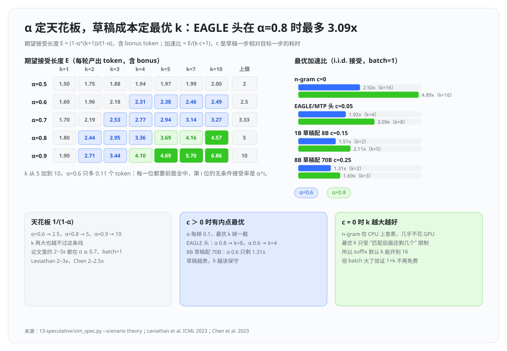
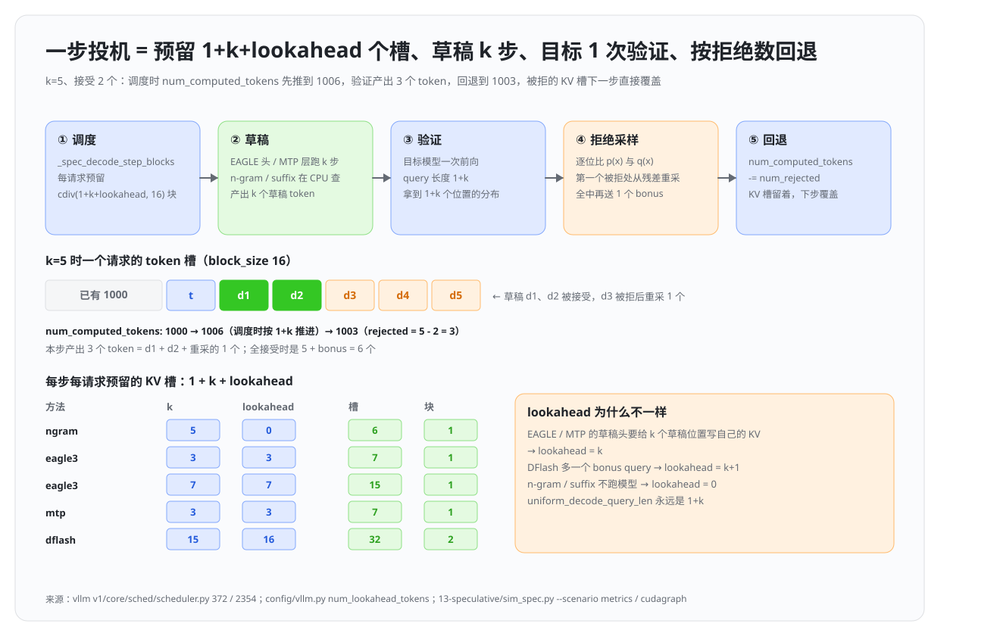
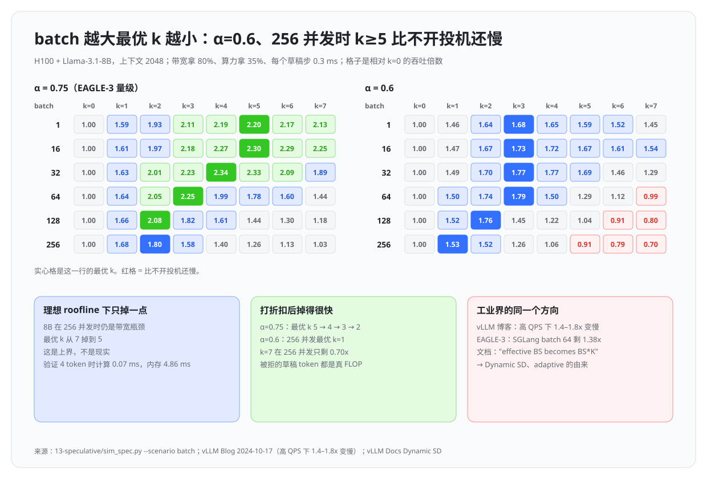
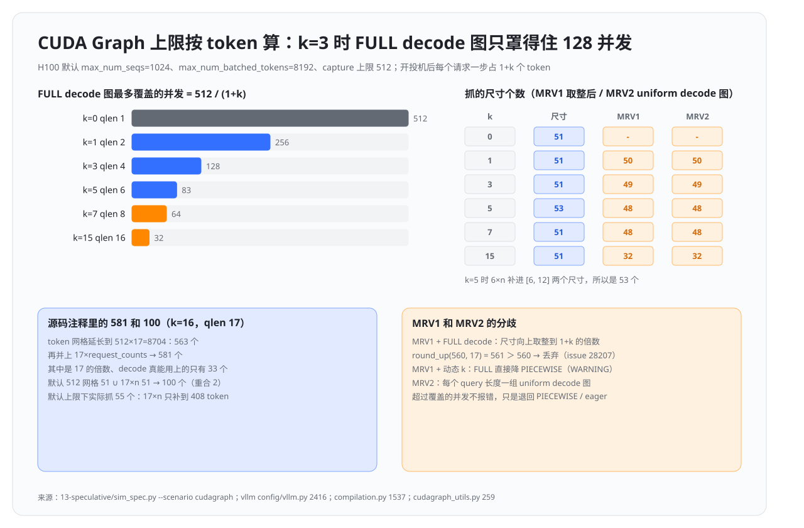
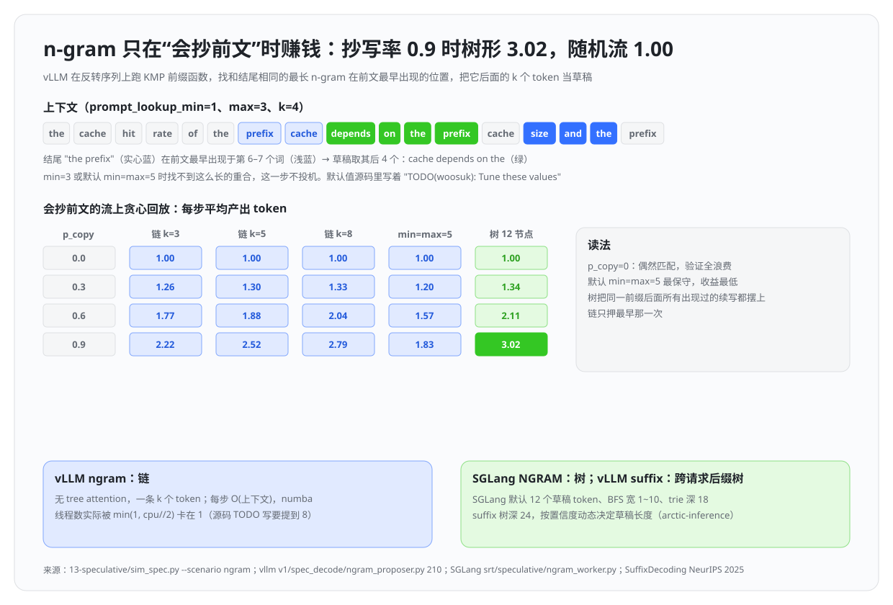
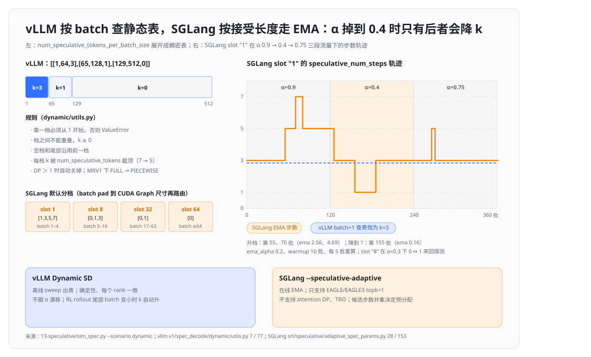
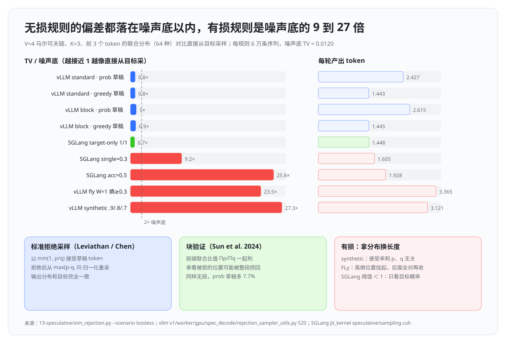
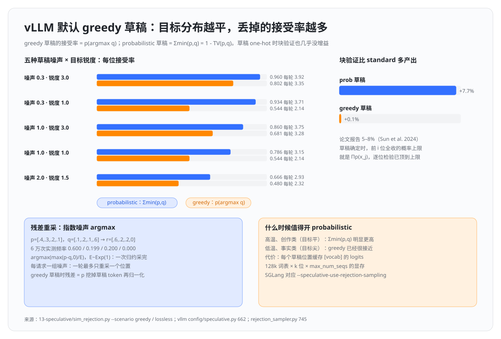
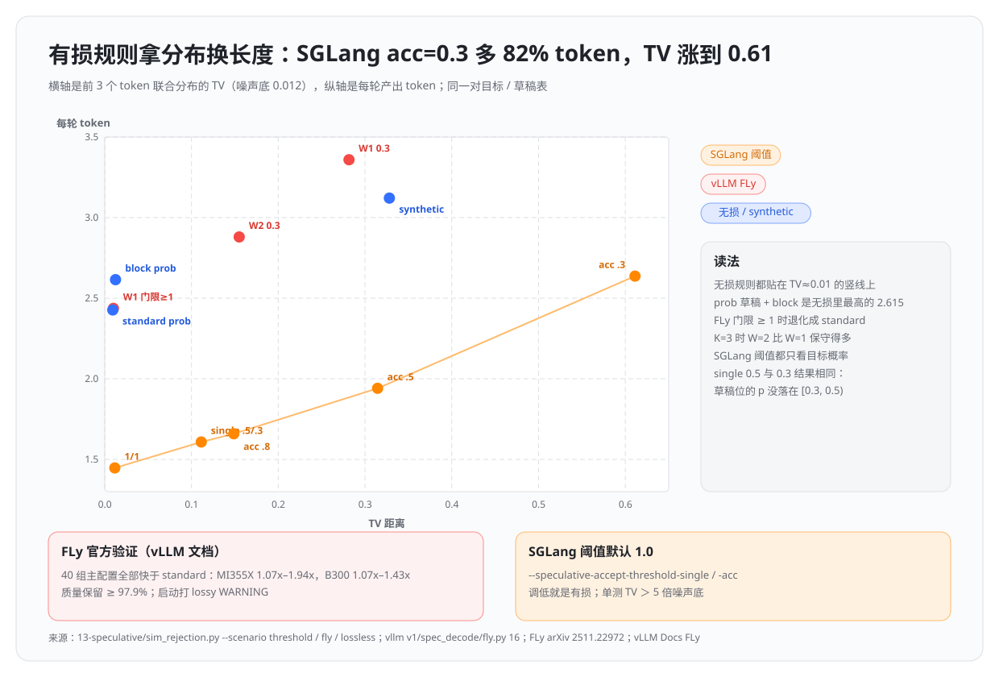
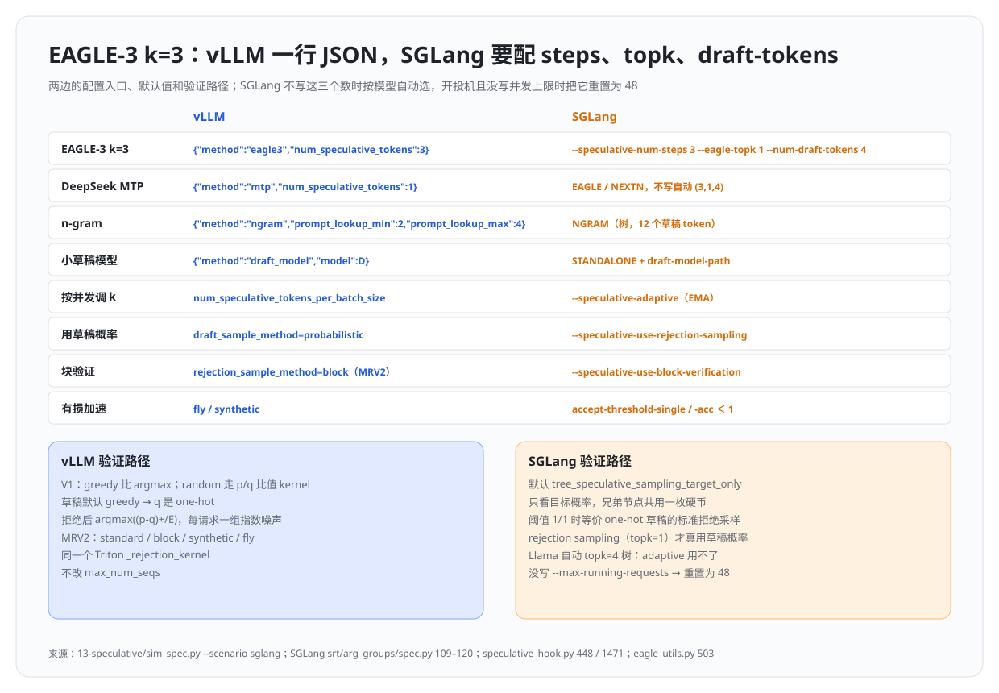

# VLLM-13｜规模｜投机解码：EAGLE、MTP、n-gram 与拒绝采样

> 🎯 **这篇文档解决什么问题**：同一个 EAGLE-3 草稿头，单请求压测快了一倍多，上线到 256 并发后吞吐反而比不开还低。把 n-gram 照文档示例写上 `prompt_lookup_max: 4`，接受长度几乎是 1。Per-position 曲线第 3 位就掉到 0.3 以下，k 却还配着 5。这些问题背后是同一本账：接受率 α 决定能多拿几个 token，草稿成本和 batch 决定这几个 token 花多少钱，拒绝采样决定输出分布还是不是原来那个。我们沿着这本账，把一步投机从调度器、提议器走到验证器，每一处都给出源码行号和模拟器数字，并和 SGLang 对照。
>
> **使用方式**：第 1 章算账。第 2 章把一步投机在调度器、提议器、验证器里的路径走一遍。第 3、4 章讲 batch 变大后 k 怎么掉、CUDA Graph 罩得住多少并发。第 5 章讲 n-gram 和 SuffixDecoding。第 6 章讲按负载调 k。第 7 到 9 章讲拒绝采样、草稿采样方式、块验证和有损规则。第 10 章是指标口径、SGLang 对照和真机实验。每章开头一张图，图里的数都来自模拟器输出或源码。
>
> **代码**：[13-speculative](../13-speculative)。sim_spec.py 有 7 个场景：期望接受长度与加速比、H100 上 batch 与最优 k 的关系、逐行移植 `_set_cudagraph_sizes` 的 CUDA Graph 尺寸、逐行移植 `ngram_proposer.py` 的 KMP 匹配、Dynamic SD 查表与 SGLang adaptive 状态机、两边的指标口径、两边的参数对照。sim_rejection.py 有 5 个场景，在一条 V=4 的马尔可夫链上，用 Monte Carlo 比较 vLLM 的 standard / block / synthetic / FLy 和 SGLang 的 target-only 是否无损。17 个单测钉住闭式解、KMP 对暴力解、源码注释里的尺寸个数和各规则的 TV。spec_matrix.md 是源码行号表，serve_spec.sh 是一张 H100 上的十种起法加四种 SGLang 对照。

# 导读 · 先给结论

## 草稿头不能跨基座沿用

投机入口使用双模型，默认 TP=2、8192 上下文。外部草稿必须显式提供仓库与 40 位 DRAFT_REVISION；固定版本不证明接口兼容。当前配置提供 mtp 候选入口；v0.32.0 有 Qwen3.5 稠密与 MoE 的 MTP 映射，拒绝采样枚举不含 fly，因此 fly 启动分支停止，历史算法模拟保留[[vLLM v0.32.0 SpeculativeConfig]](https://github.com/vllm-project/vllm/blob/v0.32.0/vllm/config/speculative.py)。这些配置尚无新增双模型 GPU 验证。

比较不开投机与不同 k 时，同时记录接受长度、按位置接受率、质量、GDN 回滚状态和额外显存。synthetic 只适合机制模拟，FLy 的有损结果不得混入无损基线。旧 Llama 接受率曲线保持原归属。

双模型结构以固定版本配置核对[[Qwen3.8-27B config.json]](https://huggingface.co/Qwen/Qwen3.8-27B/blob/37561816e66b5b9153b1b64c10968c18c1e6f4a0/config.json)[[Qwen3.5-35B-A3B config.json]](https://huggingface.co/Qwen/Qwen3.5-35B-A3B/blob/59d61f3ce65a6d9863b86d2e96597125219dc754/config.json)。

1. **α 定天花板，草稿成本定最优 k。**每个草稿 token 独立以 α 被接受时，一轮期望产出 (1-α^(k+1))/(1-α) 个 token，k 再大也越不过 1/(1-α)。α=0.8 时 EAGLE 量级的草稿头（一步成本是目标的 5%）最多 3.09x，最优 k=8；1B 配 8B 的小草稿模型 2.11x，最优 k=5。论文里 2 到 3 倍的数，基本都是 α 不低于 0.7、batch=1 测出来的。
2. **一步投机在 vLLM 里只多了三件事。**调度器每个请求多预留 1+k+lookahead 个 KV 槽。提议器在目标模型前向之后跑 k 步草稿。验证后按被拒个数把 `num_computed_tokens` 回退，被拒位置的 KV 下一步直接覆盖，不需要释放块。
3. **batch 越大，最优 k 越小，最后变成不该开。**验证 1+k 个 token “几乎免费”只在带宽瓶颈区成立。打折扣的 H100 模型里，α=0.75 时最优 k 从 batch 1 的 5 掉到 256 的 2；α=0.6、256 并发时最优 k=1，k=7 只有不开投机的 0.70。
4. **CUDA Graph 的上限按 token 算。**默认 capture 上限 512 个 token，开投机后每个请求一步占 1+k 个，k=3 时 FULL decode 图只罩得住 128 并发，k=7 是 64，k=15 是 32。超出部分不报错，只是这一步退回 PIECEWISE 或 eager。
5. **n-gram 只在“会抄前文”的负载上赚钱，默认配置还很保守。**不写窗口时 min = max = 5；只写 `prompt_lookup_max` 时 min 也等于它，和 docstring 写的“默认 1”不一样。模拟流里抄写率 0.9 时链式 k=8 每步 2.79 个 token，min=max=5 只有 1.83。
6. **vLLM 按 batch 查静态表调 k，SGLang 按接受长度在线调。**`num_speculative_tokens_per_batch_size` 只看并发，α 从 0.9 掉到 0.4 时不会动；SGLang 的 `--speculative-adaptive` 每个 BS 档一个 EMA 状态机，跟着接受长度升降步数，但只支持 topk=1。
7. **拒绝采样无损，跟草稿怎么采无关；草稿采样方式决定的是接受率。**vLLM 默认 `draft_sample_method=greedy`，接受率是 p(草稿 token)；改成 probabilistic，接受率变成 Σmin(p,q)。模拟里四个上下文 greedy 是 0.17/0.16/0.29/0.78，probabilistic 是 0.71/0.59/0.75/0.63，每轮 token 从 1.443 涨到 2.427，两者的 TV 都在噪声底以内。
8. **块验证只在 probabilistic 草稿下有用。**Sun 等人证明块验证不会比逐 token 验证差。模拟里 probabilistic 草稿多产出 7.7%，greedy 草稿只多 0.1%。vLLM 的 `block` 只有 Model Runner V2 认。
9. **有损规则拿分布换长度，要当成产品决策来做。**SGLang 把 `--speculative-accept-threshold-acc` 调到 0.3，每轮 token 多 82%，前 3 个 token 联合分布的 TV 涨到 0.61，是噪声底的 51 倍。vLLM 的 FLy 用熵门限和确认窗口约束偏差，文档里 40 组主配置全部快于 standard，质量保留不低于 97.9%。

# 第 1 章 · 先算账：α、k 和草稿成本



## 1.1 一轮能多拿几个 token

投机解码的出发点是 decode 的硬件利用率太低。batch 小时，目标模型一步要把全部权重从 HBM 读一遍，只为算出一个 token，算力大部分闲着。如果先用便宜的草稿猜 k 个 token，再让目标模型一次前向把这 k 个连同下一个位置一起算掉，读一遍权重就有机会拿到多个 token。Leviathan 等人和 Chen 等人在 2023 年分别提出了这个方法，并证明配合拒绝采样，输出分布和目标模型自回归采样完全一致[[1]](https://arxiv.org/abs/2211.17192)[[2]](https://arxiv.org/abs/2302.01318)。

账本的第一项是期望接受长度。假设每个草稿 token 独立地以概率 α 被接受，一旦某一位被拒，后面全丢；不管停在哪，目标模型都会在停下的位置补一个 token（被拒时从残差分布里重采，全中时是 bonus token）。于是一轮期望产出 E = (1-α^(k+1))/(1-α)。k 趋于无穷时 E 趋于 1/(1-α)：α=0.6 时上限 2.5，α=0.8 时 5，α=0.9 时 10。

```text
== 期望接受长度 E = (1 - α^(k+1)) / (1 - α)，含 bonus token
  α     k=1     k=2     k=3     k=4     k=5     k=7     k=10    
  0.5   1.50    1.75    1.88    1.94    1.97    1.99    2.00    
  0.6   1.60    1.96    2.18    2.31    2.38    2.46    2.49    
  0.7   1.70    2.19    2.53    2.77    2.94    3.14    3.27    
  0.8   1.80    2.44    2.95    3.36    3.69    4.16    4.57    
  0.9   1.90    2.71    3.44    4.10    4.69    5.70    6.86    
  上限 1/(1-α)：α=0.6 → 2.5，α=0.8 → 5，α=0.9 → 10。k 再大也越不过这条线。
```

这张表有两个读法。横着看，α=0.6 时 k 从 3 加到 10，E 只从 2.18 涨到 2.49，后面几位草稿几乎都白猜；α=0.9 时 k=10 还在涨。竖着看，α 每涨 0.1，同样 k=5 的接受长度从 2.38 到 2.94 再到 3.69，涨幅越来越大。草稿头的训练质量对 α 的影响，比调 k 大得多，这也是 vLLM 团队单独做 Speculators 训练框架的原因，他们给出的端到端收益在 1.5 到 3 倍之间[[3]](https://vllm.ai/blog/2025-12-13-speculators-v030)。

## 1.2 每个 token 花多少钱

账本的第二项是成本。设草稿一步耗时是目标一步的 c 倍，batch=1、验证 1+k 个 token 和验证 1 个 token 耗时相同时，一轮耗时是 k·c+1 个目标步，加速比 = E/(k·c+1)。四类草稿的 c 大致如下：n-gram 在 CPU 上查表，c≈0。EAGLE 和 MTP 是挂在目标模型上的一层 decoder，c≈0.05。1B 配 8B 的小模型约 0.15。8B 配 70B 约 0.25。

```text
== 加速比 = E / (k·c + 1)，c = 草稿一步相对目标一步的耗时
  α = 0.6
    n-gram（CPU 查表）         c=0.0   k1:1.60  k3:2.18  k5:2.38  k7:2.46   最优 k=16 → 2.50x
    EAGLE / MTP 头          c=0.05  k1:1.52  k3:1.89  k5:1.91  k7:1.82   最优 k=4  → 1.92x
    小草稿模型（1B 配 8B）         c=0.15  k1:1.39  k3:1.50  k5:1.36  k7:1.20   最优 k=2  → 1.51x
    大草稿模型（8B 配 70B）        c=0.25  k1:1.28  k3:1.24  k5:1.06  k7:0.89   最优 k=2  → 1.31x
  α = 0.8
    n-gram（CPU 查表）         c=0.0   k1:1.80  k3:2.95  k5:3.69  k7:4.16   最优 k=16 → 4.89x
    EAGLE / MTP 头          c=0.05  k1:1.71  k3:2.57  k5:2.95  k7:3.08   最优 k=8  → 3.09x
    小草稿模型（1B 配 8B）         c=0.15  k1:1.57  k3:2.04  k5:2.11  k7:2.03   最优 k=5  → 2.11x
    大草稿模型（8B 配 70B）        c=0.25  k1:1.44  k3:1.69  k5:1.64  k7:1.51   最优 k=3  → 1.69x
  c = 0 时最优 k 永远是上限（再多也不亏），所以 n-gram 的 k 只受 "匹配后面还有几个 token" 限制；
  c > 0 时有内点最优：α 每降 0.1，最优 k 掉一截。论文里的 2~3x 都是 α ≥ 0.7、batch = 1 的数。
```

c=0 时 E 随 k 单调增，最优 k 永远是上限，表里 n-gram 的“k=16”只是模拟器设的上限；n-gram 的实际约束是匹配位置后面还剩几个 token，以及高并发下验证的算力开销，第 3、5 章再算。c 大于 0 时出现内点最优：α=0.8 时 EAGLE 最优 k=8、3.09x，8B 配 70B 最优 k=3、1.69x；α 掉到 0.6，EAGLE 最优 k 降到 4、1.92x，8B 配 70B 只剩 1.31x。

vLLM 文档开头就把适用范围写成了“medium-to-low QPS、memory-bound workloads”，方法表里 EAGLE、MTP 在低 QPS 下标“High gain”，n-gram 和 suffix 标“Low to medium gain”[[4]](https://docs.vllm.ai/en/latest/features/speculative_decoding/)。这张表是定性的，上面的公式给出了量级：同样 α，草稿越便宜，最优 k 越大，能逼近的上限越高。但这还没算 batch，batch=1 的结论放到线上会差很多。

# 第 2 章 · 一步投机在 vLLM 里怎么走



## 2.1 调度器：多预留几个 KV 槽

开投机以后，一个 decode 请求这一步要喂给目标模型的，是上一轮留下的 1 个 token 加 k 个草稿。调度器在 [scheduler.py](https://github.com/vllm-project/vllm/blob/0d6f92a/vllm/v1/core/sched/scheduler.py) 372 行算每个请求要预留的槽：`1 + num_spec_tokens + num_lookahead_tokens`，再按 block_size 向上取整，Mamba 层的状态块另算。lookahead 留给草稿模型自己：EAGLE 草稿头要给 k 个草稿位置写自己那一层的 KV，所以 lookahead = k。DFlash 有一个额外的 bonus query，是 k+1。n-gram 和 suffix 不跑模型，是 0（[vllm.py](https://github.com/vllm-project/vllm/blob/0d6f92a/vllm/config/vllm.py) 641 行 `num_lookahead_tokens`）。

```text
== 每步每请求预留的 KV 块（block_size 16）：1 + k + lookahead
  ngram   k=5   lookahead=0   →   6 个 slot = 1 块
  eagle3  k=3   lookahead=3   →   7 个 slot = 1 块
  eagle3  k=7   lookahead=7   →  15 个 slot = 1 块
  mtp     k=3   lookahead=3   →   7 个 slot = 1 块
  dflash  k=15  lookahead=16  →  32 个 slot = 2 块
  EAGLE 的草稿头要给 k 个草稿位置写自己的 KV，所以 lookahead = k；DFlash 多一个 bonus query，lookahead = k+1。
  uniform_decode_query_len 永远是 1+k（不是 1+lookahead）：DFlash 预留 k+1 个 slot，但验证只有 1+k 个 token。
```

block_size=16 时，k 不超过 7 的常见配置每步都只多占 1 个块，DFlash k=15 占 2 个。影响 KV 容量的主要是并发，这一步的预留占不了多少：每个请求都要按最坏情况预留，KV 余量紧的部署里，开投机会让可调度的并发略降一点。

## 2.2 提议器：一个基类，四类草稿

vLLM 的 `method` 字段在 [speculative.py](https://github.com/vllm-project/vllm/blob/0d6f92a/vllm/config/speculative.py) 77 行定义成一个 Literal：ngram、draft_model、suffix、custom_class、eagle、eagle3、dflash、dspark、ngram_gpu，外加 29 个 MTP 类型（deepseek_mtp、qwen3_5_mtp、gemma4_mtp 等）。模型类的提议器都继承 [llm_base_proposer.py](https://github.com/vllm-project/vllm/blob/0d6f92a/vllm/v1/spec_decode/llm_base_proposer.py) 里的 `SpecDecodeBaseProposer`，[eagle.py](https://github.com/vllm-project/vllm/blob/0d6f92a/vllm/v1/spec_decode/eagle.py) 第 10 行的 `EagleProposer` 只是把 `pass_hidden_states_to_model` 设成 True。EAGLE、EAGLE-3、MTP 共用这一条路径，区别只在草稿网络的输入是什么。

| 方法 | 草稿从哪来 | vLLM 里的关键点 | 依据 |
|-|-|-|-|
| EAGLE | 目标模型最后一层 hidden state + 已采 token 的 embedding，过一层 decoder | `pass_hidden_states_to_model=True`；embedding、lm_head 能共享就共享（llm_base_proposer.py 1421 / 1513） | Li 等人 2024[[5]](https://arxiv.org/abs/2401.15077) |
| EAGLE-3 | 目标模型低、中、高三层 hidden state 融合 | 默认取第 2、L/2、L-3 层（interfaces.py 1751），Llama-3.1-8B 是 2、16、29 | Li 等人 2025[[6]](https://arxiv.org/abs/2503.01840) |
| MTP | checkpoint 自带的多 token 预测层 | 不写 model，用目标 checkpoint 里的 MTP 层；Gemma 4 assistant 也走 mtp | vLLM Docs[[7]](https://docs.vllm.ai/en/latest/features/speculative_decoding/mtp/) |
| draft_model | 独立的小模型 | 词表、TP 必须和目标一致，否则启动报错；lookahead = k | vLLM Docs[[4]](https://docs.vllm.ai/en/latest/features/speculative_decoding/) |
| PARD / P-EAGLE | 一次前向出全部 k 个草稿 | `parallel_drafting: true`；EAGLE 的并行草稿 MRV2 还不支持，会回退 MRV1 | An 等人 2025[[8]](https://arxiv.org/abs/2504.18583)；vLLM Blog[[9]](https://vllm.ai/blog/2026-03-13-p-eagle) |
| ngram / suffix | 前文或历史输出里查表 | CPU 上跑，不占 GPU；第 5 章 | vLLM Docs[[10]](https://docs.vllm.ai/en/latest/features/speculative_decoding/n_gram/)[[11]](https://docs.vllm.ai/en/latest/features/speculative_decoding/suffix/) |

草稿是一步一步串着出的。`propose`（511 行）先用目标模型的 hidden state 跑一次草稿前向拿到第 1 个草稿，628 行判断：k=1 或者开了 parallel_drafting 就直接返回，否则进入循环，每步把上一个草稿 token 当输入再跑一次，共 k-1 次。这就是 c 的来源：EAGLE 草稿头一步很便宜，但 k=7 就是 7 次串行的 kernel 序列，batch 小时 kernel launch 和调度开销本身就是成本。P-EAGLE 把 k 次串行改成一次前向，在 B200 上的 GPT-OSS-20B 上比 EAGLE-3 快 1.05x 到 1.69x；MT-Bench 上并发 1 时快 1.55x，并发 64 时只剩 1.05x[[9]](https://vllm.ai/blog/2026-03-13-p-eagle)。并发越高，草稿那几次串行前向占一步总时间的比例越小，这个规律和第 3 章算的一样。

草稿头也在迭代。EAGLE 3.1 主要解决长上下文和 chat template 变化下接受长度不稳的问题，长上下文负载上接受长度最多是 EAGLE-3 的 2 倍。在 GB200 上 TP=4 的 Kimi-K2.6-NVFP4 上测 SPEED-Bench coding，单用户输出吞吐在并发 1 时提高到 2.03 倍，并发 4 时 1.71 倍，并发 16 时 1.66 倍[[12]](https://vllm.ai/blog/2026-05-26-eagle-3-1)。Medusa 走的是另一条路：在目标模型上挂多个头各自预测第 i 个 token，用树注意力一次验证多条候选[[13]](https://arxiv.org/abs/2401.10774)。vLLM 主干里已经没有 Medusa 的 method，树形验证是 SGLang 的强项，第 10 章对照。

## 2.3 验证与回退

目标模型对 1+k 个位置一次前向，拿到 1+k 份 logits，交给拒绝采样器（第 7 章）决定接受到第几位。接受 j 个草稿时，这一步实际产出 j+1 个 token。调度器在 2354 行做回退：`num_rejected = num_draft_tokens - num_accepted`，`num_computed_tokens -= num_rejected`。

```text
== 拒绝后的账（v1/core/sched/scheduler.py:2354）：k=5、接受 2 个
  调度时 num_computed_tokens 先按 1+k 推进到 1006；验证产出 3 个 token（2 草稿 + 1 bonus），
  rejected = 5 - 2 = 3，num_computed_tokens 回退到 1003；被拒位置的 KV 槽下一步直接覆盖。
```

被拒位置的 KV 已经写进了块里，但它们落在新的 `num_computed_tokens` 之后，下一步重新调度时，新的 token 会写到同样的槽位上，把它们覆盖掉。这一点和 PagedAttention 的设计是配合好的：块只按“已计算到哪”来解读，块里多写的内容不需要擦掉[[14]](https://arxiv.org/abs/2309.06180)。所以拒绝不触发块的分配和释放，开销只有那几个被浪费的 FLOP。

# 第 3 章 · batch 变大以后：最优 k 往下掉



## 3.1 验证为什么不再免费

第 1 章的公式默认“验证 1+k 个 token 和验证 1 个 token 一样快”。这在 batch=1 时成立：Llama-3.1-8B 一步要读 16 GB 权重，H100 上约 4.86 ms，而 4 个 token 的计算量只要 0.07 ms。batch 变大后，一次前向要处理 batch×(1+k) 个 token，计算项按这个数线性涨，权重读取不变。H100 的拐点约 295 FLOP/B，只读权重时一次前向大约要 295 个 token 才吃满算力[[15]](https://arxiv.org/abs/2402.16363)。batch=64、k=3 时验证就是 256 个 token，已经贴着拐点。

```text
== Llama-3.1-8B @ H100 SXM，平均上下文 2048，α = 0.75（EAGLE-3 量级），理想 roofline
  目标模型 8.0B 参数，权重 16.0 GB；KV 128 KB/token
  草稿头 0.40B 参数（1 层 decoder + 融合层 + 32k 词表 lm_head），KV 4 KB/token
  H100 拐点 295 FLOP/B；只读权重时，一次前向要 ~295 个 token 才吃满算力（2 FLOP/参数 vs 2 B/参数）
  显存（util 0.9）最多放 209 个这样的请求，超过的行标 *

  batch  k=0     k=1     k=2     k=3     k=4     k=5     k=6     k=7     最优 k   t_target(k=0)  草稿/目标
     1   1.00    1.67    2.10    2.38    2.55    2.63    2.67    2.67    7          4.86 ms      0.050
     4   1.00    1.67    2.11    2.39    2.55    2.64    2.68    2.68    7          5.10 ms      0.049
    16   1.00    1.67    2.12    2.40    2.58    2.67    2.72    2.72    7          6.06 ms      0.046
    32   1.00    1.68    2.13    2.42    2.60    2.70    2.75    2.76    7          7.34 ms      0.043
    64   1.00    1.68    2.14    2.44    2.63    2.74    2.79    2.81    7          9.90 ms      0.040
   128   1.00    1.69    2.15    2.46    2.66    2.77    2.77    2.51    5         15.03 ms      0.037
   192   1.00    1.69    2.16    2.47    2.67    2.79    2.54    2.30    5         20.16 ms      0.036
   256*  1.00    1.69    2.16    2.48    2.68    2.69    2.42    2.19    5         25.29 ms      0.035
  （表内是相对 k=0 的吞吐倍数；同一 batch 下的 ITL 倍数与之相同）

== 为什么会掉：把 k=3 拆开看内存项和计算项
  batch   1: 验证    4 token  内存   4.86 ms  计算   0.07 ms  → 带宽瓶颈；k=0 时计算  0.02 ms
  batch  32: 验证  128 token  内存   7.34 ms  计算   2.21 ms  → 带宽瓶颈；k=0 时计算  0.55 ms
  batch  64: 验证  256 token  内存   9.90 ms  计算   4.42 ms  → 带宽瓶颈；k=0 时计算  1.10 ms
  batch 128: 验证  512 token  内存  15.03 ms  计算   8.84 ms  → 带宽瓶颈；k=0 时计算  2.21 ms
  batch 256: 验证 1024 token  内存  25.29 ms  计算  17.68 ms  → 带宽瓶颈；k=0 时计算  4.42 ms
  理想 roofline 下 8B 模型在 256 并发时仍是带宽瓶颈，所以最优 k 只从 7 掉到 5——这是上界，不是现实。

== 打折扣：带宽拿到 80%、算力只拿到 35%（大 batch decode 的典型 MFU）、每个草稿步固定 0.3 ms
  α = 0.75
  batch  k=0     k=1     k=2     k=3     k=4     k=5     k=6     k=7     最优 k
     1   1.00    1.59    1.93    2.11    2.19    2.20    2.17    2.13    5
    16   1.00    1.61    1.97    2.18    2.27    2.30    2.29    2.25    5
    32   1.00    1.63    2.01    2.23    2.34    2.33    2.09    1.89    4
    64   1.00    1.64    2.05    2.25    1.99    1.78    1.60    1.44    3
   128   1.00    1.66    2.08    1.82    1.61    1.44    1.30    1.18    2
   256   1.00    1.68    1.80    1.58    1.40    1.26    1.13    1.03    2
  α = 0.6
  batch  k=0     k=1     k=2     k=3     k=4     k=5     k=6     k=7     最优 k
     1   1.00    1.46    1.64    1.68    1.65    1.59    1.52    1.45    3
    16   1.00    1.47    1.67    1.73    1.72    1.67    1.61    1.54    3
    32   1.00    1.49    1.70    1.77    1.77    1.69    1.46    1.29    3
    64   1.00    1.50    1.74    1.79    1.50    1.29    1.12    0.99    3
   128   1.00    1.52    1.76    1.45    1.22    1.04    0.91    0.80    2
   256   1.00    1.53    1.52    1.26    1.06    0.91    0.79    0.70    1
  α 掉到 0.6、batch 256 时最优 k=1，k ≥ 5 直接比不开投机还慢——和 vLLM 博客 "高 QPS 下 1.4~1.8x 变慢" 同一个方向。
  验证 1+k 个 token 的 "免费" 只在带宽瓶颈区成立；一旦 batch·(1+k) 越过拐点，被拒的草稿 token 都是真金白银的 FLOP。
  这就是 vLLM 文档里 "effective BS becomes BS*K" 的意思，也是 Dynamic SD 和 SGLang adaptive 存在的理由。
```

理想 roofline 下（第一张表），8B 模型到 256 并发仍是带宽瓶颈，最优 k 只从 7 掉到 5，这是上界。实际大 batch decode 拿不到峰值算力，打折扣以后（带宽 80%、算力 35%、每个草稿步固定 0.3 ms）情况就不一样了：α=0.75 时最优 k 按 batch 1、16、32、64、128、256 依次是 5、5、4、3、2、2；α=0.6 时 256 并发最优 k=1，k 不小于 5 就比不开投机慢，k=7 只有 0.70。

## 3.2 线上数据和论文怎么说

vLLM 2024 年的博客给过一组真机数据：Llama3-70B 在 4 张 H100 上，QPS=1 时 ShareGPT 用小草稿模型快 1.5 倍，CNN/DailyMail 用 n-gram 快 2.8 倍；QPS 拉高以后两者分别变成 1.4 倍和 1.8 倍的减速[[16]](https://vllm.ai/blog/2024-10-17-spec-decode)。动态投机的文档把原因写得很直接：batch 变大后“effective BS becomes BS\*K”，越过临界 batch 就拖慢 TPOT[[17]](https://docs.vllm.ai/en/latest/features/speculative_decoding/dynamic_speculative_decoding/)。

MagicDec 是反方向的证据。它指出长上下文下 decode 的瓶颈从权重变成了 KV：每个请求每步都要读一遍自己的 KV，batch 越大 KV 读得越多，系统一直留在带宽瓶颈区，验证仍然便宜。它用稀疏 KV 的草稿，在 Llama3.1-8B 上 batch 32 到 256 的长序列里拿到 2.51 倍[[18]](https://arxiv.org/abs/2408.11049)。这和上面的模拟并不矛盾：模拟设的上下文是 2048，KV 项小；上下文到 32k 以上时内存项膨胀，拐点往右移，最优 k 掉得慢。判断一个部署该不该开投机，要同时看 batch 和平均上下文长度，只看 QPS 不够。

落到操作上，规律是：先用 batch=1 测出 α 和最优 k，再按线上的并发分布压一遍 1、16、64、256，找到投机开始变成负收益的并发，再决定用固定的小 k 还是第 6 章的动态 k。

# 第 4 章 · CUDA Graph：开投机以后罩得住多少并发



## 4.1 上限按 token 算

VLLM-09 讲过，decode 的 CUDA Graph 按 token 数抓一组尺寸，运行时把 batch 补齐到最近的尺寸重放。开投机后每个请求一步占 1+k 个 token，尺寸表的含义就变了。[vllm.py](https://github.com/vllm-project/vllm/blob/0d6f92a/vllm/config/vllm.py) 2416 行的 `_set_cudagraph_sizes` 把上限设成 min(max_num_seqs×(1+k)×2, 512)（SM100 是 1024），网格是默认的 1、2、4、8、16、24…再并上 (1+k) 的整数倍。

```text
== H100 默认 max_num_seqs=1024、max_num_batched_tokens=8192（API server），capture 上限 512
  k   qlen  尺寸个数  最大尺寸  MRV1 取整后个数  MRV1 FULL decode 最多覆盖并发   MRV2 uniform decode 图个数  最多覆盖并发
  0   1     51        512       -                512                            -                           -
  1   2     51        512       50               256                            50                          256
  3   4     51        512       49               128                            49                          128
  5   6     53        512       48               83                             48                          83
  7   8     51        512       48               64                             48                          64
  15  16    51        512       32               32                             32                          32
  读法：capture 上限按 token 算（512），开投机后每个请求一步占 1+k 个 token，FULL decode 图能覆盖的并发直接除以 1+k。
  超过的并发不会报错，只是这一步退回 PIECEWISE / eager；k 越大，越早掉出 FULL 图。

== k=3 时实际抓的尺寸（前 40 个）
   [1, 2, 4, 8, 16, 24, 32, 40, 48, 56, 64, 72, 80, 88, 96, 104, 112, 120, 128, 136, 144, 152, 160, 168, 176, 184, 192, 200, 208, 216, 224, 232, 240, 248, 256, 272, 288, 304, 320, 336]
  MRV1 取整到 4 的倍数： [4, 8, 16, 24, 32, 40, 48, 56, 64, 72, 80, 88, 96, 104, 112, 120, 128, 136, 144, 152, 160, 168, 176, 184] ...
  k=3 时 uniform_decode_sizes（4 × request_counts）全部落在默认网格上，额外尺寸 []；k=5 时 6 × n 补进来 [6, 12]，所以是 53 个。

== 源码注释里的两个数（config/vllm.py _set_cudagraph_sizes）
  "581 sizes"：token 网格延长到 512×17=8704 有 563 个，再并上 17×request_counts → 581 个；其中是 17 倍数、真能被 decode 用上的只有 33 个网格点。
  "100 with the request-count grid"：默认 512 网格 51 个 ∪ 17×request_counts 51 个 → 100 个（两者重合 2 个）。
  默认上限 512 下真正抓的是 55 个：17×n 只补到 n=24（408 token），更宽的 decode 走 eager，除非手动放大 capture 范围。
  "at query length 17 a captured 560 rounds to 561 and is rejected"：round_up(560, 17) = 561 > 560。

== 动态 SD（文档示例 [[1,64,3],[65,128,1],[129,512,0]]，max_num_seqs=512，k=3）
  按档补尺寸：51 个；只按最宽档 qlen=4 补：51 个
  MRV2 qlen=1: 按档  51 个图，最多覆盖 512 个请求；只按最宽档补  51 个图，最多覆盖 512 个请求
  MRV2 qlen=2: 按档  50 个图，最多覆盖 256 个请求；只按最宽档补  50 个图，最多覆盖 256 个请求
  MRV2 qlen=4: 按档  49 个图，最多覆盖 128 个请求；只按最宽档补  49 个图，最多覆盖 128 个请求
  MRV1 下动态 SD 直接把 FULL 改成 PIECEWISE（config/vllm.py:1084 的 WARNING），只有 MRV2 才按档抓 FULL 图。
```

上限是 512 个 token，换成请求数要除以每条请求的 token 数。k=3 时 FULL decode 图最多罩 128 个并发，k=7 只有 64，k=15 只有 32。更大的并发不会报错，这一步只是退回 PIECEWISE 或 eager，TPOT 会出现一个台阶，在 bench 曲线上很容易被误读成“投机在高并发下变慢”。要区分，看 profiler 里这一步有没有 graph replay，或者调大 `max_cudagraph_capture_size` 再测一次。

## 4.2 MRV1 和 MRV2 的差别

V1 model runner 下，FULL decode 图要求每个请求的 query 长度都等于 1+k。[compilation.py](https://github.com/vllm-project/vllm/blob/0d6f92a/vllm/config/compilation.py) 1537 行的 `adjust_cudagraph_sizes_for_spec_decode` 把尺寸取整到 (1+k) 的倍数，超过上限的丢掉，k=3 时 51 个尺寸剩 49 个。源码注释里的“at query length 17 a captured 560 rounds to 561 and is rejected”说的就是这件事。MRV2 在 [cudagraph_utils.py](https://github.com/vllm-project/vllm/blob/0d6f92a/vllm/v1/worker/gpu/cudagraph_utils.py) 259 行，按 query 长度分组抓 uniform decode 图，动态 k 下每一档一组[[19]](https://vllm.ai/blog/2026-03-24-mrv2)。

动态 k 在 MRV1 下有一个代价：每步的 query 长度会变，FULL 图没法复用，[vllm.py](https://github.com/vllm-project/vllm/blob/0d6f92a/vllm/config/vllm.py) 1084–1100 行直接把 `cudagraph_mode` 从 FULL 降成 PIECEWISE，并打一条 WARNING 建议改用 `VLLM_USE_V2_MODEL_RUNNER=1`。MRV2 是这个提交上的默认 runner，只有遇到它不支持的特性（suffix、custom_class、EAGLE 的 parallel_drafting、异构词表草稿）才回退到 V1，启动日志会写原因。

# 第 5 章 · n-gram 和 SuffixDecoding：不训练的草稿



## 5.1 KMP 找最长后缀匹配

n-gram（prompt lookup）的想法很朴素：如果当前结尾的几个 token 在前文出现过，就把那次出现后面的 k 个 token 当草稿[[10]](https://docs.vllm.ai/en/latest/features/speculative_decoding/n_gram/)。代码改写、摘要、RAG 引用、多轮对话里重复上一轮的内容，都是这种模式。[ngram_proposer.py](https://github.com/vllm-project/vllm/blob/0d6f92a/vllm/v1/spec_decode/ngram_proposer.py) 210 行的 `_find_longest_matched_ngram_and_propose_tokens` 把序列反转，在反转后的序列上算 KMP 前缀函数，一遍扫描就找到“和结尾相同的最长 n-gram”，长度相同时取最早的那次。

```text
== KMP：在反转后的序列上算前缀函数，找 "和结尾相同的最长 n-gram" 在前文的最早位置
  上下文： the cache hit rate of the prefix cache depends on the prefix cache size and the prefix
  prompt_lookup_min=1 max=3, k=4 → 草稿 ['cache', 'depends', 'on', 'the']
  prompt_lookup_min=2 max=2, k=4 → 草稿 ['cache', 'depends', 'on', 'the']
  prompt_lookup_min=3 max=5, k=4 → 草稿 （无匹配，这步不投机）
  prompt_lookup_min=5 max=5, k=4 → 草稿 （无匹配，这步不投机）
  默认 min = max = 5（config/speculative.py，"TODO(woosuk): Tune these values"）：只有 5-gram 完全重合才出草稿。
  只写 prompt_lookup_max=4（文档示例）时，1393 行把 min 也设成 4：docstring 写 "Defaults to 1"，代码是 min = max。
  想要 "找不到 4-gram 就退到更短的"，必须显式写 prompt_lookup_min，例如 min=2、max=4。

== 复杂度：每步 O(上下文长度)，numba 并行；8192 token 以上才开多线程（num_tokens_threshold）
  注意源码里 num_numba_thread_available = min(1, cpu_count // 2)，再除以 TP，实际上限 1 线程（TODO 写着要提到 8）。

== "会抄前文" 的流（600 token，词表 50，60% 概率抄一段 4~20 token 的历史）上贪心回放，每步平均产出 token
  p_copy  链式 k=3   链式 k=5   链式 k=8   min=max=5   树 12 节点 min=2
  0.0     1.00       1.00       1.00       1.00        1.00
  0.3     1.26       1.30       1.33       1.20        1.34
  0.6     1.77       1.88       2.04       1.57        2.11
  0.9     2.22       2.52       2.79       1.83        3.02
  p_copy = 0 时几乎没有收益（随机流里偶然匹配），这时验证 1+k 个 token 的计算全浪费——高 QPS 下就是负收益。
  树形草稿在 "同一个前缀后面跟过不同内容" 时更稳：链式只押最早那次出现，树把所有出现过的后续都摆上去。
  SGLang 的 NGRAM 就是树：默认 12 个草稿 token、BFS 宽度 1~10、trie 深度 18，只看输入和输出最后 18 个 token；
  vLLM 的 ngram 是链：没有 tree attention，一条草稿 k 个 token。
```

## 5.2 默认窗口的坑

窗口的默认值在 [speculative.py](https://github.com/vllm-project/vllm/blob/0d6f92a/vllm/config/speculative.py) 1384–1400 行。两个都不写时 min = max = 5，注释是“TODO(woosuk): Tune these values. They are arbitrarily chosen.”；只写 `prompt_lookup_max` 时 1393 行把 min 也设成 max。字段的 docstring 写的是“Defaults to 1”，和代码不一致。文档示例只写了 `prompt_lookup_max: 4`，照抄的结果是只认 4-gram 完全重合，找不到就这一步不投机。想要“找不到长的就退到短的”，必须显式写 min。模拟流里抄写率 0.9 时，min=max=5 每步 1.83 个 token，min=1、链式 k=8 是 2.79。

还有两处要知道。一是 48 行的线程数 `min(1, cpu_count // 2)` 再除以 TP，实际上限是 1 个 numba 线程，注释里写着要提到 8；8192 token 以上才开多线程（36 行）。长上下文、大 batch 时 n-gram 的 CPU 时间会冒出来，这时可以试 `ngram_gpu`。二是抄写率为 0 时 n-gram 几乎没有收益，但每步仍要验证 1+k 个 token，低负载下浪费的只是闲置的算力，高 QPS 下就是负收益。

## 5.3 链和树

vLLM 的 ngram 是链：一条草稿 k 个 token，没有树注意力。SGLang 的 NGRAM 是树：默认 12 个草稿 token、BFS 宽度 1 到 10、trie 深度 18，同一个前缀后面出现过不同内容时，把它们都摆上去一起验证[[20]](https://github.com/sgl-project/sglang/blob/8fabf5e/python/sglang/srt/speculative/ngram_worker.py)。模拟器把所有历史匹配的后续合并成一棵 trie（这是简化模型，没有移植 SGLang 的 C++ 实现），抄写率 0.9 时树每步 3.02 个，比链式 k=8 的 2.79 多 8%。代价是树注意力的 mask 和更多的验证 token，在 batch 大时更早吃到第 3 章的算力墙。

## 5.4 SuffixDecoding

SuffixDecoding 在 n-gram 上走了两步：匹配范围从当前请求扩展到所有历史请求的输出，用后缀树组织；每个候选按出现频率打分，草稿深度按匹配的置信度动态决定。它针对的是 agent 类负载，同一个工作流反复生成结构相似的内容，论文在 SWE-Bench 和 Text-to-SQL 上最高 5.3 倍，比 EAGLE-2/3 快 2.8 倍[[21]](https://arxiv.org/abs/2411.04975)。vLLM 通过 arctic-inference 接入（`method: suffix`，要求 arctic-inference==0.1.1），树深度默认 24，k 不写时取树深度，文档建议 k 设到 16 以上[[11]](https://docs.vllm.ai/en/latest/features/speculative_decoding/suffix/)。它不在 MRV2 的支持列表里，开了就会回退 V1 runner。

# 第 6 章 · 按负载调 k：静态表、EMA 和自适应验证



## 6.1 vLLM 的静态表

第 3 章的结论是最优 k 随 batch 变。vLLM 的 Dynamic SD 让你写一张表：`num_speculative_tokens_per_batch_size: [[1,64,3],[65,128,1],[129,512,0]]`，并发在哪个区间就用哪个 k，k=0 就是这一步不投机。文档给的两个场景是并发波动大的在线服务，和 RL rollout 的长尾阶段（batch 从大变小，k 应该跟着变大）[[17]](https://docs.vllm.ai/en/latest/features/speculative_decoding/dynamic_speculative_decoding/)。

[utils.py](https://github.com/vllm-project/vllm/blob/0d6f92a/vllm/v1/spec_decode/dynamic/utils.py) 第 7 行做校验，77 行在启动时把表展开成稠密数组，调度时直接按 batch 大小下标取值。

```text
== vLLM：按 batch size 查一张静态表（启动时展开成稠密数组，调度时 dense[len(num_scheduled_tokens)]）
  [[1, 64, 3], [65, 128, 1], [129, 512, 0]] max_num_seqs=512  k=3 → 1-64:k=3  65-128:k=1  129-512:k=0
  [[1, 16, 3], [32, 128, 2]]             max_num_seqs=160  k=3 → 1-31:k=3  32-160:k=2
  [[1, 8, 7], [9, 32, 4]]                max_num_seqs=64   k=5 → 1-8:k=5  9-64:k=4
  空档（17~31）沿用前一档；尾部沿用最后一档；每档的 k 被 num_speculative_tokens 截顶（第三行 7 → 5）。
  [[2, 8, 3]]            → ValueError: The first batch-size range must start at 1 so every runtime batch size has a defined schedule.
  [[1, 8, 3], [8, 16, 1]] → ValueError: Batch-size ranges must be non-overlapping and sorted.
  [[1, 8, -1]]           → ValueError: num_speculative_tokens_per_batch_size values must be >= 0.
```

三条规则：第一档必须从 1 开始，区间不能重叠，k 不能是负数。空档和尾部沿用前一档，每一档的 k 都被 `num_speculative_tokens` 截顶，所以表里写 7 而全局 k=5 时，实际只有 5。限制也有两条：DP 大于 1 时每个 rank 各自调度，可能选出不同的 k，导致集合通信不一致，vLLM 会自动关掉动态 k；MRV1 下会把 FULL CUDA Graph 降成 PIECEWISE（第 4 章）。

**主干补充：Dense DP 可以按本地负载调 k。**上段限制保留为 0d6f92a 基线说明。2026 年 11 月 13 日合入的 2b635e9 将动态投机的 DP 限制收窄到 MoE：DP 大于 1 时，配置识别为非 MoE 的模型保留分档表，各 rank 按自己的 batch 选 k；MoE 仍清空 `num_speculative_tokens_per_batch_size`，回退到固定的 `num_speculative_tokens`，避免不同 k 使集合通信失配[[[[Spec Decode] Keep dynamic speculative decoding for dense models with DP]]](https://github.com/vllm-project/vllm/pull/67005)。这项门控以 `model_config.is_moe` 为准；模型配置缺失时仍保守禁用[[VllmConfig：动态投机与数据并行门控]](https://github.com/vllm-project/vllm/blob/2b635e9014c3914b3e881e02ee88b4ddc4d6989d/vllm/config/vllm.py)。本次仅核对源码并执行门控桩对象检查，未验证两种 Qwen 示例的投机适配、通信正确性或吞吐。

## 6.2 SGLang 的 EMA 状态机

SGLang 的 `--speculative-adaptive` 在运行时调。`srt/speculative/adaptive_spec_params.py`[[22]](https://github.com/sgl-project/sglang/blob/8fabf5e/python/sglang/srt/speculative/adaptive_spec_params.py) 28 行的默认配置分四档 BS：1、8、32、64，每档有一组候选步数；153 行的 `AdaptiveStepSlot` 对接受长度做 EMA（alpha 0.2），warmup 10 批后每 5 批重算一次，带滞回地升降一档。

```text
== SGLang：每个 BS 档一个 EMA 状态机，按观测到的接受长度调 speculative_num_steps
  默认四档 DEFAULT_ADAPTIVE_CONFIG： {'1': [1, 3, 5, 7], '8': [0, 1, 3], '32': [0, 1], '64': [0]}
  ema_alpha 0.2、warmup 10 批、每 5 批重算一次；升档门槛 ema > 当前步数 - 0.5，降档门槛 ema <= 下一档 - 0.5 + 滞回
  batch   1 → pad   1 → slot "1" candidate_steps=[1, 3, 5, 7]
  batch   3 → pad   4 → slot "1" candidate_steps=[1, 3, 5, 7]
  batch   5 → pad   8 → slot "8" candidate_steps=[0, 1, 3]
  batch   9 → pad  16 → slot "8" candidate_steps=[0, 1, 3]
  batch  31 → pad  32 → slot "32" candidate_steps=[0, 1]
  batch  33 → pad  40 → slot "32" candidate_steps=[0, 1]
  batch  48 → pad  48 → slot "32" candidate_steps=[0, 1]
  batch  60 → pad  60 → slot "32" candidate_steps=[0, 1]
  batch 100 → pad 100 → slot "64" candidate_steps=[0]
  batch 5 被 pad 到 8 → 落 slot "8"；batch 3 pad 到 4 → slot "1"。≥64 只有 [0]：大 batch 直接关掉投机。

== slot "1" 的轨迹：先 120 批 α=0.9，再 120 批 α=0.4，再 120 批 α=0.75（初始 steps=3，SGLang 自动参数的默认）
  第  55 批：steps 3 -> 5（ema_accept_len=2.56）
  第  70 批：steps 5 -> 7（ema_accept_len=4.69）
  第  80 批：steps 7 -> 5（ema_accept_len=3.65）
  第 125 批：steps 5 -> 3（ema_accept_len=2.17）
  第 155 批：steps 3 -> 1（ema_accept_len=0.16）
  第 185 批：steps 1 -> 3（ema_accept_len=0.79）
  第 265 批：steps 3 -> 5（ema_accept_len=2.66）
  第 270 批：steps 5 -> 3（ema_accept_len=2.11）
  对照：同样的流量 vLLM 的查表只看 batch size，batch=1 时永远是表里那个 k，不管 α 是 0.9 还是 0.4。

== slot "8"（候选 [0, 1, 3]）在 α=0.3 下会关到 0，然后每 5 批探测一次 1 步
  第  20 批：steps 3 -> 0（ema_accept_len=0.47）
  第  25 批：steps 0 -> 1（ema_accept_len=0.47）
  第  30 批：steps 1 -> 0（ema_accept_len=0.41）
  第  35 批：steps 0 -> 1（ema_accept_len=0.41）
  第  40 批：steps 1 -> 0（ema_accept_len=0.42）
  第  45 批：steps 0 -> 1（ema_accept_len=0.42）
  第  50 批：steps 1 -> 0（ema_accept_len=0.33）
  第  55 批：steps 0 -> 1（ema_accept_len=0.33）
  第  60 批：steps 1 -> 0（ema_accept_len=0.34）
  steps=0 时 EMA 不更新（没有草稿可数），所以每次重算都会 +1 去探测，再被低接受率打回 0——这就是 "关了也会周期性试一下"。

== 两种思路的边界
  vLLM Dynamic SD：离线 sweep 出 (batch 区间, k) 表；确定性、每个 DP rank 一致；不跟踪 α 漂移；DP > 1 时禁用；
                   MRV1 下把 FULL CUDA Graph 降成 PIECEWISE，MRV2 按档抓图。
  SGLang adaptive：在线 EMA；只支持 EAGLE/EAGLE3 topk=1；不支持 attention DP、TBO、pdmux、multi-layer EAGLE；
                   候选步数的并集决定要预分配多少 CUDA Graph / buffer。
```

两种做法的差别在第一段轨迹里最清楚：同样 batch=1，α 从 0.9 掉到 0.4，SGLang 在第 125 和 155 批把步数从 5 降到 3 再降到 1，vLLM 的表只看 batch，永远是那个 k。反过来，vLLM 的表是确定性的，每个 DP rank 一致，离线 sweep 一次就能用；SGLang 的状态机只支持 EAGLE/EAGLE3 的 topk=1，不支持 attention DP 和 TBO，而 Llama 系列默认 topk=4（第 10 章），要用得先改配置。

## 6.3 自适应验证：每个请求验证多少由置信度决定

Dynamic SD 和 SGLang adaptive 都是整个 batch 用同一个 k。vLLM 的 `enable_adaptive_verification` 更进一步：每一步给每个请求的每个草稿位置估一个接受概率，连乘得到“走到这一位还活着”的概率，按这个概率在全局排序，从高到低分配一个总验证预算[[23]](https://docs.vllm.ai/en/latest/features/speculative_decoding/adaptive_verification/)。总预算来自启动时 profile 的成本模型：测出不同形状下一步的耗时，选使“期望接受 token 每秒”最大的 token 数。代码在 [adaptive_verification.py](https://github.com/vllm-project/vllm/blob/0d6f92a/vllm/v1/worker/gpu/spec_decode/adaptive_verification.py) 128 行的 `assign_draft_token_budget` 和 227 行的 Manager。

置信度有两个来源：DSpark checkpoint 自带训练好的置信度头；其他草稿用一个小的 logistic 模型从草稿 logits 估计，服务时用验证结果在线校准。限制不少：要求 FULL CUDA Graph，只在 MRV2 上有，不支持 LoRA 和流水线并行；没有置信度头时不能开 `use_local_argmax_reduction`（[speculative.py](https://github.com/vllm-project/vllm/blob/0d6f92a/vllm/config/speculative.py) 1796 行会报 ValueError），因为估计器需要完整的草稿 logits。还要注意口径不一致：文档写支持 EAGLE、MTP、DFlash、DSpark 和草稿模型，配置字段的 docstring（613 行）和方法总表都写“currently DSpark only”。用之前在自己的版本上起一次服务确认。

# 第 7 章 · 拒绝采样：为什么输出分布不变



## 7.1 标准规则

设目标模型在某个位置的分布是 p，草稿是 q，草稿采出 x。以 min(1, p(x)/q(x)) 的概率接受 x。拒绝时从归一化的 max(p-q, 0) 里重采一个，这一轮到此结束。k 个全接受时再从目标的下一个位置采一个 bonus token。Leviathan 等人证明，这样得到的每个 token 的分布严格等于 p[[1]](https://arxiv.org/abs/2211.17192)。直觉是：q 比 p 大的地方草稿采多了，按比例退回；q 比 p 小的地方草稿采少了，由残差补上。

## 7.2 模拟器怎么判断“无损”

sim_rejection.py 在一条 V=4 的马尔可夫链上，给目标和草稿各一张转移表，k=3，每种规则生成 6 万条序列，统计前 3 个 token 的联合分布（64 种结果），和精确的目标分布算 TV 距离。同样条数直接从目标采样，TV 也不是 0，这个值是有限样本的噪声底，0.0120。TV 落在噪声底的 1 到 2 倍以内，就是和直接采样分不出来。

```text
== V=4 马尔可夫链，K=3 个草稿，看前 3 个 token 的联合分布（64 种结果），每种规则 60000 条序列
  每个上下文 probabilistic 接受率 Σmin(p,q)：0.71, 0.59, 0.75, 0.63
  每个上下文 greedy 草稿接受率 p(argmax q)： 0.17, 0.16, 0.29, 0.78
  噪声底（直接从 p 采 60000 次的 TV）：0.0120

  规则                                  TV        TV/噪声底      每轮 token    理论
  vLLM standard，草稿 probabilistic      0.0093    0.8         2.427       无损
  vLLM standard，草稿 greedy（默认）         0.0100    0.8         1.443       无损
  vLLM block，草稿 probabilistic         0.0124    1.0         2.615       无损
  vLLM block，草稿 greedy                0.0113    0.9         1.445       无损
  vLLM synthetic [0.9,0.8,0.7]        0.3281    27.3        3.121       有损
  vLLM fly W=1 熵≥0.3                  0.2822    23.5        3.365       有损
  SGLang target-only 阈值 1/1（默认）       0.0089    0.7         1.448       无损
  SGLang target-only acc=0.5          0.3103    25.8        1.928       有损
  SGLang target-only single=0.3       0.1108    9.2         1.605       有损

  读法：TV 落在噪声底 1~2 倍以内 = 和直接从目标模型采样分不出来；有损规则的 TV 是噪声底的好几倍。
  block 比 standard 每轮多产出：草稿 probabilistic +7.7%，草稿 greedy +0.1%。
  probabilistic 时的增益来自 "整块一起判"：前面某位单看被拒，联合比值 Πp/Πq 还可能把整段捞回来。
  greedy 时几乎没有增益：草稿是确定的，前 i 位全收的概率上限就是 Πp(x_j)，逐位检验已经顶到这个上限。
```

四条 vLLM 的无损规则和 SGLang 默认阈值，TV 都在噪声底的 0.7 到 1.0 倍；三条有损规则是噪声底的 9 到 27 倍。单测把这个判断写成了断言：无损规则低于 2.5 倍，有损规则高于 5 倍。

## 7.3 残差怎么采：指数噪声的 argmax

拒绝以后要从 max(p-q, 0) 里采样。常规做法是归一化、前缀和、二分，在 128k 的词表上每个请求都要一次完整的扫描再加一次归约。[rejection_sampler.py](https://github.com/vllm-project/vllm/blob/0d6f92a/vllm/v1/sample/rejection_sampler.py) 745 行的 `sample_recovered_tokens` 换了一种写法：每个词抽一个 Exp(1) 噪声 E，取 argmax((p-q)+ / E)。

```text
== v1/sample/rejection_sampler.py sample_recovered_tokens：argmax(max(p-q,0) · inv_q)，inv_q = 1/Exp(1)
  p = [0.4, 0.3, 0.2, 0.1]  q = [0.1, 0.2, 0.1, 0.6]
  归一化残差 r = 0.600, 0.200, 0.200, 0.000
  指数噪声 argmax 频率 = 0.600, 0.199, 0.200, 0.000（60000 次）
  原理：x 胜出的概率 = r_x / Σr（指数分布的 "最小者" 性质，等价于 Gumbel-max）。
  好处：不用做前缀和，也不用归一化，一次 argmax 归约就采完；每个请求只抽一组噪声（"Create only one distribution
  for each request"），因为一个请求一轮最多只重采一个位置。
  草稿 greedy 时 q 是 one-hot：残差 = p 把草稿那个 token 挖掉，再重新归一化。
```

原理是指数分布的“最小者”性质：E_x/r_x 是参数为 r_x 的指数变量，最小的那个落在 x 上的概率正好是 r_x/Σr，和 Gumbel-max 技巧等价。好处是不用归一化，也不用前缀和，一次 argmax 归约就采完。源码 760 行的注释“Create only one distribution for each request”也有讲究：一个请求一轮最多只在一个位置重采，所以每个请求只抽一组噪声，所有位置共用。V1 的 greedy 请求走 793 行的 `rejection_greedy_sample_kernel`，直接比 argmax；random 请求走 896 行的 `rejection_random_sample_kernel`。

# 第 8 章 · 草稿怎么采，块怎么验



## 8.1 vLLM 默认 greedy 草稿

拒绝采样对任何 q 都无损，但 q 决定接受率。vLLM 的 `draft_sample_method` 默认是 greedy（[speculative.py](https://github.com/vllm-project/vllm/blob/0d6f92a/vllm/config/speculative.py) 662 行）：草稿永远取 argmax，q 是 one-hot，接受概率就是 p(草稿 token)。改成 probabilistic，草稿按自己的分布采样，接受率变成 Σmin(p,q) = 1 - TV(p,q)。代价写在 docstring 里：要缓存每个草稿位置的完整 logits，128k 词表乘 k 乘 max_num_seqs，是实打实的显存。

```text
== 草稿 greedy（vLLM 默认 draft_sample_method）vs probabilistic：接受率谁高取决于两个分布长什么样
  probabilistic：接受率 = Σ min(p, q) = 1 - TV(p, q)；greedy：接受率 = p(argmax q)
  草稿噪声      目标锐度      prob 接受     greedy 接受   实测每轮 prob       实测每轮 greedy     
  0.3       3.0       0.960       0.802       3.915           3.354           
  0.3       1.0       0.934       0.544       3.709           2.144           
  1.0       3.0       0.860       0.681       3.754           3.284           
  1.0       1.0       0.786       0.544       3.148           2.144           
  2.0       1.5       0.666       0.480       2.932           2.316           
  目标分布越尖（低温、事实性回答），greedy 草稿越接近 probabilistic；目标越平（高温、创作），
  probabilistic 的 Σmin(p,q) 明显更高——这就是 MRV2 要缓存草稿 logits（draft_sample_method=probabilistic）的理由。
  代价：每个草稿位置存一份 [vocab] 的 logits，128k 词表 × K 位 × max_num_seqs，这是实打实的显存。
```

这张表扫了草稿噪声和目标锐度。目标越尖（低温、事实性回答），argmax q 大概率就是 p 的峰，greedy 和 probabilistic 差得不多：草稿噪声 0.3、锐度 3.0 时是 0.802 对 0.960。目标越平（高温、创作），greedy 草稿把 q 的全部质量压在一个词上，p 在那个词上可能只有 0.5，差距拉大到 0.544 对 0.934。第 7 章那张表里四个上下文的 greedy 接受率是 0.17、0.16、0.29、0.78，probabilistic 是 0.71、0.59、0.75、0.63，每轮 token 从 1.443 涨到 2.427，多 68%。

greedy 采样（temperature=0）的请求不受这个选项影响，验证直接比 argmax。所以做法很清楚：线上主要是 temperature=0 的，保持默认；主要是采样请求、并且显存有余量的，打开 probabilistic，看 Per-position 曲线是否整体上移。

## 8.2 块验证

逐 token 验证在第 i 位被拒就停，哪怕后面几位单看都很好。Sun 等人提出块验证：把整段草稿当一个整体，用联合概率比 Πp/Πq 判断，从后往前找能接受的最长前缀，并证明它是最优的，不会比逐 token 差，端到端快 5% 到 8%[[24]](https://arxiv.org/abs/2403.10444)。

模拟器复现了这个结论，也给出了一个边界：probabilistic 草稿下块验证每轮多产出 7.7%，greedy 草稿下只多 0.1%。原因是 greedy 草稿是确定的，前 i 位全收的概率上限就是 Πp(x_j)，逐位检验已经顶到这个上限，块验证没有可捞的。所以 `rejection_sample_method: block` 要和 `draft_sample_method: probabilistic` 一起开才有意义。

实现上，block 只有 MRV2 认：[rejection_sampler.py](https://github.com/vllm-project/vllm/blob/0d6f92a/vllm/v1/worker/gpu/spec_decode/rejection_sampler.py) 178 行设置 `use_block_verification`，standard、block、synthetic、fly 四种规则都在 [rejection_sampler_utils.py](https://github.com/vllm-project/vllm/blob/0d6f92a/vllm/v1/worker/gpu/spec_decode/rejection_sampler_utils.py) 520 行的同一个 `_rejection_kernel` 里，335 行算累积 log p，418 行算残差质量。V1 的采样器只分支 fly 和 synthetic，写了 block 也按 standard 跑。SGLang 对应的是 `--speculative-use-block-verification`，要求 topk=1[[25]](https://github.com/sgl-project/sglang/blob/8fabf5e/python/sglang/srt/arg_groups/spec.py)。

# 第 9 章 · 有损规则：拿分布换长度



## 9.1 SGLang 的两个阈值

SGLang 默认的验证路径是 `tree_speculative_sampling_target_only`（`srt/speculative/eagle_utils.py` 503 行[[26]](https://github.com/sgl-project/sglang/blob/8fabf5e/python/sglang/srt/speculative/eagle_utils.py)）：只看目标概率，兄弟节点累加的 prob_acc 共用一枚硬币，判断条件是 coin 小于 prob_acc/th_acc，或者 p 不小于 th_single。两个阈值默认都是 1.0，这时等价于 one-hot 草稿的标准拒绝采样，是无损的。把阈值调低，就变成“目标觉得还行就收”。

```text
== SGLang --speculative-accept-threshold-single / --speculative-accept-threshold-acc 扫描（默认都是 1.0）
  噪声底 0.0120
  single  acc     TV        每轮 token    
  1.0     1.0     0.0116    1.447       
  1.0     0.8     0.1488    1.659       
  1.0     0.5     0.3145    1.941       
  1.0     0.3     0.6112    2.637       
  0.5     1.0     0.1112    1.608       
  0.3     1.0     0.1112    1.608       
  0.3     0.5     0.3145    1.941       
  single 0.5 与 0.3 结果相同：这张表里草稿 argmax 位置的目标概率（0.17/0.16/0.29/0.78）没有落在 [0.3, 0.5)。
  acc 把接受概率从 p 抬到 min(1, p/acc)；single 让 p ≥ 阈值的草稿无条件通过。两者都只看目标概率，
  等于用 "目标觉得还行" 代替 "和目标同分布"——接受长度涨了，分布也偏了。
```

acc 从 1.0 降到 0.3，每轮 token 从 1.447 涨到 2.637，多 82%，TV 从 0.0116 涨到 0.6112，是噪声底的 51 倍。0.6 的 TV 意味着前 3 个 token 的联合分布已经和目标模型差得很远。single 0.5 和 0.3 结果相同，是因为这张表里草稿 argmax 位置的目标概率（0.17、0.16、0.29、0.78）都不在 [0.3, 0.5) 区间。阈值的效果完全取决于目标分布的形状，没法事先给一个“安全值”。

## 9.2 vLLM 的 FLy

FLy 是另一种思路：被拒的位置如果目标分布很平（top-k 熵高于门限），先不拒，往后看 W 位，后面都按标准规则通过了，就把这一位也收下[[27]](https://arxiv.org/abs/2511.22972)[[28]](https://docs.vllm.ai/en/latest/features/speculative_decoding/fly/)。它押的是：高熵位置上草稿选了别的词，往往只是同义改写，后文仍然对得上。论文在 Llama-3.1-70B 上平均加速 2.81 倍，保持 99% 以上的准确率。vLLM 的实现要求 k 不小于 2，窗口默认 min(6, k-1)，熵门限 0.3，top-k 3（[speculative.py](https://github.com/vllm-project/vllm/blob/0d6f92a/vllm/config/speculative.py) 680–687 行），熵在 [fly.py](https://github.com/vllm-project/vllm/blob/0d6f92a/vllm/v1/spec_decode/fly.py) 16 行的 `compute_fly_entropy` 里算，启动时打一条“FLy verification is a lossy”的 WARNING。

```text
== vLLM FLy：窗口 W、熵门限扫描（K=3，所以 W ≤ 2；默认 W = min(6, K-1) = 2，门限 0.3，top-k 3）
  噪声底 0.0120
  standard 每轮 2.435 token
  W   熵门限       TV        每轮 token    
  1   99.0      0.0100    2.437       
  1   1.0       0.0100    2.437       
  1   0.3       0.2815    3.359       
  1   0.0       0.2815    3.359       
  2   0.3       0.1550    2.880       
  2   0.0       0.1550    2.880       
  门限设成 99 时没有位置能挂起，退化成 standard（无损）。门限越低、窗口越短，越多被拒 token 被 "后面都对" 捞回来，
  TV 随之变大。FLy 的赌注是：目标分布平坦（高熵）的位置上，草稿选了别的词，往往只是同义改写。
  W 越大，确认越严格（要后面连对 W 个）——K 小时 W 只能 ≤ K-1，所以 K=3 时 FLy 能捞回的很有限。
```

门限设成 99 时没有位置能挂起，和 standard 逐位相同，单测钉住了这一点。门限 0.3、W=1 时每轮 3.359 个 token，比 standard 的 2.435 多 38%，TV 0.2815；W=2 时确认更严格，TV 降到 0.1550，token 是 2.880。k=3 时 W 最多是 2，能捞回的有限，FLy 文档里的例子用的是 k=8、W=6。文档报告 40 组主配置全部快于 standard，29 组有比例型质量指标的配置里质量保留最低 97.9%；MI355X 上最高 1.94 倍，B300 上 1.07 到 1.43 倍，这些都是相对 standard 投机的倍数[[28]](https://docs.vllm.ai/en/latest/features/speculative_decoding/fly/)。

## 9.3 synthetic：不看草稿质量的压测模式

synthetic 模式不管草稿对不对，按给定的接受长度或每位接受率伪造接受结果，用来做容量规划：在没训好草稿头之前，先回答“如果接受长度是 2.5，这台机器能扛多少并发”。输出是错的，不能接业务流量。

```text
== synthetic 模式：不用真草稿，按给定接受长度伪造接受（压测 / 容量规划用，输出分布不对）
  synthetic_acceptance_length=2.5, k=5 → 无条件 [1.0, 0.5, 0.0, 0.0, 0.0] → 条件 [1.0, 0.5, 0.0, 0.0, 0.0]
  synthetic_acceptance_length=3.0, k=3 → 无条件 [1.0, 1.0, 0.0] → 条件 [1.0, 1.0, 0.0]
  synthetic_acceptance_length=4.2, k=7 → 无条件 [1.0, 1.0, 1.0, 0.20000000000000018, 0.0, 0.0, 0.0] → 条件 [1.0, 1.0, 1.0, 0.2, 0.0, 0.0, 0.0]
  "minimum-variance schedule"：前 floor(L-1) 位必中，下一位按小数部分，后面全拒——方差最小，但和真实接受曲线形状不同。
```

[speculative.py](https://github.com/vllm-project/vllm/blob/0d6f92a/vllm/config/speculative.py) 596–640 行规定接受率是无条件的、非递增的，`synthetic_acceptance_length` 和 `_rates` 二选一。给接受长度时用的是“最小方差”展开：前 floor(L-1) 位必中，下一位按小数部分，后面全拒。这和真实的接受曲线形状不同（真实曲线是逐位衰减的），所以用它压出来的 CUDA Graph 命中和 KV 占用，和真实草稿会有偏差，只适合做量级估计。

# 第 10 章 · 指标、SGLang 对照与真机实验



## 10.1 看哪几个数

开投机后，vLLM 每 10 秒打一行“SpecDecoding metrics:”，代码在 [metrics.py](https://github.com/vllm-project/vllm/blob/0d6f92a/vllm/v1/spec_decode/metrics.py) 114–121 行：Mean acceptance length = 1 + accepted/num_drafts，含 bonus。Per-position acceptance rate 是第 i 位被接受的次数除以草稿次数，是无条件的。Avg Draft acceptance rate 是 accepted/drafted。SGLang 报 `spec_accept_length` 和 `spec_accept_rate`，定义相同。

```text
== 同一批验证结果（2 万次，k=5，i.i.d. α=0.7）
  vLLM 日志 "SpecDecoding metrics:"（v1/spec_decode/metrics.py）
    Mean acceptance length: 2.92    ← 1 + accepted / num_drafts，含 bonus
    Per-position acceptance rate: 0.698, 0.486, 0.341, 0.237, 0.162   ← 无条件：第 i 位被接受的次数 / 草稿次数
    Avg Draft acceptance rate: 38.5%   ← accepted / drafted
  SGLang（srt/metrics/collector.py）
    sglang:spec_accept_length = 2.92   ← "accepted drafts + bonus token per forward"
    sglang:spec_accept_rate   = 0.385  ← "accepted drafts / proposed drafts"
  理论：E = 2.94；第 i 位无条件接受率 α^i = 0.700, 0.490, 0.343, 0.240, 0.168
  换成条件接受率（c_i = p_i / p_(i-1)）：0.698, 0.696, 0.702, 0.694, 0.685  ← i.i.d. 时每位都 ≈ α
  读法：两边的 "接受长度" 是同一个量；"接受率" 也是同一个量。真正要看的是 Per-position：
  它从第几位开始掉到 0.3 以下，k 就该砍到第几位。

== Prometheus 计数器（算任意窗口的接受长度：1 + Δaccepted / Δdrafts）
  vLLM  vllm:spec_decode_num_drafts / _num_draft_tokens / _num_accepted_tokens / _num_accepted_tokens_per_pos
  SGLang sglang:spec_accept_length / sglang:spec_accept_rate（gauge，已经是比值）
```

接受长度和接受率两边是同一个量，可以直接比。调参要看的是 Per-position：它从第几位开始掉到 0.3 以下，k 就砍到那一位。i.i.d. 假设下条件接受率每位都约等于 α，真实草稿通常逐位下降，所以 Per-position 掉得比 α^i 快。算任意时间窗口的接受长度用 Prometheus 计数器：1 + Δ`spec_decode_num_accepted_tokens` / Δ`spec_decode_num_drafts`。

## 10.2 同一个需求两边怎么配

```text
== 同一个需求两边怎么配
  EAGLE-3，3 个草稿 token
    vLLM:   vllm serve M -sc '{"method":"eagle3","model":"D","num_speculative_tokens":3}'
    SGLang: --speculative-algorithm EAGLE3 --speculative-draft-model-path D --speculative-num-steps 3 --speculative-eagle-topk 1 --speculative-num-draft-tokens 4
  DeepSeek MTP
    vLLM:   -sc '{"method":"mtp","num_speculative_tokens":1}'（不写 model，用 checkpoint 自带的 MTP 层）
    SGLang: --speculative-algorithm EAGLE（NEXTN 是别名）+ steps/topk/draft-tokens，不写会自动选 (3,1,4)
  n-gram
    vLLM:   -sc '{"method":"ngram","num_speculative_tokens":5,"prompt_lookup_min":2,"prompt_lookup_max":4}'
    SGLang: --speculative-algorithm NGRAM（树：draft tokens 默认 12，BFS 1~10，trie 深度 18）
  小草稿模型
    vLLM:   -sc '{"method":"draft_model","model":"D","num_speculative_tokens":4}'
    SGLang: --speculative-algorithm STANDALONE --speculative-draft-model-path D
  按 batch 调 k
    vLLM:   -sc '{...,"num_speculative_tokens_per_batch_size":[[1,64,3],[65,128,1],[129,512,0]]}'
    SGLang: --speculative-adaptive [--speculative-adaptive-config cfg.json]
  有损加速
    vLLM:   -sc '{...,"rejection_sample_method":"fly"}'（FLy，窗口 + 熵门限）
    SGLang: --speculative-accept-threshold-single / -acc < 1
  块验证
    vLLM:   -sc '{...,"rejection_sample_method":"block"}'（只有 MRV2 的 kernel 认；V1 采样器只分支 fly/synthetic）
    SGLang: --speculative-use-block-verification（topk=1 的 EAGLE/EAGLE3/NEXTN）

== SGLang 不写 steps/topk/draft-tokens 时自动选（speculative_hook.py:1471）
  EAGLE      LlamaForCausalLM         → steps=5 topk=4 draft_tokens=8
  EAGLE3     LlamaForCausalLM         → steps=5 topk=4 draft_tokens=8
  EAGLE      DeepseekV3ForCausalLM    → steps=3 topk=1 draft_tokens=4
  EAGLE      Qwen3ForCausalLM         → steps=3 topk=1 draft_tokens=4
  STANDALONE LlamaForCausalLM         → steps=3 topk=1 draft_tokens=4
  Llama 默认是 topk=4 的树（8 个节点），这时 adaptive 和 rejection sampling 都用不了（只支持 topk=1）。
  另一个副作用：开投机且没写 --max-running-requests 时，SGLang 把它重置为 48。vLLM 不改 max_num_seqs，
  所以同一台机器上 "默认配置对比" 时，SGLang 的并发上限已经被压低了。

== 验证路径（sampling 请求，temperature > 0）
  vLLM V1   standard：p(x)/q(x) 比值检验；草稿默认 greedy → q 是 one-hot，接受概率 = p(草稿 token)
            拒绝后从 max(p - q, 0) 里采：每个请求一组指数噪声，argmax((p-q)+ / E) 等价于按比例采样
  vLLM MRV2 standard / block / synthetic / fly 都在一个 Triton kernel 里，greedy 请求直接比 argmax
  SGLang    默认 tree_speculative_sampling_target_only：只看目标概率，兄弟节点累加 prob_acc 共用一枚硬币；
            阈值都是 1 时等价于 one-hot 草稿的标准拒绝采样；拒绝的 token 在残差里置零（"FIXME: leverage draft probs"）
            --speculative-use-rejection-sampling（topk=1）走 chain_speculative_sampling_triton，才真正用草稿概率
            全 greedy batch、CPU、XPU、或 HIP 且没开 rejection sampling → 直接比 argmax
```

几处差别会直接影响对比结果。第一，SGLang 的 EAGLE 天生是树：`--speculative-num-steps` 是草稿深度，`--speculative-eagle-topk` 是每层分叉数，`--speculative-num-draft-tokens` 是树里送去验证的节点数。链式 k=3 要写成 steps 3、topk 1、draft-tokens 4。三个都不写时，`srt/speculative/speculative_hook.py` 1471 行按模型自动选，Llama 是 (5, 4, 8)，DeepSeek-V3 和 Qwen3 是 (3, 1, 4)[[29]](https://github.com/sgl-project/sglang/blob/8fabf5e/python/sglang/srt/speculative/speculative_hook.py)。Llama 默认是 topk=4 的树，这时 adaptive、rejection sampling 和块验证都用不了。

第二，SGLang 开投机且没写 `--max-running-requests` 时，把它重置为 48（同一文件 448 行）。vLLM 不改 `max_num_seqs`。拿两边的默认配置在高并发下比吞吐，SGLang 的并发上限已经被压低了，比的不是同一个东西。第三，SGLang 默认验证只看目标概率，源码里留着“FIXME: leverage draft probs”；要用上草稿概率得开 `--speculative-use-rejection-sampling`（要求 topk=1），对应 vLLM 的 `draft_sample_method: probabilistic`。

| 需求 | vLLM | SGLang |
|-|-|-|
| EAGLE-3 链式 k=3 | `method: eagle3, num_speculative_tokens: 3` | steps 3 / topk 1 / draft-tokens 4 |
| 树形草稿 | 无（链） | topk 大于 1；Llama 默认 (5, 4, 8) |
| 按并发调 k | 静态表 `num_speculative_tokens_per_batch_size` | `--speculative-adaptive`，运行时 EMA |
| 用草稿概率 | `draft_sample_method: probabilistic` | `--speculative-use-rejection-sampling` |
| 块验证 | `rejection_sample_method: block`（MRV2） | `--speculative-use-block-verification` |
| 有损加速 | `fly`（熵门限 + 窗口） | 阈值小于 1 |

## 10.3 真机实验

serve_spec.sh 默认用 Llama-3.1-8B-Instruct 和 RedHatAI 发布的 EAGLE-3 草稿头（vLLM EAGLE 文档里的示例[[30]](https://docs.vllm.ai/en/latest/features/speculative_decoding/eagle/)），一张 H100 就够。起服务和压测各开一个终端，每种起法的日志存到 results/：

```bash
# 在 13-speculative 目录执行；终端 1 前台启动
MODEL_PROFILE=dense TP=2 bash serve_spec.sh base
# 终端 2：服务就绪后，profile 必须相同
MODEL_PROFILE=dense bash serve_spec.sh bench 1
# 停止旧服务后再试 MTP，不能把基线和候选同时占用同一端口
MODEL_PROFILE=dense TP=2 bash serve_spec.sh mtp 1
# 再对 moe 重复；结果默认按 profile 和批次隔离，显式 OUT 不得复用
# EAGLE 需另设 DRAFT 与 40 位 DRAFT_REVISION，小草稿需 DRAFT_SMALL
# fly 和未核对的 SGLang 投机启动分支会明确停止
python3 -m unittest test_serve_spec -v
# 仅为离线入口测试；MTP 质量、GDN 回滚、接受率与额外显存须真机验证
```

读结果时注意三件事。第一，ShareGPT 是对话负载，n-gram 在上面的收益会很小，想看 n-gram 的上限换成摘要或代码改写类数据集。第二，bench 默认 temperature 0，greedy 请求不受 `draft_sample_method` 影响，prob 和 block 要把温度调到 1 再比。第三，256 并发下 eagle3 的吞吐如果低于 base，先看是不是掉出了 FULL CUDA Graph（第 4 章），再看 Per-position，最后才是第 3 章的算力墙。

## 10.4 读源码的顺序

config/speculative.py 77、447、590、613、662、1384–1400、2141 → config/vllm.py 641、746、1084–1100、2416 → v1/core/sched/scheduler.py 372、2354 → v1/spec_decode/llm_base_proposer.py 511、628、1421、1513 → eagle.py 10 → model_executor/models/interfaces.py 1751 → ngram_proposer.py 36、48、210 → v1/sample/rejection_sampler.py 432、745、793、896 → v1/worker/gpu/spec_decode/rejection_sampler.py 178 → rejection_sampler_utils.py 335、418、520 → v1/spec_decode/dynamic/utils.py 7、77 → v1/worker/gpu/spec_decode/adaptive_verification.py 128、227 → fly.py 16 → metrics.py 114。SGLang 侧：srt/arg_groups/spec.py 109–120 → srt/speculative/speculative_hook.py 448、1471 → eagle_utils.py 503、745 → jit_kernel 下的 speculative/sampling.cuh → adaptive_spec_params.py 28、153 → ngram_worker.py。每一行的用途见 spec_matrix.md。

> 📌 **核对清单**
> - 能用 (1-α^(k+1))/(1-α) 和 E/(k·c+1) 估出给定 α 和草稿成本下的最优 k 和加速比。
> - 能说出一步投机里调度器预留几个槽、lookahead 在 EAGLE、DFlash、n-gram 下各是多少，拒绝后怎么回退。
> - 能说出 EAGLE、EAGLE-3、MTP、草稿模型、PARD / P-EAGLE 的草稿各从哪来，EAGLE-3 默认取哪三层。
> - 能解释 batch 变大后最优 k 为什么下降，以及长上下文为什么让这个下降变慢。
> - 能算出给定 k 下 FULL decode CUDA Graph 最多罩住多少并发，知道 MRV1 动态 k 会降成 PIECEWISE。
> - 知道 n-gram 窗口的真实默认值，能写出“找不到长的退到短的”的配置。
> - 能写出 Dynamic SD 的表，说出它和 SGLang adaptive 各自的适用场景和限制。
> - 能证明标准拒绝采样无损，解释指数噪声 argmax 为什么等价于按残差采样。
> - 能说出 greedy 和 probabilistic 草稿的接受率公式，知道块验证为什么只在后者下有用。
> - 能说出 SGLang 两个阈值和 vLLM FLy 各自怎么放宽接受，以及 synthetic 模式能用来做什么。
> - 能读懂 SpecDecoding metrics 那一行，用 Per-position 决定 k。
> - 能把 SGLang 的 steps / topk / draft-tokens 换算成 vLLM 的写法，知道 SGLang 开投机后并发上限默认变成 48。

投机解码省的是 decode 每一步读权重的钱。到了长上下文和大并发，另一笔钱开始变大：KV cache 本身放不下，GPU 显存成了上限。下一篇 VLLM-14 讲 KV 卸载和连接器：把 KV 放到 CPU 内存、本地盘和远端存储，LMCache 和 Mooncake 怎么接进 vLLM 的 KV connector 接口，命中一次远端 KV 比重算 prefill 省多少。

# 参考文献

按正文首次引用顺序编号，资料截至 2026 年 10 月底。源码以 vllm-project/vllm 主干提交 0d6f92a（2026 年 10 月 29 日）和 v0.32.0 发行版为准；SGLang 对照以 sgl-project/sglang 主干 8fabf5e 为准。

[1] Leviathan Y, et al. Fast Inference from Transformers via Speculative Decoding. ICML (2023) [https://arxiv.org/abs/2211.17192](https://arxiv.org/abs/2211.17192)

[2] Chen C, et al. Accelerating Large Language Model Decoding with Speculative Sampling. arXiv (2023) [https://arxiv.org/abs/2302.01318](https://arxiv.org/abs/2302.01318)

[3] vLLM Team. Diving into speculative decoding training support for vLLM with Speculators v0.3.0. vLLM Blog (2025-12-13) [https://vllm.ai/blog/2025-12-13-speculators-v030](https://vllm.ai/blog/2025-12-13-speculators-v030)

[4] vLLM Docs. Speculative Decoding [https://docs.vllm.ai/en/latest/features/speculative_decoding/](https://docs.vllm.ai/en/latest/features/speculative_decoding/)

[5] Li Y, et al. EAGLE: Speculative Sampling Requires Rethinking Feature Uncertainty. ICML (2024) [https://arxiv.org/abs/2401.15077](https://arxiv.org/abs/2401.15077)

[6] Li Y, et al. EAGLE-3: Scaling up Inference Acceleration of Large Language Models via Training-Time Test. arXiv (2025) [https://arxiv.org/abs/2503.01840](https://arxiv.org/abs/2503.01840)

[7] vLLM Docs. MTP (Multi-Token Prediction) [https://docs.vllm.ai/en/latest/features/speculative_decoding/mtp/](https://docs.vllm.ai/en/latest/features/speculative_decoding/mtp/)

[8] An Z, et al. PARD: Accelerating LLM Inference with Low-Cost PARallel Draft Model Adaptation. arXiv (2025) [https://arxiv.org/abs/2504.18583](https://arxiv.org/abs/2504.18583)

[9] vLLM Team. P-EAGLE: Faster LLM inference with Parallel Speculative Decoding in vLLM. vLLM Blog (2026-03-13) [https://vllm.ai/blog/2026-03-13-p-eagle](https://vllm.ai/blog/2026-03-13-p-eagle)

[10] vLLM Docs. N-Gram Speculation [https://docs.vllm.ai/en/latest/features/speculative_decoding/n_gram/](https://docs.vllm.ai/en/latest/features/speculative_decoding/n_gram/)

[11] vLLM Docs. Suffix Decoding [https://docs.vllm.ai/en/latest/features/speculative_decoding/suffix/](https://docs.vllm.ai/en/latest/features/speculative_decoding/suffix/)

[12] vLLM Team. EAGLE 3.1: Advancing Speculative Decoding Through Collaboration Between the EAGLE Team, vLLM, and TorchSpec. vLLM Blog (2026-05-26) [https://vllm.ai/blog/2026-05-26-eagle-3-1](https://vllm.ai/blog/2026-05-26-eagle-3-1)

[13] Cai T, et al. Medusa: Simple LLM Inference Acceleration Framework with Multiple Decoding Heads. ICML (2024) [https://arxiv.org/abs/2401.10774](https://arxiv.org/abs/2401.10774)

[14] Kwon W, et al. Efficient Memory Management for Large Language Model Serving with PagedAttention. SOSP (2023) [https://arxiv.org/abs/2309.06180](https://arxiv.org/abs/2309.06180)

[15] Yuan Z, et al. LLM Inference Unveiled: Survey and Roofline Model Insights. arXiv (2024) [https://arxiv.org/abs/2402.16363](https://arxiv.org/abs/2402.16363)

[16] vLLM Team. How Speculative Decoding Boosts vLLM Performance by up to 2.8x. vLLM Blog (2024-10-17) [https://vllm.ai/blog/2024-10-17-spec-decode](https://vllm.ai/blog/2024-10-17-spec-decode)

[17] vLLM Docs. Dynamic Speculative Decoding [https://docs.vllm.ai/en/latest/features/speculative_decoding/dynamic_speculative_decoding/](https://docs.vllm.ai/en/latest/features/speculative_decoding/dynamic_speculative_decoding/)

[18] Sadhukhan R, et al. MagicDec: Breaking the Latency-Throughput Tradeoff for Long Context Generation with Speculative Decoding. ICLR (2025) [https://arxiv.org/abs/2408.11049](https://arxiv.org/abs/2408.11049)

[19] vLLM Team. Model Runner V2: A Modular and Faster Core for vLLM. vLLM Blog (2026-03-24) [https://vllm.ai/blog/2026-03-24-mrv2](https://vllm.ai/blog/2026-03-24-mrv2)

[20] sgl-project. sglang/srt/speculative/ngram_worker.py. GitHub (8fabf5e) [https://github.com/sgl-project/sglang/blob/8fabf5e/python/sglang/srt/speculative/ngram_worker.py](https://github.com/sgl-project/sglang/blob/8fabf5e/python/sglang/srt/speculative/ngram_worker.py)

[21] Oliaro G, et al. SuffixDecoding: Extreme Speculative Decoding for Emerging AI Applications. NeurIPS (2025) [https://arxiv.org/abs/2411.04975](https://arxiv.org/abs/2411.04975)

[22] sgl-project. sglang/srt/speculative/adaptive_spec_params.py. GitHub (8fabf5e) [https://github.com/sgl-project/sglang/blob/8fabf5e/python/sglang/srt/speculative/adaptive_spec_params.py](https://github.com/sgl-project/sglang/blob/8fabf5e/python/sglang/srt/speculative/adaptive_spec_params.py)

[23] vLLM Docs. Adaptive Verification [https://docs.vllm.ai/en/latest/features/speculative_decoding/adaptive_verification/](https://docs.vllm.ai/en/latest/features/speculative_decoding/adaptive_verification/)

[24] Sun Z, et al. Block Verification Accelerates Speculative Decoding. ICLR (2025) [https://arxiv.org/abs/2403.10444](https://arxiv.org/abs/2403.10444)

[25] sgl-project. sglang/srt/arg_groups/spec.py. GitHub (8fabf5e) [https://github.com/sgl-project/sglang/blob/8fabf5e/python/sglang/srt/arg_groups/spec.py](https://github.com/sgl-project/sglang/blob/8fabf5e/python/sglang/srt/arg_groups/spec.py)

[26] sgl-project. sglang/srt/speculative/eagle_utils.py. GitHub (8fabf5e) [https://github.com/sgl-project/sglang/blob/8fabf5e/python/sglang/srt/speculative/eagle_utils.py](https://github.com/sgl-project/sglang/blob/8fabf5e/python/sglang/srt/speculative/eagle_utils.py)

[27] Training-Free Loosely Speculative Decoding (FLy). arXiv (2025) [https://arxiv.org/abs/2511.22972](https://arxiv.org/abs/2511.22972)

[28] vLLM Docs. FLy Verification (Lossy) [https://docs.vllm.ai/en/latest/features/speculative_decoding/fly/](https://docs.vllm.ai/en/latest/features/speculative_decoding/fly/)

[29] sgl-project. sglang/srt/speculative/speculative_hook.py. GitHub (8fabf5e) [https://github.com/sgl-project/sglang/blob/8fabf5e/python/sglang/srt/speculative/speculative_hook.py](https://github.com/sgl-project/sglang/blob/8fabf5e/python/sglang/srt/speculative/speculative_hook.py)

[30] vLLM Docs. EAGLE Draft Models [https://docs.vllm.ai/en/latest/features/speculative_decoding/eagle/](https://docs.vllm.ai/en/latest/features/speculative_decoding/eagle/)

---

[在 Colab 里跑本章 CPU 练习](https://colab.research.google.com/github/chenziyaos/zero-to-vllm/blob/main/colab/13-speculative.ipynb) · 上一章：[VLLM-12｜规模｜量化：FP8、INT4、NVFP4 与 KV cache 量化](./12-quantization.md) · [目录](./README.md) · 下一章：[VLLM-14｜规模｜KV 卸载与连接器：CPU 卸载、LMCache 与 Mooncake](./14-kv-offload.md)
