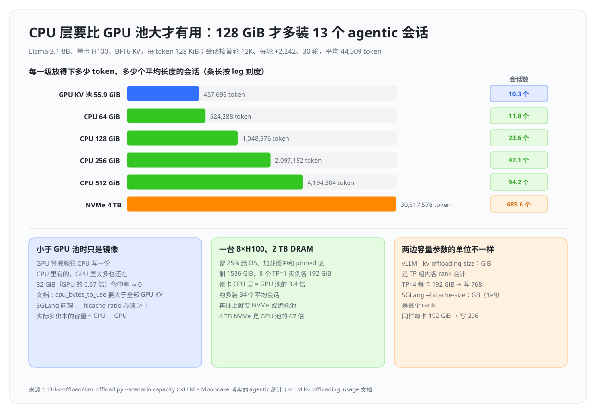
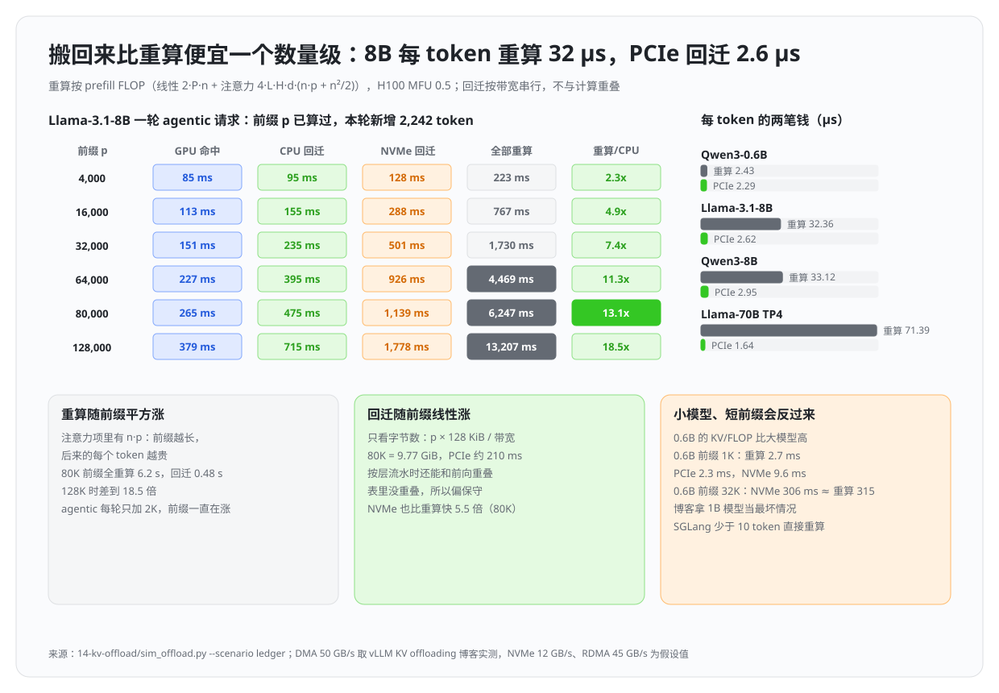
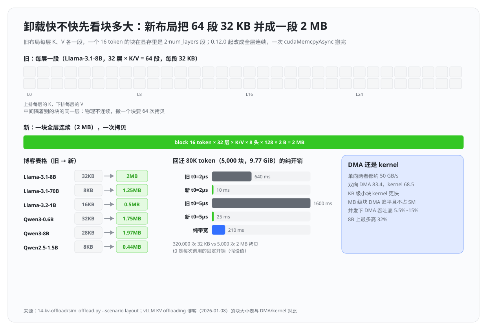
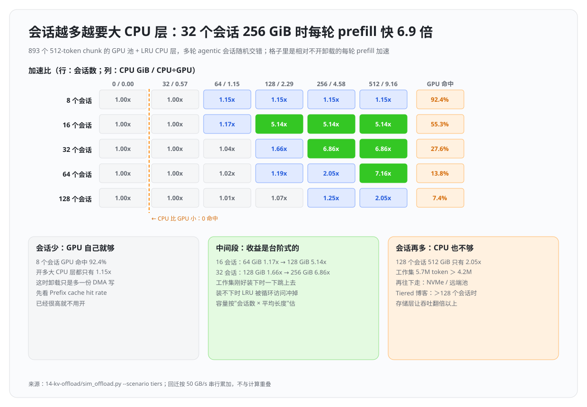
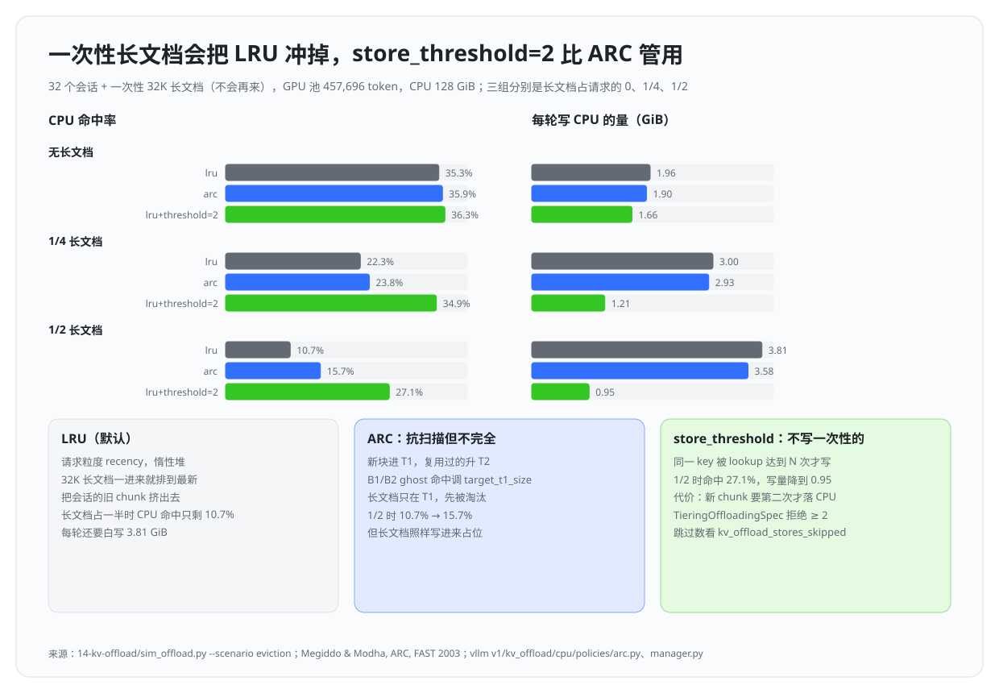
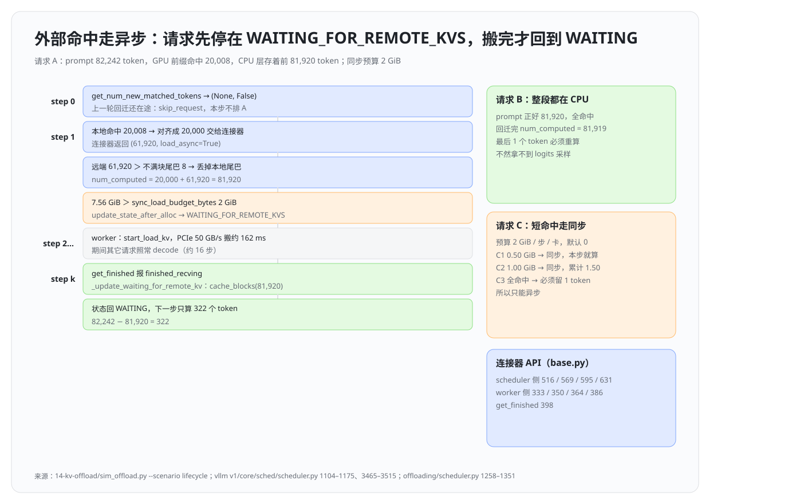
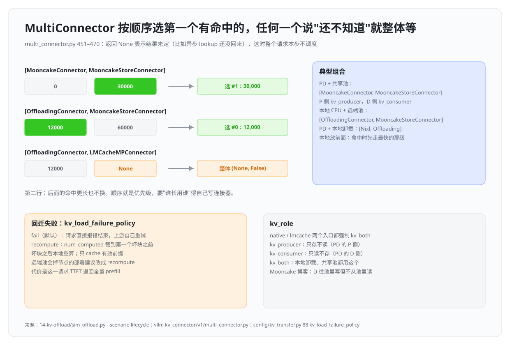
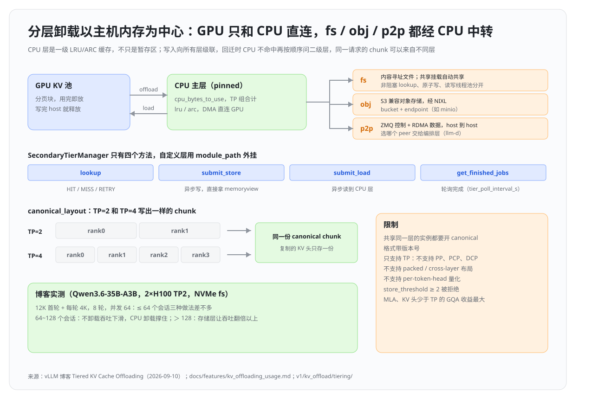
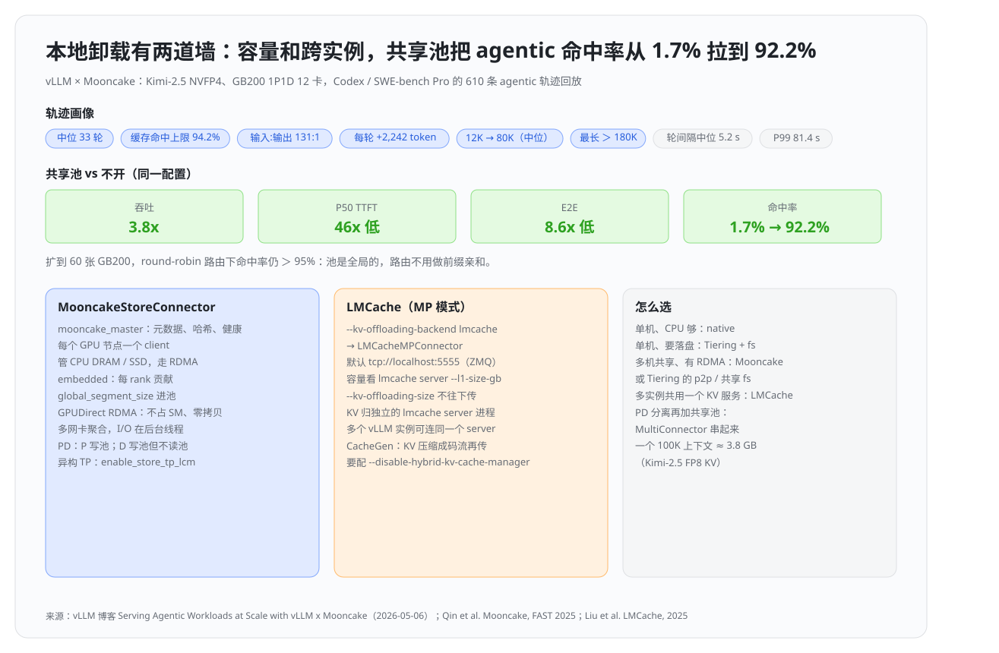
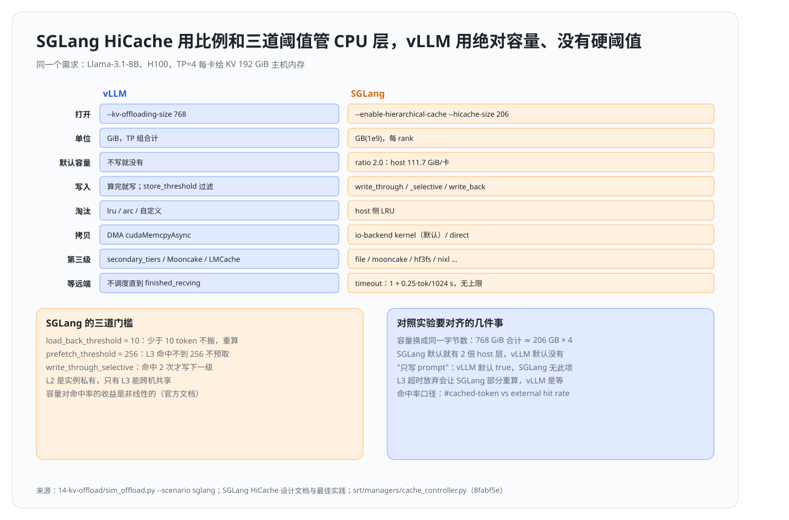

# VLLM-14｜规模｜KV 卸载与连接器：CPU 卸载、LMCache 与 Mooncake

> 🎯 **这篇文档解决什么问题**：一台 H100 跑 Llama-3.1-8B，GPU 池装 45 万 token，接 32 个 agentic 会话，每个会话到第 30 轮已经 7.7 万 token。前缀缓存的命中率从单会话的 90% 掉到 27.6%，剩下的每轮都在重算几万 token 的 prefill。加 `--kv-offloading-size 32` 不见效，加到 256 每轮 prefill 快了将近 7 倍。换成 4 卡 TP 时同样的数要写 1024。接了 Mooncake 以后 decode 实例看不到池里的命中。我们把这些现象放进同一本账：CPU 层要比 GPU 池大多少、搬回来比重算便宜多少、请求在调度器里怎么等外部 KV，以及多个连接器叠在一起时谁说了算。
>
> **使用方式**：第 1、2 章算容量和时间。第 3 章讲块布局为什么决定卸载快慢。第 4、5 章是并发会话数 × CPU 容量和淘汰策略的模拟。第 6 章把一个请求在调度器里等外部 KV 的过程逐步走一遍。第 7 章讲 MultiConnector 的优先级规则和失败策略。第 8 章讲分层卸载框架。第 9 章讲 LMCache 和 Mooncake 两种外部池。第 10 章是指标、SGLang HiCache 对照和真机实验。
>
> **代码**：[14-kv-offload](../14-kv-offload)。sim_offload.py 有 7 个场景：三级容量与两边容量参数的单位、回迁和重算的逐 token 时间账、新旧块布局的物理块大小、会话数 × CPU 容量的分级命中、LRU / ARC / store_threshold 在扫描负载下的对比、逐行移植调度器与连接器判定逻辑的请求生命周期、SGLang HiCache 的容量与阈值。14 个单测钉住 MultiConnector 的首个命中和 None 规则、同步预算至少留 1 个 token、整段命中回退 1 个 token、不满块尾巴的处理、博客表格里的物理块大小、ARC 的 ghost 调整等。offload_matrix.md 是源码行号表，serve_offload.sh 目前只开放双模型的 base、bench 和 sgl_base 入口；原连接器分支保留作历史实现参考，在 GDN 状态恢复核验前停止执行。基线入口也须核对当前引擎与硬件支持，本章未提供双模型卸载实测结果。

# 导读 · 先给结论

## 卸载需要覆盖混合状态

两种主例都含 GDN；卸载对象要说明全注意力 KV、状态快照和索引元数据各自如何保存与恢复。只有 KV 字节传输成功，不能证明命中后可正确续算。

serve_offload.sh 保留双模型基线和观测入口；连接器分支在状态恢复链路核验前明确停止，不自动退回 Llama。验收至少覆盖冷加载、驱逐后回迁、失败重试和输出一致性。原 Llama 字节与带宽模拟仍是纯 KV 专项。

双模型结构以固定版本配置核对[[Qwen3.8-27B config.json]](https://huggingface.co/Qwen/Qwen3.8-27B/blob/37561816e66b5b9153b1b64c10968c18c1e6f4a0/config.json)[[Qwen3.5-35B-A3B config.json]](https://huggingface.co/Qwen/Qwen3.5-35B-A3B/blob/59d61f3ce65a6d9863b86d2e96597125219dc754/config.json)。

1. **本章模拟中，CPU 层小于 GPU 池时没有新增命中。**模拟按写穿和两层内容重叠计算：CPU 层为 32 GiB、GPU 池为 56 GiB 时，测试覆盖的会话数下 CPU 命中均为 0。这一结果依赖模拟的访问序列和淘汰方式，不能推广为所有卸载实现的必要条件。实际部署需结合选择性写入、块驻留和复用距离，比较新增命中与传输开销。
2. **搬回来比重算便宜一个数量级，而且越长越划算。**Llama-3.1-8B 每 token 重算 32 µs，PCIe 回迁 2.6 µs；80K 前缀的一轮请求重算 6.2 s，从 CPU 回迁 0.48 s。反例在小模型和短前缀：Qwen3-0.6B、1K 前缀时 NVMe 回迁 9.6 ms，重算只要 2.7 ms。
3. **卸载快不快先看一次拷贝有多大。**0.11.0 的布局下一个 16 token 的块在 GPU 上是 64 段 32 KB；0.12.0 起全层连续成一段 2 MB，回迁 80K token 的拷贝次数从 32 万次降到 5000 次。vLLM 博客说这个改动让卸载吞吐涨了一个数量级。
4. **会话越多，CPU 层的收益越陡，但都有一个门槛。**32 个会话时 128 GiB 只快 1.66 倍，256 GiB 快 6.86 倍；64 个会话要到 512 GiB 才拿到 7.16 倍。容量没到门槛之前，LRU 在多轮负载上会把下一轮马上要用的前缀先淘汰掉。
5. **一次性长文档会冲掉 LRU，ARC 只挽回一部分，store_threshold=2 挽回得更多。**长文档占一半请求时 LRU 的 CPU 命中 10.7%，ARC 15.7%，store_threshold=2 是 27.1%，写 CPU 的流量还降到四分之一。代价是 store_threshold 只能在单级 CPU 层用。
6. **外部命中默认是异步的：请求先停下，搬完再排。**连接器返回命中后，请求进入 `WAITING_FOR_REMOTE_KVS`，其它请求照常 decode。`sync_load_budget_bytes` 让短命中当步搬完当步算，但每步每卡有预算，并且必须给请求至少留 1 个 token 去算。
7. **MultiConnector 看顺序不看长短。**第一个命中大于 0 的子连接器胜出，后面的命中再长也不换；任何一个子连接器说“还不知道”，整个请求本步都不排。本地 CPU 层要放在远端池前面。
8. **分层卸载以主机内存为中心。**GPU 只和 CPU 层直连，fs、对象存储、p2p 都经 CPU 中转；CPU 层除了做中转暂存，本身也是一层 LRU/ARC 缓存。`canonical_layout` 让 TP=2 和 TP=4 的实例写出同样的 chunk，可以共用一个存储层。
9. **本地卸载解决容量，共享池解决跨实例。**vLLM × Mooncake 在 Kimi-2.5 的 agentic 回放上把命中率从 1.7% 拉到 92.2%，吞吐 3.8 倍，P50 TTFT 低 46 倍；扩到 60 张卡用 round-robin 路由命中率仍高于 95%。
10. **SGLang HiCache 默认就有 2 倍的 host 层，vLLM 默认没有。**两边容量参数的单位也不同：vLLM 是 GiB、TP 组合计，SGLang 是 GB（1e9）、每 rank。SGLang 有三道硬阈值和一个 L3 预取超时，超时的代码默认值（1 + 0.25·tok/1024 秒、无上限）和设计文档写的（min(30, 2 + 0.1·tok/1024)）不一样。

# 第 1 章 · 容量：每一级能放多少



## 1.1 一个 agentic 会话有多大

VLLM-05 讲过，前缀缓存让多轮对话第二轮以后只算新增的那段。前提是上一轮的 KV 还在 GPU 上。agentic 负载把这个前提打破了：vLLM × Mooncake 博客统计 Codex 在 SWE-bench Pro 上的 610 条轨迹，中位 33 轮，每轮新增 2,242 token，上下文从 12K 涨到 80K，输入输出比 131:1，理论缓存命中上限 94.2%[[1]](https://vllm.ai/blog/2026-05-06-mooncake-store)。轮与轮之间要等工具执行，间隔中位 5.2 s、P99 81.4 s。这段时间里，GPU 池要接别的会话，这个会话的 KV 很可能被挤掉。

Llama-3.1-8B 每 token 的 KV 是 2（K、V）× 32 层 × 8 个 KV 头 × 128 维 × 2 字节 = 128 KiB。按 02-ledger 的账本，H100 80GB、`gpu_memory_utilization` 0.92 时 GPU 池 55.9 GiB，正好 457,696 token。一个会话到第 30 轮是 77,018 token，GPU 池装不满 6 个。

```text
== Llama-3.1-8B，H100 ×1，BF16 KV：每级能放多少
  每 token KV 128 KiB；1 GiB = 8,192 token；80K 上下文 = 9.77 GiB
  agentic 会话（首轮 12K、每轮 +2,242、30 轮）：第 30 轮 77,018 token，30 轮平均 44,509 token
  层级                             容量        token    放得下的会话（按平均）   按第 30 轮
  GPU KV 池（util 0.92）        55.9 GiB      457,696           10.3       5.9
  CPU --kv-offloading-size 64     64.0 GiB      524,288           11.8       6.8
  CPU --kv-offloading-size 128    128.0 GiB    1,048,576           23.6      13.6
  CPU --kv-offloading-size 256    256.0 GiB    2,097,152           47.1      27.2
  CPU --kv-offloading-size 512    512.0 GiB    4,194,304           94.2      54.5
  NVMe 4 TB                3725.3 GiB   30,517,578          685.6     396.2
```

这张表决定了后面所有章节的基调。CPU 层 64 GiB 和 GPU 池差不多大，看上去多装了 6.8 个会话，实际一个都没多（1.3 节）。要多装二三十个会话，CPU 层得是 GPU 池的 2 到 5 倍。主机内存不缺：一台 8×H100 节点通常配 2 TB DRAM，留 25% 给系统、权重加载缓冲和 pinned 区，每卡还能分到 192 GiB，是 GPU 池的 3.4 倍。

## 1.2 两个参数，两种单位

vLLM 打开 CPU 卸载只要两个参数：[cache.py](https://github.com/vllm-project/vllm/blob/0d6f92a/vllm/config/cache.py) 383 行的 `kv_offloading_size` 和 389 行的 `kv_offloading_backend`（`native` 或 `lmcache`）。[vllm.py](https://github.com/vllm-project/vllm/blob/0d6f92a/vllm/config/vllm.py) 1168–1196 行把它们改写成一份 `kv_transfer_config`：native 变成 `OffloadingConnector`，`cpu_bytes_to_use = size × 2^30`。设了 `VLLM_USE_SIMPLE_KV_OFFLOAD=1` 时换成 `SimpleCPUOffloadConnector`。lmcache 变成 `LMCacheMPConnector`，size 不往下传。三种情况都把 `kv_role` 强制成 `kv_both`。

```text
== 同一台 8×H100 节点（2 TB DRAM）怎么分
  留 25% 给 OS、权重加载缓冲和 pinned 区，剩 1536 GiB；8 个 TP=1 实例各 192 GiB，每卡 CPU 层 = GPU 池的 3.4 倍
  vLLM：--kv-offloading-size 是 TP 组内各 rank 合计（GiB）；TP=4 想每卡 192 GiB 要写 768
  SGLang：--hicache-size 是每 rank（GB = 1e9 B）；同样每卡 192 GiB 要写 206
```

`cpu_bytes_to_use` 填的是 TP 组内所有 worker 的合计[[2]](https://docs.vllm.ai/en/latest/features/kv_offloading_usage/)。同样每卡 192 GiB，TP=1 写 192，TP=4 要写 768。SGLang 的 `--hicache-size` 正好反过来，单位是 GB（1e9 字节），每个 rank 一份[[3]](https://github.com/sgl-project/sglang/blob/8fabf5e/python/sglang/srt/arg_groups/fields/memory.py)，192 GiB 要写 206。两边换着压测时，这一处写错会让容量差 4 倍或 7%，结论跟着反过来。

## 1.3 为什么小于 GPU 池就没用

vLLM 的卸载是写穿式的：块一算完就异步拷到 CPU，GPU 上那一份照常留在前缀缓存里。于是 CPU 层的内容总是包含 GPU 池里最近的那些块。GPU 池淘汰一个块时，CPU 层要么还留着它（CPU 层比 GPU 池大），要么早就淘汰了（CPU 层比 GPU 池小，而且 LRU 下 CPU 层淘汰得更早）。后一种情况 CPU 层是 GPU 内容的子集，永远命中不了 GPU 没命中的东西。文档的调参建议原话是：单级 CPU 卸载时 `cpu_bytes_to_use` 要大于全部 GPU KV，否则“just mirrors what the GPU already holds and adds no hit rate”[[2]](https://docs.vllm.ai/en/latest/features/kv_offloading_usage/)。

```text
== 多大才有用：CPU 层小于 GPU 池时它只是 GPU 内容的镜像（见 --scenario tiers）
  vLLM 文档：单层 CPU 卸载时 cpu_bytes_to_use 要大于全部 GPU KV，否则只是镜像，不加命中率
  SGLang：--hicache-ratio 必须 > 1；write_through 下 host 里真正 "GPU 没有" 的部分 = host - GPU
```

SGLang 用 `--hicache-ratio` 把这条规则写死在参数里：比例必须大于 1，cache 模式默认 2.0[[3]](https://github.com/sgl-project/sglang/blob/8fabf5e/python/sglang/srt/arg_groups/fields/memory.py)。它默认的写策略也是 write_through，host 层里“GPU 没有而 host 有”的部分同样只是 host 减 GPU，默认是 55.9 GiB。

# 第 2 章 · 时间账：搬回来还是重算



## 2.1 每个 token 的两种价格

重算一个 token 的 KV 就是对它做一次 prefill。线性层的 FLOP 是 2·P，P 是参数量；注意力的 FLOP 随前缀长度线性增长。H100 BF16 稠密峰值 989 TFLOPS，按 MFU 0.5 算，8B 模型每 token 32 µs。把同一个 token 的 128 KiB KV 从 pinned 内存经 PCIe 搬回来，按 vLLM 博客实测的 DMA 单向约 50 GB/s，是 2.6 µs[[4]](https://vllm.ai/blog/2026-01-08-kv-offloading-connector)。

```text
== 每个 token：重算要几微秒，搬回来要几微秒（H100，MFU 0.5，前缀 0）
  模型             TP     KV/卡       重算  PCIe 50  NVMe 12  RDMA 45   重算/PCIe
  Qwen3-0.6B      1    112Ki    2.43µ    2.29µ    9.56µ    2.55µ      1.1x
  Llama-3.1-8B    1    128Ki   32.36µ    2.62µ   10.92µ    2.91µ     12.3x
  Qwen3-8B        1    144Ki   33.12µ    2.95µ   12.29µ    3.28µ     11.2x
  Llama-3.1-70B   4     80Ki   71.39µ    1.64µ    6.83µ    1.82µ     43.6x
  注意力项随前缀长度线性涨，下面按真实前缀长度再算一次。
```

比值由模型的 FLOP/KV 比决定。参数越多、KV 越小（GQA 头少、TP 把 KV 切开），重算越贵、搬运越便宜：70B 在 TP=4 下每卡只存 80 KiB，重算/回迁到了 43.6 倍。0.6B 正好相反，参数少，KV 却和大模型同量级（28 层 × 8 头 × 128 维），比值只有 1.1。

## 2.2 一轮 agentic 请求的 TTFT

```text
== Llama-3.1-8B 一轮 agentic 请求：前缀 p 已算过，新增 2,242 token
      前缀 p    GPU 命中    CPU 回迁    NVMe 回迁      全部重算   重算/CPU
     4,000      85ms      95ms      128ms     223ms     2.3x
    16,000     113ms     155ms      288ms     767ms     4.9x
    32,000     151ms     235ms      501ms    1730ms     7.4x
    64,000     227ms     395ms      926ms    4469ms    11.3x
    80,000     265ms     475ms     1139ms    6247ms    13.1x
   128,000     379ms     715ms     1778ms   13207ms    18.5x
  CPU 回迁这一列按搬完再算，没有重叠；vLLM 按层流水（wait_for_layer_load）时会更短。
```

这里的 CPU 回迁按“搬完再算”串行累加，没有重叠，偏保守。vLLM 的 worker 侧 `wait_for_layer_load` 支持按层等（[base.py](https://github.com/vllm-project/vllm/blob/0d6f92a/vllm/distributed/kv_transfer/kv_connector/v1/base.py) 350 行），第 k 层算的时候第 k+1 层还在搬。即便不重叠，80K 前缀的一轮也从 6.2 s 降到 0.48 s。vLLM 博客单请求测试里回迁的 TTFT 比重算低 2 到 22 倍，随 prompt 长度增长，量级一致[[4]](https://vllm.ai/blog/2026-01-08-kv-offloading-connector)。

博客里更重要的一句是：吞吐涨了 9 倍，而 512 token 请求的 TTFT 只降了 2 倍，“the major gain in KV cache offloading is throughput maximization”[[4]](https://vllm.ai/blog/2026-01-08-kv-offloading-connector)。原因是回迁走 DMA 引擎，不占 SM；重算的 prefill 却要和其它请求的 decode 抢同一批 SM。并发上来以后，省掉的除了一个请求的等待，还有整个 batch 的算力。

## 2.3 什么时候不划算

```text
== 回迁什么时候不划算
  Qwen3-0.6B   前缀  1,000：重算     2.7 ms，PCIe 回迁    2.3 ms，NVMe 回迁    9.6 ms
  Qwen3-0.6B   前缀  8,000：重算    34.3 ms，PCIe 回迁   18.4 ms，NVMe 回迁   76.5 ms
  Qwen3-0.6B   前缀 32,000：重算   315.1 ms，PCIe 回迁   73.4 ms，NVMe 回迁  305.8 ms
  Llama-3.1-8B 前缀  1,000：重算    32.9 ms，PCIe 回迁    2.6 ms，NVMe 回迁   10.9 ms
  Llama-3.1-8B 前缀  8,000：重算   292.8 ms，PCIe 回迁   21.0 ms，NVMe 回迁   87.4 ms
  Llama-3.1-8B 前缀 32,000：重算  1578.2 ms，PCIe 回迁   83.9 ms，NVMe 回迁  349.5 ms
  小模型 KV/FLOP 比大：0.6B 的短前缀从 NVMe 搬回来比重算还慢，这就是 vLLM 博客拿 1B 模型当最坏情况的原因。
```

有两个反例要记住。第一，小模型配慢介质：0.6B 的 1K 前缀从 NVMe 搬要 9.6 ms，重算 2.7 ms，到 32K 才勉强打平。第二，再快的介质也有固定开销：查表、分配块、发起传输、多等一步调度，这些在短前缀上会吃掉全部收益。vLLM 的应对是每请求的 `max_load_tokens`（放在 `kv_transfer_params` 里，实验特性），设成 0 就不从外部加载，GPU 前缀缓存照常用[[2]](https://docs.vllm.ai/en/latest/features/kv_offloading_usage/)；SGLang 的应对是硬阈值，host 命中少于 10 个 token 不搬，L3 命中少于 256 token 不预取（第 10 章）。

# 第 3 章 · 布局：一次拷贝有多大



## 3.1 从 64 段到 1 段

前两章把回迁当成纯带宽问题，前提是每次拷贝足够大。0.11.0 引入卸载连接器时，GPU KV 按层分配：每层一个张量，K 和 V 分开，一个 16 token 的块在 Llama-3.1-8B 上是 2 × 32 = 64 段，每段 16 × 8 × 128 × 2 字节 = 32 KB。0.12.0 改成所有层连续，一个块就是一段 2 MB[[4]](https://vllm.ai/blog/2026-01-08-kv-offloading-connector)。

```text
== 一个 16 token 的块在 GPU 上是几段：旧布局每层 K、V 各一段，新布局（0.12.0 起）全层连续一段
  模型                          旧：一段      新：一块    段数   博客表格（旧 / 新）
  Llama-3.1-8B                32KB    2.00MB    64   32 KB / 2 MB
  Llama-3.1-70B（TP=4）          8KB    1.25MB   160   8 KB / 1.25 MB
  Qwen3-0.6B                  32KB    1.75MB    56   32 KB / 1.75 MB
  Qwen3-8B                    32KB    2.25MB    72   28 KB / 1.97 MB
  Qwen3-8B 按 config.json 算出 32 KB / 2.25 MB，博客表格是 28 KB / 1.97 MB，两者倍数都是 2·36 = 72。
```

模拟器按 config.json 算出的数与博客表格逐行核对。Qwen3-8B 有出入：按 36 层、8 个 KV 头、128 维算是 32 KB / 2.25 MB，博客写的是 28 KB / 1.97 MB，两者的倍数都是 72，说明差在单段大小的口径，不影响结论。

```text
== Llama-3.1-8B 回迁 80K token = 5,000 个块，9.77 GiB
  旧布局：320,000 次 32 KB 拷贝；新布局：5,000 次 2 MB 拷贝（offload block_size 256 时再降到 313 次 32 MB）
  每次 cudaMemcpyAsync 若有 t0 的固定开销（假设值），纯开销部分：
    t0 = 2 µs：旧    640 ms，新  10.0 ms，纯带宽 210 ms
    t0 = 5 µs：旧   1600 ms，新  25.0 ms，纯带宽 210 ms
  博客结论：KB 级小块上自定义 kernel 吞吐明显更高，MB 级块上 DMA 追平；并发负载下 DMA 不占 SM，
  吞吐比 kernel 高 5.5%（0% 命中）到 15%（80% 命中），Llama-3.1-8B 上最多高 32%。
```

t0 是每次 `cudaMemcpyAsync` 的固定开销，这里取 2 µs 和 5 µs 两个假设值。旧布局下 32 万次拷贝的固定开销就有 0.6 到 1.6 s，是纯带宽时间的 3 到 8 倍；新布局降到 10 到 25 ms。博客的原话是物理块变大 2·num_layers 倍，“increased the throughput of the offloading connector by an order of magnitude”[[4]](https://vllm.ai/blog/2026-01-08-kv-offloading-connector)。卸载块还能比 GPU 块更大：`block_size` 或 `blocks_per_chunk` 设成 GPU 块的整数倍，一次 I/O 再大 16 倍，代价是查找粒度变粗[[2]](https://docs.vllm.ai/en/latest/features/kv_offloading_usage/)。

## 3.2 DMA 还是 kernel

GPU 和 CPU 之间搬数据有两种做法：发 `cudaMemcpyAsync` 交给拷贝引擎，或者写一个 kernel 让 SM 直接读写 pinned 内存。博客的微基准里，KB 级的小块上 kernel 明显更快（自定义 kernel 测到 68.5 GB/s），MB 级的块 DMA 追平。到了真实并发负载，结论反过来：DMA 吞吐高 5.5%（0% 命中）到 15%（80% 命中），Llama-3.1-8B 上最多高 32%。0% 命中时 kernel 方案甚至比不开卸载还慢 6%，因为它在和模型计算抢 SM[[4]](https://vllm.ai/blog/2026-01-08-kv-offloading-connector)。

vLLM 选了 DMA，前提就是 3.1 节的大块布局。SGLang 的默认是 `--hicache-io-backend kernel`，配 `--hicache-mem-layout page_first`；它的最佳实践文档在 PD 和存储后端的示例里改成 `direct` + `page_first_direct`[[5]](https://github.com/sgl-project/sglang/blob/8fabf5e/docs/docs/advanced_features/hicache_best_practices.mdx)。两边的选择和各自的布局是配套的，不能单独比哪种 I/O 后端更好。

# 第 4 章 · 分级命中：会话数 × CPU 容量



## 4.1 模拟怎么做

tiers 场景把 GPU 池切成 893 个 512 token 的 chunk，CPU 层用同样粒度的 LRU。N 个会话按 1.1 节的统计生成（首轮 12K、每轮 +2,242、30 轮），轮次随机交错。每一轮先查 GPU 前缀缓存，再查 CPU 层，剩下的重算；算完的 chunk 同时写进 GPU 和 CPU（写穿）。每轮 prefill 时间按第 2 章的单价累加：GPU 命中只算新增部分，CPU 命中加回迁时间，未命中加重算时间。

```text
== Llama-3.1-8B / H100：GPU 池 457,696 token（893 个 512 token chunk），CPU 层 LRU，多轮 agentic（12K 起、每轮 +2,242、30 轮），会话随机交错
    会话  CPU GiB CPU/GPU   GPU 命中   CPU 命中     重算  每轮 prefill     相对无卸载
     8        0    0.00    92.4%     0.0%   7.6%       251ms     1.00x
     8       32    0.57    92.4%     0.0%   7.6%       251ms     1.00x
     8       64    1.15    92.4%     1.0%   6.5%       218ms     1.15x
     8      128    2.29    92.4%     1.0%   6.5%       218ms     1.15x
     8      256    4.58    92.4%     1.0%   6.5%       218ms     1.15x
     8      512    9.16    92.4%     1.0%   6.5%       218ms     1.15x

    16        0    0.00    55.3%     0.0%  44.7%      1353ms     1.00x
    16       32    0.57    55.3%     0.0%  44.7%      1353ms     1.00x
    16       64    1.15    55.3%     7.7%  36.9%      1157ms     1.17x
    16      128    2.29    55.3%    38.3%   6.4%       264ms     5.14x
    16      256    4.58    55.3%    38.3%   6.4%       264ms     5.14x
    16      512    9.16    55.3%    38.3%   6.4%       264ms     5.14x

    32        0    0.00    27.6%     0.0%  72.4%      2053ms     1.00x
    32       32    0.57    27.6%     0.0%  72.4%      2053ms     1.00x
    32       64    1.15    27.6%     3.7%  68.7%      1979ms     1.04x
    32      128    2.29    27.6%    35.3%  37.1%      1235ms     1.66x
    32      256    4.58    27.6%    66.2%   6.2%       299ms     6.86x
    32      512    9.16    27.6%    66.2%   6.2%       299ms     6.86x

    64        0    0.00    13.8%     0.0%  86.2%      2226ms     1.00x
    64       32    0.57    13.8%     0.0%  86.2%      2226ms     1.00x
    64       64    1.15    13.8%     2.7%  83.5%      2183ms     1.02x
    64      128    2.29    13.8%    20.1%  66.0%      1865ms     1.19x
    64      256    4.58    13.8%    53.4%  32.8%      1087ms     2.05x
    64      512    9.16    13.8%    79.7%   6.5%       311ms     7.16x

   128        0    0.00     7.4%     0.0%  92.6%      2395ms     1.00x
   128       32    0.57     7.4%     0.0%  92.6%      2395ms     1.00x
   128       64    1.15     7.4%     1.0%  91.6%      2381ms     1.01x
   128      128    2.29     7.4%     9.7%  82.9%      2241ms     1.07x
   128      256    4.58     7.4%    26.6%  65.9%      1924ms     1.25x
   128      512    9.16     7.4%    58.2%  34.3%      1169ms     2.05x

  CPU/GPU < 1 时 CPU 命中几乎为 0：每次请求都把整段前缀同时留在 GPU 和 CPU，小的那层只是大的那层的子集。
```

## 4.2 怎么读这张表

第一，32 GiB 那一行在所有会话数下都是 0% CPU 命中，就是 1.3 节说的镜像。第二，每个会话数都有一个门槛：16 个会话 128 GiB 一下子从 1.17 倍跳到 5.14 倍，32 个会话的门槛在 256 GiB，64 个会话在 512 GiB。门槛以下，CPU 层装不下全部会话，LRU 每次淘汰的恰好是最久没来的那个会话，而它正是下一个要来的（多轮负载的访问顺序接近循环扫描）。这和教科书里 LRU 在循环访问上命中率为 0 的退化是同一个现象。第三，过了门槛再加容量没有用：16 个会话 128、256、512 GiB 一样，剩下的 6.4% 是每轮新增的 2,242 token，任何缓存都省不了。

128 个会话即使 512 GiB 也只有 2.05 倍，CPU 命中 58.2%。这时候单机主机内存已经不够了，要靠第 8 章的存储层或第 9 章的共享池。vLLM 分层卸载博客的真机实验给出的是同一个形状：Qwen3.6-35B-A3B、2×H100 TP2、本地 NVMe，12K 首轮 + 每轮 4K、8 轮、并发 64，64 个会话以内三种做法差不多，64 到 128 个会话不卸载的吞吐下滑、CPU 卸载撑得住，超过 128 个会话存储层让吞吐翻倍以上[[6]](https://vllm.ai/blog/2026-09-10-tiered-kv-offloading)。实验脚本在 neuralmagic/fs-offload-experiments[[7]](https://github.com/neuralmagic/fs-offload-experiments)。

这个模拟没有建模传输排队和与计算的重叠，也没有建模 GPU 池里的 decode 占用，绝对值只做量级参考。它要说明的只有两件事：CPU 层的收益对容量是阶跃的，门槛由“同时活跃的会话总量”决定；在门槛附近，淘汰策略开始起作用。

# 第 5 章 · 淘汰：LRU、ARC 与 store_threshold



## 5.1 扫描负载

真实流量里，多轮会话之外总混着一次性的长请求：贴一份 32K 的文档问一个问题，以后不再来。写穿策略下，这些 chunk 也会进 CPU 层，把会话的前缀挤出去。eviction 场景在第 4 章 32 个会话、128 GiB（门槛附近）的配置上混入 0、1/4、1/2 比例的 32K 一次性文档。

```text
== 32 个 agentic 会话 + 一次性长文档（32K、不会再来），GPU 池 457,696 token，CPU 128 GiB
     长文档占比 策略                         GPU 命中   CPU 命中     重算  写 CPU GiB/轮
         0 lru                         27.6%    35.3%  37.1%         1.96
         0 arc                         27.6%    35.9%  36.5%         1.90
         0 lru+store_threshold=2       27.6%    36.3%  36.2%         1.66

       1/4 lru                         16.8%    22.3%  60.9%         3.00
       1/4 arc                         16.8%    23.8%  59.4%         2.93
       1/4 lru+store_threshold=2       16.8%    34.9%  48.3%         1.21

       1/2 lru                          8.3%    10.7%  81.0%         3.81
       1/2 arc                          8.3%    15.7%  76.0%         3.58
       1/2 lru+store_threshold=2        8.3%    27.1%  64.6%         0.95

  长文档只进 T1 不升 T2，ARC 淘汰时先拿 T1 开刀；store_threshold=2 干脆不写只出现一次的 chunk，
  代价是会话的新 chunk 要第二次出现才落 CPU（这一轮之后被 GPU 淘汰就得重算），并且 TieringOffloadingSpec 不接受 ≥2。
```

## 5.2 ARC 怎么抗扫描

ARC 是 Megiddo 和 Modha 2003 年在 FAST 上提出的自调整替换算法[[8]](https://www.usenix.org/conference/fast-03/arc-self-tuning-low-overhead-replacement-cache)：缓存分成 T1（只访问过一次）和 T2（访问过至少两次），各自配一个只记 key 的 ghost 表 B1、B2。T1 里被淘汰的 key 进 B1，之后如果在 B1 里命中，说明 T1 分得太少，把目标大小 p 调大；B2 命中则反过来。一次性文档永远停在 T1，淘汰时先拿 T1 开刀，T2 里的会话前缀不受影响。

vLLM 的实现在 [arc.py](https://github.com/vllm-project/vllm/blob/0d6f92a/vllm/v1/kv_offload/cpu/policies/arc.py) 52–190 行，有两处和论文不同。第一，新块进 T1，升 T2 的时机是请求结束（`on_request_finished` 把被复用过的就绪块挪到 T2），第二次访问时并不升。第二，ghost 命中的步长是 `max(1, |B2|/|B1|)`，淘汰时 `|T1| ≥ int(target)` 先淘汰 T1。模拟器按这个语义移植，长文档占一半时 ARC 把 CPU 命中从 10.7% 提到 15.7%。

## 5.3 store_threshold：不写一次性的东西

比挑淘汰对象更直接的办法是不写。`store_threshold` 让一个 key 被查询（lookup）的次数达到阈值才进入写候选，已驻留的不受影响，被跳过的次数记进 `vllm:kv_offload_stores_skipped`（[manager.py](https://github.com/vllm-project/vllm/blob/0d6f92a/vllm/v1/kv_offload/cpu/manager.py) 66、87、287 行）。计数表大小由 `max_tracker_size` 控制，默认 64000。设成 2 后一次性文档一个 chunk 都不写，长文档占一半时 CPU 命中到 27.1%，写 CPU 的流量从每轮 3.81 GiB 降到 0.95 GiB。

代价有两个。第一，会话的新 chunk 要第二次出现才落 CPU，如果它在这之前被 GPU 淘汰，就得重算一次；没有扫描负载时三种策略差不多（35.3%、35.9%、36.3%），说明这个代价在多轮负载上不大。第二，[spec.py](https://github.com/vllm-project/vllm/blob/0d6f92a/vllm/v1/kv_offload/tiering/spec.py) 400–402 行拒绝 `store_threshold ≥ 2`，开分层卸载就不能用。SGLang 的对应物是 `--hicache-write-policy write_through_selective`，命中 2 次才写下一级（`unified_radix_cache.py` 570 行）[[9]](https://github.com/sgl-project/sglang/blob/8fabf5e/python/sglang/srt/mem_cache/unified_radix_cache.py)。

淘汰策略可以外挂：实现 `CachePolicy` 的 `insert(key, chunk, req_context)`，在 `kv_connector_extra_config` 里写 `eviction_policy` 为类名、`cache_policy_module_path` 为模块路径，不用改 vLLM。`req_context.get_offload_key_position(key)` 能拿到 key 在请求里的位置，可以据此做“越靠前越晚淘汰”的前缀感知策略[[2]](https://docs.vllm.ai/en/latest/features/kv_offloading_usage/)。

# 第 6 章 · 生命周期：请求怎么等外部 KV



## 6.1 连接器的七个钩子

vLLM 把所有外部 KV 来源抽象成同一个接口 `KVConnectorBase_V1`（[base.py](https://github.com/vllm-project/vllm/blob/0d6f92a/vllm/distributed/kv_transfer/kv_connector/v1/base.py)）。CPU 卸载、LMCache、Mooncake、PD 分离的 NIXL 都是它的实现，factory 里按名字注册（[factory.py](https://github.com/vllm-project/vllm/blob/0d6f92a/vllm/distributed/kv_transfer/kv_connector/factory.py)）。接口分两半：

| 侧 | 方法 | 行 | 什么时候调 |
|-|-|-|-|
| scheduler | `get_num_new_matched_tokens` | 516 | 排一个 WAITING 请求、本地前缀命中之后；返回 (token 数或 None, 是否异步) |
| scheduler | `update_state_after_alloc` | 569 | 给外部命中的 token 分完 GPU 块之后 |
| scheduler | `build_connector_meta` | 595 | 每步末尾，把本步要搬的块打包给 worker |
| scheduler | `request_finished` | 631 | 请求结束；返回 True 表示块要等异步保存完才能释放 |
| worker | `start_load_kv` / `wait_for_layer_load` | 333 / 350 | 前向开始前发起回迁；每层 attention 前等这一层 |
| worker | `save_kv_layer` / `wait_for_save` | 364 / 386 | 每层算完存；前向结束等保存 |
| worker | `get_finished` | 398 | 报告 finished_sending / finished_recving |

## 6.2 一个请求走一遍

lifecycle 场景逐行移植了调度器和 OffloadingConnector 的判定逻辑（不含真实的块分配），用一个具体请求走一遍。请求 A 是一个会话的第 N 轮，prompt 82,242 token，GPU 前缀缓存还剩前 20,008 个，CPU 层存着前 81,920 个（256 token 一块）。

```text
== 请求 A：prompt 82,242 token；GPU 前缀命中 20,008；CPU 层存着前 81,920 token（256 token 一块）
  step 0  OffloadingConnector：上一轮的回迁还没结束 → get_num_new_matched_tokens 返回 (None, False)，调度器 skip_request，本步不排 A
  step 1  本地命中 20,008 的不满块尾巴 8 个 → 给连接器的是 20,000；连接器返回 (61,920, load_async=True)
          远端 61,920 > 尾巴 8 → 丢掉本地不满块，num_computed = 20,000 + 61,920 = 81,920
          要搬 7.56 GiB，超过 sync_load_budget_bytes = 2 GiB → 走异步：update_state_after_alloc，状态 WAITING_FOR_REMOTE_KVS
  step 2…  PCIe 50 GB/s 搬 162 ms；期间其它请求照常 decode（一步约 10 ms 时是 16 步）
  step k  worker 报 finished_recving → _update_waiting_for_remote_kv：cache_blocks(81,920)，状态回 WAITING，下一步只算 322 个 token
```

step 0 对应 [scheduler.py](https://github.com/vllm-project/vllm/blob/0d6f92a/vllm/distributed/kv_transfer/kv_connector/v1/offloading/scheduler.py) 1258 行起的 `get_num_new_matched_tokens`：这个请求还有在途传输（比如上一轮的保存没结束），直接返回 `(None, False)`，调度器在 [scheduler.py](https://github.com/vllm-project/vllm/blob/0d6f92a/vllm/v1/core/sched/scheduler.py) 1054 行的 `skip_request` 把它放回队列，本步不排。返回 None 的含义是“还不知道”，和“没有命中”的 0 不一样。

step 1 是调度器 1104–1175 行。本地命中 20,008 不是块对齐的，`partial_tail = 20,008 % 16 = 8`，交给连接器的是 20,000。连接器命中 61,920 个，比尾巴的 8 个多，调度器丢掉本地那个不满块，让回迁覆盖它，这样不用对共享块做写时复制。然后看大小：7.56 GiB 超过 `sync_load_budget_bytes`，走异步，请求状态变成 `WAITING_FOR_REMOTE_KVS`（1523 行）。

异步期间这个请求不占调度预算，其它请求照常 decode。worker 报 finished_recving 之后，3517 行的 `_handle_blocked_waiting_request` 把它转回 WAITING，3465 行的 `_update_waiting_for_remote_kv` 把搬来的块登记进前缀缓存。下一步它只剩 322 个 token 要算。

## 6.3 整段命中和同步预算

```text
== 请求 B：prompt 正好 81,920 token，CPU 全命中
  连接器返回 (81,920, True)；回迁完成后 num_computed = 81,919，最后 1 个 token 重算，才能采样第一个输出

== 请求 C：短前缀走同步回迁（sync_load_budget_bytes = 2 GiB / 步 / 卡）
  C1: 命中 4,096 / prompt 6,000，0.50 GiB → 同步，本步就能算；本步预算已用 0.50 GiB
  C2: 命中 8,192 / prompt 9,000，1.00 GiB → 同步，本步就能算；本步预算已用 1.50 GiB
  C3: 命中 4,096 / prompt 4,096，0.50 GiB → 异步；本步预算已用 1.50 GiB
```

请求 B 的 prompt 整段命中，`num_computed_tokens` 却被置成 81,919：模型必须对最后一个 token 做一次前向才能拿到 logits，采样第一个输出 token。GPU 前缀缓存也有同样的处理（VLLM-05）。

同步预算由 `_reserve_sync_load`（scheduler.py 1327–1351 行）管：预算按字节、每步、每卡。放得下的命中当步搬当步算，省掉一步调度的等待。放不下的，或者命中后一个 token 都不剩的（C3 正是这种情况：命中 4,096、prompt 4,096），继续走异步。文档的描述是“Hits that don't fit the remaining budget, or would leave nothing to compute, stay async”[[2]](https://docs.vllm.ai/en/latest/features/kv_offloading_usage/)。默认 0，即全部异步。打开它适合短前缀、高命中的负载；预算设大了，一步里塞进太多同步拷贝，会拖慢这一步里所有请求的 decode。

# 第 7 章 · 组合：MultiConnector 与失败策略



## 7.1 谁说了算

一个实例常常同时要几种外部 KV：PD 分离的 P→D 直传，加一个跨实例的共享池；或者本地 CPU 层加远端池。`MultiConnector` 把多个连接器按列表顺序串起来，规则在 [multi_connector.py](https://github.com/vllm-project/vllm/blob/0d6f92a/vllm/distributed/kv_transfer/kv_connector/v1/multi_connector.py) 451–470 行，就十几行：

```python
to_return = (0, False)
for i, c in enumerate(self._connectors):
    toks, load_async = c.get_num_new_matched_tokens(request, num_computed_tokens)
    if toks is None:              # 有一个还在查
        return (None, False)
    if to_return[0] == 0 and toks > 0:   # 第一个命中 > 0 的胜出
        self._requests_to_connector[request.request_id] = i
        to_return = (toks, load_async)
return to_return
```

```text
== MultiConnector（PD + 存储池）：第一个命中 > 0 的连接器胜出，任何一个说 "还不知道" 就整体等
  [MooncakeConnector, MooncakeStoreConnector]    各自返回 [(0, False), (30000, True)] → (30000, True)，选中 #1
  [OffloadingConnector, MooncakeStoreConnector]  各自返回 [(12000, True), (60000, True)] → (12000, True)，选中 #0
  [OffloadingConnector, LMCacheMPConnector]      各自返回 [(12000, True), (None, False)] → (None, False)，选中 #None
  第二行：后面的连接器命中更长也不会被选，顺序就是优先级。
```

第二行是最容易踩的：本地 CPU 层命中 12,000，远端池命中 60,000，选的是本地的 12,000，剩下 48,000 重算。规则是“顺序即优先级”，命中更长的那家并不优先。把本地 CPU 层放前面，是假设大多数时候本地命中就够长、而且搬得最快；如果负载里远端命中经常远长于本地，要么把远端放前面，要么自己写一个连接器做比较。第三行说明任何一个子连接器的异步 lookup 没回来，整个请求都等，慢的那个决定调度延迟。Mooncake store 连接器异步查询时就会返回 None（[scheduler.py](https://github.com/vllm-project/vllm/blob/0d6f92a/vllm/distributed/kv_transfer/kv_connector/v1/mooncake/store/scheduler.py) 210 行），prompt 不到一个对齐块时返回 0。

## 7.2 角色

`kv_role` 有三种：`kv_producer` 只存不读（PD 的 P 侧），`kv_consumer` 只读不存（D 侧），`kv_both` 都做。本地卸载和共享池都是 kv_both。Mooncake 文档里 PD + 共享池的标准写法是：P 侧 `MultiConnector[MooncakeConnector(kv_producer), MooncakeStoreConnector(kv_both)]`，D 侧两个都是 kv_consumer；想让 decode 产生的新块也进池，给 D 侧的 store 连接器加 `save_decode_cache: true`[[10]](https://docs.vllm.ai/en/latest/features/mooncake_store_connector_usage/)。博客说得更直接：decode 往池里写，但不从池里读，因为每个请求都会同时调度到一个 P 和一个 D，P 从池里取前缀再经 PD 连接器转给 D[[1]](https://vllm.ai/blog/2026-05-06-mooncake-store)。

## 7.3 回迁失败了怎么办

```text
== 回迁失败：kv_load_failure_policy
  "fail"（默认）    请求直接以错误结束，上游要自己重试
  "recompute"       num_computed_tokens 截到第一个坏块之前，坏块之后的 token 本地重算；_update_waiting_for_remote_kv 只 cache 有效前缀
```

`kv_load_failure_policy` 在 [kv_transfer.py](https://github.com/vllm-project/vllm/blob/0d6f92a/vllm/config/kv_transfer.py) 88 行，默认 `fail`。本地 CPU 层几乎不会失败，fail 没问题。远端池会掉节点、会超时，建议改成 `recompute`：调度器把 `num_computed_tokens` 截到第一个坏块之前，`_update_waiting_for_remote_kv` 只登记有效前缀，剩下的本地重算。这个请求的 TTFT 退回全量 prefill，但不会报错。OffloadingConnector 对加载失败过的请求还会把后续命中置 0（1305 行的 `req_status.load_failed`），不会反复失败。

# 第 8 章 · 分层卸载：CPU 之外的层



## 8.1 以主机内存为中心

单级 CPU 卸载是 `CPUOffloadingSpec`。把 `spec_name` 换成 `TieringOffloadingSpec`（[spec.py](https://github.com/vllm-project/vllm/blob/0d6f92a/vllm/v1/kv_offload/tiering/spec.py) 87 行），再给一个有序的 `secondary_tiers` 列表，就是多级。这个框架从 v0.22 开始可用[[6]](https://vllm.ai/blog/2026-09-10-tiered-kv-offloading)。设计上有三条：

1. 只有 CPU 主层能直接访问 GPU，二级层和 GPU 之间的数据都经 CPU 中转[[2]](https://docs.vllm.ai/en/latest/features/kv_offloading_usage/)。
2. GPU 上的块在拷到 host 后就释放，回迁时再按需分配；TP 各 rank 的分片在 host 合并成一个区域。博客称之为 just-in-time allocation。
3. 卸载时 chunk 向所有层级联写入；回迁时先问 CPU 层，不命中再按顺序问二级层，同一请求的不同 chunk 可以来自不同层。CPU 层是“proper LRU/ARC cache, not a staging buffer”[[6]](https://vllm.ai/blog/2026-09-10-tiered-kv-offloading)。

二级层 lookup 的返回值有三种（[base.py](https://github.com/vllm-project/vllm/blob/0d6f92a/vllm/v1/kv_offload/tiering/base.py) 221–231 行）：HIT、MISS、RETRY。RETRY 表示这个 chunk 正在被提升到 CPU 层，调度器下一步再问，在连接器那一层表现为 `get_num_new_matched_tokens` 返回 None。

## 8.2 内置的四种层

| type | 实现 | 要点 |
|-|-|-|
| `fs` | FileSystemTierManager | 内容寻址的文件，路径 `root_dir/模型_摘要_r{rank}/前 3 位哈希/…/哈希.bin`。挂同一个共享盘的实例自动共享。非阻塞 lookup、原子写。读写线程池分开，默认各 16 |
| `obj` | ObjectStoreSecondaryTierManager | S3 兼容对象存储，经 NIXL |
| `p2p` | P2PSecondaryTierManager | ZMQ 控制 + RDMA 数据，host 到 host；从哪个 peer 拉由编排层（如 llm-d）通过 `kv_transfer_params` 指定 |
| `kvcr` | KVCRSecondaryTierManager | 注册在 factory 里的第四种，文档里还没有说明 |

注册表在 [factory.py](https://github.com/vllm-project/vllm/blob/0d6f92a/vllm/v1/kv_offload/tiering/factory.py) 152–175 行。fs 层的摘要由模型、块大小、并行布局、dtype 算出，配置一样的实例共用目录，不一样的并排放、互不干扰；旧目录不会自动清理[[2]](https://docs.vllm.ai/en/latest/features/kv_offloading_usage/)。p2p 层要在引擎忙着跑模型时也能回应别的 peer，所以有一个独立的轮询线程，间隔 `tier_poll_interval_s` 默认 1 ms；设成 0 退回每步服务一次，饱和的 rank 上一次 lookup 可能要等好几秒。

自定义层实现 `SecondaryTierManager` 的四个方法：`lookup`、`submit_store`、`submit_load`、`get_finished_jobs`，用 `module_path` 外挂；仓库里 [example/](https://github.com/vllm-project/vllm/tree/0d6f92a/vllm/v1/kv_offload/tiering/example/) 是示例[[6]](https://vllm.ai/blog/2026-09-10-tiered-kv-offloading)。

## 8.3 跨 TP 共享：canonical_layout

默认每个 worker 把自己的 GPU 页原样拷到 CPU，TP=2 和 TP=4 的实例写出来的 chunk 形状不同，即便放在同一个 fs 目录里也互相读不了。`canonical_layout: true` 让每个 worker 把自己那一片写到一个规范页的固定位置，规范页是这个块完整的 KV（所有头、所有 token），格式带版本号[[2]](https://docs.vllm.ai/en/latest/features/kv_offloading_usage/)。

它带来两个能力：TP=2 的 prefiller 和 TP=4 的 decoder 共享同一个存储命名空间；MLA 或 KV 头数少于 TP 的 GQA 模型，各 rank 持有相同的 KV，规范布局下轮流存，CPU 层只留一份。限制也写在文档里：共享一个层的所有实例都要开。只支持 TP，不支持 PP、PCP、DCP。不支持 packed 和 cross-layer 布局。映射不了的层启动时直接报错。每次拷贝都变成 scatter/gather，有额外开销，用不到上面两个能力就别开。

# 第 9 章 · 外部池：LMCache 与 Mooncake



## 9.1 本地卸载的两道墙

Mooncake 博客把本地卸载的局限说成两条[[1]](https://vllm.ai/blog/2026-05-06-mooncake-store)。一是容量：Kimi-2.5 FP8 的 10 万 token KV 约 3.8 GB，单机 DRAM 装不下几百个长会话（第 4 章 128 个会话的那一行）。二是跨实例：负载均衡把同一个会话的下一轮发到另一台机器，本地 CPU 层里的前缀用不上。路由做前缀亲和能缓解第二条，但会让负载不均。共享池把两个问题一起解决：池是全局的，容量是所有节点的 DRAM/SSD 之和，路由可以只看负载。

## 9.2 Mooncake

Mooncake 是月之暗面 Kimi 的服务平台，FAST 2025 的论文提出以 KVCache 为中心的分离架构，把 GPU 集群里闲置的 CPU、DRAM、SSD 组成一个分布式 KV 缓存；真实负载下让 Kimi 多处理 75% 的请求[[11]](https://arxiv.org/abs/2407.00079)。vLLM 里对应 `MooncakeStoreConnector`，代码在 [store/](https://github.com/vllm-project/vllm/tree/0d6f92a/vllm/distributed/kv_transfer/kv_connector/v1/mooncake/store/)。

架构是一个 `mooncake_master` 管元数据、哈希和健康检查，每个 GPU 节点一个 client 管本地 DRAM/SSD，节点间走 RDMA。调度器侧拿 prompt 的块哈希去 master 查；worker 侧把 GPU KV 注册成 RDMA buffer，GPUDirect RDMA 直接在 GPU 和远端 DRAM 之间搬，不占 SM、不经 CPU 中转，多网卡聚合，I/O 在后台线程里完全异步[[1]](https://vllm.ai/blog/2026-05-06-mooncake-store)。默认 embedded 模式下每个 rank 往池里贡献 `global_segment_size` 的 CPU 内存；带 SSD 时文档推荐 standalone-store 模式，由独立的 `mooncake_client` 进程管 CPU 池和 SSD，rank 只做请求方[[10]](https://docs.vllm.ai/en/latest/features/mooncake_store_connector_usage/)。

```json
{
  "mode": "embedded",
  "metadata_server": "P2PHANDSHAKE",
  "master_server_address": "127.0.0.1:50051",
  "global_segment_size": "80GB",
  "local_buffer_size": "4GB",
  "protocol": "rdma",
  "device_name": "",
  "enable_offload": false
}
```

博客的结果：Kimi-2.5 NVFP4，GB200，prefill TP4、decode DP8+EP，1P1D 共 12 卡，回放 610 条轨迹。开共享池后吞吐 3.8 倍，P50 TTFT 低 46 倍，端到端延迟低 8.6 倍，缓存命中率从 1.7% 到 92.2%；扩到 60 卡、round-robin 路由，命中率仍高于 95%，吞吐近线性[[1]](https://vllm.ai/blog/2026-05-06-mooncake-store)。1.7% 这个基线说明，不开池时，PD 分离下 prefill 实例的本地前缀缓存在 agentic 负载上几乎没用。异构 TP 共享一个池用 `enable_store_tp_lcm` + `prefill_tp_sizes`，取各 TP 的最小公倍数做存储分片[[10]](https://docs.vllm.ai/en/latest/features/mooncake_store_connector_usage/)。

## 9.3 LMCache

LMCache 是芝加哥大学团队做的开源 KV 缓存层，同时支持 vLLM 和 SGLang，论文报告配合 vLLM 在多轮问答和文档分析上最多 15 倍吞吐[[12]](https://arxiv.org/abs/2510.09665)。它的特点是 KV 不归推理引擎管：`--kv-offloading-backend lmcache` 走 MP 模式，vLLM 里的 `LMCacheMPConnector` 通过 ZMQ 连到独立的 `lmcache server` 进程，默认 `tcp://localhost:5555`（[lmcache_mp_connector.py](https://github.com/vllm-project/vllm/blob/0d6f92a/vllm/distributed/kv_transfer/kv_connector/v1/lmcache_mp_connector.py) 485 行）。容量由 `lmcache server --l1-size-gb` 决定，`--kv-offloading-size` 不往下传（1.2 节），两边写的数对不上时以 server 为准[[13]](https://docs.lmcache.ai)。同一个 server 可以接多个 vLLM 实例。

LMCache 团队早先的 CacheGen（SIGCOMM 2024）解决的是另一半问题：KV 经网络传太大，就把它编码成更紧凑的码流，按带宽调整压缩等级，KV 体积降到 1/3.5 到 1/4.3，取 KV 加处理的总延迟降 3.2 到 3.7 倍，质量损失可忽略[[14]](https://arxiv.org/abs/2310.07240)。网络比 PCIe 慢一个数量级时，压缩换带宽是划算的；本地 PCIe 回迁则不需要。

## 9.4 选哪一个

| 场景 | 推荐 | 原因 |
|-|-|-|
| 单机、会话总量是 GPU 池的 2 到 5 倍 | `--kv-offloading-backend native` | 零依赖，DMA，第 4 章的门槛内 |
| 单机、会话总量更大，有本地 NVMe | TieringOffloadingSpec + fs | CPU 层做热数据，NVMe 做容量 |
| 多机、共享盘或对象存储 | TieringOffloadingSpec + fs / obj + canonical_layout | 内容寻址自动共享，跨 TP |
| 多机、RDMA、PD 分离 | MultiConnector[MooncakeConnector, MooncakeStoreConnector] | 全局池，路由不必做前缀亲和 |
| 要跨 vLLM / SGLang 共享，或要独立运维 KV | LMCache MP | KV 归独立进程 |

# 第 10 章 · 指标、SGLang 对照与真机实验



## 10.1 看哪几个数

开了连接器以后，每 10 秒那行日志会多一个字段“External prefix cache hit rate”（[loggers.py](https://github.com/vllm-project/vllm/blob/0d6f92a/vllm/v1/metrics/loggers.py) 329 行），口径是连接器命中的 token / 连接器被查询的 token，查询量是 GPU 前缀缓存没命中的部分。它和 GPU 的“Prefix cache hit rate”分母不同，不能相加。Prometheus 侧对应 `vllm:external_prefix_cache_queries` / `_hits`（685 行起）[[15]](https://docs.vllm.ai/en/latest/design/metrics/)。

| 指标 | 用来回答 |
|-|-|
| `vllm:kv_offload_config_info` | 实际生效的 CPU chunk 数、每 chunk 的 GPU 块数、字节数、可装 token 数；启动参数写错时先看它 |
| `vllm:kv_offload_cpu_cache_usage_perc` | CPU 层是否已满；长期不满说明容量过大或命中太少 |
| `vllm:kv_offload_load_bytes` / `_load_time` | 回迁带宽；远低于 50 GB/s 先查 pinned 内存和 NUMA |
| `vllm:kv_offload_store_bytes` / `_store_time` | 写流量；扫描负载下暴涨时考虑 store_threshold |
| `vllm:kv_offload_stores_skipped` | store_threshold 跳过了多少 |
| `vllm:kv_offload_lookup_sync_delay_seconds` | 调度器里查一次花多久，远端池时尤其要看 |

这些名字分布在 [metrics.py](https://github.com/vllm-project/vllm/blob/0d6f92a/vllm/distributed/kv_transfer/kv_connector/v1/offloading/metrics.py) 和 `v1/kv_offload/cpu/common.py`。分层卸载另有 `vllm:kv_offload_tiering_*` 一组，按层报 chunk 命中。SGLang 的命中看日志里的 `#cached-token`，那是 GPU 和 host 合计的口径，和 vLLM 的两个分开的命中率对比时要换算。

## 10.2 SGLang HiCache

SGLang 的分层缓存叫 HiCache：L1 是 GPU，L2 是 host，L3 是存储后端（file、mooncake、hf3fs、nixl、aibrix 等）。L1 和 L2 是实例私有的，只有 L3 能跨实例共享；同一节点上的两个实例也不能共用 host 内存[[5]](https://github.com/sgl-project/sglang/blob/8fabf5e/docs/docs/advanced_features/hicache_best_practices.mdx)。

```text
== 默认容量：Llama-3.1-8B / H100，GPU KV 池 55.9 GiB
  SGLang --enable-hierarchical-cache（cache 模式）：--hicache-ratio 默认 2.0 → host 111.7 GiB/卡
    write_through 下 host 先镜像一份 GPU 内容，"GPU 没有而 host 有" 的空间 = 55.9 GiB ≈ 457,696 token
  vLLM 不开就没有；开了以后容量完全由 --kv-offloading-size 决定，没有比例参数

== 同一份需求怎么写（TP=4，每卡 192 GiB 主机内存给 KV）
  打开 CPU 层     | vLLM: --kv-offloading-size 768                     | SGLang: --enable-hierarchical-cache --hicache-size 206
  单位           | vLLM: GiB，TP 组合计                                   | SGLang: GB(1e9)，每 rank
  写入时机         | vLLM: 算完就写（store_threshold 默认不过滤）                  | SGLang: write_through（默认）/ _selective / write_back
  只写 prompt    | vLLM: offload_prompt_only 默认 true                  | SGLang: —
  淘汰           | vLLM: eviction_policy lru（默认）/ arc / 自定义           | SGLang: host 侧 LRU
  GPU↔CPU 拷贝   | vLLM: DMA cudaMemcpyAsync，不占 SM                    | SGLang: --hicache-io-backend kernel（默认）/ direct
  主机布局         | vLLM: GPU 页原样；canonical_layout 可选                  | SGLang: --hicache-mem-layout page_first（默认）
  第三级          | vLLM: TieringOffloadingSpec: fs / obj / p2p；或 MooncakeStore、LMCache 连接器 | SGLang: --hicache-storage-backend file / mooncake / hf3fs / nixl / aibrix …
  跨实例共享        | vLLM: secondary tier 或外部连接器                        | SGLang: 只有 L3 能共享，L2 是实例私有

== SGLang 的三道门槛（vLLM 没有对应的硬阈值）
  load_back_threshold = 10    host → GPU 回迁少于 10 个 token 就不搬，直接重算
  prefetch_threshold  = 256   L3 命中不到 256 token 不发起预取（且不小于 page_size）
  write_through_threshold     write_through 为 1，write_through_selective 为 2（命中 2 次才写下一级）

== L3 预取超时（prefetch_policy=timeout，默认）
  代码默认（8fabf5e）：1 + 0.25·tokens/1024 秒，无上限
  设计文档写的是：min(30, 2 + 0.1·tokens/1024) 秒 —— 以代码为准，部署时显式传参
       256 token  代码  1.06 s  文档  2.02 s   NVMe 12 GB/s 读完  0.00 s   RDMA 45 GB/s  0.00 s
     4,096 token  代码  2.00 s  文档  2.40 s   NVMe 12 GB/s 读完  0.04 s   RDMA 45 GB/s  0.01 s
    32,768 token  代码  9.00 s  文档  5.20 s   NVMe 12 GB/s 读完  0.36 s   RDMA 45 GB/s  0.10 s
    81,920 token  代码 21.00 s  文档 10.00 s   NVMe 12 GB/s 读完  0.89 s   RDMA 45 GB/s  0.24 s
   131,072 token  代码 33.00 s  文档 14.80 s   NVMe 12 GB/s 读完  1.43 s   RDMA 45 GB/s  0.38 s
   300,000 token  代码 74.24 s  文档 30.00 s   NVMe 12 GB/s 读完  3.28 s   RDMA 45 GB/s  0.87 s
  vLLM 对应的是"异步就绪前不调度"：没有超时，请求停在 WAITING_FOR_REMOTE_KVS 直到 finished_recving。
```

几处差别直接影响对比。第一，SGLang 一开 `--enable-hierarchical-cache` 就有 2 倍 GPU 池的 host 层，vLLM 不写 `--kv-offloading-size` 就一点都没有；对比要按字节对齐，768 GiB 合计对 206 GB × 4。第二，SGLang 有三道硬阈值：host 回迁少于 10 token 不搬（`unified_radix_cache.py` 588 行）[[9]](https://github.com/sgl-project/sglang/blob/8fabf5e/python/sglang/srt/mem_cache/unified_radix_cache.py)，L3 命中少于 256 token 不预取且不小于 page_size（`cache_controller.py` 309、623 行）[[16]](https://github.com/sgl-project/sglang/blob/8fabf5e/python/sglang/srt/managers/cache_controller.py)，selective 写策略命中 2 次才写下一级。vLLM 一个都没有，靠第 2.3 节的 `max_load_tokens` 按请求控制。

第三是 L3 预取的等待方式。vLLM 是“就绪前不调度”，没有超时。SGLang 的 `--hicache-storage-prefetch-policy` 有三档：`best_effort` GPU 能开始算就停止预取，`wait_complete` 必须等完，`timeout`（默认）超时就放弃、剩下的重算[[3]](https://github.com/sgl-project/sglang/blob/8fabf5e/python/sglang/srt/arg_groups/fields/memory.py)。超时公式的默认值，代码和文档不一致。设计文档写的是 base 2 s、每 1024 token 加 0.1 s、封顶 30 s[[17]](https://github.com/sgl-project/sglang/blob/8fabf5e/docs/docs/advanced_features/hicache_design.mdx)；8fabf5e 的代码里，`hybrid_cache_controller.py` 404–407 行的默认是 base 1、每 1024 token 0.25[[18]](https://github.com/sgl-project/sglang/blob/8fabf5e/python/sglang/srt/mem_cache/hybrid_cache/hybrid_cache_controller.py)，`storage_attachment.py` 290–292 行换算成每页的增量[[19]](https://github.com/sgl-project/sglang/blob/8fabf5e/python/sglang/srt/mem_cache/unified_cache/storage_attachment.py)，`unified_radix_cache.py` 2320–2330 行按 base + 页数 × 每页增量算，没有上限。上面输出里两列都给了：32K 以上代码的超时比文档长，300K token 时 74 s 对 30 s。要可预期的行为，部署时在 `--hicache-storage-backend-extra-config` 里显式写 `prefetch_timeout_base` 和 `prefetch_timeout_per_ki_token`。最佳实践文档的 PD 示例统一用的是 `wait_complete`[[5]](https://github.com/sgl-project/sglang/blob/8fabf5e/docs/docs/advanced_features/hicache_best_practices.mdx)。

| 需求 | vLLM | SGLang |
|-|-|-|
| 打开 CPU 层 | `--kv-offloading-backend native --kv-offloading-size N` | `--enable-hierarchical-cache` |
| 容量单位 | GiB，TP 组合计 | `--hicache-size` GB(1e9)/rank，或 `--hicache-ratio` |
| 扫描负载 | `store_threshold: 2`（单级）或 `eviction_policy: arc` | `--hicache-write-policy write_through_selective` |
| 存储层 | `secondary_tiers`：fs / obj / p2p | `--hicache-storage-backend` |
| 跨 TP 共享 | `canonical_layout: true` | `tp_lcm_size`（extra-config） |
| 远端未就绪 | 等，不调度 | `timeout`（默认）/ `best_effort` / `wait_complete` |
| 加载失败 | `kv_load_failure_policy: recompute` | 放弃预取，剩余重算 |

## 10.3 真机实验

serve_offload.sh 按 MODEL_PROFILE=dense/moe 选择基座，默认 TP=2、上下文 32768、显存比例 0.92。当前只运行不加卸载参数的 vLLM 或 SGLang 基线，以及对现有服务的压测。prefix_repetition 负载设为 64 个 16000 token 前缀，每个请求另有 2000 token 后缀和 128 token 输出，共 640 个请求、并发 16；实际分词长度与前缀是否超过可用缓存须从运行记录确认。历史 Llama 的 457K token GPU 池和主机内存条件不适用于双模型容量判断。

```bash
# 在 zero-to-vllm/14-kv-offload 目录执行
python3 sim_offload.py --scenario tiers
python3 -m unittest test_sim_offload -v
# 模拟保留历史纯 KV 假设；以下基线命令仍需真机验证
# 终端 1：核对引擎支持、显存与端口后，启动不加卸载参数的基线
MODEL_PROFILE=dense TP=2 MAX_MODEL_LEN=32768 OUT=results/dense/base-server-01 bash serve_offload.sh base
# 终端 2：服务就绪后执行，HOST、PORT 与终端 1 一致
MODEL_PROFILE=dense OUT=results/dense/base-bench-01 bash serve_offload.sh bench 64 16
# 停止旧服务后才启动 SGLang 基线；当前版本兼容性须先核对
MODEL_PROFILE=dense TP=2 MAX_MODEL_LEN=32768 OUT=results/dense/sgl-base-server-01 bash serve_offload.sh sgl_base
# moe 用同一流程独立运行，OUT 改为 results/moe 下的新目录
# native、small、arc、sync、simple、tiered、canonical、lmcache、mooncake
# 以及 sgl_hicache 系列均被脚本拦截；不要绕过 GDN 状态恢复检查
# 每次调用使用新的 OUT；bench 保存详细 JSON、完整日志和 metrics.prom
```

当前结果只能用于观察双模型基线的前缀复用和负载表现，不能据此比较卸载策略。启用连接器前，先验证全注意力 KV、GDN 状态及索引元数据在冷加载、驱逐回迁和失败重试后能正确恢复，再核对固定输入下的输出一致性。验收通过后，才按相同硬件与实际可用容量比较命中率、传输字节和 TTFT 分位数。历史模拟的 small/native 差异、固定容量门槛及 HiCache 比例换算须保留各自版本和模型条件，不能预写成双模型的预期收益。

## 10.4 读源码的顺序

config/cache.py 383、389 → config/vllm.py 1168–1196 → config/kv_transfer.py 88 → distributed/kv_transfer/kv_connector/factory.py → v1/base.py 333–631 → v1/core/sched/scheduler.py 1054、1104–1175、1523、3465、3517 → v1/offloading/scheduler.py 229、1258、1327 → multi_connector.py 451 → v1/kv_offload/cpu/manager.py 66、287 → cpu/policies/arc.py 52 → cpu/gpu_worker.py 881 → tiering/spec.py 87、400 → tiering/base.py 145、221 → tiering/factory.py 152 → mooncake/store/scheduler.py 210 → lmcache_mp_connector.py 485、724 → v1/metrics/loggers.py 329、685。SGLang 侧：srt/arg_groups/fields/memory.py 109–176 → srt/managers/cache_controller.py 309、623 → srt/mem_cache/unified_radix_cache.py 570、588、2320 → hybrid_cache/hybrid_cache_controller.py 404 → unified_cache/storage_attachment.py 290。每一行的用途见 offload_matrix.md。

> 📌 **核对清单**
> - 能算出给定模型和显存下 GPU 池装多少 token、多少个 agentic 会话，知道 CPU 层为什么必须大于 GPU 池。
> - 能把同一份主机内存预算分别写成 vLLM 的 `--kv-offloading-size` 和 SGLang 的 `--hicache-size`。
> - 能估出每 token 重算和回迁的时间，说出小模型、短前缀、慢介质下为什么不划算。
> - 能解释 0.12.0 的块布局改动为什么让卸载吞吐涨一个数量级，以及并发负载下 DMA 为什么胜过 kernel。
> - 能说出会话数和 CPU 容量之间的门槛关系，以及门槛以下 LRU 为什么退化。
> - 能比较 LRU、ARC、store_threshold 在扫描负载下的表现，知道 store_threshold 不能和分层卸载一起用。
> - 能走一遍请求从 `get_num_new_matched_tokens` 到 `WAITING_FOR_REMOTE_KVS` 再回到 WAITING 的过程，说出 None 和 0 的区别。
> - 能说出 `sync_load_budget_bytes` 什么时候生效、为什么整段命中要回退 1 个 token。
> - 能写出 MultiConnector 的选择规则，知道本地层和远端层怎么排。
> - 能说出 TieringOffloadingSpec 的四种二级层、RETRY 的含义，以及 `canonical_layout` 的能力和限制。
> - 能为单机、多机、PD 分离、跨引擎共享这四种场景选连接器。
> - 能读懂 External prefix cache hit rate 和 `vllm:kv_offload_*` 指标，知道 SGLang 预取超时的代码默认值和文档不同。

第 9 章已经碰到了 PD 分离：prefill 实例从共享池取前缀，再把整段 KV 交给 decode 实例。这条 P→D 的传输是另一类连接器，带宽要求、触发时机和失败处理都和卸载不同。下一篇 VLLM-15 讲 PD 分离：为什么要把 prefill 和 decode 拆开，NIXL 怎么在两台机器的 GPU 之间直接搬 KV，push 和 pull 两种模式各自省了什么，以及路由层怎么按 P/D 的负载分配请求。

# 参考文献

按正文首次引用顺序编号，资料截至 2026 年 10 月底。源码以 vllm-project/vllm 主干提交 0d6f92a（2026 年 10 月 29 日）和 v0.32.0 发行版为准；SGLang 对照以 sgl-project/sglang 主干 8fabf5e 为准。

[1] vLLM Team. Serving Agentic Workloads at Scale with vLLM x Mooncake. vLLM Blog (2026-05-06) [https://vllm.ai/blog/2026-05-06-mooncake-store](https://vllm.ai/blog/2026-05-06-mooncake-store)

[2] vLLM Docs. KV Offloading Usage Guide [https://docs.vllm.ai/en/latest/features/kv_offloading_usage/](https://docs.vllm.ai/en/latest/features/kv_offloading_usage/)

[3] sgl-project. sglang/srt/arg_groups/fields/memory.py. GitHub (8fabf5e) [https://github.com/sgl-project/sglang/blob/8fabf5e/python/sglang/srt/arg_groups/fields/memory.py](https://github.com/sgl-project/sglang/blob/8fabf5e/python/sglang/srt/arg_groups/fields/memory.py)

[4] vLLM Team. Inside vLLM's New KV Offloading Connector: Smarter Memory Transfer for Maximizing Inference Throughput. vLLM Blog (2026-01-08) [https://vllm.ai/blog/2026-01-08-kv-offloading-connector](https://vllm.ai/blog/2026-01-08-kv-offloading-connector)

[5] SGLang Docs. HiCache Best Practices (hicache_best_practices.mdx). GitHub (8fabf5e) [https://github.com/sgl-project/sglang/blob/8fabf5e/docs/docs/advanced_features/hicache_best_practices.mdx](https://github.com/sgl-project/sglang/blob/8fabf5e/docs/docs/advanced_features/hicache_best_practices.mdx)

[6] vLLM Team. Tiered KV Cache Offloading in vLLM. vLLM Blog (2026-09-10) [https://vllm.ai/blog/2026-09-10-tiered-kv-offloading](https://vllm.ai/blog/2026-09-10-tiered-kv-offloading)

[7] neuralmagic. fs-offload-experiments. GitHub [https://github.com/neuralmagic/fs-offload-experiments](https://github.com/neuralmagic/fs-offload-experiments)

[8] Megiddo N, Modha DS. ARC: A Self-Tuning, Low Overhead Replacement Cache. FAST (2003) [https://www.usenix.org/conference/fast-03/arc-self-tuning-low-overhead-replacement-cache](https://www.usenix.org/conference/fast-03/arc-self-tuning-low-overhead-replacement-cache)

[9] sgl-project. sglang/srt/mem_cache/unified_radix_cache.py. GitHub (8fabf5e) [https://github.com/sgl-project/sglang/blob/8fabf5e/python/sglang/srt/mem_cache/unified_radix_cache.py](https://github.com/sgl-project/sglang/blob/8fabf5e/python/sglang/srt/mem_cache/unified_radix_cache.py)

[10] vLLM Docs. MooncakeStoreConnector Usage Guide [https://docs.vllm.ai/en/latest/features/mooncake_store_connector_usage/](https://docs.vllm.ai/en/latest/features/mooncake_store_connector_usage/)

[11] Qin R, et al. Mooncake: A KVCache-centric Disaggregated Architecture for LLM Serving. FAST (2025) [https://arxiv.org/abs/2407.00079](https://arxiv.org/abs/2407.00079)

[12] Liu Y, et al. LMCache: An Efficient KV Cache Layer for Enterprise-Scale LLM Inference. arXiv (2025) [https://arxiv.org/abs/2510.09665](https://arxiv.org/abs/2510.09665)

[13] LMCache Docs. LMCache Documentation [https://docs.lmcache.ai](https://docs.lmcache.ai)

[14] Liu Y, et al. CacheGen: KV Cache Compression and Streaming for Fast Large Language Model Serving. SIGCOMM (2024) [https://arxiv.org/abs/2310.07240](https://arxiv.org/abs/2310.07240)

[15] vLLM Docs. Metrics (design) [https://docs.vllm.ai/en/latest/design/metrics/](https://docs.vllm.ai/en/latest/design/metrics/)

[16] sgl-project. sglang/srt/managers/cache_controller.py. GitHub (8fabf5e) [https://github.com/sgl-project/sglang/blob/8fabf5e/python/sglang/srt/managers/cache_controller.py](https://github.com/sgl-project/sglang/blob/8fabf5e/python/sglang/srt/managers/cache_controller.py)

[17] SGLang Docs. HiCache System Design and Optimization (hicache_design.mdx). GitHub (8fabf5e) [https://github.com/sgl-project/sglang/blob/8fabf5e/docs/docs/advanced_features/hicache_design.mdx](https://github.com/sgl-project/sglang/blob/8fabf5e/docs/docs/advanced_features/hicache_design.mdx)

[18] sgl-project. sglang/srt/mem_cache/hybrid_cache/hybrid_cache_controller.py. GitHub (8fabf5e) [https://github.com/sgl-project/sglang/blob/8fabf5e/python/sglang/srt/mem_cache/hybrid_cache/hybrid_cache_controller.py](https://github.com/sgl-project/sglang/blob/8fabf5e/python/sglang/srt/mem_cache/hybrid_cache/hybrid_cache_controller.py)

[19] sgl-project. sglang/srt/mem_cache/unified_cache/storage_attachment.py. GitHub (8fabf5e) [https://github.com/sgl-project/sglang/blob/8fabf5e/python/sglang/srt/mem_cache/unified_cache/storage_attachment.py](https://github.com/sgl-project/sglang/blob/8fabf5e/python/sglang/srt/mem_cache/unified_cache/storage_attachment.py)

[20] vLLM Docs. Benchmark CLI [https://docs.vllm.ai/en/latest/benchmarking/cli/](https://docs.vllm.ai/en/latest/benchmarking/cli/)

---

上一章：[VLLM-13｜规模｜投机解码：EAGLE、MTP、n-gram 与拒绝采样](./13-speculative.md) · [目录](./README.md) · 下一章：[VLLM-15｜规模｜PD 分离：NIXL、KV 传输与 P/D 感知路由](./15-pd-disagg.md)
