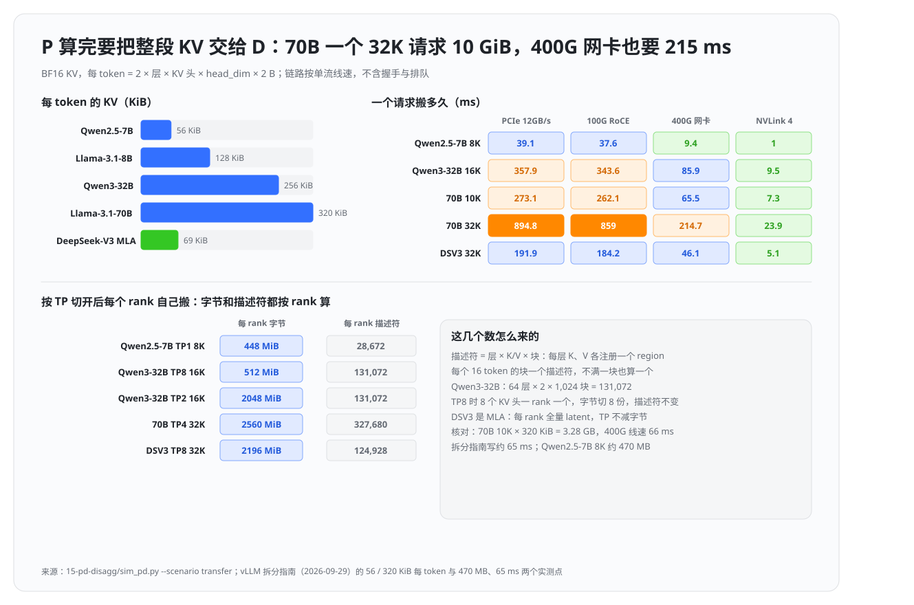
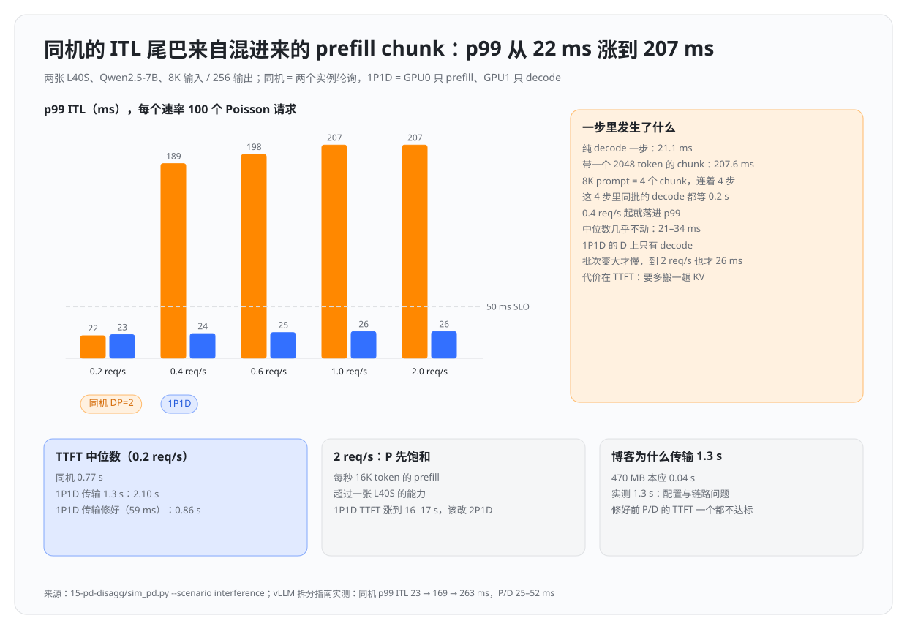
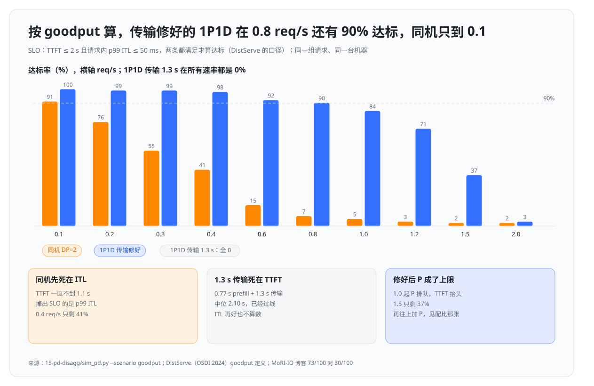
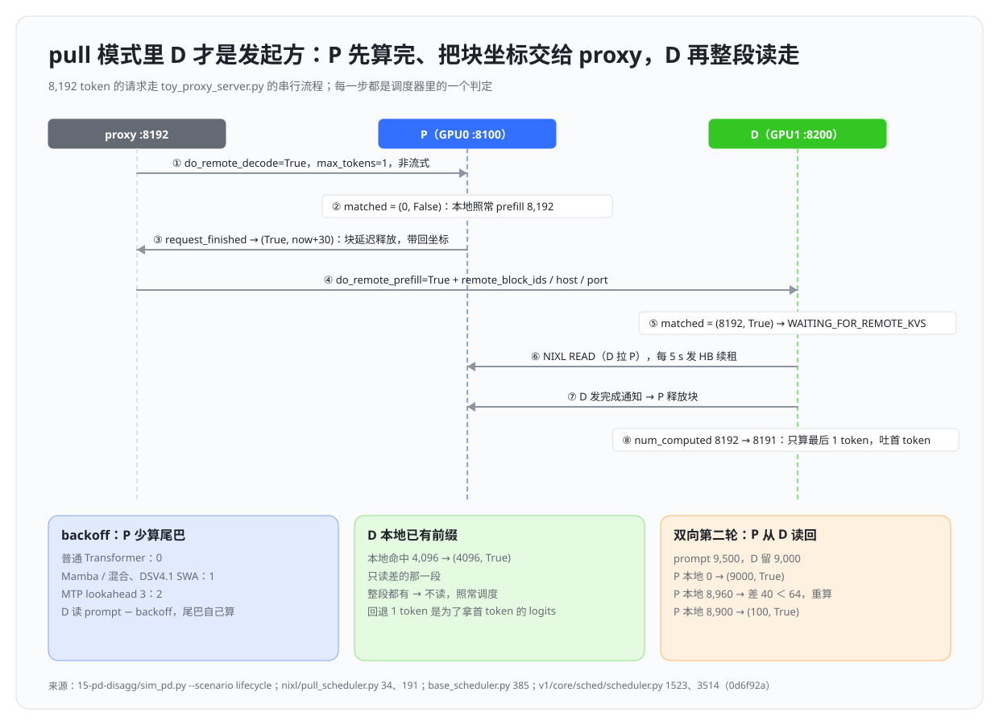
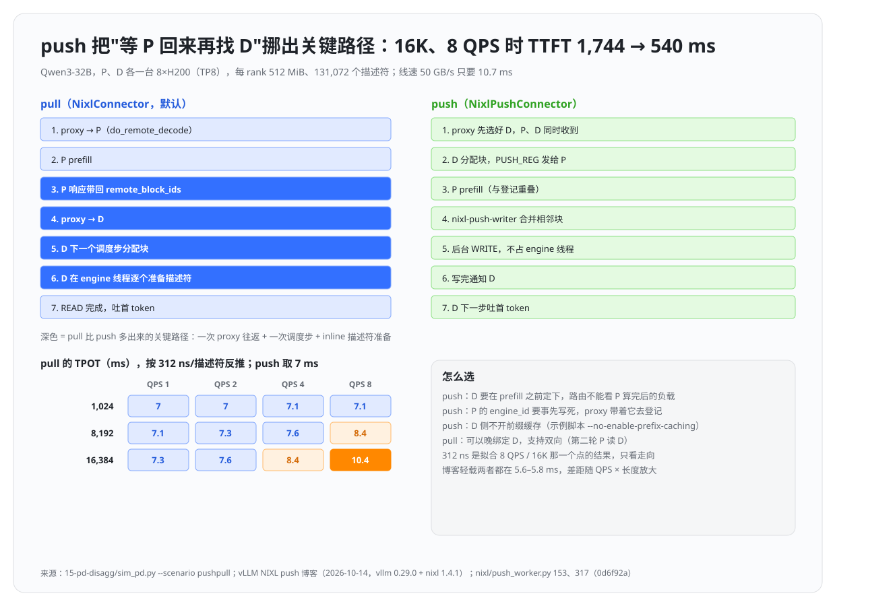
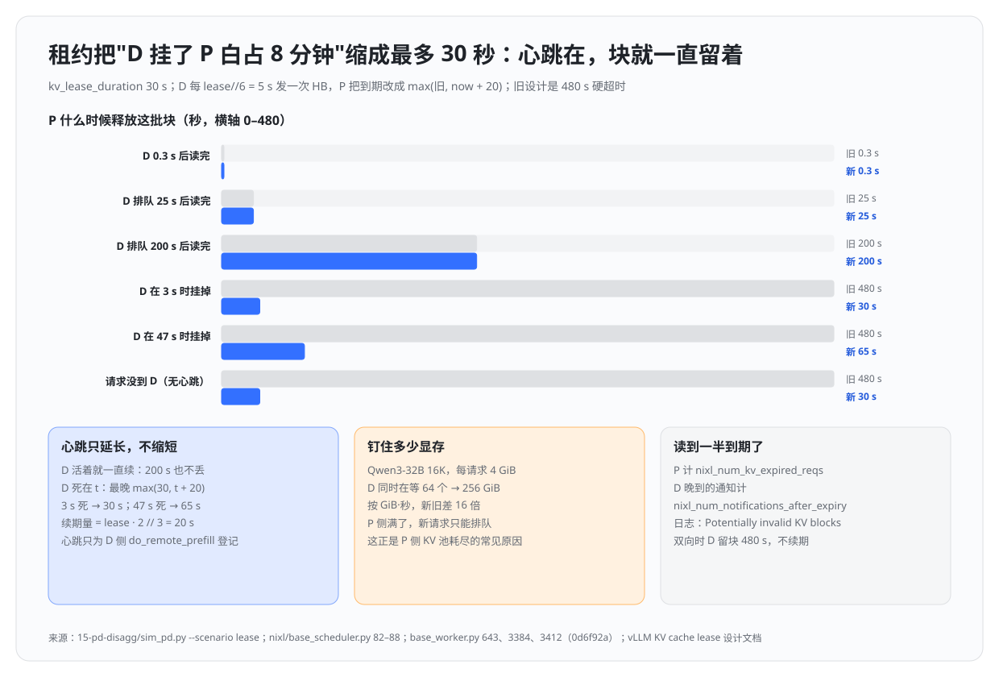
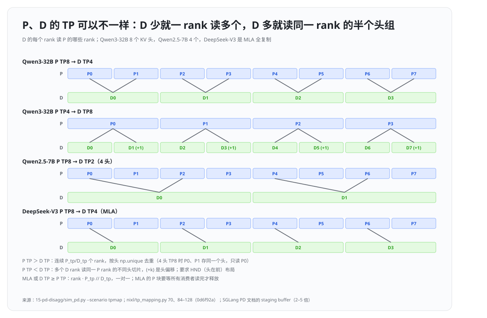
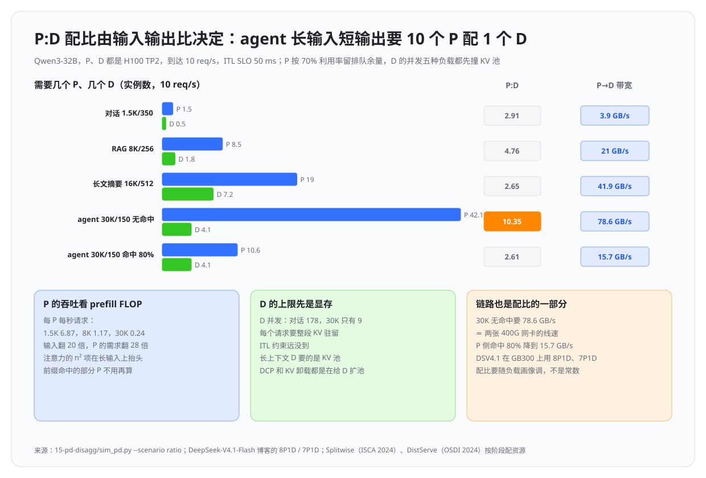
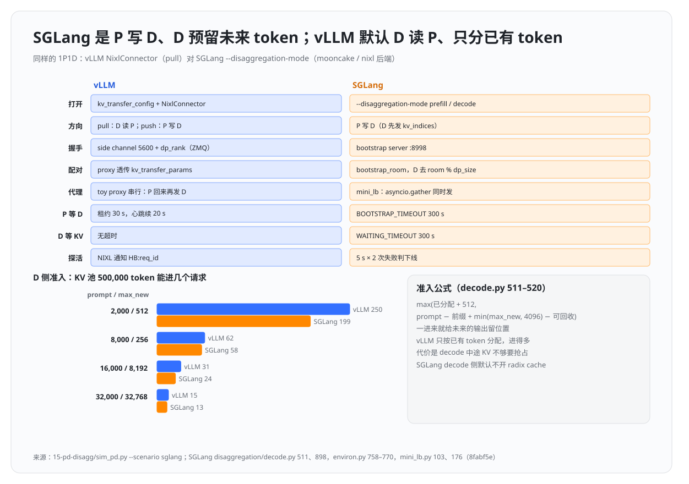
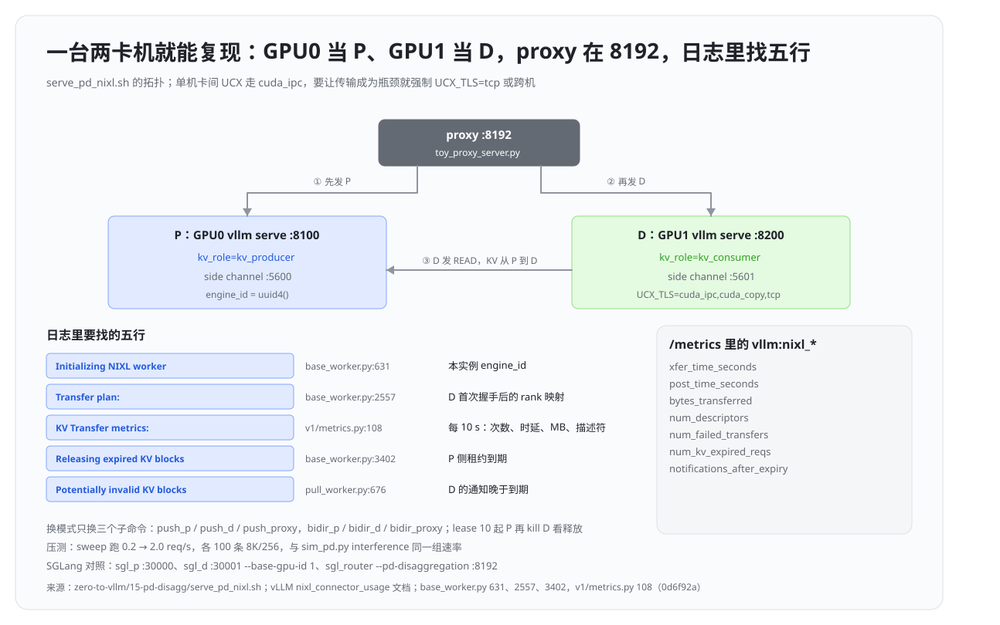

# VLLM-15｜规模｜PD 分离：NIXL、KV 传输与 P/D 感知路由

> 🎯 **这篇文档解决什么问题**：两张 L40S 跑 Qwen2.5-7B，8K 输入、256 输出。同机两个实例时，到了 0.4 req/s，p99 ITL 从 23 ms 涨到 169 ms。拆成一个 prefill 实例、一个 decode 实例以后，p99 ITL 稳在 25–52 ms，可 TTFT 中位数却从 0.7 s 变成 2.2 s，每个速率都没达到 2 s 的目标。同一套 NIXL，换到 AWS P5en 上跑 Qwen3-32B，pull 换成 push 以后 16K、8 QPS 的 TTFT 从 1,744 ms 降到 540 ms。我们把这些现象放进同一本账：KV 有多大、走哪条链路、谁发起传输、P 上的块什么时候能放、P 和 D 的 TP 不一样时怎么对上头，以及 P 和 D 各要几台。
>
> **使用方式**：第 1 章算 KV 的体积和传输时间。第 2、3 章用模拟器复现同机和 1P1D 的 ITL、TTFT 与 goodput。第 4 章把一个请求在 P、D 两边的调度器判定逐步走一遍，包括 backoff 和双向传输。第 5 章比较 pull 和 push。第 6 章讲租约与心跳。第 7 章讲异构 TP。第 8 章讲 P:D 配比和路由。第 9 章对照 SGLang。第 10 章是指标、真机实验和源码阅读顺序。
>
> **代码**：[15-pd-disagg](../15-pd-disagg)。sim_pd.py 有 9 个场景：每 token KV 与各链路传输时间、同机 DP=2 与 1P1D 的 ITL 和 TTFT、按 DistServe 口径的 goodput、五种负载下的 P:D 配比、pull 与 push 的关键路径、租约与旧硬超时的对比、逐行移植的调度器判定、异构 TP 映射、SGLang 的准入公式与超时。20 个单测钉住每 token KV 与拆分指南一致、D 侧整段读与本地前缀只读差额、双向阈值 64 的边界、收齐回退 1 个 token、四种 backoff、`request_finished` 的五个分支、D 挂掉后最晚释放时间、四种 TP 映射、SGLang 准入公式。pd_matrix.md 是源码行号表，serve_pd_nixl.sh 是同机基线、pull、push、双向、短租约五种起法加 SGLang 对照。

# 导读 · 先给结论

## PD 传输不能遗漏 GDN

P 到 D 的交接必须明确两类注意力资源以及状态对应的 token 边界。比较时两侧必须使用同一 checkpoint revision、tokenizer、精度和兼容布局，不能将旧 Qwen2.5 纯 KV 配置直接迁入双模型。

通用 PD 脚本仅保留同机基线，拆分、代理和压测分支在混合状态传输、失败回收及续算一致性核验前停止。原指南实测与模拟数字继续保留，不能当作 Qwen3.8-27B 或 Qwen3.5-35B-A3B 的收益。

双模型结构以固定版本配置核对[[Qwen3.8-27B config.json]](https://huggingface.co/Qwen/Qwen3.8-27B/blob/37561816e66b5b9153b1b64c10968c18c1e6f4a0/config.json)[[Qwen3.5-35B-A3B config.json]](https://huggingface.co/Qwen/Qwen3.5-35B-A3B/blob/59d61f3ce65a6d9863b86d2e96597125219dc754/config.json)。

1. **PD 分离能减少 prefill 对 decode 的干扰，峰值吞吐是否提高仍需同资源对照。**本章模拟中，一个 2048 token 的 prefill chunk 把单步耗时从 21 ms 拉到 208 ms，同 batch 的 decode 请求一起等待。拆开后，模拟的 p99 ITL 为 23–26 ms；拆分指南记录的是 25–52 ms，两组数字不属于同一次实测。评价拆分收益需同时报告资源投入、峰值吞吐和满足 SLO 的请求率。DistServe 使用 TTFT 与 TPOT SLO；本章另用请求内 p99 ITL 作逐 token 延迟约束，两种 goodput 口径不可直接混算。
2. **每个首 token 都要付一次传输。**Qwen2.5-7B 每 token 56 KiB，8K 请求 470 MB；Llama-3.1-70B 每 token 320 KiB，32K 请求 10 GiB，400 Gb/s 线速也要 215 ms。拆分指南在没有 P2P 的 L40S 上量到 1.3 s，大部分是拷贝之外的开销，包括 D 只在两次前向之间轮询完成状态。
3. **先修传输，再谈拆分。**模拟里传输 1.3 s 时 1P1D 的 goodput 是 0；同一负载把传输修到 59 ms，0.8 req/s 还有 90% 请求达标，同机只撑到 0.1 req/s。拆分指南的建议也是：先看 D 日志里的 KV Transfer metrics，Avg xfer time 在几百毫秒就先修它。
4. **vLLM 默认是 pull：D 读 P。**proxy 先发 P（`max_tokens=1`），P 算完把块坐标放进响应；proxy 再发 D，D 分配块、发 NIXL READ，读完把 `num_computed` 回退 1 个 token，下一步只算最后一个 token 并吐出首 token。Mamba、SWA bounded replay、多模块 MTP 要让 P 少算 1–2 个 token。
5. **push 把“等 P 回来再找 D”挪出关键路径。**D 在 prefill 之前就分配好块并向 P 登记，P 算完由后台线程合并相邻块直接 WRITE。代价是 D 必须提前选定，不能等 prefill 完再按负载挑。
6. **P 上的块靠租约释放，不再靠 8 分钟硬超时。**P 给每个块 30 s 租约，D 从请求进调度器起每 5 s 发一次心跳，把到期续到 now + 20 s。D 挂掉时 P 最多再占 30 s（旧设计 480 s）；D 排队 200 s 也不会被误释放。
7. **多轮对话可以把 KV 从 D 读回 P。**`bidirectional_kv_xfer` 让 D 留住上一轮的块 480 s（不续期），下一轮 P 先查本地，差额不小于 64 token 才从 D 读。AWS 的测试里，最长的输入下 TTFT 降了 1.6 倍（Qwen3-32B）和 3.3 倍（GLM-5-FP8）。
8. **P、D 的 TP 可以不一样。**P TP 大时 D 的一个 rank 读几个 P rank，KV 头少于 P TP 时按头去重。D TP 大时几个 D rank 读同一个 P rank 的不同头切片，要求 HND 布局。MLA 每个 rank 都是全量 latent，只读一个。
9. **P:D 配比由输入输出比决定。**Qwen3-32B 在 H100 TP2 上，对话负载约 3:1，30K 输入 150 输出的 agent 负载要 10:1；有 80% 前缀命中时又回到 2.6:1。DeepSeek-V4.1-Flash 在 GB300 上用的是 8P1D 和 7P1D。
10. **SGLang 是 P 写 D，并且 D 准入时预留未来 token。**proxy 同时发 P、D，用 bootstrap room 配对；D 每请求按 prompt + min(max_new, 4096) 预留，同一个池能进的请求比 vLLM 少 6%–23%，换来 decode 中途少抢占。超时也不同：SGLang P 等 D 300 s、D 等 KV 300 s；vLLM 是 30 s 租约，D 侧不设超时。

# 第 1 章 · KV 账：P 要交给 D 多少字节



## 1.1 为什么要拆

prefill 和 decode 是两种完全不同的负载。prefill 一次读完整个 prompt，算力受限，决定 TTFT；decode 每步一个 token，卡在读权重和读 KV 的显存带宽上，决定 ITL。VLLM-06 讲过，chunked prefill 把长 prompt 切成块，和 decode 拼在同一批里跑，这样吞吐好看了，但每一个带 prefill chunk 的步都比纯 decode 步慢一个量级，同一批里的 decode 请求全部跟着等[[1]](https://arxiv.org/abs/2403.02310)。DistServe 把这个现象叫 prefill-decode 干扰，主张把两种阶段放到不同 GPU 上，各自选并行方式和资源，用 goodput（同时满足 TTFT 和 TPOT SLO 的请求率）衡量[[2]](https://arxiv.org/abs/2401.09670)。Splitwise 从功耗和成本角度得出同样的结论：prompt 阶段用算力强的卡，token 阶段换成更便宜、算力弱的卡也不怎么掉性能[[3]](https://arxiv.org/abs/2311.18677)。Mooncake 是 Kimi 的线上系统，P、D 分池，中间是一个跨 CPU 内存和 SSD 的 KV 池[[4]](https://arxiv.org/abs/2407.00079)。

拆开以后多出一件事：P 算出的整段 KV 要搬到 D，D 才能开始 decode。这次搬运落在每个请求的 TTFT 上，没法摊薄。所以第一本账是体积。

## 1.2 每 token 多少字节

BF16 下每 token KV = 2（K、V）× 层数 × KV 头数 × head_dim × 2 字节。MLA（DeepSeek-V3）每层只存一份 512 + 64 维的 latent。

```text
== 每 token 的 KV（BF16）：P 算完要整段搬给 D
  模型               层  KV头   每 token     8k 请求    32k 请求
  Qwen2.5-7B      28    4      56Ki     448Mi    1.75Gi
  Llama-3.1-8B    32    8     128Ki    1024Mi    4.00Gi
  Qwen3-32B       64    8     256Ki    2048Mi    8.00Gi
  Llama-3.1-70B   80    8     320Ki    2560Mi   10.00Gi
  DeepSeek-V3     61  128      69Ki     549Mi    2.14Gi
  核对 vLLM 拆分指南：Qwen2.5-7B 56 KiB/token，8k prompt 约 470 MB；Llama-3.1-70B 320 KiB/token，10k token 约 3 GB
  本模型：10k × 320 KiB = 3.28 GB，400 Gb/s 线速 66 ms（指南写约 65 ms）
```

vLLM 拆分指南给了两个数：Qwen2.5-7B 每 token 56 KiB，8K prompt 约 470 MB；Llama-3.1-70B 每 token 320 KiB，10K token 约 3 GB，400 Gb/s 线速约 65 ms[[5]](https://vllm.ai/blog/2026-09-29-disaggregated-serving-guide)。模拟器的账和这两个数对得上，单测 `test_kv_per_token_matches_guide` 钉住了。

## 1.3 各条链路上要搬多久

```text
== 一个请求在各种链路上要搬多久（整段、单流、线速，不含握手和排队）
  模型 / prompt               PCIe 4.0 主机中转（  100 Gb/s RoCE（  400 Gb/s 单网卡（线  NVLink 4（单向 45
  Qwen2.5-7B 8192                   39.1ms          37.6ms           9.4ms           1.0ms
  Qwen3-32B 16384                  357.9ms         343.6ms          85.9ms           9.5ms
  Llama-3.1-70B 10000              273.1ms         262.1ms          65.5ms           7.3ms
  Llama-3.1-70B 32768              894.8ms         859.0ms         214.7ms          23.9ms
  DeepSeek-V3 32768                191.9ms         184.2ms          46.1ms           5.1ms
  链路名：PCIe 4.0 主机中转（假设 12 GB/s）；100 Gb/s RoCE（线速）；400 Gb/s 单网卡（线速）；NVLink 4（单向 450 GB/s）
```

这是单流线速，不含握手、排队和完成通知。读这张表有两点要注意。第一，同一台机器上没有 P2P 的两张卡（PCIe 交换机不支持，`nvidia-smi topo -p2p r` 显示 NS）只能经主机内存中转，8K 的 Qwen2.5-7B 按 12 GB/s 算也只要 39 ms。拆分指南实测 1.3 s，指南自己的解释是“Bandwidth alone doesn't explain 1.3 s”，大部分时间花在拷贝以外，其中一项是 D 只在两次前向之间轮询传输是否完成[[5]](https://vllm.ai/blog/2026-09-29-disaggregated-serving-guide)。第二，70B、32K 的请求在 400 Gb/s 单网卡上要 215 ms，已经和一次 decode 步的数十倍相当；跨机部署要么多网卡并发，要么靠 TP 把 KV 切开、每个 rank 用自己的网卡。

## 1.4 按 TP 切开以后

```text
== 按 TP 切开以后：每个 rank 搬自己那份，描述符按"层 × K/V × 块"算
  模型             TP  prompt    每 rank     每 rank 描述符   8 rank 总量
  Qwen2.5-7B      1   8,192     448Mi         28,672      0.44Gi
  Qwen3-32B       8  16,384     512Mi        131,072      4.00Gi
  Qwen3-32B       2  16,384    2048Mi        131,072      4.00Gi
  Llama-3.1-70B   4  32,768    2560Mi        327,680     10.00Gi
  DeepSeek-V3     8  32,768    2196Mi        124,928     17.16Gi
  Qwen3-32B TP8：8 个 KV 头正好一 rank 一个，16k prompt 每个 rank 512 MiB、131,072 个描述符。
  push 连接器在后台线程里把相邻块合并成大区域再发 WRITE；pull 在 D 的 worker 上逐个准备描述符。
  MLA（DeepSeek-V3）每个 rank 存全量 latent，D 只需从一个 P rank 读（tp_mapping.py:103–108）。
```

NIXL 是 NVIDIA 为推理写的点对点传输库，下面接 UCX、LIBFABRIC（AWS EFA）、GDS 等后端，提供注册内存、描述符列表和 READ/WRITE/通知三类原语[[6]](https://github.com/ai-dynamo/nixl)。vLLM 的 [base_worker.py](https://github.com/vllm-project/vllm/blob/0d6f92a/vllm/distributed/kv_transfer/kv_connector/v1/nixl/base_worker.py) 1513–1881 行 `register_kv_caches` 把每层 K、V 各注册成一个 region，每块一个描述符，所以描述符数 = 层 × 2 × 块数。Qwen3-32B TP8、16K prompt，每个 rank 要发 131,072 个描述符。描述符数和字节数一样重要：第 5 章会看到，pull 模式在 D 的 engine 线程上逐个准备描述符，并发一高就挤占 decode 的时间。

| 参数 | 默认 | 作用 |
|-|-|-|
| `kv_connector` | — | `NixlConnector`；`extra_config.transfer_mode: push` 时由 [factory.py](https://github.com/vllm-project/vllm/blob/0d6f92a/vllm/distributed/kv_transfer/kv_connector/factory.py) 126–130 行改写成 `NixlPushConnector` |
| `kv_role` | — | `kv_producer` / `kv_consumer` / `kv_both`；NIXL 连接器按每个请求的 `kv_transfer_params` 判断 P/D，角色只影响默认行为 |
| `kv_buffer_device` | `cuda` | `cpu` 时先拷到主机缓冲再传，给不支持 GPUDirect 的环境用 |
| `engine_id` | uuid4 | push 模式 proxy 要提前知道 P 的 engine_id，P 必须显式写 |
| `kv_load_failure_policy` | `fail` | D 读失败时报错；`recompute` 把失败的块重算 |
| `VLLM_NIXL_SIDE_CHANNEL_PORT` | 5600 | 握手用的 ZMQ 端口，每个 DP rank 在此基础上加 dp_rank；同机两实例必须错开 |

# 第 2 章 · 干扰：同机的 ITL 尾巴从哪来



## 2.1 复现拆分指南的实验

拆分指南的实验是一台两卡 L40S（48 GB，PCIe，无 NVLink），Qwen2.5-7B-Instruct，约 8K 输入、256 输出，每个速率 100 个 Poisson 请求，关掉前缀缓存。同机用 `vllm serve --data-parallel-size 2`，P/D 用 NixlConnector 的 1P1D[[5]](https://vllm.ai/blog/2026-09-29-disaggregated-serving-guide)。模拟器按同样的设置跑：每步时间 = max(算力时间, 读权重 + 读 KV 时间) + 3 ms 固定开销，L40S 按 362 TFLOP/s、864 GB/s、MFU 0.5。同机两个实例轮询分发，chunked prefill 预算 2048。1P1D 的 P 只做 prefill，算完加上传输时间交给 D。

```text
== 两张 L40S，Qwen2.5-7B，8k prompt，256 输出，每个速率 100 个 Poisson 请求，chunked prefill 预算 2048
  单步：纯 decode 21.1 ms；带一个 2048 token 的 prefill chunk 207.6 ms；一个 8k prompt 独占 prefill 0.77 s
  P/D 传输两档：博客实测 1.30 s；修好以后 470 MB / 12 GB/s + 20 ms = 59 ms

  req/s |          同机 DP=2           |       1P1D 传输 1.3 s        |         1P1D 传输修好         
        |   ITL50   ITL99   TTFT50  |   ITL50   ITL99   TTFT50  |   ITL50   ITL99   TTFT50
    0.2 |   21.1ms    22ms   0.77s  |   21.7ms    23ms   2.10s  |   21.7ms    23ms   0.86s 
    0.4 |   21.7ms   189ms   0.80s  |   22.2ms    24ms   2.11s  |   22.2ms    24ms   0.87s 
    0.6 |   22.2ms   198ms   0.81s  |   22.8ms    25ms   2.11s  |   22.8ms    25ms   0.87s 
    1.0 |   23.3ms   207ms   0.81s  |   23.9ms    26ms   2.68s  |   23.9ms    26ms   1.44s 
    2.0 |   34.4ms   207ms   1.08s  |   25.0ms    26ms  17.20s  |   25.0ms    26ms  15.96s 

  博客实测：同机 p99 ITL 23 → 169 ms（0.4 req/s）→ 263 ms（2 req/s）；P/D 25–52 ms；两边 ITL 中位数 21–24 ms；
           0.2 req/s 时 P/D TTFT 中位数 2.2 s，同机 0.7 s。
  2 req/s 时单个 P 每秒要算 2 × 8k token，超过一张 L40S 的 prefill 能力，P 排队，TTFT 一路涨：1P1D 在这里该改成 2P1D或回到同机。
```

## 2.2 读法

ITL 中位数两边差不多，21–25 ms，大部分步是纯 decode。差别全在尾巴：同机 0.4 req/s 时 p99 已经 189 ms，也就是说每 100 步里至少有 1 步混进了一个 2048 token 的 prefill chunk，这一步 208 ms，batch 里的每个 decode 请求都吃到一次。8K prompt 要切成 4 个 chunk，每个新请求到来都会制造 4 个这样的步。拆分指南实测 23 → 169 → 263 ms，模拟的 22 → 189 → 207 ms 在量级和拐点上一致；2 req/s 时实测更高，是因为真实系统里 prefill chunk 还会和更大的 decode batch 叠在一起。

1P1D 那两列，ITL 尾巴消失了，D 上只有 decode 步，p99 只比中位数高 1–2 ms。TTFT 却分成两档。传输 1.3 s 时 TTFT 中位数 2.1 s，拆分指南实测 2.2 s；同机是 0.77 s。传输修到 59 ms 后，1P1D 的 TTFT 是 0.86 s，只比同机多一次传输。

最后一行是另一回事。2 req/s 时一个 P 每秒要算 16K token 的 prefill，超过一张 L40S 的能力，P 开始排队，TTFT 涨到十几秒。这时同机两张卡都在做 prefill，反而能撑住。1P1D 不是越拆越好，P 和 D 的数量要按负载配（第 8 章）。

## 2.3 不拆也能缓解尾巴吗

能缓解，但要付代价。把 `--max-num-batched-tokens` 调小，每个 chunk 变短，混进 decode 的那一步就没那么慢，但 prefill 要分更多步，TTFT 变长，GPU 利用率也降。Sarathi-Serve 给出的就是这个权衡：chunk 大小要按 TPOT SLO 选[[1]](https://arxiv.org/abs/2403.02310)。拆分指南的说法是“the right chunk size depends on the traffic, so you end up retuning it”[[5]](https://vllm.ai/blog/2026-09-29-disaggregated-serving-guide)。VLLM-17 会给 chunk 预算的调参方法。DCP（VLLM-11）解决的是长上下文 decode 的显存，和这里的干扰不是一回事。

# 第 3 章 · Goodput：传输修好之前，拆了也白拆



## 3.1 两条 SLO 一起算

DistServe 的 goodput 口径是：一个请求同时满足 TTFT 和 TPOT 两条 SLO 才算数，系统的 goodput 是这种请求的最大速率[[2]](https://arxiv.org/abs/2401.09670)。下面取 TTFT ≤ 2 s，并且请求内 p99 ITL ≤ 50 ms。

```text
== SLO：TTFT ≤ 2 s，且请求内 p99 ITL ≤ 50 ms；达标率 = 两条都满足的请求占比（DistServe 的 goodput 口径）
  req/s    同机 DP=2  1P1D 1.3 s    1P1D 修好
    0.1        91%          0%       100%
    0.2        76%          0%        99%
    0.3        55%          0%        99%
    0.4        41%          0%        98%
    0.6        15%          0%        92%
    0.8         7%          0%        90%
    1.0         5%          0%        84%
    1.2         3%          0%        71%
    1.5         2%          0%        37%
    2.0         2%          0%         3%
  达标率 ≥ 90% 的最高速率：同机 0.1 req/s，1P1D（1.3 s）0 req/s，1P1D（修好）0.8 req/s
  读法：ITL 尾巴让同机最先掉出 SLO；传输 1.3 s 让 P/D 在 TTFT 上一个都不达标；传输修好后 P/D 的 goodput 才拉开。
  对照：MoRI-IO 在 MI300X 上跑 Qwen3-235B-FP8、8 req/s，1 s TTFT + 50 ms ITL 达标 73/100，同机 30/100。
```

三列各有各的瓶颈。同机掉得最早，0.2 req/s 就只剩 76%，卡在 ITL：只要一个请求的 256 个 decode 步里有 3 步以上撞上 prefill chunk，它的 p99 ITL 就超过 50 ms。传输 1.3 s 的 1P1D 一个都不达标，卡在 TTFT：0.77 s 的 prefill 加 1.3 s 传输已经超过 2 s。传输修好的 1P1D 到 0.8 req/s 还有 90%，到 1.5 req/s 掉到 37%，这时候 P 开始排队，又回到 TTFT。

这就是拆分指南把“check the transfer before you benchmark anything else”放在最前面的原因[[5]](https://vllm.ai/blog/2026-09-29-disaggregated-serving-guide)。它给的检查步骤是：同机先看 `nvidia-smi topo -p2p r` 在 P、D 两张卡之间是否 OK；然后一次发一个长 prompt，读 D 日志里的 `KV Transfer metrics` 那一行，`Avg xfer time` 在几百毫秒就先修传输。

## 3.2 业界的数

| 来源 | 设置 | 结果 |
|-|-|-|
| MoRI-IO（AMD）[[5]](https://vllm.ai/blog/2026-09-29-disaggregated-serving-guide) | Qwen3-235B-A22B-FP8，单台 8×MI300X，8 req/s，SLO 1 s TTFT + 50 ms ITL | 达标 73/100，同机 30/100，goodput 约 2.4 倍 |
| llm-d P/D 指南[[5]](https://vllm.ai/blog/2026-09-29-disaggregated-serving-guide)[[7]](https://github.com/llm-d/llm-d) | gpt-oss-120b，16 张 H200，对比同样卡数的聚合副本 | 平均 E2E 延迟低 59%，P95 低 67% |
| vLLM 拆分指南[[5]](https://vllm.ai/blog/2026-09-29-disaggregated-serving-guide) | Qwen2.5-7B，两张 L40S，无 P2P | p99 ITL 25–52 ms（同机 169–263 ms），TTFT 2.2 s vs 0.7 s，没有一档满足 2 s |
| DistServe[[2]](https://arxiv.org/abs/2401.09670) | OPT-13B/66B/175B，聊天、代码补全、摘要 | 同 SLO 下请求率最高 7.4 倍，或 SLO 收紧 12.6 倍 |

拆分指南最后给了一张决策表，归纳成三句话：production 负载下 ITL p99 不达标，拆。TTFT 是硬约束或传输慢，先别拆。低速率、突发或者对延迟不敏感的负载，留在同机[[5]](https://vllm.ai/blog/2026-09-29-disaggregated-serving-guide)。

# 第 4 章 · 生命周期：一个请求在 P、D 上各走哪几步



## 4.1 pull 模式的八步

pull 是 NixlConnector 的默认模式。最简单的 proxy 是 vLLM 测试目录里的 `toy_proxy_server.py`，流程是串行的：先发 P，P 返回后再发 D[[8]](https://docs.vllm.ai/en/latest/features/nixl_connector_usage/)。下面的步骤由模拟器逐行移植调度器的判定函数得到。

```text
== 一个 8,192 token 的请求走 pull 模式（toy_proxy_server.py 的串行流程）
  1 proxy → P：kv_transfer_params = {do_remote_decode: True}，stream=False，max_tokens=1
    P 的 get_num_new_matched_tokens → (0, False)：P 本地照常 prefill
  2 P 结束：request_finished → 延迟释放=True，到期 t+30 s（租约），响应里带回 remote_block_ids / engine_id / host / port / tp_size / remote_num_tokens
  3 proxy → D：do_remote_prefill=True；D 的 get_num_new_matched_tokens → (8192, True)：整段 8192 token 异步读，请求进 WAITING_FOR_REMOTE_KVS
  4 D 读完：num_computed 8192 → after_recv → 8191，下一步只算最后 1 个 token 并吐首 token
  5 D 有本地前缀命中 4,096 时：(4096, True) —— 只读差的那段
```

对照源码：

| 步 | 谁 | 源码 |
|-|-|-|
| proxy → P | proxy | 请求里带 `kv_transfer_params = {do_remote_decode: true}`，`max_tokens=1`，`stream=false` |
| P 不读远端 | P 调度器 | [pull_scheduler.py](https://github.com/vllm-project/vllm/blob/0d6f92a/vllm/distributed/kv_transfer/kv_connector/v1/nixl/pull_scheduler.py) 34–106 行 `get_num_new_matched_tokens`：P 侧第一轮返回 `(0, False)`，照常 prefill |
| P 延迟释放 | P 调度器 | 191–292 行 `request_finished`：返回 True（块先不放），到期 now + 30 s，响应里带 `remote_block_ids / remote_engine_id / remote_request_id / remote_host / remote_port / tp_size / remote_num_tokens` |
| proxy → D | proxy | 把 P 返回的 `kv_transfer_params` 原样放进请求，标 `do_remote_prefill` |
| D 异步等 | D 调度器 | `get_num_new_matched_tokens` 返回 `(prompt − backoff − 本地命中, True)`；[scheduler.py](https://github.com/vllm-project/vllm/blob/0d6f92a/vllm/v1/core/sched/scheduler.py) 1523 行把请求置为 `WAITING_FOR_REMOTE_KVS` |
| D 发 READ | D worker | [pull_worker.py](https://github.com/vllm-project/vllm/blob/0d6f92a/vllm/distributed/kv_transfer/kv_connector/v1/nixl/pull_worker.py) 138 / 401 行：在 engine 线程上准备本地和远端描述符，发 NIXL READ |
| D 回退 1 个 token | D 调度器 | scheduler.py 3465–3514 行 `_update_waiting_for_remote_kv`：收齐后若 `num_computed == num_tokens` 就置 `num_tokens − 1` |
| D 发完成通知 | D worker | P 收到后释放块；晚于租约到期的通知记 `vllm:nixl_num_notifications_after_expiry`，D 打 “Potentially invalid KV blocks”（676 行） |

回退 1 个 token 和 VLLM-14 外部 KV 整段命中时的处理是同一个道理：调度器需要至少一个 token 去算，才能产出 logits、采样出首 token。D 拿到了 8,192 个 token 的 KV，下一步只算第 8,192 个位置。P 那边的 `max_tokens=1` 生成的 token 会被 proxy 丢掉，首 token 由 D 重新采样。

D 上有本地前缀命中时只读差额（第 5 行输出）。这在多轮对话里有用：D 自己的前缀缓存里还留着上一轮的 prompt，P 那边就算重新算了一遍，D 也只读新增的部分。

## 4.2 backoff：P 什么时候要少算几个 token

```text
== backoff：哪些模型 P 要少算尾巴
  普通 Transformer                   backoff 0：P 算 8,192，D 读 8,192，D 自己重算 0 个
  Mamba / 混合模型                     backoff 1：P 算 8,191，D 读 8,191，D 自己重算 1 个
  DeepSeek-V4.1 SWA bounded replay backoff 1：P 算 8,191，D 读 8,191，D 自己重算 1 个
  多模块 MTP，lookahead 3              backoff 2：P 算 8,190，D 读 8,190，D 自己重算 2 个
```

[base_scheduler.py](https://github.com/vllm-project/vllm/blob/0d6f92a/vllm/distributed/kv_transfer/kv_connector/v1/nixl/base_scheduler.py) 385–409 行：`_prefill_backoff = max(1 if (mamba 或 bounded_replay) else 0, lookahead − 1)`，411–436 行 `_truncate_request_for_prefill` 让 P 只算前 prompt − backoff 个 token。原因各不相同。Mamba 的状态是递推的，D 要从最后一个 token 继续，必须拿到“算到倒数第二个 token 为止”的状态，再自己算最后一个。DeepSeek-V4.1 的 SWA bounded replay 同理。多模块 MTP 每步要往前看 lookahead 个位置，D 需要自己重算最后 lookahead − 1 个 token 来产生草稿。普通 Transformer 的 backoff 是 0。

## 4.3 双向传输：第二轮让 P 从 D 读

多轮对话的第二轮，prompt 包含第一轮的 prompt 和回复。P 如果关了前缀缓存、被淘汰了，或者 router 换了一个 P，就得重算整段。可是 D 上正好留着这段 KV：第一轮的 prompt 是从 P 读来的，回复是 D 自己算的。AWS 的双向传输就是让 P 反过来从 D 读[[9]](https://vllm.ai/blog/2026-10-12-bidirectional-kvxfer-multiturn-agentic-workload)。

```text
== 双向模式第二轮（bidirectional_kv_xfer=True，kv_recompute_threshold=64）
  第一轮 D 结束：request_finished → (True, 480.0)：块留 480 s，元数据经流式响应交给有状态 proxy
  第二轮 prompt 9,500，D 上留了 9,000，P 本地已有 0 → (9000, True)
  第二轮 prompt 9,500，D 上留了 9,000，P 本地已有 8,960 → (0, False)
  第二轮 prompt 9,500，D 上留了 9,000，P 本地已有 8,900 → (100, True)
  差额小于 64 个 token 时 P 直接重算，不发 RDMA（双向博客：短前缀的互联与协调开销会超过重算）。
```

博客描述了六步：①D 在请求结束时留住块，保留 `decoder_kv_blocks_ttl`（默认 480 s）。②在流式响应的最后一个 chunk 里返回块坐标。③router 按请求里的 `conversation_id` 缓存这份元数据，附到下一轮发给 P 的请求上。④P 先查本地前缀缓存。⑤剩下能从 D 读的 token 数不小于 `kv_recompute_threshold`（默认 64）就排一个异步接收。⑥P 发 D→P 的 NIXL READ，然后只算剩下的后缀[[9]](https://vllm.ai/blog/2026-10-12-bidirectional-kvxfer-multiturn-agentic-workload)。router 只搬元数据，KV 点对点走。

源码对应：pull_scheduler 的 `get_num_new_matched_tokens` 在 P 侧第二轮返回 `min(remote_num_tokens, prompt) − 本地命中`，小于阈值返回 `(0, False)`；坐标不全（缺 engine_id、host、port 任一）直接不读。`request_finished` 在双向模式下对 D 侧请求也返回 True，到期 now + 480 s。[pull_worker.py](https://github.com/vllm-project/vllm/blob/0d6f92a/vllm/distributed/kv_transfer/kv_connector/v1/nixl/pull_worker.py) 33 行 `_KV_BLOCKS_EXPIRY_SAFETY_MARGIN = 5.0`：离 D 侧块到期不足 5 s 就不读了，免得读到一半被释放。

| 模型 | 输入 2K → 24K，TTFT 关 | 开 | 传输占用 |
|-|-|-|-|
| Qwen3-32B | 158 → 778 ms | 122 → 460 ms | 30–130 ms |
| GLM-5-FP8 | 500 → 2,334 ms | 358 → 702 ms | 29–110 ms |

实验是 P5en + EFA 的 1P1D，P 侧关掉前缀缓存来模拟“P 已经淘汰或者 router 换了 P”[[9]](https://vllm.ai/blog/2026-10-12-bidirectional-kvxfer-multiturn-agentic-workload)。GLM-5 收益更大，是因为它的 prefill 每 token 更贵，而 KV 相对小。博客也提醒了局限：D 侧的 TTL 是固定的、不续期，要按轮间间隔调；下一步计划是把心跳租约扩展到 D 侧。serve_pd_nixl.sh 的 bidir\_\* 子命令和 `disagg_proxy_multiturn.py` 可以复现这个流程，proxy 按请求体顶层的 `conversation_id` 记住 D 返回的参数。

# 第 5 章 · push 与 pull：谁发起传输



## 5.1 关键路径上差了什么

```text
== 关键路径：Qwen3-32B，P、D 各一台 8×H200（TP8），16k prompt，每 rank 两张 200 Gb/s EFA
  每 rank 要搬 512 MiB，线速 50 GB/s 需 10.7 ms；描述符 131,072 个（64 层 × K/V × 1,024 块）

  pull（NixlConnector）                                   push（NixlPushConnector）
  · proxy 把请求发给 P（do_remote_decode, max_tokens=1）        · proxy 先选好 D，P、D 同时收到请求
  · P prefill                                            · D 分配块，同一步里把 PUSH_REG 发给 P（与 prefill 重叠）
  · P 把 remote_block_ids 等放进响应，回到 proxy                  · P prefill
  · proxy 再把请求连同参数发给 D                                   · P 后台线程 nixl-push-writer：合并相邻块、发 WRITE
  · D 下一个调度步分配块                                          · 写完发完成通知，D 下一步吐首 token
  · D worker 在 engine 线程上准备描述符、发 READ                    · 
  · 读完，D 下一步吐首 token                                     ·
```

pull 的问题在 prefill 之后那几步。P 算完要把坐标交回 proxy，proxy 再找 D，D 要等下一个调度步才分配块，然后在 engine 线程上准备描述符、发 READ。这些都排在 P 算完之后、D 吐首 token 之前。push 把 D 的分配和登记挪到 prefill 之前：proxy 先选好 D，P、D 同时收到请求，D 分配块后在同一步里把一个 PUSH_REG 通知发给 P，里面是 D 的身份和刚预留的块位置[[10]](https://vllm.ai/blog/2026-10-14-nixl-push-connector)[[11]](https://docs.vllm.ai/en/latest/design/nixl_kv_push_connector/)。登记和 prefill 谁先到都行：登记先到，P 存着等 prefill 完；prefill 先完，P 留着块等登记。后到的那个触发传输。

源码：[push_scheduler.py](https://github.com/vllm-project/vllm/blob/0d6f92a/vllm/distributed/kv_transfer/kv_connector/v1/nixl/push_scheduler.py) 128–205 行在 D 侧把块和 P 的坐标打成 PUSH_REG，`remote_block_ids=()`、`do_remote_prefill=False`；[push_worker.py](https://github.com/vllm-project/vllm/blob/0d6f92a/vllm/distributed/kv_transfer/kv_connector/v1/nixl/push_worker.py) 317 / 337 行是 P 收登记和 D 发登记；153 行起一个 `nixl-push-writer` 后台线程，253 行的循环把相邻块合并成大区域再发 WRITE。P 的主循环把块交给这个线程就回去跑模型，不在关键路径上准备描述符。

## 5.2 TPOT 为什么也变好

push 博客的另一个结论是 TPOT 降了 30%。原因是 pull 在 D 的 engine 线程上同步准备描述符，这段时间 D 的 decode 停着[[10]](https://vllm.ai/blog/2026-10-14-nixl-push-connector)。博客没有给每描述符的成本，模拟器用“8 QPS × 16K 时 pull TPOT 10.4 ms、push 7 ms”这一个点反推，得到每描述符约 312 ns。这个数只用来看量级和走向：

```text
== 反推：8 QPS × 16k 时 D 有 33% 的时间在 inline 准备描述符 → 每请求 41 ms，每描述符 312 ns
  博客没有给每描述符成本，这个数只是让模型与 8 QPS / 16k 那个点对上，用来看量级与随 QPS、输入长度的走向。
      输入        QPS 1       QPS 2       QPS 4       QPS 8
   1,024        7.0ms       7.0ms       7.1ms       7.1ms
   4,096        7.1ms       7.1ms       7.3ms       7.6ms
   8,192        7.1ms       7.3ms       7.6ms       8.4ms
  16,384        7.3ms       7.6ms       8.4ms      10.4ms
  （表中是 pull 的 TPOT，push 取 7 ms 不变）博客实测：轻载两者都在 5.6–5.8 ms；16k 时 pull 在 4–8 QPS 约 10.4 ms。
  模型在 4 QPS 给出约 8.4 ms，低于实测：D 侧还有排队和批次变大的效应，线性模型抓不到。

  TTFT 实测：8 QPS、16k 时 pull 约 1,744 ms，push 约 540 ms（博客，vllm 0.29.0 + nixl 1.4.1）。
  代价：push 要在 prefill 之前定下 D；pull 可以等 prefill 完再按负载挑 D，并且支持双向传输。
```

走向是对的：输入越长（描述符越多）、QPS 越高（每秒要准备的请求越多），pull 的 TPOT 越高；轻载时两者一样。实测 4 QPS 时 pull 已经到 10.4 ms，模型只给 8.4 ms，说明还有排队和 batch 变大的效应，线性模型抓不到。

|  | pull（默认） | push |
|-|-|-|
| 谁发起 | D 发 READ | P 发 WRITE |
| D 何时确定 | prefill 之后，可按负载挑 | prefill 之前，proxy 先选 |
| 描述符准备 | D 的 engine 线程，同步 | P 的后台线程，合并相邻块 |
| proxy | 串行：P 回来再发 D | 并行：P、D 同时发，D 带 P 的 engine_id / host / side channel 端口去登记 |
| P 块释放 | D 读完发通知，或租约到期 | 写完即可释放，同负载下更早 |
| 双向传输 | 支持 | 不支持 |
| D 侧前缀缓存 | 可开，本地命中只读差额 | serve_pd_nixl.sh 里关掉（`--no-enable-prefix-caching`） |
| 登记超时 | — | `push_registration_timeout`，默认取 `decoder_kv_blocks_ttl`（480 s） |

博客实测（Qwen3-32B，P5en 8×H200 + EFA，1P1D，128 输出，D 关前缀缓存，vLLM 0.29.0 + NIXL 1.4.1）：轻载短 prompt 两者几乎一样，TPOT 都在 5.6–5.8 ms；16K、8 QPS 时 pull 的 TTFT 约 1,744 ms，push 约 540 ms，约 3 倍[[10]](https://vllm.ai/blog/2026-10-14-nixl-push-connector)。博客自己也写了代价：“Pull mode allows the router to select a decode instance after prefill completes”，push 放弃了这一点。D 的 KV 池紧张、负载波动大的部署，pull 的晚绑定更安全。

# 第 6 章 · 租约：P 上的块什么时候能放



## 6.1 旧设计的问题

pull 模式下，P 算完的块要一直留到 D 读完。D 可能排队很久才读，也可能根本不来（D 挂了、proxy 没发、请求被取消）。旧设计用一个硬超时 `VLLM_NIXL_ABORT_REQUEST_TIMEOUT`，480 s，设计文档的原话是“up to 8 minutes”[[12]](https://docs.vllm.ai/en/latest/design/nixl_kv_cache_lease/)。D 挂了，P 上一批块就白占 8 分钟；调小了，D 排队一长又会被误放，读到别的请求写进去的数据。

## 6.2 租约加心跳

新设计：P 给延迟释放的块一个初始租约 `kv_lease_duration`，默认 30 s（[base_scheduler.py](https://github.com/vllm-project/vllm/blob/0d6f92a/vllm/distributed/kv_transfer/kv_connector/v1/nixl/base_scheduler.py) 82–88 行）。D 在请求进入调度器的那一刻（`on_new_request`，202–241 行）登记心跳，不等实际开始读；每 `lease // 6` = 5 s 发一次，按远端 engine 聚合成一个 NIXL 通知 `HB:req_id,...`。P 收到后把每个请求的到期时间置为 max(旧, now + lease × 2 // 3)，也就是 20 s（[base_worker.py](https://github.com/vllm-project/vllm/blob/0d6f92a/vllm/distributed/kv_transfer/kv_connector/v1/nixl/base_worker.py) 643–647、3412–3430 行）。到期的块由 3384–3410 行 `_reap_expired_send_leases` 回收，打印 “Releasing expired KV blocks”[[12]](https://docs.vllm.ai/en/latest/design/nixl_kv_cache_lease/)。

```text
== 默认值：kv_lease_duration 30 s，心跳间隔 lease//6 = 5 s，每次心跳续到 now + lease·2//3 = 20 s
  旧设计：VLLM_NIXL_ABORT_REQUEST_TIMEOUT 一个 480 s 的硬超时，D 挂了 P 要白占 8 分钟
  情形                                      新：释放于      旧：释放于
  D 0.3 s 后读完                              0.3s       0.3s
  D 排队 25 s 后读完（心跳续着）                     25.0s      25.0s
  D 排队 200 s 后读完（心跳续着）                   200.0s     200.0s
  D 在 3 s 时挂掉                             30.0s     480.0s
  D 在 47 s 时挂掉                            65.0s     480.0s
  请求一开始就没到 D（无心跳）                         30.0s     480.0s

== D 挂掉时 P 白占多少：Qwen3-32B 16k 请求每个 4 GiB，D 上同时在等的有 64 个
  一共 256 GiB 的块被钉在 P 上：新设计最多 30 s 后释放，旧设计 480 s；按"GiB·秒"算差 16 倍
  租约到期但 D 其实还在读：P 计 vllm:nixl_num_kv_expired_reqs；D 晚到的完成通知计 vllm:nixl_num_notifications_after_expiry，并打 "Potentially invalid KV blocks"。
  心跳只对 D 侧（do_remote_prefill）的请求登记：双向模式里 D 留着给第二轮回读的块不走租约，而是固定 decoder_kv_blocks_ttl = 480 s，不续期。
  push 模式 D 侧登记等待 push_registration_timeout，默认也取 decoder_kv_blocks_ttl（480 s）。
```

几个边界值：D 在 3 s 时挂掉，P 在 30 s 释放，因为初始租约是 30 s，心跳最多续到 3 + 20 = 23 s，没超过初始值；D 在 47 s 挂掉，最后一次心跳在 45 s，到期 65 s。所以 D 挂掉后 P 最多再占 max(30 − t, 20) 秒左右。D 只要活着，排队 200 s 也不会被误放。心跳复用 NIXL 的通知通道，在前向循环里发，不另起线程。

租约有一个盲区：双向模式里 D 侧为第二轮留的块不走租约，是固定 480 s 不续期（第 4.3 节）。push 模式 D 等 P 写的登记也是 480 s。这两个值都要按业务的轮间间隔调。

| 指标 / 日志 | 含义 |
|-|-|
| `vllm:nixl_num_kv_expired_reqs`（P） | 租约到期被回收的请求数；不为 0 说明 D 挂过、太慢或没来 |
| `vllm:nixl_num_notifications_after_expiry`（P） | 到期后才收到的完成通知，D 读到的可能已是别人的数据 |
| “Potentially invalid KV blocks”（D） | 同上，D 侧的告警；看到它要把 `kv_lease_duration` 调大或查 D 的排队 |
| `vllm:nixl_num_failed_transfers` / `_failed_notifications` | 传输或通知失败；配合 `kv_load_failure_policy` 决定报错还是重算 |

# 第 7 章 · 异构 TP：P、D 的切法不一样时怎么对头



## 7.1 为什么要不一样

DistServe 的核心论点之一是 P、D 应各自选并行方式[[2]](https://arxiv.org/abs/2401.09670)：prefill 算力受限，TP 大一点能缩短 TTFT；decode 带宽受限，TP 小、副本多更省。最常见的是 P 用 TP8 压 TTFT，D 用 TP4 或 TP2 多开副本。这样 D 的一个 rank 存的 KV 头是 P 的几个 rank 的合集，传输就不是一对一了。

```text
== D 的每个 rank 从 P 的哪些 rank 读（Qwen3-32B：8 个 KV 头；Qwen2.5-7B：4 个；MLA 全复制）
  Qwen3-32B   P TP8 → D TP8: D0←P0  D1←P1  D2←P2  D3←P3  D4←P4  D5←P5  D6←P6  D7←P7
  Qwen3-32B   P TP8 → D TP4: D0←P0,1  D1←P2,3  D2←P4,5  D3←P6,7
  Qwen3-32B   P TP4 → D TP8: D0←P0  D1←P0(+1)  D2←P1  D3←P1(+1)  D4←P2  D5←P2(+1)  D6←P3  D7←P3(+1)
  Qwen3-32B   P TP8 → D TP2: D0←P0,1,2,3  D1←P4,5,6,7
  Qwen2.5-7B  P TP8 → D TP2: D0←P0,2  D1←P4,6
  Qwen2.5-7B  P TP2 → D TP8: D0←P0  D1←P0  D2←P0(+1)  D3←P0(+1)  D4←P1  D5←P1  D6←P1(+1)  D7←P1(+1)
  DeepSeek-V3 P TP8 → D TP4: D0←P0  D1←P2  D2←P4  D3←P6
  P TP > D TP：一个 D rank 读多个 P rank；KV 头少于 P TP 时几个 P rank 存的是同一个头，np.unique 去重，只读一次
  P TP < D TP：多个 D rank 读同一个 P rank 的不同头切片，(+k) 是头偏移；要求 LBHNC（头在前）布局，LBNHC 不支持异构 TP 切头
  MLA：每个 rank 都是全量 latent，D 的每个 rank 只读一个 P rank，P 的块要等所有消费者都读完才释放
  SGLang：异构 TP 推荐开 staging buffer，文档给的提升是 2–5 倍
```

## 7.2 三种情况

[tp_mapping.py](https://github.com/vllm-project/vllm/blob/0d6f92a/vllm/distributed/kv_transfer/kv_connector/v1/nixl/tp_mapping.py) 84–128 行 `compute_tp_mapping`：

| 情况 | D rank r 读谁 | 细节 |
|-|-|-|
| MLA，或 D TP ≥ P TP | `[r · P_tp // D_tp]`，一个 P rank | D TP 大时，70 行 `compute_head_offset` 算出本 rank 的头在远端块里的偏移（表里的 +k） |
| P TP > D TP | 连续 P_tp / D_tp 个 P rank | KV 头数少于 P TP 时几个 P rank 存的是同一个头（GQA 复制），127 行 `np.unique` 去重，只读一次 |
| P TP = D TP | 同号 rank | 一对一 |

Qwen2.5-7B 只有 4 个 KV 头，P TP8 时 P0、P1 存的是同一个头，D TP2 的 D0 只需要读 P0 和 P2。反方向 P TP2 → D TP8，8 个 D rank 分 4 个头，每个头 2 份，D0 和 D1 读同一份，D2、D3 读 P0 的第二个头。

D TP 大于 P TP 时，D 要从 P 的一个块里只读一部分头。这要求块内布局是头在前（HND，日志里 “Detected kv cache layout” 显示 LBHNC，[base_worker.py](https://github.com/vllm-project/vllm/blob/0d6f92a/vllm/distributed/kv_transfer/kv_connector/v1/nixl/base_worker.py) 1009 行），一个头的所有 token 连续，才能用一个描述符取一段；NHD 布局下一个头的数据散在每个 token 里，没法切。MLA 每个 rank 都是完整 latent，D 的每个 rank 只读一个 P rank；P 的块要等所有读它的 D rank 都读完才释放。D 首次握手后会打印 “Transfer plan:”（2557 行），列出这张映射表，部署异构 TP 时先看它。

SGLang 对异构 TP 的默认做法是按 token × 头切片逐段传。Mooncake 后端可以开 GPU staging buffer，P 侧先把头切片聚成连续缓冲再大块 RDMA，D 侧再散开，文档给的高并发提升是 2–5 倍，和同构 TP 相差约 5%。MLA 模型不要开[[13]](https://github.com/sgl-project/sglang/blob/8fabf5e/docs/docs/advanced_features/pd_disaggregation.mdx)。

# 第 8 章 · 配比与路由：P、D 各要几台，请求发给谁



## 8.1 P:D 配比

P 的吞吐按“每秒能做多少个请求的 prefill”算，取决于输入长度；D 的吞吐按“能同时 decode 多少个请求”算，受 ITL SLO 和 KV 池两个约束，再乘以输出长度决定一个请求在 D 上停多久。两者一比就是配比。Splitwise 和 DistServe 都把配比当成部署时要按负载求的量[[3]](https://arxiv.org/abs/2311.18677)[[2]](https://arxiv.org/abs/2401.09670)。

```text
== Qwen3-32B，P、D 都是 H100 TP2，到达 10 req/s，ITL SLO 50 ms，P 利用率按 70% 留排队余量
  负载                     输入    输出  每P req/s    D并发    约束  每D tok/s   P 数   D 数    P:D    P→D 带宽
  对话                  1,500   350      6.87    178  KV 池     6,992   1.5   0.5   2.91     3.9GB/s
  RAG                 8,000   256      1.17     36  KV 池     1,426   8.5   1.8   4.76    21.0GB/s
  长文摘要               16,000   512      0.53     18  KV 池       713  19.0   7.2   2.65    41.9GB/s
  agent，无前缀命中        30,000   150      0.24      9  KV 池       369  42.1   4.1  10.35    78.6GB/s
  agent，80% 前缀命中     30,000   150      0.94      9  KV 池       369  10.6   4.1   2.61    15.7GB/s
  前缀命中的部分不用重新传（P 侧本地命中）；双向模式下 D 上留着的 KV 还能回传给 P，见 lifecycle 场景。
  输入越长、输出越短，P 越多：DeepSeek-V4.1-Flash 博客在 GB300 上用到 8P1D、7P1D。
  D 的并发常常先撞 KV 池而不是 ITL：长上下文 D 要的是显存，不是算力。
```

几个读法。输入越长、输出越短，要的 P 越多：agent 负载 30K 输入 150 输出，要 10 个 P 配 1 个 D。前缀命中能大幅减少 P：同样的 agent 负载有 80% 前缀命中，P 只需要 2.6 倍，这就是 VLLM-14 的卸载和共享池在 PD 架构里的位置。D 的并发几乎都先撞上 KV 池，ITL 还没到线：长上下文的 D 缺显存，算力是够的。P→D 带宽随输入长度线性涨，agent 负载在 10 req/s 时要 79 GB/s，超过一张 400 Gb/s 网卡。

业界的配置印证了这个方向。DeepSeek-V4.1-Flash 博客在 GB300 NVL72 上用了 8P1D（并发 3,072）和 7P1D（并发 4,800）[[14]](https://vllm.ai/blog/2026-10-23-deepseek-v41-flash-pd-wide-ep)。

## 8.2 路由

toy proxy 只做轮询，生产环境需要一个知道 P/D 角色和负载的路由层。vLLM Router 是 Rust 写的轻量负载均衡器，策略有一致性哈希（按会话 ID 粘到同一个副本，最大化 KV 复用）、Power of Two、轮询和随机，并原生支持 P/D 两池[[15]](https://vllm.ai/blog/2025-12-13-vllm-router-release)。博客的测试：Llama-3.1-8B 8P/8D 时吞吐比 llm-d 高 25%，比 K8s 原生负载均衡高 100%；DeepSeek-V3 1P（TP8）+ 1D（TP8）时和 llm-d 接近[[15]](https://vllm.ai/blog/2025-12-13-vllm-router-release)。llm-d 用 vLLM 原生的 remote prefill/decode 和 NIXL，由它的 EPP 调度器选 P、D 端点并编排 KV 交接[[5]](https://vllm.ai/blog/2026-09-29-disaggregated-serving-guide)[[7]](https://github.com/llm-d/llm-d)。拆分指南明确说 toy proxy “fine for development but not for production”，K8s 上从 llm-d 或 Dynamo 开始[[5]](https://vllm.ai/blog/2026-09-29-disaggregated-serving-guide)。

| 路由要做的事 | 为什么 |
|-|-|
| P、D 分池，P 按队列长度选 | P 排队直接加到 TTFT（第 2 章最后一行） |
| D 按 KV 池占用选 | D 的瓶颈是 KV 池；pull 模式可以等 prefill 完再选，push 要提前选 |
| 同一会话粘到同一 P | P 侧前缀缓存命中能把 P 的需求降到 1/4（8.1 节） |
| 记住 D 返回的元数据 | 双向传输要按 `conversation_id` 把 D 的块坐标带给下一轮的 P |
| 传递 `kv_transfer_params` | P 的响应里的块坐标要原样交给 D |

# 第 9 章 · SGLang 对照：P 写 D，D 先预留



## 9.1 配对与方向

SGLang 用 `--disaggregation-mode prefill / decode` 打开 PD 分离，传输后端 `--disaggregation-transfer-backend` 默认 mooncake，也可以选 nixl[[16]](https://github.com/sgl-project/sglang/blob/8fabf5e/python/sglang/srt/arg_groups/fields/disagg.py)[[13]](https://github.com/sgl-project/sglang/blob/8fabf5e/docs/docs/advanced_features/pd_disaggregation.mdx)。它的流程和 vLLM pull 有三处不同。第一，proxy 同时发 P 和 D：mini_lb 的 `select_pair`（103–111 行）随机选一对，176 行 `asyncio.gather` 一起发[[17]](https://github.com/sgl-project/sglang/blob/8fabf5e/sgl-model-gateway/bindings/python/src/sglang_router/mini_lb.py)。第二，配对靠 bootstrap：proxy 给请求生成 `bootstrap_host / port / room`，room 是一个随机 64 位整数，D 拿它去 P 的 bootstrap server（默认端口 8998）找到同一个请求；P 开 DP 时 D 去 `room % dp_size` 那个 rank（[decode.py](https://github.com/sgl-project/sglang/blob/8fabf5e/python/sglang/srt/disaggregation/decode.py) 898 行）。第三，方向是 P 写 D：D 先分配好 KV 槽位，把 `kv_indices` 发给 P，P 算完直接写过去。这更像 vLLM 的 push 模式。

```text
== 谁先动：vLLM toy proxy 串行（P 返回后再发 D）；SGLang mini_lb 用 asyncio.gather 同时发 P、D
  bootstrap_room 是 proxy 随机生成的 64 位整数，D 用它找 P 上的同一个请求；P 开 DP=4 时 D 去 room % 4：[1, 1, 2, 0, 3, 2]
  bootstrap 端口默认 8998，传输后端默认 mooncake；vLLM 侧是 NIXL side channel 5600 + dp_rank
  方向：SGLang 的 Mooncake / NIXL 后端都是 P 往 D 写（D 先把自己的 kv_indices 发给 P）；vLLM pull 是 D 读，push 是 P 写
```

## 9.2 D 侧准入

vLLM 的 D 按已有 token 分配，不为后面的 decode 留位置，和同机的调度器一样，KV 不够时抢占。SGLang 的 `DecodePreallocQueue`（decode.py 390 行）在准入时预留：511–520 行要求的空间是 max(已分配 + 512, prompt − 前缀 + min(max_new, 4096) − 可回收)[[18]](https://github.com/sgl-project/sglang/blob/8fabf5e/python/sglang/srt/disaggregation/decode.py)。

```text
== D 侧准入：SGLang 预留未来的 decode token，vLLM 只分配已有 token
  D 的 KV 池 500,000 token；SGLang 公式 max(已分配 + 512, prompt - 前缀 + min(max_new, 4096) - 可回收)
   prompt  max_new   SGLang 每请求     能进几个    vLLM 每请求     能进几个
    2,000      512        2,512      199       2,000      250
    8,000      256        8,512       58       8,000       62
   16,000    8,192       20,096       24      16,000       31
   32,000   32,768       36,096       13      32,000       15
  vLLM 准入更松，代价是之后 KV 不够时要抢占；SGLang 准入更紧，换来 decode 中途少抢占。
  SGLang 默认 decode 侧不开 radix cache（disaggregation_decode_enable_radix_cache=False）。
```

短输出时两边差不多（8K/256 是 58 对 62）；长输出时 SGLang 多留 4,096 个 token，16K/8K 能进的请求从 31 降到 24。这是一个明确的取舍：SGLang 让 decode 中途少抢占，vLLM 让准入更松、批更大。PD 架构下抢占比同机更贵，被抢占的请求通常要在 D 上重算整段 prefill，而 D 本来就不是为 prefill 配置的。SGLang 默认还关掉了 decode 侧的 radix cache（`disaggregation_decode_enable_radix_cache=False`），可以开 `--disaggregation-decode-enable-offload-kvcache` 把 D 的 KV 卸到 HiCache[[16]](https://github.com/sgl-project/sglang/blob/8fabf5e/python/sglang/srt/arg_groups/fields/disagg.py)。

SGLang 还有一个 `--disaggregation-decode-allocation-policy`：默认 `early`，D 在 prefill 完成前就预留槽位；`prefill_complete` 让 P 先算完再通知 D 分配，适合长 prefill 和活跃 decode 争 KV 的情况，代价是 P 留块更久，而且只支持部分后端，不能和 staging buffer、decode radix cache 等功能一起用[[13]](https://github.com/sgl-project/sglang/blob/8fabf5e/docs/docs/advanced_features/pd_disaggregation.mdx)。这和 vLLM push / pull 的取舍是同一件事：D 早绑定省关键路径，晚绑定省 D 的显存。

## 9.3 超时与探活

```text
== 超时与健康检查
  P 侧等 D 来取  | vLLM: 租约 30 s + 心跳每 5 s 续 20 s               | SGLang: BOOTSTRAP_TIMEOUT 300 s
  D 侧等 KV    | vLLM: 无超时，停在 WAITING_FOR_REMOTE_KVS          | SGLang: WAITING_TIMEOUT 300 s
  探活         | vLLM: NIXL 通知里的 HB:req_id                    | SGLang: 每 5 s 探 P 的 bootstrap，连续 2 次失败判下线
  传输失败       | vLLM: kv_load_failure_policy fail（默认）/ recompute | SGLang: 请求 abort
  D 选择时机     | vLLM: pull 晚绑定；push 早绑定                      | SGLang: early（默认）/ prefill_complete（只支持 mooncake 等限制）
  SGLang 判 P 下线最快约 10 s；vLLM 的 P 发现 D 没了最晚 30 s。
```

SGLang 的几个超时都在 environ.py：`SGLANG_DISAGGREGATION_BOOTSTRAP_TIMEOUT` 300 s（763 行），`HEARTBEAT_INTERVAL` 5.0 s × `HEARTBEAT_MAX_FAILURE` 2（765–766 行），`SGLANG_DISAGGREGATION_WAITING_TIMEOUT` 300 s（767 行）[[19]](https://github.com/sgl-project/sglang/blob/8fabf5e/python/sglang/srt/environ.py)。D 等 KV 有超时是 SGLang 有而 vLLM 没有的：vLLM 的 D 停在 `WAITING_FOR_REMOTE_KVS`，P 挂了只能靠 NIXL 传输失败来发现。

| 需求 | vLLM | SGLang |
|-|-|-|
| 打开 | `--kv-transfer-config '{"kv_connector":"NixlConnector","kv_role":"kv_producer"}'` | `--disaggregation-mode prefill` |
| 传输后端 | NIXL（UCX / LIBFABRIC），另有 Mooncake、MoRI-IO、P2pNccl 等连接器 | mooncake（默认）/ nixl / … |
| 方向 | pull：D 读 P；push：P 写 D | P 写 D |
| 握手 | side channel 5600 + dp_rank（ZMQ） | bootstrap server 8998 |
| proxy 发送 | toy proxy 串行；push proxy 并行 | mini_lb 并行 |
| D 准入 | 只分配已有 token | 预留 min(max_new, 4096) + 512 余量 |
| P 等 D | 租约 30 s，心跳续 20 s | 300 s |
| D 等 KV | 无超时 | 300 s |
| 异构 TP | tp_mapping 自动，D 切得细时要 HND | 按 token × 头切片；Mooncake staging buffer |
| 多轮复用 | `bidirectional_kv_xfer` | D 侧 radix cache 默认关，可卸到 HiCache |

# 第 10 章 · 真机实验、指标与源码阅读顺序



## 10.1 先看哪几行日志

D 每 10 秒打一行 “KV Transfer metrics:”（[metrics.py](https://github.com/vllm-project/vllm/blob/0d6f92a/vllm/v1/metrics.py) 108 行），字段有成功传输数、Avg / P90 xfer time、Avg MB per transfer、吞吐、平均描述符数、KV 过期请求数。Prometheus 侧在 [stats.py](https://github.com/vllm-project/vllm/blob/0d6f92a/vllm/distributed/kv_transfer/kv_connector/v1/nixl/stats.py) 188–276 行：

| 指标 | 用来回答 |
|-|-|
| `vllm:nixl_xfer_time_seconds` | 单次传输耗时；和第 1 章的线速比，差一个数量级就查 UCX_TLS 和网卡 |
| `vllm:nixl_post_time_seconds` | 发起传输（准备描述符、post）花了多久；pull 下高 QPS 时看它 |
| `vllm:nixl_bytes_transferred` | 每次搬了多少，对照第 1 章的每请求字节数 |
| `vllm:nixl_num_descriptors` | 描述符数；push 合并相邻块后应明显少于 pull |
| `vllm:nixl_num_failed_transfers` / `_failed_notifications` | 传输或通知失败 |
| `vllm:nixl_num_kv_expired_reqs` / `_notifications_after_expiry` | 租约问题（第 6 章） |

## 10.2 单机两卡复现

serve_pd_nixl.sh 默认 Qwen2.5-7B-Instruct，两卡（L40S、A100、H100 都行），需要装 NIXL（`pip install nixl`），并把 vLLM 源码克隆到 `$VLLM_SRC`（proxy 脚本在源码里）。同机两卡之间默认 `UCX_TLS=cuda_ipc,cuda_copy,tcp`，有 P2P 时走 CUDA IPC，比跨机 RDMA 快得多；要看传输成为瓶颈，设 `UCX_TLS=tcp`。

```bash
cd zero-to-vllm/15-pd-disagg
python3 sim_pd.py --scenario transfer         # 先算每请求字节数
python3 -m unittest test_sim_pd               # 20 个单测
nvidia-smi topo -p2p r                        # P、D 两张卡之间应为 OK

bash serve_pd_nixl.sh p                       # 终端 1：GPU0，:8100，side channel 5600
bash serve_pd_nixl.sh d                       # 终端 2：GPU1，:8200，side channel 5601
bash serve_pd_nixl.sh proxy                   # 终端 3：:8192
bash serve_pd_nixl.sh bench 0.2 5             # 终端 4：先单发几条，看 Avg xfer time
grep -h "KV Transfer metrics" results/pull_d.log | tail -3
bash serve_pd_nixl.sh sweep                   # 0.2 → 2.0 req/s，各 100 条 8k/256

bash serve_pd_nixl.sh colo                    # 同机基线：两个普通实例，配一个轮询 LB
bash serve_pd_nixl.sh push_p ; bash serve_pd_nixl.sh push_d ; bash serve_pd_nixl.sh push_proxy
bash serve_pd_nixl.sh bidir_p ; bash serve_pd_nixl.sh bidir_d ; bash serve_pd_nixl.sh bidir_proxy
bash serve_pd_nixl.sh multiturn               # 双向：带 conversation_id 的多轮压测
bash serve_pd_nixl.sh lease 10                # P 租约 10 s；P 算完 kill D，10 s 内应见 Releasing expired KV blocks

bash serve_pd_nixl.sh sgl_p ; bash serve_pd_nixl.sh sgl_d ; bash serve_pd_nixl.sh sgl_router   # SGLang NIXL 对照
```

读结果时注意四件事。第一，先单发几条看 `Avg xfer time`：8K 的 Qwen2.5-7B 有 P2P 时应在几十毫秒内，几百毫秒以上先修传输，不要急着扫速率。第二，比较同机和 1P1D 时盯 p99 ITL 和 TTFT 中位数两个数，中位 ITL 两边本来就差不多。第三，速率扫到 P 饱和以后 1P1D 的 TTFT 会突然变大，这时该加 P，传输没出问题。第四，“Transfer plan:” 在 D 首次握手后打印一次，异构 TP 时核对映射。

## 10.3 读源码的顺序

config/kv_transfer.py 64–111 → kv_connector/factory.py 126–130 → envs.py 236–237 → nixl/base_scheduler.py 82–88、168–187、202、385–436 → nixl/pull_scheduler.py 34、108、191 → v1/core/sched/scheduler.py 1523、3465–3514 → nixl/base_worker.py 631、643、1009、1513、1134、1479、2421、2557、3384、3412 → nixl/pull_worker.py 33、138、401、676 → nixl/push_scheduler.py 96、128 → nixl/push_worker.py 153、253、317、337 → nixl/tp_mapping.py 70、84–128 → nixl/stats.py 188–276 → v1/metrics.py 108。设计文档两篇：docs/design/nixl_kv_cache_lease.md、nixl_kv_push_connector.md[[12]](https://docs.vllm.ai/en/latest/design/nixl_kv_cache_lease/)[[11]](https://docs.vllm.ai/en/latest/design/nixl_kv_push_connector/)。SGLang 侧：srt/arg_groups/fields/disagg.py 59–92 → srt/disaggregation/decode.py 390、511–520、898 → srt/environ.py 758–770 → srt/disaggregation/nixl/conn.py[[20]](https://github.com/sgl-project/sglang/blob/8fabf5e/python/sglang/srt/disaggregation/nixl/conn.py) → sglang_router/mini_lb.py 103、176。每一行的用途见 pd_matrix.md。

> 📌 **核对清单**
> - 能算出给定模型和 prompt 长度下每请求的 KV 字节数和描述符数，估出在 PCIe 中转、RoCE、400G 网卡、NVLink 上各要多久。
> - 能解释同机 p99 ITL 为什么会在 prefill chunk 混进来时跳一个量级，以及调小 chunk 预算的代价。
> - 能按 DistServe 口径算 goodput，说出传输 1.3 s 时 1P1D 为什么一个请求都不达标。
> - 能按顺序走一遍 pull 模式下 proxy、P、D 的八步，说出 D 为什么要把 `num_computed` 回退 1 个 token。
> - 能说出哪些模型 backoff 不为 0，以及原因。
> - 能讲清楚双向传输的六步、`kv_recompute_threshold` 的边界和 `decoder_kv_blocks_ttl` 不续期的影响。
> - 能比较 push 和 pull 在关键路径、描述符准备、D 选择时机上的差别，知道 push 为什么也能降 TPOT。
> - 能算出 D 在 t 秒挂掉时 P 最晚何时释放块，并知道对应的指标和日志。
> - 能为 P TP8 → D TP4、P TP4 → D TP8、MLA 三种情况写出 rank 映射，知道 HND 布局的要求。
> - 能按输入输出比和前缀命中率估 P:D 配比和 P→D 带宽。
> - 能说出 SGLang 在配对、方向、D 准入、超时上和 vLLM 的差别。
> - 能用 serve_pd_nixl.sh 在两卡机上跑出同机与 1P1D 的对比，并先用 KV Transfer metrics 检查传输。

到这里，规模部分的显存、并行和 KV 搬运都讲完了。下一篇 VLLM-16 换一个方向，讲两个改变请求本身的功能：结构化输出（xgrammar、guidance 怎么在每一步给 logits 加掩码，掩码计算怎么和前向重叠，跳跃解码怎么省步数）和多 LoRA（Punica 的 SGMV/BGMV kernel、适配器在 GPU 和 CPU 之间的换入换出、LoRA 和前缀缓存怎么共存），并对照 SGLang 的实现。

# 参考文献

按正文首次引用顺序编号，资料截至 2026 年 10 月底。源码以 vllm-project/vllm 主干提交 0d6f92a（2026 年 10 月 29 日）和 v0.32.0 发行版为准；SGLang 对照以 sgl-project/sglang 主干 8fabf5e 为准。

[1] Agrawal A, et al. Taming Throughput-Latency Tradeoff in LLM Inference with Sarathi-Serve. OSDI (2024) [https://arxiv.org/abs/2403.02310](https://arxiv.org/abs/2403.02310)

[2] Zhong Y, et al. DistServe: Disaggregating Prefill and Decoding for Goodput-optimized Large Language Model Serving. OSDI (2024) [https://arxiv.org/abs/2401.09670](https://arxiv.org/abs/2401.09670)

[3] Patel P, et al. Splitwise: Efficient Generative LLM Inference Using Phase Splitting. ISCA (2024) [https://arxiv.org/abs/2311.18677](https://arxiv.org/abs/2311.18677)

[4] Qin R, et al. Mooncake: A KVCache-centric Disaggregated Architecture for LLM Serving. FAST (2025) [https://arxiv.org/abs/2407.00079](https://arxiv.org/abs/2407.00079)

[5] vLLM Team. Taking vLLM Apart: A Practical Guide to Disaggregated Serving. vLLM Blog (2026-09-29) [https://vllm.ai/blog/2026-09-29-disaggregated-serving-guide](https://vllm.ai/blog/2026-09-29-disaggregated-serving-guide)

[6] ai-dynamo. NIXL: NVIDIA Inference Xfer Library. GitHub [https://github.com/ai-dynamo/nixl](https://github.com/ai-dynamo/nixl)

[7] llm-d. llm-d: Kubernetes-native distributed inference. GitHub [https://github.com/llm-d/llm-d](https://github.com/llm-d/llm-d)

[8] vLLM Docs. NixlConnector Usage Guide [https://docs.vllm.ai/en/latest/features/nixl_connector_usage/](https://docs.vllm.ai/en/latest/features/nixl_connector_usage/)

[9] Nadampalli S (AWS). Improve TTFT for Multi-Turn Agentic Workloads with Bi-Directional KV Transfer in vLLM. vLLM Blog (2026-10-12) [https://vllm.ai/blog/2026-10-12-bidirectional-kvxfer-multiturn-agentic-workload](https://vllm.ai/blog/2026-10-12-bidirectional-kvxfer-multiturn-agentic-workload)

[10] vLLM Team. Push-Based KV Transfer to Improve TTFT and TPOT for Disaggregated Inference in vLLM. vLLM Blog (2026-10-14) [https://vllm.ai/blog/2026-10-14-nixl-push-connector](https://vllm.ai/blog/2026-10-14-nixl-push-connector)

[11] vLLM Docs. NIXL KV Push Connector (design) [https://docs.vllm.ai/en/latest/design/nixl_kv_push_connector/](https://docs.vllm.ai/en/latest/design/nixl_kv_push_connector/)

[12] vLLM Docs. NIXL KV Cache Lease (design) [https://docs.vllm.ai/en/latest/design/nixl_kv_cache_lease/](https://docs.vllm.ai/en/latest/design/nixl_kv_cache_lease/)

[13] SGLang Docs. PD Disaggregation (pd_disaggregation.mdx). GitHub (8fabf5e) [https://github.com/sgl-project/sglang/blob/8fabf5e/docs/docs/advanced_features/pd_disaggregation.mdx](https://github.com/sgl-project/sglang/blob/8fabf5e/docs/docs/advanced_features/pd_disaggregation.mdx)

[14] vLLM Team. Serving DeepSeek-V4.1-Flash at Scale: vLLM Matches DeepInfer and Scales to GB300 NVL72. vLLM Blog (2026-10-23) [https://vllm.ai/blog/2026-10-23-deepseek-v41-flash-pd-wide-ep](https://vllm.ai/blog/2026-10-23-deepseek-v41-flash-pd-wide-ep)

[15] vLLM Team. vLLM Router: A High-Performance and Prefill/Decode Aware Load Balancer for Large-scale Serving. vLLM Blog (2025-12-13) [https://vllm.ai/blog/2025-12-13-vllm-router-release](https://vllm.ai/blog/2025-12-13-vllm-router-release)

[16] sgl-project. sglang/srt/arg_groups/fields/disagg.py. GitHub (8fabf5e) [https://github.com/sgl-project/sglang/blob/8fabf5e/python/sglang/srt/arg_groups/fields/disagg.py](https://github.com/sgl-project/sglang/blob/8fabf5e/python/sglang/srt/arg_groups/fields/disagg.py)

[17] sgl-project. sglang_router/mini_lb.py. GitHub (8fabf5e) [https://github.com/sgl-project/sglang/blob/8fabf5e/sgl-model-gateway/bindings/python/src/sglang_router/mini_lb.py](https://github.com/sgl-project/sglang/blob/8fabf5e/sgl-model-gateway/bindings/python/src/sglang_router/mini_lb.py)

[18] sgl-project. sglang/srt/disaggregation/decode.py. GitHub (8fabf5e) [https://github.com/sgl-project/sglang/blob/8fabf5e/python/sglang/srt/disaggregation/decode.py](https://github.com/sgl-project/sglang/blob/8fabf5e/python/sglang/srt/disaggregation/decode.py)

[19] sgl-project. sglang/srt/environ.py. GitHub (8fabf5e) [https://github.com/sgl-project/sglang/blob/8fabf5e/python/sglang/srt/environ.py](https://github.com/sgl-project/sglang/blob/8fabf5e/python/sglang/srt/environ.py)

[20] sgl-project. sglang/srt/disaggregation/nixl/conn.py. GitHub (8fabf5e) [https://github.com/sgl-project/sglang/blob/8fabf5e/python/sglang/srt/disaggregation/nixl/conn.py](https://github.com/sgl-project/sglang/blob/8fabf5e/python/sglang/srt/disaggregation/nixl/conn.py)

---

上一章：[VLLM-14｜规模｜KV 卸载与连接器：CPU 卸载、LMCache 与 Mooncake](./14-kv-offload.md) · [目录](./README.md) · 下一章：[VLLM-16｜规模｜结构化输出与多 LoRA](./16-structured-lora.md)
