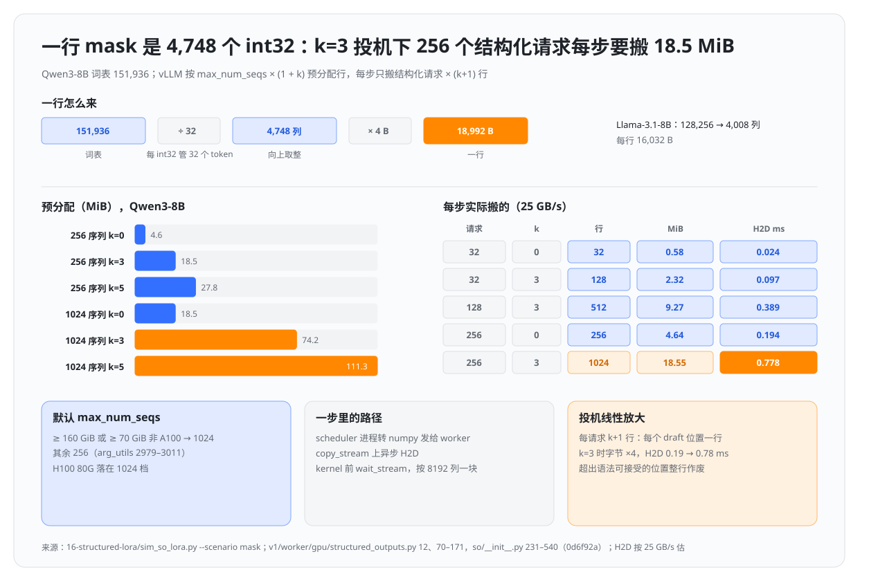
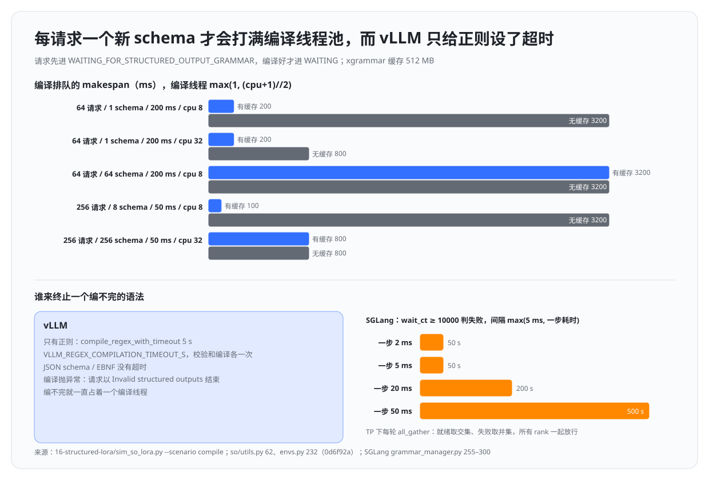
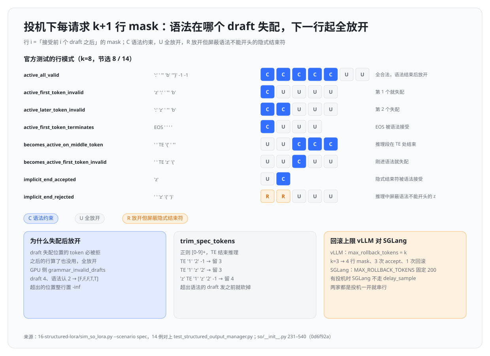
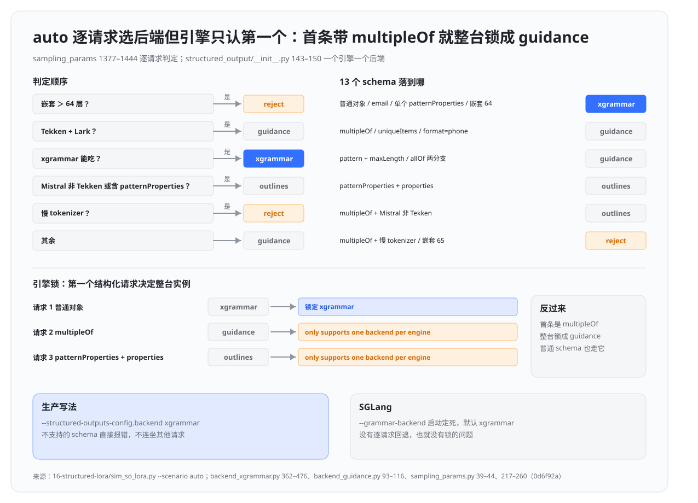
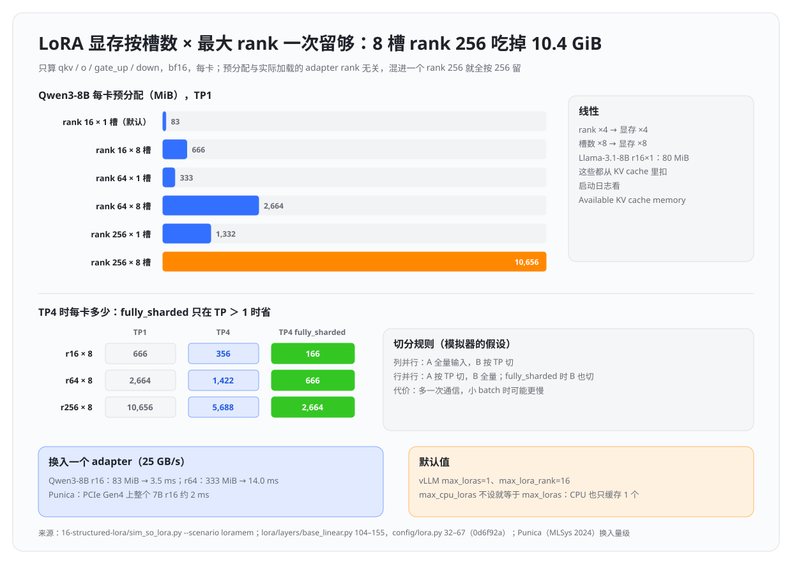
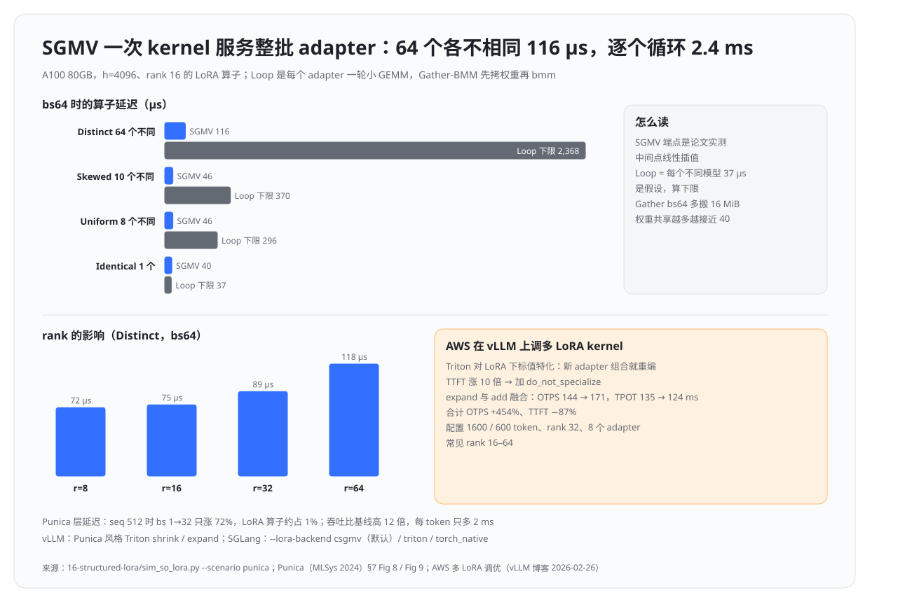
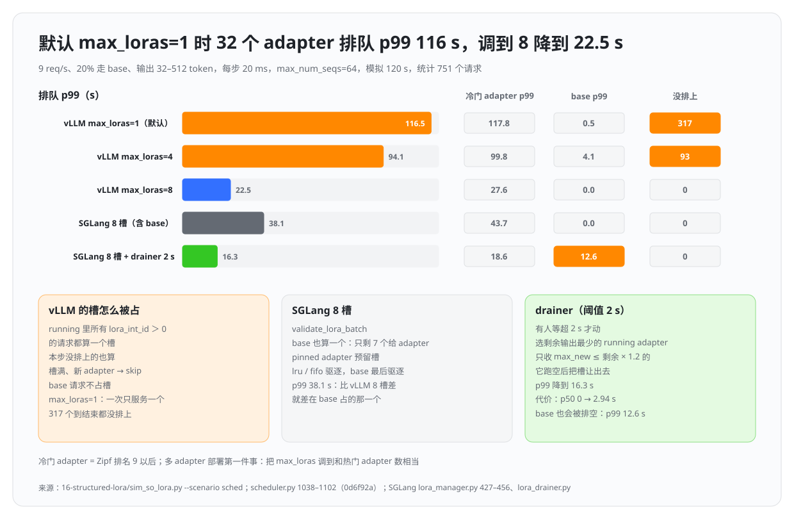
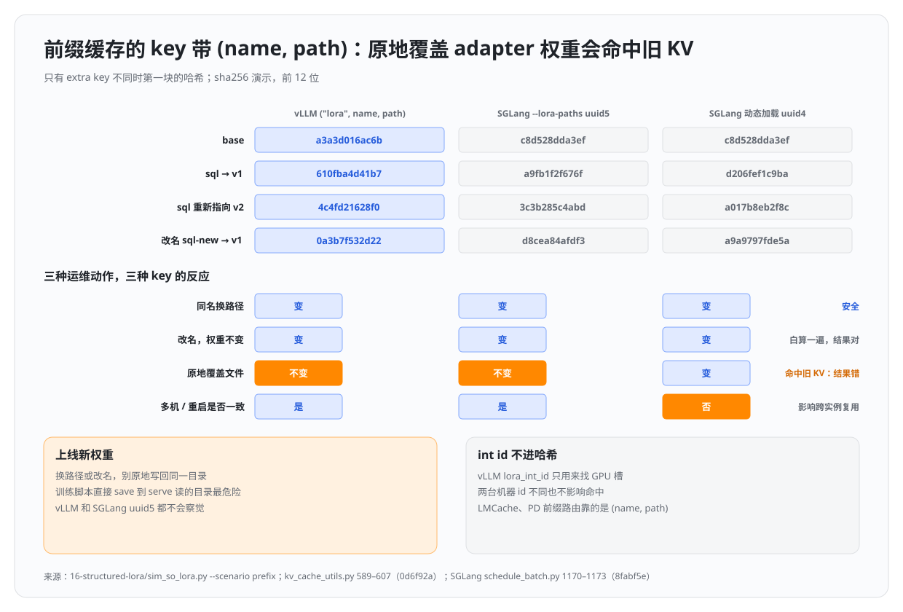
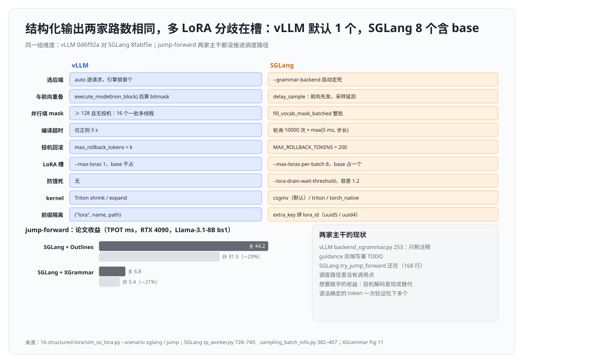
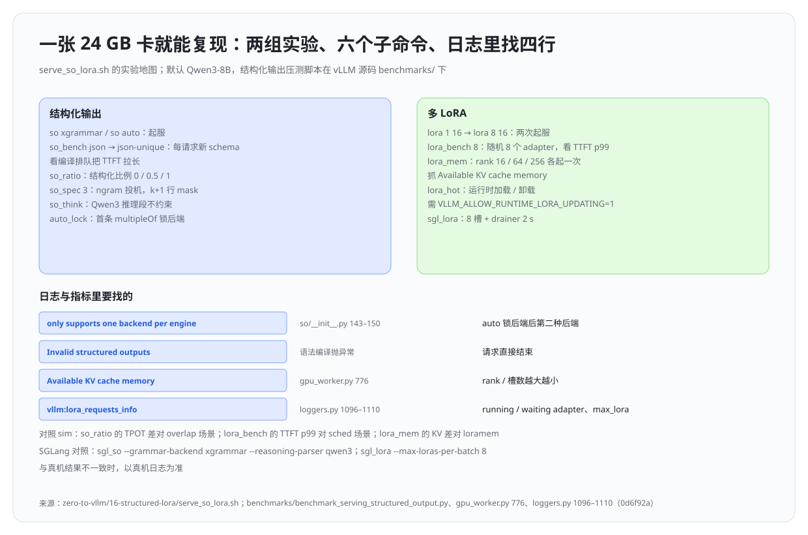

# VLLM-16｜规模｜结构化输出与多 LoRA

> 🎯 **这篇文档解决什么问题**：结构化输出和多 LoRA 改的是每条请求能吐什么、用哪套权重，两样都要在每一步付额外的账。结构化输出要求模型只吐出满足某个 JSON schema 或正则的 token，代价是每一步都要给整个词表算一行掩码：Qwen3-8B 一行 4,748 个 int32，开了 3 步投机、256 个请求时每步要往 GPU 搬 18.5 MiB。多 LoRA 让一个基座同时服务几十个微调版本，代价是 adapter 权重要预留显存、要在批内按请求分派，而 vLLM 的默认值 `max_loras=1` 让 32 个 adapter 的 Zipf 负载排队 p99 到 116 s。我们把这两笔账逐项算清楚，并对照 SGLang 的做法。
>
> **使用方式**：第 1–5 章是结构化输出：掩码账本、掩码与前向重叠、语法编译与超时、投机解码与推理段下的语法推进、auto 后端选择与 jump-forward。第 6–9 章是多 LoRA：预分配显存、Punica 的三种算子、调度器怎么占槽与排队、LoRA 与前缀缓存怎么隔离。第 10 章对照 SGLang，第 11 章是真机实验和源码阅读顺序。
>
> **代码**：[16-structured-lora](../16-structured-lora)。sim_so_lora.py 有 11 个场景，其中 spec 场景逐行移植了 `StructuredOutputManager` 的投机路径，14 种行模式全部对上官方测试。auto 场景按 vLLM 的判定顺序跑 13 个 schema。sched 场景用 Zipf 负载比较 vLLM 三档 max_loras、SGLang 8 槽和 drainer。26 个单测钉住了掩码列数、两种线程数公式、并行阈值、SGLang 超时、14 个行模式、嵌套 64 层边界、LoRA 显存线性、`validate_lora_batch` 计 base、drainer 的 1.2 容差和前缀 key。so_lora_matrix.md 是源码行号表，serve_so_lora.sh 是真机实验。

# 导读 · 先给结论

## 解析器与 LoRA 要匹配模型

结构化输出入口已接入双模型。so_think 必须显式指定经核对的 REASONING_PARSER，不继续默认沿用 Qwen3 的解析器。区分推理文本与最终受约束内容，检查拒绝、截断和流式输出。

LoRA 入口先检查 adapter_config 的基座、revision、rank 和显式 target_modules，并要求非空 adapter_model.safetensors。缺少训练版本记录时必须追溯工件，不能随意补写字段。检查不读取张量形状，不证明 GDN、路由专家或当前引擎支持该 adapter；MoE LoRA 与投机组合仍须单独验证。历史 adapter 内存模拟保留原投影结构。

双模型结构以固定版本配置核对[[Qwen3.8-27B config.json]](https://huggingface.co/Qwen/Qwen3.8-27B/blob/37561816e66b5b9153b1b64c10968c18c1e6f4a0/config.json)[[Qwen3.5-35B-A3B config.json]](https://huggingface.co/Qwen/Qwen3.5-35B-A3B/blob/59d61f3ce65a6d9863b86d2e96597125219dc754/config.json)。

1. **掩码本身不贵，贵的是算掩码。**一行 18,992 字节，256 个请求才 4.6 MiB，H2D 0.2 ms。决定 TPOT 的是 CPU 推进语法、填掩码的时间。XGrammar 论文里 PDA 基线一行 65.8 ms，比一步前向慢 10 倍；加上自适应 token mask 缓存后降到亚毫秒。
2. **只要填掩码比一步前向短，它就是免费的。**vLLM engine core 先非阻塞发出前向，再在 CPU 上算 bitmask，等前向结束后带着掩码采样。bs64、自适应缓存档：串行 27.8 ms，重叠后 18.0 ms，和不开结构化输出一样。SGLang 的 overlap 调度用 `delay_sample` 做同一件事。
3. **超过 128 个结构化请求才并行填掩码，开了投机一律串行。**16 个一批丢给 min(cpu/2, 8) 个线程，256 行从 4.61 ms 降到 0.58 ms。投机时每个请求要逐个 draft 推进语法再回滚，状态有先后依赖，只能单线程。
4. **投机下每个请求要 k+1 行掩码。**语法在第几个 draft 失配，从下一行起就整行放开，等拒绝采样把它拒掉；GPU 侧再把超出可接受 draft 数的行置 -inf。官方测试有 14 种行模式，模拟器全部复现。
5. **同一 schema 只编一次；每请求一个新 schema 才会把编译线程池打满。**vLLM 只给正则设了 5 s 编译超时，JSON schema 没有超时；SGLang 按轮询次数判失败，一步 20 ms 时要等 200 s。
6. **`backend=auto` 逐请求选后端，但一个引擎只认第一个。**第一条请求带 `multipleOf`，整台实例就锁成 guidance，之后普通 schema 也走 guidance；第一条是普通 schema，后面带 `multipleOf` 的直接报错。生产上应显式指定后端。
7. **LoRA 显存按 max_loras × max_lora_rank 一次留够，和实际 adapter 的 rank 无关。**Qwen3-8B 上 rank 16 一个槽 83 MiB，8 槽 rank 256 是 10.4 GiB，全部从 KV cache 里扣。TP4 时 fully_sharded 能再省一半。
8. **一个 kernel 服务一整批不同的 adapter。**Punica 的 SGMV 在 bs64、64 个不同 adapter 时 116 µs，逐个 adapter 循环至少 2.4 ms。AWS 在 vLLM 上去掉 Triton 对 LoRA 下标的值特化、融合 expand 与 add，OTPS 提高 454%，TTFT 降 87%。
9. **多 adapter 部署先改 max_loras。**vLLM 只要某个 adapter 还有请求在 running 就占着槽，槽满时新 adapter 的请求留在 waiting。32 个 adapter 的 Zipf 负载下，max_loras=1 时排队 p99 116.5 s、317 个请求到结束都没排上；调到 8 降到 22.5 s。SGLang 8 槽里 base 占一个，p99 38.1 s；开 drainer 降到 16.3 s，代价是 p50 从 0 涨到 2.9 s。
10. **前缀缓存按 (name, path) 隔离 adapter。**同名换路径、改名都安全；路径不变、文件被原地覆盖时，vLLM 和 SGLang 用 `--lora-paths` 加载的 adapter 都会命中旧 KV。上线新权重请换路径或改名。

# 第 1 章 · 掩码账本：一行多大、留多少、每步搬多少



## 1.1 结构化输出在采样前做了什么

约束解码的思路从 Outlines 开始就没变过：把 JSON schema 或正则编译成自动机，每一步根据自动机当前状态，算出词表里哪些 token 能接在后面，把其余 token 的 logit 置为 -inf[[1]](https://arxiv.org/abs/2307.09702)。正则对应有限状态机，可以事先把每个状态的合法 token 集合算好；JSON schema 允许递归嵌套，要用下推自动机（PDA），栈的状态无穷，没法全部预计算。XGrammar 的做法是把 token 分成两类：只看当前状态就能判定的（上下文无关 token，占绝大多数）提前算好缓存，必须看栈才能判定的（上下文相关 token）运行时再查[[2]](https://arxiv.org/abs/2411.15100)。vLLM 的 xgrammar 后端直接用它的 `GrammarCompiler` 和 `GrammarMatcher`[[3]](https://github.com/mlc-ai/xgrammar)；guidance 后端用微软的 llguidance，走 Earley 解析[[4]](https://github.com/guidance-ai/llguidance)。vLLM 博客有一篇入门，讲了 V0 时代掩码怎么拖慢吞吐、V1 为什么把掩码挪到 engine core[[5]](https://vllm.ai/blog/2025-01-14-struct-decode-intro)。

不管哪个后端，交给 GPU 的都是同一种东西：每个请求一行 bitmask，每个 int32 管 32 个 token，第 i 位为 0 就把对应 logit 置 -inf。

## 1.2 一行多大、预分配多少

```text
== 每行 bitmask = ceil(vocab/32) 个 int32；vLLM 预分配 max_num_seqs × (1 + k) 行
  Qwen3-8B      vocab 151,936 → 4,748 列，每行 18,992 B
  Llama-3.1-8B  vocab 128,256 → 4,008 列，每行 16,032 B

  模型            max_num_seqs  k     预分配行       预分配
  Qwen3-8B               256  0      256     4.6 MiB
  Qwen3-8B               256  3     1024    18.5 MiB
  Qwen3-8B               256  5     1536    27.8 MiB
  Qwen3-8B              1024  0     1024    18.5 MiB
  Qwen3-8B              1024  3     4096    74.2 MiB
  Qwen3-8B              1024  5     6144   111.3 MiB
  Llama-3.1-8B           256  0      256     3.9 MiB
  Llama-3.1-8B           256  3     1024    15.7 MiB
  Llama-3.1-8B           256  5     1536    23.5 MiB
  Llama-3.1-8B          1024  0     1024    15.7 MiB
  Llama-3.1-8B          1024  3     4096    62.6 MiB
  Llama-3.1-8B          1024  5     6144    93.9 MiB
  max_num_seqs 默认：显存 ≥ 160 GiB，或 ≥ 70 GiB 且不是 A100/GB10 时 1024，否则 256（arg_utils 2979–3011）
```

vLLM 在 [\_\_init\_\_.py](https://github.com/vllm-project/vllm/blob/0d6f92a/vllm/v1/structured_output/__init__.py) 里按 `max_num_seqs × (1 + num_speculative_tokens)` 行预分配一块 CPU 上的 int32 张量，GPU 侧在 [structured_outputs.py](https://github.com/vllm-project/vllm/blob/0d6f92a/vllm/v1/worker/gpu/structured_outputs.py) 里留同样大小的缓冲。预分配本身不大：H100 80 GB 默认 `max_num_seqs=1024`（[arg_utils.py](https://github.com/vllm-project/vllm/blob/0d6f92a/vllm/engine/arg_utils.py) 2979–3011 行），k=5 时也只有 111 MiB。

## 1.3 每步实际搬多少

```text
== 每步真正搬的是 结构化请求数 × (k+1) 行（grammar_bitmask 最后切到 num_masks），H2D 按 25 GB/s 估
       结构化请求  k      行         字节      H2D    kernel grid
           1  0      1     0.02MiB  0.001ms        (1, 19)
           1  3      4     0.07MiB  0.003ms        (4, 19)
          32  0     32     0.58MiB  0.024ms       (32, 19)
          32  3    128     2.32MiB  0.097ms      (128, 19)
         128  0    128     2.32MiB  0.097ms      (128, 19)
         128  3    512     9.27MiB  0.389ms      (512, 19)
         256  0    256     4.64MiB  0.194ms      (256, 19)
         256  3   1024    18.55MiB  0.778ms     (1024, 19)
  bitmask 先在 scheduler 进程转成 numpy 发给 worker（序列化），再在 copy_stream 上异步 H2D；kernel 前 wait_stream。
  k=3、256 个结构化请求时每步约 18 MiB，H2D 就要 0.7 ms 以上，投机步数会线性放大这笔账。
```

每步只搬结构化请求那几行：`grammar_bitmask` 最后把张量切到 `num_masks`。路径是 scheduler 进程把 bitmask 转成 numpy 发给 worker，worker 在 copy stream 上异步 H2D，kernel 启动前 `wait_stream`。kernel 本身（`_apply_grammar_bitmask_kernel`，70–171 行）按 8192 列一块切 grid，所以 Qwen3 的 151,936 词表是 19 块。

这张表要读的是最后一行：256 个结构化请求、k=3 时每步 1,024 行、18.55 MiB，按 25 GB/s 有效带宽也要 0.78 ms。投机把这笔账按 k+1 线性放大，第 4 章会看到为什么每个 draft 位置都要一行。

# 第 2 章 · 重叠：掩码怎么藏进 GPU 前向


## 2.1 engine core 的一步

[core.py](https://github.com/vllm-project/vllm/blob/0d6f92a/vllm/v1/engine/core.py) 685–693 行是这样一个顺序：`execute_model(scheduler_output, non_block=True)` 把前向发出去，拿到一个 future。CPU 这时调用 `get_grammar_bitmask` 推进每个请求的语法、填 bitmask。然后 `future.result()` 等前向结束，再调 `sample_tokens(grammar_output)` 带着掩码采样。掩码只影响采样，不影响前向，所以 CPU 填掩码和 GPU 前向可以完全并行。

## 2.2 XGrammar 的四档优化各能藏住多少

模拟器取 XGrammar 论文 Table 3 各优化档位的每行掩码成本，GPU 单步时间按 Table 2（MLC-LLM、Llama-3.1-8B）bs1 6.2 ms、bs16 9.0 ms 线性外推[[2]](https://arxiv.org/abs/2411.15100)。

```text
== 时间线（engine/core.py 685–693）：execute_model(non_block=True) 先把前向发出去，CPU 再算 bitmask，
   future.result() 等前向结束，然后 sample_tokens 带着 bitmask 采样。CPU 填 mask 被藏在 GPU 前向里。

  每行 mask 成本                 bs   GPU 步    填 mask    串行 TPOT    重叠 TPOT
  + 节点合并                      1    6.2ms   38.28ms     44.5ms     38.3ms
  + 节点合并                     16    9.0ms  612.48ms    621.5ms    612.5ms
  + 节点合并                     64   18.0ms 2449.92ms   2467.9ms   2449.9ms
  + 节点合并                    256   53.8ms 1224.96ms   1278.8ms   1225.0ms
  + 自适应 token mask 缓存         1    6.2ms    0.15ms      6.4ms      6.2ms
  + 自适应 token mask 缓存        16    9.0ms    2.46ms     11.5ms      9.0ms
  + 自适应 token mask 缓存        64   18.0ms    9.86ms     27.8ms     18.0ms
  + 自适应 token mask 缓存       256   53.8ms    4.93ms     58.7ms     53.8ms
  + 规则内联                      1    6.2ms    0.04ms      6.2ms      6.2ms
  + 规则内联                     16    9.0ms    0.56ms      9.6ms      9.0ms
  + 规则内联                     64   18.0ms    2.24ms     20.2ms     18.0ms
  + 规则内联                    256   53.8ms    1.12ms     54.9ms     53.8ms
  + 上下文扩展                     1    6.2ms    0.02ms      6.2ms      6.2ms
  + 上下文扩展                    16    9.0ms    0.29ms      9.3ms      9.0ms
  + 上下文扩展                    64   18.0ms    1.15ms     19.1ms     18.0ms
  + 上下文扩展                   256   53.8ms    0.58ms     54.4ms     53.8ms
  PDA 基线 65.776 ms/行，bs1 就比一步前向慢 10 倍，重叠也救不回来。
  bs256 的填 mask 反而比 bs64 短：过了 128 的并行阈值，按 cpu=16 开 8 个线程。
```

PDA 基线一行 65.8 ms，bs1 就比一步前向慢 10 倍，重叠也救不回来。“节点合并”档还是几十毫秒一行，bs64 时填掩码要 2.4 s。从“自适应 token mask 缓存”档开始，上下文无关 token 的结果直接查缓存，每行降到 0.15 ms，bs64 也只要 9.9 ms，比 18 ms 的前向短，重叠后 TPOT 和无约束一样。后两档（规则内联、上下文扩展）继续压缩上下文相关 token 的数量。论文 Table 2 的端到端结果是：MLC-LLM 上开不开 XGrammar，JSON Schema 任务 bs1 6.2 vs 6.3 ms、bs16 9.0 vs 9.2 ms。

## 2.3 多线程填掩码

```text
== 并行阈值：> 128 个结构化请求且没有投机，按 16 个一批丢给 max(1, min(cpu//2, 8)) 个线程（本机 cpu=4 → 2）
  cpu=  4 线程 2：256 行 串行 4.61 ms → 并行 2.304 ms（还要加 GIL 和提交开销）
  cpu= 16 线程 8：256 行 串行 4.61 ms → 并行 0.576 ms（还要加 GIL 和提交开销）
  cpu= 64 线程 8：256 行 串行 4.61 ms → 并行 0.576 ms（还要加 GIL 和提交开销）
  有投机时永远串行：每个请求要逐 draft 推进语法再回滚，状态有先后依赖。
  XGrammar Table 2：MLC-LLM 上开不开 XGrammar，JSON Schema bs1 6.2 vs 6.3 ms，bs16 9.0 vs 9.2 ms。
```

[\_\_init\_\_.py](https://github.com/vllm-project/vllm/blob/0d6f92a/vllm/v1/structured_output/__init__.py) 81–96 行定义了两个线程池：编译用 `max(1, (cpu+1)//2)` 个线程；填掩码用 `max(1, min(cpu//2, 8))` 个线程，结构化请求超过 128 个、而且没有投机时，按 16 个一批提交。这就是表里 bs256 的填掩码时间反而比 bs64 短的原因：bs64 在阈值以下，串行填。xgrammar 的 `fill_next_token_bitmask` 是 C++ 实现，会释放 GIL，多线程才有意义。

| 参数 | 默认 | 作用 |
|-|-|-|
| `--structured-outputs-config.backend` | `auto` | auto / xgrammar / guidance / outlines / lm-format-enforcer（config/structured_outputs.py 23） |
| `disable_any_whitespace` | False | 禁止 JSON 里的任意空白，只有 xgrammar、guidance 支持；能少生成一些 token |
| `reasoning_parser` / `enable_in_reasoning` | — / False | 有推理解析器时推理段默认不约束；打开后从第一个 token 起约束 |
| `VLLM_XGRAMMAR_CACHE_MB` | 512 | xgrammar 编译缓存上限（envs.py 1717） |
| `VLLM_REGEX_COMPILATION_TIMEOUT_S` | 5 | 正则编译超时（envs.py 232） |

[[6]](https://docs.vllm.ai/en/latest/features/structured_outputs/)

# 第 3 章 · 编译与超时：每请求一个新 schema 时



## 3.1 编译在哪里、什么时候

请求到达 scheduler 时，如果带了结构化输出参数，vLLM 立刻把编译任务提交到编译线程池，请求状态设为 `WAITING_FOR_STRUCTURED_OUTPUT_GRAMMAR`；编译完成后才转成 `WAITING`，参与正常调度。这样编译不阻塞 engine core 的循环，但会推迟这个请求的 TTFT。xgrammar 的 `GrammarCompiler` 带缓存，同一个 schema 第二次编译直接命中。

```text
== vLLM：请求到达即 submit 到编译线程池，状态 WAITING_FOR_STRUCTURED_OUTPUT_GRAMMAR，编译好才进 WAITING
  编译线程 max(1, (cpu+1)//2)；xgrammar GrammarCompiler max_threads=8、缓存上限 512 MB
     请求   不同 schema     单次编译  cpu      有缓存      无缓存
     64           1    200ms    8    200ms   3200ms
     64           1    200ms   32    200ms    800ms
     64          64    200ms    8   3200ms   3200ms
     64          64    200ms   32    800ms    800ms
    256           8     50ms    8    100ms   3200ms
    256           8     50ms   32     50ms    800ms
    256         256     50ms    8   3200ms   3200ms
    256         256     50ms   32    800ms    800ms
  同一个 schema 的请求排队等同一份编译结果；每请求一个新 schema（工具调用里很常见）才会把线程池打满。
```

同一个 schema 的 64 个请求，有缓存时总共 200 ms，所有请求等同一份结果；每个请求一个新 schema 时，cpu=8 开 4 个编译线程，64 个 200 ms 的编译排成 16 波，3.2 s。工具调用场景里每个请求带的 tools 不一样，生成的 schema 也不一样，正是后一种情况。vLLM 的结构化输出压测脚本有一个 `json-unique` 数据集专门测这个（第 11 章）。

## 3.2 谁来终止一个编不完的语法

```text
== 超时：谁来终止一个编不完的语法
  vLLM：只有正则有 5 s 编译超时（compile_regex_with_timeout，校验阶段和编译阶段各一次）；
        JSON schema / grammar 没有超时，编译抛异常时请求以 "Invalid structured outputs" 结束。
  SGLang：grammar_manager 按轮询次数计，wait_ct ≥ 10000 判失败，单次间隔 max(0.005 s, 一步 GPU 耗时)
    一步    2 ms → 最长等     50 s
    一步    5 ms → 最长等     50 s
    一步   20 ms → 最长等    200 s
    一步   50 ms → 最长等    500 s
  TP 下 SGLang 每轮 all_gather：就绪取交集、失败取并集，所有 rank 一起放行。
```

vLLM 只给正则设了超时：[utils.py](https://github.com/vllm-project/vllm/blob/0d6f92a/vllm/v1/structured_output/utils.py) 62 行的 `compile_regex_with_timeout`，默认 5 s，校验阶段和编译阶段各调一次。JSON schema 和 EBNF 语法没有超时，编译抛异常时请求以 “Invalid structured outputs” 结束；一直编不完就一直占着一个编译线程。SGLang 的 `grammar_manager.py` 255–300 行[[7]](https://github.com/sgl-project/sglang/blob/8fabf5e/python/sglang/srt/constrained/grammar_manager.py)按轮询次数计：每一轮调度检查一次编译 future，`wait_ct` 到 10,000 判失败，两次之间至少隔 5 ms，所以一步 GPU 时间越长，超时越长；TP 下每轮 all_gather 一次，就绪取交集、失败取并集，所有 rank 一起放行。

# 第 4 章 · 投机解码与推理段：语法要先走一遍 draft



## 4.1 为什么每个 draft 位置都要一行掩码

投机解码一次验证 k 个 draft，目标模型在 k+1 个位置上各给出一组 logit，拒绝采样逐个位置比对[[8]](https://arxiv.org/abs/2211.17192)。结构化输出要在每个位置上都生效，就得知道“接受了前 i 个 draft 之后”语法处在什么状态。vLLM 的 [\_\_init\_\_.py](https://github.com/vllm-project/vllm/blob/0d6f92a/vllm/v1/structured_output/__init__.py) 231–540 行这样做：对每个请求，先填第 0 行（当前状态），然后逐个 draft 调 `accept_tokens` 推进语法、填下一行。某个 draft 不被语法接受，从下一行起整行放开（全 1），后面不再推进。全部填完调 `rollback` 退回原状态。最终被接受的 token 在采样后再正式 accept 一遍。xgrammar 的 matcher 因此要开 `max_rollback_tokens = num_speculative_tokens`（[backend_xgrammar.py](https://github.com/vllm-project/vllm/blob/0d6f92a/vllm/v1/structured_output/backend_xgrammar.py) 202 行）。

整行放开、不做屏蔽，因为这一行已经不会被用到：draft 在前一个位置就违反了语法，GPU 侧 [structured_outputs.py](https://github.com/vllm-project/vllm/blob/0d6f92a/vllm/v1/worker/gpu/structured_outputs.py) 15 行的 `grammar_invalid_drafts` 会把超出可接受 draft 数的行整行置 -inf，拒绝采样一定在那里停下，从这一行采出一个合法 token。

```text
== GPU 侧 grammar_invalid_drafts：draft 4 个，语法只认前 2 个 → 位置 3、4 的 logit 行作废（拒绝采样必然拒）
  [False, False, False, True, True]
```

## 4.2 官方测试的 14 种行模式

[test_structured_output_manager.py](https://github.com/vllm-project/vllm/blob/0d6f92a/tests/v1/structured_output/test_structured_output_manager.py) 把这套逻辑钉成了 14 个用例[[9]](https://github.com/vllm-project/vllm/blob/0d6f92a/tests/v1/structured_output/test_structured_output_manager.py)。模拟器逐行移植了 `StructuredOutputManager` 的投机路径，语法用一个玩具实现，只为复现行模式。

```text
== FLOW_CASES（tests/v1/structured_output/test_structured_output_manager.py），k=8
   行 i 是"接受了前 i 个 draft 之后"的 mask：C=语法约束，U=全放开，R=放开但屏蔽隐式结束符
  inactive                             ' ' 'z' ' '                    → UUUU     ✓
  active_all_valid                     ':' ' "' 'b' '"}' -1 -1        → CCCCCUU  ✓
  active_first_token_invalid           'z' ':' ' "' 'b'               → CUUUU    ✓
  active_later_token_invalid           ':' 'z' ' "' 'b'               → CCUUU    ✓
  active_first_token_terminates        EOS ' ' ' '                    → CUUU     ✓
  active_later_token_terminates        ':' ' "' 'b' '"}' EOS ' '      → CCCCCUU  ✓
  becomes_active_on_first_token        TE '{' ' "' 'b'                → UCCCC    ✓
  becomes_active_on_middle_token       ' ' TE '{' ' "'                → UUCCC    ✓
  becomes_active_on_last_token         ' ' ' ' TE                     → UUUC     ✓
  becomes_active_first_token_invalid   ' ' TE 'z' '{'                 → UUCUU    ✓
  becomes_active_later_token_invalid   ' ' TE '{' 'z'                 → UUCCU    ✓
  becomes_active_terminates            ' ' TE '{' '}' EOS ' '         → UUCCCUU  ✓
  implicit_end_accepted                'z'                            → UC       ✓
  implicit_end_rejected                ' ' 'z' '{' '}'                → RRUUU    ✓
```

读这张表抓三类：

- **active\_\***：推理已结束、语法在约束中。第一个非法 draft 那一行仍是 C（它是“接受了前面合法 draft 之后”的掩码，会被用来重采），后面全是 U。遇到 EOS 同理，EOS 之后的行不再有意义。
- **becomes_active\_\***：draft 里出现了推理结束符 TE（Qwen3 的 `</think>`），TE 之前的行不受约束，TE 之后的第一行起才是 C。
- **implicit_end\_\***：推理段的行用 R，不用 U。R 是“放开，但屏蔽语法开头不允许的隐式结束符”。有的推理解析器把某个普通 token 当作推理结束的信号，如果这个 token 恰好让后面的语法无法开始，推理段就要提前屏蔽它；能以它开头的语法（正则 `z[0-9]+`）则照常放开。

```text
== 推理行屏蔽隐式结束符（引擎式 reasoner，隐式 z + 显式 TE）
  json 不能以 z 开头              ' ' ' '      → RRR ✓
  regex z[0-9]+ 能以 z 开头      ' ' 'z' '1'  → UUCC ✓
  并行填充路径（k=0）：推理中 R，接受 TE 后 C

== 正则 [0-9]+ 的终止（推理已结束）
  '1' '2'      → CCC ✓
  '1' EOS '2'  → CCUU ✓
  EOS '1'      → CUU ✓
  全部与官方测试一致：True
```

## 4.3 trim：把注定被拒的 draft 先剪掉

```text
== trim_spec_tokens：正则 [0-9]+，推理以 TE 结束
  TE '1' '2' -1            → 留 3 个 ✓
  TE '1' 'z' '2'           → 留 3 个 ✓
  '1' 'z' '2' -1           → 留 3 个 ✓
  'z' TE '1' 'z' '2' -1    → 留 4 个 ✓
```

scheduler 在把 draft 交给 worker 之前调用 `trim_spec_tokens`：语法在第 j 个 draft 失配，就只留到第 j 个（含失配那个，它的位置还要重采），后面的不送去验证，省下前向里那几个位置的计算。-1 是 `strip_speculative_padding`（[utils.py](https://github.com/vllm-project/vllm/blob/0d6f92a/vllm/v1/structured_output/utils.py) 48 行）去掉的填充。

## 4.4 推理模型：推理段不约束

Qwen3、DeepSeek-R1 这类模型先输出一段思考再给答案。配了 `reasoning_parser` 时，vLLM 默认推理段不上掩码，解析器看到推理结束符后才开始推进语法[[10]](https://docs.vllm.ai/en/latest/features/reasoning_outputs/)；`enable_in_reasoning=True` 则从第一个 token 起约束（config/structured_outputs.py 39、45 行）。这对答案质量是必要的：把思考段也压成 JSON，模型就没法正常推理。SGLang 用 `--reasoning-parser`，在 `think_end_id` 之前不约束，语义相同。

## 4.5 代价：投机下只能单线程

```text
== 代价：投机时一律串行，每请求 k+1 行，逐 draft accept 一次、最后 rollback 一次
  k=0：每请求 1 行 mask、最多 0 次 accept；xgrammar max_rollback_tokens = 0（SGLang 固定 200）
  k=1：每请求 2 行 mask、最多 1 次 accept；xgrammar max_rollback_tokens = 1（SGLang 固定 200）
  k=3：每请求 4 行 mask、最多 3 次 accept；xgrammar max_rollback_tokens = 3（SGLang 固定 200）
  k=5：每请求 6 行 mask、最多 5 次 accept；xgrammar max_rollback_tokens = 5（SGLang 固定 200）
```

每个请求的 k+1 行有先后依赖，必须同一个线程按顺序 accept、填、最后 rollback，所以 2.3 节的 128 并行阈值只在没有投机时生效。256 个结构化请求、k=3 时，CPU 要串行做 1,024 次填掩码和 768 次 accept；按自适应缓存档每行约 0.15 ms，合计 150 ms 以上，远比一步前向长。结构化输出和投机一起开，先看 CPU 侧填掩码时间，别只看 acceptance rate。SGLang 的 xgrammar 后端把 `MAX_ROLLBACK_TOKENS` 固定为 200（xgrammar_backend.py 63 行[[11]](https://github.com/sgl-project/sglang/blob/8fabf5e/python/sglang/srt/constrained/xgrammar_backend.py)），与 k 无关。

# 第 5 章 · auto 后端与 jump-forward



## 5.1 auto 怎么逐请求选后端

`--structured-outputs-config.backend` 默认是 `auto`，判定写在 [sampling_params.py](https://github.com/vllm-project/vllm/blob/0d6f92a/vllm/sampling_params.py) 1377–1444 行：Mistral Tekken tokenizer 加 Lark 语法 → guidance。xgrammar 能吃就用 xgrammar。否则 Mistral 非 Tekken 或 schema 里有 patternProperties → outlines。慢 tokenizer 直接报错。其余走 guidance。xgrammar 吃不下的特性列在 [backend_xgrammar.py](https://github.com/vllm-project/vllm/blob/0d6f92a/vllm/v1/structured_output/backend_xgrammar.py) 362–476 行的 `has_xgrammar_unsupported_json_features`，guidance 的列在 [backend_guidance.py](https://github.com/vllm-project/vllm/blob/0d6f92a/vllm/v1/structured_output/backend_guidance.py) 93–116 行，只有一条：任意一层出现 patternProperties[[4]](https://github.com/guidance-ai/llguidance)。在此之前还有一道 JSON 嵌套检查，超过 64 层直接拒绝（sampling_params.py 39、217–260 行）。

```text
== backend="auto" 每个请求单独判定（sampling_params 1377–1444）
  schema                             tokenizer 后端        原因
  普通对象                               fast      xgrammar  -
  price: multipleOf 0.01             fast      guidance  number + multipleOf
  tags: uniqueItems                  fast      guidance  array + uniqueItems/contains
  email 格式                           fast      xgrammar  -
  自定义 format                         fast      guidance  string format=phone
  pattern + maxLength                fast      guidance  string pattern/format + min/maxLength
  单个 patternProperties               fast      xgrammar  -
  patternProperties + properties     fast      outlines  patternProperties + properties；有 patternProperties
  allOf 两个分支                         fast      guidance  allOf 多分支
  multipleOf + 慢 tokenizer           slow      reject    number + multipleOf；guidance 不支持慢 tokenizer
  multipleOf + Mistral(非 Tekken)     mistral   outlines  number + multipleOf；非 Tekken Mistral
  嵌套 64 层                            fast      xgrammar  -
  嵌套 65 层                            fast      reject    嵌套超过 64 层
```

价格字段写 `multipleOf: 0.01`、标签数组写 `uniqueItems`、手机号写自定义 `format`，这些在业务 schema 里都很常见，单独看每条都能被某个后端吃下。

## 5.2 一个引擎只认第一个后端

```text
== 一个引擎只能有一个后端（structured_output/__init__.py 143–150）
  第 1 个请求 → xgrammar，引擎锁定为 xgrammar
  第 2 个请求 → guidance，与 xgrammar 不同：报 "only supports one backend per engine"
  第 3 个请求 → outlines，与 xgrammar 不同：报 "only supports one backend per engine"
  反过来，如果第一个请求恰好是 multipleOf，引擎会锁成 guidance，之后所有普通 schema 都走 guidance。
  生产上显式写 --structured-outputs-config.backend，别让第一条请求决定整台实例的后端。

  SGLang：--grammar-backend 启动时选定（默认 xgrammar），没有逐请求的 auto 回退。
```

[\_\_init\_\_.py](https://github.com/vllm-project/vllm/blob/0d6f92a/vllm/v1/structured_output/__init__.py) 143–150 行：`StructuredOutputManager` 只持有一个 backend 实例，第一个结构化请求决定它是谁，之后判定结果不同的请求报 “only supports one backend per engine”。于是 auto 的语义变成了“看第一条请求的运气”：同一台实例，重启后第一条请求不同，后面的报错率就不同。生产上该显式写后端，并在网关侧对 schema 做一次 `has_xgrammar_unsupported_json_features` 等价的检查，把不支持的请求挡在外面或路由到另一组实例。复现见第 11 章 `auto_lock`。

## 5.3 jump-forward：论文有收益，两家主干都没接上

```text
== jump-forward：语法唯一确定的后续字符串（如 JSON 的 "key": ）不用一个个采样，直接追加
  SGLang + Outlines  TPOT  44.2 →  31.5 ms（-29%）
  SGLang + XGrammar  TPOT   6.8 →   5.4 ms（-21%）
  来源：XGrammar 论文 Fig 11，RTX 4090 + Ryzen 7950X，Llama-3.1-8B，bs1，JSON Schema 任务
```

jump-forward 出自 SGLang 论文的 compressed FSM 一节：语法唯一确定的后续字符串，比如 JSON 的 `"name": `，不必一个 token 一个 token 地采，直接追加再做一次 prefill[[12]](https://arxiv.org/abs/2312.07104)。XGrammar 论文 Fig 11 在 SGLang 上测出了 21%–29% 的 TPOT 下降[[2]](https://arxiv.org/abs/2411.15100)。

```text
== 两家主干的现状
  vLLM：backend_xgrammar.py 253 行只有指向 find_jump_forward_string 的注释，guidance 后端写着 TODO。
  SGLang：XGrammarGrammar.try_jump_forward 仍在（xgrammar_backend.py 168），但 scheduler / model_runner /
          schedule_batch / grammar_manager 里没有调用点。
  所以两家的结构化输出提速都靠 mask 生成快 + 与 GPU 重叠，不靠跳字。想要跳字的收益，投机解码是现成的替代：
  语法确定的 token 被 draft 猜中后，一次验证就吃下多个位置。
```

读源码时容易被 SGLang 里还留着的 `try_jump_forward` 误导，以为它在跑。实际上 scheduler、model_runner、schedule_batch、grammar_manager 里都找不到调用点。要接上它，得处理追加字符串后的重新分词（token 边界会变），还要和 overlap 调度的状态同步，实现成本不低。vLLM 主干没有实现。两家今天都靠“掩码算得快、藏进前向”拿到接近零开销的结构化输出；想吃掉确定性片段，用投机解码，语法确定的 token 容易被 ngram 或 EAGLE 猜中。

# 第 6 章 · LoRA 显存：按最坏情况一次留够



## 6.1 预分配的形状

LoRA 把一个线性层的增量写成 `B·A`，A 是 `r × in`，B 是 `out × r`。多 LoRA 服务的思路来自 Punica 和 S-LoRA：基座只放一份，adapter 权重按请求分派，一个批里可以混着不同的 adapter[[13]](https://arxiv.org/abs/2310.18547)[[14]](https://arxiv.org/abs/2311.03285)。vLLM 为了让 CUDA graph 和 kernel 形状固定，在 [base_linear.py](https://github.com/vllm-project/vllm/blob/0d6f92a/vllm/lora/layers/base_linear.py) 104–155 行给每个被 LoRA 包裹的线性层预分配两块张量：`lora_a_stacked` 形状 `(max_loras, 1, max_lora_rank, in)`，`lora_b_stacked` 形状 `(max_loras, 1, out, max_lora_rank)`。加载一个 rank 8 的 adapter，也是写进 rank 16 的槽里、其余补零。

```text
== vLLM 按 max_loras × max_lora_rank 预分配 A/B（base_linear.py 104–155），与实际加载的 adapter rank 无关
   统计 qkv / o / gate_up / down 四类线性层，bf16，单卡
  模型            rank max_loras  TP        每卡  fully_sharded 每卡
  Qwen3-8B        16         1   1      83MiB              83MiB
  Qwen3-8B        16         1   4      44MiB              21MiB
  Qwen3-8B        16         8   1     666MiB             666MiB
  Qwen3-8B        16         8   4     356MiB             166MiB
  Qwen3-8B        64         1   1     333MiB             333MiB
  Qwen3-8B        64         1   4     178MiB              83MiB
  Qwen3-8B        64         8   1    2664MiB            2664MiB
  Qwen3-8B        64         8   4    1422MiB             666MiB
  Qwen3-8B       256         1   1    1332MiB            1332MiB
  Qwen3-8B       256         1   4     711MiB             333MiB
  Qwen3-8B       256         8   1   10656MiB           10656MiB
  Qwen3-8B       256         8   4    5688MiB            2664MiB
  Llama-3.1-8B    16         1   1      80MiB              80MiB
  Llama-3.1-8B    16         1   4      41MiB              20MiB
  Llama-3.1-8B    16         8   1     640MiB             640MiB
  Llama-3.1-8B    16         8   4     328MiB             160MiB
  Llama-3.1-8B    64         1   1     320MiB             320MiB
  Llama-3.1-8B    64         1   4     164MiB              80MiB
  Llama-3.1-8B    64         8   1    2560MiB            2560MiB
  Llama-3.1-8B    64         8   4    1312MiB             640MiB
  Llama-3.1-8B   256         1   1    1280MiB            1280MiB
  Llama-3.1-8B   256         1   4     656MiB             320MiB
  Llama-3.1-8B   256         8   1   10240MiB           10240MiB
  Llama-3.1-8B   256         8   4    5248MiB            2560MiB
  max_lora_rank 取的是最大的那个 adapter：混着一个 rank 256 的，8 个槽全按 256 留。
  fully_sharded 只切列并行的 A 和行并行的 B，TP 越大省得越多，代价是多一次通信。
```

这块显存在 profiling 之前就分好，算 KV cache 可用显存时已经扣掉了。三条规律：

- **线性于 rank 和槽数**：Qwen3-8B rank 16 一个槽 83 MiB，8 个槽 666 MiB；rank 256、8 槽 10.4 GiB，在 80 GB 卡上就是七八分之一的 KV cache。
- **max_lora_rank 取最大的那个 adapter**：一批 rank 16 的 adapter 里混进一个 rank 256 的，所有槽都按 256 留。rank 差距大的 adapter 应该拆到不同实例。
- **fully_sharded 只在 TP>1 时有用**：默认 TP 下，列并行层的 A 是全量（输入没切）、行并行层的 B 是全量（输出没切）；`fully_sharded_loras=True` 把这两块也按 TP 切，代价是 shrink 之后多一次 all_gather。TP4、rank 256、8 槽从 5688 MiB 降到 2664 MiB。

## 6.2 换上一个 adapter 要多久

```text
== 一个 adapter 从 CPU 换上 GPU 要搬多少（按实际 rank，H2D 假设 25 GB/s）
  Qwen3-8B      rank  16:     83 MiB →   3.5 ms
  Qwen3-8B      rank  64:    333 MiB →  14.0 ms
  Llama-3.1-8B  rank  16:     80 MiB →   3.4 ms
  Llama-3.1-8B  rank  64:    320 MiB →  13.4 ms
  Punica 的量级：PCIe Gen4 x16 上一层约 50 µs、整个模型约 2 ms（Llama-2-7B，rank 16）。
  SGLang 默认 max_loras_per_batch=8；vLLM 默认 max_loras=1，max_cpu_loras 不设时等于 max_loras。
```

adapter 从磁盘先加载到 CPU 缓存（容量 `max_cpu_loras`），调度到它时再拷进 GPU 槽。按实际 rank 搬，Qwen3-8B rank 16 是 83 MiB、约 3.5 ms，比一步解码还短，所以 GPU 槽换入不是瓶颈；瓶颈在槽数，第 8 章细说。Punica 论文给的量级是 Llama-2-7B rank 16 整个模型约 2 ms[[13]](https://arxiv.org/abs/2310.18547)。

| 参数 | 默认 | 作用 |
|-|-|-|
| `--enable-lora` | False | 打开后才包裹线性层、预分配槽 |
| `--max-loras` | 1 | GPU 上同时驻留的 adapter 数，也是一个批里最多的不同 adapter 数；base 不占 |
| `--max-lora-rank` | 16 | 预分配的 rank 上限，大于它的 adapter 加载时报错 |
| `--max-cpu-loras` | None（= max_loras） | CPU 侧 LRU 缓存的 adapter 数 |
| `--fully-sharded-loras` | False | TP 下把 A/B 全切，省显存、多一次通信 |
| `--lora-modules name=path` | — | 启动时注册的 adapter，请求里 `model` 填 name |

[[15]](https://docs.vllm.ai/en/latest/features/lora/)

# 第 7 章 · Punica 算子：一个 kernel 服务一整批 adapter



## 7.1 三种实现

批里每个请求用的 adapter 不同，`x·Aᵀ·Bᵀ` 就没法用一次 GEMM 做完。Punica 论文比较了三种做法[[13]](https://arxiv.org/abs/2310.18547)：

```text
== Punica 的三种实现（论文 §7 算子微基准，A100 80GB）
  Loop：每个 LoRA 一轮 bs=1 的小 GEMM；Gather-BMM：先把每个请求要的权重拷成一份大张量再 bmm；
  SGMV：按 segment 直接索引各自的权重，一次 kernel

  workload    bs     不同模型  SGMV(µs)   Loop 下限(µs)   Gather 多搬
  Distinct     1        1        37            37       256KiB
  Distinct    16       16        56           592      4096KiB
  Distinct    64       64       116          2368     16384KiB
  Uniform      1        1        37            37       256KiB
  Uniform     16        4        39           148      4096KiB
  Uniform     64        8        46           296     16384KiB
  Skewed       1        1        37            37       256KiB
  Skewed      16        6        39           222      4096KiB
  Skewed      64       10        46           370     16384KiB
  Identical    1        1        37            37       256KiB
  Identical   16        1        38            37      4096KiB
  Identical   64        1        40            37     16384KiB
  SGMV 端点是论文实测（Distinct 37→116 µs，Uniform/Skewed 37→46，Identical 37→40），中间点线性插值。
  Loop 下限按"每个不同模型一轮 37 µs"估，是假设；Gather 多搬的字节按 h=4096、rank 16 的 A 矩阵算。
```

Loop 按 adapter 分组、每组一次小 GEMM，不同 adapter 越多越慢，bs64 全不同时下限 2.4 ms，而一层基座 GEMM 才几十微秒。Gather-BMM 先把每个请求要的 A/B 拷成一个大张量再 bmm，算子快了但每层多搬 16 MiB。SGMV（Segmented Gather Matrix-Vector）按请求所属的 segment 直接索引各自的权重，一次 kernel 做完，bs64 全不同也只有 116 µs。

```text
== rank 的影响（Fig 9，Distinct）：bs1 约 42 µs，bs64
  r=  8: 72 µs
  r= 16: 75 µs
  r= 32: 89 µs
  r= 64: 118 µs
  有权重共享时（Uniform/Skewed/Identical）bs 1→64 都在 42–45 µs。
  层延迟：seq 512 时 bs 1→32 只涨 72%；LoRA 算子约占 1%。Punica 吞吐比基线高 12 倍，每 token 只多 2 ms。
```

## 7.2 vLLM 的实现：shrink 与 expand

vLLM 沿用 Punica 的拆法，但用 Triton 重写成两个 kernel：[lora_shrink_op.py](https://github.com/vllm-project/vllm/blob/0d6f92a/vllm/lora/ops/triton_ops/lora_shrink_op.py) 算 `x·Aᵀ`（hidden → rank），[lora_expand_op.py](https://github.com/vllm-project/vllm/blob/0d6f92a/vllm/lora/ops/triton_ops/lora_expand_op.py) 算 `·Bᵀ` 并加回基座输出（rank → hidden）。两者都接收每个 token 的 LoRA 下标，按下标去 `lora_a_stacked` / `lora_b_stacked` 里取对应槽，下标 -1 表示不加 LoRA。qkv、gate_up 这类合并层一次 kernel 处理多个切片。

## 7.3 工业实践：AWS 在 vLLM 上的两处修改

```text
== 工业实践：AWS 在 vLLM 上调多 LoRA kernel（vLLM 博客 2026-02-26）
  Triton 对 LoRA 下标做了值特化，每来一个新 adapter 组合就重编，TTFT 涨 10 倍 → 加 do_not_specialize
  expand 与 add 融合：144 → 171 OTPS（tuned），TPOT 135 → 124 ms；合计 OTPS +454%、TTFT -87%
  测试配置 1600 输入 / 600 输出、rank 32、8 个 adapter；他们说常见 rank 是 16–64
```

AWS 在 SageMaker 和 Bedrock 上用 vLLM 服务几十个微调模型，发现两个问题[[16]](https://vllm.ai/blog/2026-02-26-multi-lora)。第一个是 Triton 的值特化：kernel 参数里的整数如果碰巧等于 1 或能被 16 整除，Triton 会为它单独编译一个版本，LoRA 下标、adapter 数这些每批都在变，于是新组合一来就重编，TTFT 涨 10 倍；给这些参数加 `do_not_specialize` 解决。第二个是 expand 后单独一个 add kernel，融合进 expand 后 OTPS 从 144 到 171。合计 OTPS 提高 454%、TTFT 降 87%。

SGLang 的 LoRA 后端可选 `--lora-backend` csgmv（默认）/ triton / torch_native / triton_v2，csgmv 是 chunked SGMV[[17]](https://docs.sglang.io/docs/advanced_features/server_arguments)。

# 第 8 章 · 调度：max_loras=1 是一个排队问题



## 8.1 vLLM 怎么占槽

[scheduler.py](https://github.com/vllm-project/vllm/blob/0d6f92a/vllm/v1/core/sched/scheduler.py) 1038–1047 行，每步开头收集 `scheduled_loras`：running 队列里所有 `lora_int_id > 0` 的请求的 adapter，包括这一步因 token 预算没排上的。1091–1102 行处理 waiting：如果请求的 adapter 不在集合里、而集合已经有 `max_loras` 个，就跳过这个请求（1565 行的 skip 分支），它留在 waiting，下一步再看。base 请求不占槽。worker 侧 [model_manager.py](https://github.com/vllm-project/vllm/blob/0d6f92a/vllm/lora/model_manager.py) 1449–1462 行按 LRU 激活：槽满时淘汰最久未用的；没有可淘汰的报 “No free adapter slots.”（1406 行）。调度器保证了后者不会发生。

所以一个 adapter 只要还有一个请求在生成，就一直占着槽。max_loras=1 时，热门 adapter 的请求源源不断，冷门 adapter 要等它的 running 请求全部跑完、而且这一刻 waiting 里排在前面的恰好是冷门请求，才能换上。

## 8.2 Zipf 负载下的排队

```text
== 负载：32 个 adapter，Zipf α=1.5，20% 走 base；到达 9.0 req/s，
   输出 32–512 token 均匀，每步 20 ms，max_num_seqs=64，模拟 120 s；只统计前 70% 时间到达的 751 个请求
  配置                             排队 p50     p99      最长    没排上 |  冷门 adapter p99 base p99
  vLLM max_loras=1（默认）            3.24s  116.5s  119.5s    317 |          117.8s     0.5s
  vLLM max_loras=4                0.00s   94.1s   99.8s     93 |           99.8s     4.1s
  vLLM max_loras=8                0.00s   22.5s   27.6s      0 |           27.6s     0.0s
  SGLang 8 槽（含 base）              0.00s   38.1s   43.7s      0 |           43.7s     0.0s
  SGLang 8 槽 + drainer 2 s        2.94s   16.3s   21.3s      0 |           18.6s    12.6s
  冷门 adapter = Zipf 排名 9 以后的那些。
  vLLM：只要还有一个该 adapter 的请求在 running（哪怕本步因 token 预算没排上），它就占着一个槽；
        槽满时新 adapter 的请求被 skip 留在 waiting，base 请求不占槽。
  SGLang：base 也算一个槽，所以 8 槽实际只给 7 个 adapter；drainer 让剩余最少的 running adapter 只收
          max_new ≤ 剩余 × 1.2 的新请求，它自然跑空后把槽让给等得最久的 adapter。
          base（lora_id=None）也在 running_adapter_ids 里，同样可能被选中排空——表里 base p99 上涨就是这个。
  max_loras=1 是 vLLM 默认值：多 adapter 生产部署第一件事就是把它调到和热门 adapter 数相当。
```

max_loras=1 时 p50 就有 3.24 s，p99 116.5 s，317 个请求到模拟结束都没排上；调到 4 仍有 93 个没排上，调到 8 全部排上、p99 22.5 s。SGLang 默认 `--max-loras-per-batch 8`，但 base 也算一个槽（lora_id 为 None 也进 `running_adapter_ids`），实际只给 7 个 adapter，p99 38.1 s。SGLang 的准入在 `lora_manager.py` 427–456 行的 `validate_lora_batch`[[18]](https://github.com/sgl-project/sglang/blob/8fabf5e/python/sglang/srt/lora/lora_manager.py)，还会给 pinned adapter 预留槽位。

## 8.3 SGLang 的 drainer

SGLang 加了一个防饿死机制[[19]](https://github.com/sgl-project/sglang/blob/8fabf5e/python/sglang/srt/lora/lora_drainer.py)：`--lora-drain-wait-threshold`（秒，默认 0 关闭）。当 waiting 里有 adapter 等待超过阈值、槽又满了，drainer 选 running 里剩余 token 最少的 adapter，让它只接收 `max_new_tokens ≤ 剩余 × 1.2` 的新请求，于是它在有限时间内跑空，把槽让出来。表里 drainer 把 p99 从 38.1 s 压到 16.3 s，代价是 p50 从 0 涨到 2.94 s：被排空的 adapter 自己的新请求要等。base 也可能被选中排空，所以 base p99 从 0 涨到 12.6 s。vLLM 没有对应机制，只能靠加大 max_loras，或在网关侧按 adapter 分实例。

Zipf 负载下要算的是：热门 adapter 数 + 1 个周转槽，再看显存够不够（第 6 章）。rank 16 时多留 7 个槽只要 583 MiB，没有理由守着默认值 1。

# 第 9 章 · LoRA 与前缀缓存：KV 按谁隔离



## 9.1 为什么必须隔离

LoRA 改的是 q、k、v 投影，同一段 system prompt 经过不同 adapter 算出来的 KV 不一样。前缀缓存如果只按 token 哈希，adapter A 的请求就可能命中 adapter B 留下的块，输出悄悄变错，不报任何错误[[20]](https://docs.vllm.ai/en/latest/design/prefix_caching/)。所以两家都把 adapter 身份拼进块哈希的 extra key。

vLLM 在 [kv_cache_utils.py](https://github.com/vllm-project/vllm/blob/0d6f92a/vllm/v1/core/kv_cache_utils.py) 589–607 行的 `_gen_lora_extra_hash_keys` 里拼 `("lora", name, path)`，只用于每个请求的第一块（后续块通过父哈希链式继承）。`lora_int_id` 不进哈希，它只用来找 GPU 槽。SGLang 在 `schedule_batch.py` 1170–1173 行把 `lora_id` 拼进 extra_key[[21]](https://github.com/sgl-project/sglang/blob/8fabf5e/python/sglang/srt/managers/schedule_batch.py)；这个 id 由 `lora_registry.py` 生成[[22]](https://github.com/sgl-project/sglang/blob/8fabf5e/python/sglang/srt/lora/lora_registry.py)：`--lora-paths` 启动时加载的用 `uuid5(name\0path)`，运行时动态加载的用 `uuid4`。

## 9.2 四种情况

```text
== 同一段 system prompt，第一块的哈希（只有 extra key 不同）
  情况                                     vLLM key  SGLang(CLI)   SGLang(动态)
  base                               a3a3d016ac6b c8d528dda3ef c8d528dda3ef
  sql → v1                           610fba4d41b7 a9fb1f2f676f d206fef1c9ba
  sql 重新指向 v2                        4c4fd21628f0 3c3b285c4abd a017b8eb2f8c
  改名 sql-new → v1                    0a3b7f532d22 d8cea84afdf3 a9a9797fde5a

  判读：
  - 重新指向（同名换路径）：vLLM key 带 path，不会命中旧 KV；SGLang 两种 id 也都变了。三者都安全。
  - 改名但权重一样：vLLM 和 SGLang 都不复用——KV 白算一遍，但不会错。
  - 路径不变、文件被原地覆盖（训练脚本直接写回同一目录）：vLLM key 不变，会命中旧 KV；
    SGLang 用 CLI 加载的 uuid5 也不变；只有动态加载的 uuid4 每次都不同。上线新权重请换路径或改名。
```

危险的是最后一种：训练脚本把新 checkpoint 直接写回同一个目录，然后调 `/v1/load_lora_adapter` 用同一个 name 和 path 重新加载。vLLM 的 key 一字不差，旧 KV 全部命中，前缀部分的注意力用的还是旧权重算出来的 K、V。SGLang 用 `--lora-paths` 加载的同理；只有动态加载的 uuid4 每次都换。上线流程里把版本号写进路径（`/loras/sql/v2`），或者把版本号写进 name，就能绕开。

## 9.3 多机与重启

```text
== 多机 / 重启：同一个 adapter 的 key 是否稳定（影响跨实例的 KV 复用，比如 LMCache、PD 的前缀路由）
  vLLM (name, path)            两台机器一致：是
  SGLang --lora-paths uuid5    两台机器一致：是
  SGLang 动态加载 uuid4            两台机器一致：否
  lora_int_id 不进哈希：vLLM 的 int id 只用来找 GPU 槽，同一 adapter 在两台机器上 id 不同也不影响命中。
```

key 稳定才谈得上跨实例复用：LMCache 这类外部 KV 存储、PD 分离里按前缀哈希做路由，都要求同一个 adapter 在两台机器上算出同样的块哈希[[23]](https://arxiv.org/abs/2510.09665)[[24]](https://vllm.ai/blog/2026-09-29-disaggregated-serving-guide)。vLLM 的 (name, path) 和 SGLang 的 uuid5 满足；SGLang 动态加载的 uuid4 不满足，跨机永远不命中。反过来，这也说明 uuid4 和“原地覆盖安全”是同一枚硬币的两面。

# 第 10 章 · 对照 SGLang



两家的结构化输出都建立在 xgrammar 上，核心手段一样：掩码与前向重叠。SGLang overlap 调度下，`tp_worker.py` 728–749 行把采样包成 `delay_sample_func`[[25]](https://github.com/sgl-project/sglang/blob/8fabf5e/python/sglang/srt/managers/tp_worker.py)，前向先发出去，CPU 推进语法后再采样；`sampling_batch_info.py` 382–407 行的 `update_regex_vocab_mask` 用 `fill_vocab_mask_batched` 一次填整批[[26]](https://github.com/sgl-project/sglang/blob/8fabf5e/python/sglang/srt/sampling/sampling_batch_info.py)。差别在边角：vLLM 有逐请求的 auto 回退但会锁后端，SGLang 启动时定死。vLLM 给投机开 k 步回滚，SGLang 固定 200 步[[11]](https://github.com/sgl-project/sglang/blob/8fabf5e/python/sglang/srt/constrained/xgrammar_backend.py)。超时一个按墙钟一个按轮询次数。

多 LoRA 差别更大。SGLang 默认 8 槽、有 drainer 防饿死、有 pinned 预留和异步加载（`--enable-lora-overlap-loading`）；vLLM 默认 1 槽、没有防饿死，靠用户调大 max_loras。

```text
维度             | vLLM                                                 | SGLang
  结构化输出后端        | auto：逐请求 xgrammar → guidance/outlines；引擎锁定首个         | --grammar-backend 启动定死，默认 xgrammar
  mask 与前向重叠     | execute_model(non_block) 后在 engine core 算 bitmask    | overlap 下 delay_sample：前向先发，CPU 推进语法、填 mask 后再采样
  并行填 mask       | > 128 请求且无投机：16 个一批，min(cpu//2,8) 线程                 | fill_vocab_mask_batched 一次填整批
  编译超时           | 仅正则 5 s                                              | 轮询 10000 次 × max(5 ms, 步长)
  投机 + 语法        | rollback 上限 = num_speculative_tokens；逐 draft 生成 k+1 行 | MAX_ROLLBACK_TOKENS=200
  jump-forward   | 无（只剩注释）                                              | try_jump_forward 仍在，调度路径没调用
  LoRA 槽         | max_loras=1，base 不占槽                                 | max_loras_per_batch=8，base 占一个槽
  LoRA 准入        | running 里所有 adapter 占槽，满了 skip                       | validate_lora_batch + pinned 预留 + drainer
  LoRA 显存        | max_loras × max_lora_rank 预分配                        | mem_pool 按 max_lora_rank 预分配，lru/fifo 驱逐，base 最后驱逐
  LoRA kernel    | Punica 风格 Triton shrink/expand                       | csgmv（默认）/ triton / torch_native
  前缀隔离           | extra key ("lora", name, path)                       | extra_key 拼 lora_id（uuid4 / uuid5）
```

| 维度 | vLLM 参数 | SGLang 参数 |
|-|-|-|
| 后端 | `--structured-outputs-config.backend` | `--grammar-backend` |
| 推理段 | `--reasoning-parser` + `enable_in_reasoning` | `--reasoning-parser` |
| 槽数 | `--max-loras`（1） | `--max-loras-per-batch`（8，含 base） |
| CPU 缓存 | `--max-cpu-loras` | `--max-loaded-loras` + `--lora-eviction-policy` |
| 防饿死 | — | `--lora-drain-wait-threshold`（0 关闭） |
| kernel | Triton shrink / expand | `--lora-backend` csgmv / triton / torch_native / triton_v2 |
| 运行时加载 | `VLLM_ALLOW_RUNTIME_LORA_UPDATING=1` | `/load_lora_adapter`，默认开 |

[[17]](https://docs.sglang.io/docs/advanced_features/server_arguments)

# 第 11 章 · 真机实验与源码阅读顺序



## 11.1 实验

默认 Qwen3-8B 单卡，24 GB 以上即可。结构化输出压测用 vLLM 源码 `benchmarks/benchmark_serving_structured_output.py`，五种数据集里 `json` 所有请求同一 schema、`json-unique` 每请求一个新 schema，对比两者的 TTFT 就是第 3 章编译排队的真机版。`--structured-output-ratio` 扫 0 / 0.5 / 1，看 TPOT 是否随结构化比例上涨：没涨说明掩码完全藏进了前向（第 2 章）。

```bash
# 在 16-structured-lora 目录执行。终端 1
MODEL_PROFILE=dense TP=2 bash serve_so_lora.sh so xgrammar
# 终端 2：先确认服务就绪
MODEL_PROFILE=dense bash serve_so_lora.sh so_bench json
# 停止旧服务后再改配置；moe 使用相同流程，分开保存结果
# LoRA：LORA_DIR 下每个子目录包含可追溯的 adapter_config.json 与 safetensors
MODEL_PROFILE=dense TP=2 bash serve_so_lora.sh lora 1 16
# 另一终端，仅在服务端加载了对应 adapter 后执行
MODEL_PROFILE=dense LORA_MAX_RANK=16 bash serve_so_lora.sh lora_bench 8
# so_think 须显式设置 REASONING_PARSER；lora_hot 暂停执行
python3 -m unittest test_validate_adapter test_serve_so_lora -v
```

LoRA 预检只核对配置声明与文件存在性：基座仓库和 revision 必须匹配，rank 及 rank_pattern 不超过本次上限，target_modules 显式列出，adapter_model.safetensors 非空。它不读取张量，不验证形状或模块在当前架构中是否存在，也不证明 GDN、专家层或当前引擎支持这些适配器。真机加载后须另测输出质量与显存增量；第 6 章的 666 MiB 至 10,656 MiB 属于历史 Qwen3-8B 账本，不能作为双模型验收值。比较 max_loras 时固定适配器集合和请求分布，保存 TTFT p99、错误数及实际暴露的 LoRA 指标，不能预设等待队列或延迟一定按模拟方向变化。运行时加载卸载分支 lora_hot 仍暂停，本文不提供绕过入口。

## 11.2 源码阅读顺序

结构化输出从请求入口读：[sampling_params.py](https://github.com/vllm-project/vllm/blob/0d6f92a/vllm/sampling_params.py) 的 auto 判定和嵌套检查 → [\_\_init\_\_.py](https://github.com/vllm-project/vllm/blob/0d6f92a/vllm/v1/structured_output/__init__.py) 的 `StructuredOutputManager`（线程池、`grammar_init`、`grammar_bitmask`、`trim_spec_tokens`）→ [backend_xgrammar.py](https://github.com/vllm-project/vllm/blob/0d6f92a/vllm/v1/structured_output/backend_xgrammar.py) 看 matcher 的 accept / rollback / fill → [core.py](https://github.com/vllm-project/vllm/blob/0d6f92a/vllm/v1/engine/core.py) 685–693 行的重叠 → [structured_outputs.py](https://github.com/vllm-project/vllm/blob/0d6f92a/vllm/v1/worker/gpu/structured_outputs.py) 的 kernel。边读边对 [test_structured_output_manager.py](https://github.com/vllm-project/vllm/blob/0d6f92a/tests/v1/structured_output/test_structured_output_manager.py)，14 个用例就是规格说明。

多 LoRA 从配置读：[lora.py](https://github.com/vllm-project/vllm/blob/0d6f92a/vllm/config/lora.py) → [base_linear.py](https://github.com/vllm-project/vllm/blob/0d6f92a/vllm/lora/layers/base_linear.py) 的预分配 → [model_manager.py](https://github.com/vllm-project/vllm/blob/0d6f92a/vllm/lora/model_manager.py) 的 LRU 激活 → [lora_shrink_op.py](https://github.com/vllm-project/vllm/blob/0d6f92a/vllm/lora/ops/triton_ops/lora_shrink_op.py) / [lora_expand_op.py](https://github.com/vllm-project/vllm/blob/0d6f92a/vllm/lora/ops/triton_ops/lora_expand_op.py) → [scheduler.py](https://github.com/vllm-project/vllm/blob/0d6f92a/vllm/v1/core/sched/scheduler.py) 搜 `scheduled_loras` → [kv_cache_utils.py](https://github.com/vllm-project/vllm/blob/0d6f92a/vllm/v1/core/kv_cache_utils.py) 的 extra key。SGLang 对照读 `lora_manager.py`、`lora_drainer.py`、`lora_registry.py` 三个文件即可。行号都在 so_lora_matrix.md。

## 11.3 自己训一个 LoRA adapter

前面的实验和模拟器都假设手里已经有 adapter。这一节从零训一个，再检查它能不能被 vLLM 和 SGLang 加载。代码在 [16-structured-lora](../16-structured-lora) 的 `train_lora.py` 和 `check_adapter.py`。训练依赖 torch、transformers 和 peft，CPU 就能跑，和推理环境分开装；检查脚本只用标准库。

```bash
pip install -r ../requirements-lora.txt
python3 train_lora.py
python3 train_lora.py --base Qwen/Qwen3-0.6B --steps 80 --lr 1e-3 --out loras/qwen-city-r8
python3 train_lora.py --base Qwen/Qwen3-0.6B --rank 64 --out loras/qwen-city-r64
python3 check_adapter.py loras/*
python3 test_lora_adapter.py
```

第一条命令用随机权重的小 Llama 跑几秒，只验证流程；第三条换 rank 64，给第 8 章的多 LoRA 实验凑不同档位。任务是让模型把「城市：巴黎」答成一行 JSON：数据是 40 对城市和国家，最后 4 对留出不参与训练。底座不会自发输出这个格式，训完的 adapter 会，加不加 adapter 一眼就能看出差别。

在 Apple M4 Pro 的 CPU 上实跑 Qwen3-0.6B（float32，batch 8，80 步，学习率 1e-3，r=8，alpha=16，只训 q/k/v/o_proj）：用时 73.3 秒，训练 loss 从 2.3322 降到 0.0005；留出的 4 条 loss 从 2.338 降到 0.057，完全答对从 0 条变成 3 条。可训练参数 2,293,760 个，占总参数 598,343,680 的 0.383%，adapter 文件 9.2 MB、224 个张量。探针「城市：巴西利亚」训练前答成「时间：2023年」，训练后答成 `{"city": "巴西利亚", "country": "巴西"}`。

```plaintext
== qwen-city-r8
  底座      Qwen/Qwen3-0.6B
  r / alpha 8 / 16
  声明模块  ['v_proj', 'k_proj', 'o_proj', 'q_proj']
  实际模块  ['k_proj', 'o_proj', 'q_proj', 'v_proj']（224 个张量）
  vLLM    可以加载
  SGLang  可以加载
  vLLM    --enable-lora --max-lora-rank 8 --lora-modules qwen-city-r8=/绝对路径/loras/qwen-city-r8
  SGLang  --enable-lora --max-lora-rank 8 --lora-target-modules k_proj o_proj q_proj v_proj --lora-paths qwen-city-r8=/绝对路径/loras/qwen-city-r8
```

检查脚本按两家的加载规则逐条核对，下面几处最容易踩：

- vLLM 的 `--max-lora-rank` 只能取 1、8、16、32、64、128、256、320、512，默认 16（[vllm/config/lora.py](https://github.com/vllm-project/vllm/blob/0d6f92a/vllm/config/lora.py) 第 27 行）。rank 64 的 adapter 不改这个参数会加载失败。
- vLLM 不支持 DoRA；`modules_to_save` 只接受 `classifier` 和 `score`，把 `lm_head` 或 `embed_tokens` 一起训的 adapter 上不了 vLLM（[vllm/lora/peft_helper.py](https://github.com/vllm-project/vllm/blob/0d6f92a/vllm/lora/peft_helper.py)）。
- SGLang 不传 `--max-lora-rank` 时取启动时所有 adapter 里最大的 r，之后热加载更大 rank 的 adapter 会报 incompatible；训练时往词表里加了 token 的 adapter，SGLang 拒绝加载。
- SGLang 的 `--lora-target-modules` 会把 q/k/v_proj 归一成 `qkv_proj`、gate/up_proj 归一成 `gate_up_proj`；只写 `qkv_proj` 而 adapter 还训了 `o_proj`，同样加载失败。

把训好的几个目录放进 `$LORA_DIR`，就能接着跑 11.1 的 `serve_so_lora.sh lora` 和 `lora_bench`。训练和检查在 CPU 上实跑过；GPU 上的加载、输出质量和压测本节没有实测。

> 📌 **核对清单**
> - 能算出自己模型的 bitmask 列数（ceil(vocab/32)）和 k 步投机下每步 H2D 字节数。
> - 能说出 vLLM 在哪一行发出非阻塞前向、在哪一步填掩码，为什么填掩码比前向短时不增加 TPOT。
> - 知道并行填掩码的两个条件（>128 个结构化请求、没有投机），以及两个线程池各自的线程数公式。
> - 能看懂 C / U / R 三种行，解释 active_later_token_invalid 为什么是 CCUUU。
> - 知道 vLLM 只有正则有编译超时，SGLang 的超时随步长变化。
> - 生产上显式指定结构化输出后端，并在网关侧过滤 xgrammar 不支持的 schema。
> - 能算出 max_loras × max_lora_rank 的预分配显存，并在启动日志的 KV cache 可用显存里验证。
> - 多 adapter 部署把 max_loras 调到热门 adapter 数 + 1，用 `vllm:lora_requests_info` 看 waiting 名单。
> - 上线新 adapter 权重时换路径或改名，不原地覆盖。
> - 上线 adapter 前跑 `check_adapter.py`：rank 落在 vLLM 允许的档位里，没有 DoRA，`modules_to_save` 只有分类头。

到这里，vLLM 的功能面已经走完：调度、KV、并行、投机、量化、PD 分离、结构化输出和多 LoRA。每一项都有一组参数，而且它们抢的是同一块显存、同一个 token 预算。下一篇 VLLM-17 把这些参数放到一起：从负载画像出发，定 `max_num_batched_tokens`、`gpu_memory_utilization`、编译档位和 CUDA graph 尺寸，给出一张可以直接照着改的调参手册。

# 参考文献

按正文首次引用顺序编号，资料截至 2026 年 10 月底。源码以 vllm-project/vllm 主干提交 0d6f92a（2026 年 10 月 29 日）和 v0.32.0 发行版为准；SGLang 对照以 sgl-project/sglang 主干 8fabf5e 为准。

[1] Willard B T, Louf R. Efficient Guided Generation for Large Language Models. arXiv (2023) [https://arxiv.org/abs/2307.09702](https://arxiv.org/abs/2307.09702)

[2] Dong Y, et al. XGrammar: Flexible and Efficient Structured Generation Engine for Large Language Models. MLSys (2025) [https://arxiv.org/abs/2411.15100](https://arxiv.org/abs/2411.15100)

[3] mlc-ai. XGrammar. GitHub [https://github.com/mlc-ai/xgrammar](https://github.com/mlc-ai/xgrammar)

[4] guidance-ai. llguidance: Super-fast Structured Outputs. GitHub [https://github.com/guidance-ai/llguidance](https://github.com/guidance-ai/llguidance)

[5] vLLM Team. Structured Decoding in vLLM: a gentle introduction. vLLM Blog (2025-01-14) [https://vllm.ai/blog/2025-01-14-struct-decode-intro](https://vllm.ai/blog/2025-01-14-struct-decode-intro)

[6] vLLM Docs. Structured Outputs [https://docs.vllm.ai/en/latest/features/structured_outputs/](https://docs.vllm.ai/en/latest/features/structured_outputs/)

[7] sgl-project. sglang/srt/constrained/grammar_manager.py. GitHub (8fabf5e) [https://github.com/sgl-project/sglang/blob/8fabf5e/python/sglang/srt/constrained/grammar_manager.py](https://github.com/sgl-project/sglang/blob/8fabf5e/python/sglang/srt/constrained/grammar_manager.py)

[8] Leviathan Y, et al. Fast Inference from Transformers via Speculative Decoding. ICML (2023) [https://arxiv.org/abs/2211.17192](https://arxiv.org/abs/2211.17192)

[9] vllm-project. tests/v1/structured_output/test_structured_output_manager.py. GitHub (0d6f92a) [https://github.com/vllm-project/vllm/blob/0d6f92a/tests/v1/structured_output/test_structured_output_manager.py](https://github.com/vllm-project/vllm/blob/0d6f92a/tests/v1/structured_output/test_structured_output_manager.py)

[10] vLLM Docs. Reasoning Outputs [https://docs.vllm.ai/en/latest/features/reasoning_outputs/](https://docs.vllm.ai/en/latest/features/reasoning_outputs/)

[11] sgl-project. sglang/srt/constrained/xgrammar_backend.py. GitHub (8fabf5e) [https://github.com/sgl-project/sglang/blob/8fabf5e/python/sglang/srt/constrained/xgrammar_backend.py](https://github.com/sgl-project/sglang/blob/8fabf5e/python/sglang/srt/constrained/xgrammar_backend.py)

[12] Zheng L, et al. SGLang: Efficient Execution of Structured Language Model Programs. NeurIPS (2024) [https://arxiv.org/abs/2312.07104](https://arxiv.org/abs/2312.07104)

[13] Chen L, et al. Punica: Multi-Tenant LoRA Serving. MLSys (2024) [https://arxiv.org/abs/2310.18547](https://arxiv.org/abs/2310.18547)

[14] Sheng Y, et al. S-LoRA: Serving Thousands of Concurrent LoRA Adapters. MLSys (2024) [https://arxiv.org/abs/2311.03285](https://arxiv.org/abs/2311.03285)

[15] vLLM Docs. LoRA Adapters [https://docs.vllm.ai/en/latest/features/lora/](https://docs.vllm.ai/en/latest/features/lora/)

[16] AWS. Efficiently serve dozens of fine-tuned models with vLLM on Amazon SageMaker AI and Amazon Bedrock. vLLM Blog (2026-02-26) [https://vllm.ai/blog/2026-02-26-multi-lora](https://vllm.ai/blog/2026-02-26-multi-lora)

[17] SGLang Docs. Server Arguments [https://docs.sglang.io/docs/advanced_features/server_arguments](https://docs.sglang.io/docs/advanced_features/server_arguments)

[18] sgl-project. sglang/srt/lora/lora_manager.py. GitHub (8fabf5e) [https://github.com/sgl-project/sglang/blob/8fabf5e/python/sglang/srt/lora/lora_manager.py](https://github.com/sgl-project/sglang/blob/8fabf5e/python/sglang/srt/lora/lora_manager.py)

[19] sgl-project. sglang/srt/lora/lora_drainer.py. GitHub (8fabf5e) [https://github.com/sgl-project/sglang/blob/8fabf5e/python/sglang/srt/lora/lora_drainer.py](https://github.com/sgl-project/sglang/blob/8fabf5e/python/sglang/srt/lora/lora_drainer.py)

[20] vLLM Docs. Automatic Prefix Caching (design) [https://docs.vllm.ai/en/latest/design/prefix_caching/](https://docs.vllm.ai/en/latest/design/prefix_caching/)

[21] sgl-project. sglang/srt/managers/schedule_batch.py. GitHub (8fabf5e) [https://github.com/sgl-project/sglang/blob/8fabf5e/python/sglang/srt/managers/schedule_batch.py](https://github.com/sgl-project/sglang/blob/8fabf5e/python/sglang/srt/managers/schedule_batch.py)

[22] sgl-project. sglang/srt/lora/lora_registry.py. GitHub (8fabf5e) [https://github.com/sgl-project/sglang/blob/8fabf5e/python/sglang/srt/lora/lora_registry.py](https://github.com/sgl-project/sglang/blob/8fabf5e/python/sglang/srt/lora/lora_registry.py)

[23] Liu Y, et al. LMCache: An Efficient KV Cache Layer for Enterprise-Scale LLM Inference. arXiv (2025) [https://arxiv.org/abs/2510.09665](https://arxiv.org/abs/2510.09665)

[24] vLLM Team. Taking vLLM Apart: A Practical Guide to Disaggregated Serving. vLLM Blog (2026-09-29) [https://vllm.ai/blog/2026-09-29-disaggregated-serving-guide](https://vllm.ai/blog/2026-09-29-disaggregated-serving-guide)

[25] sgl-project. sglang/srt/managers/tp_worker.py. GitHub (8fabf5e) [https://github.com/sgl-project/sglang/blob/8fabf5e/python/sglang/srt/managers/tp_worker.py](https://github.com/sgl-project/sglang/blob/8fabf5e/python/sglang/srt/managers/tp_worker.py)

[26] sgl-project. sglang/srt/sampling/sampling_batch_info.py. GitHub (8fabf5e) [https://github.com/sgl-project/sglang/blob/8fabf5e/python/sglang/srt/sampling/sampling_batch_info.py](https://github.com/sgl-project/sglang/blob/8fabf5e/python/sglang/srt/sampling/sampling_batch_info.py)

---

[在 Colab 里跑本章 CPU 练习](https://colab.research.google.com/github/chenziyaos/zero-to-vllm/blob/main/colab/16-structured-lora.ipynb) · 上一章：[VLLM-15｜规模｜PD 分离：NIXL、KV 传输与 P/D 感知路由](./15-pd-disagg.md) · [目录](./README.md) · 下一章：[VLLM-17｜生产｜调参手册：预算、显存比例、编译档位与负载画像](./17-tuning.md)
