# VLLM-17｜生产｜调参手册：预算、显存比例、编译档位与负载画像

> 🎯 **这篇文档解决什么问题**：vLLM 不传任何调参参数也能跑，因为引擎会按卡型、显存和入口替你选一组默认值。H100 上 API server 拿到 `max_num_batched_tokens=8192`、`max_num_seqs=1024`，同为 80 GB 的 A100 只拿到 2048 / 256。这组默认值是为“通用负载”挑的，和你的输入输出长度、SLO、到达方式都无关。我们先把默认值从哪来、会被怎样改写讲清楚，再按显存、预算、并发、捕获网格、准入、编译档位六个旋钮逐个算账，每个旋钮都给出模拟器的数字和真机复现命令，并对照 SGLang 的同类参数。
>
> **使用方式**：第 1–2 章是默认值和后处理，先知道引擎替你做了什么决定。第 3–8 章是六个旋钮：`gpu_memory_utilization`、CUDA graph 捕获网格、`max_num_batched_tokens`、`max_num_seqs`、`max_num_queued_tokens` 准入、`-O` 编译档位。第 9 章给调参顺序和 CPU 核数，第 10 章对照 SGLang，第 11 章是真机实验。只想照着改的话，直接看第 9 章和文末清单。
>
> **代码**：[17-tuning](../17-tuning)。sim_tuning.py 有 8 个场景：defaults 逐行移植了 `get_batch_defaults`、后处理四步和 `_set_cudagraph_sizes`，并排放 SGLang `memory_hook` 的分档。mem 沿用 ch02 的显存账本。budget、seqs、queue 复用 06 章的步进模拟器。19 个单测钉住了各卡默认档位、A100 卡名判断、throughput 模式只翻倍未设的项、默认网格 51 个、Blackwell 上限 1024、SGLang H100 mem_fraction 0.830、ch02 的 24,957 块和 CPU 公式。sweep.sh 是真机实验，tuning_matrix.md 是源码行号表，tuning_log_template.md 是调参记录模板。

# 导读 · 先给结论

## 调参按模型分开留档

sweep.sh 通过 MODEL_PROFILE 选择模型，服务端固定 revision，结果按模型分目录。每轮记录 GPU、TP/EP、精度、上下文、token 预算、序列数、缓存和 MTP 设置，不能只记 util 与吞吐。

先用公共账本检查 KV 与状态预算，再测并发和排队。旧 sim_tuning 的固定页大小与模型系数仍是历史机制示例，不能直接预测混合页池容量。任何超时、OOM 或缺失结果都应计入失败，不剔除后宣称最佳。

双模型结构以固定版本配置核对[[Qwen3.8-27B config.json]](https://huggingface.co/Qwen/Qwen3.8-27B/blob/37561816e66b5b9153b1b64c10968c18c1e6f4a0/config.json)[[Qwen3.5-35B-A3B config.json]](https://huggingface.co/Qwen/Qwen3.5-35B-A3B/blob/59d61f3ce65a6d9863b86d2e96597125219dc754/config.json)。

1. **默认值按卡、按入口分档，A100 是特例。**`get_batch_defaults` 先看 torch 报告的显存，再看卡名和入口：H100 上 `LLM` 类拿 16384 / 1024，API server 拿 8192 / 1024；A100 80G 虽然显存够 70 GiB，卡名含 a100 就落到 2048 / 256，因为 PR #17885 实测大预算在 A100 上反而掉吞吐。SGLang 只按 nvidia-smi 显存分档，A100 与 H100 同档。
2. **你传的数还会被改写。**后处理四步：throughput 模式只把没设的项翻倍，关掉 chunked prefill 时预算抬到 max_model_len，预算不超过 seqs × max_model_len，seqs 不超过预算。只设 `--max-num-seqs 64` 时预算仍是 8192，但图上限跟着缩到 128。
3. **显存比例是最没油水的旋钮。**H100 + Qwen3-8B，util 每加 0.01 只多 0.79 GiB、约 5,760 个 KV token；从默认 0.92 拧到 0.97 只多 7%，却把留给 PyTorch 之外进程和碎片的余量从 6.3 GiB 压到 2.4 GiB。KV 不够时先考虑 FP8 KV、TP 或缩短 max_model_len。
4. **max_num_seqs 1024 而图只捕获到 512。**非 Blackwell 卡的捕获上限是 min(2 × max_num_seqs, 512)，H100 默认 51 个尺寸，batch 超过 512 就走 eager。B200 上限 1024、83 个尺寸。SGLang H100 默认 decode 图只到 256。
5. **预算是 ITL 和 TTFT 的跷跷板。**10 req/s、SLO 为 TTFT 2 s 且 TPOT 30 ms 时，预算从 8192 降到 512，ITL p99 从 265.8 ms 降到 26.3 ms，TTFT p50 从 119 ms 涨到 606 ms，goodput 从 8.31 升到 9.05 req/s。负载轻到 6 req/s 时，六档预算都接近 100% 达标，调预算没有意义。
6. **并发上限最终是 KV。**2000 条请求同时到达，KV 只够装约 173 条；max_num_seqs 从 32 到 256，吞吐从 2,298 涨到 3,572 tok/s，再往上不涨。想压 decode batch 又不想缩小图，用 `max_num_active_seqs`。
7. **过载时快速失败比排队强。**`max_num_queued_tokens` 按“目标 TTFT × prefill 吞吐”设上限，超限返回 503。20 req/s 时拒掉约 10% 的请求，TTFT p99 从 27.2 s 降到 2.1 s。上限按 0.6 倍起步，因为排进来的请求还要和 decode 抢步。
8. **-O 档位拿启动时间换稳态性能。**默认 O2 编译并捕获 FULL_AND_PIECEWISE 图，打开 allreduce_rms、rope_kvcache 等融合；O0 什么都不编译，启动最快。启动敏感的场景先把 `VLLM_CACHE_ROOT` 打进镜像，再考虑降档。
9. **顺序是显存 → 预算 → 并发 → 网格 → 准入 → 启动。**前一步圈定后一步的范围。每次只改一个变量，或者用 `vllm bench sweep serve` 跑笛卡尔积；每条改动记录负载、指标和结论。
10. **两家旋钮能对上，口径不同。**vLLM 的预算管整步 token（prefill + decode），SGLang 的 `chunked_prefill_size` 只管 prefill 段，decode 另跑一批；vLLM 的 util 是整卡比例，SGLang 的 `mem_fraction_static` 是权重 + KV 的静态比例。照抄数值会出错。

# 第 1 章 · 默认值：引擎替你选了什么

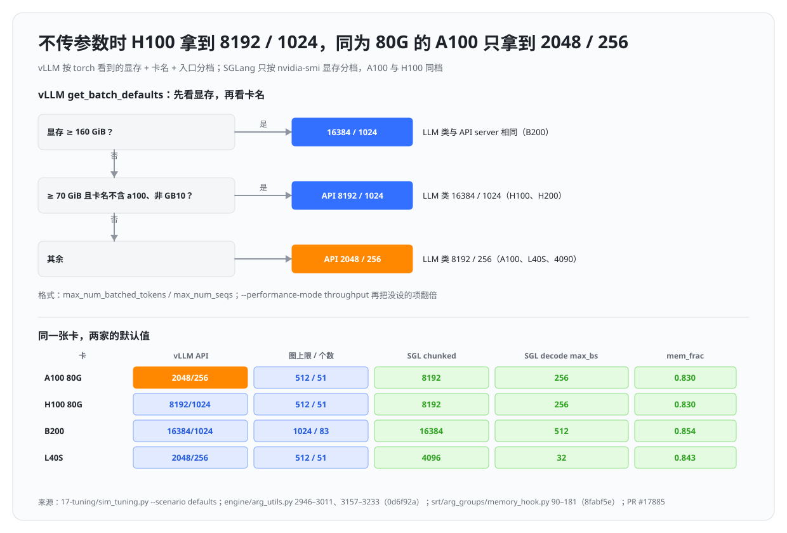

## 1.1 三档默认值

不传 `--max-num-batched-tokens` 和 `--max-num-seqs` 时，[arg_utils.py](https://github.com/vllm-project/vllm/blob/0d6f92a/vllm/engine/arg_utils.py) 2946 行的 `get_batch_defaults` 返回两张表，一张按 usage context 给预算，一张给 seqs。分档依据是 `torch.cuda.mem_get_info` 报告的总显存（GiB）和设备名：≥160 GiB 的卡（B200 这一代；H200 约 140 GiB，仍在下一档）两种入口都是 16384 / 1024。≥70 GiB、卡名不含 a100、也不是 GB10 的卡，`LLM` 类 16384 / 1024，OpenAI API server 8192 / 1024。其余一律 `LLM` 类 8192 / 256、API server 2048 / 256。同一张卡，离线批处理和在线服务拿到的预算差一倍，因为在线服务更在意 ITL。

```text
== 不调参时各卡的默认值（Qwen3-8B，max_model_len 40960，TP=1）
卡               vLLM API     vLLM LLM 类  API+throughput   vLLM 图上限    图个数 | SGL chunked SGL dec max_bs  dec 图  pre 图 mem_frac
a100-80g    2048/256       8192/256        4096/512            512     51 |        8192            256     36     58    0.830
h100-sxm    8192/1024     16384/1024      16384/2048           512     51 |        8192            256     36     58    0.830
h200        8192/1024     16384/1024      16384/2048           512     51 |        8192            256     36     58    0.903
b200       16384/1024     16384/1024      32768/2048          1024     83 |       16384            512     52     74    0.854
l40s        2048/256       8192/256        4096/512            512     51 |        4096             32      8     50    0.843
rtx4090     2048/256       8192/256        4096/512            512     51 |        4096             48     10     50    0.704
```

A100 的特例在 2976 行，注释指向 PR #17885。这个 PR 的标题就是 “Use small max_num_batched_tokens for A100”[[1]](https://github.com/vllm-project/vllm/pull/17885)：在 A100 上，大预算让 prefill 和 decode 挤进同一步，单步变长，吞吐不升反降。所以 A100 80G 虽然显存够 70 GiB，也落到 2048 / 256。L40S 和 4090 显存不够 70 GiB，落到同一档。

## 1.2 SGLang 怎么分档

SGLang 在 `srt/arg_groups/memory_hook.py` 90–171 行按 nvidia-smi 报告的显存（MiB）分档，同时决定 `chunked_prefill_size`、decode 图的 `max_bs` 和 `mem_fraction_static`[[2]](https://github.com/sgl-project/sglang/blob/8fabf5e/python/sglang/srt/arg_groups/memory_hook.py)。它不看卡名，A100 80G 和 H100 同档：8192 / 256。<90G 与 <160G 两档的数值一样，所以 H200 也是 8192 / 256，只有 B200 这种更大的卡才到 16384 / 512。表里 SGLang 的 mem_frac 由第 3 章的 reserved 公式算出，H100 是 0.830，与 ch02 一致。

两家默认值的差异主要在 max_running。vLLM 在 H100 上默认允许 1024 条同时运行；SGLang 的 `max_running_requests` 默认不设（schedule.py 31 行）[[3]](https://github.com/sgl-project/sglang/blob/8fabf5e/python/sglang/srt/arg_groups/fields/schedule.py)，H100 的 decode 图只捕获到 256，设了 max_running 时图上限再截到它以下（memory_hook.py 181–188 行）。高并发负载下 vLLM 的 batch 更容易超出图上限，第 4 章会算这笔账。

| 来源 | 预算（tokens） | seqs | 条件 |
|-|-|-|-|
| `DEFAULT_MAX_NUM_BATCHED_TOKENS` | 2048 | 128 | config/scheduler.py 兜底值，测试用 |
| get_batch_defaults，大卡 | 16384 | 1024 | ≥160 GiB，两种入口相同 |
| get_batch_defaults，80G 非 A100 | LLM 16384 / API 8192 | 1024 | ≥70 GiB 且卡名不含 a100、非 GB10 |
| get_batch_defaults，其余 | LLM 8192 / API 2048 | 256 | A100、L40S、4090 等 |

# 第 2 章 · 后处理：你传的数怎样被改写

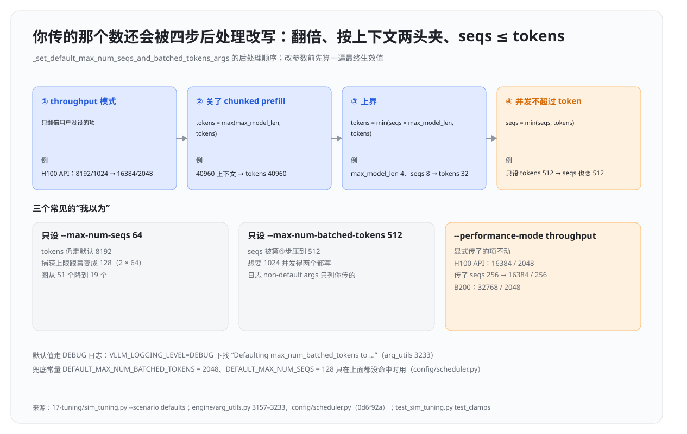

## 2.1 四步截断

默认值选完，[arg_utils.py](https://github.com/vllm-project/vllm/blob/0d6f92a/vllm/engine/arg_utils.py) 3157 行开始四步后处理，顺序固定：

1. **throughput 模式翻倍。**`--performance-mode throughput` 只把用户没设的那一项乘 2。H100 API 默认 8192 / 1024 变成 16384 / 2048；如果你显式传了 `--max-num-seqs 512`，seqs 保持 512，只有预算翻倍。
2. **关 chunked prefill 时抬预算。**不切 prefill 就必须一步吃下整条 prompt，预算取 max(max_model_len, 预算)。Qwen3-8B 的 max_model_len 40960，预算直接变成 40960。
3. **预算不超过 seqs × max_model_len。**上下文很短、seqs 又小的部署里，预算再大也凑不满。
4. **seqs 不超过预算。**每条请求一步至少一个 token，seqs 大于预算没有意义。

最终值在 3233 行打一条 DEBUG 日志 “Defaulting max_num_batched_tokens to …”，要看到它得设 `VLLM_LOGGING_LEVEL=DEBUG`。INFO 级别的 `non-default args` 只列你显式传过的参数，没传的 max_num_seqs 不会出现在里面。

```text
max_model_len 很短时 tokens 会被 max_num_seqs × max_model_len 截断，例：
    H100 API max_model_len 512: 8192/1024
    H100 API max_model_len 2048: 8192/1024
  关掉 chunked prefill：tokens 抬到 max(max_model_len, 默认) = 40960
  只设 --max-num-seqs 64：tokens 仍走默认 8192，图上限变成 128
```

## 2.2 performance_mode

`--performance-mode` 在 [vllm.py](https://github.com/vllm-project/vllm/blob/0d6f92a/vllm/config/vllm.py) 162 行定义，有 balanced（默认）、interactivity、throughput 三档。throughput 影响上面的第 1 步；interactivity 不改预算，改的是捕获网格：1 到 32 逐个捕获，小 batch 不再 padding 到 8 的倍数（第 4 章）。它是一键档，不替代逐项调参：throughput 翻倍后 seqs 到了 2048，图上限仍是 512，超出部分还是 eager。

这一章的结论只有一句：调参前先起一次默认实例，把日志里的实际值抄下来。sweep.sh 的 `defaults` 子命令做的就是这件事。

# 第 3 章 · 显存比例：util 每 0.01 值多少 KV

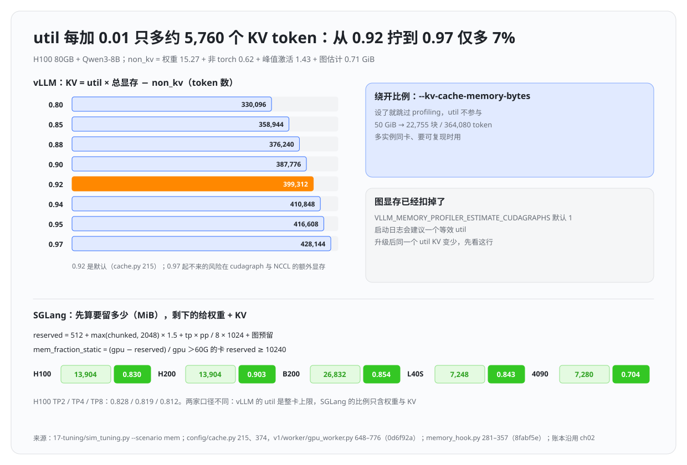

## 3.1 账本

`gpu_memory_utilization` 默认 0.92（[cache.py](https://github.com/vllm-project/vllm/blob/0d6f92a/vllm/config/cache.py) 215 行），含义是这个实例最多用整卡显存的 92%，权重、激活、CUDA graph 和 KV 全在里面。worker 启动时在 [gpu_worker.py](https://github.com/vllm-project/vllm/blob/0d6f92a/vllm/v1/worker/gpu_worker.py) 648–776 行做一次 profiling：跑一遍 `max_num_batched_tokens` 大小的假前向，记下权重、非 torch 显存、峰值激活，再按 `VLLM_MEMORY_PROFILER_ESTIMATE_CUDAGRAPHS`（默认 1）估一份图显存，剩下的才是 KV。ch02 拆过这本账，这里只看 util 变化时 KV 怎么动。

```text
== gpu_memory_utilization 与 KV（H100 80GB + Qwen3-8B，账目沿用 ch02）
   non_kv = 权重 15.27 + 非 torch 0.62 + transient 1.43 + 图估计 0.71 GiB
  util   KV GiB        块     token    较 0.92    满 40k 请求数
  0.80    45.33   20,631   330,096   -69,216         8.06
  0.85    49.29   22,434   358,944   -40,368         8.76
  0.88    51.67   23,515   376,240   -23,072         9.19
  0.90    53.25   24,236   387,776   -11,536         9.47
  0.92    54.84   24,957   399,312        +0         9.75
  0.94    56.42   25,678   410,848   +11,536        10.03
  0.95    57.21   26,038   416,608   +17,296        10.17
  0.97    58.80   26,759   428,144   +28,832        10.45
   每 0.01 util ≈ 0.79 GiB ≈ 5,760 token ≈ 5.6 条 1k 上下文
   --kv-cache-memory-bytes 50GiB：22,755 块 364,080 token，util 不再参与，profiling 跳过
```

H100 80 GB 的 0.01 就是 0.79 GiB，Qwen3-8B 每个 token 的 KV 是 36 层 × 8 个 KV 头 × 128 维 × 2（K、V）× 2 字节 = 144 KiB，0.79 GiB 换 5,760 个 token，按 1k 上下文算只多 5.6 条请求。从 0.92 拧到 0.97，KV 多 28,832 个 token，增幅 7%；但 0.92 时整卡还剩 6.3 GiB 给 PyTorch 管不到的部分（NCCL 缓冲、cuBLAS workspace、碎片、同卡上的其他进程），0.97 只剩 2.4 GiB。官方文档把调高 util 列为解决抢占的第一个办法[[4]](https://docs.vllm.ai/en/latest/configuration/optimization/)，但它的收益上限就是这张表。

KV 不够的时候，更有效的办法在别处：FP8 KV 直接让 token 数翻倍（VLLM-12）。TP2 让每卡权重减半，Qwen3-8B 每卡多出约 7.6 GiB。把 `max_model_len` 从 40960 缩到实际需要的 8192 不会增加 KV 总量，但会让单条请求占不满整个池子，并让后处理第 3 步的截断更紧。官方的 Conserving Memory 文档也是这个顺序[[5]](https://docs.vllm.ai/en/latest/configuration/conserving_memory/)。

## 3.2 绕开比例：kv_cache_memory_bytes

`--kv-cache-memory-bytes`（[cache.py](https://github.com/vllm-project/vllm/blob/0d6f92a/vllm/config/cache.py) 374 行）设了以后，worker 只跑一次 profile_run 编译模型，然后直接按这个字节数分 KV，不再做显存测量，util 不参与。日志会提示这时不受 util 约束、OOM 了要自己比较两次启动的初始空闲显存。它适合两种场景：同一张卡上跑多个实例，各自要一个确定的 KV 大小；或者要求每次启动 KV 一致、便于复现压测结果。官方优化文档还把它列为加速启动的手段之一：上一次启动日志会打印能复现当前分配的值，下一次直接传进去，跳过显存测量和图显存估计[[4]](https://docs.vllm.ai/en/latest/configuration/optimization/)。

升级 vLLM 时要注意 gpu_worker.py 780–817 行那条提示：图显存估计默认打开后，同一个 util 算出的 KV 会比以前少一截，日志会给出“等效的旧 util”和“要保持原 KV 大小应该调到的 util”。升级后 KV token 数变了，先找这行。

## 3.3 SGLang：先算留多少，剩下给静态池

```text
== SGLang mem_fraction_static 默认值（memory_hook.py，TP=1）
卡          smi MiB chunked max_bs     激活      图  reserved mem_frac
a100-80g     81920    8192    256  12288    976    13,904    0.830
h100-sxm     81559    8192    256  12288    976    13,904    0.830
h200        143771    8192    256  12288    976    13,904    0.903
b200        183359   16384    512  24576   1616    26,832    0.854
l40s         46068    4096     32   6144    464     7,248    0.843
rtx4090      24564    4096     48   6144    496     7,280    0.704
   >60G 的卡 reserved 至少 10240 MiB；H100 算出 13,904 MiB → 0.830，与 ch02 一致
   H100 TP=1: max_bs 256, reserved 13,904 MiB, mem_frac 0.830
   H100 TP=2: max_bs 256, reserved 14,032 MiB, mem_frac 0.828
   H100 TP=4: max_bs 512, reserved 14,800 MiB, mem_frac 0.819
   H100 TP=8: max_bs 512, reserved 15,312 MiB, mem_frac 0.812
```

SGLang 的 `mem_fraction_static` 定义不同：它是权重 + KV 池占整卡的比例，激活和 CUDA graph 在这个比例之外。memory_hook.py 281–325 行先算要预留多少 MiB：512 + max(chunked_prefill_size, 2048) × 1.5 + tp × pp / 8 × 1024，再加图预留（decode max_bs × 2 + prefill 网格个数 × 8），>60 GB 的卡至少留 10240 MiB[[2]](https://github.com/sgl-project/sglang/blob/8fabf5e/python/sglang/srt/arg_groups/memory_hook.py)。H100 算出 13,904 MiB，比例 0.830。TP 越大预留越多，比例越低。SGLang 的调参文档给的判据是启动日志里的 `available_gpu_mem`：5–8 GB 合适，10–20 GB 说明比例可以再调高，也可以每次加 0.01 直到 OOM[[6]](https://github.com/sgl-project/sglang/blob/8fabf5e/docs/docs/advanced_features/hyperparameter_tuning.mdx)。

两家的数不能互抄。vLLM 0.92 是整卡上限，SGLang 0.83 只是静态部分。同样 H100 + Qwen3-8B，两者最后分到的 KV 相差不大，差在谁替激活和图留了余量。

# 第 4 章 · 捕获网格：哪些 batch 走图，哪些走 eager

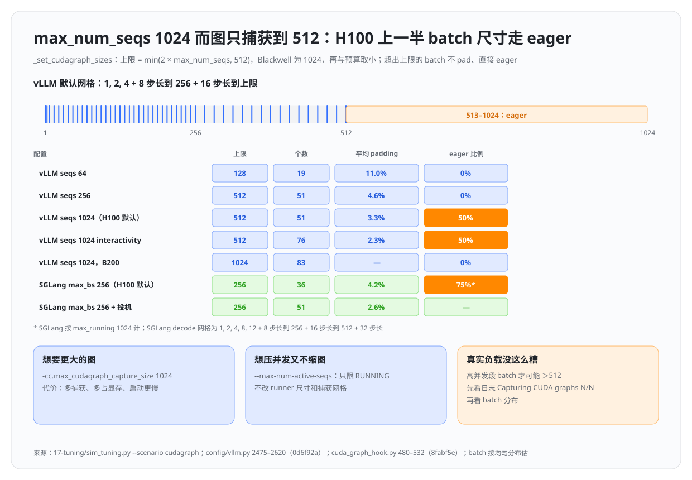

## 4.1 默认网格怎么生成

CUDA graph 只能重放捕获时的形状，vLLM 预先捕获一组 token 数，运行时把 batch padding 到最近的那个尺寸[[7]](https://docs.vllm.ai/en/latest/design/cuda_graphs/)。网格在 [vllm.py](https://github.com/vllm-project/vllm/blob/0d6f92a/vllm/config/vllm.py) 2475–2620 行的 `_set_cudagraph_sizes` 里生成。上限先取 min(max_num_seqs × decode_query_len × 2, 512)，Blackwell（compute capability 10.x）上 512 换成 1024，再和 `max_num_batched_tokens` 取小。尺寸是 1、2、4，然后步长 8 到 248，256 起步长 16 到上限；预算比上限小时把预算本身补进网格。interactivity 模式把开头的 1、2、4 换成 1 到 32 逐个。显式给了 `-cc.cudagraph_capture_sizes` 就只用你给的列表。

```text
== vLLM 捕获网格（H100，max_num_batched_tokens 8192）
max_num_seqs 模式            q_len    上限    个数   平均 padding   eager 比例  头尾
          64 balanced          1   128    19        11.0%       0.0%  [1, 2, 4, 8, 16, 24] … [112, 120, 128]
         128 balanced          1   256    35         7.3%       0.0%  [1, 2, 4, 8, 16, 24] … [240, 248, 256]
         256 balanced          1   512    51         4.6%       0.0%  [1, 2, 4, 8, 16, 24] … [480, 496, 512]
        1024 balanced          1   512    51         3.3%      50.0%  [1, 2, 4, 8, 16, 24] … [480, 496, 512]
        1024 interactivity     1   512    76         2.3%      50.0%  [1, 2, 3, 4, 5, 6] … [480, 496, 512]
         256 balanced          4   512    51         4.6%       0.0%  [1, 2, 4, 8, 16, 24] … [480, 496, 512]
        1024 throughput        1   512    51         3.3%      50.0%  [1, 2, 4, 8, 16, 24] … [480, 496, 512]
   max_num_seqs 1024 时上限被 512 卡住：batch 513–1024 全走 eager（Blackwell cc 10.x 上限 1024）
   B200 同配置：上限 1024，83 个，eager 比例 0.0%
```

平均 padding 按 decode batch 在 1 到 max_num_seqs 之间均匀分布估算。上限之内，网格越密 padding 越小；max_num_seqs 1024 时麻烦出在 513–1024 这一半尺寸根本没有图，padding 倒在其次，只能 eager 执行。decode 是 launch 密集型的，eager 每步要多付几百次 kernel launch 的 CPU 开销。投机解码时 decode_query_len 大于 1，2476–2559 行另按请求数生成一组 uniform decode 尺寸补进网格，避免 token 步长的网格对不上 k+1 的整数倍。

## 4.2 什么时候要动它

默认上限够用的条件是 max_num_seqs ≤ 256（非 Blackwell）。超过这个数，又确实有那么多并发（看 `vllm:num_requests_running`），就该显式抬高 `-cc.max_cudagraph_capture_size`，代价是多捕获的每个尺寸都占图显存，并拉长启动。另一条路是不让 batch 长那么大：`--max-num-active-seqs` 只限制 RUNNING 的请求数，不缩小 runner 的缓冲和图的捕获范围（[scheduler.py](https://github.com/vllm-project/vllm/blob/0d6f92a/vllm/config/scheduler.py) 69 行），第 6 章会用到。

## 4.3 SGLang 的 decode 网格

```text
== SGLang decode 网格（cuda_graph_hook.py）
   max_bs  256 spec=False  36 个，平均 padding 4.2%  [1, 2, 4, 8, 12, 16] … [240, 248, 256]
   max_bs  512 spec=False  52 个，平均 padding 3.1%  [1, 2, 4, 8, 12, 16] … [480, 496, 512]
   max_bs  256 spec=True   51 个，平均 padding 2.6%  [1, 2, 3, 4, 5, 6] … [240, 248, 256]
   max_bs   48 spec=False  10 个，平均 padding 10.8%  [1, 2, 4, 8, 12, 16] … [32, 40, 48]
   H100 默认 max_bs 256 而 max_running 1024 时：batch>256 走 eager 的比例 75.0%
```

SGLang 的 decode 网格在 cuda_graph_hook.py 480–532 行：1、2、4、8、12，8 步长到 256，16 步长到 512，再往上 32 步长；开投机时开头更细[[8]](https://github.com/sgl-project/sglang/blob/8fabf5e/python/sglang/srt/arg_groups/cuda_graph_hook.py)。上限是第 1 章的 `max_bs`，H100 默认 256。它的文档写得很直接：默认只给小 batch 开图，大 TP 下 512 或 768 也可能有收益，可以调大 `--cuda-graph-max-bs-decode`，同时下调 `--mem-fraction-static` 给图让显存[[6]](https://github.com/sgl-project/sglang/blob/8fabf5e/docs/docs/advanced_features/hyperparameter_tuning.mdx)。所以两家默认都没覆盖到 1024 并发，只是 vLLM 的上限高一倍。

# 第 5 章 · 预算：max_num_batched_tokens 与 goodput

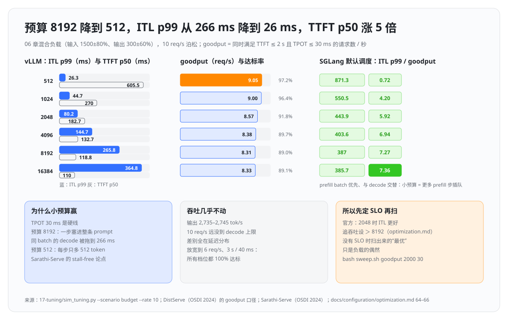

## 5.1 预算决定一步塞多少 prefill

V1 默认开 chunked prefill，调度器先把所有 running 的 decode 排进本步，剩下的预算再给 prefill[[4]](https://docs.vllm.ai/en/latest/configuration/optimization/)。预算越小，长 prompt 被切得越碎，每步的 prefill 段越短，夹在里面的 decode 越不容易被拖慢；代价是一条 prompt 要更多步才能 prefill 完，TTFT 变长。这就是 Sarathi-Serve 的 stall-free batching：用 token 预算给每步定一个时长上限，换取稳定的 TBT[[9]](https://arxiv.org/abs/2403.02310)。官方文档的建议也是两句话：2048 这样的小值 ITL 更好；追求吞吐时设到 8192 以上[[4]](https://docs.vllm.ai/en/latest/configuration/optimization/)。

要比较不同预算，单看吞吐不够，因为输出吞吐在这里几乎不变。DistServe 提出用 goodput 衡量：同时满足 TTFT 和 TPOT 两个 SLO 的请求每秒有多少条[[10]](https://arxiv.org/abs/2401.09670)。`vllm bench serve --goodput ttft:2000 tpot:30` 就按这个口径统计[[11]](https://docs.vllm.ai/en/latest/benchmarking/cli/)。

## 5.2 10 req/s 下扫六档预算

负载沿用 06 章：泊松到达 10 req/s，输入 1500±80%，输出 300±60%，单卡 H100 + Qwen3-8B 的 roofline 步长模型，跑 120 s。SLO 定为 TTFT ≤ 2 s 且 TPOT ≤ 30 ms。

```text
== max_num_batched_tokens 扫描（06 的混合负载，10 req/s，120 s；SLO TTFT≤2000 ms 且 TPOT≤30 ms）
    预算 模式        输出 tok/s  TTFT p50  TTFT p99  ITL p50  ITL p99    达标率  goodput
   512 vllm         2,735  605.5 ms    2.27 s  20.1 ms  26.3 ms  97.2%     9.05
   512 sglang       2,692  527.8 ms    2.43 s  19.4 ms 871.3 ms   7.9%     0.72
  1024 vllm         2,741  270.0 ms    1.36 s   9.5 ms  44.7 ms  96.4%     9.00
  1024 sglang       2,732  239.6 ms    1.25 s  11.7 ms 550.5 ms  45.2%     4.20
  2048 vllm         2,744  182.7 ms    1.13 s   9.0 ms  80.2 ms  91.8%     8.57
  2048 sglang       2,739  155.9 ms    1.10 s  10.3 ms 443.9 ms  63.6%     5.92
  4096 vllm         2,744  132.7 ms    1.09 s   8.8 ms 144.7 ms  89.7%     8.38
  4096 sglang       2,741  126.1 ms    1.05 s   9.8 ms 403.6 ms  74.4%     6.94
  8192 vllm         2,745  118.8 ms    1.08 s   8.8 ms 265.8 ms  89.0%     8.31
  8192 sglang       2,742  110.5 ms    1.08 s   9.5 ms 387.0 ms  77.9%     7.27
 16384 vllm         2,745  110.0 ms    1.19 s   8.8 ms 364.8 ms  89.1%     8.33
 16384 sglang       2,743  109.4 ms    1.19 s   9.4 ms 385.7 ms  78.9%     7.36
   vllm: goodput 最高在预算 512（9.05 req/s）
   sglang: goodput 最高在预算 16384（7.36 req/s）
```

vLLM 那几行是一条单调的跷跷板。预算 8192 时，一条 1500 token 的 prompt 加上几条在切的长 prompt 能一步塞满，单步最长到 265.8 ms，ITL p99 就是这个数，TPOT 超标的请求占 11%。降到 512，单步最长 26.3 ms，TPOT 几乎全部达标，但 TTFT p50 从 118.8 ms 涨到 605.5 ms：一条 1500 token 的 prompt 要切成 3 步以上，每步还要和几十条 decode 分预算。在这组 SLO 下 512 的 goodput 最高（9.05），1024 只差一点（9.00）而 TTFT p50 只有 270 ms，是更稳妥的选择。H100 API server 的默认 8192 在这里是 8.31。

SGLang 那几行是 06 章的默认调度：有新的 prefill 就先跑一个 prefill batch，否则跑 decode batch，不开 `--enable-mixed-chunk`。prefill batch 在跑时 decode 整步停下，所以 ITL p99 在每一档都是几百毫秒，`chunked_prefill_size` 越小，长 prompt 被切的段数越多，decode 停顿的次数越多，512 档 goodput 只有 0.72。SGLang 还有余地：开 mixed chunk 后它也会把 decode 拼进 prefill batch，行为接近 vLLM 的混合批。

## 5.3 负载轻时预算不重要

```text
预算 模式        输出 tok/s  TTFT p50  TTFT p99  ITL p50  ITL p99    达标率  goodput
   512 vllm         1,669   45.9 ms    1.28 s   6.5 ms  25.9 ms 100.0%     5.67
   512 sglang       1,668   44.3 ms    1.17 s   6.7 ms  66.5 ms  99.7%     5.66
  1024 vllm         1,669   35.9 ms  982.1 ms   6.4 ms  43.0 ms 100.0%     5.68
  1024 sglang       1,669   35.6 ms  952.3 ms   6.5 ms  43.5 ms 100.0%     5.68
  2048 vllm         1,670   34.5 ms  842.1 ms   6.4 ms  75.6 ms 100.0%     5.68
  2048 sglang       1,670   34.2 ms  835.5 ms   6.4 ms  41.2 ms 100.0%     5.68
  4096 vllm         1,670   34.5 ms  784.5 ms   6.4 ms 132.4 ms 100.0%     5.68
  4096 sglang       1,670   34.3 ms  777.5 ms   6.4 ms  40.6 ms 100.0%     5.68
  8192 vllm         1,670   34.3 ms  758.2 ms   6.4 ms 134.6 ms 100.0%     5.68
  8192 sglang       1,670   33.8 ms  758.0 ms   6.4 ms  40.3 ms 100.0%     5.68
 16384 vllm         1,670   34.6 ms  793.3 ms   6.4 ms  40.8 ms 100.0%     5.68
 16384 sglang       1,670   33.8 ms  783.3 ms   6.4 ms  40.3 ms 100.0%     5.68
```

把到达率降到 6 req/s、SLO 放宽到 3 s / 40 ms，六档预算的达标率都是 100% 或 99.7%。这时调预算只是在不同的 p99 之间挪动，不影响 goodput。所以调预算的前提是已经知道负载离饱和有多近：先用 `vllm bench sweep serve_workload` 画出延迟-吞吐曲线，找到 SLO 开始被突破的那个到达率，再在那个到达率附近扫预算[[12]](https://docs.vllm.ai/en/latest/benchmarking/sweeps/)。

| 负载画像 | 预算方向 | 理由 |
|-|-|-|
| 聊天，短输入，ITL 敏感 | 1024–2048 | 单步时长上限低，长 prompt 不卡 decode |
| RAG，长输入短输出，TTFT 敏感 | 8192–16384 | prefill 占大头，切得越少 TTFT 越短 |
| 离线批处理，只看吞吐 | ≥ 8192，可开 throughput 模式 | 官方建议 >8192；预算大、步数少，调度开销摊薄 |
| A100 | 先用默认 2048 再往上试 | PR #17885 实测大预算降吞吐 |

# 第 6 章 · 并发：max_num_seqs 实际受 KV 限制

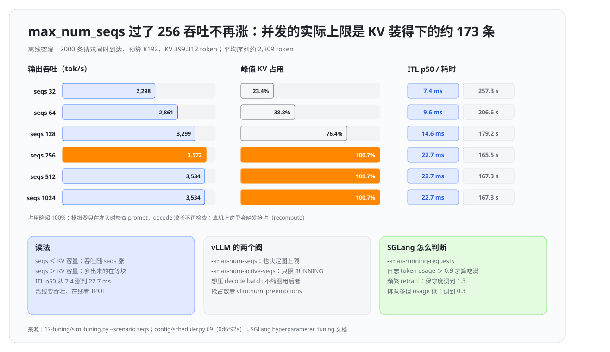

## 6.1 突发 2000 条请求

`max_num_seqs` 有两个身份：调度器每步最多让多少条请求处于 RUNNING；model runner 按它预分配每请求的缓冲，并由它决定 CUDA graph 上限（第 4 章）。离线批处理最直接受它影响，模拟器让 2000 条请求同时到达，预算 8192，其余同 06 章的负载。

```text
== max_num_seqs 扫描（离线 burst：2000 条同时到达，预算 8192）
   KV 399,312 token；平均序列 ~2309 token → KV 能同时装下约 173 条
max_num_seqs   输出 tok/s       耗时     峰值 KV 占用  ITL p50  ITL p99
          32      2,298   257.3s        23.4%   7.4 ms 265.9 ms
          64      2,861   206.6s        38.8%   9.6 ms 265.7 ms
         128      3,299   179.2s        76.4%  14.6 ms 265.3 ms
         256      3,572   165.5s       100.7%  22.7 ms 268.7 ms
         512      3,534   167.3s       100.7%  22.7 ms 271.4 ms
        1024      3,534   167.3s       100.7%  22.7 ms 271.4 ms
   max_num_seqs 超过 KV 能装的条数之后，吞吐不再涨：真正的并发上限是 KV（占用略超 100% 是因为模拟器只按 prompt 准入、decode 增长不再检查）
```

KV 一共 399,312 个 token，平均序列约 2,309 token，同时装得下约 173 条。max_num_seqs 小于这个数时，它是瓶颈：32 条时 KV 只用了 23.4%，decode batch 小，GPU 大部分时间在读权重，吞吐 2,298 tok/s。放到 128，KV 用到 76.4%，吞吐 3,299。放到 256，KV 先满，再往上 512、1024 结果完全一样，因为能进 RUNNING 的请求数已经被 KV 卡住了。ITL p50 随 batch 变大从 7.4 ms 涨到 22.7 ms，这是 decode batch 变大的正常代价；ITL p99 在每一档都是 266–271 ms，由预算 8192 下的混合步决定，和 seqs 无关。

所以 max_num_seqs 的合理值是“KV 能装下的条数”附近，设得远大于它没有收益，只会让第 4 章的图上限和 runner 缓冲按一个用不到的数去分配。KV 能装多少条，启动日志的 “Maximum concurrency for X tokens per request” 直接给了一个按 max_model_len 算的保守值；按真实平均长度算会更多。

## 6.2 只压 RUNNING，不缩图

在线服务里有时要反过来：KV 够，但 decode batch 太大让 TPOT 超标。直接调小 max_num_seqs 会连带缩小图上限和 runner 缓冲。[scheduler.py](https://github.com/vllm-project/vllm/blob/0d6f92a/vllm/config/scheduler.py) 69 行的 `max_num_active_seqs` 只限制进入 RUNNING 的请求数，必须 ≤ max_num_seqs，图和缓冲仍按 max_num_seqs 准备。这样可以在不重启改图的前提下压 batch，也方便在同一份图上做 A/B。

## 6.3 SGLang 的做法

SGLang 对应的是 `--max-running-requests`，默认不设，由 KV 池大小决定能跑多少条[[3]](https://github.com/sgl-project/sglang/blob/8fabf5e/python/sglang/srt/arg_groups/fields/schedule.py)。它的调度器在接收新请求前会按 `max_new_tokens` 预估未来的 KV 占用，`--schedule-conservativeness` 调这个预估的松紧。官方指南给的判据：离线批处理时日志里 `#queue-req` 在 100–2000、`token usage` > 0.9 才算喂饱。频繁出现 “KV cache pool is full. Retract requests” 就把保守度调到 1.3。排队很多但 usage 低于 0.9（请求经常提前遇到 EOS），调到 0.3[[6]](https://github.com/sgl-project/sglang/blob/8fabf5e/docs/docs/advanced_features/hyperparameter_tuning.mdx)。vLLM V1 没有这个旋钮：调度器按块即时分配，KV 不够时直接抢占最晚进入的请求并重算，代价记在 `vllm:num_preemptions`[[13]](https://docs.vllm.ai/en/latest/usage/metrics/)。所以在 vLLM 上判断 seqs 是否过大，看的是抢占计数和 `vllm:kv_cache_usage_perc`。

# 第 7 章 · 准入：过载时快速失败

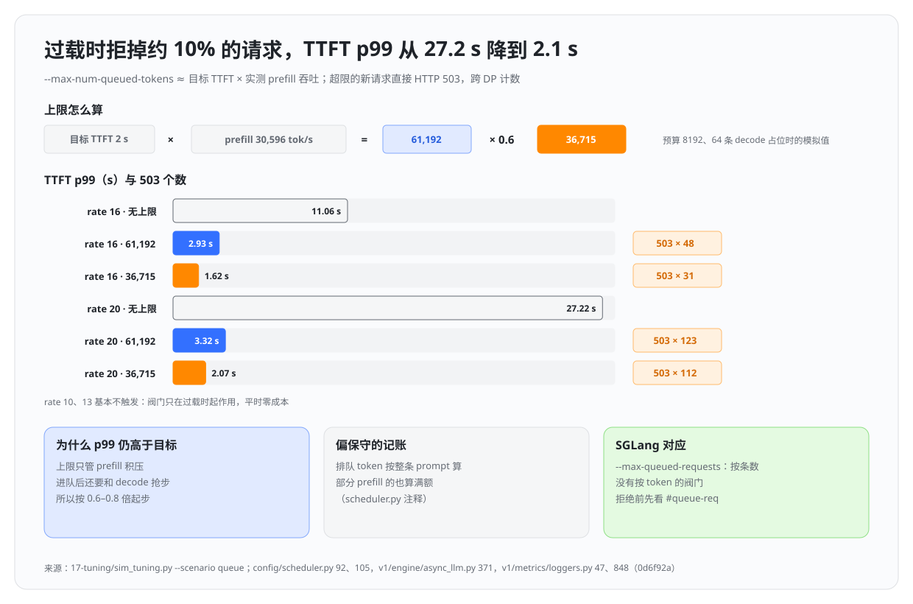

## 7.1 为什么要一个阀门

vLLM 的等待队列默认没有上限。到达率超过服务能力后，排队时间线性增长，TTFT 跟着涨，最后每个请求都超时，有效吞吐反而下降。负载均衡器看不到这一点，因为实例一直在返回 200。[scheduler.py](https://github.com/vllm-project/vllm/blob/0d6f92a/vllm/config/scheduler.py) 92 和 105 行提供了两个阀门：`max_num_queued_reqs` 限制在飞的请求条数，`max_num_queued_tokens` 限制处于 prefill 阶段的 prompt token 总数。超限时 API server 直接返回 HTTP 503，客户端或网关可以换一个实例重试。两个限制都在 API server 进程里统计，跨它路由到的所有 DP rank 计数（[async_llm.py](https://github.com/vllm-project/vllm/blob/0d6f92a/vllm/v1/engine/async_llm.py) 340–383 行），每次拒绝都在 `vllm:admission_rejections` 上按 reason 计一次（[loggers.py](https://github.com/vllm-project/vllm/blob/0d6f92a/vllm/v1/metrics/loggers.py) 47 行）。

配置注释给了 token 阀门的设法：上限 = 目标 TTFT × prefill 吞吐。排队的 prompt token 超过这个数，新请求即便进来也赶不上 TTFT 目标，不如立刻拒绝。DP 部署时 prefill 吞吐要用整个部署的总吞吐。注释还说明了这个计数偏保守：一条请求在 prefill 完成之前一直按整条 prompt 记账，因为调度器每步的进度不会回传给 API server。

## 7.2 模拟：上限取多少

```text
== max_num_queued_tokens = 目标 TTFT × prefill 吞吐（预算 8192，64 条 decode 占位）
   单卡 prefill 吞吐 ≈ 30,596 token/s；目标 TTFT 2000 ms → 上限 ≈ 61,192 token
 rate        上限     接收   503  TTFT p50  TTFT p99
   10         —    587     0   82.3 ms    1.11 s
   10     61192    587     0   82.3 ms    1.11 s
   10     36715    584     3   81.1 ms  980.4 ms
   13         —    752     0  340.2 ms    1.44 s
   13     61192    752     0  340.2 ms    1.44 s
   13     36715    747     5  258.1 ms    1.17 s
   16         —    936     0    3.29 s   11.06 s
   16     61192    888    48    1.71 s    2.93 s
   16     36715    905    31  818.0 ms    1.62 s
   20         —   1150     0   12.85 s   27.22 s
   20     61192   1027   123    2.24 s    3.32 s
   20     36715   1038   112    1.15 s    2.07 s
   上限只管 prefill 积压，排队后还要和 decode 抢步，p99 会超过目标：线上按 0.6–0.8 倍起步再按实测收紧
   上限按整条 prompt 记账，部分 prefill 的请求直到离开 prefill 前都算满额（scheduler.py 注释），所以偏保守
```

预算 8192、64 条 decode 占位时，模拟出的单卡 prefill 吞吐约 30,596 token/s，目标 TTFT 2 s 对应上限 61,192。没过载时（10、13 req/s）阀门几乎不动作，0.6 倍的上限也只拒掉 3–5 条。过载以后差别很大：20 req/s 不设上限，TTFT p50 12.85 s、p99 27.22 s，所有请求都在排队。上限 61,192 拒掉 123 条，p99 降到 3.32 s，仍超过 2 s 目标，因为排进来的请求还要和 decode 抢每步的预算，prefill 吞吐达不到满额。上限收到 0.6 倍的 36,715，拒掉 112 条（约 10%），p99 2.07 s。拒掉的条数反而比 61,192 时少，是因为队列短、请求走得快，被拒的窗口更短。

实践上按 0.6–0.8 倍起步，然后用实测的 TTFT p99 收紧或放宽。prefill 吞吐不要用模拟值，在目标负载下用 `vllm bench serve` 测 prompt 吞吐。sweep.sh 的 `queue` 子命令用 2 倍 rate 压一次不设上限、一次设上限，对比 503 数和 TTFT。

## 7.3 SGLang 的排队上限

SGLang 有 `--max-queued-requests`，默认不设，按条数限制 scheduler 的等待队列；开了优先级调度时，新请求可以挤掉队列里优先级更低的请求（scheduler.py 3612 行 `_abort_on_queued_limit`）[[3]](https://github.com/sgl-project/sglang/blob/8fabf5e/python/sglang/srt/arg_groups/fields/schedule.py)。它没有按 token 计的阀门，长短 prompt 混合时条数和 prefill 积压对不上。vLLM 的 token 阀门在这类负载下更贴近 TTFT。

# 第 8 章 · 编译档位：启动时间与稳态性能

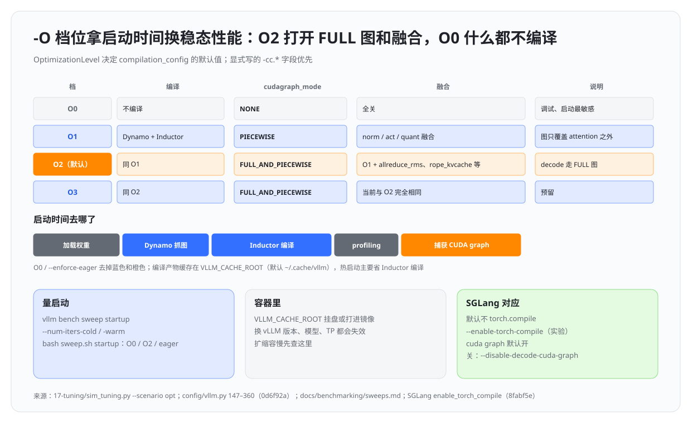

## 8.1 四档各开了什么

```text
== OptimizationLevel（config/vllm.py:147-359，默认 O2）
档   cudagraph_mode      flashinfer autotune fusion / 说明
O0  NONE                关                   全关；不编译、不捕获图：启动最快，调试用
O1  PIECEWISE           开                   norm/act + quant fusion；Dynamo + Inductor 编译，只捕获 attention 之外的分段图
O2  FULL_AND_PIECEWISE  开                   O1 + allreduce_rms、attn_quant（量化模型）、rope_kvcache、qk_norm_rope_kvcache；默认档
O3  FULL_AND_PIECEWISE  开                   同 O2；当前与 O2 完全相同，预留给更激进的优化
   --enforce-eager 等价于把 cudagraph_mode 设成 NONE；编译缓存在 VLLM_CACHE_ROOT（默认 ~/.cache/vllm）
```

[vllm.py](https://github.com/vllm-project/vllm/blob/0d6f92a/vllm/config/vllm.py) 147–360 行定义了 `OptimizationLevel` 和每档的默认配置。O0 不编译、不捕获图，启动最快，调试用。O1 走 Dynamo + Inductor 编译，只捕获 attention 之外的分段图（PIECEWISE），开 norm、激活与量化的融合。O2 是默认档，在 O1 基础上捕获 FULL_AND_PIECEWISE 图，纯 decode 批走整图，再打开 allreduce + RMSNorm（TP > 1、Hopper / Blackwell、装了 FlashInfer 时）、rope + KV 写入等融合。O3 目前与 O2 相同[[4]](https://docs.vllm.ai/en/latest/configuration/optimization/)[[14]](https://docs.vllm.ai/en/latest/design/optimization_levels/)。torch.compile 在 vLLM 里怎么分段、怎么缓存，见官方博客[[15]](https://vllm.ai/blog/2025-08-20-torch-compile)。

## 8.2 启动时间花在哪

冷启动多出来的时间主要是 Dynamo 追踪、Inductor 编译和逐尺寸捕获图。官方优化文档列了三种缩短重复启动的方法[[4]](https://docs.vllm.ai/en/latest/configuration/optimization/)：第一，编译产物在 `VLLM_CACHE_ROOT`（默认 `~/.cache/vllm`），可以拷到别的机器或打进容器镜像，同一模型、配置和硬件下热启动直接复用。第二，用上次日志打印的 `--kv-cache-memory` 值跳过显存测量和图显存估计（第 3 章）。第三，`--enforce-eager` 跳过编译和捕获，代价是稳态 decode 变慢。降到 O0 或开 eager 之前先做前两件，它们不损失稳态性能。

冷热启动比较必须固定模型提交号、TP 和上下文，再分别记录编译与捕获耗时。当前 `sweep.sh startup` 暂停执行，返回非零状态；待核对所用 CLI 的参数传递后再恢复。编译档位的收益还须用相同负载比较延迟与 goodput，不能仅凭启动耗时判断。`grid` 中 RAG 为 8000 输入加 200 输出，默认 8192 上下文不足，脚本会在创建结果目录前拒绝；示例使用 `MAXLEN=16384`，仍需核对实际 token 长度。`util` 会记录失败档位，并在存在失败时返回非零；网格不再启用跳过错误继续运行。

## 8.3 SGLang

SGLang 默认不开 torch.compile，CUDA graph 默认开。`--enable-torch-compile` 是可选项，官方调参指南的说法是它能加速小模型、小 batch[[6]](https://github.com/sgl-project/sglang/blob/8fabf5e/docs/docs/advanced_features/hyperparameter_tuning.mdx)。关图分别用 `--disable-decode-cuda-graph` 和 `--disable-prefill-cuda-graph`，旧的 `--disable-cuda-graph` 仍兼容。两家默认的取舍不同：vLLM 默认就编译，启动慢、稳态快；SGLang 默认只捕获图，启动快一些，编译交给用户决定。

# 第 9 章 · 调参顺序与 CPU

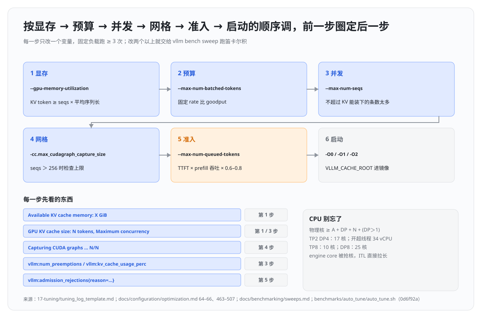

## 9.1 为什么是这个顺序

六个旋钮不是独立的。显存决定 KV 能装多少 token，这限定了 max_num_seqs 有意义的范围。预算决定一步最长多久，这决定了 ITL 和 TTFT 的平衡点，而它的最优值又依赖于并发有多高。max_num_seqs 决定图上限。准入阀门要用前几步定下来之后实测的 prefill 吞吐来设。编译档位只影响启动和常数项，放到最后。所以按显存 → 预算 → 并发 → 网格 → 准入 → 启动的顺序调，每一步都在前一步圈定的范围里找。

1. **显存**：从默认 0.92 起，看启动日志的 KV token 数是否够 max_num_seqs × 平均序列长度。不够先考虑 FP8 KV、TP 或缩短 max_model_len，最后才调 util。
2. **预算**：在 SLO 开始被突破的到达率附近，用 `--goodput` 比较 1024 / 2048 / 4096 / 8192 / 16384。ITL 敏感往小走，离线吞吐往大走。
3. **并发**：max_num_seqs 设在 KV 能装下的条数附近；想压 decode batch 又不想缩图，用 `--max-num-active-seqs`。看 `vllm:num_preemptions` 判断是否设大了。
4. **捕获网格**：max_num_seqs 超过 256 而并发确实很高时，检查 “Capturing CUDA graphs” 的个数，需要时抬 `-cc.max_cudagraph_capture_size`。
5. **准入**：要快速失败时开 `--max-num-queued-tokens` ≈ 目标 TTFT × 实测 prefill 吞吐 × 0.6–0.8。
6. **启动**：编译缓存打进镜像或挂盘；启动敏感时比较 -O0 / -O1 / -O2。

每一步只改一个变量，同一负载至少跑 3 次。要同时扫两个变量，交给 `vllm bench sweep serve`：它对 serve-params 和 bench-params 两份 JSON 做笛卡尔积，每组起一次服务、跑完所有负载，结果可以直接交给 `vllm bench sweep plot` 画图[[12]](https://docs.vllm.ai/en/latest/benchmarking/sweeps/)。仓库里的 [auto_tune.sh](https://github.com/vllm-project/vllm/blob/0d6f92a/benchmarks/auto_tune/auto_tune.sh) 是另一种自动化：先从 util 0.98 往下每次减 0.01，找到能起服的最大值，再对 max_num_seqs × max_num_batched_tokens 做网格，用 `--goodput e2el:` 在延迟约束下选吞吐最高的组合[[16]](https://github.com/vllm-project/vllm/blob/0d6f92a/benchmarks/auto_tune/auto_tune.sh)。它把 util 推到能起服的极限，适合压测找上限；上线时按第 3 章的理由留回余量。tuning_log_template.md 给了一条记录的格式：改动、假设、依据、负载命令、改前改后的指标、结论和副作用。

## 9.2 CPU 核数

```text
== CPU 核数（docs/configuration/optimization.md）TP=1 DP=1 API server=1
   物理核下限 = A + DP + N + (DP>1) = 1 + 1 + 1 + 0 = 3；开超线程按 vCPU 算要 6
   TP=1 DP=1（A 取默认 = DP）：3 物理核 / 6 vCPU
   TP=8 DP=1（A 取默认 = DP）：10 物理核 / 20 vCPU
   TP=2 DP=4（A 取默认 = DP）：17 物理核 / 34 vCPU
   TP=1 DP=8（A 取默认 = DP）：25 物理核 / 50 vCPU
   06 的时间模型里 CPU 每步 0.8 ms + 8 µs/请求：engine core 被抢核时这部分直接拉长 ITL
```

vLLM V1 是多进程架构：每个 API server、每个 engine core、每张卡的 worker 都是独立进程，DP > 1 时还有一个 DP coordinator。官方文档给的物理核下限是 A + DP + N + (DP > 1 ? 1 : 0)，A 是 API server 个数，默认等于 DP；开了超线程要按 vCPU 翻倍。DP4 TP2 的 8 卡部署至少 17 个物理核[[4]](https://docs.vllm.ai/en/latest/configuration/optimization/)。engine core 跑的是忙循环，对抢核最敏感：06 章的步长模型里每步有 0.8 ms + 每请求 8 µs 的 CPU 开销，被抢核时这部分直接加到 ITL 上。容器里 CPU limit 设得比这个下限低，GPU 利用率上不去，调什么参数都没用。

# 第 10 章 · 对照 SGLang：同一个意图，两套口径

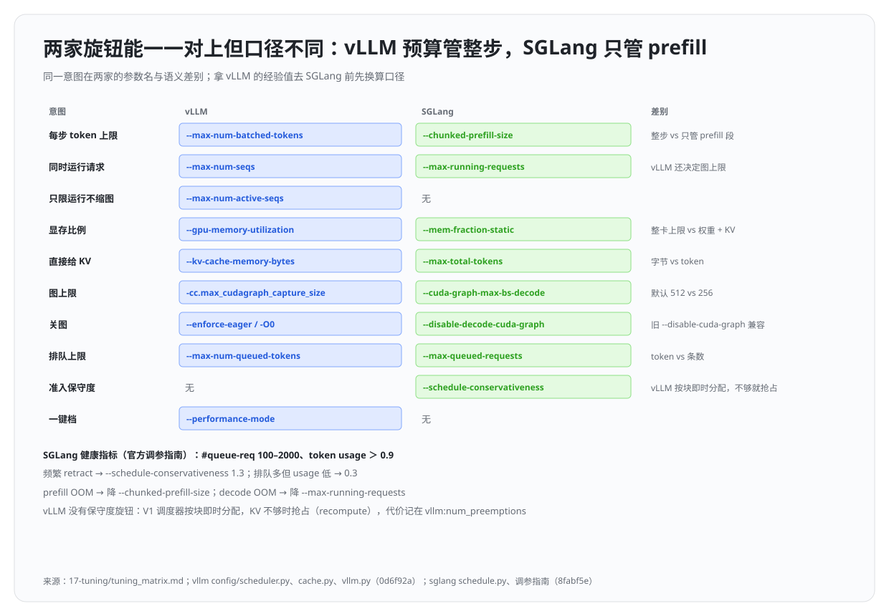

两家的旋钮大多能一一对上，但很少能直接照抄数值。下表按意图排列，第三列是换算时要注意的口径差。

| 意图 | vLLM | SGLang | 口径差 |
|-|-|-|-|
| 每步 token 上限 | `--max-num-batched-tokens` | `--chunked-prefill-size` + `--max-prefill-tokens` | vLLM 管整步（prefill + decode）；SGLang 只管 prefill batch，decode 另跑 |
| 同时运行请求 | `--max-num-seqs` | `--max-running-requests` | vLLM 还决定图上限和 runner 缓冲 |
| 只限运行不缩图 | `--max-num-active-seqs` | 无直接对应 |  |
| KV 显存 | `--gpu-memory-utilization` | `--mem-fraction-static` | 整卡上限 vs 权重 + KV 的静态比例 |
| 直接给 KV | `--kv-cache-memory-bytes` | `--max-total-tokens` | 字节 vs token |
| 图上限 | `-cc.max_cudagraph_capture_size` | `--cuda-graph-max-bs-decode` | H100 默认 512 vs 256 |
| 关图 | `--enforce-eager` / `-O0` | `--disable-decode-cuda-graph` / `--disable-prefill-cuda-graph` | 旧 `--disable-cuda-graph` 仍兼容 |
| 编译 | `-O0` … `-O3`，默认 O2 | `--enable-torch-compile`，默认关 | vLLM 默认编译 |
| 排队上限 | `--max-num-queued-reqs` / `--max-num-queued-tokens` | `--max-queued-requests` | vLLM 可按 token 计 |
| 准入保守度 | 无 | `--schedule-conservativeness` | vLLM 按块即时分配，不够就抢占 |
| 一键档 | `--performance-mode` | 无，靠分档默认值 |  |

[[17]](https://docs.vllm.ai/en/latest/configuration/serve_args/)[[18]](https://docs.sglang.io/docs/advanced_features/server_arguments)

最容易踩的是第一行。从 SGLang 迁到 vLLM 时，把 `chunked_prefill_size=8192` 照搬成 `max_num_batched_tokens=8192`，在 decode 很多的负载上 prefill 实际能用的预算会少一截，因为 decode token 也占预算；反过来，把 vLLM 的 2048 搬到 SGLang，长 prompt 会被切成更多段，每段都让 decode 停一步（第 5 章 SGLang 512 档的 goodput 只有 0.72）。第二容易踩的是显存比例，两个 0.9 的含义完全不同。

判断“调得对不对”的信号也不同。SGLang 看日志里的 `#queue-req`、`token usage` 和 retract 警告[[6]](https://github.com/sgl-project/sglang/blob/8fabf5e/docs/docs/advanced_features/hyperparameter_tuning.mdx)；vLLM 看 `/metrics` 上的 `vllm:kv_cache_usage_perc`、`vllm:num_preemptions`、`vllm:num_requests_waiting` 和 `vllm:admission_rejections`[[13]](https://docs.vllm.ai/en/latest/usage/metrics/)。下一篇会专门讲这些指标的口径。

# 第 11 章 · 真机实验

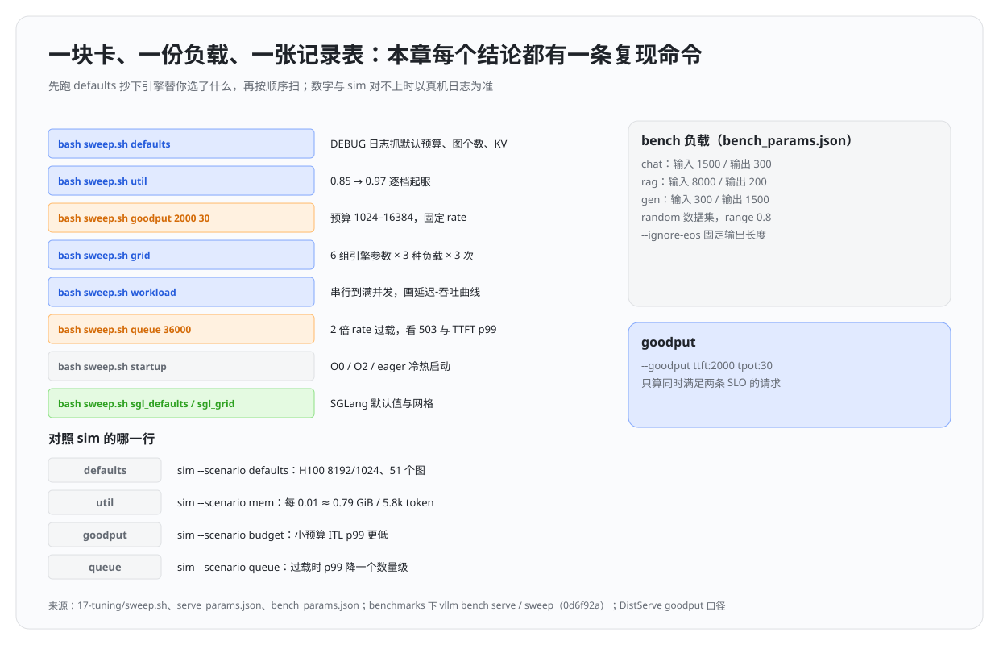

## 11.1 命令

```bash
# 在 zero-to-vllm/17-tuning 目录执行；先停止目标端口的旧实例
python3 sim_tuning.py --scenario all
python3 -m unittest test_sim_tuning test_sweep -v
MODEL_PROFILE=dense TP=2 bash sweep.sh defaults
MODEL_PROFILE=dense TP=2 bash sweep.sh util
MODEL_PROFILE=dense TP=2 OUT=results/dense/workload-01 bash sweep.sh workload
MODEL_PROFILE=dense TP=2 RATE=10 bash sweep.sh goodput 2000 30
MODEL_PROFILE=dense TP=2 MAXLEN=16384 OUT=results/dense/grid-01 bash sweep.sh grid
MODEL_PROFILE=dense TP=2 bash sweep.sh queue 36000
MODEL_PROFILE=dense TP=2 bash sweep.sh sgl_defaults
MODEL_PROFILE=dense TP=2 bash sweep.sh sgl_grid
# moe 使用相同流程单独运行，不复用 OUT
# startup 暂停；plot 使用对应实验的已有 OUT，无须合并两批结果
OUT=results/dense/grid-01 bash sweep.sh plot grid
OUT=results/dense/workload-01 bash sweep.sh plot workload
# 记录当前引擎版本和完整日志；以上命令不代表已有双模型 GPU 结果
```

每个子命令要对照的东西：`defaults` 的 “Capturing CUDA graphs” 在 H100 上应是 51 个，KV token 数与第 3 章同量级（真实的非 torch 显存和激活会不同）。`util` 每 0.01 应接近 0.79 GiB / 5.8k token。`goodput` 的方向应与第 5 章一致：预算越小 ITL p99 越低、TTFT 越高。`queue` 设了上限后 503 不为 0，TTFT p99 明显下降。`sgl_defaults` 在 H100 上 mem_fraction_static 应为 0.830。grid 的 serve_params.json 里有一组 `long_prefill_token_threshold=1024`，用来看在预算 2048 下再限制单条长 prompt 每步占用的效果；bench_params.json 的三种负载 chat（1500 / 300）、rag（8000 / 200）、gen（300 / 1500）对应第 5 章表里的三类画像。

## 11.2 源码阅读顺序

[arg_utils.py](https://github.com/vllm-project/vllm/blob/0d6f92a/vllm/engine/arg_utils.py) 2946–3233 行（默认值和后处理）→ [scheduler.py](https://github.com/vllm-project/vllm/blob/0d6f92a/vllm/config/scheduler.py)（seqs、active、阀门、长 prefill 阈值）→ [cache.py](https://github.com/vllm-project/vllm/blob/0d6f92a/vllm/config/cache.py)（util、kv_cache_memory_bytes、block_size）→ [gpu_worker.py](https://github.com/vllm-project/vllm/blob/0d6f92a/vllm/v1/worker/gpu_worker.py) 648–817 行（KV 怎么算出来）→ [vllm.py](https://github.com/vllm-project/vllm/blob/0d6f92a/vllm/config/vllm.py) 147–360 与 2416–2620 行（编译档位和捕获网格）→ [async_llm.py](https://github.com/vllm-project/vllm/blob/0d6f92a/vllm/v1/engine/async_llm.py) 准入。SGLang 对照读 `arg_groups/memory_hook.py`、`arg_groups/cuda_graph_hook.py`、`arg_groups/fields/schedule.py` 三个文件。行号都在 tuning_matrix.md。

> 📌 **核对清单**
> - 能说出自己的卡在 vLLM API server 和 LLM 类下的默认预算与 seqs，以及 A100 为什么是例外。
> - 知道后处理四步的顺序，能解释只设 `--max-num-seqs 64` 时预算和图上限各是多少。
> - 能算出自己卡上 util 每 0.01 对应多少 KV token，知道 KV 不够时先做哪三件事。
> - 知道 `--kv-cache-memory-bytes` 会跳过显存测量，以及升级后 KV 变少先看哪行日志。
> - 能算出捕获上限 min(2 × max_num_seqs, 512)，知道 Blackwell 是 1024，超出部分走 eager。
> - 扫预算前先找到 SLO 拐点，用 `--goodput ttft:X tpot:Y` 比较，别只比吞吐。
> - max_num_seqs 设在 KV 能装下的条数附近，用 `max_num_active_seqs` 压 batch 而不缩图。
> - 过载要快速失败时，按目标 TTFT × 实测 prefill 吞吐 × 0.6–0.8 设 `--max-num-queued-tokens`，用 `vllm:admission_rejections` 看拒绝数。
> - 启动敏感时先复用编译缓存和 kv-cache-memory，再考虑降 -O 档。
> - CPU 物理核不少于 A + DP + N + (DP > 1)。
> - 从 SGLang 迁移时，不照抄 chunked_prefill_size 和 mem_fraction_static 的数值。

调参的每一步都靠指标判断：KV 占用、抢占次数、排队长度、TTFT 和 TPOT 的分位数。这些数从哪来、按什么口径统计，直方图的桶边界会不会把 p99 算偏，一步慢在哪个 kernel 上，是下一篇 VLLM-18 的内容：Prometheus 指标的口径、torch profiler 和 nsys 的用法。

# 参考文献

按正文首次引用顺序编号，资料截至 2026 年 10 月底。源码以 vllm-project/vllm 主干提交 0d6f92a（2026 年 10 月 29 日）和 v0.32.0 发行版为准；SGLang 对照以 sgl-project/sglang 主干 8fabf5e 为准。

[1] vllm-project. [Perf] Use small max_num_batched_tokens for A100. PR #17885 (2025-05-11) [https://github.com/vllm-project/vllm/pull/17885](https://github.com/vllm-project/vllm/pull/17885)

[2] sgl-project. sglang/srt/arg_groups/memory_hook.py handle_gpu_memory_settings. GitHub (8fabf5e) [https://github.com/sgl-project/sglang/blob/8fabf5e/python/sglang/srt/arg_groups/memory_hook.py](https://github.com/sgl-project/sglang/blob/8fabf5e/python/sglang/srt/arg_groups/memory_hook.py)

[3] sgl-project. sglang/srt/arg_groups/fields/schedule.py. GitHub (8fabf5e) [https://github.com/sgl-project/sglang/blob/8fabf5e/python/sglang/srt/arg_groups/fields/schedule.py](https://github.com/sgl-project/sglang/blob/8fabf5e/python/sglang/srt/arg_groups/fields/schedule.py)

[4] vLLM Docs. Optimization and Tuning [https://docs.vllm.ai/en/latest/configuration/optimization/](https://docs.vllm.ai/en/latest/configuration/optimization/)

[5] vLLM Docs. Conserving Memory [https://docs.vllm.ai/en/latest/configuration/conserving_memory/](https://docs.vllm.ai/en/latest/configuration/conserving_memory/)

[6] SGLang Docs. Hyperparameter Tuning (8fabf5e) [https://github.com/sgl-project/sglang/blob/8fabf5e/docs/docs/advanced_features/hyperparameter_tuning.mdx](https://github.com/sgl-project/sglang/blob/8fabf5e/docs/docs/advanced_features/hyperparameter_tuning.mdx)

[7] vLLM Docs. CUDA Graphs [https://docs.vllm.ai/en/latest/design/cuda_graphs/](https://docs.vllm.ai/en/latest/design/cuda_graphs/)

[8] sgl-project. sglang/srt/arg_groups/cuda_graph_hook.py. GitHub (8fabf5e) [https://github.com/sgl-project/sglang/blob/8fabf5e/python/sglang/srt/arg_groups/cuda_graph_hook.py](https://github.com/sgl-project/sglang/blob/8fabf5e/python/sglang/srt/arg_groups/cuda_graph_hook.py)

[9] Agrawal A, et al. Taming Throughput-Latency Tradeoff in LLM Inference with Sarathi-Serve. OSDI (2024) [https://arxiv.org/abs/2403.02310](https://arxiv.org/abs/2403.02310)

[10] Zhong Y, et al. DistServe: Disaggregating Prefill and Decoding for Goodput-optimized Large Language Model Serving. OSDI (2024) [https://arxiv.org/abs/2401.09670](https://arxiv.org/abs/2401.09670)

[11] vLLM Docs. Benchmark CLI [https://docs.vllm.ai/en/latest/benchmarking/cli/](https://docs.vllm.ai/en/latest/benchmarking/cli/)

[12] vLLM Docs. Parameter Sweeps [https://docs.vllm.ai/en/latest/benchmarking/sweeps/](https://docs.vllm.ai/en/latest/benchmarking/sweeps/)

[13] vLLM Docs. Production Metrics [https://docs.vllm.ai/en/latest/usage/metrics/](https://docs.vllm.ai/en/latest/usage/metrics/)

[14] vLLM Docs. Optimization Levels (design) [https://docs.vllm.ai/en/latest/design/optimization_levels/](https://docs.vllm.ai/en/latest/design/optimization_levels/)

[15] vLLM Team. Introduction to torch.compile and How It Works with vLLM. vLLM Blog (2025-08-20) [https://vllm.ai/blog/2025-08-20-torch-compile](https://vllm.ai/blog/2025-08-20-torch-compile)

[16] vllm-project. benchmarks/auto_tune/auto_tune.sh. GitHub (0d6f92a) [https://github.com/vllm-project/vllm/blob/0d6f92a/benchmarks/auto_tune/auto_tune.sh](https://github.com/vllm-project/vllm/blob/0d6f92a/benchmarks/auto_tune/auto_tune.sh)

[17] vLLM Docs. Server Arguments [https://docs.vllm.ai/en/latest/configuration/serve_args/](https://docs.vllm.ai/en/latest/configuration/serve_args/)

[18] SGLang Docs. Server Arguments [https://docs.sglang.io/docs/advanced_features/server_arguments](https://docs.sglang.io/docs/advanced_features/server_arguments)

---

[在 Colab 里跑本章 CPU 练习](https://colab.research.google.com/github/zyaochen/zero-to-vllm/blob/main/colab/17-tuning.ipynb) · 上一章：[VLLM-16｜规模｜结构化输出与多 LoRA](./16-structured-lora.md) · [目录](./README.md) · 下一章：[VLLM-18｜生产｜可观测与 profiling：指标口径、torch profiler 与 nsys](./18-observability.md)
