# VLLM-18｜生产｜可观测与 profiling：指标口径、torch profiler 与 nsys

> 🎯 **这篇文档解决什么问题**：VLLM-17 调参的每一步都要看指标：TTFT 的 p99、ITL 的 p99、命中率、KV 使用率、抢占次数。这些数在 vLLM 里有三个出口：每 10 秒一行的日志、`/metrics` 上的 Prometheus 指标、`vllm bench serve` 的汇总。同一个名字在三个出口里的口径并不总一样，换到 SGLang 又是另一套。我们先把一条请求的时间戳怎样拆成各段指标讲清楚，再逐个看 ITL、直方图桶、命中率窗口、KV 使用率、prompt 吞吐这几处最容易读错的地方，最后讲 torch profiler、nsys、proton 三种 profiling 的开关和窗口控制。每一处都给出源码行号、模拟器数字和 SGLang 的对应做法。
>
> **使用方式**：第 1–2 章是请求级区间，第 3 章是 ITL 的三种口径，第 4 章是直方图桶带来的分位误差，第 5–7 章是命中率、KV 使用率、prompt 吞吐三个容易误读的指标，第 8 章是 profiler，第 9 章是时间序列数和多进程，第 10 章对照 SGLang，第 11 章是真机实验。只想搭看板的话，先看第 4、5、9 章和文末清单。
>
> **代码**：[18-observability](../18-observability)。sim_metrics.py 有 8 个场景：intervals 按 stats.py 的公式拆一条请求的时间线。itl 用 06 章的混合负载把同一批 token 时间戳按三种口径各算一遍。buckets 在两家默认桶上跑 PromQL 的 histogram_quantile。hitrate 比较日志的 1000 条窗口和 rate[1m] / rate[5m]。profiler 逐行移植 `WorkerProfiler.step()` 和 torch schedule 的状态机。scrape_metrics.py 抓两次 `/metrics` 算窗口分位数，只用标准库。21 个单测钉住了区间公式、两家 ITL 的关系、各桶族档数、1000 条窗口和三种 profiler 窗口。profile.sh 是真机命令清单，metrics_matrix.md 是源码行号表。

# 导读 · 先给结论

## 观测要能区分两类状态

profile.sh 已接入双模型。保留请求层 TTFT、TPOT、ITL 与错误率，同时核对全注意力 KV、GDN 状态及 runtime workspace；实际指标名以引擎暴露内容为准，不编造状态专用指标。

MoE 增加专家负载不均和 dispatch/combine 通信的 trace 分析。分桶误差示例继续标为合成数据；两模型比较使用同一 SLO 和直方图边界，尾延迟要保留逐请求样本。

双模型结构以固定版本配置核对[[Qwen3.8-27B config.json]](https://huggingface.co/Qwen/Qwen3.8-27B/blob/37561816e66b5b9153b1b64c10968c18c1e6f4a0/config.json)[[Qwen3.5-35B-A3B config.json]](https://huggingface.co/Qwen/Qwen3.5-35B-A3B/blob/59d61f3ce65a6d9863b86d2e96597125219dc754/config.json)。

1. **TTFT 从前端算起，其余区间从 engine 算起。**TTFT = 首 token − arrival_time，含 tokenize 和前端排队；queue、prefill、decode、inference 用 engine core 打的时间戳。所以 TTFT 总比 queue + prefill 大一点，差值就是 engine 之前的开销。
2. **抢占的时间记在发生它的那一段。**`scheduled_ts` 只在第一次调度时赋值，queue 只记第一次排队。prefill 中被抢占 1.5 s，TTFT 从 710 ms 涨到 2.21 s，TPOT 不变；decode 中被抢占，TTFT 不变，TPOT 从 20.0 ms 涨到 27.5 ms，ITL max 到 1.52 s。
3. **投机解码下，两家的 ITL 不是一个数。**vLLM 每个输出事件记一个 ITL 样本，SGLang 把间隔除以新 token 数、按 token 数重复记。同一批时间戳，投机 k=3 时 vLLM ITL 均值 48.1 ms，SGLang 19.1 ms，比值 2.52 就是每个事件平均带的 token 数。TPOT 两边都是 19.6 ms。
4. **默认桶会把 p99 算偏。**本章 rate 10 的合成混合负载中，原始样本直接计算的 TTFT p99 是 1.08 s，按 vLLM 默认桶插值得到 1.64 s（+51%），因为 1.0–2.5 s 之间没有边界。在同一组样本上，用 `--custom-histogram-buckets` 加密边界后，误差约为 1%。这些数用于演示分桶误差，不能当作生产集群的测量结果，也不保证换一组分布仍有相同误差。
5. **日志的命中率按请求条数开窗。**最近 1000 条请求：2 req/s 时这个窗口约 8 分钟，命中率从 80% 掉到 20% 后两分钟日志还报 64.5%；20 req/s 时窗口只有 50 s，反而比 rate[5m] 快。告警用 `rate(hits[1m]) / rate(queries[1m])`。
6. **KV 使用率不含前缀缓存。**`kv_cache_usage_perc` 只数被运行中请求引用的块。流量退潮时它只有 8.4%，但 79% 的块里还存着能复用的前缀。SGLang 的 `token_usage` 同样不含可驱逐缓存，但另有 `kv_evictable_tokens` gauge，vLLM 没有对应的 gauge。
7. **日志的 prompt 吞吐和 counter 差一个命中率。**日志只累加实际算过的 token，`vllm:prompt_tokens` 累加全部 prompt token。命中 90% 时日志报 4,000 tok/s，counter 报 40,000。看 GPU 真干了多少 prefill，用 `prompt_tokens_by_source{source="local_compute"}`。
8. **delay / max 包在 torch schedule 外面。**`delay_iterations=3` 从第 3 个 worker step 开始记，`max_iterations=5` 记满后自动停，但文档要求仍调 `/stop_profile`，不调的话下一次 start 返回 409。SGLang 的 `num_steps` 记满自动结束。
9. **直方图的序列数随 DP 线性涨。**每个 engine 308 条直方图序列，DP=8 就是 2,464 条。加桶前先算序列数：把 ITL 族改成 40 个桶，DP=8 多 336 条。
10. **排查顺序是指标 → torch profiler → nsys。**先用两次 `/metrics` 抓取定位是 queue、prefill 还是 decode 涨了。queue 涨是容量问题，回到 17 章。prefill / decode 涨用 torch profiler 找算子。GPU 时间线上有空隙再上 nsys。

# 第 1 章 · 一条请求的时间戳

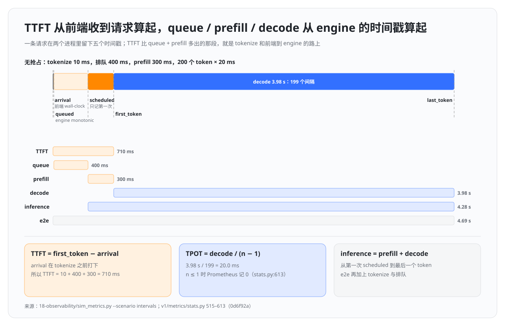

## 1.1 四个时间戳，两个时钟

vLLM 的请求级指标来自 2024 年初的 PR #2316，它把 Prometheus 指标重构了一遍，加上了请求级的 TTFT、e2e 等直方图[[1]](https://github.com/vllm-project/vllm/pull/2316)。V1 引擎之后，这些指标由 [stats.py](https://github.com/vllm-project/vllm/blob/0d6f92a/vllm/v1/metrics/stats.py) 计算，用到四个时间戳。`arrival_time` 由前端在 tokenize 之前打。`queued_ts`、`scheduled_ts` 由 engine core 在请求进入 waiting 队列、被调度时以事件形式带回。`first_token_ts` 和 `last_token_ts` 是 engine core 输出那一步的时间戳。前端和 engine core 是两个进程，设计文档专门强调：每个进程的 monotonic 时钟起点不同，跨进程比较 monotonic 时间戳没有意义，区间必须用同一进程的两个时间戳相减[[2]](https://docs.vllm.ai/en/latest/design/metrics/)。

所以 TTFT 和 e2e 是跨了 engine 边界的两个区间，都用前端进程的时间相减：515–530 行在请求还处于 prefilling 状态时，用前端的 `iteration_timestamp` 减 `arrival_time`。其余四个区间和 TPOT 都在 594–613 行请求结束时，用 engine 时间戳相减：

| 区间 | 公式 | 包含什么 |
|-|-|-|
| TTFT | 首 token − arrival | tokenize、前端排队、engine 排队、prefill |
| queue | scheduled − queued | 第一次排队 |
| prefill | first_token − scheduled | prefill 计算，以及 prefill 期间被抢占的暂停 |
| decode | last_token − first_token | decode 计算，以及 decode 期间被抢占的暂停 |
| inference | last_token − scheduled | = prefill + decode |
| TPOT | decode / (n − 1)，n ≤ 1 记 0 | 不算 prefill 吐出的第一个 token |

```text
== intervals：一条请求 200 个输出 token，事件时间线 → 各段指标（stats.py:594-613） ==
   tokenize 10 ms，排队 400 ms，prefill 300 ms，decode 20 ms/token；抢占暂停 1.5 s
场景                  TTFT     queue   prefill    decode  inference       e2e      TPOT   ITL max
无抢占           710.0 ms  400.0 ms  300.0 ms    3.98 s     4.28 s    4.69 s   20.0 ms   20.0 ms
prefill 中抢占     2.21 s  400.0 ms    1.80 s    3.98 s     5.78 s    6.19 s   20.0 ms   20.0 ms
decode 中抢占    710.0 ms  400.0 ms  300.0 ms    5.48 s     5.78 s    6.19 s   27.5 ms    1.52 s
```

无抢占那一行，TTFT 710 ms 比 queue + prefill 的 700 ms 多出 10 ms，正好是模拟里设的 tokenize 时间。真机上这个差值还包括多模态预处理、前端和 engine 之间的 IPC。看板上 TTFT 涨了而 queue 和 prefill 都没动，就去查前端：tokenizer 线程是否打满、API server 进程是否不够（17 章的 CPU 核数公式）。

## 1.2 TPOT 的单 token 请求

TPOT 的分母是 n − 1，只输出一个 token 的请求没有 decode 段。stats.py 613 行把它记成 0 写进 `vllm:request_time_per_output_token_seconds`；[serve.py](https://github.com/vllm-project/vllm/blob/0d6f92a/vllm/benchmarks/serve.py) 628–661 行算 bench 的 TPOT 时直接剔除这类请求[[3]](https://docs.vllm.ai/en/latest/benchmarking/cli/)。分类、打分这类 `max_tokens=1` 的流量一多，Prometheus 里的 TPOT 均值会被拉低，而 bench 报告里看不到这个效应。SGLang 的 TPOT 直方图同样剔除 completion < 2 的请求[[4]](https://github.com/sgl-project/sglang/blob/8fabf5e/docs/docs/references/production_metrics.mdx)。

还有一处要注意：TPOT 直方图是按请求记的，每条请求一个样本；ITL 直方图是按输出事件记的，长回复贡献的样本多得多。所以同一负载下 TPOT p99 和 ITL p99 差很远：第 3 章的混合负载里，逐 token 解码时 ITL p99 265.8 ms，TPOT p99 只有 40.3 ms。ITL p99 反映“偶尔一步很慢”（比如长 prefill 挤进来），TPOT p99 反映“某条请求整体很慢”。

# 第 2 章 · 抢占落在哪一段

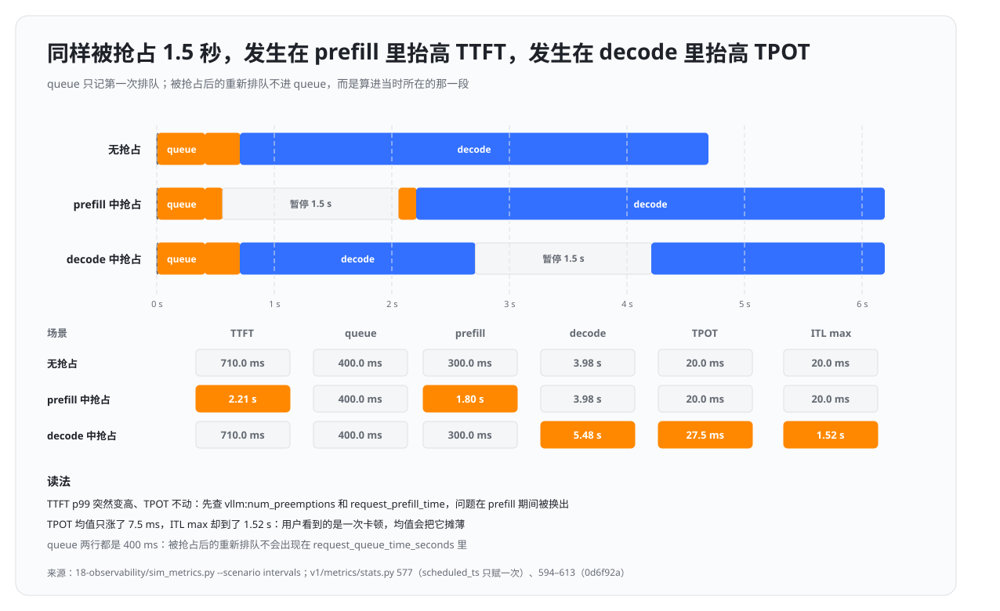

KV 不够时，调度器会把运行中的请求抢占回 waiting 队列（05 章）。这段暂停记在哪里，取决于 stats.py 577 行的一个判断：`scheduled_ts` 只在等于 0 时赋值，注释写的是 “ignore preemptions”。被抢占后重新调度，engine 照样发 SCHEDULED 事件，但 `scheduled_ts` 不再更新；`queued_ts` 每次 QUEUED 事件都会覆盖，但它只参与 queue 的计算，而 queue 用的是第一次的 scheduled。结果就是 597–608 行注释写明的：prefill 期间的抢占算进 prefill，decode 期间的抢占算进 decode。

| 场景 | TTFT | prefill | decode | TPOT | ITL max |
|-|-|-|-|-|-|
| 无抢占 | 710.0 ms | 300.0 ms | 3.98 s | 20.0 ms | 20.0 ms |
| prefill 中抢占 1.5 s | 2.21 s | 1.80 s | 3.98 s | 20.0 ms | 20.0 ms |
| decode 中抢占 1.5 s | 710.0 ms | 300.0 ms | 5.48 s | 27.5 ms | 1.52 s |

decode 中的抢占对 TPOT 的影响被 199 个 token 摊薄，只多了 7.5 ms；对 ITL 是一个 1.52 s 的离群样本，落在 ITL 直方图的尾部。这就是为什么排查抢占不能只看 TPOT：TPOT p99 可能几乎不动，直接信号要看 ITL p99 和 `vllm:request_num_preemptions`。`vllm:num_preemptions` 是 counter，按 engine 累计抢占次数[[5]](https://docs.vllm.ai/en/latest/usage/metrics/)；日志在本周期有抢占时会多打一列 “Preemptions: N”（[loggers.py](https://github.com/vllm-project/vllm/blob/0d6f92a/vllm/v1/metrics/loggers.py) 311 行）。

queue 不含重新排队的时间，所以 `vllm:request_queue_time_seconds` 不涨并不代表请求没排队。KV 吃紧时 queue 可能很平，prefill 或 decode 却在涨，原因是请求被反复抢占。这种情况下该看的是 `kv_cache_usage_perc` 是否贴近 1、`num_preemptions` 的 rate，然后回到 17 章调显存和 max_num_seqs。

# 第 3 章 · ITL：同一批时间戳的三种口径

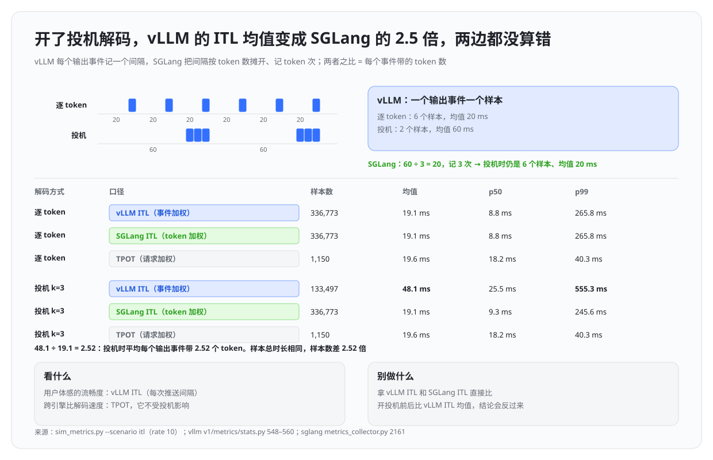

## 3.1 vLLM 按事件记，SGLang 按 token 记

stats.py 548–560 行：每次 engine core 为某条请求吐出一批新 token，如果它不在 prefill 阶段，就把这一次与上一次的时间差作为一个 ITL 样本。一次吐几个 token 不影响样本数。逐 token 解码时一次一个，没有区别；投机解码（13 章）一次可能吐出 1 + 接受的草稿数个 token，vLLM 仍只记一个样本，值是这一整步的耗时。

SGLang 的 `observe_inter_token_latency`（metrics_collector.py 2161 行[[6]](https://github.com/sgl-project/sglang/blob/8fabf5e/python/sglang/srt/observability/metrics_collector.py)）把间隔除以新 token 数，再按 token 数重复 observe。它的 ITL 是“每个 token 摊到多少时间”，样本数等于 decode token 数。

```text
解码方式      口径                                  样本数        均值       p50       p99
逐 token   vLLM ITL（事件加权）              336,773   19.1 ms    8.8 ms  265.8 ms
逐 token   SGLang ITL（token 加权）        336,773   19.1 ms    8.8 ms  265.8 ms
逐 token   TPOT（请求加权）                    1,150   19.6 ms   18.2 ms   40.3 ms
投机 k=3    vLLM ITL（事件加权）              133,497   48.1 ms   25.5 ms  555.3 ms
投机 k=3    SGLang ITL（token 加权）        336,773   19.1 ms    9.3 ms  245.6 ms
投机 k=3    TPOT（请求加权）                    1,150   19.6 ms   18.2 ms   40.3 ms
```

逐 token 解码时两家完全相同，336,773 个样本，p99 都是 265.8 ms。投机 k=3 时（每步先出 1 个 token，再以 0.7 的概率逐个接受草稿，最多 3 个），vLLM 只有 133,497 个样本，均值 48.1 ms；SGLang 仍是 336,773 个样本，均值 19.1 ms。总时长没变，变的只是分组方式，比值 2.52 就是平均每个输出事件带的 token 数。这个模拟只重新分组已有时间戳，不能用来估计投机解码的真实加速比，那要看 13 章的接受率模型[[7]](https://arxiv.org/abs/2211.17192)。

TPOT 两种情况下都是 19.6 ms：它是 decode 总时长除以 token 数，与分组无关。所以跨引擎、或开关投机解码前后比较“每个 token 多快”，用 TPOT；想知道“用户看到的流式卡顿有多长”，用 vLLM 的 ITL，因为流式输出的一次推送对应的就是一个输出事件。开了投机解码后在 vLLM 看板上看到 ITL 均值变大，原因是一次推送的 token 变多了，生成并没有变慢。

## 3.2 bench 的 ITL 又是哪一种

`vllm bench serve` 在客户端按收到的流式分片计时，每个分片一个 ITL 样本，口径接近 vLLM 的服务端 ITL，只是多了网络和 detokenize。SGLang 文档也提醒：平均 TPOT 的倒数不等于平均每秒 token 数，因为一个按请求平均、一个按 token 平均[[4]](https://github.com/sgl-project/sglang/blob/8fabf5e/docs/docs/references/production_metrics.mdx)。对外报数时写清楚是哪一种，并注明是否开了投机解码。

# 第 4 章 · 直方图桶：p99 是插值出来的

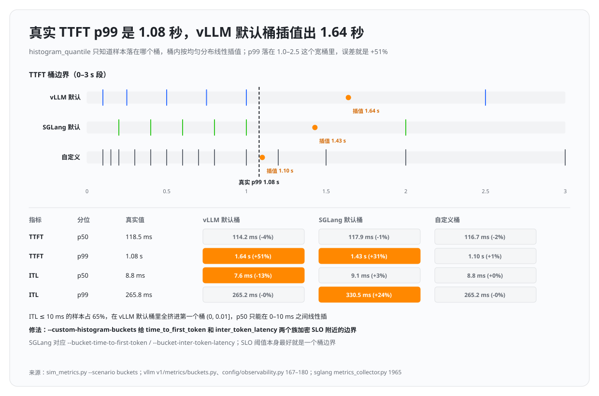

## 4.1 histogram_quantile 只知道桶边界

Prometheus 的经典直方图只存每个桶的累计计数。`histogram_quantile(0.99, …)` 先找到第 99 百分位落在哪个桶，再在桶内做线性插值；误差上限就是这个桶的宽度[[8]](https://prometheus.io/docs/practices/histograms/)。落进 +Inf 桶时，它返回最后一个有限上界，这时的 p99 只是一个下界。

vLLM 的默认桶定义在 [buckets.py](https://github.com/vllm-project/vllm/blob/0d6f92a/vllm/v1/metrics/buckets.py)，共 8 个族。TTFT 22 档，从 1 ms 到 2560 s，0.1 s 之后是 0.25、0.5、0.75、1.0、2.5；ITL 19 档，第一个边界是 10 ms。SGLang 的 TTFT 桶 18 档，从 0.1 s 开始[[6]](https://github.com/sgl-project/sglang/blob/8fabf5e/python/sglang/srt/observability/metrics_collector.py)。用 06 章的混合负载、rate 10 跑 120 s，把真实分位数和两家默认桶的插值结果放在一起：

```text
指标       分位        真实值          vLLM 默认桶        SGLang 默认桶              自定义桶
TTFT    p50   118.5 ms      114.2 ms (-4%)      117.9 ms (-1%)      116.7 ms (-2%)
TTFT    p90   606.8 ms      650.4 ms (+7%)      608.8 ms (+0%)      607.3 ms (+0%)
TTFT    p99     1.08 s       1.64 s (+51%)       1.43 s (+31%)        1.10 s (+1%)
ITL     p50     8.8 ms       7.6 ms (-13%)        9.1 ms (+3%)        8.8 ms (+0%)
ITL     p90    21.4 ms      24.2 ms (+13%)       21.3 ms (-0%)       21.3 ms (-0%)
ITL     p99   265.8 ms      265.2 ms (-0%)     330.5 ms (+24%)      265.2 ms (-0%)
```

TTFT p99 真实值 1.08 s，落在 vLLM 的 (1.0, 2.5] 桶里。这个桶里的样本大多挤在 1.0 附近，线性插值却假设它们均匀分布，于是给出 1.64 s，偏高 51%。SGLang 默认桶在这一段是 (1, 2]，偏高 31%。ITL p50 的问题正好相反：65% 的样本 ≤ 10 ms，全挤在 vLLM 的第一个桶 (0, 0.01] 里，p50 只能在 0–10 ms 之间插值，得到 7.6 ms，偏低 13%。

## 4.2 按 SLO 加桶

修法是把桶边界加密到 SLO 附近。vLLM 用 `--custom-histogram-buckets` 传 JSON，键是 buckets.py 里的族名，8 个族都能改（[observability.py](https://github.com/vllm-project/vllm/blob/0d6f92a/vllm/config/observability.py) 70、167–180 行）[[9]](https://docs.vllm.ai/en/latest/configuration/serve_args/)：

```bash
# 在 18-observability 目录执行；两模型使用同一组桶边界
MODEL_PROFILE=dense TP=2 bash ../01-first-server/serve.sh --custom-histogram-buckets '{
  "time_to_first_token": [0.05,0.1,0.15,0.2,0.3,0.4,0.5,0.6,0.7,0.8,1.0,1.2,1.5,2.0,3.0,5.0,10.0],
  "inter_token_latency": [0.005,0.01,0.015,0.02,0.025,0.03,0.04,0.05,0.075,0.1,0.15,0.2,0.3,0.5,1.0,2.5]}'
# 停止后换 moe 重复；桶边界是否合适仍以逐请求分布核对。
```

上表最后一列就是这组桶：TTFT p99 误差降到 1%，ITL p50 降到 0%。`inter_token_latency` 族同时作用于 ITL 和 TPOT 两个直方图（loggers.py 862–1030 行的映射），改一处两个都变。SGLang 对应三个参数：`--bucket-time-to-first-token`、`--bucket-inter-token-latency`、`--bucket-e2e-request-latency`[[10]](https://github.com/sgl-project/sglang/blob/8fabf5e/python/sglang/srt/arg_groups/fields/observability.py)。

加桶有两个代价。第一是序列数，第 9 章会算。第二是改了桶之后，新旧数据的桶边界不同，跨重启做 `rate()` 会混在一起；scrape_metrics.py 遇到两次抓取边界不同时直接报错，就是为了提醒这一点。桶要在上线前定好，SLO 改了再动。

| 族 | 默认档数 | 用到它的直方图 |
|-|-|-|
| time_to_first_token | 22 | TTFT |
| inter_token_latency | 19 | ITL、TPOT |
| request_latency | 21 | e2e、queue、inference、prefill、decode |
| request_tokens | max_model_len 40960 时 14 | prompt、generation 等 5 个 token 数直方图 |
| iteration_tokens | 13 | iteration_tokens_total |
| request_params_n / request_num_preemptions | 5 / 7 | n 参数、每请求抢占次数 |
| kv_cache_residency | 0.001–1800 s | kv_block\_\* 三个直方图，`--kv-cache-metrics` 时才注册 |

# 第 5 章 · 命中率：按条数开窗还是按时间开窗

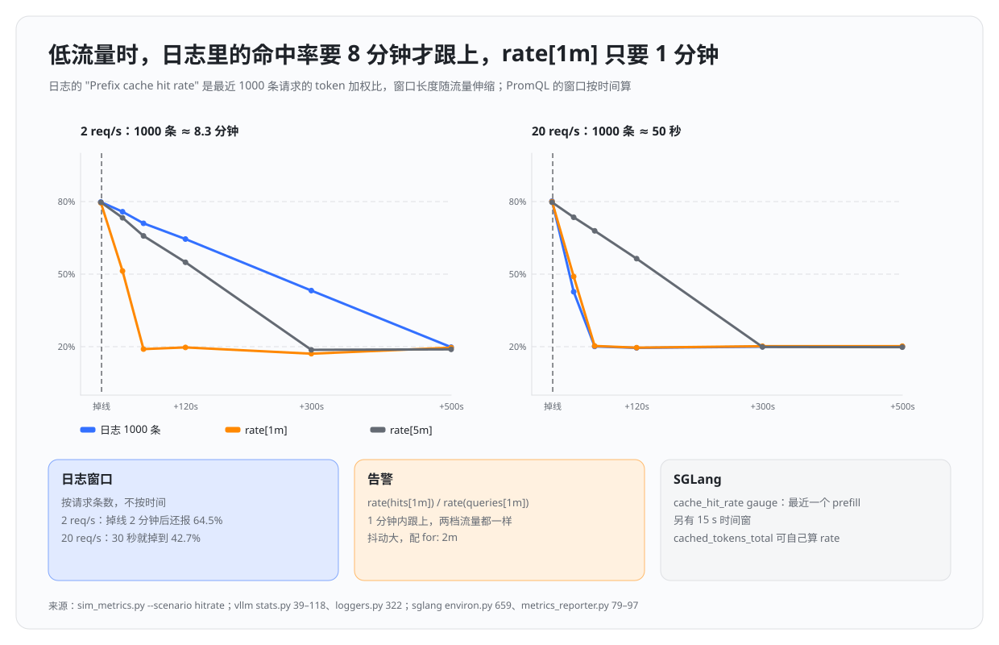

日志里的 “Prefix cache hit rate” 来自 stats.py 39–118 行的 `CachingMetrics`：一个双端队列，保存最近 1000 条请求的 (请求数, 查询 token 数, 命中 token 数)，命中率按 token 加权。没有新请求的统计周期不入队；调用 `reset_prefix_cache` 会清空队列。Prometheus 一侧是两个 counter：`vllm:prefix_cache_queries` 和 `vllm:prefix_cache_hits`（loggers.py 662、673 行），按时间窗口算比值由 PromQL 负责。

```text
流量  t − 600      日志窗口  rate[1m]  rate[5m]
     2/s       -1     79.8%     79.5%     79.7%
     2/s       30     75.8%     51.3%     73.3%
     2/s       60     71.0%     19.0%     65.8%
     2/s      120     64.5%     19.7%     54.9%
     2/s      300     43.2%     17.1%     18.7%
     2/s      500     19.8%     19.6%     18.9%
    20/s       -1     80.2%     80.0%     79.7%
    20/s       30     42.7%     49.0%     73.5%
    20/s       60     20.1%     20.3%     67.9%
    20/s      120     19.5%     19.6%     56.4%
    20/s      300     20.0%     20.2%     19.9%
    20/s      500     20.1%     20.2%     19.8%
```

t = 600 s 时命中率从 80% 突然掉到 20%。2 req/s 时，1000 条请求要攒 500 s，日志两分钟后还在报 64.5%，五分钟后才降到 43.2%；rate[1m] 一分钟后就到了 19.0%。20 req/s 时，1000 条只要 50 s，日志一分钟后已经是 20.1%，比 rate[5m] 的 67.9% 快得多。日志窗口的时间长度随流量变化，用它判断“命中率什么时候掉的”不可靠。

实践上：告警用 `rate(vllm:prefix_cache_hits_total[1m]) / rate(vllm:prefix_cache_queries_total[1m])`，看板用 5m 窗口看趋势；多 engine 时先 `sum` 再相除，不要对每个 engine 的比值取平均。KV connector 的命中走另一对 counter `vllm:external_prefix_cache_*`（686、698 行），算总命中率时要加上。

SGLang 的 `sglang:cache_hit_rate` 是 gauge，值是最近一个 prefill batch 的命中率；另有一个默认 15 s 的时间窗口版本，由 `SGLANG_CACHE_HIT_RATE_WINDOW_SECONDS` 控制（metrics_reporter.py 79–97、826–865 行）[[11]](https://github.com/sgl-project/sglang/blob/8fabf5e/python/sglang/srt/managers/scheduler_components/metrics_reporter.py)。gauge 只保留抓取那一刻的值，两次抓取之间的 batch 都丢了，所以跨引擎比较时，用 SGLang 的 `sglang:cached_tokens_total` 和 prompt token counter 自己算比值，口径才和 vLLM 的 counter 对得上。

# 第 6 章 · KV 使用率不含前缀缓存

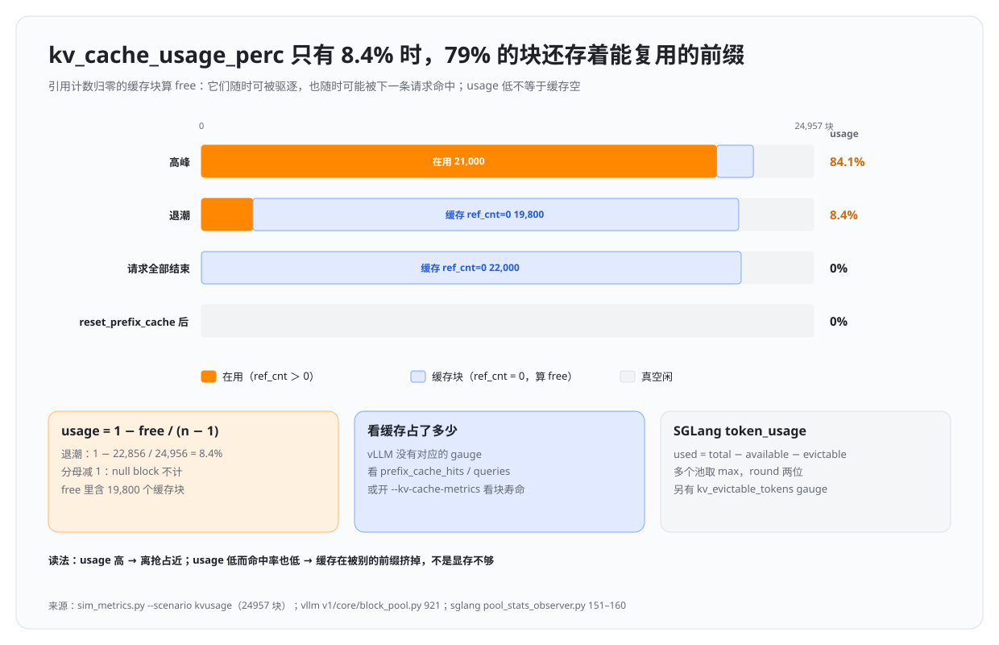

`vllm:kv_cache_usage_perc` 由 [block_pool.py](https://github.com/vllm-project/vllm/blob/0d6f92a/vllm/v1/core/block_pool.py) 921 行的 `get_usage` 计算：1 − 空闲块数 / (num_gpu_blocks − 1)，减 1 是因为有一个 null block。关键在“空闲”的定义：前缀缓存的块在请求结束、ref_cnt 降到 0 之后，仍保留着哈希和内容，但会被放回 free 队列，等到有新分配需要时才按 LRU 驱逐（04 章）。所以这些块在 usage 里算空闲。

```text
时刻                              运行中占用块       空闲但有缓存      真正空块  vLLM usage  SGLang usage
峰值：200 条在跑                  21,000        1,500     2,456       84.1%          0.84
流量退潮：20 条在跑                  2,100       19,800     3,056        8.4%          0.08
全部结束                             0       22,000     2,956        0.0%          0.00
reset_prefix_cache 之后            0            0    24,956        0.0%          0.00
```

沿用 02 章 H100 + Qwen3-8B 的 24,957 块。峰值时 usage 84.1%，和直觉一致；流量退潮后只剩 20 条在跑，usage 掉到 8.4%，但 19,800 块（79%）里还存着前缀，新来的同前缀请求可以直接命中。全部结束后 usage 是 0，缓存却还在；只有 `reset_prefix_cache` 之后才清空。

这个定义对调度是对的：可驱逐的块随时能拿来用，不该算作占用。但它让 usage 不能用来判断“缓存装了多少”。要看缓存状况，vLLM 这边只有间接手段：命中率 counter，以及 `--kv-cache-metrics` 打开后的 `vllm:kv_block_*` 直方图，记录块的生命周期、驱逐前空闲时长和复用间隔，按 `kv_cache_metrics_sample`（默认 0.01）采样（loggers.py 1037–1075 行）。

SGLang 的 `sglang:token_usage` 也不含可驱逐缓存：pool_stats_observer.py 151–160、236–240 行算的是 used = total − (available + evictable)，多个池取 max 并保留两位小数[[12]](https://github.com/sgl-project/sglang/blob/8fabf5e/python/sglang/srt/managers/scheduler_components/pool_stats_observer.py)。不同的是 SGLang 另外暴露了 `sglang:kv_evictable_tokens` 和 `sglang:kv_available_tokens` 两个 gauge（metrics_collector.py 438、445 行），能直接看出缓存装了多少；vLLM 目前没有对应的 gauge。

# 第 7 章 · prompt 吞吐：computed 还是 total

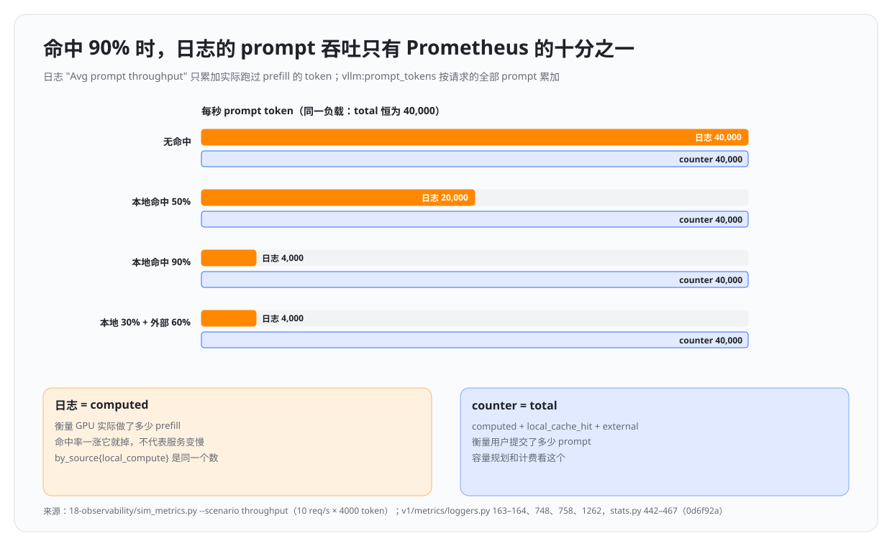

日志每 10 秒（`VLLM_LOG_STATS_INTERVAL`）打一行 “Avg prompt throughput: … tokens/s”。它的分子在 loggers.py 163–164 行：只累加 `prompt_token_stats.computed`，注释写明排除了缓存命中和外部传入的 token。Prometheus 的 `vllm:prompt_tokens` counter 在 1262 行累加的是 total = computed + 本地命中 + 外部 KV（stats.py 501 行）。两者都对，问的问题不同：前者是 GPU 真算了多少 prefill，后者是用户送进来多少 prompt。

```text
本地命中    外部 KV    日志 prompt tok/s  rate(prompt_tokens)  by_source local_compute  cache_hit  external
      0%       0%             40,000               40,000                   40,000          0         0
     50%       0%             20,000               40,000                   20,000     20,000         0
     90%       0%              4,000               40,000                    4,000     36,000         0
     30%      60%              4,000               40,000                    4,000     12,000    24,000
```

命中 90% 时，日志报 4,000 tok/s，`rate(vllm:prompt_tokens_total[1m])` 报 40,000。只看日志会以为 prefill 负载很轻；只看 counter 会以为 GPU 每秒在算 4 万个 prompt token。`vllm:prompt_tokens_by_source{source}`（loggers.py 758 行）把 total 拆成 local_compute、local_cache_hit、external_kv_transfer 三份，local_compute 和日志口径一致；`prompt_tokens_cached_by_source` 再把命中按 device、host、disk 等来源拆开，用于 15 章的分层缓存。

SGLang 的 `sglang:prompt_tokens_total` 在请求结束时才累加，缓存命中单独记在 `cached_tokens_total`（metrics_collector.py 2100–2136 行）[[6]](https://github.com/sgl-project/sglang/blob/8fabf5e/python/sglang/srt/observability/metrics_collector.py)。长请求还没结束时 SGLang 的 counter 不动，短窗口的 rate 会比 vLLM 抖；vLLM 是每个 iteration 累加。

# 第 8 章 · profiler：窗口怎样落到 engine step 上

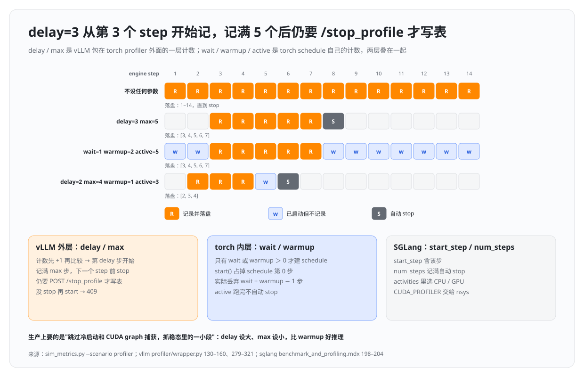

## 8.1 三种 profiler，一个入口

profiling 文档开头就有一条警告：profiling 只给开发者用，终端用户不应该打开，它会明显拖慢推理。选型建议是 Nsight Systems 开销低，适合性能敏感的分析；PyTorch profiler 开销中等，信息更多（调用栈、显存、shape）[[13]](https://docs.vllm.ai/en/latest/contributing/profiling/)。三种后端共用一个开关 `--profiler-config`（v0.13.0 起），`profiler` 字段取 torch、cuda 或 proton，实现分别是 [wrapper.py](https://github.com/vllm-project/vllm/blob/0d6f92a/vllm/profiler/wrapper.py) 里的 `TorchProfilerWrapper`（228 行）、`CudaProfilerWrapper`（682 行，调 `torch.cuda.profiler.start/stop` 并加 NVTX range）和 `ProtonProfilerWrapper`（468 行）。配了 profiler 之后 API server 才挂上 `/start_profile` 和 `/stop_profile` 两个路由，启动时会打一条 “This should ONLY be used for local development!” 的警告（[api_router.py](https://github.com/vllm-project/vllm/blob/0d6f92a/vllm/entrypoints/serve/profile/api_router.py)）。

torch profiler 的选项默认值：`torch_profiler_with_stack` 开、`use_gzip` 开、`dump_cuda_time_total` 开，`record_shapes`、`with_memory`、`with_flops` 关（[profiler.py](https://github.com/vllm-project/vllm/blob/0d6f92a/vllm/config/profiler.py) 117–134 行）。每个 worker 在 `torch_profiler_dir` 下写两个文件：`rank0.<id>.pt.trace.json.gz` 用 Perfetto 打开，`rank0.profiler_out.txt` 是汇总表；AsyncLLM 前端的 CPU trace 叫 `<hostname>_<pid>.async_llm`。设了 `profile_prefix` 时文件名前面加 `<prefix>_`，多次会话不会互相覆盖。汇总表在 `_stop` 里生成（415–435 行）：有 GPU 活动时按 `self_device_time_total` 排序；只记 CPU 时才按 `self_cpu_time_total` 排、取 50 行。stop 时的落盘很慢，文档给的例子是 H100 上 llama 70B 约 100 条请求的数据要 10 分钟，所以 profiling 时只发少量请求。

## 8.2 delay / max 与 wait / warmup / active

窗口控制有两层。外层是 vLLM 的 `WorkerProfiler`（36 行起）：每次 `execute_model` 调一次 `step()`（[gpu_worker.py](https://github.com/vllm-project/vllm/blob/0d6f92a/vllm/v1/worker/gpu_worker.py) 1222、1362 行），130–160 行先把计数加 1，再判断是否等于 `delay_iterations`，等于时才 start；记满 `max_iterations` 个有效 step 后，在下一个 step 里调 `stop()`。内层是 torch 自己的 schedule：只有 wait 或 warmup 大于 0 时才建（279–321 行）[[14]](https://docs.pytorch.org/docs/stable/profiler.html)。

```text
delay=0 max_iters=0                      step 1..14: RRRRRRRRRRRRRR   落盘的 step：[1, 2, 3, 4, 5, 6, 7, 8, 9, 10, 11, 12, 13, 14]
  delay=3 max_iters=5                      step 1..14: ..RRRRRS......   落盘的 step：[3, 4, 5, 6, 7]
  delay=0 max_iters=0 wait=1 warmup=2 active=5 step 1..14: wwRRRRRwwwwwww   落盘的 step：[3, 4, 5, 6, 7]
  delay=2 max_iters=4 wait=0 warmup=1 active=3 step 1..14: .RRRwS........   落盘的 step：[2, 3, 4]
```

第二行最要记住：`delay=3` 时第 3 个 step 就开始记，因为计数先加 1 再比较，被跳过的是前 2 个。第三行 wait=1、warmup=2，直觉上该丢 3 步，实际只丢了 2 步，因为 `start()` 已经占掉了 schedule 的第 0 步。第四行两层叠加：delay=2 从第 2 步启动，warmup=1 让启动那一步不记，max=4 却只落盘 3 步，因为 active=3 跑完后 schedule 进入不记录状态，而 vLLM 的计数只算实际记录的 step。

生产上要的通常是“跳过冷启动和 CUDA graph 捕获，在稳态里抓一小段”，用 delay 设大、max 设小最好推理。`/start_profile` 的 JSON body 可以按次覆盖这两个值，还能带 `profiler_kwargs`：

```bash
curl -X POST http://localhost:8000/start_profile -H 'Content-Type: application/json' -d '{
  "profile_prefix": "ch18_run1", "delay_iterations": 5000, "max_iterations": 20,
  "profiler_kwargs": {"record_shapes": true, "with_stack": true}}'
# 压测若干秒后
curl -X POST http://localhost:8000/stop_profile
```

记满 max 之后 worker 端的 profiler 已经自动停了，但文档要求仍然调 `/stop_profile`：AsyncLLM 在 `start_profile` 里用 `_profile_session_active` 标记会话（[async_llm.py](https://github.com/vllm-project/vllm/blob/0d6f92a/vllm/v1/engine/async_llm.py) 1145–1151 行），没 stop 就再 start 会抛 `ProfilerAlreadyActiveError`，HTTP 返回 409。delay / max 也不作用于前端的 CPU profiler，它从 start 一直记到 stop。`vllm bench serve --profile` 会在压测前后自动调这两个接口[[3]](https://docs.vllm.ai/en/latest/benchmarking/cli/)。

## 8.3 nsys 与 proton

torch profiler 回答“哪个算子慢”，回答不了“两个 kernel 之间 GPU 为什么空着”。后者要看 nsys 的时间线[[15]](https://docs.nvidia.com/nsight-systems/UserGuide/index.html)。vLLM 的做法是把 `profiler` 设成 cuda，`/start_profile` 就变成 `cudaProfilerStart`，nsys 用 `--capture-range=cudaProfilerApi` 只抓这段；`--capture-range-end repeat` 让每次 start / stop 各出一份报告。worker 是子进程，要加 `--trace-fork-before-exec=true`。CUDA graph 里的 kernel 要 `--cuda-graph-trace=node` 才能逐个看到。文档还建议设 `VLLM_WORKER_MULTIPROC_METHOD=spawn`，因为 nsys 对 fork 出来的进程有已知问题[[13]](https://docs.vllm.ai/en/latest/contributing/profiling/)：

```bash
# 在 18-observability 目录执行；目标机器先确认 nsys 与引擎 profiler 兼容
MODEL_PROFILE=${MODEL_PROFILE:-dense}
source ../common/model_profile.sh
VLLM_WORKER_MULTIPROC_METHOD=spawn nsys profile \
  --trace-fork-before-exec=true --cuda-graph-trace=node \
  --capture-range=cudaProfilerApi --capture-range-end repeat \
  vllm serve "$MODEL" --revision "$REVISION" --host 127.0.0.1 \
    --tensor-parallel-size 2 --max-model-len 8192 --profiler-config.profiler cuda
# 另一终端使用相同 profile 压测；trace 分开查看全注意力、GDN 和专家通信。
# 停止并保存当前报告后再切换另一 profile，不覆盖已有结果。
```

proton 是 Triton 的 profiler，适合看 Triton kernel 的聚合耗时。CUDA graph 开着时必须设 `proton_graph_attribution: true` 才能把 replay 的 kernel 归因回去，这需要 Triton ≥ 3.7；`pcsampling` 模式和 Chrome trace 输出要 `--enforce-eager`。分层 NVTX 标记 `--enable-layerwise-nvtx-tracing`（[observability.py](https://github.com/vllm-project/vllm/blob/0d6f92a/vllm/config/observability.py) 86 行）不支持 CUDA graph，用它就得接受 eager 模式下的时间线与线上不同。

SGLang 的 profiler 入口也是 `/start_profile`，输出目录由 `SGLANG_TORCH_PROFILER_DIR` 指定。`start_step` 包含该步，`num_steps` 记满自动结束：start_step=3、num_steps=10 记的是第 3–12 步；`activities` 里写 `CUDA_PROFILER` 就交给外层的 nsys[[16]](https://github.com/sgl-project/sglang/blob/8fabf5e/docs/docs/developer_guide/benchmark_and_profiling.mdx)。两家的起点语义恰好一致（都从第 N 步开始记），区别在结束：vLLM 记满后还要手动 stop 才能开下一轮。

# 第 9 章 · 时间序列数与多进程

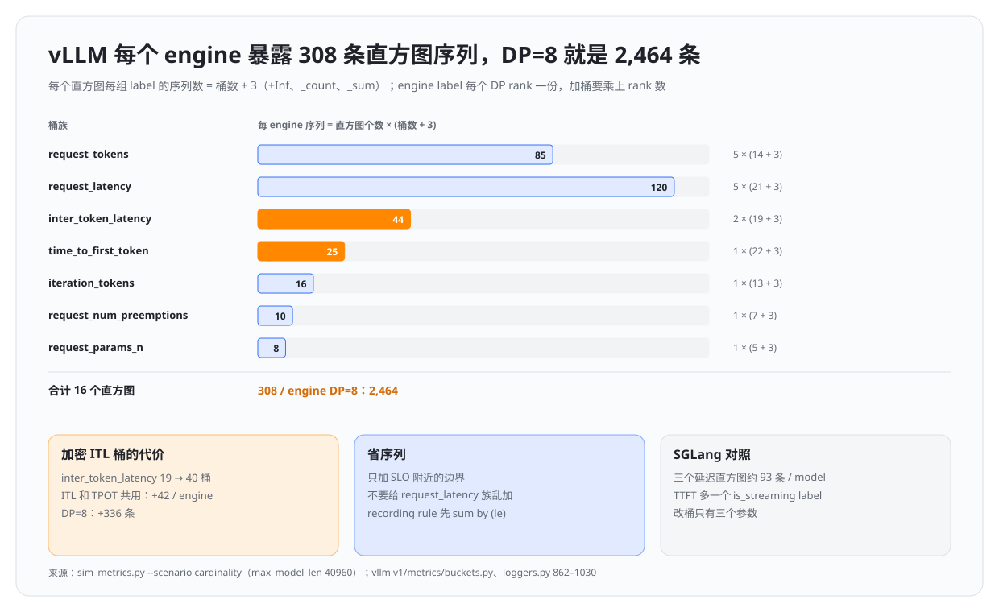

一个经典直方图每组 label 占用 桶数 + 3 条时间序列：每个有限桶一条、+Inf 一条、`_count` 和 `_sum` 各一条。vLLM 的 label 是 `model_name` × `engine`，engine 每个 DP rank 一份。按 max_model_len 40960 数一遍默认的 16 个直方图：

```text
桶族                            桶数     直方图个数    每 engine 序列
request_tokens                14         5             85
iteration_tokens              13         1             16
request_params_n               5         1              8
time_to_first_token           22         1             25
inter_token_latency           19         2             44
request_latency               21         5            120
request_num_preemptions        7         1             10
合计                                      16            308
   DP=1：308 条直方图序列（engine label 每个 DP rank 一份）
   DP=8：2,464 条直方图序列（engine label 每个 DP rank 一份）
   把 inter_token_latency 族改成 40 个桶：每 engine 多 42 条（ITL 和 TPOT 共用这一族），DP=8 多 336 条
   对照 SGLang 三个延迟直方图（TTFT 多一个 is_streaming label）：每个 model_name 约 93 条
```

每个 engine 308 条，DP=8 就是 2,464 条，再乘上集群里的实例数。Prometheus 的建议是单个指标的基数尽量控制在 10 以下，超过 100 就要考虑别的方案[[17]](https://prometheus.io/docs/practices/instrumentation/#do-not-overuse-labels)。这里的 308 是 16 个直方图的合计，单个直方图在 DP=8 时也有 8 × (桶数 + 3) 条。加桶时先算账：把 ITL 族从 19 档加到 40 档，ITL 和 TPOT 两个直方图都变，每 engine 多 42 条，DP=8 多 336 条。kv_block\_\* 直方图默认不注册，打开 `--kv-cache-metrics` 时再加一份。

看板上算分位数要先把所有 engine 的桶加起来再插值：`histogram_quantile(0.99, sum by (le) (rate(vllm:time_to_first_token_seconds_bucket[5m])))`。对每个 engine 分别求 p99 再取平均，得到的不是任何东西的 p99。scrape_metrics.py 的 `merged_hist` 做的就是 `sum by (le)`。

多进程方面，指标早年在 engine core 进程里收集，再用 prometheus_client 的 multiprocess 模式暴露给 API server；现在指标在 API server 进程里收集，只有 `--api-server-count > 1` 时才用 multiprocess 模式[[2]](https://docs.vllm.ai/en/latest/design/metrics/)[[18]](https://github.com/vllm-project/vllm/pull/17546)。[prometheus.py](https://github.com/vllm-project/vllm/blob/0d6f92a/vllm/v1/metrics/prometheus.py) 17 行的 `setup_multiprocess_prometheus` 负责设置 `PROMETHEUS_MULTIPROC_DIR`。多 API server 时每个进程各写一份文件，抓取时合并；gauge 的合并方式和单进程不同，看 KV 使用率这类 gauge 时注意它来自哪个进程。指标弃用也有固定节奏：X.Y 版弃用的指标在 X.Y+1 隐藏，可以用 `--show-hidden-metrics-for-version=X.Y` 临时找回[[5]](https://docs.vllm.ai/en/latest/usage/metrics/)，升级前查一遍看板用到的指标名。

# 第 10 章 · 对照 SGLang

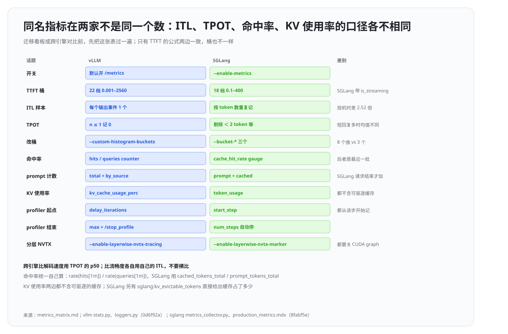

| 话题 | vLLM | SGLang | 迁移时注意 |
|-|-|-|-|
| 开关 | `/metrics` 默认开 | `--enable-metrics` | SGLang 不加参数就没有指标 |
| TTFT 桶 | 22 档，0.001–2560 s | 18 档，0.1–400 s；带 `is_streaming` label | SGLang 低于 100 ms 的 TTFT 全在第一个桶 |
| ITL 样本 | 每个输出事件一个 | 间隔 / 新 token 数，按 token 重复记 | 开投机后均值差 2.52 倍（第 3 章） |
| TPOT | decode / (n − 1)，n ≤ 1 记 0 | 剔除 completion < 2、abort 等 | 短回复多时均值不同 |
| 改桶 | `--custom-histogram-buckets`，8 个族 | `--bucket-*` 三个参数 | SGLang 只能改三个延迟直方图 |
| 命中率 | hits / queries counter；日志 1000 条窗口 | `cache_hit_rate` gauge，最近一批；15 s 窗口 | 跨引擎用 counter 自己算 |
| prompt 计数 | 每 iteration 累加 total；by_source 拆分 | 请求结束时累加；cached 单独记 | 短窗口 rate 抖动不同 |
| KV 使用率 | `kv_cache_usage_perc` | `token_usage`，多池取 max | 都不含可驱逐缓存；SGLang 另有 `kv_evictable_tokens` |
| profiler 起点 / 终点 | `delay_iterations` / `max_iterations` + stop | `start_step` / `num_steps` 自动停 | vLLM 记满仍要 `/stop_profile` |
| nsys 区间 | `profiler=cuda` | `activities: ["CUDA_PROFILER"]` | 两家都用 cudaProfilerApi 做 capture range |

[[4]](https://github.com/sgl-project/sglang/blob/8fabf5e/docs/docs/references/production_metrics.mdx)[[16]](https://github.com/sgl-project/sglang/blob/8fabf5e/docs/docs/developer_guide/benchmark_and_profiling.mdx)

能让结论反过来的是 ITL 和命中率两行。A/B 两家引擎时，在 vLLM 一侧看 ITL、在 SGLang 一侧也看 ITL，开了投机解码的话会得出“vLLM 慢一倍多”的错误结论，正确做法是两边都看 TPOT，或者都用客户端 bench 的口径。命中率方面，SGLang 的 gauge 是抓取那一刻最近一批的值，跟 vLLM counter 算出的窗口比值不可比。

两家相同的地方也记一下：两家的 TTFT 都从请求到达算起，KV 使用率都不含可驱逐的前缀缓存，profiler 的起点都是“从第 N 步开始记”。迁移看板时这几项可以直接对应，只需改前缀和桶。

# 第 11 章 · 真机实验

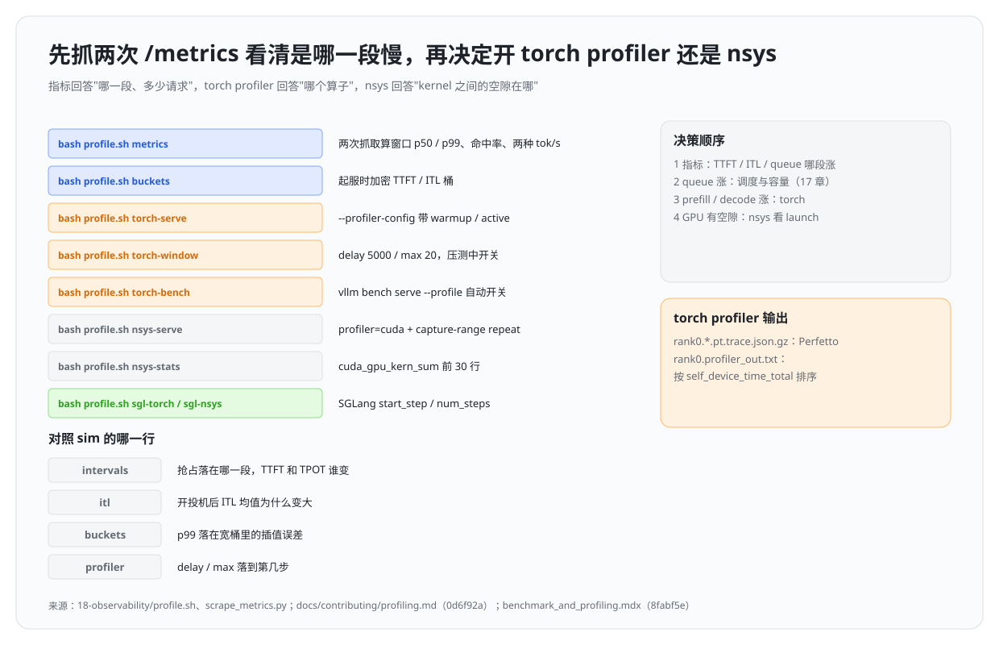

## 11.1 命令

```bash
# 在 zero-to-vllm/18-observability 目录执行；每段独立运行，不整块执行
python3 sim_metrics.py --scenario all
python3 -m unittest test_sim_metrics -v
# 已有服务：VLLM 可覆盖完整地址，默认 http://127.0.0.1:8000
MODEL_PROFILE=dense bash profile.sh metrics
# torch 示例，终端 1：先核对当前版本支持，停止占用目标端口的旧服务
MODEL_PROFILE=dense TP=2 MAX_MODEL_LEN=8192 bash profile.sh torch-serve
# 终端 2：服务就绪后压测，torch-bench 自行管理 start/stop
MODEL_PROFILE=dense bash profile.sh torch-bench
# 手工窗口是另一种选择：在有持续负载时运行，不与 torch-bench 同时控制
# MODEL_PROFILE=dense SECS=60 bash profile.sh torch-window
# buckets、nsys-serve、proton-serve 都会启动独立服务，须停旧实例后逐项选择
# nsys-serve 就绪后在另一终端运行 torch-bench；用实际报告文件执行 nsys-stats
# SGLang 的 sgl-torch 仅向现有 SGL 服务发起 CPU/GPU 采样，不负责启动服务
# sgl-nsys 则启动新服务；另一个终端用 CUDA_PROFILER 活动触发，不能串接 sgl-torch
# SGL 默认 http://127.0.0.1:30000，可用 SGL / SGL_PORT 设置对应地址
# moe 独立重复；每条命令自动新建 results/<profile>/<时间戳>_<PID>
# 也可用 OUT 指定尚不存在的目录；失败后重跑也须换目录
# 服务端 trace：OUT/torch、OUT/proton；nsys 前缀：OUT/vllm_profile、OUT/sgl_profile
# 客户端详细结果：客户端 OUT/bench.json；分析时配对本轮服务端与客户端目录
```

先核对指标名称、计数窗口和直方图边界，再比较日志、Prometheus 与客户端结果。p99 落入 +Inf 桶时只能报告下界；加密桶后仍要用同一时间窗口的逐请求样本核对，不能保证一定接近另一窗口的 bench 分位数。torch-window 的延迟按 worker step 计，固定等待 60 秒不保证已经跳过 5000 步并采满 20 步，须从 trace 确认实际采样窗口。脚本拒绝复用已有 OUT，将 torch、proton 目录和 nsys 报告前缀放在本次服务端 OUT 内；引擎启动、torch-bench 与 nsys-stats 的输出写入日志，torch-bench 要求非空的详细 bench.json。即使 JSON 已存在，命令退出非零仍算失败。metrics、torch-window、sgl-torch 尚未统一保存完整输出，仍需额外归档；手工窗口中断时还须确认服务端是否停止采样。run.txt 只记录所选配置，不能证明服务端实际加载的模型或引擎版本，须配对保存对应启动日志。分析时分别识别全注意力、GDN 和专家通信，不预设最耗时 kernel 的排序。离线检查只验证参数与失败处理，当前双模型的 profiler 接口、trace 和 GPU 结果仍待实机验证。

## 11.2 源码阅读顺序

[stats.py](https://github.com/vllm-project/vllm/blob/0d6f92a/vllm/v1/metrics/stats.py)（时间戳、区间公式、CachingMetrics）→ [loggers.py](https://github.com/vllm-project/vllm/blob/0d6f92a/vllm/v1/metrics/loggers.py)（日志与 Prometheus 两个 logger，指标定义和桶映射）→ [buckets.py](https://github.com/vllm-project/vllm/blob/0d6f92a/vllm/v1/metrics/buckets.py)（8 个桶族）→ [observability.py](https://github.com/vllm-project/vllm/blob/0d6f92a/vllm/config/observability.py)（开关和自定义桶）→ [block_pool.py](https://github.com/vllm-project/vllm/blob/0d6f92a/vllm/v1/core/block_pool.py) 921 行（KV usage）→ [wrapper.py](https://github.com/vllm-project/vllm/blob/0d6f92a/vllm/profiler/wrapper.py)（三种 profiler 与窗口控制）→ [profiler.py](https://github.com/vllm-project/vllm/blob/0d6f92a/vllm/config/profiler.py)。设计背景读 Metrics 设计文档[[2]](https://docs.vllm.ai/en/latest/design/metrics/)，用法读 Production Metrics 与 Profiling 两篇[[5]](https://docs.vllm.ai/en/latest/usage/metrics/)[[13]](https://docs.vllm.ai/en/latest/contributing/profiling/)。SGLang 对照读 `observability/metrics_collector.py`、`scheduler_components/pool_stats_observer.py`、`scheduler_components/metrics_reporter.py` 和 Production Metrics 文档。行号都在 metrics_matrix.md。

> 📌 **核对清单**
> - 能说出 TTFT 与 queue + prefill 的差值来自哪里，TTFT 涨而 queue、prefill 不动时先查前端。
> - 知道 queue 只记第一次排队，抢占的暂停记在 prefill 或 decode，排查抢占看 ITL p99 和 `num_preemptions`。
> - 知道 Prometheus 的 TPOT 把单 token 请求记 0，bench 和 SGLang 都剔除。
> - 开投机解码后比较“每 token 多快”用 TPOT，不用 ITL；跨引擎比较 ITL 前确认口径。
> - 按 SLO 用 `--custom-histogram-buckets` 加密 TTFT / ITL 桶，上线前定好，改桶前算序列数。
> - 分位数先 `sum by (le)` 再插值；p99 落进 +Inf 桶时只是下界。
> - 命中率告警用 counter 的 rate[1m] 比值，不看日志的 1000 条窗口，也不看 SGLang 的单批 gauge。
> - KV 使用率低不代表缓存空了；要看缓存用命中率 counter 和 `--kv-cache-metrics`。
> - GPU 实际 prefill 量看日志口径或 `prompt_tokens_by_source{source="local_compute"}`。
> - profiling 用 delay 设大、max 设小抓稳态。记满后仍调 `/stop_profile`。只发少量请求。
> - nsys 带 `--trace-fork-before-exec=true --cuda-graph-trace=node`，服务端用 `profiler=cuda` + capture range，设 `VLLM_WORKER_MULTIPROC_METHOD=spawn`。

到这里，单个实例从调参到观测都有了。实际部署很少只有一个实例：多个副本前面要有按前缀和负载路由的网关，要在 K8s 上滚动升级，RL 训练还要求推理实例能腾出显存、接收新权重。下一篇 VLLM-19 讲集群与 RL：路由、K8s 部署、sleep mode 与权重同步。

# 参考文献

按正文首次引用顺序编号，资料截至 2026 年 10 月底。源码以 vllm-project/vllm 主干提交 0d6f92a（2026 年 10 月 29 日）和 v0.32.0 发行版为准；SGLang 对照以 sgl-project/sglang 主干 8fabf5e 为准。

[1] vllm-project. Refactor Prometheus and Add Request Level Metrics. PR #2316 (2024-01-31) [https://github.com/vllm-project/vllm/pull/2316](https://github.com/vllm-project/vllm/pull/2316)

[2] vLLM Docs. Metrics (design) [https://docs.vllm.ai/en/latest/design/metrics/](https://docs.vllm.ai/en/latest/design/metrics/)

[3] vLLM Docs. Benchmark CLI [https://docs.vllm.ai/en/latest/benchmarking/cli/](https://docs.vllm.ai/en/latest/benchmarking/cli/)

[4] SGLang Docs. Production Metrics (8fabf5e) [https://github.com/sgl-project/sglang/blob/8fabf5e/docs/docs/references/production_metrics.mdx](https://github.com/sgl-project/sglang/blob/8fabf5e/docs/docs/references/production_metrics.mdx)

[5] vLLM Docs. Production Metrics [https://docs.vllm.ai/en/latest/usage/metrics/](https://docs.vllm.ai/en/latest/usage/metrics/)

[6] sgl-project. sglang/srt/observability/metrics_collector.py. GitHub (8fabf5e) [https://github.com/sgl-project/sglang/blob/8fabf5e/python/sglang/srt/observability/metrics_collector.py](https://github.com/sgl-project/sglang/blob/8fabf5e/python/sglang/srt/observability/metrics_collector.py)

[7] Leviathan Y, et al. Fast Inference from Transformers via Speculative Decoding. ICML (2023) [https://arxiv.org/abs/2211.17192](https://arxiv.org/abs/2211.17192)

[8] Prometheus Docs. Histograms and Summaries [https://prometheus.io/docs/practices/histograms/](https://prometheus.io/docs/practices/histograms/)

[9] vLLM Docs. Server Arguments [https://docs.vllm.ai/en/latest/configuration/serve_args/](https://docs.vllm.ai/en/latest/configuration/serve_args/)

[10] sgl-project. sglang/srt/arg_groups/fields/observability.py. GitHub (8fabf5e) [https://github.com/sgl-project/sglang/blob/8fabf5e/python/sglang/srt/arg_groups/fields/observability.py](https://github.com/sgl-project/sglang/blob/8fabf5e/python/sglang/srt/arg_groups/fields/observability.py)

[11] sgl-project. sglang/srt/managers/scheduler_components/metrics_reporter.py. GitHub (8fabf5e) [https://github.com/sgl-project/sglang/blob/8fabf5e/python/sglang/srt/managers/scheduler_components/metrics_reporter.py](https://github.com/sgl-project/sglang/blob/8fabf5e/python/sglang/srt/managers/scheduler_components/metrics_reporter.py)

[12] sgl-project. sglang/srt/managers/scheduler_components/pool_stats_observer.py. GitHub (8fabf5e) [https://github.com/sgl-project/sglang/blob/8fabf5e/python/sglang/srt/managers/scheduler_components/pool_stats_observer.py](https://github.com/sgl-project/sglang/blob/8fabf5e/python/sglang/srt/managers/scheduler_components/pool_stats_observer.py)

[13] vLLM Docs. Profiling vLLM [https://docs.vllm.ai/en/latest/contributing/profiling/](https://docs.vllm.ai/en/latest/contributing/profiling/)

[14] PyTorch Docs. torch.profiler [https://docs.pytorch.org/docs/stable/profiler.html](https://docs.pytorch.org/docs/stable/profiler.html)

[15] NVIDIA. Nsight Systems User Guide [https://docs.nvidia.com/nsight-systems/UserGuide/index.html](https://docs.nvidia.com/nsight-systems/UserGuide/index.html)

[16] SGLang Docs. Benchmark and Profiling (8fabf5e) [https://github.com/sgl-project/sglang/blob/8fabf5e/docs/docs/developer_guide/benchmark_and_profiling.mdx](https://github.com/sgl-project/sglang/blob/8fabf5e/docs/docs/developer_guide/benchmark_and_profiling.mdx)

[17] Prometheus Docs. Instrumentation: Do not overuse labels [https://prometheus.io/docs/practices/instrumentation/#do-not-overuse-labels](https://prometheus.io/docs/practices/instrumentation/#do-not-overuse-labels)

[18] vllm-project. [Perf] API-server scaleout with many-to-many server-engine comms. PR #17546 (2025-05-30) [https://github.com/vllm-project/vllm/pull/17546](https://github.com/vllm-project/vllm/pull/17546)

---

[在 Colab 里跑本章 CPU 练习](https://colab.research.google.com/github/zyaochen/zero-to-vllm/blob/main/colab/18-observability.ipynb) · 上一章：[VLLM-17｜生产｜调参手册：预算、显存比例、编译档位与负载画像](./17-tuning.md) · [目录](./README.md) · 下一章：[VLLM-19｜生产｜集群与 RL：路由、K8s 部署、sleep mode 与权重同步](./19-cluster-rl.md)
