# VLLM-19｜生产｜集群与 RL：路由、K8s 部署、sleep mode 与权重同步

> 🎯 **这篇文档解决什么问题**：前面 18 篇我们一直盯着单个实例。上线之后实例很少只有一个：几台副本前面要有路由层，要跑在 K8s 上，能被探针判活，崩溃后能快速拉起；RL 训练还要求推理实例在两次 rollout 之间腾出显存、收下训练端的新权重，并标清楚每个 token 是哪一版权重生成的。我们按这个顺序走一遍：vLLM 内置 DP 负载均衡的打分公式和快照延迟，SGLang 的 sgl-router 和前缀感知路由，K8s 探针和编译缓存，sleep mode 的三档，RL 的 pause、四段式权重同步和版本段。每一处都对照 SGLang，给出源码行号和模拟器数字。
>
> **使用方式**：第 1–5 章是多副本路由，第 6 章是 K8s，第 7 章是 sleep mode，第 8–11 章是 RL 权重同步，第 12 章是真机命令和核对清单。只做在线服务的话看前 7 章，做 RL 的话从第 7 章读起。
>
> **代码**：[19-cluster-rl](../19-cluster-rl)。sim_router.py 有 7 个场景：route / hot 在 4 或 8 台副本上比较轮询、vLLM 内置打分、P2C 和 sgl-router 的两种前缀感知模式。stale 逐层还原 `core_client.py` 应对过期快照的三道补丁。probe 用 01 章的启动时间线推演 kubelet 什么时候杀容器。sleep、nccl、pause 估算切换模型、广播权重和暂停的代价。15 个单测钉住打分门槛、扫描起点轮转、探针最晚被杀时间等结论。cluster.sh 是按段复制的命令清单，cluster_matrix.md 是两家源码行号对照表。全部只用 Python 标准库。

# 导读 · 先给结论

## 副本预算按总权重与状态估算

集群入口改用双模型，容量规划按每副本总驻留权重、活跃序列的 GDN 状态和全注意力 KV 共同计算。MoE 激活参数少不能据此缩减模型副本的显存配置。

sleep/wake、权重同步和请求迁移应验证状态失效与重建，避免旧权重配旧缓存继续生成。跨节点记录 TP/EP 拓扑、通信带宽与失败恢复。K8s 配置必须锁引擎镜像和模型 revision，旧单卡小模型清单不能直接部署新基座。

双模型结构以固定版本配置核对[[Qwen3.8-27B config.json]](https://huggingface.co/Qwen/Qwen3.8-27B/blob/37561816e66b5b9153b1b64c10968c18c1e6f4a0/config.json)[[Qwen3.5-35B-A3B config.json]](https://huggingface.co/Qwen/Qwen3.5-35B-A3B/blob/59d61f3ce65a6d9863b86d2e96597125219dc754/config.json)。

1. **vLLM 把负载均衡放在 API server 里，SGLang 拆成独立的 router。**`--data-parallel-size N` 只暴露一个端口，API server 按打分选 engine；sgl-router 是单独的 Rust 进程，站在若干独立的 `launch_server` 前面。
2. **vLLM 内置打分不看前缀。**score = max(client_count × inflight, waiting + running)，有排队时再加 waiting × 6 × max(0, kv − 0.5)。文档自己写着以后“could be made more sophisticated … by incorporating KV cache aware logic”。
3. **负载快照最快 100 ms 一份，靠本地计数兜底。**64 条请求挤在一个快照窗口里，只看快照会全部落到同一台；加上本地 `waiting += client_count`、扫描起点轮转和 inflight 下限，四台各 16 条。
4. **前缀感知路由省的是 prefill。**4 台副本、128 个前缀合计 709k token、单台 KV 只装 399k 时，轮询命中 66.6%，sgl-router 的 cache_aware prefer 命中 89.3%，实际要算的 prefill 从 3.78M 降到 1.21M，TTFT p50 从 85 ms 降到 23 ms。8 台时 prefill 少 76%。
5. **热点前缀下 prefer 会压垮一台。**一个前缀占一半流量时，prefer 的请求倾斜 2.32，TPOT p99 55.5 ms；balanced 在首选负载超过备选 2 倍且多 1024 token 时改投，倾斜 1.03，命中率只少 2.1 个百分点。
6. **K8s 上先配 startupProbe，再把编译缓存放到卷上。**vLLM 文档的 liveness 示例最晚第 80 秒杀容器，而本篇引用的 8B 冷启动时间线是 84 秒、torch.compile 第 67 秒写完缓存，这两个时间是第 1 章示意日志推出来的算例，不是本篇在对应集群上量到的冷启动。按这套数，缓存若留在容器层，每次重启都回到冷启动，就会反复 CrashLoopBackOff。
7. **sleep level 1 换模型约 1.6 秒，代价是主机内存。**权重卸到 CPU pinned 内存，8 卡各睡一个 8B 要 131 GB；level 2 不占主机内存，唤醒后要 reload_weights，约 5 秒。
8. **vLLM 的权重同步是四个端点。**init 建 NCCL 组，每步 start → update → finish，外面包 pause / resume。update 失败后模型是半更新状态，`/health` 仍返回 200，只能从 start 重来。
9. **pause 三种模式各有代价。**wait 要等最长那条 rollout，模拟里 52.3 秒。abort 不等，重投要重新 prefill 15 万 token。keep 不等也不丢，但一条输出会跨两版权重。SGLang 对应 abort / retract / in_place。
10. **NCCL 广播的下限是 rank 0 那张网卡。**DeepSeek-V3 FP8 共 671 GB，走 400G IB 至少 13.4 秒；同卡共置用 IPC 只传句柄。两家都用 [start, end) 版本段告诉训练端哪些 token 是哪一版权重生成的。

# 第 1 章 · 两种拓扑：内置 LB 与独立 router

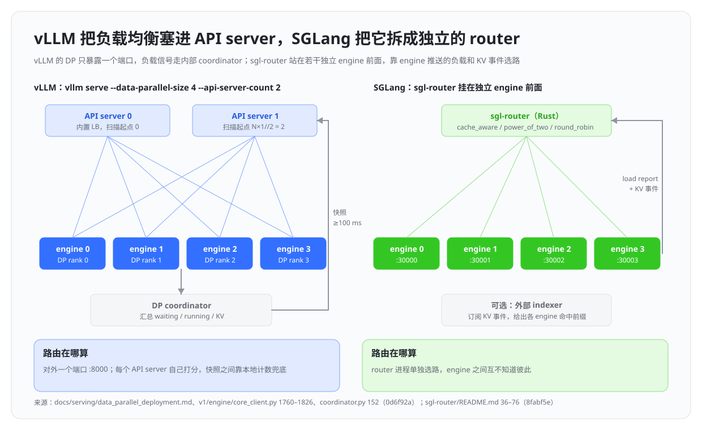

## 1.1 vLLM：一个端口，内部打分

vLLM 的数据并行部署只有一条命令：`vllm serve --data-parallel-size 4`。四个 engine core 各自管一份 KV 和调度，API server 进程里的 `DPLBAsyncMPClient` 负责把每条请求派给其中一个，对外只有一个端口[[1]](https://docs.vllm.ai/en/latest/serving/data_parallel_deployment/)。每个 engine 把自己的 waiting / running 队列长度报给 DP coordinator，coordinator 汇总后最快每 100 ms 广播一次快照（[coordinator.py](https://github.com/vllm-project/vllm/blob/0d6f92a/vllm/v1/engine/coordinator.py) 152 行）。API server 成为瓶颈时，用 `--api-server-count` 横向扩，多个 API server 共享同一个端口，各自独立打分。

多机时有三种起法。第一种手动：头节点 `--data-parallel-size-local 2` 跑 rank 0、1 和 API server，其余节点加 `--headless` 和 `--data-parallel-start-rank`，只跑 engine。第二种是 `--data-parallel-backend=ray`，一条命令拉起所有节点。第三种是 `--data-parallel-hybrid-lb`，每个节点起自己的 API server，只往本节点的 rank 派，节点之间交给上游 LB；它不能和 `--headless` 一起用[[1]](https://docs.vllm.ai/en/latest/serving/data_parallel_deployment/)。注意参数的作用范围：`--max-num-seqs` 按每个 rank 算，`--max-num-queued-reqs` 按整个服务算，所以后者要设成 dp × max-num-seqs 再加上想要的队列深度（文档 27–29 行）。

## 1.2 SGLang：sgl-router 站在独立 engine 前面

SGLang 的做法是拆开：每个 `sglang.launch_server` 是独立服务，前面挂一个 Rust 写的 `sgl-router`[[2]](https://github.com/sgl-project/sglang/blob/8fabf5e/sgl-router/README.md)。router 自己记录每个 worker 的在飞请求，engine 再把负载报告和 KV 事件推给它。K8s 上用 `--service-discovery --selector app=…` 自动发现 Pod；router 本身也能起多副本，用 `--kv-peer-selector` 从兄弟副本复制前缀树。

两种结构的取舍很直接。内置 LB 部署简单，engine 之间有 coordinator，MoE 模型的 DP rank 要同步走 dummy forward（11 章），这件事也由 coordinator 协调。独立 router 能看到更多信息，比如前缀树，也能把 engine 换成不同版本、不同机器，滚动升级时摘掉一台不影响其他。vLLM 也有独立路由的选项：`--data-parallel-external-lb` 让每个 rank 暴露自己的端口，前面放 vLLM Router 或 llm-d[[1]](https://docs.vllm.ai/en/latest/serving/data_parallel_deployment/)。vLLM Router 是从 SGLang 的 model gateway 分出来的 Rust 负载均衡器，策略有一致性哈希、Power of Two、轮询和随机，并支持 P/D 两池[[3]](https://vllm.ai/blog/2025-12-13-vllm-router-release)；llm-d 在 K8s 上用 EPP 调度器做 KV 感知路由[[4]](https://github.com/llm-d/llm-d)。外部路由要知道每台副本缓存了什么，vLLM 用 `--kv-events-config` 通过 ZMQ 发 KV 块的存储和驱逐事件[[5]](https://github.com/vllm-project/vllm/blob/0d6f92a/examples/disaggregated/disaggregated_serving/kv_events.sh)；SGLang 用同名参数，另加 `replay_endpoint`，丢了事件可以重取[[2]](https://github.com/sgl-project/sglang/blob/8fabf5e/sgl-router/README.md)。

|  | vLLM 内置 DP | SGLang sgl-router |
|-|-|-|
| 进程 | API server 内的 DPLBAsyncMPClient | 独立 Rust 进程 |
| 默认策略 | 打分扫描，取最小分 | 不加 `--chat-routing` 是 round_robin；reorg 下是 power_of_two |
| 看不看前缀 | 不看 | `--policy cache_aware` |
| 负载信号 | coordinator 快照，最快 100 ms；本地计数兜底 | engine 推送负载报告；router 自己记在飞 |
| 横向扩 | `--api-server-count` | router 多副本 + `--kv-peer-selector` |

[[1]](https://docs.vllm.ai/en/latest/serving/data_parallel_deployment/)[[6]](https://github.com/sgl-project/sglang/blob/8fabf5e/sgl-router/src/config/cli.rs)

# 第 2 章 · vLLM 内置打分：看队列，KV 过半才罚

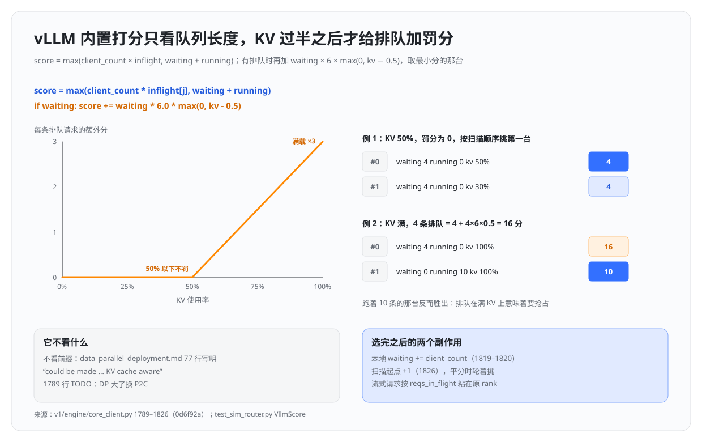

打分逻辑在 [core_client.py](https://github.com/vllm-project/vllm/blob/0d6f92a/vllm/v1/engine/core_client.py) 1789–1826 行，每条请求进来时从扫描起点开始遍历所有 engine，取分数最小的一台。分数由两部分组成：

```python
# core_client.py 1795-1815（简化）
base = max(client_count * inflight[i],      # 本 API server 精确记的在飞数，乘以 API server 个数
           waiting[i] + running[i])         # coordinator 快照里的队列长度
if waiting[i] > 0:
    base += waiting[i] * 6 * max(0.0, kv_usage[i] - 0.5)   # KV 用过一半才开始罚排队
```

第一项是负载下限。快照里的 waiting + running 可能已经过时，但 API server 自己派出去、还没结束的请求数 `inflight` 是精确的；乘以 `client_count`，是假设别的 API server 也派了差不多一样多。第二项只在有排队时生效：KV 用了不到一半，排队只说明 batch 满了，很快就能轮到；KV 超过一半，排队的请求可能要等别人释放 KV，甚至触发抢占（05 章），所以按超出部分加罚。KV 0.9、排 4 条时罚 4 × 6 × 0.4 = 9.6，相当于多出 9.6 条请求。

这里面没有前缀。DP 文档 77 行原话是：目前的均衡只看队列，以后“could be made more sophisticated in future by incorporating KV cache aware logic”[[1]](https://docs.vllm.ai/en/latest/serving/data_parallel_deployment/)。1789 行还有一条 TODO，打算换成 P2C。对于流式请求，1778 行做了会话粘性，同一个 streaming 会话的后续输入留在原 engine 上。

SGLang 侧，不开 cache_aware 时默认策略要看是否加 `--chat-routing reorg`：不加是 round_robin，加了是 power_of_two，随机挑两台取负载低的那台；prefill 和普通 engine 依次比较估计的 prefill 排队时间、待算的未命中 token、waiting、running、在飞数，decode engine 比较 waiting、running 和 KV 使用率[[6]](https://github.com/sgl-project/sglang/blob/8fabf5e/sgl-router/src/config/cli.rs)。P2C 是负载均衡里的经典做法，每次只比较两台，避免所有路由同时扑向同一台“最空”的机器。

# 第 3 章 · 100 ms 的快照窗口

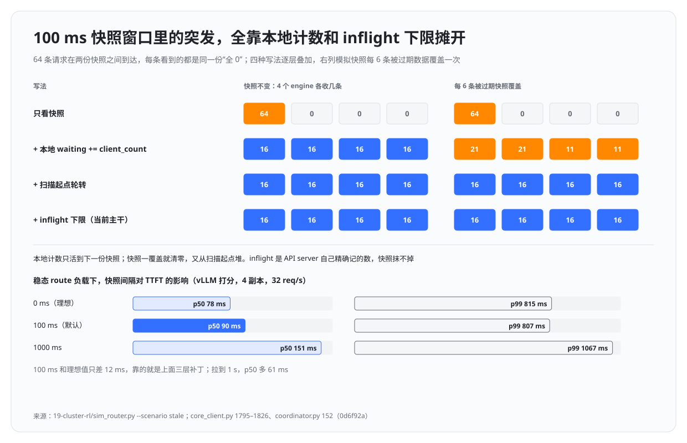

快照最快 100 ms 一份。32 req/s 的负载下，一个窗口里平均到 3 条；突发时可能几十条挤在一起。如果路由只看快照，窗口里每条请求看到的都是同一份数字，扫描到的最小分永远是同一台，结果全部压上去。core_client.py 里有三处补丁专门处理这个问题，模拟器把它们逐层叠上去：

```text
写法                                                  快照不变                  每 6 条被过期快照覆盖
只看快照                                       [64, 0, 0, 0]                 [64, 0, 0, 0]
+ 本地 waiting += client_count            [16, 16, 16, 16]              [21, 21, 11, 11]
+ 扫描起点轮转                                [16, 16, 16, 16]              [16, 16, 16, 16]
+ inflight 下限（当前主干）                     [16, 16, 16, 16]              [16, 16, 16, 16]
```

第一层是 1819–1820 行：派出一条请求后，在本地快照副本上给那台 engine 的 waiting 加 `client_count`，路由立刻“看见”自己刚派出去的请求。只要快照不变，这一层就够了。但快照会被更新，如果新到的快照比本地计数还旧（coordinator 汇总时这些请求还没到 engine），本地加的数就被冲掉，又从头堆。模拟器里每 6 条覆盖一次，分布变成 [21, 21, 11, 11]。

第二层是 1826 行：每派一条，扫描起点往后挪一位。分数相同时不再总是第一台赢。第三层是 1795–1804 行的 inflight 下限：它是 API server 自己精确记的在飞数，快照覆盖不掉。两层叠上之后，过期快照也打不乱分布。多个 API server 时还有一处：第 k 个 API server 的扫描起点从 `N × k // client_count` 开始（1767 行），两个 API server 各从不同的 engine 扫起，只看快照时分布是 [32, 0, 32, 0]，没有全压在一台上。

快照间隔对稳态延迟的影响有多大？同一个 route 负载，把间隔从 0 改到 1000 ms：

| 快照间隔 | TTFT p50 | TTFT p99 |
|-|-|-|
| 0 ms（每条请求都看最新） | 78 ms | 815 ms |
| 100 ms（vLLM 默认下限） | 90 ms | 807 ms |
| 1000 ms | 151 ms | 1067 ms |

100 ms 只比理想情况多 12 ms，补丁基本把快照延迟吃掉了。间隔拉到 1 秒，p50 差将近一倍：inflight 下限只反映自己派的量，别的 API server 派出的和 engine 实际排队的都要等快照。SGLang 的 router 在每个 worker 上自己记在飞请求，engine 另外推送负载报告；冷前缀突发时还有 `--cache-pending-prefix-ttl-ms`：共享同一个冷前缀的一串请求先粘在同一个 worker 上，直到它的 KV 事件到达[[2]](https://github.com/sgl-project/sglang/blob/8fabf5e/sgl-router/README.md)。两家用的是同一个思路：路由要立刻记住自己的决定，不能只等下游汇报。

# 第 4 章 · 前缀感知路由：省下来的是 prefill

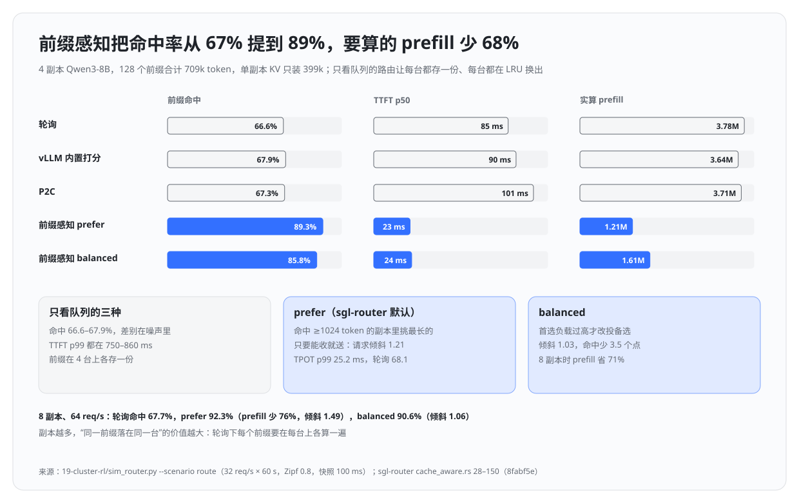

## 4.1 cache_aware 怎么选

sgl-router 的 `--policy cache_aware` 先拿到 prompt 在每个 worker 上能命中的最长前缀，来源可以是外部 KV indexer，也可以是 router 本地维护的 radix 树。命中至少 `--cache-affinity-min-matched-tokens`（默认 1024），可选再加一个占 prompt 比例的门槛，过了门槛的 worker 按命中长度降序、负载升序排，第一名是首选[[2]](https://github.com/sgl-project/sglang/blob/8fabf5e/sgl-router/README.md)[[7]](https://github.com/sgl-project/sglang/blob/8fabf5e/sgl-router/src/policies/cache_aware.rs)。首选没过准入（在飞数、排队数、KV 使用率等上限），或者没有任何 worker 过门槛，就退回 power_of_two。它只用于普通和 prefill 组，需要 tokenizer。

这就是 08 章前缀缓存在集群层面的延伸：单机上 RadixAttention 或 APC 只管一台机器内的复用，副本一多，同一个前缀落到哪台机器决定了它能不能被复用。只看队列的路由会把同一个前缀轮流派到每台副本，每台都要算一遍、存一份。

## 4.2 模拟结果

模拟器按 01、09 章实测的量级设定每台副本的 prefill 和 decode 速度，KV 容量 399k token，前缀缓存 LRU 淘汰。负载是 128 个共享前缀（系统提示词、few-shot 模板、长文档），长度 3009–7941 token，按 Zipf 0.8 分布，合计 709k，比单台副本装得下的多。vLLM 打分每 100 ms 拿一次快照，prefer 和 balanced 的参数用 sgl-router 默认值。

```text
== route：4 副本 × Qwen3-8B，32 req/s × 60 s，128 个前缀（3009–7941 token，合计 709k，Zipf 0.8），单副本 KV 容量 399k token，快照 100 ms
策略                        前缀命中   TTFT p50   TTFT p99   TPOT p99      请求倾斜   prefill 倾斜    实算 prefill
轮询                       66.6%       85ms      857ms     68.1ms      1.00         1.03        3.78M
vLLM 内置打分                67.9%       90ms      807ms     68.3ms      1.03         1.04        3.64M
P2C                      67.3%      101ms      756ms     64.9ms      1.01         1.04        3.71M
前缀感知 prefer              89.3%       23ms      535ms     25.2ms      1.21         1.06        1.21M
前缀感知 balanced            85.8%       24ms      683ms     41.5ms      1.03         1.03        1.61M
   前缀感知把命中率从 66.6% 提到 89.3%，实际要算的 prefill 少 68%；轮询和内置打分只看队列，前缀在每台副本上各存一份，合计前缀 709k 超过单副本容量，LRU 在每台上都在换
```

三种只看队列的策略命中率都在 67% 上下，差别在噪声范围内。原因是每台副本都在尝试缓存全部 709k 前缀，装不下，LRU 一直在换。prefer 把每个前缀固定在一台上，四台合计 1.6M 的容量足够装下全部前缀，命中率到 89.3%，实际算的 prefill 从 3.78M 降到 1.21M。省下的 prefill 直接体现在 TPOT 上：chunked prefill 和 decode 混在同一个 batch 里（06 章），prefill 少了，decode 步就短，TPOT p99 从 68.1 ms 降到 25.2 ms。

代价是倾斜。prefer 的请求倾斜 1.21，热门前缀所在的那台更忙；balanced 把倾斜压回 1.03，命中率少 3.5 个百分点。副本数翻倍时效果更明显：

```text
策略                        前缀命中   TTFT p50   TTFT p99   TPOT p99      请求倾斜   prefill 倾斜    实算 prefill
轮询                       67.7%       62ms      787ms     88.3ms      1.00         1.07        7.37M
vLLM 内置打分                68.2%       86ms      796ms     82.2ms      1.08         1.05        7.27M
P2C                      68.6%       47ms      755ms     80.7ms      1.02         1.03        7.18M
前缀感知 prefer              92.3%       23ms      344ms     23.2ms      1.49         1.25        1.76M
前缀感知 balanced            90.6%       23ms      407ms     31.2ms      1.06         1.08        2.14M
```

8 台副本时轮询的命中率还是 67.7%，因为每台装不下的问题没变；prefer 的合计容量翻倍，命中到 92.3%，prefill 少 76%。但 prefer 的倾斜也涨到 1.49。这个数字要盯住：倾斜意味着部分副本闲着，扩容的收益被浪费。

业界数字方向一致。vLLM Router 博客报告，Llama-3.1-8B 8P/8D 下吞吐比 llm-d 高 25%，比 K8s 原生负载均衡高 100%[[3]](https://vllm.ai/blog/2025-12-13-vllm-router-release)；AIBrix 也把前缀感知路由列为控制面的核心组件[[8]](https://arxiv.org/abs/2504.03648)。具体幅度取决于前缀的复用程度和总量与单机容量的比例：前缀总量远小于单机 KV 时，随便怎么路由都能全命中；前缀合计超过单机容量、又能被多台合起来装下时，前缀感知路由的收益最大。

# 第 5 章 · 热点前缀：prefer 与 balanced

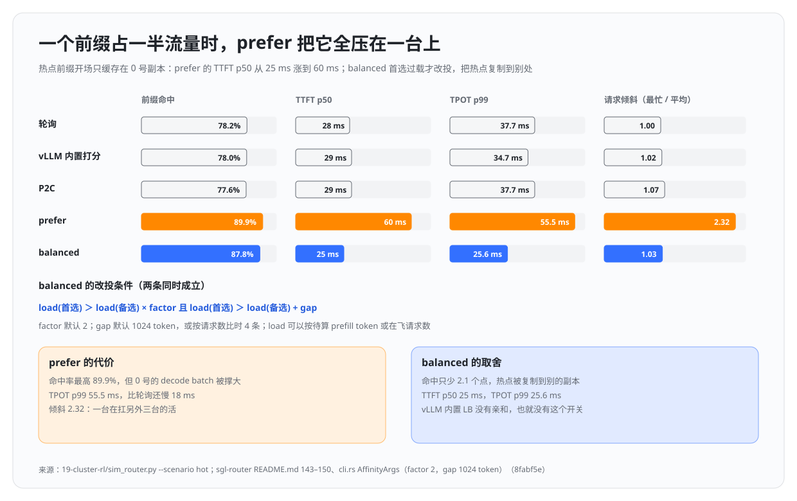

真实流量常常有一个前缀特别热，比如某个产品的系统提示词占了一半请求。模拟器把一个前缀的流量占比提到 50%，并且开场时它只缓存在 0 号副本上：

```text
策略                        前缀命中   TTFT p50   TTFT p99   TPOT p99      请求倾斜   prefill 倾斜    实算 prefill
轮询                       78.2%       28ms      507ms     37.7ms      1.00         1.04        2.56M
vLLM 内置打分                78.0%       29ms      547ms     34.7ms      1.02         1.03        2.59M
P2C                      77.6%       29ms      532ms     37.7ms      1.07         1.08        2.63M
前缀感知 prefer              89.9%       60ms      381ms     55.5ms      2.32         1.29        1.19M
前缀感知 balanced            87.8%       25ms      471ms     25.6ms      1.03         1.16        1.44M
```

prefer 的逻辑是首选副本只要过准入就送。热点前缀的请求全部压在 0 号上，请求倾斜 2.32，0 号的 decode batch 被撑大，TTFT p50 60 ms、TPOT p99 55.5 ms，比轮询还慢。命中率最高没有用，因为瓶颈从 prefill 转到了那一台的 decode。

balanced 再随机抽一台备选，只有首选的负载同时超过“备选 × `--affinity-load-factor`”（默认 2）和“备选 + `--affinity-load-gap`”（默认 1024 token）时才改投；负载默认按待算的 prefill token 衡量，也可以改成 running 请求数[[2]](https://github.com/sgl-project/sglang/blob/8fabf5e/sgl-router/README.md)[[6]](https://github.com/sgl-project/sglang/blob/8fabf5e/sgl-router/src/config/cli.rs)。改投之后，热点前缀会在备选副本上也缓存一份，慢慢变成几台共同承担。结果是倾斜 1.03、TTFT p50 25 ms，命中率只少 2.1 个百分点。

有两点要注意。第一，balanced 的两个条件是“且”的关系：factor 防止在小负载下来回抖动，gap 防止在负载都很高时因为一点差距就放弃缓存。第二，balanced 并不是总优于 prefer：在第 4 章没有热点的负载下，balanced 的 TPOT p99 是 41.5 ms，比 prefer 的 25.2 ms 差，因为它更早放弃了缓存。热点明显时选 balanced，前缀分布平坦时 prefer 更好。vLLM 内置 LB 没有亲和，也就没有这一层权衡；要用就得接外部路由。

# 第 6 章 · K8s：探针时间和编译缓存

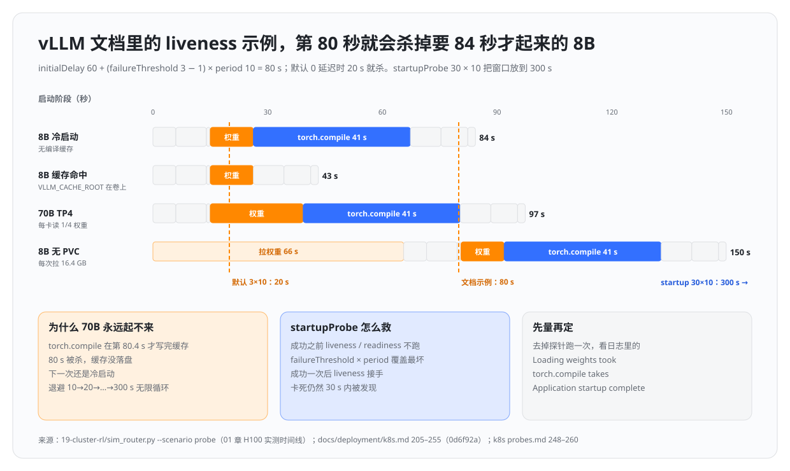

## 6.1 kubelet 什么时候杀容器

K8s 的 liveness 探针默认 `initialDelaySeconds 0`、`periodSeconds 10`、`failureThreshold 3`、`timeoutSeconds 1`，连续失败 failureThreshold 次才判定失败[[9]](https://kubernetes.io/docs/tasks/configure-pod-container/configure-liveness-readiness-startup-probes/)。所以容器最晚在 initialDelay + (failureThreshold − 1) × period 被杀：默认配置下第 20 秒。被杀之后按指数退避重启，10 秒起翻倍，封顶 300 秒，这就是 CrashLoopBackOff[[10]](https://kubernetes.io/docs/concepts/workloads/pods/pod-lifecycle/)。

vLLM 的 K8s 文档示例里，liveness 设了 `initialDelaySeconds: 60`、`periodSeconds: 10`，failureThreshold 没写，取默认 3[[11]](https://github.com/vllm-project/vllm/blob/0d6f92a/docs/deployment/k8s.md)，算下来最晚第 80 秒被杀。01 章那套 H100 示意口径给的 Qwen3-8B 冷启动时间线是 84 秒：torch.compile 第 67 秒结束，CUDA graph 捕获和 KV 分配到第 84 秒。这是示意算例，不是本篇独立量到的启动时长。照抄上面的探针示例，按这套时间线 8B 起不来。

```text
== probe：01 章实测时间线 Qwen3-8B H100 冷启动 84 s、编译缓存命中 43 s；Llama-3.1-70B TP4 估算 97 s（每卡读 1/4 权重，按 8B 的读盘速度线性放大，其余阶段照搬 8B）
   kubelet 判定：探针在 initialDelay + k × period 打，连续 failureThreshold 次失败才杀，最晚在 initialDelay + (failureThreshold − 1) × period 被杀；重启退避 10 → 20 → 40 … → 300 s
                                            doc-liveness          default-3x10         startup-30x10
8B，编译缓存在容器层                          CrashLoop（重启 9 次）     CrashLoop（重启 9 次）                  84 s
8B，VLLM_CACHE_ROOT 挂 emptyDir              133 s（重启 1）     CrashLoop（重启 9 次）                  84 s
8B，无 PVC 每次拉权重 2 Gb/s                CrashLoop（重启 9 次）     CrashLoop（重启 9 次）                 150 s
70B TP4，编译缓存在卷上                      CrashLoop（重启 9 次）     CrashLoop（重启 9 次）                  97 s
```

## 6.2 编译缓存放在哪

第二行的差别只在于编译缓存的位置。vLLM 把 torch.compile 的产物写到 `VLLM_CACHE_ROOT/torch_compile_cache/<hash>`，默认 `~/.cache/vllm`（[backends.py](https://github.com/vllm-project/vllm/blob/0d6f92a/vllm/compilation/backends.py) 1096 行）。默认位置在容器的可写层里，容器被杀后可写层丢失，下次又是冷启动，又在第 80 秒被杀，循环往复。把 `VLLM_CACHE_ROOT` 挂到 emptyDir 上：emptyDir 的生命周期跟 Pod 走，容器崩溃不影响里面的数据[[12]](https://kubernetes.io/docs/concepts/storage/volumes/)。按上面的示意时间线推：第一次在第 80 秒被杀时缓存已在第 67 秒写完，第二次约 43 秒起来，合计约 133 秒、重启 1 次。这两个数是按假设推的算例，不是实测重启耗时。

按同一套示意时间线，70B TP4 会越过这个窗口：编译到第 80.4 秒才结束，比 80 秒晚，缓存来不及在被杀前写完。正确的做法是 startupProbe：它成功之前 liveness 和 readiness 都不运行，`failureThreshold × periodSeconds` 覆盖最坏的启动时间，K8s 文档的例子正是 30 × 10 = 300 秒[[9]](https://kubernetes.io/docs/tasks/configure-pod-container/configure-liveness-readiness-startup-probes/)。启动成功后 liveness 接手，主要管进程卡死；failureThreshold 取多少要看真实抖动、探针超时和监控口径，不能把 3 当成通用充分值。权重每次从网上拉（第三行，2 Gb/s 拉 16 GB）要 150 秒，也只有 startupProbe 能兜住。所以 HF 缓存放 PVC，Pod 重建也不用重新下载。

```bash
# 在 19-cluster-rl 目录执行；只打印 Kubernetes JSON，不连接集群
MODEL_PROFILE=dense TP=2 bash cluster.sh k8s-yaml
MODEL_PROFILE=moe TP=2 bash cluster.sh k8s-yaml
# 默认 vllm/vllm-openai:v0.32.0、固定模型 revision、8192 上下文
# GPU 数量与 TP 一致；HF_CACHE_PVC 指定事先准备的缓存卷
# VLLM_IMAGE 可设固定版本或 digest，不接受 latest
# STARTUP_FAILURE_THRESHOLD 默认 60，只是示例，须按冷启动分布调整
python3 -m unittest test_deployment -v
```

vLLM 文档的故障排查一节列了探针太紧的两个症状：容器日志里有 “KeyboardInterrupt: terminated”，`kubectl get events` 里有 “failed startup probe, will be restarted”。它建议先去掉探针测一次真实启动时间，再定 failureThreshold[[11]](https://github.com/vllm-project/vllm/blob/0d6f92a/docs/deployment/k8s.md)。完整的 Deployment 在 `cluster.sh k8s-yaml`。SGLang 侧没有对应的官方探针建议，但 torch.compile 和 CUDA graph 捕获同样耗时，道理相同。生产上也可以直接用 production-stack 的 Helm chart[[13]](https://github.com/vllm-project/production-stack) 或 llm-d[[4]](https://github.com/llm-d/llm-d)，它们已经配好了探针和缓存卷，但上线前仍要按自己的模型核对一遍启动时间。

# 第 7 章 · sleep mode：不重启进程腾出显存

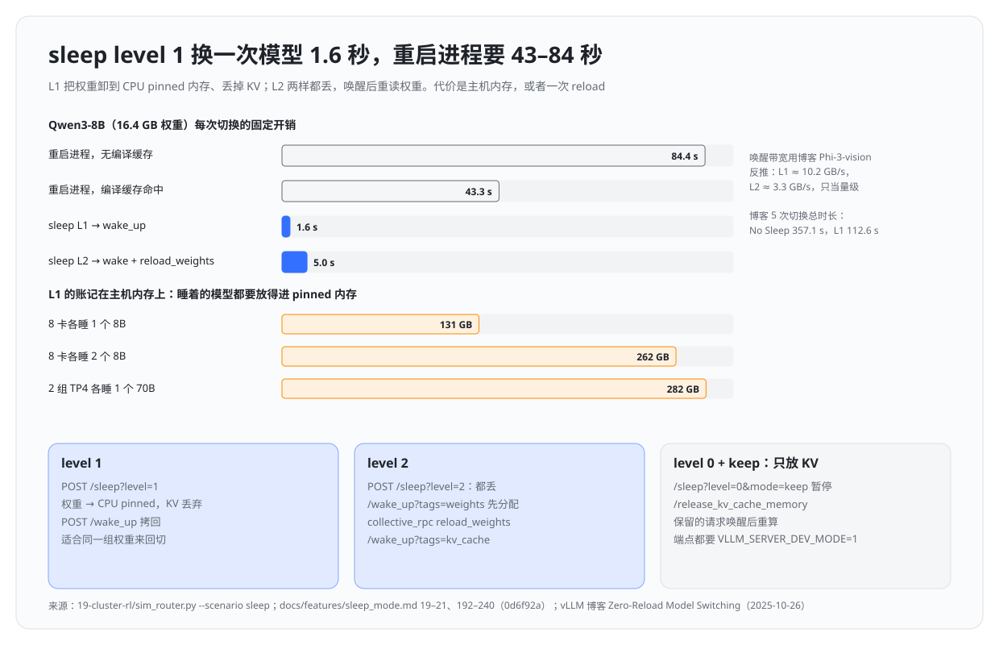

有两类场景需要让推理实例暂时让出显存：一台机器轮流服务几个模型；RL 训练时推理和训练共用同一批卡。重启进程太慢，按 01 章那套示意时间线，冷启动约 84 秒，有编译缓存也要约 43 秒。vLLM 的 sleep mode 让进程留着、只释放显存[[14]](https://github.com/vllm-project/vllm/blob/0d6f92a/docs/features/sleep_mode.md)：

| 档位 | 权重 | KV | 唤醒 | 适用 |
|-|-|-|-|-|
| level 1 | 卸到 CPU 内存 | 丢弃 | `POST /wake_up` 拷回 | 同一个模型来回切；主机内存要装得下 |
| level 2 | 丢弃（rope 等 buffer 留在 CPU） | 丢弃 | `wake_up?tags=weights` → `collective_rpc reload_weights` → `wake_up?tags=kv_cache` | 换模型、RL 更新权重；主机内存不够时 |
| level 0 + keep | 不动 | `/release_kv_cache_memory` 释放 | `wake_up?tags=kv_cache` | 只需腾出 KV 那部分 |

[[14]](https://github.com/vllm-project/vllm/blob/0d6f92a/docs/features/sleep_mode.md)

开关是 `--enable-sleep-mode`，HTTP 端点都要 `VLLM_SERVER_DEV_MODE=1`，文档明确说这些开发端点不该暴露给用户。分 tag 唤醒的意义在于更新权重时避免 OOM：先只分配权重的显存，更新完再分配 KV。level 2 还可以用 `--sleep-preserve-parameter-names` 指定训练时冻结的参数（比如 draft 模型），把它们备份到 CPU，唤醒后不用重传。

```text
Qwen3-8B（16.4 GB 权重）每次切换：
     重启进程，无编译缓存                               84.4 s
     重启进程，编译缓存命中                              43.3 s
     sleep level 1 → wake_up                   1.6 s
     sleep level 2 → wake + reload_weights     5.0 s
   博客实测 5 次切换总时长：No Sleep 357.1 s，L1 112.6 s，L2 124.6 s（L1 比重启快 3.2×，含推理时间）
   L1 把权重卸到 CPU 的 pinned 内存，主机内存要装得下所有睡着的模型：
     8 卡各睡 1 个 8B                  8 份 × 16.4 GB →  131 GB pinned 主机内存
     8 卡各睡 2 个 8B（3 个模型轮转）        16 份 × 16.4 GB →  262 GB pinned 主机内存
     2 组 TP4 各睡 1 个 70B            2 份 × 141.2 GB →  282 GB pinned 主机内存
```

切换时间是用 vLLM 博客里 Phi-3-vision 的唤醒时间反推带宽后估的，只当量级看。博客实测 5 次切换的总时长：不用 sleep 357.1 秒，level 1 112.6 秒，level 2 124.6 秒[[15]](https://vllm.ai/blog/2025-10-26-sleep-mode)。level 1 的代价是主机内存：每个睡着的模型都要在 CPU 上留一份完整权重，8 卡各睡一个 8B 就是 131 GB，跑 70B 的两组 TP4 要 282 GB。和训练共置时，训练进程自己可能也在用 CPU 内存做 offload，这时用 level 2。两档都会丢 KV，唤醒后前缀缓存要重新预热。

SGLang 的对应是 `--enable-memory-saver` 加 `POST /release_memory_occupation {"tags": ["kv_cache", "weights"]}` 和 `/resume_memory_occupation`。底层用 torch_memory_saver 保留虚拟地址，CUDA graph 回放时地址不变，不用重新捕获。文档要求调用时引擎空闲，没有在飞请求；释放 KV 时会 flush 缓存[[16]](https://github.com/sgl-project/sglang/blob/8fabf5e/docs/docs/advanced_features/sglang_for_rl.mdx)。vLLM 的 `EngineCore.sleep` 则先自己暂停调度器（[core.py](https://github.com/vllm-project/vllm/blob/0d6f92a/vllm/v1/engine/core.py) 1019–1060 行），level 0 加 `mode=keep` 时保留请求，唤醒后重算。

# 第 8 章 · RL 权重同步：四个端点

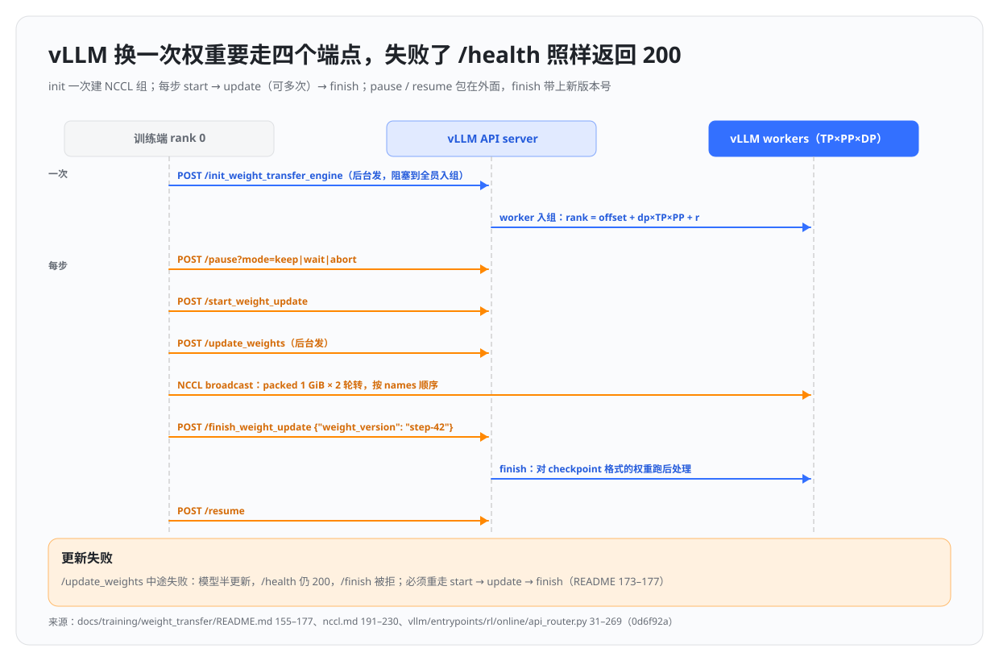

RL 训练每走一步，推理端的 rollout 模型就要换成新权重。最笨的做法是训练端存 checkpoint、推理端从磁盘重载，几十 GB 的读写每步都来一遍。vLLM 的原生 RL API 把这件事拆成四个阶段[[17]](https://vllm.ai/blog/2026-05-28-native-rl-apis)[[18]](https://github.com/vllm-project/vllm/blob/0d6f92a/docs/training/weight_transfer/README.md)：

1. **init**（`/init_weight_transfer_engine`）：建立训练端和推理 worker 之间的通道，训练开始前调一次。
2. **start**（`/start_weight_update`）：让推理端准备接收。
3. **update**（`/update_weights`）：传权重，可以调多次，比如分块传。
4. **finish**（`/finish_weight_update`）：收尾，比如对 checkpoint 格式的权重跑后处理；可以带上 `weight_version`。

外面再包一层 `/pause` 和 `/resume`。端点定义都在 [api_router.py](https://github.com/vllm-project/vllm/blob/0d6f92a/vllm/entrypoints/rl/online/api_router.py)，需要 `VLLM_SERVER_DEV_MODE=1` 和 `--weight-transfer-config`。训练端可以不装 vLLM，只用 PyTorch 和 HTTP 客户端按文档的线协议说话，这样训练和推理可以各自升级[[18]](https://github.com/vllm-project/vllm/blob/0d6f92a/docs/training/weight_transfer/README.md)。

## 8.1 NCCL 后端的握手

NCCL 后端里训练端是 rank 0，负责广播。init 时训练端自己生成 `ncclUniqueId`，base64 后放进请求体。`world_size` = 训练端广播的 rank 数 + `GET /get_world_size` 的返回值（推理端 TP × PP × DP）。worker 的 rank = `rank_offset + dp_index × TP × PP + rank`[[19]](https://github.com/vllm-project/vllm/blob/0d6f92a/docs/training/weight_transfer/nccl.md)。几个容易踩的坑都写在文档里：

- `/init_weight_transfer_engine` 要等所有 rank 入组才返回，必须放后台发，同时训练端调 `ncclCommInitRank`；没有超时，训练端不来就永远等。
- init 之后每个 worker 会发一次 warm-up `all_reduce`，训练端必须在其他集合通信之前也发一次同样的。
- `/update_weights` 也要后台发，同时 rank 0 按 `names` 的顺序广播；第二次起参数没变的话只发 `{"update_info": {}}`，元数据沿用第一次的。

```bash
# cluster.sh rl-sync（训练端是 NCCL rank 0）
curl -s -X POST "$VLLM/start_weight_update"
curl -s -X POST "$VLLM/update_weights" -H 'Content-Type: application/json' -d '{"update_info": {}}' &
# …… 训练端在这里按 names 顺序广播 ……
wait
curl -s -X POST "$VLLM/finish_weight_update" -H 'Content-Type: application/json' -d '{"weight_version": "step-42"}'
curl -s -X POST "$VLLM/resume"
```

## 8.2 失败了 /health 还是 200

README 有一条警告：`/update_weights` 失败时模型停在半更新状态，`/health` 仍然返回 200，`/finish_weight_update` 会被拒绝；再生成之前必须重走一遍完整的 start → update → finish[[18]](https://github.com/vllm-project/vllm/blob/0d6f92a/docs/training/weight_transfer/README.md)。这意味着不能拿健康检查判断权重同步是否成功，训练端要自己检查每个端点的返回，失败就重来，同时用 `/weight_info` 核对当前提交的版本号。

SGLang 的对应有三条路：`/update_weights_from_disk`、`/update_weights_from_tensor`（共置，共享张量）、`/init_weights_update_group` + `/update_weights_from_distributed`（NCCL 组广播）。后两种必须包在 `/begin_weight_update` 和 `/end_weight_update` 之间，`end` 时统一跑量化层的后处理，一次 refit 只付一次后处理的代价；会话外调用、重复 begin、没有 begin 就 end，都返回 `success: false`，权重不动[[16]](https://github.com/sgl-project/sglang/blob/8fabf5e/docs/docs/advanced_features/sglang_for_rl.mdx)。两家的结构基本一样：一个会话包住多次传输，结束时做一次后处理。

# 第 9 章 · pause 的三种模式

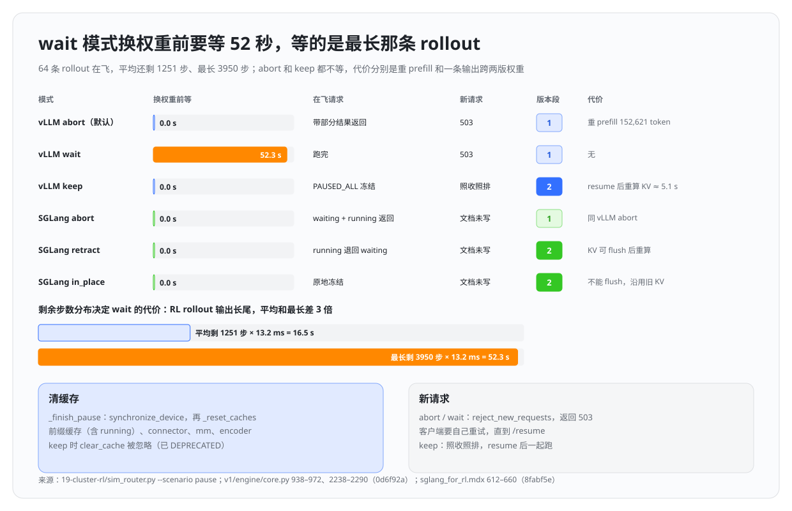

换权重的时候，推理端上还有正在生成的 rollout。`/pause` 的 mode 决定怎么处理它们[[20]](https://github.com/vllm-project/vllm/blob/0d6f92a/docs/training/async_rl.md)[[21]](https://github.com/vllm-project/vllm/blob/0d6f92a/vllm/entrypoints/rl/online/api_router.py)：

| 模式 | 在飞请求 | 新请求 |
|-|-|-|
| abort（默认） | 立刻中止，带部分结果返回 | 503，直到 resume |
| wait | running 的跑完才算暂停完成；排队的等 resume 后再跑 | 503，直到 resume |
| keep | 冻结在队列里，resume 后继续 | 照收照排 |

[[20]](https://github.com/vllm-project/vllm/blob/0d6f92a/docs/training/async_rl.md)

引擎侧实现在 [core.py](https://github.com/vllm-project/vllm/blob/0d6f92a/vllm/v1/engine/core.py)：2238–2280 行的 `pause_scheduler` 按模式处理在飞请求，abort 调 `finish_requests(None, FINISHED_ABORTED)`，keep 把调度器置为 PAUSED_ALL；2283–2290 行 `reject_new_requests = mode != keep`。暂停完成时 `_finish_pause` 先 `synchronize_device`，再 `_reset_caches`，清掉前缀缓存（包括 running 请求的）、KV connector、多模态和 encoder 缓存（938–972 行）。`clear_cache` 参数默认 True，已标 DEPRECATED，keep 模式下被忽略。

```text
模式                                 换权重前等  在飞请求                    新请求          版本段  代价
vLLM abort（默认）                     0.0 s  在飞请求带部分结果返回             503            1  重投要把 prompt + 已生成共 152621 token 重新 prefill
vLLM wait                         52.3 s  等最长的一条再跑 3950 步         503            1  无
vLLM keep + clear_cache            0.0 s  冻结在队列里                  照收照排           2  resume 后重算 152621 token 的 KV，约 5.1 s
vLLM keep, clear_cache=False       0.0 s  冻结在队列里                  照收照排           2  152621 token 的 KV 是旧权重算的（stale）
SGLang abort（默认）                   0.0 s  waiting + running 全部返回  文档未写           1  同 vLLM abort
SGLang retract                     0.0 s  running 退回 waiting      文档未写           2  KV 可 flush，continue 后重算
SGLang in_place                    0.0 s  原地冻结                    文档未写           2  flush_cache 会失败，只能沿用旧 KV
```

wait 的问题是长尾。64 条 rollout 平均还剩 1251 步，最长的还剩 3950 步，按 13.2 ms 一步，换权重前要等 52.3 秒，而平均只需 16.5 秒。RL rollout 的输出长度分布本来就长尾，APRIL 论文统计过这个现象：少数超长 rollout 拖住整个 batch，GPU 大部分时间在等它们[[22]](https://arxiv.org/abs/2509.18521)。abort 不等，但被中止的请求要把 prompt 加上已生成的部分重新提交，模拟里共 152,621 token 要重新 prefill。keep 既不等也不丢，resume 后这些请求的 KV 要用新权重重算（因为缓存被清了），按 01 章的 prefill 吞吐约 5.1 秒。

keep 的代价不在时间上：一条输出的前半段是旧权重采样的，后半段是新权重采样的。这对 on-policy 的算法是个问题，训练端需要知道切换点在哪，这是第 11 章版本段要解决的。文档的典型异步 RL 流程就是 keep：暂停、同步权重并设版本号、恢复，在飞的请求用新权重继续[[20]](https://github.com/vllm-project/vllm/blob/0d6f92a/docs/training/async_rl.md)。还有一点，如果用 Python API 并把 `clear_cache` 设成 False，旧 KV 会保留下来，上下文里一部分 token 的 KV 是旧权重算的，文档称之为 stale KV。

SGLang 的 `/pause_generation` 也是三种：abort（默认，waiting 和 running 的请求全部返回）、retract（running 退回 waiting，KV 可以 flush 之后重算）、in_place（请求状态不动，依赖 KV 继续，之后的 `flush_cache` 会失败）[[16]](https://github.com/sgl-project/sglang/blob/8fabf5e/docs/docs/advanced_features/sglang_for_rl.mdx)。retract 对应 vLLM 的 keep 加清缓存，in_place 对应 keep 不清缓存。恢复用 `/continue_generation`。

# 第 10 章 · 传输后端：瓶颈在 rank 0 的网卡

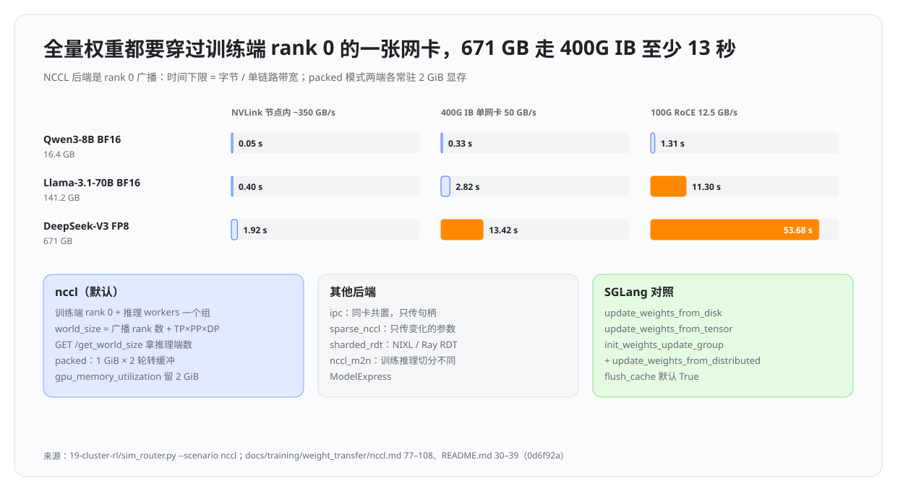

NCCL 后端是训练端 rank 0 向所有推理 worker 广播。所有字节都要从 rank 0 的出口链路发出去，所以单链路带宽决定了下限：

```text
模型                           字节   packed 次数      NVLink 节点内 ~350 GB/s       400G IB 单网卡 50 GB/s       100G RoCE 12.5 GB/s
Qwen3-8B BF16              16GB          16                    0.05 s                    0.33 s                    1.31 s
Llama-3.1-70B BF16        141GB         132                    0.40 s                    2.82 s                   11.30 s
DeepSeek-V3 FP8           671GB         625                    1.92 s                   13.42 s                   53.68 s
```

这里只算字节除以带宽，不含建组和打包拷贝的开销，是下限。8B 在什么链路上都不是问题。70B 走 100G RoCE 要 11 秒。DeepSeek-V3 走 400G IB 至少 13.4 秒，和 RL 一步的训练时间相比已经不可忽略。packed 模式把张量拼进连续的大缓冲区再广播，减少 NCCL 调用次数，并用多个缓冲区和独立的 CUDA stream 让打包、广播、解包重叠；默认 1 GiB × 2 个缓冲区，整个传输期间两端各常驻 2 GiB 显存，推理端的 `gpu_memory_utilization` 要留出这部分[[19]](https://github.com/vllm-project/vllm/blob/0d6f92a/docs/training/weight_transfer/nccl.md)。

其他后端针对的是 NCCL 广播不合适的情况[[18]](https://github.com/vllm-project/vllm/blob/0d6f92a/docs/training/weight_transfer/README.md)：

| 后端 | 传输 | 场景 |
|-|-|-|
| ipc | CUDA IPC 句柄 | 训练和推理共置在同一张卡，只传句柄不搬字节 |
| sparse_nccl | NCCL 广播 | 只传 checkpoint 坐标下的稀疏补丁 |
| sharded_rdt | NIXL / Ray Direct Transport，拉取式 | 超大模型，每个 worker 只要自己那一片（如 EP 的 MoE） |
| nccl_m2n | NCCL M2N 重切分 | 训练端和推理端切分方式不同 |
| ModelExpress | 按版本传输 | 安装不可变的已发布权重版本，含对象存储 checkpoint 和增量 |

[[18]](https://github.com/vllm-project/vllm/blob/0d6f92a/docs/training/weight_transfer/README.md)

sharded_rdt 正是为了绕开 rank 0 瓶颈：每个推理 worker 直接从持有对应分片的训练 rank 拉，用不着一个点往外广播全量。vLLM 博客把 `WeightTransferEngine` 设计成可插拔的，新后端实现同一组接口即可[[17]](https://vllm.ai/blog/2026-05-28-native-rl-apis)。SGLang 的分布式更新同样是训练端在 TP rank 0 上汇总后广播给 rollout 组，每个 rollout TP 分片只加载自己需要的参数；共置场景用 `update_weights_from_tensor`[[16]](https://github.com/sgl-project/sglang/blob/8fabf5e/docs/docs/advanced_features/sglang_for_rl.mdx)。

# 第 11 章 · 版本段：一条输出跨两版权重

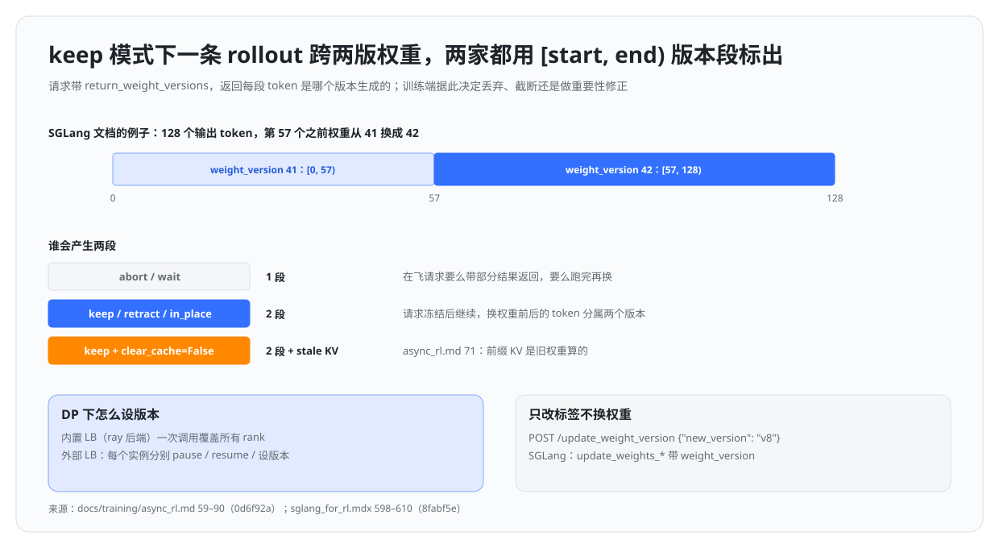

keep 模式下，跨过一次权重更新的请求会有两段输出。vLLM 在 `finish_weight_update` 带上 `weight_version`，或者调 `/update_weight_version` 只改标签不换权重；标签是任意字符串，vLLM 不排序也不校验。每条序列的最终输出带一个 `weight_versions` 列表，每个元素是一段 `[start, end)` 的输出 token 下标和它的版本[[20]](https://github.com/vllm-project/vllm/blob/0d6f92a/docs/training/async_rl.md)：

```python
completion = final_output.outputs[0]
for span in completion.weight_versions:
    # [span.start, span.end) 这段 token 由 span.version 的权重采样
    print(span.version, completion.token_ids[span.start : span.end])
```

HTTP 上，`/v1/completions` 和 `/v1/chat/completions` 要在请求里设 `return_weight_versions: true`，下标对应 `return_token_ids` 返回的 token；流式时在最后一个 chunk 上。被 abort 的请求返回部分输出的版本段；如果把这部分输出拼进新 prompt 重投，新请求的下标从 0 重新算，合并前要平移已生成的 token 数[[20]](https://github.com/vllm-project/vllm/blob/0d6f92a/docs/training/async_rl.md)。

SGLang 的格式几乎一样，`meta_info.weight_versions`，文档的例子是 41 号版本占 [0, 57)，42 号占 [57, 128)；同样是半开区间，不含 prompt，大多数请求只有一段[[16]](https://github.com/sgl-project/sglang/blob/8fabf5e/docs/docs/advanced_features/sglang_for_rl.mdx)。训练端拿到版本段后可以选择丢掉跨版本的样本、只用新版本那段、或者对旧版本那段做重要性采样修正，选哪种由算法决定。

数据并行时还有一处容易漏：用 vLLM 内置 LB（ray 后端）时，pause、resume 一次调用就覆盖所有 DP rank；用外部 LB 时，前面是多个独立的 vLLM 实例，pause、resume 和设版本号都要对每个实例分别调[[20]](https://github.com/vllm-project/vllm/blob/0d6f92a/docs/training/async_rl.md)。漏掉一台，那台会继续用旧权重生成、打旧标签。SGLang 在 router 后面的每个 engine 同样要分别调。

# 第 12 章 · 动手

## 12.1 先跑模拟器，再上真机

```bash
# 在 19-cluster-rl 目录执行
python3 sim_router.py --scenario all
python3 -m unittest test_sim_router test_deployment -v
MODEL_PROFILE=dense TP=2 bash cluster.sh k8s-yaml
# 先审阅清单并准备 PVC、GPU 节点、命名空间与访问控制，再自行应用
# moe 单独生成和审阅，不复用旧 Qwen3-8B 配置
# 多机命令必须设置 HEAD_IP；路由须设置 WORKER_URL_1 与 WORKER_URL_2
# 本处不自动应用清单；sleep/wake、权重同步和混合状态重建须另测
```

验收时保存各 rank 的请求量、全注意力 KV 与 GDN 状态占用，按同一负载比较路由分布。启动探针窗口依据实际冷启动分布、下载及编译波动制定，不能把一次启动时间乘 1.5 当作充分保证。sleep/wake 需核对释放与恢复的资源、固定提示输出和状态重建；权重更新还需核对请求暂停、版本标签和旧缓存失效。以上双模型路径尚无新增 GPU 验证。

## 12.2 源码阅读顺序

[core_client.py](https://github.com/vllm-project/vllm/blob/0d6f92a/vllm/v1/engine/core_client.py) 1730–1830 行（DPLBAsyncMPClient 的打分）→ [coordinator.py](https://github.com/vllm-project/vllm/blob/0d6f92a/vllm/v1/engine/coordinator.py)（快照）→ [api_router.py](https://github.com/vllm-project/vllm/blob/0d6f92a/vllm/entrypoints/rl/online/api_router.py)（RL 端点）→ [core.py](https://github.com/vllm-project/vllm/blob/0d6f92a/vllm/v1/engine/core.py) 938–972、1019–1060、2238–2290 行（清缓存、sleep、pause）。文档读 DP 部署、sleep mode、async RL 和 weight transfer 四篇[[1]](https://docs.vllm.ai/en/latest/serving/data_parallel_deployment/)[[14]](https://github.com/vllm-project/vllm/blob/0d6f92a/docs/features/sleep_mode.md)[[20]](https://github.com/vllm-project/vllm/blob/0d6f92a/docs/training/async_rl.md)[[18]](https://github.com/vllm-project/vllm/blob/0d6f92a/docs/training/weight_transfer/README.md)。SGLang 读 `sgl-router/README.md`、`src/policies/cache_aware.rs` 和 SGLang for RL 文档。行号都在 cluster_matrix.md。

> 📌 **核对清单**
> - 知道 vLLM 内置 DP 的打分只看队列和 KV 压力，不看前缀；需要前缀感知时用 external LB 加外部路由，并开 `--kv-events-config`。
> - `--max-num-seqs` 按 rank 算，`--max-num-queued-reqs` 按整个服务算。
> - 前缀合计超过单机 KV 时，前缀感知路由收益最大；先算前缀总量和单机容量的比值。
> - 有热点前缀时用 balanced，盯住请求倾斜；前缀平坦时 prefer 更好。
> - K8s 上用 startupProbe 兜启动，窗口按实测启动时间定；liveness 只管卡死。
> - `VLLM_CACHE_ROOT` 挂 emptyDir 或 PVC，HF 缓存挂 PVC，`/dev/shm` 挂 Memory emptyDir。
> - sleep level 1 先算主机内存够不够；level 2 唤醒后要 `reload_weights`，前缀缓存要重新预热。
> - dev 端点（sleep、pause、权重同步）只在内网开 `VLLM_SERVER_DEV_MODE=1`，不暴露给用户。
> - 权重同步失败后 `/health` 仍是 200，训练端检查每个端点的返回，失败重走 start → update → finish，用 `/weight_info` 核对版本。
> - NCCL init 和 update_weights 要后台发；packed 两端各留 2 GiB 显存。
> - wait 模式的等待由最长 rollout 决定；keep 模式要用 `return_weight_versions` 拿版本段。
> - 外部 LB 下，pause、resume 和版本号要对每个实例分别设置。

到这里，vLLM 从单个请求到集群部署都走完了。最后一篇 VLLM-20 换一个方向：怎样自己读源码、写插件、跑测试和基准，把改动提成 PR 合进上游。

# 参考文献

按正文首次引用顺序编号，资料截至 2026 年 10 月底。源码以 vllm-project/vllm 主干提交 0d6f92a（2026 年 10 月 29 日）和 v0.32.0 发行版为准；SGLang 对照以 sgl-project/sglang 主干 8fabf5e 为准。

[1] vLLM Docs. Data Parallel Deployment [https://docs.vllm.ai/en/latest/serving/data_parallel_deployment/](https://docs.vllm.ai/en/latest/serving/data_parallel_deployment/)

[2] sgl-project. sgl-router/README.md. GitHub (8fabf5e) [https://github.com/sgl-project/sglang/blob/8fabf5e/sgl-router/README.md](https://github.com/sgl-project/sglang/blob/8fabf5e/sgl-router/README.md)

[3] vLLM Team. vLLM Router: A High-Performance and Prefill/Decode Aware Load Balancer for Large-scale Serving. vLLM Blog (2025-12-13) [https://vllm.ai/blog/2025-12-13-vllm-router-release](https://vllm.ai/blog/2025-12-13-vllm-router-release)

[4] llm-d. llm-d: Kubernetes-native distributed inference. GitHub [https://github.com/llm-d/llm-d](https://github.com/llm-d/llm-d)

[5] vllm-project. examples/disaggregated/disaggregated_serving/kv_events.sh. GitHub (0d6f92a) [https://github.com/vllm-project/vllm/blob/0d6f92a/examples/disaggregated/disaggregated_serving/kv_events.sh](https://github.com/vllm-project/vllm/blob/0d6f92a/examples/disaggregated/disaggregated_serving/kv_events.sh)

[6] sgl-project. sgl-router/src/config/cli.rs. GitHub (8fabf5e) [https://github.com/sgl-project/sglang/blob/8fabf5e/sgl-router/src/config/cli.rs](https://github.com/sgl-project/sglang/blob/8fabf5e/sgl-router/src/config/cli.rs)

[7] sgl-project. sgl-router/src/policies/cache_aware.rs. GitHub (8fabf5e) [https://github.com/sgl-project/sglang/blob/8fabf5e/sgl-router/src/policies/cache_aware.rs](https://github.com/sgl-project/sglang/blob/8fabf5e/sgl-router/src/policies/cache_aware.rs)

[8] The AIBrix Team. AIBrix: Towards Scalable, Cost-Effective Large Language Model Inference Infrastructure. arXiv (2025) [https://arxiv.org/abs/2504.03648](https://arxiv.org/abs/2504.03648)

[9] Kubernetes Docs. Configure Liveness, Readiness and Startup Probes [https://kubernetes.io/docs/tasks/configure-pod-container/configure-liveness-readiness-startup-probes/](https://kubernetes.io/docs/tasks/configure-pod-container/configure-liveness-readiness-startup-probes/)

[10] Kubernetes Docs. Pod Lifecycle [https://kubernetes.io/docs/concepts/workloads/pods/pod-lifecycle/](https://kubernetes.io/docs/concepts/workloads/pods/pod-lifecycle/)

[11] vllm-project. docs/deployment/k8s.md. GitHub (0d6f92a) [https://github.com/vllm-project/vllm/blob/0d6f92a/docs/deployment/k8s.md](https://github.com/vllm-project/vllm/blob/0d6f92a/docs/deployment/k8s.md)

[12] Kubernetes Docs. Volumes [https://kubernetes.io/docs/concepts/storage/volumes/](https://kubernetes.io/docs/concepts/storage/volumes/)

[13] vLLM Project. production-stack. GitHub [https://github.com/vllm-project/production-stack](https://github.com/vllm-project/production-stack)

[14] vllm-project. docs/features/sleep_mode.md. GitHub (0d6f92a) [https://github.com/vllm-project/vllm/blob/0d6f92a/docs/features/sleep_mode.md](https://github.com/vllm-project/vllm/blob/0d6f92a/docs/features/sleep_mode.md)

[15] vLLM Team. Zero-Reload Model Switching with vLLM Sleep Mode. vLLM Blog (2025-10-26) [https://vllm.ai/blog/2025-10-26-sleep-mode](https://vllm.ai/blog/2025-10-26-sleep-mode)

[16] SGLang Docs. SGLang for RL (8fabf5e) [https://github.com/sgl-project/sglang/blob/8fabf5e/docs/docs/advanced_features/sglang_for_rl.mdx](https://github.com/sgl-project/sglang/blob/8fabf5e/docs/docs/advanced_features/sglang_for_rl.mdx)

[17] vLLM Team. Native RL APIs in vLLM. vLLM Blog (2026-05-28) [https://vllm.ai/blog/2026-05-28-native-rl-apis](https://vllm.ai/blog/2026-05-28-native-rl-apis)

[18] vllm-project. docs/training/weight_transfer/README.md. GitHub (0d6f92a) [https://github.com/vllm-project/vllm/blob/0d6f92a/docs/training/weight_transfer/README.md](https://github.com/vllm-project/vllm/blob/0d6f92a/docs/training/weight_transfer/README.md)

[19] vllm-project. docs/training/weight_transfer/nccl.md. GitHub (0d6f92a) [https://github.com/vllm-project/vllm/blob/0d6f92a/docs/training/weight_transfer/nccl.md](https://github.com/vllm-project/vllm/blob/0d6f92a/docs/training/weight_transfer/nccl.md)

[20] vllm-project. docs/training/async_rl.md. GitHub (0d6f92a) [https://github.com/vllm-project/vllm/blob/0d6f92a/docs/training/async_rl.md](https://github.com/vllm-project/vllm/blob/0d6f92a/docs/training/async_rl.md)

[21] vllm-project. vllm/entrypoints/rl/online/api_router.py. GitHub (0d6f92a) [https://github.com/vllm-project/vllm/blob/0d6f92a/vllm/entrypoints/rl/online/api_router.py](https://github.com/vllm-project/vllm/blob/0d6f92a/vllm/entrypoints/rl/online/api_router.py)

[22] Zhou et al. APRIL: Active Partial Rollouts in Reinforcement Learning to Tame Long-tail Generation. arXiv 2509.18521 (2025) [https://arxiv.org/abs/2509.18521](https://arxiv.org/abs/2509.18521)

---

[在 Colab 里跑本章 CPU 练习](https://colab.research.google.com/github/zyaochen/zero-to-vllm/blob/main/colab/19-cluster-rl.ipynb) · 上一章：[VLLM-18｜生产｜可观测与 profiling：指标口径、torch profiler 与 nsys](./18-observability.md) · [目录](./README.md) · 下一章：[VLLM-20｜生产｜读源码与提 PR：插件系统、测试与基准](./20-contrib.md)
