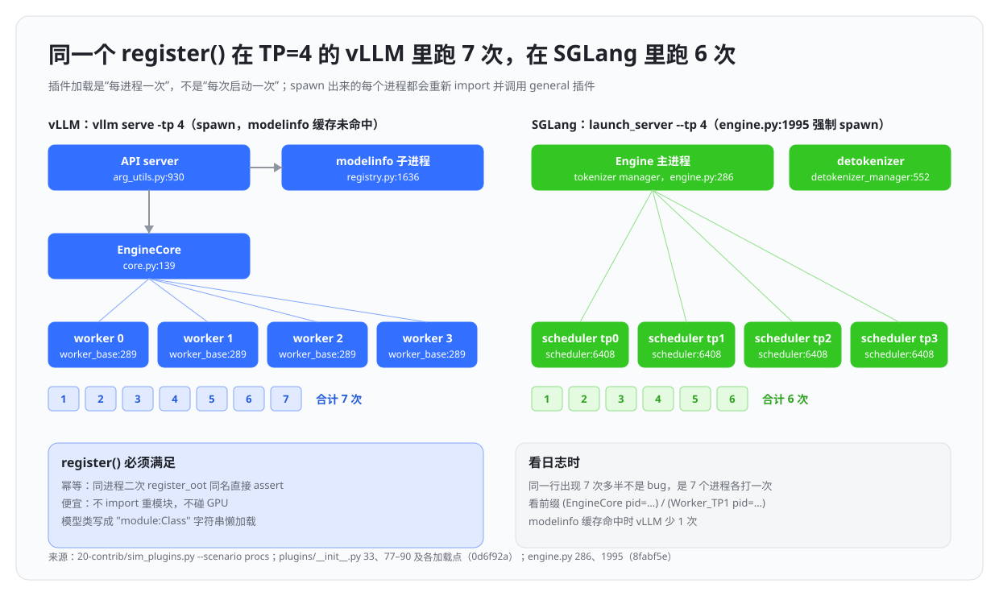
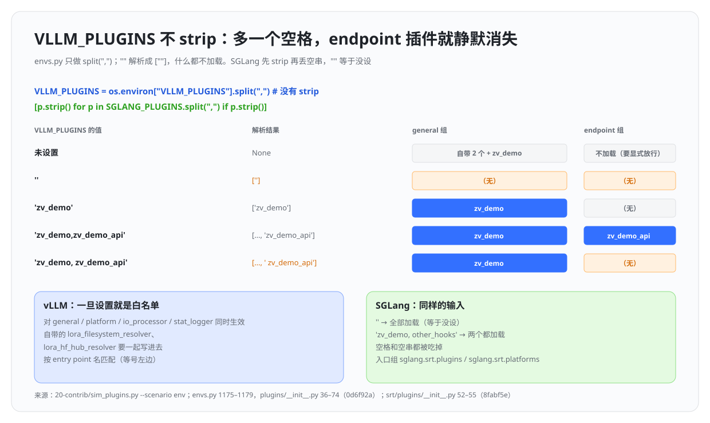
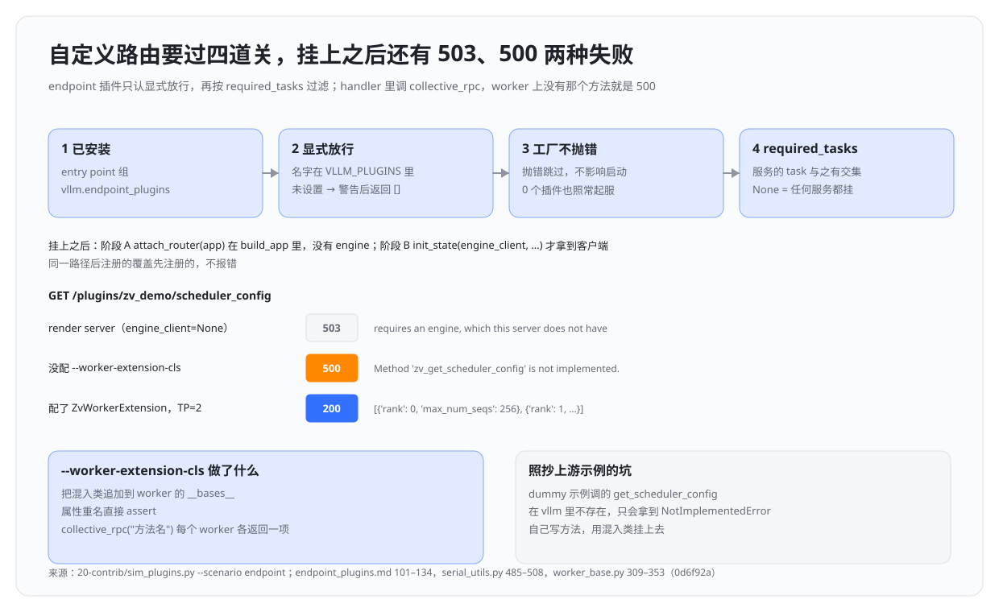
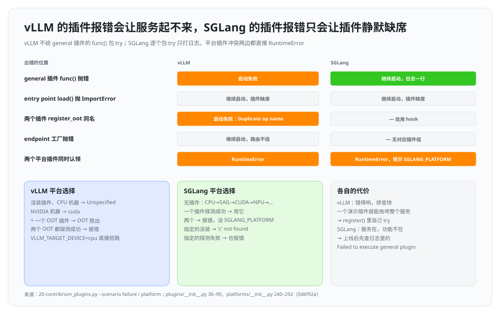
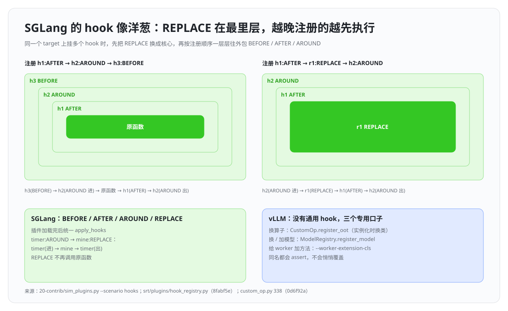
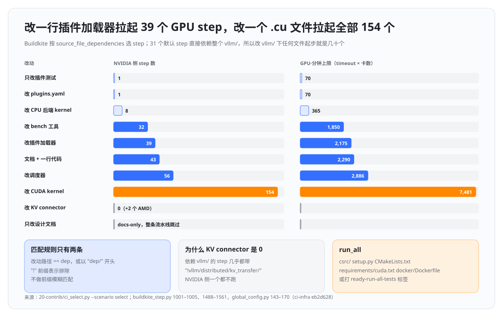
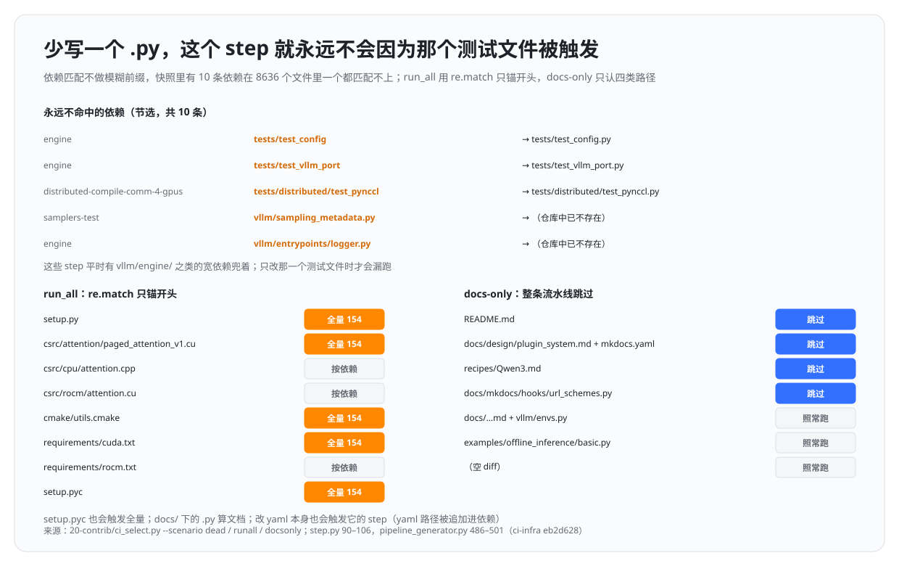
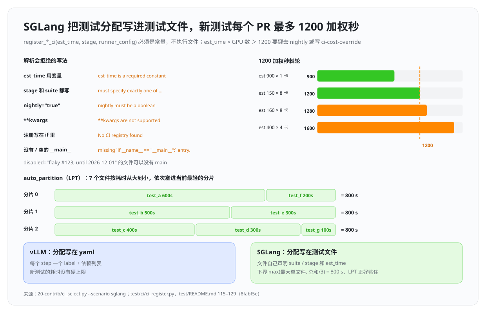
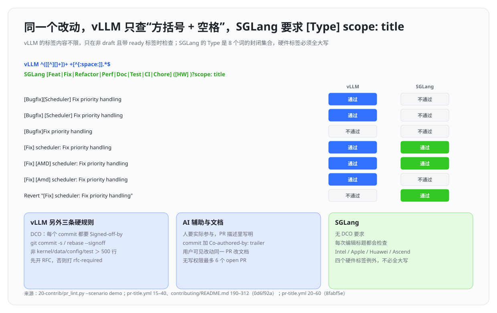
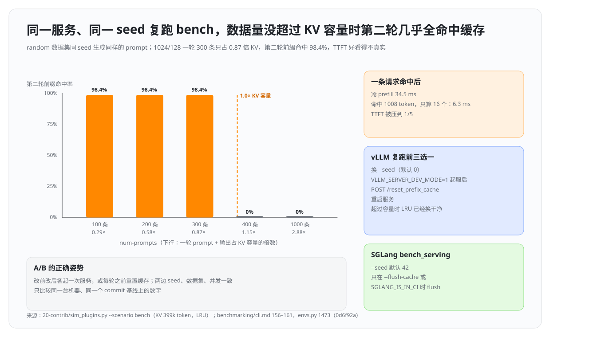

# VLLM-20｜生产｜读源码与提 PR：插件系统、测试与基准

> 🎯 **这篇文档解决什么问题**：前 19 篇我们一直在用 vLLM，这一篇动手改它。改法有两种：一种不动上游代码，写个插件随包安装；另一种直接改源码，提 PR 合进主干。两种都会碰到同一类问题。插件为什么打了 7 行一样的日志？`VLLM_PLUGINS` 里多一个空格，路由为什么就没了？改一行代码，CI 会拉起多少个 GPU step？标题为什么被机器人拒了？改前改后各跑一次 bench，第二轮为什么快得离谱？我们按“插件 → 定位源码 → CI → PR 规范 → 基准”的顺序回答这些问题，每一处都对照 SGLang，给出源码行号和模拟器输出。
>
> **使用方式**：第 1–5 章讲插件，第 6 章讲从日志、参数、行为变化定位源码，第 7–9 章讲两边的 CI，第 10 章讲 PR 规范，第 11 章讲基准 A/B，第 12 章是动手清单和核对表。只写插件的话读前 5 章加第 12 章，准备提 PR 的话从第 6 章读起。
>
> **代码**：[20-contrib](../20-contrib)。sim_plugins.py 照抄两边的插件加载逻辑，离线推演进程次数、白名单解析、endpoint 四道关、平台冲突、失败传播、hook 顺序和 bench 缓存命中。ci_select.py 复刻 vllm-project/ci-infra 的 step 选择逻辑和 SGLang 的测试注册解析。pr_lint.py 在提 PR 前检查标题、DCO、AI 署名、RFC 门槛和文档提示。60 个单测钉住这些结论。plugin_demo/ 是能 `pip install -e` 的插件包，locate.sh 和 contrib.sh 是按段复制的命令清单。模拟器和单测只用 Python 标准库。

# 导读 · 先给结论

## 源码定位先分模型实现

通用阅读案例从两个固定 revision 的 architectures 和 text_config.model_type 出发，沿模型注册找到稠密或 MoE 实现，再分别追 GDN 和全注意力。不要只凭仓库显示名猜实现类。

插件、CI 和 CPU 测试中的小模型保留为低成本测试夹具，不作为通用部署主例。新增修改应补覆盖混合状态和专家分支的测试；只通过 import 或注册测试不能证明推理正确。

双模型结构以固定版本配置核对[[Qwen3.8-27B config.json]](https://huggingface.co/Qwen/Qwen3.8-27B/blob/37561816e66b5b9153b1b64c10968c18c1e6f4a0/config.json)[[Qwen3.5-35B-A3B config.json]](https://huggingface.co/Qwen/Qwen3.5-35B-A3B/blob/59d61f3ce65a6d9863b86d2e96597125219dc754/config.json)。

1. **general 插件每个进程都要跑一次。**TP=4 的 `vllm serve` 首次启动时，`register()` 在 API server、modelinfo 子进程、EngineCore 和 4 个 worker 里各跑一次，共 7 次；SGLang 是 Engine 主进程、4 个 scheduler 和 detokenizer，共 6 次。register() 必须幂等。
2. **`VLLM_PLUGINS` 只按逗号切，不 strip。**`"a, b"` 里的第二个名字是 `" b"`，匹配不上任何插件；`""` 解析成 `[""]`，什么都不加载。SGLang 先 strip 再丢掉空串，`""` 等于没设。
3. **endpoint 插件要显式放行。**没设 `VLLM_PLUGINS` 时只打一行提示，不挂路由；放行之后还要过 `required_tasks`。路由挂上之后，没有 engine 返回 503，worker 上没有对应方法返回 500。
4. **插件出错时，vLLM 起不来，SGLang 照常起。**vLLM 的 general 插件 `func()` 外面没有 try；SGLang 每个插件包在 try 里，代价是插件缺席只留一行日志。
5. **SGLang 有通用 hook，vLLM 没有。**SGLang 的 REPLACE 排在最里层，其余按注册顺序向外包，最后注册的最先执行。vLLM 改行为靠三条专用通道：ModelRegistry、`CustomOp.register_oot` 和 `--worker-extension-cls`。
6. **vLLM 的 CI 按路径选 step。**改一行插件加载器会拉起 39 个 NVIDIA step，GPU·分钟上限 2175。改一个 .cu 文件触发 run_all，154 个 step，上限 7481。只改文档时整条流水线跳过。
7. **依赖少写一个 .py，这个 step 就再也不会被那个文件触发。**匹配只认“相等”或“以 dep/ 开头”。0d6f92a 的 yaml 里有 10 条这样的依赖。
8. **SGLang 把测试分配写在测试文件里。**文件顶部的 `register_*_ci()` 用 AST 解析，不执行；新加的 PR 测试，est_time × 卡数不能超过 1200，超出要挪去 nightly 或写 `ci-cost-override:`。
9. **两边的 PR 标题规则互不兼容。**vLLM 只查“方括号标签 + 空格 + 描述”；SGLang 要求 `[Type] scope: title`，Type 只有 8 个。vLLM 要求每个 commit 带 DCO 签名，超过 500 行先开 RFC。
10. **同一服务、同一 seed 复跑 bench，第二轮会命中第一轮留下的前缀缓存。**数据量不超过 KV 容量时命中率 98.4%，单条 prefill 从 34.5 ms 降到 6.3 ms。A/B 之间要换 seed、重置缓存或重启服务。

# 第 1 章 · 插件在哪些进程里执行



## 1.1 五个插件组，一个加载函数

vLLM 的插件是 Python 包的 entry point。[\_\_init\_\_.py](https://github.com/vllm-project/vllm/blob/0d6f92a/vllm/plugins/__init__.py) 18–30 行定义了五个组：`vllm.general_plugins`、`vllm.platform_plugins`、`vllm.io_processor_plugins`、`vllm.stat_logger_plugins` 和 `vllm.endpoint_plugins`[[1]](https://github.com/vllm-project/vllm/blob/0d6f92a/vllm/plugins/__init__.py)[[2]](https://docs.vllm.ai/en/latest/design/plugin_system/)。前四组都经过同一个 `load_plugins_by_group`（36–74 行）：用 `importlib.metadata.entry_points(group=…)` 列出所有已安装的插件，按 `VLLM_PLUGINS` 过滤，逐个 `load()`。load 抛异常时只打日志，跳过这个插件。

general 组最常用。`load_general_plugins`（77–90 行）先查模块级变量 `plugins_loaded`，已经加载过就直接返回；否则加载全部 general 插件，并逐个调用返回的函数。这里的“只加载一次”是每个进程一次，因为模块级变量不会跨进程共享。vLLM 官方博客给的插件写法也是在 `register()` 里调 `ModelRegistry.register_model` 之类的注册函数[[3]](https://vllm.ai/blog/2025-11-20-vllm-plugin-system)。

## 1.2 TP=4 时跑 7 次

调用 `load_general_plugins` 的地方有四处：[arg_utils.py](https://github.com/vllm-project/vllm/blob/0d6f92a/vllm/engine/arg_utils.py) 930 行（API server 或 `LLM()` 构造引擎参数时）、[registry.py](https://github.com/vllm-project/vllm/blob/0d6f92a/vllm/model_executor/models/registry.py) 1636 行（模型信息检查子进程）、[core.py](https://github.com/vllm-project/vllm/blob/0d6f92a/vllm/v1/engine/core.py) 139 行（EngineCore 初始化）和 [worker_base.py](https://github.com/vllm-project/vllm/blob/0d6f92a/vllm/v1/worker/worker_base.py) 289 行（每个 worker 初始化）。modelinfo 检查用 subprocess 起一个全新解释器，缓存未命中时才会跑，`vllm serve` 首次启动正好是这种情况。

```text
-- vLLM（spawn，modelinfo 缓存未命中）
   API server / LLM() 主进程                  执行    arg_utils.py:930
   modelinfo 检查子进程                         执行    registry.py:1636（subprocess，总是全新解释器）
   engine core                             执行    core.py:139
     worker rank 0                         执行    worker_base.py:289
     worker rank 1                         执行    worker_base.py:289
     worker rank 2                         执行    worker_base.py:289
     worker rank 3                         执行    worker_base.py:289
   合计执行 7 次，分布在 7 个进程
-- SGLang（engine.py:1995 强制 spawn）
   Engine 主进程（tokenizer manager）           执行    engine.py:286
     scheduler pp0 tp0                     执行    scheduler.py:6408
     scheduler pp0 tp1                     执行    scheduler.py:6408
     scheduler pp0 tp2                     执行    scheduler.py:6408
     scheduler pp0 tp3                     执行    scheduler.py:6408
   detokenizer                             执行    detokenizer_manager.py:552
   合计执行 6 次，分布在 6 个进程
```

SGLang 的对应函数在 `srt/plugins/__init__.py`[[4]](https://github.com/sgl-project/sglang/blob/8fabf5e/python/sglang/srt/plugins/__init__.py)，调用点是 `engine.py` 286 行（Engine 主进程，同时是 tokenizer manager）、`scheduler.py` 6408 行（每个 scheduler rank）和 `detokenizer_manager.py` 552 行。`engine.py` 1995 行强制用 spawn 起子进程，所以每个子进程都是全新解释器，各自加载一次。TP=4 时共 6 次。

直接后果有两条。第一，`register()` 里打的日志会出现 7 次，这是预期行为。看日志前缀的 `(EngineCore pid=…)`、`(Worker_TP1 pid=…)` 就能分清是哪个进程打的，locate.sh 的 `log-proc` 段会按前缀计数。第二，`register()` 必须幂等，并且不能有只该发生一次的副作用，比如写文件、占端口、上报指标。确实只想在某个进程里做的事，要自己判断进程身份。同一个进程里重复注册同名 OOT op 会撞上 [custom_op.py](https://github.com/vllm-project/vllm/blob/0d6f92a/vllm/model_executor/custom_op.py) 338 行的 assert，第 4 章会再遇到它。

# 第 2 章 · VLLM_PLUGINS：一个空格的代价



## 2.1 解析：只 split，不 strip

`VLLM_PLUGINS` 在 [envs.py](https://github.com/vllm-project/vllm/blob/0d6f92a/vllm/envs.py) 1175–1179 行解析：没设置时是 None，表示全部加载；设置了就 `split(",")`，不 strip，也不丢空串[[5]](https://docs.vllm.ai/en/latest/configuration/env_vars/)。所以 `""` 变成 `[""]`，任何插件名都不等于空串，结果什么都不加载；`"zv_demo, zv_demo_api"` 的第二项是 `" zv_demo_api"`，前面带空格，匹配不上。匹配的是 entry point 名，也就是 setup.py 里等号左边那个名字，包名和模块名都不认（endpoint_plugins.md 101 行）[[6]](https://github.com/vllm-project/vllm/blob/0d6f92a/docs/design/endpoint_plugins.md)。

```text
VLLM_PLUGINS                                    general 组                                         endpoint 组      
   未设置                                             lora_filesystem_resolver, lora_hf_hub_resolver, zv_demo（无）             
   ''                                              （无）                                               （无）             
   'zv_demo'                                       zv_demo                                           （无）             
   'zv_demo,zv_demo_api'                           zv_demo                                           zv_demo_api     
   'zv_demo, zv_demo_api'                          zv_demo                                           （无）             
   'zv_demo,zv_demo_api,lora_filesystem_resolver'  lora_filesystem_resolver, zv_demo                 zv_demo_api     
   VLLM_PLUGINS 对 general / platform / io_processor / stat_logger 四组同时生效，一旦设置，自带的 lora_filesystem_resolver 也要写进去
   逗号后的空格不会被去掉：" zv_demo_api" 和 "zv_demo_api" 是两个名字
```

这个变量同时作用于 general、platform、io_processor、stat_logger 四组，endpoint 组也看它。一旦设置，vLLM 自带的两个 LoRA resolver 如果还要用，也必须写进去。上面最后一行就是这种情况：只写自己的两个插件，`lora_filesystem_resolver` 就被挡掉了。

## 2.2 SGLang：先 strip 再丢空串

SGLang 的 `SGLANG_PLUGINS` 在 `srt/plugins/__init__.py` 52–55 行解析，切分后对每项 strip，再丢掉空串[[4]](https://github.com/sgl-project/sglang/blob/8fabf5e/python/sglang/srt/plugins/__init__.py)。所以 `""` 等同于未设置，全部加载；带空格的写法也能正确匹配。

```text
SGLANG_PLUGINS                    SGLang general 组（装了 zv_demo、other_hooks）
   未设置                               zv_demo, other_hooks
   ''                                zv_demo, other_hooks
   'zv_demo'                         zv_demo
   'zv_demo, other_hooks'            zv_demo, other_hooks
   SGLang 先 strip 再丢空串，"" 等于没设；vLLM 的 "" 解析成 [""]，什么都不加载
```

部署脚本里最容易出这个问题：YAML 列表拼成字符串时用了 `", ".join(...)`，或者 Helm 模板在逗号后面加了空格。general 插件少了一个，服务通常还能起来，只是某个模型或功能缺席；endpoint 插件少了，路由直接 404，日志里也没有报错。排查时先在服务进程里打印 `repr(os.environ["VLLM_PLUGINS"])`，看清楚有没有空格。

# 第 3 章 · 自定义路由：endpoint 插件与 worker extension



## 3.1 四道关

endpoint 插件给 OpenAI 兼容服务加 HTTP 路由，加载逻辑在 [\_\_init\_\_.py](https://github.com/vllm-project/vllm/blob/0d6f92a/vllm/plugins/__init__.py) 93–159 行，设计文档是 [endpoint_plugins.md[6]](https://github.com/vllm-project/vllm/blob/0d6f92a/docs/design/endpoint_plugins.md)。它比 general 插件多三道关。第一，必须显式放行：`VLLM_PLUGINS` 没设置时，其他组全部加载，endpoint 组一个都不加载，只打一行 “Found endpoint plugin(s) … but VLLM_PLUGINS is not set”。第二，名字必须写进 `VLLM_PLUGINS`，漏写就静默跳过。第三，插件声明的 `required_tasks` 要和服务支持的任务有交集，否则打 “Skipping endpoint plugin …”。最后一道关在挂载时：`attach_router` 在 build_app 阶段把路由挂到 FastAPI 上，`init_state(engine_client)` 等引擎客户端就绪后才调用。两个插件注册了同一条路径时，后注册的覆盖先注册的，不报错（文档 107–134 行）。

```text
VLLM_PLUGINS 未设置                        不挂    Found endpoint plugin(s) ['zv_demo_api'] but VLLM_PLUGINS is not set.
   VLLM_PLUGINS=zv_demo（漏写 api）            不挂    
   VLLM_PLUGINS=zv_demo,zv_demo_api        挂上    
   required_tasks=generate，pooling 服务      不挂    Skipping endpoint plugin zv_demo_api: requires one of tasks ('generate',)
   required_tasks=None，render server       挂上    
   required_tasks=generate，render server   不挂    Skipping endpoint plugin zv_demo_api: requires one of tasks ('generate',)
```

render server 是只做 tokenize / 渲染、没有引擎的服务形态，`required_tasks=None` 的插件会挂上去，声明了 `generate` 的插件不会。plugin_demo 的路由故意写成 `required_tasks=None`，所以 handler 必须自己处理 `engine_client is None`，这就是下面那条 503 的来历。

## 3.2 挂上之后的两种失败

路由挂上只是开始。plugin_demo 里的 `/plugins/zv_demo/scheduler_config` 在 handler 里调 `engine_client.collective_rpc("zv_get_scheduler_config")`，让每个 worker 返回自己的 `max_num_seqs`。这一步有三种结局：

```text
-- 路由挂上之后，handler 调 collective_rpc("zv_get_scheduler_config")：
   render server（engine_client=None）       503  requires an engine, which this server does not have
   没配 --worker-extension-cls               500  Method 'zv_get_scheduler_config' is not implemented.
   配了 ZvWorkerExtension                    200  [{'rank': 0, 'max_num_seqs': 256}, {'rank': 1, 'max_num_seqs': 256}]
   上游 dummy 示例调的 get_scheduler_config 在 vllm 里不存在，照抄只会拿到 NotImplementedError
```

503 是 handler 自己判断 `engine_client is None` 后返回的。500 来自 [serial_utils.py](https://github.com/vllm-project/vllm/blob/0d6f92a/vllm/v1/serial_utils.py) 485–508 行：worker 上找不到这个方法名，就抛 NotImplementedError。补上方法的办法是 `--worker-extension-cls`：[worker_base.py](https://github.com/vllm-project/vllm/blob/0d6f92a/vllm/v1/worker/worker_base.py) 309–353 行在 worker 初始化时把扩展类动态混入 worker 的基类，扩展类里定义的方法就成了 worker 的方法，`collective_rpc` 能按名字调到。扩展类和 worker 有同名属性时直接报错（315–321 行），不会静默覆盖。上游设计文档里 dummy 示例调用的 `get_scheduler_config` 在 vLLM 里并不存在，照抄只会得到上面那条 500。

SGLang 没有 endpoint 插件组。要加路由，要么在 hook 里改 FastAPI app，要么在 SGLang 前面再挂一层服务。vLLM 这套机制的价值在于：路由、worker 方法、模型注册都能随一个 pip 包分发，上游升级时不用 rebase 补丁。

# 第 4 章 · 插件出错、平台冲突：谁会把服务带下去



## 4.1 general 插件抛异常

vLLM 的 `load_general_plugins` 对每个插件函数直接调用 `func()`，外面没有 try（77–90 行）。插件函数一抛异常，API server 进程就起不来；如果是在 worker 里才抛，engine 初始化失败，整个服务退出。vLLM 自带的 LoRA resolver 就是现成的例子：开了 `VLLM_ALLOW_RUNTIME_LORA_UPDATING` 却没设缓存目录时，它在注册阶段抛 “VLLM_LORA_RESOLVER_CACHE_DIR must be set”，服务直接退出。SGLang 把每个插件的加载和执行都包在 try 里，出错只打一行 “Failed to execute general plugin”，服务继续启动[[4]](https://github.com/sgl-project/sglang/blob/8fabf5e/python/sglang/srt/plugins/__init__.py)。

```text
general 插件 func() 抛错                vLLM    启动失败：ValueError: VLLM_LORA_RESOLVER_CACHE_DIR must be set
   general 插件 func() 抛错                SGLang  继续启动，日志：Failed to execute general plugin: zv_demo: V
   entry point load() 抛 ImportError    vLLM    继续启动，插件缺席：Failed to load plugin zv_demo: ImportErr
   entry point load() 抛 ImportError    SGLang  继续启动，插件缺席
   两个插件 register_oot 同名                vLLM    启动失败：AssertionError: Duplicate op name: RMSNorm
   endpoint 工厂抛错                       vLLM    继续启动，路由不挂（0 个插件）
   vLLM 的 general 插件跑在每个 worker 里，抛错 = 起不来；SGLang 包了 try，代价是插件静默缺席，要自己看日志
```

两种设计各有代价。vLLM 的做法让配置错误在启动时暴露，不会带着缺了一块的功能上线；SGLang 的做法让一个可选插件坏掉时不影响主服务，但插件缺席只能靠日志发现。用 SGLang 写插件时，建议在插件里自己暴露一个健康检查信号，比如一个 metrics 或一个只读路由，别只靠日志。`load()` 阶段的 ImportError 两边都只打日志、跳过插件，所以插件依赖没装全时，vLLM 也会静默缺席。

## 4.2 同名 OOT 算子

`CustomOp.register_oot` 让插件用自己的类替换某个内置算子，比如把 RMSNorm 换成 NPU 实现。注册表是一个字典，[custom_op.py](https://github.com/vllm-project/vllm/blob/0d6f92a/vllm/model_executor/custom_op.py) 338 行对重名做了 assert。两个插件都替换 RMSNorm，或者同一个插件在同一进程里注册了两次（第 1 章说的幂等问题），都会触发 “Duplicate op name: RMSNorm”，服务起不来。

## 4.3 平台插件冲突

平台插件的 activate 函数探测当前机器，返回平台类的路径，或者返回 None 表示不认领。vLLM 的选择逻辑在 [\_\_init\_\_.py](https://github.com/vllm-project/vllm/blob/0d6f92a/vllm/platforms/__init__.py) 240–292 行：先跑所有 OOT 插件，有一个认领就用它，OOT 压过内置平台；有两个及以上同时认领就报 RuntimeError。没有 OOT 认领时再跑内置探测，内置也只能有一个认领。

```text
vLLM   CPU 机器没装插件                  → UnspecifiedPlatform
   vLLM   NVIDIA 机器                   → cuda
   vLLM   NVIDIA 机器 + 装了一个 OOT        → my_npu（OOT 胜出）
   vLLM   两个 OOT 都探测成功                → RuntimeError: Only one platform plugin can be activated, but got: ['my_npu', 'my_npu_v2']
   vLLM   内置探测出两个                     → RuntimeError: Only one platform plugin can be activated, but got: ['cpu', 'cuda']
   vLLM   VLLM_TARGET_DEVICE=cpu      → cpu（VLLM_TARGET_DEVICE=cpu 直接短路）
   SGLang 没装插件                        → CUDA（无插件，按 CPU→SAIL→CUDA→NPU→ROCm→XPU→MUSA→MPS 探测）
   SGLang 一个插件探测成功                    → my_npu
   SGLang 两个插件探测成功                    → RuntimeError: Multiple platform plugins activated: a, b. Set SGLANG_PLATFORM to select one.
   SGLang SGLANG_PLATFORM=a           → a（指定）
   SGLang SGLANG_PLATFORM=c（没装）       → RuntimeError: SGLANG_PLATFORM='c' not found
   SGLang SGLANG_PLATFORM=b（探测失败）     → RuntimeError: Platform plugin 'b' is installed but activate() returned None
   vLLM 里 OOT 插件压过内置；SGLang 里平台插件只和平台插件比，指定 SGLANG_PLATFORM 时其余平台包的 general 插件也不加载
```

SGLang 的平台插件只和平台插件比：没装插件时按 CPU→SAIL→CUDA→NPU→ROCm→XPU→MUSA→MPS 的顺序探测内置平台。装了插件且只有一个认领就用它。多个同时认领时报错，并提示设置 `SGLANG_PLATFORM` 指定。指定的平台没装，或者装了但 activate 返回 None，也直接报错。vLLM 没有对应的“指定平台”变量，`VLLM_TARGET_DEVICE=cpu` 只能短路到 CPU；同一台机器上装了两个会认领的 OOT 平台包，只能卸掉一个，或者让其中一个的 activate 读环境变量决定是否认领。

# 第 5 章 · SGLang 的 hook 与 vLLM 的三条通道



## 5.1 四种 hook 的嵌套顺序

SGLang 的插件除了注册模型，还能对任意函数挂 hook，实现在 `hook_registry.py`[[7]](https://github.com/sgl-project/sglang/blob/8fabf5e/python/sglang/srt/plugins/hook_registry.py)。hook 有四种：BEFORE 在原函数前执行，AFTER 在原函数后执行，AROUND 包住原函数，REPLACE 换掉原函数。同一个 target 上挂了多个 hook 时，REPLACE 先排到最里层，取代原函数；其余 hook 按注册顺序一层层往外包，所以最后注册的在最外层，最先执行。

```text
注册顺序 h1:AFTER → h2:AROUND → h3:BEFORE
   执行轨迹 h3(BEFORE) → h2(AROUND 进) → 原函数 → h1(AFTER) → h2(AROUND 出)
   注册顺序 timer:AROUND → mine:REPLACE
   执行轨迹 timer(AROUND 进) → mine(REPLACE) → timer(AROUND 出)
   注册顺序 h1:AFTER → r1:REPLACE → h2:AROUND
   执行轨迹 h2(AROUND 进) → r1(REPLACE) → h1(AFTER) → h2(AROUND 出)
   REPLACE 先排到最里层（替换原函数，不再调用原函数），其余按注册顺序一层层往外包，最后注册的最先执行
```

第一组看出 BEFORE 和 AFTER 也是“层”：h3 最后注册，在最外层，最先执行；h1 最先注册，紧贴原函数，原函数一返回就执行。第二组说明 REPLACE 不受注册顺序影响，timer 先注册，仍然包在 REPLACE 外面，计时照样有效。第三组是三种混用。两个插件都对同一个函数注册 REPLACE 时，后注册的生效，hook_registry.py 119–130 行只打一条 “Multiple REPLACE hooks” 的 warning。这和 vLLM 同名 OOT op 冲突是同一类问题，vLLM 用 assert 拦下，SGLang 放行。REPLACE 还能直接换掉一个类，类级 REPLACE 会先于其他 hook 应用，后面挂在 `类名.方法` 上的 hook 解析到的是替换后的类。

## 5.2 vLLM 为什么没有通用 hook

vLLM 把扩展点收窄成三条通道：换模型用 `ModelRegistry.register_model`，换算子用 `CustomOp.register_oot`（实例化时换类），给 worker 加方法用 `--worker-extension-cls`[[2]](https://docs.vllm.ai/en/latest/design/plugin_system/)[[3]](https://vllm.ai/blog/2025-11-20-vllm-plugin-system)。好处是扩展点有限、可以测试，上游重构时知道哪些接口不能动；代价是想改调度器的某个分支时没有官方入口，只能 monkey patch 或者提 PR。vLLM 博客也明确建议：插件里的 monkey patch 要尽量小，并且固定 vLLM 版本[[3]](https://vllm.ai/blog/2025-11-20-vllm-plugin-system)。经验上，需要 patch 的东西如果对其他用户也有用，提 PR 加一个正式扩展点通常比长期维护 patch 便宜。

| 改什么 | vLLM | SGLang |
|-|-|-|
| 加一个模型架构 | general 插件里 `ModelRegistry.register_model` | general 插件注册模型 |
| 换一个算子实现 | `CustomOp.register_oot`，同名 assert | hook REPLACE，重复时后注册的生效并打 warning |
| 给 worker 加 RPC 方法 | `--worker-extension-cls` | hook 或改源码 |
| 加 HTTP 路由 | endpoint 插件，需放行 | hook 或外挂服务 |
| 在某个函数前后插逻辑 | 无官方入口，monkey patch | hook BEFORE / AFTER / AROUND |

# 第 6 章 · 从现象到源码：日志、参数、commit

## 6.1 从一行日志找到源码

vLLM 默认日志里只有文件名和行号，比如 `[scheduler.py:123]`。仓库里叫 scheduler.py 的文件不止一个，只看文件名分不清。把 `VLLM_LOGGING_LEVEL` 设成 DEBUG 后，[formatter.py](https://github.com/vllm-project/vllm/blob/0d6f92a/vllm/logging_utils/formatter.py) 18–70 行会把文件名换成相对路径：去掉开头的 `vllm/`，中间层折叠成 `...`，同名文件就分开了。另一个办法是拿日志正文里不含变量的一段去搜。日志用 `%s` 占位，所以去掉变量部分，用 `rg --fixed-strings` 搜原文。

```bash
bash locate.sh log-debug                                   # DEBUG 级别，带相对路径
bash locate.sh log-grep "Only one platform plugin can be activated"
bash locate.sh log-proc                                    # 按 (EngineCore pid=…) 前缀计数
```

## 6.2 从参数名找到定义

vLLM 的 CLI 参数大多由 config dataclass 的字段自动生成：`--max-num-seqs` 对应 `SchedulerConfig.max_num_seqs`，字段下面的 docstring 就是 `--help` 里的说明。所以查一个参数，先在 `vllm/config/` 里找字段和 docstring，再到 [arg_utils.py](https://github.com/vllm-project/vllm/blob/0d6f92a/vllm/engine/arg_utils.py) 里找有没有特殊处理。`vllm serve --help=关键字` 可以按参数组名或参数名子串过滤（[argparse_utils.py](https://github.com/vllm-project/vllm/blob/0d6f92a/vllm/utils/argparse_utils.py) 240–279 行），比翻完整的 help 快得多。环境变量全部集中在 [envs.py](https://github.com/vllm-project/vllm/blob/0d6f92a/vllm/envs.py)，类型声明、解析 lambda 和注释写在一起，注释就是文档[[5]](https://docs.vllm.ai/en/latest/configuration/env_vars/)；SGLang 的环境变量在 `python/sglang/srt/environ.py`，参数在 server_args[[8]](https://docs.sglang.io/docs/advanced_features/server_arguments)。

```bash
bash locate.sh arg-help max-num-seqs        # vllm serve --help=max-num-seqs
bash locate.sh arg-src  max-num-seqs        # config 字段 + arg_utils 特殊处理
bash locate.sh env-src  VLLM_PLUGINS
```

## 6.3 从行为变化找到 commit

升级之后某个行为变了，要找是哪个 commit 改的。`git log -S 字符串` 列出这个字符串出现次数发生变化的 commit，适合找某个参数、某句日志是哪次加的、哪次删的；`-G 正则` 按正则匹配 diff 行，适合找函数签名被改过的 commit[[9]](https://git-scm.com/docs/git-log#Documentation/git-log.txt--Sltstringgt)。`git blame` 要带 `-w -C -C`：-w 忽略空白，-C 跟踪跨文件的移动，否则会停在“格式化”或“搬文件”的那个 commit 上。vLLM 用 squash merge，commit 标题末尾带 `(#PR号)`，从 commit 直接跳到 PR 讨论，往往能看到为什么这么改。

```bash
bash locate.sh pickaxe        VLLM_PLUGINS
bash locate.sh pickaxe-regex  "def load_general_plugins"
bash locate.sh blame                                     # load_general_plugins 每一行的来历
bash locate.sh tests-for      vllm/plugins               # 谁在测它，哪个 CI step 依赖它
bash locate.sh ci-steps                                  # 当前分支的改动会触发哪些 step
```

最后两段把改动连到测试：先按 import 路径在 `tests/` 里搜谁引用了这个模块，再在 `.buildkite/test_areas/*.yaml` 里搜谁把它列为依赖。这两份结果不一致时，就是第 8 章要讲的“改了文件但相关测试没跑”。

# 第 7 章 · vLLM 的 CI：改一行，跑多少



## 7.1 step 从哪里来

vLLM 的 Buildkite 流水线由独立仓库 vllm-project/ci-infra 的 pipeline generator 生成[[10]](https://github.com/vllm-project/ci-infra/tree/eb2d628)。测试分配写在 vllm 仓库的 `.buildkite/test_areas/*.yaml`：每个 step 有 label、命令、GPU 类型、卡数、超时，还有一个 `source_file_dependencies` 列表。PR 来了，generator 拿到改动文件列表，逐个 step 判断要不要跑。0d6f92a 的快照里有 36 个 yaml、254 个 step，其中 82 个标了 optional，PR 默认不跑。

判断规则在 buildkite_step.py 1001–1005 行和 1544–1561 行[[11]](https://github.com/vllm-project/ci-infra/blob/eb2d628/buildkite/pipeline_generator/buildkite_step.py)：改动路径等于某个依赖，或者以 `依赖/` 开头，就算命中；依赖前面加 `!` 表示排除，命中排除项的改动不算数。有三条额外规则：yaml 自己被改时，step.py 90–106 行会把 yaml 路径追加进它每个 step 的依赖，改 yaml 等于改了这些 step 的全部依赖。改动命中 `setup.py`、`CMakeLists.txt`、`csrc/` 下的 CUDA 源码、`requirements/cuda.txt` 等文件时触发 run_all（global_config.py 143–170 行）。改动只涉及文档时整条流水线跳过（pipeline_generator.py 486–501 行[[12]](https://github.com/vllm-project/ci-infra/blob/eb2d628/buildkite/pipeline_generator/pipeline_generator.py)）。

```text
快照：254 个 step，82 个 optional（PR 默认不跑），21 个 AMD 原生
   改动                状态                     step 数      GPU·分钟上限  +AMD  例子
   改插件加载器            按依赖选择                      39          2175    37  basic-correctness, basic-correctness-cumem, basic-correctness-sleep-mode …
   只改插件测试            按依赖选择                       1            70     1  plugin-tests-2-gpus
   改调度器              按依赖选择                      56          2886    50  basic-correctness, basic-correctness-cumem, basic-correctness-sleep-mode …
   改 KV connector    按依赖选择                       0             0     2  
   改 bench 工具        按依赖选择                      32          1850    30  basic-correctness, basic-correctness-cumem, basic-correctness-sleep-mode …
   改 plugins.yaml    按依赖选择                       1            70     1  plugin-tests-2-gpus
   改 CPU 后端 kernel   按依赖选择                       8           365     8  openai-api-correctness, kernels-core-operation-test, kernels-mhc-test-b200 …
   改 CUDA kernel     run_all                   154          7481   155  v1-attention-h100-mi300, v1-attention-b200, basic-correctness …
   只改设计文档            docs-only，整条流水线跳过           0             0     0  
   文档 + 一行代码         按依赖选择                      43          2290    40  basic-correctness, basic-correctness-cumem, basic-correctness-sleep-mode …
```

## 7.2 读这张表

改插件加载器拉起 39 个 step，其中大部分和插件无关：有 31 个默认 step 直接依赖整个 `vllm/`。vllm/ 下任何改动都会拉起它们。因为 `vllm/plugins/` 本身而命中的只有 platform-tests、plugin-tests-2-gpus 和几个编译相关的 step。改 KV connector 时 NVIDIA 侧一个都不跑，原因是那 31 个 step 几乎都带了 `!vllm/distributed/kv_transfer/` 排除项，KV connector 的测试在 AMD 镜像 step 里。“GPU·分钟上限”是 timeout × 卡数，实际耗时比它低，但可以用来比较两种改法的代价。

```text
== diff：vllm/plugins/__init__.py tests/plugins_tests/test_platform_plugins.py
   按依赖选择；39 个 step，GPU·分钟上限 2175；另有 AMD 原生 0、amd 镜像 37
   basic-correctness                                   h200_18gb   1×68   命中 vllm/
   basic-correctness-cumem                             h200_18gb   1×68   命中 vllm/
   basic-correctness-sleep-mode                        h200_18gb   1×68   命中 vllm/
   basic-correctness-cpu-offload                       h200_18gb   1×68   命中 vllm/
   basic-correctness-prefetch-offload                  h200_18gb   1×68   命中 vllm/
```

run_all 的判定用 `re.match`，只锚定开头，不锚定结尾：`setup.pyc` 也会触发全量；`csrc/cpu/` 和 `csrc/rocm/` 下的文件不触发，因为规则只列了 CUDA 相关路径。打 `ready-run-all-tests` 标签时，连 optional step 也一起跑。

```text
setup.py                                    全量
   CMakeLists.txt                              全量
   csrc/attention/paged_attention_v1.cu        全量
   csrc/cpu/attention.cpp                      -
   csrc/rocm/attention.cu                      -
   cmake/utils.cmake                           全量
   cmake/hipify.py                             -
   docker/Dockerfile                           全量
   docker/Dockerfile.cpu                       -
   requirements/cuda.txt                       全量
   requirements/rocm.txt                       -
   requirements/test/cuda.txt                  全量
   setup.pyc                                   全量
   全量 = 154 个非 optional 非 AMD step，GPU·分钟上限 7481；打 ready-run-all-tests 标签时连 optional 也一起跑（nightly=1）
```

对提 PR 的人来说，这张表有两个用处。第一，同一个功能如果能拆成“只改 Python”和“改 kernel”两个 PR，Python 那个 PR 的 CI 规模小一个量级，评审和重跑都快。第二，在本地先跑 `bash locate.sh ci-steps`，知道会跑哪些 step，CI 挂了能更快判断是不是自己的问题。SGLang 的 PR CI 按 suite 组织，不按路径筛选，第 9 章再讲。

# 第 8 章 · 路径匹配的边缘：漏跑与跳过



## 8.1 少写一个 .py

匹配只认“相等”或“以 `dep/` 开头”，不做前缀模糊匹配。依赖写成 `tests/test_config`，而仓库里的文件是 `tests/test_config.py`：两者不相等，`tests/test_config.py` 也不以 `tests/test_config/` 开头，所以永远不会命中。ci_select.py 拿 0d6f92a 的 8636 个文件路径去对 254 个 step 的全部依赖，找出 10 条一个文件都匹配不上的：

```text
distributed-dp-tests-4-gpus           tests/distributed/test_utils            → tests/distributed/test_utils.py
   distributed-compile-comm-4-gpus       tests/distributed/test_pynccl           → tests/distributed/test_pynccl.py
   distributed-compile-comm-4-gpus       tests/distributed/test_events           → tests/distributed/test_events.py
   engine                                vllm/entrypoints/logger.py              → （仓库中已不存在）
   engine                                tests/test_sequence                     → tests/test_sequence.py
   engine                                tests/test_config                       → tests/test_config.py
   engine                                tests/test_logger                       → tests/test_logger.py
   engine                                tests/test_vllm_port                    → tests/test_vllm_port.py
   amd-umbp-connector-unit-mi355         tests/v1/kv_connector/unit/test_umbp_   → tests/v1/kv_connector/unit/test_umbp_async_lookup.py 等 5 个
   samplers-test                         vllm/sampling_metadata.py               → （仓库中已不存在）
   共 10 条。matches() 只认“相等”或“以 dep/ 开头”，不做前缀模糊匹配，少写 .py 就永远不命中
   这类 step 往往还有别的宽依赖（如 vllm/engine/）兜着，所以平时看不出来；只改那个测试文件时才会漏跑
```

平时看不出来，是因为这些 step 往往还有更宽的依赖兜着，比如 engine step 依赖整个 `vllm/engine/`。只改那个测试文件时，对应的 step 就会漏跑。还有两条指向已删除的文件，说明文件搬家后 yaml 没跟着改。提 PR 新增测试文件时，在 yaml 里写完整的文件名或目录名，再用 ci_select.py 的 `--diff` 验证一下改这个文件能不能拉起它。

## 8.2 docs-only 的边界

改动只涉及 `docs/`、`recipes/`、`*.md` 和 `mkdocs.yaml` 时，整条流水线跳过。前缀判断在后缀判断之前，所以 `docs/` 下的 .py 文件也算文档。空 diff 不算 docs-only。设了 `DOCS_ONLY_DISABLE=1`、触发了 run_all 或指定了 only_step_keys 时都不跳过。

```text
[]                                                      照常跑
   ['README.md']                                           跳过 CI
   ['docs/design/plugin_system.md', 'mkdocs.yaml']         跳过 CI
   ['recipes/Qwen3.md']                                    跳过 CI
   ['docs/mkdocs/hooks/url_schemes.py']                    跳过 CI
   ['docs/design/plugin_system.md', 'vllm/envs.py']        照常跑
   ['examples/offline_inference/basic.py']                 照常跑
   docs/ 下的 .py 也算文档（前缀判断在后缀之前）；空 diff 不算 docs-only；DOCS_ONLY_DISABLE=1、run_all、only_step_keys 任一成立都不跳过
```

vLLM 的贡献指南要求用户可见的改动在同一个 PR 里改文档（README.md 271–287 行）[[13]](https://github.com/vllm-project/vllm/blob/0d6f92a/docs/contributing/README.md)，所以“文档 + 一行代码”的 PR 很常见：它按代码改动选 step，上面的表里是 43 个。反过来，单独提一个只改 docs/ 的 PR 不消耗任何 GPU，修文档错别字时不必担心 CI 成本。

# 第 9 章 · SGLang 的 CI：测试文件自己声明 suite 和耗时



## 9.1 register\_\*\_ci 与 AST 解析

SGLang 的测试分配写在测试文件顶部，yaml 里没有：`register_cuda_ci(est_time=300, stage="stage-b", runner_config="1-gpu-large")` 声明这个文件属于哪个 suite、预计跑多久[[14]](https://github.com/sgl-project/sglang/blob/8fabf5e/test/README.md)。CI 用 AST 解析这一行，不 import、不执行测试文件（`ci_register.py`[[15]](https://github.com/sgl-project/sglang/blob/8fabf5e/python/sglang/test/ci/ci_register.py)）。所以参数必须是字面量常量，写成变量、用 `**kwargs`、放在 if 里，都会在解析阶段报错。每个注册测试还必须有 `if __name__ == "__main__":` 入口，因为注册测试都能直接当脚本跑；标了 disabled 的文件例外。

```text
新式写法                cuda suite=stage-b-test-1-gpu-large est=300
   老式 suite            amd suite=stage-a-test-1-gpu-amd est=120
   est_time 用变量        报错：est_time is a required constant in register_cuda_ci()
   stage 和 suite 都写    报错：register_cuda_ci() must specify exactly one of (stage, runner_config) pair or suite; got stage=True, runner_config=True, suite=True
   nightly="true"      报错：nightly must be a boolean in register_cuda_ci()
   **kwargs            报错：**kwargs are not supported in register_cuda_ci()
   注册写在 if 里           报错：No CI registry found in test.py
   没有 main             报错：missing `if __name__ == "__main__":` entry.
   main 里只有 pass       报错：missing `if __name__ == "__main__":` entry.
   disabled 不要 main    cuda suite=stage-a-test-1-gpu-small est=60 disabled='flaky #123, until 2026-12-01'
```

`disabled` 的格式是 “原因 #issue, until YYYY-MM-DD”，禁用测试必须写明原因、关联 issue 和到期日。vLLM 禁用测试的办法是在 yaml 里标 optional 或删掉 step，没有到期日的约定。

## 9.2 1200 加权秒的上限与 LPT 分片

test/README.md 115–129 行规定：PR 新增的注册测试，在单个 backend 上 est_time × runner_config 的卡数不能超过 1200；超出的要挪去 nightly，或者在 PR 描述里写 `ci-cost-override: 理由`[[14]](https://github.com/sgl-project/sglang/blob/8fabf5e/test/README.md)。8 卡 H200 上一个测试最多 150 秒，4 卡 H100 上最多 300 秒。vLLM 没有这类硬性数值，约束来自评审。

```text
-- 1200 加权秒棘轮（est_time × runner_config 里的卡数）
   est_time=900  1-gpu-large      900  通过
   est_time=400  4-gpu-h100      1600  超限：挪去 nightly，或写 ci-cost-override: 理由
   est_time=150  8-gpu-h200      1200  通过
   est_time=160  8-gpu-h200      1280  超限：挪去 nightly，或写 ci-cost-override: 理由
-- auto_partition（LPT）：7 个文件分 3 片
   分片 0：test_a.py, test_f.py                  800 s
   分片 1：test_b.py, test_e.py                  800 s
   分片 2：test_c.py, test_d.py, test_g.py       800 s
   最长分片 800 s，下界 max(最大单文件, 总和/3) = 800 s
```

一个 suite 里的文件按 est_time 用 LPT（最长处理时间优先）分到若干台机器上：文件按耗时从大到小排，每次放到当前总耗时最小的分片。LPT 的最长分片不超过最优解的 4/3 − 1/(3m) 倍[[16]](https://doi.org/10.1137/0117039)，上面这个例子正好达到下界 max(最大单文件, 总和 / 分片数)。这也是 est_time 要写准的原因：写小了，某个分片会远超其他分片，整个 suite 的墙钟时间被它拖长。

两种组织方式的取舍：vLLM 把分配集中在 yaml 里，一眼能看到全部 step 和依赖，但新增测试要同时改两个地方，依赖写错就会出现第 8 章的漏跑；SGLang 把分配放进测试文件，新增测试只改一个文件，但每个 PR 都跑整个 suite，不按改动路径筛选，所以要靠 1200 秒的上限控制总量。

# 第 10 章 · PR 规范：标题、签名、AI 署名与 RFC



## 10.1 标题

vLLM 的标题检查在 [pr-title.yml](https://github.com/vllm-project/vllm/blob/0d6f92a/.github/workflows/pr-title.yml) 34 行，正则是 `^(\[[^][]+\])+ +[^[:space:]].*$`：一个或多个方括号标签，后面至少一个空格，再接描述[[17]](https://github.com/vllm-project/vllm/blob/0d6f92a/.github/workflows/pr-title.yml)。标签内容不限，`[Bugfix]`、`[Perf][ROCm]` 都行。标签之间不加空格只是惯例，检查不管。这个检查只在 PR 非 draft 且带 `ready` 标签时触发。SGLang 的检查在每次编辑标题时都跑，格式是 `[Type] scope: title` 或 `[Type] [HW] scope: title`：Type 只能是 Feat、Fix、Refactor、Perf、Doc、Test、CI、Chore 八个之一，scope 必填，硬件标签必须全大写，Intel、Apple、Huawei、Ascend 例外（pr-title.yml 20–60 行）[[18]](https://github.com/sgl-project/sglang/blob/8fabf5e/.github/workflows/pr-title.yml)。

```text
标题                                                vLLM    SGLang
   [Bugfix][Scheduler] Fix priority handling         通过      不通过：Type 只能是 Feat, Fix, Refactor, Perf, Doc, Test, CI, Chore
   [Perf][ROCm][Kernel] Optimize fused MoE           通过      不通过：格式应为 "[Type] scope: title" 或 "[Type] [Hardware] scope: title"，字段之间、冒号之后各一个空格
   [Bugfix] [Scheduler] Fix priority handling        通过      不通过：Type 只能是 Feat, Fix, Refactor, Perf, Doc, Test, CI, Chore
   [Bugfix]Fix priority handling                     不通过     不通过：Type 只能是 Feat, Fix, Refactor, Perf, Doc, Test, CI, Chore
   Fix priority handling                             不通过     不通过：格式应为 "[Type] scope: title" 或 "[Type] [Hardware] scope: title"，字段之间、冒号之后各一个空格
   [Fix] scheduler: Fix priority handling            通过      通过
   [Fix] [AMD] scheduler: Fix priority handling      通过      通过
   [Fix] [Amd] scheduler: Fix priority handling      通过      不通过：硬件标签 [Amd] 要写成 [AMD]
   [Bugfix] scheduler: Fix priority handling         通过      不通过：Type 只能是 Feat, Fix, Refactor, Perf, Doc, Test, CI, Chore
   Revert "[Fix] scheduler: Fix priority handling"   不通过     通过
   vLLM 只要求 [任意标签]+空格+描述，标签之间不加空格是惯例不是检查项；SGLang 的 Type 是封闭集合，scope 必填
```

vLLM 习惯的 `[Bugfix]` 在 SGLang 不合法，SGLang 要写 `[Fix]`。`Revert "…"` 在 SGLang 合法，在 vLLM 不合法，因为 vLLM 要求标题以标签开头。两边都提 PR 的人可以用 `[Fix] scheduler: …` 这种写法，两边都能通过。pr_lint.py 的 SGLang 合法和非法样例原样搬自上游的 `pr-title.test.cjs`。

## 10.2 commit：DCO 与 AI 署名

vLLM 要求每个 commit 都有 `Signed-off-by:`，即 DCO 签名（README.md 190–196 行）[[13]](https://github.com/vllm-project/vllm/blob/0d6f92a/docs/contributing/README.md)[[19]](https://developercertificate.org/)。用 `git commit -s` 提交；已经提交的用 `git rebase --signoff origin/main` 补签。AI 辅助的改动要求有人实际参与，PR 描述里写明用了 AI，commit 加 `Co-authored-by:` 之类的 trailer（206–228 行）。SGLang 的贡献指南里没有 DCO 要求[[20]](https://github.com/sgl-project/sglang/blob/8fabf5e/docs/developer_guide/contribution_guide.mdx)。

```text
== commit：DCO 与 AI 署名
   只有标题行             缺 Signed-off-by:（git commit -s；已提交的用 git rebase --signoff origin/main）
   git commit -s     OK
   AI 辅助但没署名         AI 辅助生成的改动要加 Co-authored-by: 之类的 trailer，PR 描述里也要写明
   AI 辅助 + 署名        OK
```

## 10.3 大改动、文档与 open PR 上限

不算 kernel、数据、配置和测试，改动超过 500 行时，vLLM 要求先开 RFC issue 讨论设计，否则 PR 会被打上 `rfc-required` 标签（309–312 行）。用户可见的改动，包括参数、配置、环境变量和行为变化，必须在同一个 PR 里改文档（271–287 行）。没有写权限的贡献者最多同时开 6 个 PR（385–387 行）。pr_lint.py 会查前三条，最后一条和“PR 描述里写明 AI 辅助”脚本查不了。

```text
== diff：大改动与文档提示
   插件小修 + 测试         OK
   新 kernel 900 行    OK
   调度器重写             非 kernel/data/config/test 改动 690 行（总 810 行）> 500：先开 RFC issue，否则会被打 rfc-required
   加环境变量             动了用户可见入口 ['vllm/envs.py']：参数 / 配置 / 环境变量写进 help= / docstring / envs.py 注释，其余行为变化在同一个 PR 改 docs/
                     没有改 tests/：说明哪个测试覆盖了这次改动，或补一个
   另外两条硬约束脚本查不了：无写权限时最多 6 个 open PR；AI 辅助的 PR 描述里要写明
```

vLLM 的 PR 触发 CI 要先打 `ready` 标签，或者由有权限的人评论 `/ci run`；失败了评论 `/ci retry`，只跑 AMD 用 `/amd-ci run`（README.md 345–365 行）[[13]](https://github.com/vllm-project/vllm/blob/0d6f92a/docs/contributing/README.md)。SGLang 新 PR 第一次跑用 `/tag-and-rerun-ci`，因为只加 `run-ci` 标签不会在当前 commit 上触发；作者本人可以用 `/rerun-failed-ci` 重跑失败的 workflow，`/rerun-test -c` 只重跑本 PR 新增或改动的测试文件。

# 第 11 章 · 基准 A/B：第二轮为什么快得离谱



## 11.1 同一个 seed，同一批 prompt

Perf 类 PR 要附改前改后的基准数字。最常见的做法是起一个服务，用 `vllm bench serve` 跑一轮，换代码重启后再跑一轮[[21]](https://docs.vllm.ai/en/latest/benchmarking/cli/)。问题出在“不重启、直接复跑”：random 数据集在同一个 seed 下生成相同的 prompt，`--seed` 默认是 0，第二轮的每条 prompt 都能在前缀缓存里找到第一轮留下的 KV。只要第一轮的数据量没超过 KV 容量，第二轮几乎全命中。vLLM 的 benchmark 文档 156–161 行专门提醒了这件事[[22]](https://github.com/vllm-project/vllm/blob/0d6f92a/docs/benchmarking/cli.md)。

```text
KV 容量 24957 块 = 399312 token；一轮 prompt + 输出共 1152000 token
   --seed 0 复跑                   第二轮前缀命中   0.0%
   --seed 1 复跑                   第二轮前缀命中   0.0%
   先 POST /reset_prefix_cache    第二轮前缀命中   0.0%
   num-prompts 100  （0.29× 容量）同 seed 复跑命中  98.4%
   num-prompts 200  （0.58× 容量）同 seed 复跑命中  98.4%
   num-prompts 300  （0.87× 容量）同 seed 复跑命中  98.4%
   num-prompts 400  （1.15× 容量）同 seed 复跑命中   0.0%
   num-prompts 1000 （2.88× 容量）同 seed 复跑命中   0.0%
   单条 prefill：冷 34.5 ms，命中 1008 token 后只算 16 个 6.3 ms
```

模拟器沿用 06 章 Qwen3-8B 在 H100 上的 KV 容量，24957 块，约 39.9 万 token，前缀缓存按 LRU 淘汰。300 条 1024 token 的 prompt 加上输出，约为 0.87 倍容量，第二轮命中 98.4%，剩下的是每条 prompt 最后不满一块的那 16 个 token。400 条时超过容量，LRU 在第一轮里就把开头的块淘汰了，第二轮按同样的顺序访问，每次都在找刚被淘汰的块，命中率掉到 0。这是 LRU 在循环访问模式下的典型表现。命中时单条 prefill 只算 16 个 token，耗时从 34.5 ms 降到 6.3 ms，TTFT 的差距会直接写进 A/B 结果。

## 11.2 三种办法

第一，A、B 两轮各自重启服务，最干净但最慢。第二，用 `VLLM_SERVER_DEV_MODE=1` 起服务，每轮之前 `POST /reset_prefix_cache`；这个端点只在 dev mode 下开放（[envs.py](https://github.com/vllm-project/vllm/blob/0d6f92a/vllm/envs.py) 1473 行），生产环境不要开。第三，每轮换一个 seed，prompt 不同就不会命中；但两轮的 prompt 长度分布也不同，适合跑量大的场景。SGLang 的 `bench_serving` 默认 `--seed 42`，只有设置了 `--flush-cache` 或 `SGLANG_IS_IN_CI` 时才在开跑前 flush 缓存。

```bash
VLLM_SERVER_DEV_MODE=1 vllm serve Qwen/Qwen3-0.6B &
for tag in base patch; do
  curl -s -X POST localhost:8000/reset_prefix_cache
  vllm bench serve --model Qwen/Qwen3-0.6B --dataset-name random \
    --random-input-len 1024 --random-output-len 128 \
    --num-prompts 1000 --max-concurrency 256 --seed 0 \
    --save-result --result-filename bench_${tag}.json
done
```

实际做 A/B 时，base 和 patch 是两份代码，中间必然要重启，所以上面的循环只是示意怎么重置缓存。更常见的错误是 patch 那一轮跑了两遍，取了第二遍的数字。PR 描述里要写清楚模型、GPU、并发、输入输出长度、seed，以及是否重置了缓存；有条件时每组跑 3 次取中位数。

# 第 12 章 · 动手

## 12.1 离线

```bash
cd zero-to-vllm/20-contrib
python3 sim_plugins.py --scenario all
python3 sim_plugins.py --scenario procs --tp 8
python3 ci_select.py --scenario all
python3 ci_select.py --diff vllm/plugins/__init__.py tests/plugins_tests/test_platform_plugins.py
python3 pr_lint.py --scenario demo
python3 pr_lint.py --title "[Fix] scheduler: Fix priority handling" --repo both
python3 -m unittest -v                  # 60 个单测
```

## 12.2 真机：装一个插件

```bash
pip install -e plugin_demo/
export VLLM_PLUGINS=lora_filesystem_resolver,lora_hf_hub_resolver,zv_demo,zv_demo_api   # 逗号后不要加空格
VLLM_LOGGING_LEVEL=DEBUG vllm serve Qwen/Qwen3-0.6B -tp 2 \
  --worker-extension-cls zv_demo_plugin.worker_ext.ZvWorkerExtension 2>&1 | tee serve.log &
curl -s localhost:8000/plugins/zv_demo/scheduler_config
grep -c "zv_demo: register()" serve.log        # TP=2 首次启动应为 5：API server、modelinfo、EngineCore、2 个 worker
```

每一步要对照的东西：去掉 `--worker-extension-cls` 再请求一次，应该拿到 500 和 “Method 'zv_get_scheduler_config' is not implemented”。把 `VLLM_PLUGINS` 改成带空格的写法，路由应该 404，日志里没有报错。不设 `VLLM_PLUGINS`，日志里应该有 “Found endpoint plugin(s) ['zv_demo_api'] but VLLM_PLUGINS is not set”。再起一次服务，modelinfo 缓存命中，register 的日志会少一行。

## 12.3 提 PR

```bash
bash contrib.sh                 # 列出所有段落
bash contrib.sh vllm-dev        # fork、VLLM_USE_PRECOMPILED=1、pre-commit
bash contrib.sh vllm-test       # 只跑和改动相关的测试
bash contrib.sh bench-ab        # 改前改后基准，带缓存重置
bash contrib.sh commit          # git commit -s + pr_lint 自查
bash contrib.sh vllm-ci         # /ci run、/ci retry、ready 标签
bash contrib.sh sglang-ci       # /tag-and-rerun-ci、/rerun-failed-ci …
bash locate.sh ci-steps         # 这次改动会触发哪些 Buildkite step
```

只改 Python 时用 `VLLM_USE_PRECOMPILED=1` 安装，复用预编译 wheel 里的 kernel，不用本地编译 CUDA（README.md 43–44 行）[[13]](https://github.com/vllm-project/vllm/blob/0d6f92a/docs/contributing/README.md)；改了 `csrc/` 才需要完整编译，增量编译见 incremental_build.md[[23]](https://github.com/vllm-project/vllm/blob/0d6f92a/docs/contributing/incremental_build.md)，这类 PR 在 CI 上会触发 run_all。SGLang 用 `pip install -e "python"`，CPU 单测用 `python3 test/run_suite.py --hw cpu --suite base-a-test-cpu`，和 PR CI 的 CPU suite 是同一组[[20]](https://github.com/sgl-project/sglang/blob/8fabf5e/docs/developer_guide/contribution_guide.mdx)。两边的插件、CI、PR 规范对照，每一行都标了出处，见 contrib_matrix.md。

## 12.4 源码阅读顺序

[\_\_init\_\_.py](https://github.com/vllm-project/vllm/blob/0d6f92a/vllm/plugins/__init__.py)（四个加载函数，160 行）→ [envs.py](https://github.com/vllm-project/vllm/blob/0d6f92a/vllm/envs.py) 1175–1179 行 → [\_\_init\_\_.py](https://github.com/vllm-project/vllm/blob/0d6f92a/vllm/platforms/__init__.py) 240–292 行 → [worker_base.py](https://github.com/vllm-project/vllm/blob/0d6f92a/vllm/v1/worker/worker_base.py) 289、309–353 行 → [endpoint_plugins.md](https://github.com/vllm-project/vllm/blob/0d6f92a/docs/design/endpoint_plugins.md) → [README.md](https://github.com/vllm-project/vllm/blob/0d6f92a/docs/contributing/README.md)。CI 读 ci-infra 的 buildkite_step.py 和 pipeline_generator.py[[11]](https://github.com/vllm-project/ci-infra/blob/eb2d628/buildkite/pipeline_generator/buildkite_step.py)[[12]](https://github.com/vllm-project/ci-infra/blob/eb2d628/buildkite/pipeline_generator/pipeline_generator.py)。SGLang 读 `srt/plugins/__init__.py`、`hook_registry.py` 和 `test/README.md`[[4]](https://github.com/sgl-project/sglang/blob/8fabf5e/python/sglang/srt/plugins/__init__.py)[[7]](https://github.com/sgl-project/sglang/blob/8fabf5e/python/sglang/srt/plugins/hook_registry.py)[[14]](https://github.com/sgl-project/sglang/blob/8fabf5e/test/README.md)。

> 📌 **核对清单**
> - general 插件的 `register()` 每个进程跑一次，TP=4 首次启动共 7 次；写成幂等，不做只该发生一次的副作用。
> - `VLLM_PLUGINS` 逗号后不加空格。一旦设置，自带的 LoRA resolver 也要写进去。`""` 表示什么都不加载。
> - endpoint 插件要写进 `VLLM_PLUGINS`。调引擎的路由声明 `required_tasks`。handler 先判断 `engine_client is None`。
> - 路由要调 worker 方法时，用 `--worker-extension-cls` 把方法加到 worker 上，否则 500。
> - vLLM 插件抛错会让服务起不来；SGLang 插件抛错只打日志，要自己暴露插件是否生效的信号。
> - 两个 OOT 平台同时认领会报错；SGLang 用 `SGLANG_PLATFORM` 指定，vLLM 只能卸掉一个或让 activate 自己判断。
> - SGLang hook：REPLACE 在最里层，最后注册的最先执行，同一目标上两个 REPLACE 时后注册的生效，只有一条 warning。
> - DEBUG 日志带相对路径；查行为变化用 `git log -S / -G`，blame 带 `-w -C -C`。
> - 提 PR 前用 ci_select.py 看会触发哪些 step；Python 和 kernel 改动尽量拆开。
> - yaml 依赖写完整文件名或目录名，少写 .py 就永远不命中。
> - SGLang 新测试：`register_*_ci` 参数用字面量，带 main 入口，est_time × 卡数 ≤ 1200。
> - 标题：vLLM `[Tag] 描述`，SGLang `[Type] scope: title`；vLLM 每个 commit `git commit -s`，AI 辅助要写明。
> - 非 kernel / data / config / test 超过 500 行先开 RFC；用户可见的改动在同一个 PR 里改文档。
> - bench A/B 之间重启、重置前缀缓存或换 seed；写清模型、GPU、并发、长度和 seed。

到这里，“从 0 开始 vLLM”的 20 章主线结束，后面的 VLLM-21、VLLM-22 是两篇前沿复盘。我们从一条请求怎样进入 API server、被调度、分到 KV 块、走过注意力 kernel 和 CUDA graph 讲起，一路到量化、投机解码、PD 分离、多副本和 RL，再到这一篇怎样读源码、写插件、提 PR，每一步都对照了 SGLang，给了源码行号和能在 CPU 上复现的模拟器。vLLM 和 SGLang 都还在快速变化，文中的行号会过时，定位方法不会：拿一行日志去搜，拿一个参数去找 dataclass，拿一个行为变化去 `git log -S`，再用模拟器把结论算一遍。遇到问题时自己去源码里找答案，比记住哪个文件第几行有用。

# 参考文献

按正文首次引用顺序编号，资料截至 2026 年 10 月底。源码以 vllm-project/vllm 主干提交 0d6f92a（2026 年 10 月 29 日）和 v0.32.0 发行版为准；SGLang 对照以 sgl-project/sglang 主干 8fabf5e 为准。

[1] vllm-project. vllm/plugins/\_\_init\_\_.py. GitHub (0d6f92a) [https://github.com/vllm-project/vllm/blob/0d6f92a/vllm/plugins/\_\_init\_\_.py](https://github.com/vllm-project/vllm/blob/0d6f92a/vllm/plugins/__init__.py)

[2] vLLM Docs. Plugin System [https://docs.vllm.ai/en/latest/design/plugin_system/](https://docs.vllm.ai/en/latest/design/plugin_system/)

[3] vLLM Team. Building Clean, Maintainable vLLM Modifications Using the Plugin System. vLLM Blog (2025-11-20) [https://vllm.ai/blog/2025-11-20-vllm-plugin-system](https://vllm.ai/blog/2025-11-20-vllm-plugin-system)

[4] sgl-project. python/sglang/srt/plugins/\_\_init\_\_.py. GitHub (8fabf5e) [https://github.com/sgl-project/sglang/blob/8fabf5e/python/sglang/srt/plugins/\_\_init\_\_.py](https://github.com/sgl-project/sglang/blob/8fabf5e/python/sglang/srt/plugins/__init__.py)

[5] vLLM Docs. Environment Variables [https://docs.vllm.ai/en/latest/configuration/env_vars/](https://docs.vllm.ai/en/latest/configuration/env_vars/)

[6] vllm-project. docs/design/endpoint_plugins.md. GitHub (0d6f92a) [https://github.com/vllm-project/vllm/blob/0d6f92a/docs/design/endpoint_plugins.md](https://github.com/vllm-project/vllm/blob/0d6f92a/docs/design/endpoint_plugins.md)

[7] sgl-project. python/sglang/srt/plugins/hook_registry.py. GitHub (8fabf5e) [https://github.com/sgl-project/sglang/blob/8fabf5e/python/sglang/srt/plugins/hook_registry.py](https://github.com/sgl-project/sglang/blob/8fabf5e/python/sglang/srt/plugins/hook_registry.py)

[8] SGLang Docs. Server Arguments [https://docs.sglang.io/docs/advanced_features/server_arguments](https://docs.sglang.io/docs/advanced_features/server_arguments)

[9] Git Documentation. git-log: -S / -G (pickaxe) [https://git-scm.com/docs/git-log#Documentation/git-log.txt--Sltstringgt](https://git-scm.com/docs/git-log#Documentation/git-log.txt--Sltstringgt)

[10] vllm-project. ci-infra. GitHub (eb2d628) [https://github.com/vllm-project/ci-infra/tree/eb2d628](https://github.com/vllm-project/ci-infra/tree/eb2d628)

[11] vllm-project. ci-infra buildkite_step.py. GitHub (eb2d628) [https://github.com/vllm-project/ci-infra/blob/eb2d628/buildkite/pipeline_generator/buildkite_step.py](https://github.com/vllm-project/ci-infra/blob/eb2d628/buildkite/pipeline_generator/buildkite_step.py)

[12] vllm-project. ci-infra pipeline_generator.py. GitHub (eb2d628) [https://github.com/vllm-project/ci-infra/blob/eb2d628/buildkite/pipeline_generator/pipeline_generator.py](https://github.com/vllm-project/ci-infra/blob/eb2d628/buildkite/pipeline_generator/pipeline_generator.py)

[13] vllm-project. docs/contributing/README.md. GitHub (0d6f92a) [https://github.com/vllm-project/vllm/blob/0d6f92a/docs/contributing/README.md](https://github.com/vllm-project/vllm/blob/0d6f92a/docs/contributing/README.md)

[14] sgl-project. test/README.md. GitHub (8fabf5e) [https://github.com/sgl-project/sglang/blob/8fabf5e/test/README.md](https://github.com/sgl-project/sglang/blob/8fabf5e/test/README.md)

[15] sgl-project. python/sglang/test/ci/ci_register.py. GitHub (8fabf5e) [https://github.com/sgl-project/sglang/blob/8fabf5e/python/sglang/test/ci/ci_register.py](https://github.com/sgl-project/sglang/blob/8fabf5e/python/sglang/test/ci/ci_register.py)

[16] Graham. Bounds on Multiprocessing Timing Anomalies. SIAM J. Appl. Math. 17(2), 1969 [https://doi.org/10.1137/0117039](https://doi.org/10.1137/0117039)

[17] vllm-project. .github/workflows/pr-title.yml. GitHub (0d6f92a) [https://github.com/vllm-project/vllm/blob/0d6f92a/.github/workflows/pr-title.yml](https://github.com/vllm-project/vllm/blob/0d6f92a/.github/workflows/pr-title.yml)

[18] sgl-project. .github/workflows/pr-title.yml. GitHub (8fabf5e) [https://github.com/sgl-project/sglang/blob/8fabf5e/.github/workflows/pr-title.yml](https://github.com/sgl-project/sglang/blob/8fabf5e/.github/workflows/pr-title.yml)

[19] Developer Certificate of Origin. Version 1.1 [https://developercertificate.org/](https://developercertificate.org/)

[20] sgl-project. docs/developer_guide/contribution_guide.mdx. GitHub (8fabf5e) [https://github.com/sgl-project/sglang/blob/8fabf5e/docs/developer_guide/contribution_guide.mdx](https://github.com/sgl-project/sglang/blob/8fabf5e/docs/developer_guide/contribution_guide.mdx)

[21] vLLM Docs. Benchmark CLI [https://docs.vllm.ai/en/latest/benchmarking/cli/](https://docs.vllm.ai/en/latest/benchmarking/cli/)

[22] vllm-project. docs/benchmarking/cli.md. GitHub (0d6f92a) [https://github.com/vllm-project/vllm/blob/0d6f92a/docs/benchmarking/cli.md](https://github.com/vllm-project/vllm/blob/0d6f92a/docs/benchmarking/cli.md)

[23] vllm-project. docs/contributing/incremental_build.md. GitHub (0d6f92a) [https://github.com/vllm-project/vllm/blob/0d6f92a/docs/contributing/incremental_build.md](https://github.com/vllm-project/vllm/blob/0d6f92a/docs/contributing/incremental_build.md)

---

[在 Colab 里跑本章 CPU 练习](https://colab.research.google.com/github/zyaochen/zero-to-vllm/blob/main/colab/20-contrib.ipynb) · 上一章：[VLLM-19｜生产｜集群与 RL：路由、K8s 部署、sleep mode 与权重同步](./19-cluster-rl.md) · [目录](./README.md) · 下一章：[VLLM-21｜前沿｜一个月主干复盘：MRV2 收口、投机解码组合与 KV 状态协议](./21-frontier-month.md)
