# VLLM-21｜前沿｜一个月主干复盘：MRV2 收口、投机解码组合与 KV 状态协议

> 🎯 **这篇文档解决什么问题**：v0.32.0 在 10 月 18 日发布，到 10 月 29 日主干 0d6f92a，vLLM 又合了几百个 PR，其中 10 月 12 日以后合并的 1162 个，两份发行说明只提到 10 个。这些 PR 里有默认值的变化、被删掉的特性、新加的 opt-in 开关，也有只在某个硬件、某种并行度下才生效的专用 decode 路径。只看发行说明，升级时会撞上没写在任何摘要里的报错；把 1942 条 commit 逐条读完，一个月也读不完。我们把 2026-09-29 到 2026-10-29 这 30 天的主干拆成五条线：规模与流程、Model Runner V2 收口、投机解码和其他特性的组合、KV 状态在各层之间的协议、服务边界。每条线挑出改了行为的 PR，追到源码里的判定逻辑，同一窗口对照 SGLang 1ab008f5。
>
> **使用方式**：第 1 章用数字说明这个月为什么不能只读发行说明。第 2 章按五条线读关键 PR。第 3 章是源码索引。第 4 章把新开关变成能做的 A/B。第 5 章是踩过的坑和我们的看法。第 6 章是升级核对清单。只关心升级的话，直接看第 6 章，再按清单回到对应小节。
>
> **代码**：[21-frontier-month](../21-frontier-month)。month_review.py 读 data/ 下导出的提交快照（vllm 1942 条、SGLang 2135 条、两份发行说明引用的 PR 编号），复现文中所有计数：规模、星期分布、AI 署名、标签、主题桶、模型、churn、发行说明覆盖率和两边对比，另有 `--grep` 按标题正则筛 PR。17 个单测把正文里的数字钉住，快照一换先失败。export_snapshot.py 从本地 git 克隆重新导出快照，作者邮箱只保留哈希后的序号。统计脚本只用 Python 标准库。

# 导读 · 先给结论

## 历史提交统计不改模型归属

本章保留既定时间窗口、提交快照与原模型名。双模型作为当前阅读入口，可用来追踪 GDN、MoE、调度与后端相关改动，但不得把历史提交的支持范围改写成今天的兼容性结论。

评估一项主干变更时写明进入哪个发行版，并在 dense/moe 各自的固定 revision 上建立回归。标题命中次数不是性能收益，旧基准也不能通过换模型名变成新的实测证据。

双模型结构以固定版本配置核对[[Qwen3.8-27B config.json]](https://huggingface.co/Qwen/Qwen3.8-27B/blob/37561816e66b5b9153b1b64c10968c18c1e6f4a0/config.json)[[Qwen3.5-35B-A3B config.json]](https://huggingface.co/Qwen/Qwen3.5-35B-A3B/blob/59d61f3ce65a6d9863b86d2e96597125219dc754/config.json)。

1. **这个月的 PR 有一半以上署了 AI 的名字，代码重心搬进了按模型、按硬件分的目录。**1942 个 PR 里 1109 个带 AI co-author，按周从 45% 涨到 72%；增删行最多的目录是 `vllm/models`，占 23.6%。RFC #59665 把这件事写成了流程：专用优化只改扁平模型目录，一键合并，代价是同一模型在不同硬件上各有一份代码。
2. **Model Runner V2 已经是唯一往前走的路径。**新特性（dspark、xpress、adaptive verification、PCP 等）只加在 V1 不支持清单里，设了 `VLLM_USE_V2_MODEL_RUNNER=0` 再用这些特性会直接 ValueError；同时删了 SP/AsyncTP、cascade attention、Medusa、Ray compiled graph 和 Python 3.10。
3. **投机解码没有新增主力算法，补的是和别的特性一起开时的账。**EAGLE 和前缀缓存一起开会少命中一个块（#61589 用 lookahead 哈希补回），纯 prefill 步也在 draft（#62784 改成 K=0），batch-sharded sampling 下每个 rank 都存全量 draft logits（#63554 分片）。新方法 FLy 是有损的，只能 opt-in。
4. **KV 在 GPU、CPU tier、远端存储和 P/D 对端之间流动，每一层都在补“谁拥有、何时释放、失败谁兜底”。**同步加载预算、可拒绝的晋升、lock/unlock、显式 transfer_mode、容错下的块泄漏，都是把隐式假设变成接口。
5. **专用 kernel 的倍数到端到端大多只剩个位数，而且全是 opt-in。**DSv4.1-Flash 在 GB300 上 decode step 快 18.3%，整机吞吐只多 1–6%；MI355X mono decode 每层 kernel 1.10–2.18x，decode 只多 7–9%。读这类 PR 先找开关、启用条件和端到端口径。

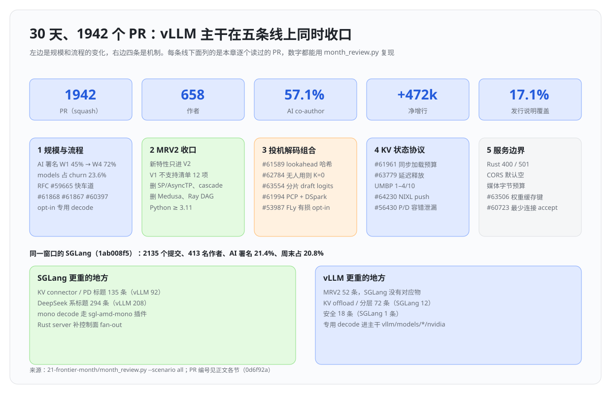

和前面各章的关系：VLLM-08 讲前缀缓存的块哈希，这里的 lookahead 哈希改的就是那套哈希的输入。VLLM-13 讲投机解码的 drafter 和拒绝采样，这里补它和前缀缓存、DBO、PCP、batch-sharded sampling 组合时的问题。VLLM-14、VLLM-15 讲 KV 卸载和 PD 分离，这里是它们一个月里的协议变化。VLLM-19 讲 RL 的 pause/abort，#60723 改的正是那条路径。VLLM-20 讲怎么提 PR，这里看的是一个月里 658 个作者提了什么。前面各章的源码基线也是 0d6f92a，行号可以直接对上。

# 第 1 章 · 问题：一个月 1942 个 PR，发行说明只覆盖了 17%

先把规模摆出来。窗口取 2026-09-29T09:46:03Z 到 2026-10-29T09:46:04Z，vLLM 截到主干 0d6f92a[[1]](https://github.com/vllm-project/vllm/commits/0d6f92a)，SGLang 截到 1ab008f5[[2]](https://github.com/sgl-project/sglang/commits/1ab008f5)。vLLM 主干是 squash merge，一个提交对应一个 PR，所以 1942 个提交就是 1942 个 PR。

```text
窗口 2026-09-29T09:46:03Z → 2026-10-29T09:46:04Z（30 天）
-- vLLM 0d6f92a
   提交 1942，带 PR 号 1942，作者 658，日均 64.7
   周末（作者本地时间）242，占 12.5%；revert 5
   最忙的三天（UTC）：10-27 102, 10-26 99, 10-08 91
   增删行 +601102 / -128748，净 +472354
-- SGLang 1ab008f5
   提交 2135，带 PR 号 2134，作者 413，日均 71.2
   周末（作者本地时间）444，占 20.8%；revert 5
   最忙的三天（UTC）：10-09 107, 10-20 97, 10-23 96
```

两个项目的提交数差不多，结构差得很远。vLLM 有 658 个作者，人均 2.95 个提交；SGLang 413 个作者，人均 5.17 个。vLLM 是长尾，大量作者一个月只合一两个 PR；SGLang 是核心团队高频提交。周末占比也印证了这一点：vLLM 周六周日加起来 242 个，占 12.5%，SGLang 是 444 个，占 20.8%。周末按作者本地时间算（git log 带时区），最忙的三天按 UTC 算，两个口径不一样，日期可能差一天。

```text
-- vLLM（作者本地时间的星期）
   Mon  294 #############################
   Tue  372 ####################################
   Wed  412 ########################################
   Thu  349 ##################################
   Fri  273 ###########################
   Sat  128 ############
   Sun  114 ###########
-- SGLang（作者本地时间的星期）
   Mon  258 ##########################
   Tue  354 ####################################
   Wed  393 ########################################
   Thu  362 #####################################
   Fri  324 #################################
   Sat  225 #######################
   Sun  219 ######################
```

更要留意的是 AI 署名。month_review.py 只数 commit message 里的 `Co-authored-by: Claude / Codex / Cursor / vllm-agent / Gemini / Copilot`，没署名的 AI 辅助数不到，所以这是下限。

```text
-- vLLM: 带 AI co-author 的提交 1109 / 1942 = 57.1%
   按周：W1 45%  W2 47%  W3 56%  W4 72%  W5 70%
-- SGLang: 带 AI co-author 的提交 457 / 2135 = 21.4%
   按周：W1 22%  W2 21%  W3 21%  W4 24%  W5 15%
   判定：commit message 里匹配 /co-authored-by: *(claude|codex|openai codex|cursor|vllm-agent|gemini|copilot)/i；只数署名，没署名的 AI 辅助数不到
```

vLLM 的比例按周从 45% 涨到 72%（W5 只有两天，70% 不能单独看），SGLang 一直在 21% 上下。vLLM 的署名构成里，Claude Opus 5.5 507 条、vllm-agent 307 条、Codex 129 条、Claude 128 条、OpenAI Codex 74 条、Cursor 55 条。vllm-agent 是项目自己的机器人账号。这个数字解释了第 2.1 节那份 RFC 为什么会出现：PR 的产出速度已经不受人手限制，评审变成了瓶颈。

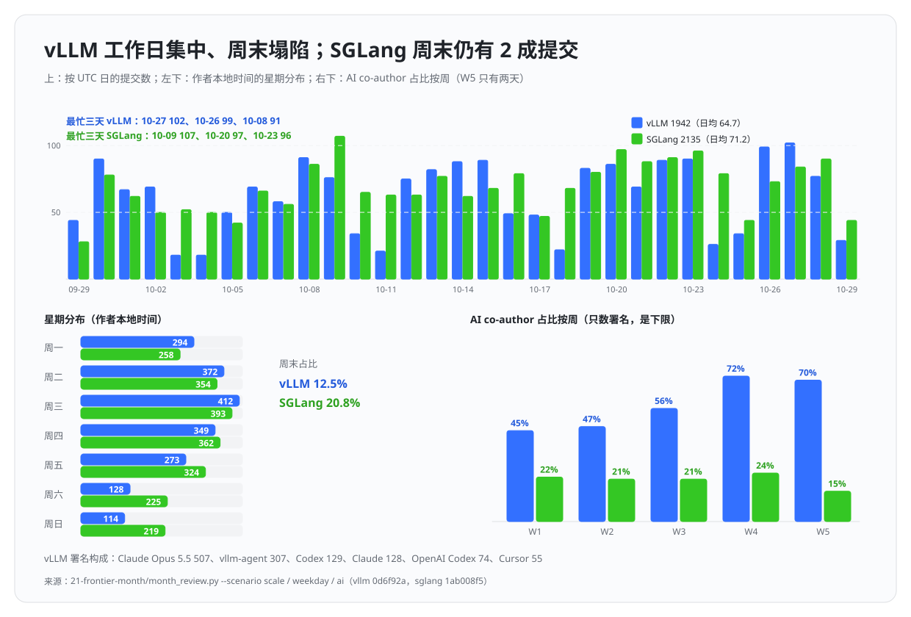

标签分布说明这个月的 PR 在忙什么：

```text
-- vLLM 标题标签 top 12
   [Bugfix] 646，[ROCm] 250，[CI] 231，[Perf] 184，[Frontend] 135，[Rust Frontend] 115，[Model] 88，[XPU] 64，[Spec Decode] 56，[KV Offload] 52，[Core] 52，[Doc] 50
-- SGLang 标题标签 top 12
   [Fix] 460，[Perf] 296，[AMD] 238，[diffusion] 169，[CI] 154，[Feat] 152，[Refactor] 122，[Doc] 81，[NPU] 74，[Test] 35，[PD] 35，[NVIDIA] 34
```

[Bugfix] 646 条，占 34.1%，SGLang 的 [Fix] 占 22.2%；[CI] 占 12.8%，SGLang 7.4%。vLLM 修 bug 和修 CI 的比例都更高，和作者长尾有关：很多外部作者的第一个 PR 就是一个小修复。[Rust Frontend] 一个月 115 条，是新出现的大标签；[KV Offload] 52 条、[Spec Decode] 56 条，和第 2 章的两条线对得上。两边标签体系不同，[Bugfix] 对 [Fix]、[ROCm] 对 [AMD]，比较时只能看比例。

问题在于这些 PR 有多少进了发行说明。v0.31.0 在 10-05 发布[[3]](https://github.com/vllm-project/vllm/releases/tag/v0.31.0)，v0.32.0 在 10-18 发布[[4]](https://github.com/vllm-project/vllm/releases/tag/v0.32.0)。把两份发行说明正文里引用的 PR 编号抽出来，和窗口内的 PR 对一下：

```text
-- v0.31.0（发布 2026-10-05）：正文引用 510 个 PR，亮点段 57 个，其中合并在窗口内 22 个
-- v0.32.0（发布 2026-10-18）：正文引用 330 个 PR，亮点段 49 个，其中合并在窗口内 311 个
-- 窗口内 1942 个 PR，两份发行说明合计覆盖 333 个（17.1%）
   合并于 2026-10-12 及以前：780 个，覆盖 323（41.4%）
   合并于 2026-10-12 以后：  1162 个，覆盖 10（0.9%）
   后半段只能读 git log 和 PR，v0.33.0 发行前没有编辑过的摘要
```

窗口内 1942 个 PR，两份发行说明合计提到 333 个，17.1%。按 10-12 切开，前面 780 个覆盖了 41.4%，后面 1162 个只覆盖了 10 个，0.9%。v0.32.0 的分支点在 10-12 前后，之后合进主干的东西要等 v0.33.0 才有摘要；v0.33.0rc1 已经打了 tag，但没有发布页。换句话说，这个月后 60% 的时间里合进来的东西，包括 #61589 lookahead 哈希、#61961 同步加载、#61868 GB300 专用 decode、#63506 权重缓存键，目前只能从 git log 和 PR 本身读到。即使是被覆盖的那部分，亮点段也只有 57 + 49 个 PR，opt-in 开关和弃用排期大多只写在 PR 描述里。

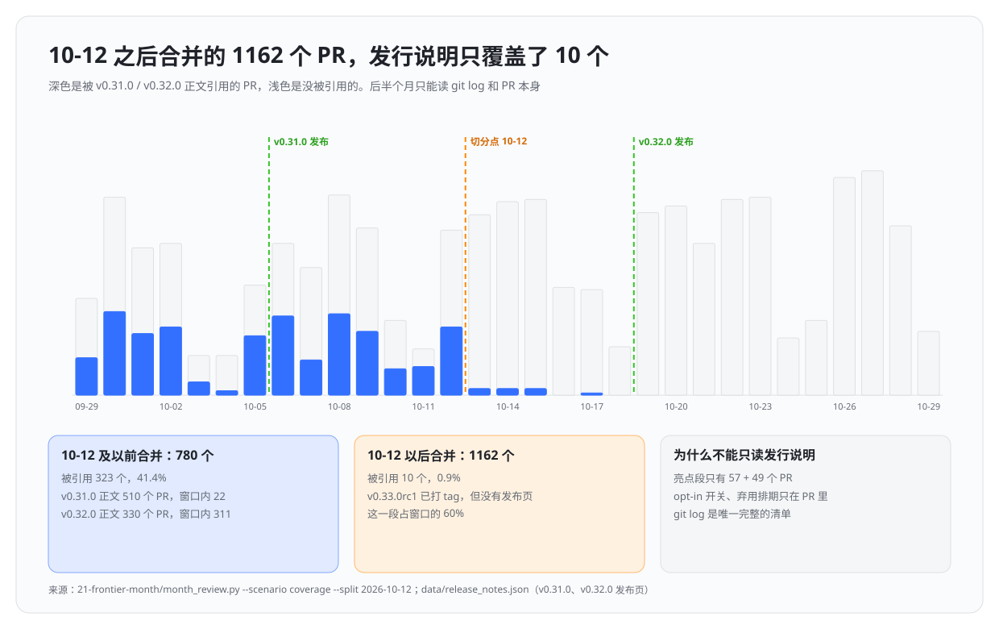

所以我们的读法是：先用标题正则把 1942 个 PR 归到主题桶，看每条线的体量；再在每个桶里挑改了默认行为、加了开关、删了东西的 PR，读 PR 描述和源码。主题桶按标题正则归类，一个 PR 可以落进几个桶，桶之间不能相加：

```text
主题桶按标题正则归类，一个 PR 可落入多个桶，不能相加
   主题                  vLLM  SGLang
   Rust 前端            123      64
   Model Runner V2     52       0
   投机解码               155     154
   KV offload / 分层     72      12
   KV connector / PD    92     135
   HiSparse            32      10
   DeepSeek 系         208     294
   ROCm / AMD         286     259
   安全                  18       1
   冷启动                 26       9
   RL / 权重更新           26       5
   删除 / 弃用             79      83
```

模型维度上，标题里出现最多的是 DeepSeek-V4.1（68 条）和 Kimi K3（56 条），MiniMax-M3 41 条、GLM-5.3 35 条、DeepSeek-V4 30 条、Qwen4 26 条。SGLang 那边 DeepSeek-V4 还有 127 条、V4.1 有 100 条，V4 仍在大量修；vLLM 的重心已经移到 4.1。

```text
-- vLLM 标题里的模型
   dsv4.1 68，dsv4 30，kimi-k3 56，glm5.3 35，minimax-m3 41，qwen4 26，step5 6
-- SGLang 标题里的模型
   dsv4.1 100，dsv4 127，kimi-k3 27，glm5.3 29，minimax-m3 18，qwen4 4，step5 1
```

# 第 2 章 · 原理：五条线上的关键合并

这一章按导读的五条线读 PR。每个 PR 只看三件事：改之前是什么行为，改之后是什么行为，作者自己量出来的数字和给出的代价。数字全部取自 PR 描述，硬件、batch 和并行度以原 PR 为准；凡是 PR 自己标了注意事项的，这里一并写出。

## 2.1 规模与流程：专用优化有了快车道，代价是重复代码

第 1 章的 AI 署名比例是这一节的背景。10 月提出的 RFC #59665[[5]](https://github.com/vllm-project/vllm/issues/59665) 标题就叫 Fast-Track Merging for Model Optimization PRs，动机段写得很直白：

> Frontier coding models have become extremely proficient at inference model optimization and efficient GPU kernel development. The frequency of new vLLM PRs is rapidly increasing, and is outpacing reviewer bandwidth.

RFC 给出的办法分两块。流程上，一类 PR 只要评审没有意见，一次批准就进入自动合并流程，CI 失败时自动 rebase 重试最多 3 次，仍失败就自动申请强制合并（1.1 One-Touch Merge）。特性的主维护者给自己的特性提小改动，可以不找第二个评审（1.2）。等评审超过 7 天的 PR 升级处理（1.3）。另配一份专用 PR 模板（1.4）。安全性上，第一条是隔离：改动只能落在“扁平模型”子目录里，RFC 举的例子就是 `vllm/models/deepseek_v41/nvidia`（2.1）。第二条是限定影响面，比如某个融合只在小输入时启用（2.2）。第三条是显式验证，所有模型优化都要跑 GSM8K 和 GPQA-Diamond，长上下文或改了 FMHA / SSM 的再加 MRCR v2 或 AIME。

RFC 没有回避代价。2.2 节原话是 “This may also increase code duplication and redundancy”，并且拿 TensorRT-LLM 的 PR #19056[[6]](https://github.com/NVIDIA/TensorRT-LLM/pull/19056) 作参照：那边按（模型、硬件、并行度）三元组各复制一份模型代码，比如 gpt-oss TP1 on SM103。RFC 说这是“相当极端的复制”，但也是 vLLM 可以往那边走的方向，前提是扁平模型目录的初步结果证明能维护。

这个月合进来的几个大 PR 正好是这套规矩的样板。#61868[[7]](https://github.com/vllm-project/vllm/pull/61868) 给 DeepSeek-V4.1-Flash 在 GB300 上加专用 decode，+9996 行，模型改动全部在 `vllm/models/deepseek_v41/nvidia/`。#61867[[8]](https://github.com/vllm-project/vllm/pull/61867) 是 Kimi K3 在 GB300 上的专用 decode，+12805 行，全部在 `vllm/models/kimi_k3/nvidia/`。#60397[[9]](https://github.com/vllm-project/vllm/pull/60397) 是 MI355X 上的 DSv4.1 mono decode，+9119 行。#63638[[10]](https://github.com/vllm-project/vllm/pull/63638) 是 Kimi K3 的 KV-balanced MLA 后端，+6553 / −0，PR 描述写明目录外只加了一行 `AttentionBackendEnum`。这四个 PR 的共同点是全部 opt-in，默认配置下行为和 main 完全一样。

```text
-- vLLM 按每个 PR 改动最大的目录归属的增删行 top 12
   vllm/models                    172591   23.6%
   tests/v1                        93990   12.9%
   vllm/model_executor             58710    8.0%
   rust/src                        58529    8.0%
   recipes/models                  52870    7.2%
   vllm/v1                         36158    5.0%
   tests/kernels                   25278    3.5%
   tests/entrypoints               20644    2.8%
   tests/models                    18603    2.5%
   vllm/distributed                18475    2.5%
   vllm/transformers_utils         11824    1.6%
   tests/model_executor            10411    1.4%
-- 新增行最多的 5 个 PR
   #61302 +44859/-6 [Doc] Host model recipes in recipes/ (#61302)
   #64111 +27012/-1941 [New Model] Add MiniMax-M3.1-Flash Model and Kernels (#64111)
   #61867 +12805/-3 [Perf] Kimi K3 Specialized Decode: CuTeDSL Optimized GB300 (1.5-2x) (#61867)
   #62622 +12799/-234 [Model][ROCm] Add Muse Spark Open support on ROCm (#62622)
   #61727 +12579/-65 Add Step-5 Preview support (#61727)
-- 净删除最多的 6 个 PR
   #60517 +32/-4797 [Compile] Remove torch.compile-based sequence parallelism and AsyncTP (#60517)
   #62186 +0/-3093 Revert "[Docs] Add train-inference consistency agent skill" (#61551) (#62186)
   #64287 +2/-2928 [Model] Remove Keye-VL and Keye-VL-1.5 (#64287)
   #60623 +719/-3268 [Chore] Remove vendored code made redundant by Transformers 5.16.1 (#60623)
   #60823 +514/-2688 [Chore] Port more vendored configs and processors to upstream Transformers (#608
   #57387 +365/-2384 [Model] Use upstream GLM-5.3 and Qwen4-Exp configs and processor (#57387)
```

churn 表要按口径读：month_review.py 把每个 PR 的增删行整笔记到它改动最多的目录上，是粗略的“代码重心”。`vllm/models` 占 23.6%，`recipes/models` 占 7.2%，后者几乎全来自 #61302[[11]](https://github.com/vllm-project/vllm/pull/61302) 一个 PR（+44859 行，把模型部署配方搬进主干的 recipes/ 目录）。`rust/src` 占 8.0%，对应 Rust 前端 123 个标题。净删除最多的几个 PR 里，#60623[[12]](https://github.com/vllm-project/vllm/pull/60623) 和 #60823[[13]](https://github.com/vllm-project/vllm/pull/60823) 把 vendored 的模型配置和处理器换回上游 Transformers，#57387[[14]](https://github.com/vllm-project/vllm/pull/57387) 对 GLM-5.3 和 Qwen4-Exp 做了同样的事。一边往 `vllm/models/*/nvidia` 里加专用代码，一边把通用的配置代码还给上游，这是同一个方向的两面：vLLM 自己只保留跑得快需要的部分。

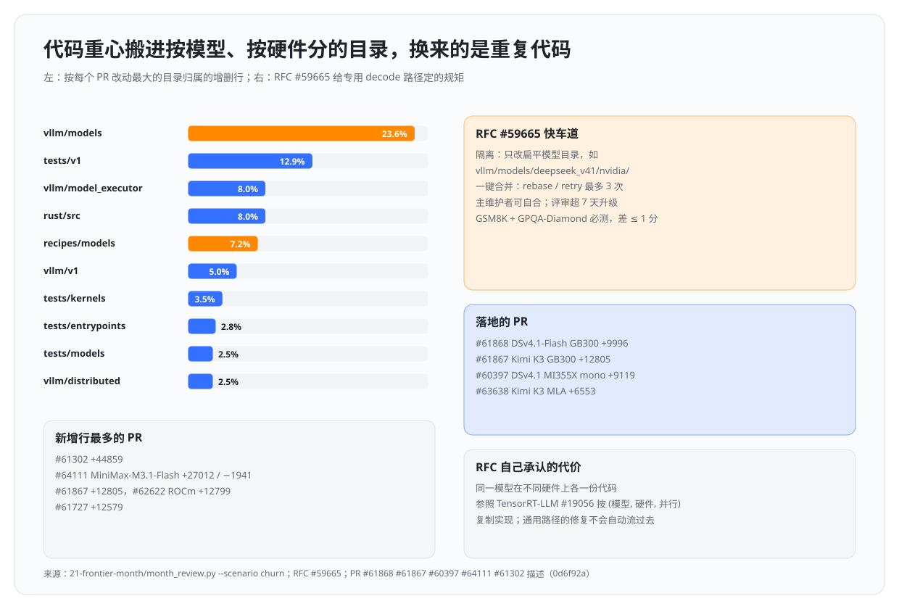

对部署方的影响很具体：同一个模型在 vLLM 里可能有三条 decode 路径，通用路径、NVIDIA 专用路径、AMD 专用路径。通用路径上的 bug 修复不会自动流进专用路径，反过来也一样。线上遇到只在某个硬件上出现的数值问题时，先确认请求走的是哪条路径，再去对应目录找代码。

## 2.2 Model Runner V2 收口：新特性只进 V2，旧路径成批删除

VLLM-09 讲过 Model Runner 和 CUDA Graph。MRV2 在 3 月的博客里第一次公开[[15]](https://vllm.ai/blog/2026-03-24-mrv2)[[16]](https://docs.vllm.ai/en/latest/design/model_runner_v2/)，到这个月它已经是默认，而且是唯一往前走的路径。判定逻辑在 [vllm.py 746 use_v2_model_runner](https://github.com/vllm-project/vllm/blob/0d6f92a/vllm/config/vllm.py#L746)，顺序是：

```python
# vllm/config/vllm.py 746（0d6f92a，节选）
if self.attention_config.hisparse_config is not None:
    if envs.VLLM_USE_V2_MODEL_RUNNER is False:
        raise ValueError("HiSparse requires Model Runner V2; remove VLLM_USE_V2_MODEL_RUNNER=0.")
    return True
if getattr(self, "watermark_config", None) is not None:
    ...  # 打 info，覆盖 =0
    return True
use_v2_model_runner = envs.VLLM_USE_V2_MODEL_RUNNER   # bool | None，默认 None
if use_v2_model_runner is not None:
    return use_v2_model_runner
if not HAS_TRITON and not current_platform.is_unspecified():
    return False                                      # warning 后用 V1
unsupported = self._get_v2_model_runner_unsupported_features()
if unsupported:
    return False                                      # "does not yet support ...; using the V1 model runner"
return True
```

关键在两张清单。[V2 不支持清单（3071）](https://github.com/vllm-project/vllm/blob/0d6f92a/vllm/config/vllm.py#L3071)只剩四类：PP 配 external_launcher、`suffix` / `custom_class` 投机方法、EAGLE 的 parallel drafting、异构词表 draft，外加 DBO 的若干组合。命中这张清单而 env 又没设时，vLLM 打 warning 回退 V1。[V1 不支持清单（3107）](https://github.com/vllm-project/vllm/blob/0d6f92a/vllm/config/vllm.py#L3107)长得多：prefill context parallel、PP 配 async scheduling（注释写着 “Since recently MRV1 has been deprecated … there was decided not to fix the issue but instead to disallow such configuration”）、dspark、xpress、adaptive draft verification、draft lm_head 量化、Parse 3.5 MTP、DFlash 混合滑窗和 candidate head、diffusion 模型、batch-sharded sampling、Step5。这张清单没有回退，校验在 2110 行附近的 `_validate_v1_model_runner()` 里直接报错。

两件事容易看漏。第一，回退只在 env 未设置时发生：显式设了 `VLLM_USE_V2_MODEL_RUNNER=1`，再命中 V2 清单里的项就直接报错，不会回退。第二，DBO 在 V2 上还要求显式设 env（3262 行 `_get_dbo_unsupported_features` 上方的 TODO 写着 under development），这是 #61464 放开 DBO + 投机解码之后仍然保留的门槛。新特性几乎全部加在 V1 清单里，这个方向从清单的长度就能看出来。

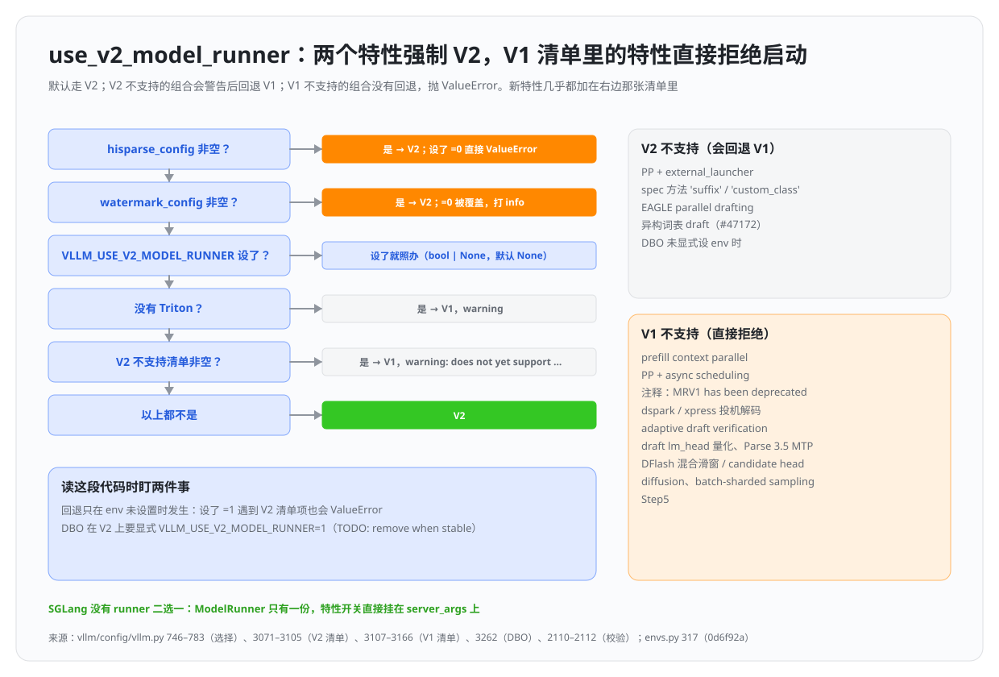

收口的另一半是删除。标题命中删除 / 弃用的 PR，vLLM 79 条、SGLang 83 条，体量差不多，删的东西性质不同。vLLM 这个月删的大多是 MRV2 不支持、继续维护又要在两个 runner 里各写一份的东西：

- #60517[[17]](https://github.com/vllm-project/vllm/pull/60517) 删掉基于 torch.compile 的 sequence parallelism 和 AsyncTP，−4797 行。理由两条：MRV2 不支持，项目在减少对 torch.compile 的依赖。模型代码里手写的 SP 不受影响。
- #61126[[18]](https://github.com/vllm-project/vllm/pull/61126) 删掉 cascade attention，−1764 行。PR 列了删除前的状态：默认就是关的，FlashInfer 上硬禁用，异步投机解码、DBO、batch invariance、CPU 上强制禁用，大多数后端不支持，但每步还要做一次调度扫描，还挂着 5 个未合并的修复。插件接口保留为弃用的空操作，[model.py 316](https://github.com/vllm-project/vllm/blob/0d6f92a/vllm/config/model.py#L316) 的 `disable_cascade_attn` 标成 Deprecated，v0.33.0 移除。
- #61701[[19]](https://github.com/vllm-project/vllm/pull/61701) 删掉 Medusa 和 MLP speculator，−885 行。MLP speculator 的注册项早就被注释掉了；Medusa 在 MRV2 上不支持，EAGLE / MTP / DFlash / DSpark 覆盖了它的场景。现在 `method="medusa"` 会在 SpeculativeConfig 校验时被拒。
- #61712[[20]](https://github.com/vllm-project/vllm/pull/61712) 删掉旧的 Ray compiled-graph 执行器，RayExecutorV2 早已是默认，三个 `VLLM_USE_RAY_COMPILED_DAG_*` 环境变量一起删；#62228[[21]](https://github.com/vllm-project/vllm/pull/62228) 随后删掉 `VLLM_USE_RAY_V2_EXECUTOR_BACKEND`。
- #60402[[22]](https://github.com/vllm-project/vllm/pull/60402) 去掉 Python 3.10，最低 3.11。#62575[[23]](https://github.com/vllm-project/vllm/pull/62575) 发布流水线不再出 CUDA 12.9 的 wheel。#59744[[24]](https://github.com/vllm-project/vllm/pull/59744) 删掉 Rust tool parser 的 PyO3 桥。
- 还在排期上的：#63423[[25]](https://github.com/vllm-project/vllm/pull/63423) 给 LM Format Enforcer 结构化输出后端加弃用警告，PR 提议 v0.33 警告、v0.34 显式 opt-in、v0.35 删除，本 PR 只做警告这一步，[structured_outputs.py 77](https://github.com/vllm-project/vllm/blob/0d6f92a/vllm/config/structured_outputs.py#L77)；#63371[[26]](https://github.com/vllm-project/vllm/pull/63371) 弃用 `ir_op_priority`。

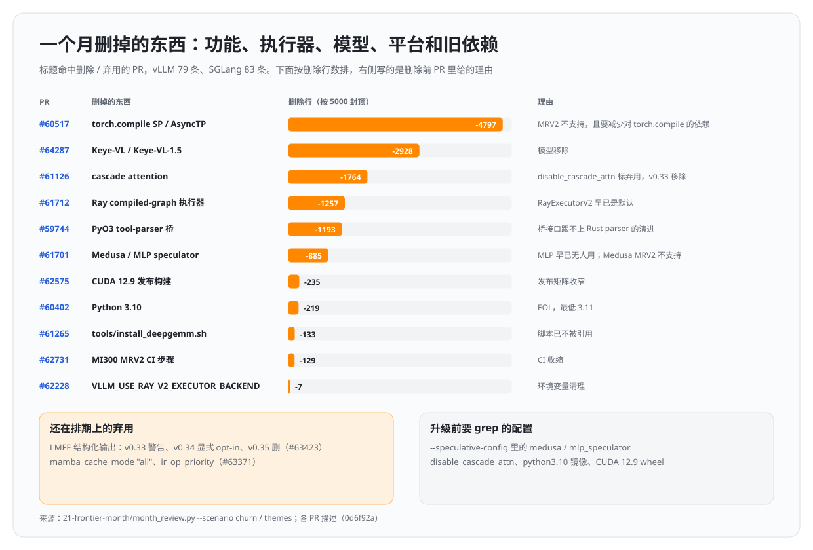

## 2.3 投机解码：补的是和别的特性一起开时的账

投机解码的标题这个月 vLLM 155 条，SGLang 154 条，体量持平。VLLM-13 讲过 EAGLE[[27]](https://arxiv.org/abs/2401.15077)、MTP 和拒绝采样的基本流程[[28]](https://docs.vllm.ai/en/latest/features/speculative_decoding/)，这里看的是组合：投机解码单独开没问题，和前缀缓存、纯 prefill、batch-sharded sampling、PCP、DBO 一起开时，各自有一笔账没算清。

### 和前缀缓存：EAGLE 每次命中少一个块

#61589[[29]](https://github.com/vllm-project/vllm/pull/61589) 是这个月改动最深的一个。EAGLE、EAGLE3 和 MTP 的 drafter 在某个位置生成 draft KV 时，要读这个位置的 hidden state 和下一个 token。一个块最后一个位置的 draft KV 于是依赖块外的那个 token：同一个块后面接不同的 token，draft KV 就不一样。main 的处理是每次前缀命中都丢掉最后一个命中块（block drop），代价是命中长度少一个块。PR 给的数字是混合注意力 + Mamba/GDN 模型上少命中 544–1600 个 token，这类模型的缓存单元比普通块大。

PR 的做法是把块后面那个 token 也算进块哈希。原来块哈希是 H(父哈希, 本块 token, 额外键)，现在额外键里多了 (lookahead 区间, 下一个 token)。只有 lookahead token 也相同时块才会被复用，命中读到的 draft KV 和冷启动算出来的一样，于是不再需要丢块。命中长度恢复到 floor((N−1)/B)·B，和不开投机解码时相同；k 个模块的多模块 MTP 是 floor((N−k)/B)·B。

```python
# vllm/config/vllm.py 693（0d6f92a）
@property
def num_hash_lookahead_tokens(self) -> int:
    """Tokens after each block that its hash covers; 0 keeps the legacy hashes."""
    speculative_config = self.speculative_config
    if (
        speculative_config is None
        or not speculative_config.use_eagle_block_drop()
        or speculative_config.disable_lookahead_block_hashes
        or not self.cache_config.enable_prefix_caching
    ):
        return 0
    # KV connectors, including HiSparse's, keep the legacy hashes.
    if self.kv_transfer_config is not None:
        return 0
    # The drafter's KV at a block's last position reads this far ahead.
    return self.num_prefill_lookahead_tokens
```

读这段代码时盯三处。`use_eagle_block_drop()` 只对 EAGLE / EAGLE3 / MTP 为真，[speculative.py 2205 needs_eagle_block_drop](https://github.com/vllm-project/vllm/blob/0d6f92a/vllm/config/speculative.py#L2205) 的注释说明，DFlash / DSpark 的 draft KV 只依赖目标模型的 hidden state，本来就不用丢块。配了任何 KV connector（包括 HiSparse 的）都保持旧哈希，connector 的支持在拆出来的第二个 PR 里。新开关 [disable_lookahead_block_hashes](https://github.com/vllm-project/vllm/blob/0d6f92a/vllm/config/speculative.py#L506) 恢复 main 的行为，docstring 特别提醒：共享同一个 KV store 的多个引擎，以及消费 KV 事件的外部系统，必须用同一个设置。原因是哈希变了，[kv_events.py 98](https://github.com/vllm-project/vllm/blob/0d6f92a/vllm/distributed/kv_events.py#L98) 的 `BlockStored` 事件也多了 `lookahead_token_ids` 字段，按旧哈希建索引的路由器会对不上。

代价是哈希计算。PR 量的是 32K 文本：块大小 16 时 +12.6%，128 时 +5.0%，1024 时 +0.5%；多模态在块大小 16 时 +13.1%。这些数字只量哈希本身的开销，没算端到端延迟。PR 跑了 1,256 个测试。

### 和纯 prefill 步：没人用得上的 draft 不再生成

#62784[[30]](https://github.com/vllm-project/vllm/pull/62784) 接着 #48244 做。一个调度步里，如果没有任何请求能用上这一步之后生成的 draft，比如全是非最后一块的 prefill chunk，或者是马上就要到 `max_tokens` 的请求，speculator 就用 K=0 跑。P/D 分离的 prefill 实例上 `max_tokens=1`，每一步都是这种情况。判定在调度器里做，DP 下要所有 rank 都满足才跳过（[dp_utils.py 44](https://github.com/vllm-project/vllm/blob/0d6f92a/vllm/v1/worker/gpu/dp_utils.py#L44)）。

收益不大，PR 自己也这么说：EAGLE / EAGLE3 / MTP 仍要跑 draft prefill 来保持 drafter 的 KV 同步，只省掉 draft 采样和 draft decode。Qwen3-8B、64 条 16,384 token 的 prompt、1 个输出 token、单张 GB300，`max_num_batched_tokens=512` 时 EAGLE3 +1.9%、DFlash +7.3%，2048 时 +1.4% 和 +2.7%；1P1D 的 prefill 实例上 512 时 +2.1% 和 +3.4%。propose() 的 host 时间从 1.41 ms 降到 0.98 ms。输出和接受率不变。

### 和 batch-sharded sampling、PCP、DBO

#63554[[31]](https://github.com/vllm-project/vllm/pull/63554)：batch-sharded sampling 下，请求按 `req_state_idx % tp_size` 分给各 rank 采样和校验，但 draft logits 缓存每个 rank 都按 `max_num_seqs` 行分配。PR 改成每个 rank 只存自己负责的请求，缓存从 `max_num_seqs` 行降到 `cdiv(max_num_seqs, tp_size)` 行，省下的显存给 KV。drafting 仍然在每个 rank 上重复做，没有新增集合通信。

#61994[[32]](https://github.com/vllm-project/vllm/pull/61994)：DeepSeek-V4.1-Flash 的 PCP 和 DSpark 一起开。PCP rank 0 生成 draft token，概率 drafting 时连同 logits 一起广播给其他 rank，再做目标校验；压缩器的环形尾部要跨 rank 保留，否则拒绝一段 draft 后回退不到正确位置。V4.1 PCP 仍然拒绝 adaptive verification。

#61464[[33]](https://github.com/vllm-project/vllm/pull/61464)：放开 V2 上 DBO 和投机解码、DCP 的组合（PCP 仍不行）。两个改动：draft prefill 要用整批的 attention metadata，微批化的步只按微批构建，所以有 speculator 时在 forward 之后再建一次整批的；校验批按请求边界切，不按中点切，否则请求数为奇数时会把一个请求切成两半，两个微批都不是均匀 decode，FULL graph 抓不住。[vllm.py 3240](https://github.com/vllm-project/vllm/blob/0d6f92a/vllm/config/vllm.py#L3240) 的 `_raise_dbo_thresholds_for_spec_decode` 会把 DBO 阈值自动抬到“微批数 × decode query 长度”，打一条 warning。

#63421[[34]](https://github.com/vllm-project/vllm/pull/63421)：adaptive verification 选 draft 预算的逻辑原来是 torch.compile 出来的，会触发 1.8–4.7 s 的重编译卡顿。换成 Triton kernel 后 host 时间从 76–90 µs 降到约 15 µs，GPU 时间从 85–100 µs 降到 22–30 µs；Qwen3-4B + DSpark 在 H200 上从 4,783 tok/s 到 6,803 tok/s。

### 两个新方法：FLy 有损，XPress 是 refiner

#53987[[35]](https://github.com/vllm-project/vllm/pull/53987) 加了 FLy[[36]](https://arxiv.org/abs/2511.22972)[[37]](https://github.com/vllm-project/vllm/blob/0d6f92a/docs/features/speculative_decoding/fly.md)。标准校验在第一个被拒的 draft token 处停下；FLy 在目标分布熵高、而且后面 W 个 draft token 都能通过原生校验时，接受这个孤立的拒绝。它不需要额外权重，也不多跑目标 forward，但不保持目标分布，PR 写得很清楚：“FLy does not preserve the target distribution and may reduce output quality; standard verification remains the default.” MRV2 上 4 个模型、6 个 batch，AMD MI355X 1.055–1.310x，NVIDIA B300 1.041–1.273x；相对目标模型的最低准确率保持 96.43%（AMD）和 96.30%（NVIDIA），都是 AIME25 上差一题，PR 也注明这只是单次测量，不构成质量保证。

#54448[[38]](https://github.com/vllm-project/vllm/pull/54448) 加了 XPress[[39]](https://arxiv.org/abs/2608.02438)：给 block diffusion 的 drafter（如 DFlash）加一个约 80M 参数的因果 refiner。DFlash 一次 forward 出整块 draft，每个位置按边缘分布独立解码，块内单个 token 看着合理、整体却不连贯，接受长度被限制住。XPress 读每个位置的 hidden state、块摘要和前一个 token，经过下三角的因果混合器输出对 logits 的偏置，用 Jacobi 迭代跑 K 轮，串行深度是常数 K。它挂在 `method="dflash"` 下面，靠 draft 架构识别（[is_xpress](https://github.com/vllm-project/vllm/blob/0d6f92a/vllm/config/speculative.py#L2214)），只有 V2 支持。

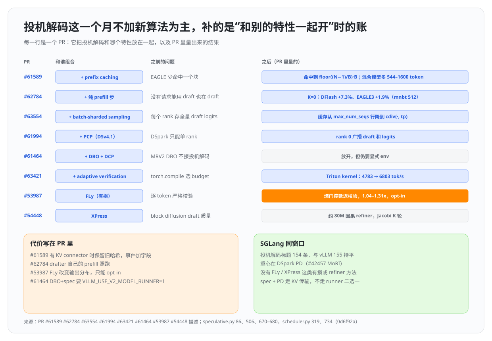

同一个月里还有几条修复也要记一下，它们都是组合的边角：#59468[[40]](https://github.com/vllm-project/vllm/pull/59468) 不再在调度器的 token 预算里给 DFlash / DSpark 预留 draft 槽位。#60945[[41]](https://github.com/vllm-project/vllm/pull/60945) 修 adaptive block verification 的 lookahead 越界。#58231[[42]](https://github.com/vllm-project/vllm/pull/58231) 修 thinking_token_budget 和投机解码一起开时，超大 logits 让 split top-p 把所有 token 都屏蔽、输出 token 0 的问题。用 month_review.py 的 `--grep` 可以把这类 PR 一次筛出来：

```text
8 条匹配 /lookahead|skip draft|sync_load|budget/
   2026-10-29 #63047 +69/-34 [Bugfix][DSv4.1] Budget prefill memory the startup profile misses (#63047)
   2026-10-26 #63421 +179/-20 [Spec Decode] Replace torch.compile'd AV draft-budget selection with a Triton kernel (#63421)
   2026-10-25 #61589 +986/-132 [Core][Spec Decode] Lookahead block hashes for EAGLE prefix caching (#61589)
   2026-10-22 #62784 +242/-3 [Spec Decode][MRV2] Skip drafting in steps where no request can use the drafts (#62784)
   2026-10-19 #58231 +37/-10 [Bugfix][Sampler] Fix split top-p masking every token for huge logits (thinking_token_budget + spec 
   2026-10-18 #62204 +58/-5 [Multimodal][Docs] State that retried media downloads count toward the request budget (#62204)
   2026-10-15 #59468 +73/-12 [Spec Decode] Don't reserve DFlash/DSpark draft slots in the scheduler token budget (#59468)
   2026-10-12 #60945 +3/-0 [Bugfix] Fix out-of-bounds lookahead in adaptive block verification (#60945)
```

## 2.4 KV 状态协议：谁拥有、何时释放、失败谁兜底

VLLM-14 讲过 OffloadingConnector 和分层卸载[[43]](https://vllm.ai/blog/2026-01-08-kv-offloading-connector)[[44]](https://vllm.ai/blog/2026-09-10-tiered-kv-offloading)，VLLM-15 讲过 NIXL 和 P/D。这个月 KV offload / 分层的标题 72 条（SGLang 12 条），KV connector / PD 92 条（SGLang 135 条）。从 GPU 块到 CPU tier，再到远端存储和 P/D 对端，每一段都有 PR 在补协议：原来靠“时序上碰巧不会出问题”的地方，变成了显式的预算、锁、事件和配置项。

### GPU ↔ CPU：小命中在当步加载

#61961[[45]](https://github.com/vllm-project/vllm/pull/61961) 的起因写在第一段：wide-EP 的 MoE prefill（比如 GLM-5.3）一步要 0.3–0.5 s，几乎每个请求都有一小段命中在 CPU tier 上。异步加载会让请求停大约 2 步才被调度，而拷贝本身只要约 1 ms。PR 加了一个 opt-in 选项 `sync_load_budget_bytes`，放在 `kv_connector_extra_config` 里，默认 0：预算内的小命中当步加载，worker 在 forward 之前等它们拷完，走单独的 expedited stream，不排在异步加载后面。预算按每 GPU 每步的 KV 字节算，因为整批都要等这次拷贝；会让请求没东西可算的命中仍走异步。文档表格这一行（[kv_offloading_usage.md 113](https://github.com/vllm-project/vllm/blob/0d6f92a/docs/features/kv_offloading_usage.md#L113)）：

> `sync_load_budget_bytes` | no | `0` | both | Per-step budget of KV bytes (per GPU) loaded within the same step, so those requests run immediately instead of waiting a step for an async load. Hits that don't fit the remaining budget, or would leave nothing to compute, stay async. `0` disables.

数字要带着 PR 自己的注意事项读。Qwen3-30B-A3B、H100，12k token 前缀在 GPU、2k token 尾巴只在 CPU tier，相对 GPU 全命中的额外 TTFT 中位数：单机 DP=2 + EP 从 +219 ms 到 +1 ms，两机 TP=8、DP=2、16 卡 EP 从 +344 ms 到 +8 ms。但 PR 写明这组数是用早先的按请求 token 上限（`sync_load_max_tokens=4096`）和共享加载流量的，现在的按步字节预算和独立 stream 还没有端到端跑过。GLM-5.3 一个 prefill 组（4×8 H100，wide EP）上，带 CPU 命中的请求延迟从约 1.9 s 降到约 0.85 s。实现在 [offloading/scheduler.py 169、324、1338](https://github.com/vllm-project/vllm/blob/0d6f92a/vllm/distributed/kv_transfer/kv_connector/v1/offloading/scheduler.py#L169)。

### CPU tier 和二级 tier：可拒绝的晋升、锁和控制面线程

#63779[[46]](https://github.com/vllm-project/vllm/pull/63779) 让二级 tier 可以当场让一次晋升失败，但对应主 tier chunk 的释放要往后推，等 tier 确认自己的 I/O 不会再写这些 chunk 之后才放：`JobResult(success=False, deferred_release=event)`，失败的 key 立即 miss、请求重算，chunk 等 tier 置位 `threading.Event` 后才回空闲池（[tiering/base.py 105](https://github.com/vllm-project/vllm/blob/0d6f92a/vllm/v1/kv_offload/tiering/base.py#L105)）。字段默认 None，fs、obj、kvcr 和树外 tier 都不受影响；新增两个指标 `vllm:kv_offload_tiering_deferred_release_chunks` 和 `_hold_seconds`。这里补的是一个经典的 use-after-free：请求已经放弃了，DMA 还在往那块内存写。

#58168[[47]](https://github.com/vllm-project/vllm/pull/58168) 把 `OffloadingManager.lock() / unlock()` 公开出来。PR 的论证是：`prepare_load()` 假设它的 key 已经被 `lookup()` 确认在 tier 里，调用方必须能把两次调用放在同一把锁里，方法内部各自加锁做不到这一点。第一个用户是 p2p tier：它要回应远端对等实例的查询，原来控制面只在 `on_schedule_end` 推进，对端的一次查询要等到模型步边界，饱和的 rank 上就是几秒；现在 tier 可以声明 `needs_control_plane_thread`，在调度线程之外推进。

UMBP 是 AMD MORI 的多级存储方案，RFC #57187[[48]](https://github.com/vllm-project/vllm/issues/57187) 计划拆成 10 个 PR，这个月合了前 4 个：#61789[[49]](https://github.com/vllm-project/vllm/pull/61789) 共享 connector、运行时契约和请求生命周期，#61790[[50]](https://github.com/vllm-project/vllm/pull/61790) 契约测试，#61791[[51]](https://github.com/vllm-project/vllm/pull/61791) 共享查找、传输、混合缓存和可观测性，#61792[[52]](https://github.com/vllm-project/vllm/pull/61792) 异步查找、事件和指标的测试。10 个里有两个是纯测试 PR，先把契约钉住再接实现。

### P/D 对端：显式 transfer_mode，失败时先收齐再抛

#64230[[53]](https://github.com/vllm-project/vllm/pull/64230) 很小，+34 行。Dynamo 这类框架只认 `NixlConnector` 这个名字，原来要用 push 模式只能写一个别名模块。现在 `kv_connector_extra_config` 里写 `"transfer_mode": "push"` 就解析成 `NixlPushConnector`，不写或写 pull 不变，其他值直接报错，不会静默回退到 pull：

```python
# vllm/distributed/kv_transfer/kv_connector/factory.py 126（0d6f92a）
if connector_name == "NixlConnector":
    mode = kv_transfer_config.get_from_extra_config("transfer_mode", "pull")
    if mode not in ("pull", "push"):
        raise ValueError(f"Invalid NixlConnector transfer_mode: {mode!r}")
    connector_name = f"Nixl{mode.capitalize()}Connector"
```

#56430[[54]](https://github.com/vllm-project/vllm/pull/56430) 把容错框架扩展到 P/D。原来 `_model_forward` 抛异常时，`kv_connector_output` 被丢掉，正在传输的 `finished_sending / finished_recving / invalid_block_ids` 一起丢失，retry 恢复后调度器的传输记账和 connector 实际状态对不上，请求挂住或者 KV 块泄漏；executor 的 `get_response` 遇到第一个 FAILURE 就抛，其他 worker 的响应留在队列里，被下一次 RPC 读走。PR 先把失败 worker 的 KV 输出取出来随异常一起带回，再把所有 worker 的响应收齐才抛。

### HiSparse：自己管驻留，不再改核心块表

HiSparse 这个月 32 条标题。#60647[[55]](https://github.com/vllm-project/vllm/pull/60647) 是结构性的：原来 HiSparse 在块表行发出去之后再修改它（接管主机前缀页的 GPU 副本、把被池子复用的页置空），改动通过 `block_table_updates` 传给 worker，#60109 就是一个新请求的行在一步里到了两次。改完之后 HiSparse 自己维护一张持久的设备表，worker 看到的核心块表只会增长。#60083[[56]](https://github.com/vllm-project/vllm/pull/60083) 把调度器侧每步 O(请求 × 上下文页 × 层) 的 Python 扫描换成按请求缓存；#61263[[57]](https://github.com/vllm-project/vllm/pull/61263) 在 top-k 2048 时扩大哈希表减少探测链，GLM-5.2-NVFP4 在 4×H200 上吞吐 +2.45%，代价是每个 block 的共享内存从 26,148 字节涨到 75,300 字节。

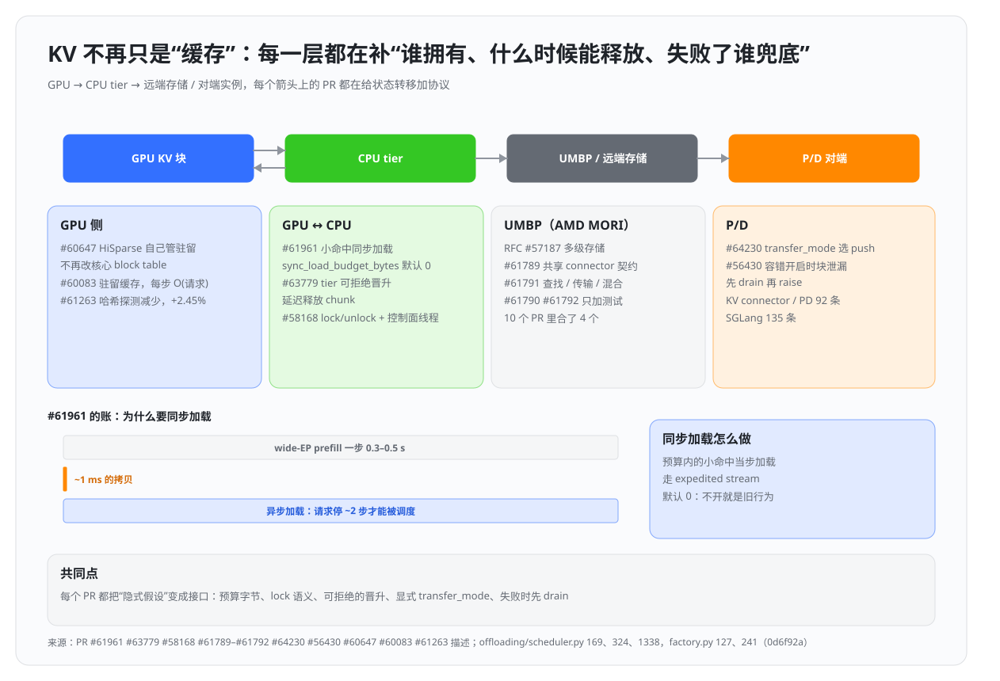

## 2.5 服务边界：从“尽量接住”改成“接不住就明说”

这一组 PR 分散在 Rust 前端、安全、Fast Start 和 RL 控制面四个地方，方向一致：原来静默降级、静默丢弃、静默放行的地方，改成显式的错误码、显式的开关或显式的预算。升级后“突然报错”的地方大多在这里。

**Rust 前端。**这个月 123 条标题，大头是语法和解析器（#59005、#59143、#60781 各 4000 行以上）。和行为相关的是三个小 PR。#62432[[58]](https://github.com/vllm-project/vllm/pull/62432)：Python API server 有、Rust 前端没实现的路由（`/v1/messages`、`/v1/chat/completions/batch`、`/scale_elastic_ep` 等），原来落到 axum 默认的 404，客户端分不清是没实现还是 URL 写错了；现在返回 501，消息里写明怎么切回 Python 前端（[routes.rs 72](https://github.com/vllm-project/vllm/blob/0d6f92a/rust/src/server/src/routes.rs#L72)）：

```rust
// rust/src/server/src/routes.rs 72（0d6f92a，节选）
async fn not_supported(method: Method, path: MatchedPath) -> (StatusCode, Json<ErrorResponse>) {
    (StatusCode::NOT_IMPLEMENTED, Json(ErrorResponse { error: ErrorDetail {
        message: format!("{method} {} is not supported by the Rust frontend yet. \
                          Set VLLM_USE_RUST_FRONTEND=0 to use the Python frontend.", path.as_str()),
        error_type: "NotImplementedError".to_string(), param: None, code: 501 } }))
}
```

#62434[[59]](https://github.com/vllm-project/vllm/pull/62434)：Python 前端认、Rust 前端静默丢掉的请求字段（chat 和 tokenize 靠 serde 默认值忽略未知键，completions 和 generate 把它们收进一个没人用的 map），客户端设了这些字段拿到的是 200 和忽略了字段的输出。现在每个字段都在 Rust DTO 里声明，非默认值返回 400；缺省、null 和 Python 的默认值照样通过，发默认值的 SDK 不受影响。#60922[[60]](https://github.com/vllm-project/vllm/pull/60922)：gRPC 的生成流原来由一个后台 producer task 驱动，客户端断开后 task 继续生成；现在响应体直接持有生成流，断开就触发已有的自动 abort。Rust 前端默认仍是关的（[envs.py 168](https://github.com/vllm-project/vllm/blob/0d6f92a/vllm/envs.py#L168) `VLLM_USE_RUST_FRONTEND` 默认 False）。

**安全默认值。**#61009[[61]](https://github.com/vllm-project/vllm/pull/61009) 收紧 CORS：原来默认 `allowed_origins=["*"]`，任何网站都能读一个浏览器可达的 vLLM 服务的响应；现在默认空列表，Python 和 Rust 前端同时改（[cli_args.py 329](https://github.com/vllm-project/vllm/blob/0d6f92a/vllm/entrypoints/common/cli_args.py#L329)，docstring：“Cross-origin browser access is disabled by default.”）。#61226[[62]](https://github.com/vllm-project/vllm/pull/61226) 给单个多模态请求加了两份预算：所有图片、音频、视频帧解码后的总字节（`VLLM_MAX_MEDIA_REQUEST_DECODE_BYTES`，默认 715,827,880），和所有媒体 URL 流式下载的总字节（`VLLM_MAX_MEDIA_REQUEST_DOWNLOAD_SIZE_MB`，默认 256），原来只有单个响应的上限（[envs.py 78、87](https://github.com/vllm-project/vllm/blob/0d6f92a/vllm/envs.py#L78)）。PR 写明这个补丁先在私有安全分支评审过。安全类标题 vLLM 18 条，SGLang 1 条（SGLang #36854[[63]](https://github.com/sgl-project/sglang/pull/36854)，diffusion 的 ZMQ 入口在通配 host 下绑回环）。

**Fast Start 权重缓存。**#63506[[64]](https://github.com/vllm-project/vllm/pull/63506) 是 Fast Start 路线图 #56049[[65]](https://github.com/vllm-project/vllm/issues/56049) 里缓存键审计的一部分。`process_weights_after_loading` 会把权重转成所选 kernel 后端的布局，给一个后端处理过的权重对另一个后端是错的，但 `WeightCacheKey` 原来不含后端。PR 描述的事故形态很典型：daemon 用 `--moe-backend flashinfer_cutlass` 写缓存，权重是 CUTLASS 布局。引擎用 auto，在 B300 上解析成 `FLASHINFER_TRTLLM`。引擎映射了 CUTLASS 布局的权重，`/health` 返回 200，每个补全都是乱码，没有任何报错。现在键里加了 `moe_backend`、`linear_backend` 和 `linear_backend_per_quant`（[weight_cache/protocol.py](https://github.com/vllm-project/vllm/blob/0d6f92a/vllm/model_executor/model_loader/weight_cache/protocol.py#L306)），后端不一致在映射任何张量之前就报键不匹配，`fallback=true`（默认）时从磁盘加载。PR 也承认键里放的是配置值，没用解析后的值：两个都写 auto、但因为环境变量不同解析成不同后端的情况，仍然抓不到。同一路线图上 #63088[[66]](https://github.com/vllm-project/vllm/pull/63088) 加了 daemon 之间的 warmup 缓存预热。

**多 API worker 的连接分配。**#60723[[67]](https://github.com/vllm-project/vllm/pull/60723) 属于 RFC #57479[[68]](https://github.com/vllm-project/vllm/issues/57479)。`--api-server-count N > 1` 时，原来一个 worker 经常吃掉一整批突发连接；现在每个新连接分给打开连接最少的 worker。VLLM-19 讲过的 RL `pause(mode="abort")`，在 GB200、DP2、8 个 API server 上，从 abort 到收齐所有响应体，从 40.0 s 降到 21.5 s；Qwen3-0.6B 输出长度 1 的短请求吞吐 +43–85% req/s，原因是 main 上客户端的 keep-alive 连接池落在少数几个 worker 上。单 API server 不变，没有新参数。

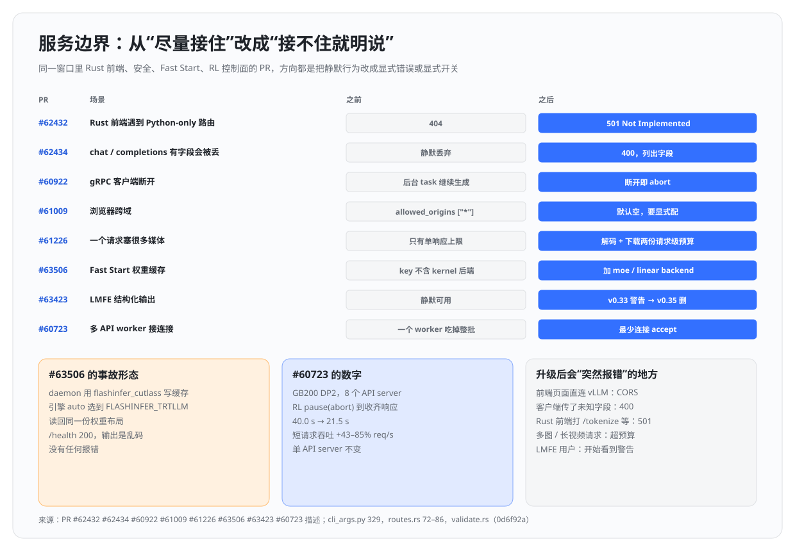

## 2.6 专用 kernel 与端到端：倍数在哪里被稀释

2.1 节说的快车道 PR，每一个都给了两组数：kernel 或 decode step 上的倍数，和整机吞吐、交互指标上的百分比。两组数之间差得很远，而且都有严格的启用条件。读这类 PR 时先找三样东西：opt-in 开关、启用条件、端到端口径。

### DSv4.1-Flash on GB300：十条前置条件

#61868[[7]](https://github.com/vllm-project/vllm/pull/61868) 用和 #61867 相同的开关：`--additional-config '{"decode_backend": "latency_specialized"}'`，默认 auto 时和 main 完全一样。它只接管 FULL graph 的 decode 步，最多 384 行（64 个请求 × 6 个 token，对应 DSpark 5 个 draft），prefill、混合批和更大的批都回到通用 forward。前置条件写在 [specialized_decode/\_\_init\_\_.py 77–130](https://github.com/vllm-project/vllm/blob/0d6f92a/vllm/models/deepseek_v41/nvidia/specialized_decode/__init__.py#L77) 的 `unsupported()` 里，一条不满足就在启动时报 “decode_backend=latency_specialized needs …”：

- GB300（SM103）GPU，Model Runner V2；
- TP=4，不开 PP、DP、EP、CP，不开微批；
- DSpark 投机解码，不开 adaptive verification；
- `FLASHINFER_MLA_SPARSE_DSV41` 注意力后端、fp8 KV cache、MXFP4 indexer 加 sparse logits；
- 只对 decode 批用 FULL CUDA graph（`FULL_AND_PIECEWISE` 或 `FULL_DECODE_ONLY`），模型不走 torch.compile；
- 不开 sleep mode、LoRA、KV transfer、batch invariance；
- DeepGEMM 和 NVLink multicast（融合 all-reduce + mHC 要用）。

还有一个细节：`specialized_decode_config()`（133 行）会在 TP 组的 CPU group 上对“能不能开”做一次 MIN all-reduce，注释写的是 “ranks that disagree would hang”。一个 rank 开了专用路径、另一个没开，集合通信就会卡死，所以宁可全体退回。

收益：B1 时 decode step 从 5,355 µs 到 4,375 µs（−18.3%），B8 时 −13.7%，B32 时 −11.3%；端到端 P90 交互性 +16–24%，每 GPU 吞吐 +1–6%，TTFT 不变。质量对照：GSM8K 0.973 / 0.974，GPQA 0.796 / 0.788，AIME25 0.994 / 0.990，接受长度 3.93。部署配方 [[69]](https://github.com/vllm-project/vllm/blob/0d6f92a/recipes/models/deepseek-ai/DeepSeek-V4.1-Flash.yaml) 里有一条对应的 lane（685–715 行）：b300、Rust 前端、TP4，参数 `--additional-config '{"decode_backend":"latency_specialized"}'`，环境 `VLLM_USE_V2_MODEL_RUNNER=1`，speculative-config 里把 `enable_adaptive_verification` 改成 false。

### MI355X mono decode：每层两次持久 launch

#60397[[9]](https://github.com/vllm-project/vllm/pull/60397) 在 MI355X 上把 DeepSeek-V4.1-Flash decode 的每个骨干层压成两次持久 FlyDSL launch：K1 做注意力前半（wqkv、q/kv norm、KV 写入、wq_b），K2 做注意力后半、TP all-reduce、FFN 和 MoE（router、top-6、共享专家、MXFP4 专家），all-reduce 在 kernel 内通过对称的对端内存完成。原 PR 用环境变量 `VLLM_ROCM_MONO_DECODE=1` 开启；#61082[[70]](https://github.com/vllm-project/vllm/pull/61082) 把它扩展到全部骨干层，并换成了命令行参数 `--monokernel`（[kernel.py 302](https://github.com/vllm-project/vllm/blob/0d6f92a/vllm/config/kernel.py#L302)）：

> If True, run the eligible layers of decode steps on the model's MonoKernel: a persistent kernel that runs most or all of one decoder layer in a single launch (DeepSeek-V4.1 on MI355X, DeepSeek-V4-Pro at TP8 on MI355X). A deployment that cannot run it is refused at startup.

配方里的注释把适用范围说得很清楚：40 个骨干层每层两次持久 launch，只用于最多 48 行的 decode 步，也就是并发 8、每个请求 5 个 DSpark draft 以内；更大的步走普通路径，所以并发越高收益越小。#60731[[71]](https://github.com/vllm-project/vllm/pull/60731) 把 mono decode 带到 MI300X / MI325X（gfx942），TP4，最多 42 行；#61482[[72]](https://github.com/vllm-project/vllm/pull/61482) 给 DeepSeek-V4-Pro 在 MI355X 上加了独立的 mono decode 层。PR 给的数字是每层 kernel 1.10–2.18x，同一批请求 decode 只多 7–9%。PR 注明实现源自 ATOM（MIT 许可）。

### Kimi K3 和 GLM-5.3

#61867[[8]](https://github.com/vllm-project/vllm/pull/61867) 是这组里端到端倍数最大的：Kimi K3 在 GB300 上，TP16、不开投机，B1–B8 时 decode step 1.79–1.92x（B1 时 3.90 ms 对 7.38 ms）。DSpark DL7 时 decode tok/s 1.53–1.71x。ISL 32k 开 DCP 时 TP8 1.36–1.50x、TP16 1.53–1.75x。它能保住倍数是因为只覆盖小 batch（不开投机到 B64，DL7 到 B8），在这个范围里 decode step 几乎就是全部。#63638[[10]](https://github.com/vllm-project/vllm/pull/63638) 是 Kimi K3 的 KV-balanced MLA 后端，按每个请求自己的长度切 KV，适合同一批里上下文长度差很多的 agentic 负载：decode attention 比调好的 TOKENSPEED_MLA 快 1.34–1.59x，端到端 DEP16 每 GPU TPS +7.8%、p90 交互 +20%；只在显式 `--attention-backend KIMI_K3_KV_BALANCED_MLA` 时启用。

#60140[[73]](https://github.com/vllm-project/vllm/pull/60140) 是另一种形态：不加 kernel，改默认值。GLM-5.3（`GlmMoeDsaForCausalLM`）在 cache_dtype 为 auto、CUDA、SM10x 家族时默认用 fp8_e4m3 KV（[models/config.py 113–125](https://github.com/vllm-project/vllm/blob/0d6f92a/vllm/model_executor/models/config.py#L113)，日志 “Using fp8 kv-cache for GlmMoeDsaForCausalLM on SM10x”），#60281[[74]](https://github.com/vllm-project/vllm/pull/60281) 随后把它限定在 SM100，#63841[[75]](https://github.com/vllm-project/vllm/pull/63841) 把同样的默认值带到 dspark draft 上，每 rank 省 5.38 GB。PR 给的数：KV 从 40.13 GiB 降到 20.69 GiB，吞吐 +4.2% / +5.5% / +2.3%（并发 1 / 4 / 16），TTFT 却 +11.1% / +10.1% / +6.9%，GSM8K 0.9212 对 0.9189。容量翻倍，TTFT 变差，这两件事要一起看。

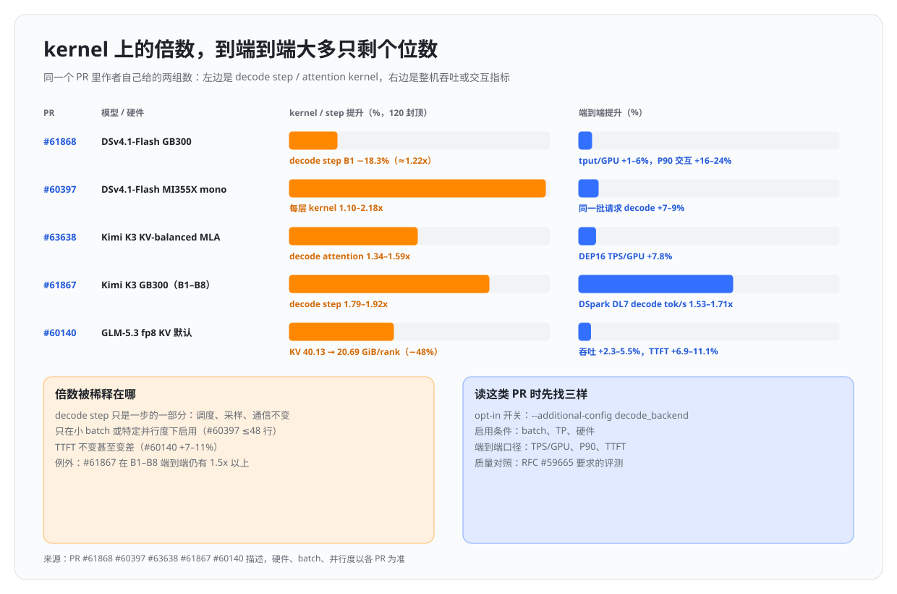

倍数被稀释的原因并不神秘：decode step 只是一步的一部分，调度、采样、通信、前端都不变。专用路径只在小 batch 或特定并行度下生效，超出范围就回到通用路径。有的优化（fp8 KV）用 TTFT 换容量。读到“2x”时，先找同一个 PR 里的端到端那一行。

## 2.7 SGLang 怎么做

同一个窗口，SGLang[[76]](https://github.com/sgl-project/sglang) 截到 1ab008f5，2135 个提交、413 名作者。两个项目把力气花在了不同的地方：

```text
指标                  vLLM    SGLang
   提交                1942      2135
   作者                 658       413
   人均提交              2.95      5.17
   周末占比 %            12.5      20.8
   AI 署名占比 %         57.1      21.4
   修复类标签 %           34.1      22.2
   CI 标签 %           12.8       7.4
```

**缓存层级。**vLLM 的 KV offload / 分层标题 72 条，SGLang 只有 12 条，但这是主题正则的口径问题：SGLang 的分层缓存叫 HiCache，标题里带 hicache 的有 87 条，正则没有为它单设桶。这个月 SGLang 在 HiCache 上做的是把页式统一缓存接到端到端（SGLang #39728[[77]](https://github.com/sgl-project/sglang/pull/39728)）、让 MLA DCP 也能用 L3（file / mooncake）（SGLang #41187[[78]](https://github.com/sgl-project/sglang/pull/41187)），以及在 Rust server 上加 HiCache 存储管理接口（SGLang #44726[[79]](https://github.com/sgl-project/sglang/pull/44726)）。vLLM 这边是 OffloadingConnector 加 TieringOffloadingSpec 加各种二级 tier，接口是 connector；SGLang 是 radix cache 往下长出 L2 / L3，接口是缓存层级本身。

**PD。**SGLang 的 KV connector / PD 标题 135 条，比 vLLM 的 92 条多。方向和 vLLM 一样是把阻塞从调度线程上拿掉：SGLang #45492[[80]](https://github.com/sgl-project/sglang/pull/45492) prefill 发 KV chunk 不再在调度线程上做 host 同步，SGLang #46689[[81]](https://github.com/sgl-project/sglang/pull/46689) decode 侧恢复主机收到的 KV 不阻塞调度器，SGLang #46423[[82]](https://github.com/sgl-project/sglang/pull/46423) 在 decode 侧 radix cache 下校验 KV checksum。vLLM 的 #58168 把 tier 控制面挪出调度线程，是同一类问题。

**Rust 前端。**两边都在做，侧重点不同。vLLM 这个月补的是“和 Python 前端行为对齐”：400、501、断开即 abort。SGLang 的 rust-server 在补控制面：控制请求 fan-out 到每个 DP rank（SGLang #46181[[83]](https://github.com/sgl-project/sglang/pull/46181)）、Rust 前端直接处理 `/abort_request`（SGLang #45888[[84]](https://github.com/sgl-project/sglang/pull/45888)）、多模态处理器拒绝的媒体返回 400（SGLang #47109[[85]](https://github.com/sgl-project/sglang/pull/47109)）。

**专用 kernel 放在哪里。**这是两边差别最大的地方。vLLM 把 mono decode 和专用 decode 合进主干的 `vllm/models/*/amd`、`vllm/models/*/nvidia`；SGLang 把 AMD monokernel 做成插件 sgl-amd-mono，装进 ROCm 镜像（SGLang #44621[[86]](https://github.com/sgl-project/sglang/pull/44621)），主干里只按模型类型注册规格（SGLang #46036[[87]](https://github.com/sgl-project/sglang/pull/46036)），NVIDIA 侧也是 megakernel 插件加绑定（SGLang #45266[[88]](https://github.com/sgl-project/sglang/pull/45266)）。vLLM 的方式让 CI 能直接测到专用路径，代价是主干代码量和 2.1 节说的重复；SGLang 的方式主干干净，但插件版本和主干版本要自己对齐。DeepSeek-V4.1 上 SGLang 这个月接了 DeepGEMM MegaGate 路由（SGLang #43262[[89]](https://github.com/sgl-project/sglang/pull/43262)）、FlashMLA MegaAttention 配 NVFP4 KV（SGLang #43922[[90]](https://github.com/sgl-project/sglang/pull/43922)）、用 `--engram-config` 选 Engram 表放在哪（SGLang #46893[[91]](https://github.com/sgl-project/sglang/pull/46893)）、MoRI 支持 DSpark PD（SGLang #42457[[92]](https://github.com/sgl-project/sglang/pull/42457)）。这些和 DeepSeek 开源组件的关系留到 VLLM-22 展开。

**没有对应物的地方。**Model Runner V2 52 条，SGLang 是 0：SGLang 只有一个 ModelRunner，特性开关直接挂在 server_args 上，没有“两个 runner 二选一”的问题，也就没有 2.2 节那两张清单。反过来，SGLang 的 diffusion 标签 169 条，vLLM 没有同等体量的方向。

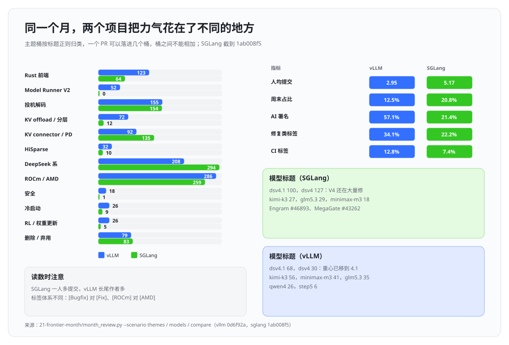

# 第 3 章 · 源码：这个月该读的二十几个位置

第 2 章引用的判定逻辑都在下面这张表里，行号以 0d6f92a 为准。表里只放“行为在这里分叉”的位置：开关读进来的地方、清单定义的地方、报错抛出的地方。读的时候先找开关的默认值，再找它在哪里被消费，最后找不满足条件时走哪条路。

| 位置 | 是什么 | 读的时候盯什么 |
|-|-|-|
| [vllm.py 746](https://github.com/vllm-project/vllm/blob/0d6f92a/vllm/config/vllm.py#L746) | `use_v2_model_runner`：HiSparse、watermark、env、Triton、V2 不支持清单，五步判定 | env 显式设置时直接返回，不看清单 |
| [vllm.py 3071](https://github.com/vllm-project/vllm/blob/0d6f92a/vllm/config/vllm.py#L3071) | V2 不支持清单 | 命中且 env 未设时回退 V1，打 warning |
| [vllm.py 3107](https://github.com/vllm-project/vllm/blob/0d6f92a/vllm/config/vllm.py#L3107) | V1 不支持清单 | 没有回退，2112 行调 `_validate_v1_model_runner()` 直接报错 |
| [vllm.py 693](https://github.com/vllm-project/vllm/blob/0d6f92a/vllm/config/vllm.py#L693) | `num_hash_lookahead_tokens` | 返回 0 的四种情况；有 KV connector 时保持旧哈希 |
| [vllm.py 3240](https://github.com/vllm-project/vllm/blob/0d6f92a/vllm/config/vllm.py#L3240) | `_raise_dbo_thresholds_for_spec_decode` | DBO 阈值被自动抬高时只有一条 warning |
| [speculative.py 506](https://github.com/vllm-project/vllm/blob/0d6f92a/vllm/config/speculative.py#L506) | `disable_lookahead_block_hashes` | 共享 KV store 和消费 KV 事件的系统要用同一设置 |
| [speculative.py 2205](https://github.com/vllm-project/vllm/blob/0d6f92a/vllm/config/speculative.py#L2205) | `needs_eagle_block_drop` | 只有 EAGLE / EAGLE3 / MTP 需要丢块 |
| [speculative.py 2214](https://github.com/vllm-project/vllm/blob/0d6f92a/vllm/config/speculative.py#L2214) | `is_xpress` | XPress 挂在 dflash 下面，按 draft 架构识别 |
| [kv_events.py 98](https://github.com/vllm-project/vllm/blob/0d6f92a/vllm/distributed/kv_events.py#L98) | `BlockStored` 事件 | 新增 `lookahead_token_ids`，外部路由器要跟着改 |
| [offloading/scheduler.py 169](https://github.com/vllm-project/vllm/blob/0d6f92a/vllm/distributed/kv_transfer/kv_connector/v1/offloading/scheduler.py#L169) | `sync_load_budget_bytes`，324 行从 extra_config 读入 | 预算按每 GPU 每步算；默认 0 |
| [tiering/base.py 105](https://github.com/vllm-project/vllm/blob/0d6f92a/vllm/v1/kv_offload/tiering/base.py#L105) | `JobResult.deferred_release` | 失败立即 miss，chunk 等 Event 置位才回池 |
| [factory.py 126](https://github.com/vllm-project/vllm/blob/0d6f92a/vllm/distributed/kv_transfer/kv_connector/factory.py#L126) | NixlConnector 的 `transfer_mode` | 非 pull / push 直接报错 |
| [dp_utils.py 44](https://github.com/vllm-project/vllm/blob/0d6f92a/vllm/v1/worker/gpu/dp_utils.py#L44) | K=0 跳过 draft 的 DP 同步 | 所有 rank 都满足才跳过 |
| [cli_args.py 329](https://github.com/vllm-project/vllm/blob/0d6f92a/vllm/entrypoints/common/cli_args.py#L329) | `allowed_origins` | 默认空列表，浏览器跨域访问关闭 |
| [envs.py 78、87](https://github.com/vllm-project/vllm/blob/0d6f92a/vllm/envs.py#L78) | 单请求媒体解码 / 下载总预算 | 715,827,880 字节和 256 MB |
| [envs.py 168](https://github.com/vllm-project/vllm/blob/0d6f92a/vllm/envs.py#L168) | `VLLM_USE_RUST_FRONTEND` | 默认 False |
| [envs.py 317](https://github.com/vllm-project/vllm/blob/0d6f92a/vllm/envs.py#L317) | `VLLM_USE_V2_MODEL_RUNNER` | 类型是 `bool \| None`，None 才走自动判定 |
| [routes.rs 72](https://github.com/vllm-project/vllm/blob/0d6f92a/rust/src/server/src/routes.rs#L72) | `not_supported` | 未实现路由返回 501，不再是 404 |
| [weight_cache/protocol.py 306](https://github.com/vllm-project/vllm/blob/0d6f92a/vllm/model_executor/model_loader/weight_cache/protocol.py#L306) | `WeightCacheKey` | 键里放的是配置值，没有解析成后端 |
| [models/config.py 113](https://github.com/vllm-project/vllm/blob/0d6f92a/vllm/model_executor/models/config.py#L113) | GLM-5.3 默认 fp8 KV | 只在 cache_dtype=auto、SM100 时生效 |
| [kernel.py 302](https://github.com/vllm-project/vllm/blob/0d6f92a/vllm/config/kernel.py#L302) | `--monokernel` | 部署不满足时启动即拒绝 |
| [specialized_decode/\_\_init\_\_.py 77、133](https://github.com/vllm-project/vllm/blob/0d6f92a/vllm/models/deepseek_v41/nvidia/specialized_decode/__init__.py#L77) | `unsupported()` 和 TP 组 MIN all-reduce | 任一 rank 不满足，全体报错 |
| [model.py 316](https://github.com/vllm-project/vllm/blob/0d6f92a/vllm/config/model.py#L316) | `disable_cascade_attn` | 已是空操作，v0.33.0 移除 |
| [structured_outputs.py 77](https://github.com/vllm-project/vllm/blob/0d6f92a/vllm/config/structured_outputs.py#L77) | LM Format Enforcer 弃用警告 | v0.33 警告，后两个版本收紧 |
| [DeepSeek-V4.1-Flash.yaml 683](https://github.com/vllm-project/vllm/blob/0d6f92a/recipes/models/deepseek-ai/DeepSeek-V4.1-Flash.yaml#L683) | `b300_agentx_tp` lane | 专用 decode 的完整参数、env 和镜像 |

SGLang 侧对应的位置分散得多：HiCache 在 `python/sglang/srt/mem_cache/`，PD 在 `srt/disaggregation/`，DeepSeek-V4.1 的 Engram 和 MegaGate 接在模型文件和 `server_args.py` 上。vLLM 这个月的变化有一个读源码上的好处：大部分开关都收进了 `vllm/config/` 的 dataclass，从参数名出发 grep 一次就能找到消费它的地方；没收进去的是 `kv_connector_extra_config` 和 `--additional-config` 这两个字典，里面的键只能从 connector 或模型目录里搜。

# 第 4 章 · 实验：把新开关变成 A/B

## 4.1 离线：复现第 1 章的每个数字

配套代码在 [21-frontier-month](../21-frontier-month)，只依赖 Python 标准库，读 `data/` 下的快照，不联网、不需要 GPU。17 个测试把正文引用的计数都钉住了，快照一换，测试先失败。

```bash
cd zero-to-vllm/21-frontier-month
python3 month_review.py --scenario all
python3 month_review.py --scenario themes --show 5
python3 month_review.py --scenario coverage --split 2026-10-05
python3 month_review.py --grep "lookahead|sync_load|decode_backend"
python3 -m unittest test_month_review -v        # 17 个测试
```

`--split` 换一个日期，覆盖率就换一个样子。以 v0.31.0 的发布日 10-05 为界，前段 356 个 PR 覆盖 149 个（41.9%），后段 1586 个覆盖 184 个（11.6%）；以 10-12 为界，后段只剩 0.9%。原因是 v0.32.0 的分支点在 10-12 前后，之后合并的 PR 要等 v0.33.0 才会被写进说明。`--grep` 只匹配标题，同一件事的修复 PR 标题里不一定有关键词：上面这条命令只找到 #61589 和 #60945 两条，#61961 的标题里没有 `sync_load`，#61868 的标题里也没有 `decode_backend`。用 grep 找候选，再到 PR 里确认，是这个工具的正确用法。

```text
-- v0.31.0（发布 2026-10-05）：正文引用 510 个 PR，亮点段 57 个，其中合并在窗口内 22 个
-- v0.32.0（发布 2026-10-18）：正文引用 330 个 PR，亮点段 49 个，其中合并在窗口内 311 个
-- 窗口内 1942 个 PR，两份发行说明合计覆盖 333 个（17.1%）
   合并于 2026-10-12 及以前：780 个，覆盖 323（41.4%）
   合并于 2026-10-12 以后：  1162 个，覆盖 10（0.9%）
   后半段只能读 git log 和 PR，v0.33.0 发行前没有编辑过的摘要
```

## 4.2 lookahead 块哈希：命中长度回来多少

#61589[[29]](https://github.com/vllm-project/vllm/pull/61589) 的收益在命中长度上，最直接的观测量是 `vllm:prefix_cache_hits` 和 `vllm:prefix_cache_queries` 两个计数器的比值。数据集用 `prefix_repetition`：若干个共享前缀，每条请求接一段随机后缀，前缀长度不是块大小整数倍时，main 和新行为的差距最明显。A、B 两轮之间必须重启，否则第二轮命中的是第一轮留下的块，VLLM-20 第 11 章讲过这件事。

```bash
DRAFT=RedHatAI/Llama-3.1-8B-Instruct-speculator.eagle3
for flag in false true; do             # false = lookahead 哈希（默认），true = main 的丢块行为
  vllm serve meta-llama/Llama-3.1-8B-Instruct --enable-prefix-caching \
    --speculative-config '{"method":"eagle3","model":"'$DRAFT'","num_speculative_tokens":3,
                           "disable_lookahead_block_hashes":'$flag'}' &
  until curl -sf localhost:8000/health; do sleep 5; done
  vllm bench serve --model meta-llama/Llama-3.1-8B-Instruct \
    --dataset-name prefix_repetition \
    --prefix-repetition-prefix-len 4000 --prefix-repetition-suffix-len 200 \
    --prefix-repetition-num-prefixes 8 --prefix-repetition-output-len 128 \
    --num-prompts 400 --max-concurrency 32 --save-result --result-filename lookahead_${flag}.json
  curl -s localhost:8000/metrics | grep -E '^vllm:prefix_cache_(hits|queries)_total'
  kill %1; wait
done
```

预期：块大小 16、前缀 4000 token 时，legacy 每次命中少一块，差 16 token，比值差距很小；把 `--block-size` 调大，或者换成混合注意力 + Mamba / GDN 的模型，PR 里少命中 544–1600 token 的差距才会出来。要同时看 TTFT 和 TPOT：哈希开销在块大小 16 时 +12.6%，短 prompt、高并发下可能抵掉一部分收益。再加一组 `--kv-transfer-config`，确认配了 connector 之后两组的比值回到相同，这验证的是 693 行那条“有 connector 就保持旧哈希”的分支。

## 4.3 sync_load_budget_bytes：小命中当步加载

#61961[[45]](https://github.com/vllm-project/vllm/pull/61961) 要构造的场景是“前缀大部分在 GPU、尾巴只在 CPU tier”。最简单的办法是把 GPU 块数压小，让一部分块被挤到 CPU，再用相同前缀的请求去打。PR 的数字是用早先的按请求 token 上限测的，现在的按字节预算没有端到端数据，这组 A/B 本身就有价值。

```bash
for budget in 0 268435456; do        # 0 = 关闭；256 MiB/GPU/步
  vllm serve Qwen/Qwen3-30B-A3B -tp 2 --enable-prefix-caching --num-gpu-blocks-override 2048 \
    --kv-transfer-config '{"kv_connector":"OffloadingConnector","kv_role":"kv_both",
      "kv_connector_extra_config":{"block_size":64,"cpu_bytes_to_use":1000000000,
                                   "sync_load_budget_bytes":'$budget'}}' &
  until curl -sf localhost:8000/health; do sleep 5; done
  vllm bench serve --model Qwen/Qwen3-30B-A3B --dataset-name prefix_repetition \
    --prefix-repetition-prefix-len 12000 --prefix-repetition-suffix-len 2000 \
    --prefix-repetition-num-prefixes 16 --prefix-repetition-output-len 64 \
    --num-prompts 256 --max-concurrency 16 --percentile-metrics ttft \
    --save-result --result-filename sync_${budget}.json
  kill %1; wait
done
```

看 TTFT 的中位数和 P90。预算开了以后，命中 CPU 的请求不再等约 2 步，但整批都要等这次拷贝，所以预算设太大，没有 CPU 命中的请求 TTFT 会变差。所以 PR 把预算定义成“每 GPU 每步的字节数”，没按“每请求的 token 数”算。上面的 256 MiB 只是起点，按 KV 每 token 字节数换算成 token，再在 0、64 MiB、256 MiB、1 GiB 几档上扫一遍。prefill 一步越长（wide-EP 的 MoE），等 2 步的代价越大，收益越明显；dense 小模型上一步只有几十毫秒，可能看不出差别。

## 4.4 专用 decode 和 MRV2 的报错路径

#61868[[7]](https://github.com/vllm-project/vllm/pull/61868) 需要 GB300，我们手上没有，大多数团队也没有，但它的启动检查在任何机器上都能触发。按配方 lane 少给一个条件，比如不开 DSpark，或者把 TP 改成 8，启动日志里应该出现 “decode_backend=latency_specialized needs …”，后面跟着第一条不满足的条件。有 GB300 的话，A/B 只换 `--additional-config`，看每 GPU 吞吐、P90 交互性和 TTFT 三个数，再各跑一次 GSM8K 和 GPQA-Diamond，这是 RFC #59665[[5]](https://github.com/vllm-project/vllm/issues/59665) 对模型优化 PR 的最低验证要求。

```bash
# GB300，配方 b300_agentx_tp lane 的核心参数
VLLM_USE_V2_MODEL_RUNNER=1 vllm serve deepseek-ai/DeepSeek-V4.1-Flash -tp 4 \
  --speculative-config '{"method":"dspark","enable_adaptive_verification":false}' \
  --additional-config '{"decode_backend":"latency_specialized"}'   # B 组删掉这一行

# 任意机器：V1 不支持清单没有回退
VLLM_USE_V2_MODEL_RUNNER=0 vllm serve <model> --speculative-config '{"method":"dspark",...}'
# → ValueError: Model Runner V1 does not support: dspark speculative decoding

# 已删除的特性
vllm serve <model> --speculative-config '{"method":"medusa",...}'   # SpeculativeConfig 校验失败
```

第二组和第三组命令要在升级前的 staging 环境里各跑一遍：老的启动脚本里带着 `VLLM_USE_V2_MODEL_RUNNER=0` 或者 `method="medusa"` 的，升级后都会启动失败，不会降级运行。

# 第 5 章 · 踩过的坑和我的看法

## 5.1 踩过的坑

**发行说明只覆盖前半个月。**10-12 以后合并的 1162 个 PR，两份说明只提到 10 个。从 v0.32.0 跟主干或者跟 nightly 镜像的团队，后半个月的变化只能自己读。CORS 默认值、Rust 前端的 400 / 501、媒体预算这几条恰好都在后半段，升级后客户端突然拿到 4xx，翻发行说明找不到原因。

**kernel 倍数不是端到端倍数。**mono decode 每层 1.10–2.18x，同一批请求 decode 只快 7–9%；DSv4.1 专用 decode 的 step 时间 −11% 到 −18%，每 GPU 吞吐只有 +1–6%。拿 kernel 数字去估容量，机器会少买。这些专用路径都只覆盖小 batch，并发一高就回到通用路径，压测要覆盖线上真实的并发分布。

**哈希变了，外部系统没跟上。**#61589 默认开启，EAGLE / MTP 加前缀缓存的部署升级后块哈希就变了。共享 KV store 的多个引擎版本不一致，或者 KV-aware 路由器按旧哈希建索引，表现都是命中率下降，不报错。混部升级期间要么统一设 `disable_lookahead_block_hashes=true`，要么先升级路由器。

**健康检查通过，输出全是乱码。**#63506 修的 Fast Start 事故是这一类问题的标本：缓存键漏了一个维度，`/health` 返回 200，没有任何报错。修复之后键里用的仍是配置值，两边都写 auto、但因为环境变量不同解析成不同后端的情况抓不到。用权重缓存的部署，上线检查不能只看 health，要发几条固定 prompt 比对输出。

**PR 里的数字和合进来的代码不是一个版本。**#61961 的 TTFT 数字是旧的按请求 token 上限测的，合进来的是按步字节预算加独立 stream。#61868 的端到端数字是特定镜像加特定配方测的。引用 PR 数字之前先读 PR 描述的最后一段，作者通常把这类说明写在那里。

**显式设了 env 就没有回退。**`VLLM_USE_V2_MODEL_RUNNER=1` 碰上 V2 不支持的特性会报错，`=0` 碰上 dspark、PCP、batch-sharded sampling 也会报错。只有不设 env，vLLM 才替你选。很多部署脚本是在 MRV2 刚出来时加的 env，现在该删掉了。

**默认值变好了，但不是每个指标都变好。**GLM-5.3 在 SM100 上默认 fp8 KV，KV 容量翻倍，吞吐 +2–6%，TTFT 却 +7–11%。对 TTFT 有 SLO 的服务，要显式写 `--kv-cache-dtype bfloat16` 才能回到原来的行为，写 auto 恰好会触发 fp8，而这个默认值不在任何发行说明里。

**删掉的特性在配置里还留着。**`disable_cascade_attn` 现在是空操作，v0.33.0 起会报未知参数；`method="medusa"`、三个 `VLLM_USE_RAY_COMPILED_DAG_*` 环境变量、Python 3.10、CUDA 12.9 wheel 已经没了。配置仓库里 grep 一遍这些名字，比上线后排查快。

## 5.2 我的看法

第一，AI 署名比例从第一周的 45% 涨到第四周的 72%，快车道 RFC 是对这件事的制度回应，没有针对某个 PR 开特例。它的取舍很清楚：用目录隔离和 opt-in 开关换评审带宽，代价是同一个模型三条 decode 路径、bug 修复不自动同步。我们认为这个取舍在当前阶段是对的，理由是专用路径全部默认关闭，出了问题关掉开关就回到通用路径，故障半径可控。风险在一年以后：如果扁平模型目录越积越多，没人回头把通用路径追上来，vLLM 会变成 RFC 自己点名的 TensorRT-LLM 式的按三元组复制。届时判断它是否健康，要看 `vllm/models/*/nvidia` 里有多少代码被删掉或者收回通用路径，新增多少倒在其次。

第二，MRV2 的收口已经过了“新旧并存”的阶段。V1 不支持清单比 V2 的长三倍，删除的 PR 大多以“MRV2 不支持”为理由，PP + async scheduling 的 bug 选择了直接禁用，没去修。V1 的移除没有排期，但新特性不会再进 V1，这比一个移除日期更说明问题。SGLang 没有这个负担，它只有一个 ModelRunner；vLLM 为 V0 到 V1、V1 到 V2 两次迁移付出的工程量，是它比 SGLang 多 245 名作者、人均提交却只有它六成的原因之一。

第三，前沿已经从单个特性移到了特性组合。这个月投机解码的 PR 里，新方法只有 FLy 和 XPress 两个，其余都在补和前缀缓存、DBO、PCP、batch-sharded sampling、P/D 一起开时的账。KV 这边也一样，#63779 的 use-after-free 和 #56430 的响应错位，都只在两个机制交界处出现。SGLang 这个月 PD 标题比 vLLM 多 43 条，方向同样是把阻塞从调度线程上拿掉，两边在同一类问题上收敛。读一个项目的成熟度，看它的组合约束是写在代码里（启动时报错），还是写在文档里（“不建议同时开启”），还是根本没写。

第四，服务边界从“尽量接住”转向“接不住就明说”。CORS 默认关、Rust 前端对不认的字段返回 400、未实现路由返回 501、媒体请求有总预算、NixlConnector 的未知 transfer_mode 报错，这些改动单看都很小，合起来是 vLLM 在从研究型引擎变成默认部署在公网边上的服务。代价是升级时多了一批过去被静默吞掉的报错。我们倾向于把这类报错当作收益：它们暴露的是早就存在、只是没人看见的配置错误。

# 第 6 章 · 升级核对清单

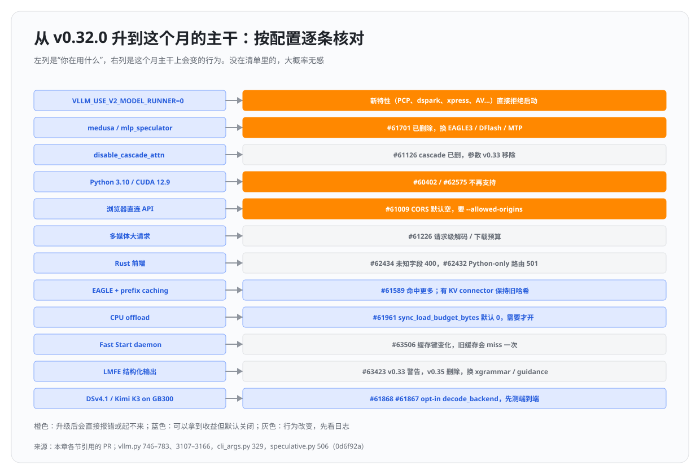

> 📌 **从 v0.32.0 或更早升级到 0d6f92a 之后的主干，逐条核对**
> - 启动脚本里的 `VLLM_USE_V2_MODEL_RUNNER`：没有明确理由就删掉，让 vLLM 自动判定；设成 0 时，dspark、PCP、batch-sharded sampling、adaptive verification 都会报错。
> - EAGLE / EAGLE3 / MTP 加前缀缓存：块哈希已变；共享 KV store 的引擎、KV-aware 路由器、KV 事件消费方要同时升级，或者统一设 `disable_lookahead_block_hashes=true`。
> - 浏览器直连的服务：显式配置 `--allowed-origins`，默认已不允许跨域。
> - 多模态服务：单请求解码总字节 715,827,880、下载总量 256 MB，超大视频请求要调 `VLLM_MAX_MEDIA_REQUEST_*`。
> - Rust 前端：客户端发的非默认字段如果 Rust 侧没声明，会拿到 400；未实现的路由是 501，按提示切回 Python 前端。
> - 已删除：Medusa、MLP speculator、cascade attention（参数仍在，空操作）、torch.compile 的 SP / AsyncTP、Ray compiled-graph 执行器及其 env、Python 3.10、CUDA 12.9 wheel。
> - LM Format Enforcer 结构化输出后端开始弃用，计划 v0.35 删除，提前迁到 xgrammar 或 guidance。
> - GLM-5.3 on SM100：默认 fp8 KV，TTFT 有 SLO 的显式指定 KV dtype 再压测。
> - Fast Start 权重缓存：daemon 和引擎的 MoE / linear 后端要一致；上线检查要比对固定 prompt 的输出，不能只看 `/health`。
> - CPU offload 加 wide-EP prefill：试 `sync_load_budget_bytes`，按 0、64 MiB、256 MiB、1 GiB 扫，同时盯没有 CPU 命中的请求的 TTFT。
> - P/D 用 push 模式：改成 `"transfer_mode": "push"`，去掉别名模块；拼错会直接报错。
> - 专用 decode（`decode_backend`、`--monokernel`、Kimi K3 KV-balanced MLA）：先确认启用条件，压测覆盖线上并发分布，跑 GSM8K 和 GPQA-Diamond；数值问题先确认请求走的是哪条路径。
> - 多 API server：`--api-server-count > 1` 时连接按最少连接分配，keep-alive 连接池的压测结果会和之前不同。
> - 10-12 以后的变化不在任何发行说明里：用 `month_review.py --grep` 加 PR 描述自己读。

## 学到的

这个月的结论会过时，我们用的方法不会。一个月 1942 个 PR，先用脚本分桶、算覆盖率，找出发行说明没覆盖的那一段。再按主题挑出改了行为的 PR，读它们的三件事：改之前、改之后、作者自己写的代价和注意事项。最后追到源码里，找到开关的默认值、被消费的位置和不满足时的去向。每一步都能在 SGLang 上做一遍对照，两边做法不同的地方，往往就是设计取舍所在。

这个月有好几条线都指向同一个外部来源：DSv4.1-Flash 的专用 decode、MI355X 的 mono decode、DSpark 投机解码、MLA 和稀疏注意力的 KV 布局、Engram 表、DeepGEMM 和 DeepEP。SGLang 那边的 MegaGate、MegaAttention、`--engram-config` 也是一样。下一篇 VLLM-22 换一个切法，不按时间，按来源：DeepSeek 开源的 kernel、通信库、模型结构和部署方案，分别在 vLLM 里改写了哪些代码，又是怎样和 SGLang 走出不同的路线的。

# 参考文献

按正文首次引用顺序编号，资料截至 2026 年 10 月底。源码以 vllm-project/vllm 主干提交 0d6f92a（2026 年 10 月 29 日）和 v0.32.0 发行版为准；SGLang 对照以 sgl-project/sglang 主干 8fabf5e 为准。

[1] vllm-project. vLLM commits 2026-09-29..2026-10-29 (0d6f92a). GitHub [https://github.com/vllm-project/vllm/commits/0d6f92a](https://github.com/vllm-project/vllm/commits/0d6f92a)

[2] sgl-project. SGLang commits 2026-09-29..2026-10-29 (1ab008f5). GitHub [https://github.com/sgl-project/sglang/commits/1ab008f5](https://github.com/sgl-project/sglang/commits/1ab008f5)

[3] vLLM Project. Release v0.31.0. GitHub (2026-10-05) [https://github.com/vllm-project/vllm/releases/tag/v0.31.0](https://github.com/vllm-project/vllm/releases/tag/v0.31.0)

[4] vLLM Project. Release v0.32.0. GitHub (2026-10-18) [https://github.com/vllm-project/vllm/releases/tag/v0.32.0](https://github.com/vllm-project/vllm/releases/tag/v0.32.0)

[5] vllm-project/vllm Issue #59665: [RFC]: Fast-Track Merging for Model Optimization PRs. GitHub [https://github.com/vllm-project/vllm/issues/59665](https://github.com/vllm-project/vllm/issues/59665)

[6] NVIDIA. TensorRT-LLM PR #19056. GitHub [https://github.com/NVIDIA/TensorRT-LLM/pull/19056](https://github.com/NVIDIA/TensorRT-LLM/pull/19056)

[7] vllm-project/vllm PR #61868: [Perf][DSv4.1] DeepSeek-V4.1-Flash specialized decode on GB300. GitHub (merged 2026-10-21) [https://github.com/vllm-project/vllm/pull/61868](https://github.com/vllm-project/vllm/pull/61868)

[8] vllm-project/vllm PR #61867: [Perf] Kimi K3 Specialized Decode: CuTeDSL Optimized GB300 (1.5-2x). GitHub (merged 2026-10-16) [https://github.com/vllm-project/vllm/pull/61867](https://github.com/vllm-project/vllm/pull/61867)

[9] vllm-project/vllm PR #60397: [ROCm][Perf][DSv4.1] Mono decode layer for DeepSeek-V4.1-Flash on MI355X. GitHub (merged 2026-10-10) [https://github.com/vllm-project/vllm/pull/60397](https://github.com/vllm-project/vllm/pull/60397)

[10] vllm-project/vllm PR #63638: [Perf][Kimi K3] Opt-in KV-balanced FP8 MLA decode for agentic workloads. GitHub (merged 2026-10-26) [https://github.com/vllm-project/vllm/pull/63638](https://github.com/vllm-project/vllm/pull/63638)

[11] vllm-project/vllm PR #61302: [Doc] Host model recipes in recipes/. GitHub (merged 2026-10-17) [https://github.com/vllm-project/vllm/pull/61302](https://github.com/vllm-project/vllm/pull/61302)

[12] vllm-project/vllm PR #60623: [Chore] Remove vendored code made redundant by Transformers 5.16.1. GitHub (merged 2026-10-09) [https://github.com/vllm-project/vllm/pull/60623](https://github.com/vllm-project/vllm/pull/60623)

[13] vllm-project/vllm PR #60823: [Chore] Port more vendored configs and processors to upstream Transformers. GitHub (merged 2026-10-20) [https://github.com/vllm-project/vllm/pull/60823](https://github.com/vllm-project/vllm/pull/60823)

[14] vllm-project/vllm PR #57387: [Model] Use upstream GLM-5.3 and Qwen4-Exp configs and processor. GitHub (merged 2026-10-02) [https://github.com/vllm-project/vllm/pull/57387](https://github.com/vllm-project/vllm/pull/57387)

[15] vLLM Team. Model Runner V2: A Modular and Faster Core for vLLM. vLLM Blog (2026-03-24) [https://vllm.ai/blog/2026-03-24-mrv2](https://vllm.ai/blog/2026-03-24-mrv2)

[16] vLLM Docs. Model Runner V2 Design [https://docs.vllm.ai/en/latest/design/model_runner_v2/](https://docs.vllm.ai/en/latest/design/model_runner_v2/)

[17] vllm-project/vllm PR #60517: [Compile] Remove torch.compile-based sequence parallelism and AsyncTP. GitHub (merged 2026-10-08) [https://github.com/vllm-project/vllm/pull/60517](https://github.com/vllm-project/vllm/pull/60517)

[18] vllm-project/vllm PR #61126: [Attention] Remove cascade attention. GitHub (merged 2026-10-12) [https://github.com/vllm-project/vllm/pull/61126](https://github.com/vllm-project/vllm/pull/61126)

[19] vllm-project/vllm PR #61701: [Spec Decode] Remove Medusa and MLP speculator support. GitHub (merged 2026-10-15) [https://github.com/vllm-project/vllm/pull/61701](https://github.com/vllm-project/vllm/pull/61701)

[20] vllm-project/vllm PR #61712: [Core] Remove the legacy Ray compiled-graph executor. GitHub (merged 2026-10-15) [https://github.com/vllm-project/vllm/pull/61712](https://github.com/vllm-project/vllm/pull/61712)

[21] vllm-project/vllm PR #62228: [Core] Remove the obsolete VLLM_USE_RAY_V2_EXECUTOR_BACKEND env var. GitHub (merged 2026-10-19) [https://github.com/vllm-project/vllm/pull/62228](https://github.com/vllm-project/vllm/pull/62228)

[22] vllm-project/vllm PR #60402: Remove Python 3.10 support now that it is EOL. GitHub (merged 2026-10-08) [https://github.com/vllm-project/vllm/pull/60402](https://github.com/vllm-project/vllm/pull/60402)

[23] vllm-project/vllm PR #62575: [CI/Build] Drop CUDA 12.9 from the release pipeline. GitHub (merged 2026-10-19) [https://github.com/vllm-project/vllm/pull/62575](https://github.com/vllm-project/vllm/pull/62575)

[24] vllm-project/vllm PR #59744: [Rust Frontend] Remove the PyO3 tool-parser bridge. GitHub (merged 2026-10-06) [https://github.com/vllm-project/vllm/pull/59744](https://github.com/vllm-project/vllm/pull/59744)

[25] vllm-project/vllm PR #63423: [Deprecation] Deprecate LM Format Enforcer structured outputs backend. GitHub (merged 2026-10-24) [https://github.com/vllm-project/vllm/pull/63423](https://github.com/vllm-project/vllm/pull/63423)

[26] vllm-project/vllm PR #63371: [vLLM IR] Deprecate ir_op_priority ahead of vLLM IR removal. GitHub (merged 2026-10-23) [https://github.com/vllm-project/vllm/pull/63371](https://github.com/vllm-project/vllm/pull/63371)

[27] Li et al. EAGLE: Speculative Sampling Requires Rethinking Feature Uncertainty. ICML 2024 [https://arxiv.org/abs/2401.15077](https://arxiv.org/abs/2401.15077)

[28] vLLM Docs. Speculative Decoding [https://docs.vllm.ai/en/latest/features/speculative_decoding/](https://docs.vllm.ai/en/latest/features/speculative_decoding/)

[29] vllm-project/vllm PR #61589: [Core][Spec Decode] Lookahead block hashes for EAGLE prefix caching. GitHub (merged 2026-10-26) [https://github.com/vllm-project/vllm/pull/61589](https://github.com/vllm-project/vllm/pull/61589)

[30] vllm-project/vllm PR #62784: [Spec Decode][MRV2] Skip drafting in steps where no request can use the drafts. GitHub (merged 2026-10-22) [https://github.com/vllm-project/vllm/pull/62784](https://github.com/vllm-project/vllm/pull/62784)

[31] vllm-project/vllm PR #63554: [Spec Decode][Sampling] Batch-sharded draft logits. GitHub (merged 2026-10-26) [https://github.com/vllm-project/vllm/pull/63554](https://github.com/vllm-project/vllm/pull/63554)

[32] vllm-project/vllm PR #61994: [Spec Decode] Support PCP with DSpark for DeepSeek-V4.1. GitHub (merged 2026-10-26) [https://github.com/vllm-project/vllm/pull/61994](https://github.com/vllm-project/vllm/pull/61994)

[33] vllm-project/vllm PR #61464: [MRV2][DBO] Support DBO with speculative decoding and DCP. GitHub (merged 2026-10-28) [https://github.com/vllm-project/vllm/pull/61464](https://github.com/vllm-project/vllm/pull/61464)

[34] vllm-project/vllm PR #63421: [Spec Decode] Replace torch.compile'd AV draft-budget selection with a Triton kernel. GitHub (merged 2026-10-26) [https://github.com/vllm-project/vllm/pull/63421](https://github.com/vllm-project/vllm/pull/63421)

[35] vllm-project/vllm PR #53987: [Spec Decode][ROCm] Add FLy: entropy-gated deferred verification for draft-model speculative decoding. GitHub (merged 2026-10-19) [https://github.com/vllm-project/vllm/pull/53987](https://github.com/vllm-project/vllm/pull/53987)

[36] FLy: Entropy-Gated Deferred Verification for Speculative Decoding. arXiv:2511.22972 [https://arxiv.org/abs/2511.22972](https://arxiv.org/abs/2511.22972)

[37] vllm-project. docs/features/speculative_decoding/fly.md. GitHub (0d6f92a) [https://github.com/vllm-project/vllm/blob/0d6f92a/docs/features/speculative_decoding/fly.md](https://github.com/vllm-project/vllm/blob/0d6f92a/docs/features/speculative_decoding/fly.md)

[38] vllm-project/vllm PR #54448: [Core] Add XPress speculative decoding method. GitHub (merged 2026-10-22) [https://github.com/vllm-project/vllm/pull/54448](https://github.com/vllm-project/vllm/pull/54448)

[39] XPress: Causal Refinement of Block-Diffusion Drafts for Speculative Decoding. arXiv:2608.02438 [https://arxiv.org/abs/2608.02438](https://arxiv.org/abs/2608.02438)

[40] vllm-project/vllm PR #59468: [Spec Decode] Don't reserve DFlash/DSpark draft slots in the scheduler token budget. GitHub (merged 2026-10-16) [https://github.com/vllm-project/vllm/pull/59468](https://github.com/vllm-project/vllm/pull/59468)

[41] vllm-project/vllm PR #60945: [Bugfix] Fix out-of-bounds lookahead in adaptive block verification. GitHub (merged 2026-10-12) [https://github.com/vllm-project/vllm/pull/60945](https://github.com/vllm-project/vllm/pull/60945)

[42] vllm-project/vllm PR #58231: [Bugfix][Sampler] Fix split top-p masking every token for huge logits (thinking_token_budget + spec decode emits token 0). GitHub (merged 2026-10-19) [https://github.com/vllm-project/vllm/pull/58231](https://github.com/vllm-project/vllm/pull/58231)

[43] vLLM Team. Inside vLLM's New KV Offloading Connector: Smarter Memory Transfer for Maximizing Inference Throughput. vLLM Blog (2026-01-08) [https://vllm.ai/blog/2026-01-08-kv-offloading-connector](https://vllm.ai/blog/2026-01-08-kv-offloading-connector)

[44] vLLM Team. Tiered KV Cache Offloading in vLLM. vLLM Blog (2026-09-10) [https://vllm.ai/blog/2026-09-10-tiered-kv-offloading](https://vllm.ai/blog/2026-09-10-tiered-kv-offloading)

[45] vllm-project/vllm PR #61961: [KV Offload] Load small CPU-tier hits synchronously within the step. GitHub (merged 2026-10-26) [https://github.com/vllm-project/vllm/pull/61961](https://github.com/vllm-project/vllm/pull/61961)

[46] vllm-project/vllm PR #63779: [KV Offload][Tiering] Let a tier fail a promotion and defer releasing its chunks. GitHub (merged 2026-10-28) [https://github.com/vllm-project/vllm/pull/63779](https://github.com/vllm-project/vllm/pull/63779)

[47] vllm-project/vllm PR #58168: [KV Offload] Expose OffloadingManager.lock()/unlock() and service the tiering control plane off the scheduler thread. GitHub (merged 2026-10-15) [https://github.com/vllm-project/vllm/pull/58168](https://github.com/vllm-project/vllm/pull/58168)

[48] vllm-project/vllm Issue #57187: [RFC]: Scheduler-Aware Multi-Tier KV Caching for vLLM with MORI-UMBP. GitHub [https://github.com/vllm-project/vllm/issues/57187](https://github.com/vllm-project/vllm/issues/57187)

[49] vllm-project/vllm PR #61789: [UMBP][1/10] Add shared connector, runtime contracts, and request lifecycle. GitHub (merged 2026-10-15) [https://github.com/vllm-project/vllm/pull/61789](https://github.com/vllm-project/vllm/pull/61789)

[50] vllm-project/vllm PR #61790: [Test][UMBP][2/10] Add shared connector contract coverage. GitHub (merged 2026-10-20) [https://github.com/vllm-project/vllm/pull/61790](https://github.com/vllm-project/vllm/pull/61790)

[51] vllm-project/vllm PR #61791: [UMBP][3/10] Add shared lookup, transfer, hybrid, and observability. GitHub (merged 2026-10-24) [https://github.com/vllm-project/vllm/pull/61791](https://github.com/vllm-project/vllm/pull/61791)

[52] vllm-project/vllm PR #61792: [Test][UMBP][4/10] Cover async lookup, hybrid cache, events, and metrics. GitHub (merged 2026-10-26) [https://github.com/vllm-project/vllm/pull/61792](https://github.com/vllm-project/vllm/pull/61792)

[53] vllm-project/vllm PR #64230: [KV Connector][NIXL] Select push mode for NixlConnector via transfer_mode. GitHub (merged 2026-10-28) [https://github.com/vllm-project/vllm/pull/64230](https://github.com/vllm-project/vllm/pull/64230)

[54] vllm-project/vllm PR #56430: [bug-fix] Fix KV block leak with fault tolerance enabled in P/D disaggregation. GitHub (merged 2026-10-22) [https://github.com/vllm-project/vllm/pull/56430](https://github.com/vllm-project/vllm/pull/56430)

[55] vllm-project/vllm PR #60647: [HiSparse] Own GPU residency instead of editing core block-table rows. GitHub (merged 2026-10-10) [https://github.com/vllm-project/vllm/pull/60647](https://github.com/vllm-project/vllm/pull/60647)

[56] vllm-project/vllm PR #60083: [Perf][HiSparse] Cache per-request residency instead of rescanning every page each step. GitHub (merged 2026-10-06) [https://github.com/vllm-project/vllm/pull/60083](https://github.com/vllm-project/vllm/pull/60083)

[57] vllm-project/vllm PR #61263: [Perf][HiSparse] Reduce residency hash probes. GitHub (merged 2026-10-26) [https://github.com/vllm-project/vllm/pull/61263](https://github.com/vllm-project/vllm/pull/61263)

[58] vllm-project/vllm PR #62432: [Rust Frontend] Return 501 instead of 404 for Python-only routes. GitHub (merged 2026-10-20) [https://github.com/vllm-project/vllm/pull/62432](https://github.com/vllm-project/vllm/pull/62432)

[59] vllm-project/vllm PR #62434: [Rust Frontend] Reject silently dropped request fields on chat, completions, and generate. GitHub (merged 2026-10-20) [https://github.com/vllm-project/vllm/pull/62434](https://github.com/vllm-project/vllm/pull/62434)

[60] vllm-project/vllm PR #60922: [Rust Frontend][gRPC] Remove \`GenerateStream\` producer task so disconnects abort requests. GitHub (merged 2026-10-10) [https://github.com/vllm-project/vllm/pull/60922](https://github.com/vllm-project/vllm/pull/60922)

[61] vllm-project/vllm PR #61009: [Security] Restrict default CORS origins. GitHub (merged 2026-10-11) [https://github.com/vllm-project/vllm/pull/61009](https://github.com/vllm-project/vllm/pull/61009)

[62] vllm-project/vllm PR #61226: [Security] Bound decoded and downloaded media per request. GitHub (merged 2026-10-13) [https://github.com/vllm-project/vllm/pull/61226](https://github.com/vllm-project/vllm/pull/61226)

[63] sgl-project/sglang PR #36854: [diffusion] security: pin multimodal-gen ZMQ scheduler ingress to loopback on wildcard --host. GitHub [https://github.com/sgl-project/sglang/pull/36854](https://github.com/sgl-project/sglang/pull/36854)

[64] vllm-project/vllm PR #63506: [Fast Start] Key the weight cache on MoE and linear kernel backends. GitHub (merged 2026-10-26) [https://github.com/vllm-project/vllm/pull/63506](https://github.com/vllm-project/vllm/pull/63506)

[65] vllm-project/vllm Issue #56049: [Feature]: Fast Start For vLLM. GitHub [https://github.com/vllm-project/vllm/issues/56049](https://github.com/vllm-project/vllm/issues/56049)

[66] vllm-project/vllm PR #63088: [Fast Start] Add daemon-to-daemon warmup cache seeding for Preload. GitHub (merged 2026-10-25) [https://github.com/vllm-project/vllm/pull/63088](https://github.com/vllm-project/vllm/pull/63088)

[67] vllm-project/vllm PR #60723: [Frontend] Accept each connection on the least loaded API worker. GitHub (merged 2026-10-09) [https://github.com/vllm-project/vllm/pull/60723](https://github.com/vllm-project/vllm/pull/60723)

[68] vllm-project/vllm Issue #57479: [RFC]: Bound frontend drain latency for bulk aborts and long non-streaming completions. GitHub [https://github.com/vllm-project/vllm/issues/57479](https://github.com/vllm-project/vllm/issues/57479)

[69] vllm-project. recipes/models/deepseek-ai/DeepSeek-V4.1-Flash.yaml. GitHub (0d6f92a) [https://github.com/vllm-project/vllm/blob/0d6f92a/recipes/models/deepseek-ai/DeepSeek-V4.1-Flash.yaml](https://github.com/vllm-project/vllm/blob/0d6f92a/recipes/models/deepseek-ai/DeepSeek-V4.1-Flash.yaml)

[70] vllm-project/vllm PR #61082: [ROCm][Perf][DSv4.1] Mono decode on every backbone layer. GitHub (merged 2026-10-13) [https://github.com/vllm-project/vllm/pull/61082](https://github.com/vllm-project/vllm/pull/61082)

[71] vllm-project/vllm PR #60731: [ROCm][Perf][DSv4.1] Mono decode on MI300X and MI325X (gfx942). GitHub (merged 2026-10-20) [https://github.com/vllm-project/vllm/pull/60731](https://github.com/vllm-project/vllm/pull/60731)

[72] vllm-project/vllm PR #61482: [ROCm][Perf][DSv4] Standalone mono decode layer for DeepSeek-V4-Pro on MI355X. GitHub (merged 2026-10-24) [https://github.com/vllm-project/vllm/pull/61482](https://github.com/vllm-project/vllm/pull/61482)

[73] vllm-project/vllm PR #60140: [GLM5.3 Perf] Switch to fp8 kv cache by default for GLM, 2.3%\~5.5% E2E Throughput Improvement. GitHub (merged 2026-10-06) [https://github.com/vllm-project/vllm/pull/60140](https://github.com/vllm-project/vllm/pull/60140)

[74] vllm-project/vllm PR #60281: [Bugfix] Limit GlmMoeDsaForCausalLM fp8 KV cache default to SM100. GitHub (merged 2026-10-07) [https://github.com/vllm-project/vllm/pull/60281](https://github.com/vllm-project/vllm/pull/60281)

[75] vllm-project/vllm PR #63841: [GLM5.3 Perf] Enable dspark fp8 kv cache for draft model, 5.38 GB GPU Memory saved per rank. GitHub (merged 2026-10-27) [https://github.com/vllm-project/vllm/pull/63841](https://github.com/vllm-project/vllm/pull/63841)

[76] sgl-project. SGLang. GitHub [https://github.com/sgl-project/sglang](https://github.com/sgl-project/sglang)

[77] sgl-project/sglang PR #39728: [Feat] HiCache: Page unified e2e integration. GitHub [https://github.com/sgl-project/sglang/pull/39728](https://github.com/sgl-project/sglang/pull/39728)

[78] sgl-project/sglang PR #41187: [Feat] hicache: Support MLA DCP with HiCache L3(file/mooncake). GitHub [https://github.com/sgl-project/sglang/pull/41187](https://github.com/sgl-project/sglang/pull/41187)

[79] sgl-project/sglang PR #44726: [Feat] rust-server: Add HiCache storage management endpoints. GitHub [https://github.com/sgl-project/sglang/pull/44726](https://github.com/sgl-project/sglang/pull/44726)

[80] sgl-project/sglang PR #45492: [Perf] pd: Send prefill KV chunks without a host sync on the scheduler thread. GitHub [https://github.com/sgl-project/sglang/pull/45492](https://github.com/sgl-project/sglang/pull/45492)

[81] sgl-project/sglang PR #46689: [Perf] disaggregation: Restore host-received decode KV without blocking the scheduler. GitHub [https://github.com/sgl-project/sglang/pull/46689](https://github.com/sgl-project/sglang/pull/46689)

[82] sgl-project/sglang PR #46423: [Feat] disaggregation: Verify the KV checksum under a decode-side radix cache. GitHub [https://github.com/sgl-project/sglang/pull/46423](https://github.com/sgl-project/sglang/pull/46423)

[83] sgl-project/sglang PR #46181: [Feat] rust-server: Fan control requests out to every DP rank. GitHub [https://github.com/sgl-project/sglang/pull/46181](https://github.com/sgl-project/sglang/pull/46181)

[84] sgl-project/sglang PR #45888: [Feat] rust-server: Serve /abort_request from the Rust frontend. GitHub [https://github.com/sgl-project/sglang/pull/45888](https://github.com/sgl-project/sglang/pull/45888)

[85] sgl-project/sglang PR #47109: [Fix] rust-server: Answer media the multimodal processor refuses with a 400. GitHub [https://github.com/sgl-project/sglang/pull/47109](https://github.com/sgl-project/sglang/pull/47109)

[86] sgl-project/sglang PR #44621: [Feat] [AMD] docker: Install the sgl-amd-mono monokernel plugin in the ROCm image. GitHub [https://github.com/sgl-project/sglang/pull/44621](https://github.com/sgl-project/sglang/pull/44621)

[87] sgl-project/sglang PR #46036: [Feat] [AMD] mono-kernels: Register specs by model type. GitHub [https://github.com/sgl-project/sglang/pull/46036](https://github.com/sgl-project/sglang/pull/46036)

[88] sgl-project/sglang PR #45266: [Feat] [NVIDIA] megakernels: Qwen3.5 binding and EAGLE entry wiring for NVIDIA megakernel plugins. GitHub [https://github.com/sgl-project/sglang/pull/45266](https://github.com/sgl-project/sglang/pull/45266)

[89] sgl-project/sglang PR #43262: [Perf] dsv41: Integrate DeepGEMM MegaGate routing. GitHub [https://github.com/sgl-project/sglang/pull/43262](https://github.com/sgl-project/sglang/pull/43262)

[90] sgl-project/sglang PR #43922: [Perf] deepseek-v4.1: Integrate FlashMLA MegaAttention with NVFP4 KV. GitHub [https://github.com/sgl-project/sglang/pull/43922](https://github.com/sgl-project/sglang/pull/43922)

[91] sgl-project/sglang PR #46893: [Feat] dsv41: Choose where Engram tables live with \`--engram-config\`. GitHub [https://github.com/sgl-project/sglang/pull/46893](https://github.com/sgl-project/sglang/pull/46893)

[92] sgl-project/sglang PR #42457: [Feat] [AMD] mori: Allow MoRI for DeepSeek-V4.1 DSpark PD. GitHub [https://github.com/sgl-project/sglang/pull/42457](https://github.com/sgl-project/sglang/pull/42457)

---

[在 Colab 里跑本章 CPU 练习](https://colab.research.google.com/github/chenziyaos/zero-to-vllm/blob/main/colab/21-frontier-month.ipynb) · 上一章：[VLLM-20｜生产｜读源码与提 PR：插件系统、测试与基准](./20-contrib.md) · [目录](./README.md) · 下一章：[VLLM-22｜前沿｜DeepSeek 开源如何改写 vLLM：从 MLA、Wide-EP 到 DeepInfer 同源](./22-deepseek-impact.md)
