# VLLM-22｜前沿｜DeepSeek 开源如何改写 vLLM：从 MLA、Wide-EP 到 DeepInfer 同源

> 🎯 **这篇文档解决什么问题**：vLLM 官方 recipe 给 DeepSeek-V4.1-Flash 的启动命令里，有 MXFP4 专家权重和最少 614 GB 显存，TP 随卡型变（H100 上 8，B200 / GB300 上 2，其余 4），投机解码是 5 个草稿 token 的 `dspark` 加自适应验证，H100 上还要多一个 `--engram-config`。这些参数背后，0d6f92a 里和 DeepSeek 相关的开关有九个，默认开的只有 DeepGEMM 和有界重放。要读懂它们，得先分清 DeepSeek 开源的东西从哪条线进的 vLLM。第一条是模型结构：MLA、MTP、DSA 的稀疏 indexer、V4 的混合压缩注意力、V4.1 的 Engram，每一代都逼着 vLLM 改 KV cache 的组织方式。第二条是 kernel 和算法库：FlashMLA、DeepEP、DeepGEMM、DeepSelect、EPLB、DualPipe，它们以分叉、上游 pin 或改写的方式进到 vLLM 的后端选择里[[1]](https://github.com/deepseek-ai/open-infra-index)。第三条是引擎本身：DeepSeek 2025 年 4 月说自己的推理引擎是一年多前 vLLM 的早期分叉，决定把组件回馈上游，整个引擎不开源[[2]](https://github.com/deepseek-ai/open-infra-index/blob/main/OpenSourcing_DeepSeek_Inference_Engine/README.md)；2026 年开源的 DeepInfer 又在致谢里写明“originally built primarily on vLLM”[[3]](https://github.com/deepseek-ai/DeepInfer)。三条线缠在一起，读 vLLM 里和 DeepSeek 相关的代码时，很容易分不清一个开关是 vLLM 自己的设计，还是 DeepSeek 某个仓库的接口，也分不清一个性能数字量的是 kernel、step 还是端到端。我们按时间把这三条线拆开，每一处都落到 0d6f92a 的源码行号和 PR，同时对照 SGLang 8fabf5e 怎么接同一批东西。
>
> **使用方式**：第 1 章列出 DeepSeek 组件在 vLLM 里留下的开关，以及线上现象该看哪一节。第 2 章按代际读：MLA、kernel 接入、Wide-EP / EPLB / DBO、V3.2、V4、V4.1、DeepInfer 和复测对齐，最后对照 SGLang。第 3 章是源码索引。第 4 章是能动手做的实验。第 5 章是坑和我们的看法。第 6 章是部署 DeepSeek 模型前的核对清单。
>
> **代码**：[22-deepseek-impact](../22-deepseek-impact)。ds_impact.py 有七个场景：kvbytes 算 MHA / MLA / V3.2 / V4 / V4.1 每 token 的 KV 字节。eplb 是 vLLM `policy/default.py` 的纯 Python 移植，复现 vLLM 单测的期望布局。replay 数 V4.1 有界重放省下的 token×层。adaptive 移植 DSpark 自适应验证的 argmax。components 列出每个 DeepSeek 组件进两个引擎的方式。grep 和 lines 复现正文里的提交计数和代码行数。22 个单测钉住正文的数字。只用 Python 标准库。

# 导读 · 先给结论

## DeepSeek 专项不替换为 Qwen

本章 DeepSeek 的 MLA、专家并行和专属组件保留原对象。通用案例转到双模型后，可以对比 MoE 的权重驻留与通信问题，但 Qwen 的 GDN 状态不能用 MLA latent 公式代算。

架构对照先分注意力机制，再分 FFN。引用本章数字时必须同时保留原模型、硬件和版本；任何移植结论都要验证张量布局、kernel 与状态恢复，不能只比较总参数量。

双模型结构以固定版本配置核对[[Qwen3.8-27B config.json]](https://huggingface.co/Qwen/Qwen3.8-27B/blob/37561816e66b5b9153b1b64c10968c18c1e6f4a0/config.json)[[Qwen3.5-35B-A3B config.json]](https://huggingface.co/Qwen/Qwen3.5-35B-A3B/blob/59d61f3ce65a6d9863b86d2e96597125219dc754/config.json)。

1. **DeepSeek 和 vLLM 是双向同源。**DeepSeek 的线上引擎起于 vLLM 的早期分叉，DeepInfer 起于 vLLM；反过来，vLLM 的 MLA、稀疏注意力、MoE 和 EP 通信后端，几乎都接的是 DeepSeek 的 kernel。vLLM 10 月 23 日的博客直接写了“share a lineage in both directions”。
2. **kernel 是按仓库分叉进来的，算法是改写进来的。**DeepGEMM、FlashMLA、DeepSelect 在 vLLM 里是 vllm-project 名下的分叉，cmake 按 commit pin；DeepEP 直接 pin 上游。EPLB 算法改写进 `policy/default.py`，多了一步 `preserve_intragpu_slots` 减少迁移；SGLang 是把 eplb.py 原样复制一份。
3. **每一代模型都在改 KV cache 的形状。**MLA 把每层每 token 从 81920 B 压到 1152 B（1/71）。V3.2 多一份 indexer K。V4 有五种 cache 塞进三个页桶，1M 上下文从 83.9 GiB 降到 9.62 GiB。V4.1 的 SWA 状态在 4K 上下文时占全部 KV 的 45%，前缀缓存不改就要在每个块边界存 13 倍于全局 KV 的快照，于是有了有界重放。
4. **“匹配 DeepInfer”这句话要看口径。**decode 在同配置下差 6% 以内；prefill 两边的并行方式、冗余专家数、重放长度都不一样，博客自己写了“not an engine-to-engine speedup”。能复用的是那串 PR：prefill 三个改动合计 +35.6–43.9%，CPU 侧把 DEP32 从比 DEP16 慢修到 516K tok/s。
5. **代价是 78k 行按代际分开的代码。**`deepseek_v32/`、`deepseek_v4/`、`deepseek_v41/` 三个目录合计 78412 行，再按 amd / nvidia / common 分。新特性大多只在 Model Runner V2、只在 SM100、只在 NVIDIA 上开，ROCm 和老卡要看每个开关的门槛。

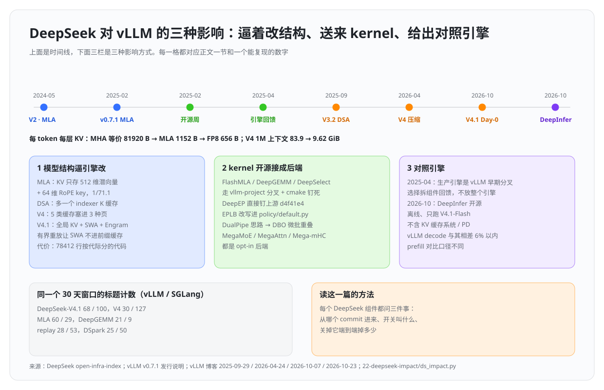

和前面各章的关系：VLLM-06 讲 attention 后端选择，这里是 MLA 和稀疏 MLA 怎么塞进那套选择。VLLM-08 讲前缀缓存，V4.1 的有界重放改的是“命中前缀以后还要算什么”。VLLM-11 讲 EP 和 MoE，这里是 DeepEP、DeepGEMM、EPLB 和 DBO 的细节。VLLM-13 讲投机解码，MTP 和 DSpark 是它的 DeepSeek 特化。VLLM-21 是同一个 30 天窗口的全景，这一篇只追 DeepSeek 这一条线。

# 第 1 章 · 问题：一个 DeepSeek 部署命令里有多少个 DeepSeek 组件

先看 vLLM 官方 recipe 给 DeepSeek-V4.1-Flash 的默认命令[[4]](https://github.com/vllm-project/vllm/blob/0d6f92a/recipes/models/deepseek-ai/DeepSeek-V4.1-Flash.yaml)。它要求 vLLM 不低于 0.31.0，默认变体是 MXFP4 专家权重，最少 614 GB 显存；张量并行在 H100 上是 8，B200 / GB300 上是 2，其余是 4。投机解码配置是 `dspark`、5 个草稿 token、`enable_adaptive_verification: true`。AMD 覆盖成 false，注释写着 vLLM 目前拒绝这个开关。H100 要额外加 `--engram-config '{"cpu_offload":true}'` 和 `VLLM_USE_V2_MODEL_RUNNER=1`。AMD 用 `--moe-backend aiter`。V4 博客给的启动参数是另一组[[5]](https://vllm.ai/blog/2026-04-24-deepseek-v4)：

```bash
vllm serve deepseek-ai/DeepSeek-V4 \
  --kv-cache-dtype fp8 --block-size 256 \
  --enable-expert-parallel --data-parallel-size 8 \
  --attention_config.use_fp4_indexer_cache=True \
  --tokenizer-mode deepseek_v4
```

这几行参数背后各自是一个 DeepSeek 组件，或者是为某个 DeepSeek 结构加的适配。把 0d6f92a 里和 DeepSeek 有关的开关列出来，看它们的默认值和来路：

| 开关 | 默认 | 对应的 DeepSeek 组件 | 源码 |
|-|-|-|-|
| `VLLM_USE_DEEP_GEMM` | True | DeepGEMM[[6]](https://github.com/deepseek-ai/DeepGEMM) | [envs.py 200](https://github.com/vllm-project/vllm/blob/0d6f92a/vllm/envs.py#L200)；Blackwell 上对部分模型自动关掉，[deep_gemm.py 29](https://github.com/vllm-project/vllm/blob/0d6f92a/vllm/utils/deep_gemm.py#L29) |
| `--moe-backend` | auto | DeepGEMM MegaMoE / DeepEP / aiter | [arg_utils.py 1850](https://github.com/vllm-project/vllm/blob/0d6f92a/vllm/engine/arg_utils.py#L1850)，[kernel.py 122](https://github.com/vllm-project/vllm/blob/0d6f92a/vllm/config/kernel.py#L122) |
| `all2all_backend` | allgather_reducescatter | DeepEP HT / LL[[7]](https://github.com/deepseek-ai/DeepEP) | [parallel.py 220](https://github.com/vllm-project/vllm/blob/0d6f92a/vllm/config/parallel.py#L220) |
| `enable_eplb` | False | EPLB[[8]](https://github.com/deepseek-ai/eplb) | [parallel.py 206](https://github.com/vllm-project/vllm/blob/0d6f92a/vllm/config/parallel.py#L206)，[policy/default.py 7](https://github.com/vllm-project/vllm/blob/0d6f92a/vllm/distributed/eplb/policy/default.py#L7) |
| `enable_dbo` | False（阈值 32 / 512） | DualPipe 的微批重叠思路[[9]](https://github.com/deepseek-ai/DualPipe) | [parallel.py 258](https://github.com/vllm-project/vllm/blob/0d6f92a/vllm/config/parallel.py#L258) |
| `SparseIndexerTopkBackend` | auto，可选 deep_select | DeepSelect[[10]](https://github.com/deepseek-ai/DeepSelect) | [kernel.py 172](https://github.com/vllm-project/vllm/blob/0d6f92a/vllm/config/kernel.py#L172) |
| `--swa-bounded-replay` | True | V4.1 SWA + 前缀缓存 | [cache.py 367](https://github.com/vllm-project/vllm/blob/0d6f92a/vllm/config/cache.py#L367)，[arg_utils.py 1427](https://github.com/vllm-project/vllm/blob/0d6f92a/vllm/engine/arg_utils.py#L1427) |
| `--engram-config` | cpu_offload=True | V4.1 Engram | [engram.py 37](https://github.com/vllm-project/vllm/blob/0d6f92a/vllm/config/engram.py#L37)，[arg_utils.py 1901](https://github.com/vllm-project/vllm/blob/0d6f92a/vllm/engine/arg_utils.py#L1901) |
| `enable_adaptive_verification` | False | DSpark 草稿模型 | [speculative.py 613](https://github.com/vllm-project/vllm/blob/0d6f92a/vllm/config/speculative.py#L613) |

九个开关里，只有 DeepGEMM 和有界重放是默认开的，其余都要手动打开；而手动打开之后，每一个都有自己的门槛。DBO 在 Model Runner V2 下要显式设环境变量，不支持 LoRA、PP、PCP 和多模态。MegaMoE 只在 SM100 上可用，隐藏维度和中间维度都要是 128 的倍数。有界重放要 Model Runner V2，ROCm 上的前缀缓存重放是关的，PCP 下要求开前缀缓存。这些门槛都写在代码里，不在 recipe 里。

线上出问题时，现象通常不会直接指向哪个组件。下面这张表是我们排查时的入口：

| 现象 | 先怀疑 | 看哪一节 |
|-|-|-|
| 长上下文下 KV 容量远低于估算 | MLA 布局或 V4 页桶没选对，block size 不是 256 | 2.1、2.5 |
| 启动日志出现 `Auto-disabled DeepGemm` | Blackwell 上该模型被排除，走回 Triton / CUTLASS | 2.2 |
| EP 扩到 32 卡反而比 16 卡慢 | 卡在 CPU 侧 DP 同步、KV 加载和准入成本上，和 kernel 无关 | 2.3、2.8 |
| EPLB 打开后吞吐抖一下 | 重排期间的权重迁移，看迁移批次和 symm_mem | 2.3 |
| V3.2 / V4 短请求比 MLA 还慢 | 稀疏 indexer 在 10k–20k token 以下不划算 | 2.4 |
| V4.1 命中前缀后 TTFT 仍然高 | 有界重放被门槛关掉（V1 runner、ROCm、PCP 无 APC） | 2.6 |
| DSpark 接受长度不低但吞吐不涨 | 验证成本曲线已过拐点，看自适应验证 | 2.6 |
| 和 DeepInfer 的数字对不上 | 并行方式、冗余专家、重放长度不一致 | 2.7、2.8 |

这一个月的提交也说明 DeepSeek 线在 vLLM 里有多重。同一个 30 天窗口[[11]](https://github.com/vllm-project/vllm/commits/0d6f92a)，按标题正则数 DeepSeek 相关的提交，和 SGLang 对照[[12]](https://github.com/sgl-project/sglang/commits/1ab008f5)：

```text
-- 2026-09-29 → 2026-10-29，vLLM 1942 个提交 / SGLang 2135 个提交，按标题正则计数（一个提交可命中多项）
   主题              vLLM  SGLang
   deepgemm          21       9
   megamoe           18      17
   deepep             8       9
   flashmla           4       6
   deepselect         2       4
   eplb               7       7
   dbo/tbo            6       2
   tilelang           2       2
   mla               60      29
   dsa/indexer       34      72
   mhc                2      14
   engram            12      18
   replay            28      53
   dspark            25      50
   mtp               25      20
   dsv4.1            68     100
   dsv4              30     127
   deepinfer          0       0
```

vLLM 在 MLA（60 对 29）和 DeepGEMM（21 对 9）上提交更多，SGLang 在 V4（127 对 30）、V4.1（100 对 68）、重放（53 对 28）、DSpark（50 对 25）上更多。这和两边的分工对得上：vLLM 的 MLA 后端目录下有 26 个文件，长期承担多硬件的 MLA 适配；SGLang 在 V4 / V4.1 上仍在大量修。`deepinfer` 两边都是 0，没人在提交标题里提它，同源关系只写在博客和 DeepInfer 的致谢里。

# 第 2 章 · 原理：DeepSeek 的三类开源物怎么进 vLLM

时间线先摆出来。2024 年 5 月 DeepSeek-V2 提出 MLA[[13]](https://arxiv.org/abs/2405.04434)，2024 年 12 月 V3 加上 MTP、无辅助损失的负载均衡和 FP8 训练[[14]](https://arxiv.org/abs/2412.19437)。2025 年 2 月 24 日到 28 日的 Open Source Week 连放五个仓库：FlashMLA（H800 上 3000 GB/s、580 TFLOPS，页大小 64）、DeepEP（高吞吐和低延迟两种模式，FP8 dispatch）、DeepGEMM（FP8 GEMM 1350+ TFLOPS，核心约 300 行）、DualPipe 和 EPLB、3FS（6.6 TiB/s）[[1]](https://github.com/deepseek-ai/open-infra-index)；第六天公开线上推理系统，每个 H800 节点 prefill 73.7k、decode 14.8k tok/s，成本利润率 545%[[15]](https://github.com/deepseek-ai/open-infra-index/blob/main/202502OpenSourceWeek/day_6_one_more_thing_deepseekV3R1_inference_system_overview.md)。同年 4 月 DeepSeek 写明自己的推理引擎“built upon vLLM”，是“an early fork of vLLM from over a year ago”，因为分叉太深、内部依赖太多，决定不开源整个引擎，而是把组件抽成独立库回馈上游，并承诺新模型 Day-0 支持[[2]](https://github.com/deepseek-ai/open-infra-index/blob/main/OpenSourcing_DeepSeek_Inference_Engine/README.md)。ISCA 2025 的论文把这套系统背后的硬件约束写成了文章[[16]](https://arxiv.org/abs/2505.09343)。

vLLM 这边对应的是一连串模型博客：V3.2（2025-09-29）、GB300 上的稀疏注意力对比（2026-02-13）、V4（2026-04-24）、DSpark（2026-08-14）、V4.1-Flash Day-0（2026-10-07）、V4.1 PD + Wide-EP（2026-10-23）。下面按代际读，每一节都回答同一组问题：DeepSeek 给了什么，vLLM 改了哪一层，代价落在哪里。

## 2.1 MLA：把 KV cache 的形状从“头”改成“潜向量”

MLA 的核心是把每个 token 的 K、V 投影到一个 512 维的潜向量，再加一段 64 维的解耦 RoPE key[[13]](https://arxiv.org/abs/2405.04434)。cache 里只存这个潜向量，不再为每个头单独存 K 和 V。V3 有 61 层、128 个头、头维 128，按 MHA 存 BF16 每层每 token 是 2×128×128×2 = 65536 B；V3 的 RoPE 头维另算，按等价 MHA（192 维 K、128 维 V）是 81920 B。MLA BF16 只要 (512+64)×2 = 1152 B，是等价 MHA 的 1/71.1：

```text
-- 每 token 的 KV 字节（V3 系列 61 层）
   布局                               B/层   KiB/token      1M 上下文 GiB
   V3 等价 MHA（BF16）                81920      4880.0          4880.0
   V2/V3 MLA（BF16）                 1152        68.6            68.6
   V3 MLA（vLLM FP8 布局）              656        39.1            39.1
   V3.2 MLA FP8 + indexer FP8       788        46.9            46.9
   MLA BF16 / 等价 MHA = 1/71.1；indexer FP8 132 B，FP4 68 B
```

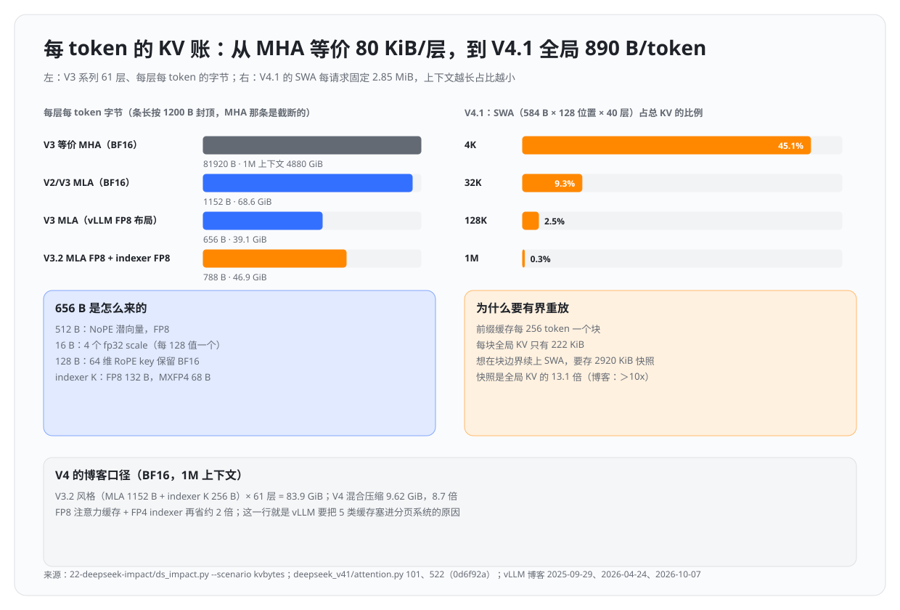

vLLM v0.7.1（2025-02-01）第一次把 MLA 做成独立后端，发行说明给的数字是生成吞吐约 3 倍、可容纳 token 数约 10 倍[[17]](https://github.com/vllm-project/vllm/releases/tag/v0.7.1)。这里的 10 倍和上面的 71 倍不是一回事：71 倍是只算 KV 的理论比例，10 倍是和此前把 MLA 展开成 MHA 来跑的实现相比，权重、激活和 CUDA graph 也要占显存。

MLA 还改了 attention 的计算形状。decode 时把 W_UK 吸收进 Q、W_UV 吸收进 O，attention 直接在潜空间里算，于是所有头共享同一份 KV，变成 MQA 形状；prefill 时 token 多，吸收反而不划算，要把潜向量解压回每个头再走普通的变长 attention。vLLM 的 [MultiHeadLatentAttentionWrapper](https://github.com/vllm-project/vllm/blob/0d6f92a/vllm/model_executor/layers/mla.py#L44) 和 [DeepseekV2MLAAttention](https://github.com/vllm-project/vllm/blob/0d6f92a/vllm/model_executor/models/deepseek_v2.py#L1000) 就是这两条路径的分叉点，#57320[[18]](https://github.com/vllm-project/vllm/pull/57320) 让预处理过的权重跳过吸收。0d6f92a 的 MLA 后端目录下有 26 个条目：FlashMLA、CUTLASS MLA、FlashInfer MLA（含 SM90、SM120、sparse 版本）、FlashAttention MLA、Triton、ROCm aiter、XPU、CPU、AMX……这是 MLA 进 vLLM 以后最直接的后果：同一个 attention 公式，要为每种硬件和每种精度各配一份 kernel。

FP8 布局是 vLLM 自己定的：512 B 的 NoPE 部分按 FP8 存，4 个 fp32 scale 共 16 B，64 维 RoPE 仍存 BF16 共 128 B，合计 656 B[[19]](https://vllm.ai/blog/2025-09-29-deepseek-v3-2)。这个布局后来被 V3.2、V4 沿用，#58305[[20]](https://github.com/vllm-project/vllm/pull/58305) 又给不带 RoPE 的模型在 SM120 上做了更紧凑的 FP8 行。MTP 的草稿头在 [DeepSeekMTP](https://github.com/vllm-project/vllm/blob/0d6f92a/vllm/model_executor/models/deepseek_mtp.py#L240)，572 行，作为 VLLM-13 讲过的 drafter 之一接进投机解码。

## 2.2 kernel：分叉、pin 上游、还是重新打包

DeepSeek 开源的 kernel 库进 vLLM 有三种方式，ds_impact.py 的 components 场景把它们列在一起：

```text
-- DeepSeek 组件进入两个引擎的方式
   DeepGEMM         vLLM: vllm-project/DeepGEMM 分叉 5cdb145
                          cmake/external_projects/deepgemm.cmake:30-41
                    SGLang: sgl-deep-gemm==0.2.3.post2 wheel
   FlashMLA         vLLM: vllm-project/FlashMLA 分叉 e2afa5f
                          cmake/external_projects/flashmla.cmake:21-22
                    SGLang: sgl-project/FlashMLA 分叉 3620b63
   DeepSelect       vLLM: vllm-project/DeepSelect 分叉 d96d33a
                          cmake/external_projects/deepselect.cmake:21-22
                    SGLang: （内置于 sglang kernels）
   DeepEP           vLLM: deepseek-ai/DeepEP 上游 d4f41e4
                          tools/ep_kernels/install_python_libraries.sh:13,244
                    SGLang: sgl-deep-ep==0.1.2.post1 wheel
   EPLB             vLLM: 改写进 policy/default.py，加 preserve_intragpu_slots
                          vllm/distributed/eplb/policy/default.py
                    SGLang: eplb_algorithms/deepseek.py 原样复制，另加 vec / elasticity_aware
   DualPipe 微批重叠    vLLM: DBO（enable_dbo，阈值 32/512）
                          vllm/config/parallel.py:258-268
                    SGLang: TBO（two_batch_overlap.py）
   TileLang         vLLM: mHC 等少数 kernel 走 JIT
                          #62745、#58685
                    SGLang: tilelang==0.1.12
```

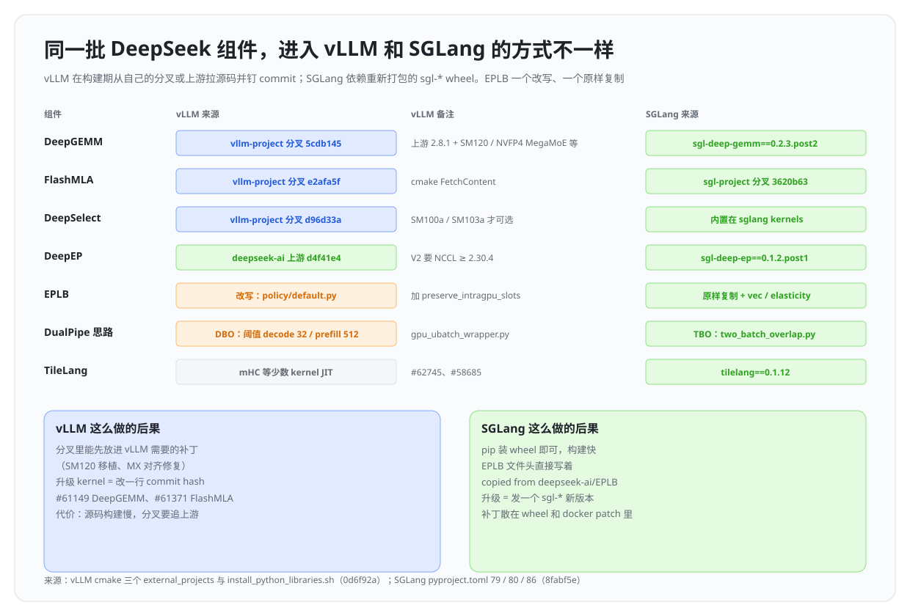

DeepGEMM、FlashMLA、DeepSelect 三个库在 vLLM 里都是 vllm-project 名下的分叉，cmake 按 commit 拉源码编译：[deepgemm.cmake 30–41](https://github.com/vllm-project/vllm/blob/0d6f92a/cmake/external_projects/deepgemm.cmake#L30)、[flashmla.cmake 21–22](https://github.com/vllm-project/vllm/blob/0d6f92a/cmake/external_projects/flashmla.cmake#L21)、[deepselect.cmake 21–22](https://github.com/vllm-project/vllm/blob/0d6f92a/cmake/external_projects/deepselect.cmake#L21)。DeepGEMM 分叉的注释把差异写得很清楚：上游 26/09/30 发布（2.8.1）之上，加了 SM120 移植、SM90 paged-MQA 移植、SwiGLU 的 alpha/beta、NVFP4 MegaMoE 和 MX 对齐修复（分叉内 #43），用 PyTorch 2.11 的稳定 ABI。分叉是因为上游只支持 DeepSeek 自己用的 SM90 / SM100，vLLM 要覆盖 SM120（RTX 50、RTX PRO）和其他模型的形状。这一个月里 DeepGEMM 的 commit pin 就动了三次：#61149[[21]](https://github.com/vllm-project/vllm/pull/61149)、#61744[[22]](https://github.com/vllm-project/vllm/pull/61744)、#63253[[23]](https://github.com/vllm-project/vllm/pull/63253)、#64411[[24]](https://github.com/vllm-project/vllm/pull/64411)，第一个还同时适配了稀疏 indexer 的接口变化。

DeepEP 是唯一直接 pin 上游的：[install_python_libraries.sh 13](https://github.com/vllm-project/vllm/blob/0d6f92a/tools/ep_kernels/install_python_libraries.sh#L13) 写死 deepseek-ai/DeepEP 的 d4f41e4，第 89 行要求 DeepEP v2 的 NCCL 不低于 2.30.4。DeepEP 的接口是通信原语，不随模型形状变，分叉没有收益；需要的只是把它编进镜像，#61829[[25]](https://github.com/vllm-project/vllm/pull/61829)、#61442[[26]](https://github.com/vllm-project/vllm/pull/61442) 分别给 SM103（B300 / GB300）和 SM107a 加了构建目标。

kernel 进来以后，要挂到 vLLM 的后端选择上才有用。DeepGEMM 默认开（[envs.py 200](https://github.com/vllm-project/vllm/blob/0d6f92a/vllm/envs.py#L200) 的 `VLLM_USE_DEEP_GEMM=True`），large-scale serving 博客把“DeepGEMM enabled by default”列为 Wide-EP 的关键优化之一[[27]](https://vllm.ai/blog/2025-12-17-large-scale-serving)。但默认开不等于总开：[\_DEEPGEMM_BLACKWELL_EXCLUDED_MODEL_TYPES](https://github.com/vllm-project/vllm/blob/0d6f92a/vllm/utils/deep_gemm.py#L29) 列了在 Blackwell 上自动关掉的模型，qwen3_5_text 和 qwen3_5_moe_text 在 SM100 / SM120 上因为精度关，kolibri1 在 SM120 上因为延迟关；[vllm.py 1644](https://github.com/vllm-project/vllm/blob/0d6f92a/vllm/config/vllm.py#L1644) 在 quant_config 的 `use_deep_gemm` 没有显式设置时调用这个判断，打一条 `Auto-disabled DeepGemm for model_type=%s on Blackwell`。DeepSeek 模型不在名单里，但这条名单说明 DeepGEMM 是按 DeepSeek 的形状调的，换个模型就得逐个验证。

MegaMoE 是 DeepGEMM 里把 dispatch、两层 GEMM 和 combine 融成一个 kernel 的 MoE 实现。#58053[[28]](https://github.com/vllm-project/vllm/pull/58053) 先把它抽成独立后端，#61538[[29]](https://github.com/vllm-project/vllm/pull/61538) 再把各种精度收到一张特性矩阵后面并加上 NVFP4。它的门槛写在 [check_deep_gemm_mega_moe_supported](https://github.com/vllm-project/vllm/blob/0d6f92a/vllm/model_executor/layers/fused_moe/deep_gemm_mega_moe.py#L188)：只认 SM100 家族，hidden size 和 intermediate size 都必须是 128 的倍数。[NATIVE_MEGA_MOE_BACKENDS](https://github.com/vllm-project/vllm/blob/0d6f92a/vllm/config/kernel.py#L166) 把它标成“原生 MegaMoE 后端”，选中以后 EP 通信由 kernel 自己做，不再走 all2all manager。DeepSelect 是 V3.2 以后稀疏 indexer 的 top-k kernel，[SparseIndexerTopkBackend](https://github.com/vllm-project/vllm/blob/0d6f92a/vllm/config/kernel.py#L172) 第 174 行加了 `deep_select` 选项，文档注明只支持 SM100a / SM103a。

## 2.3 Wide-EP：DeepEP、EPLB 和 DBO

DeepSeek 第六天公开的线上部署是大 EP：prefill 每个单元 4 节点 32 卡，decode 18 节点 144 卡，每卡只放少量专家，靠 EPLB 加冗余专家把负载摊平，靠双微批把通信藏在计算后面[[15]](https://github.com/deepseek-ai/open-infra-index/blob/main/202502OpenSourceWeek/day_6_one_more_thing_deepseekV3R1_inference_system_overview.md)。vLLM 把这三件事分别做成了 all2all 后端、EPLB 和 DBO，large-scale serving 博客在 H200 上测到 2.2k tok/s/GPU[[27]](https://vllm.ai/blog/2025-12-17-large-scale-serving)。

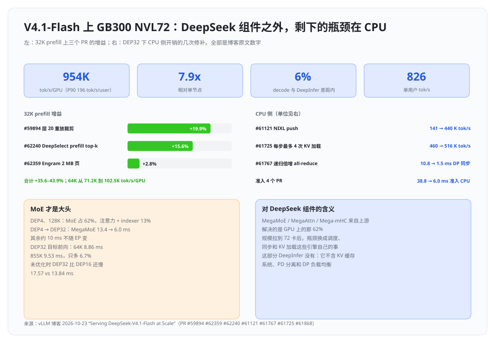

**DeepEP**。[parallel.py 220](https://github.com/vllm-project/vllm/blob/0d6f92a/vllm/config/parallel.py#L220) 的 `all2all_backend` 有 14 个选项，默认是 NCCL 的 allgather_reducescatter，DeepEP 占三个：高吞吐 [DeepEPHTAll2AllManager](https://github.com/vllm-project/vllm/blob/0d6f92a/vllm/distributed/device_communicators/all2all.py#L255)、低延迟 [DeepEPLLAll2AllManager](https://github.com/vllm-project/vllm/blob/0d6f92a/vllm/distributed/device_communicators/all2all.py#L314) 和 v2 [DeepEPV2All2AllManager](https://github.com/vllm-project/vllm/blob/0d6f92a/vllm/distributed/device_communicators/all2all.py#L1040)。低延迟模式走 RDMA，第 384 行注释写着“DeepEP LL uses RDMA so no SMs are used for communication”，所以它能和计算重叠而不抢 SM，这正是 DBO 能成立的前提。#57991[[30]](https://github.com/vllm-project/vllm/pull/57991) 让 DeepEP v2 默认自动选 hybrid 模式。

**EPLB**。[policy/default.py](https://github.com/vllm-project/vllm/blob/0d6f92a/vllm/distributed/eplb/policy/default.py#L7) 的 docstring 写明算法“adapted from DeepSeek EPLB”[[8]](https://github.com/deepseek-ai/eplb)。三步和上游一致：[rebalance_experts_hierarchical](https://github.com/vllm-project/vllm/blob/0d6f92a/vllm/distributed/eplb/policy/default.py#L103) 先把专家组按负载装箱到节点，再在节点内复制热点专家（[replicate_experts](https://github.com/vllm-project/vllm/blob/0d6f92a/vllm/distributed/eplb/policy/default.py#L75)：每次给“负载 / 副本数”最大的专家加一份），最后把物理专家装箱到 GPU（[balanced_packing](https://github.com/vllm-project/vllm/blob/0d6f92a/vllm/distributed/eplb/policy/default.py#L22)）。vLLM 多了一步 [preserve_intragpu_slots](https://github.com/vllm-project/vllm/blob/0d6f92a/vllm/distributed/eplb/policy/default.py#L191)：重排后仍留在同一张卡上的专家尽量保持原来的槽位，只让新来的专家填空槽，这一步不改负载，只减少要搬的权重。我们把这套算法移植成纯 Python，在 vLLM 自己的单测例子上逐位复现期望布局，再用合成负载看冗余专家的作用：

```text
-- vLLM 单测 tests/distributed/test_eplb_algo.py 的例子：12 专家、4 组、2 节点、8 GPU、16 个物理槽
   层 0：phy2log [5, 6, 5, 7, 8, 4, 3, 4, 10, 9, 10, 2, 0, 1, 11, 1]（与单测期望一致）
         每卡负载 [121.5, 86.5, 125.0, 113.0, 147.5, 131.5, 156.0, 152.0]，max 156.0，mean 129.1，balancedness 0.83（参照：按编号摊 4 卡 0.78）
   层 1：phy2log [7, 10, 6, 8, 6, 11, 8, 9, 2, 4, 5, 1, 5, 0, 3, 1]（与单测期望一致）
         每卡负载 [173.0, 179.5, 120.5, 172.0, 123.0, 152.0, 118.5, 117.5]，max 179.5，mean 144.5，balancedness 0.81（参照：按编号摊 4 卡 0.56）
-- 合成负载：64 专家、8 组、2 节点、16 GPU、40 层，Zipf α=0.9
   不做 EPLB（专家按编号平铺）       balancedness 0.30
   EPLB 冗余   0（每卡 4 槽）            balancedness 0.34
   EPLB 冗余  16（每卡 5 槽）            balancedness 0.94
   EPLB 冗余  32（每卡 6 槽）            balancedness 0.96
   balancedness = Σ层 mean(rank 负载) / Σ层 max(rank 负载)，与 eplb_state.py:631 日志同口径
```

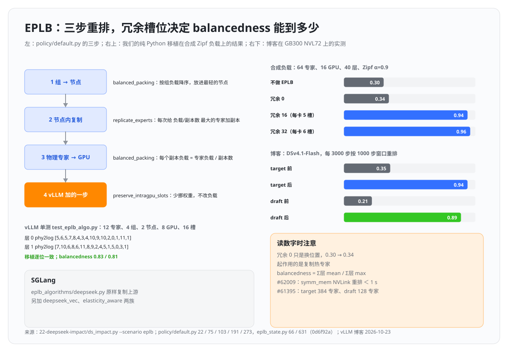

不加冗余（每卡 4 槽、64 个专家正好放满）时 EPLB 只能换位置，balancedness 从 0.30 到 0.34；加 16 个冗余槽到 0.94，32 个到 0.96。冗余是 EPLB 的主要收益来源，代价是每卡多放 1–2 个专家的权重。balancedness 的口径和 [eplb_state.py 631](https://github.com/vllm-project/vllm/blob/0d6f92a/vllm/distributed/eplb/eplb_state.py#L631) 的日志一致：各层 rank 负载均值之和除以各层最大值之和。10 月 23 日的博客在 GB300 NVL72 上测到同一个指标：每 3000 步按前 1000 步的负载重排一次，目标模型从 0.35 到 0.94，DSpark 草稿模型从 0.21 到 0.89，分别收回了到均匀路由差距的 97% 和 93%[[31]](https://vllm.ai/blog/2026-10-23-deepseek-v41-flash-pd-wide-ep)。

这个月 EPLB 的改动全在“搬权重”这一侧：#52641[[32]](https://github.com/vllm-project/vllm/pull/52641) 按链路争用分批迁移，#62081[[33]](https://github.com/vllm-project/vllm/pull/62081) 在 NIXL 读之前等待未完成的缓冲区拷贝，#61786[[34]](https://github.com/vllm-project/vllm/pull/61786) 把 1 字节的专家张量按 uint8 视图搬，#56716[[35]](https://github.com/vllm-project/vllm/pull/56716) 让预热步不进负载统计，#59611[[36]](https://github.com/vllm-project/vllm/pull/59611) 修 V4 冗余槽的权重加载，#57549[[37]](https://github.com/vllm-project/vllm/pull/57549) 给 DSpark 草稿模型加 EPLB。博客里还有两个快照之外的 PR：#62009[[31]](https://vllm.ai/blog/2026-10-23-deepseek-v41-flash-pd-wide-ep) 用 NVLink symm_mem 在一秒内重排整个 DEP32 且不停 decode，同时把副本映射和负载记录融进 MegaMoE kernel，每步省约 0.2 ms；#61395[[31]](https://vllm.ai/blog/2026-10-23-deepseek-v41-flash-pd-wide-ep) 支持目标和草稿模型各自独立的 EPLB（384 对 128 个专家）。

**DBO**。DualPipe 是训练侧的双向流水线[[9]](https://github.com/deepseek-ai/DualPipe)，推理侧借的是它的思路：把一个 batch 切成两个微批，一个算 attention 时另一个做 dispatch / combine。vLLM 叫它 dual batch overlap，博客原话是“integrated support for DeepSeek's microbatching strategy”[[27]](https://vllm.ai/blog/2025-12-17-large-scale-serving)。开关在 [parallel.py 258](https://github.com/vllm-project/vllm/blob/0d6f92a/vllm/config/parallel.py#L258)，默认关；decode 阈值 32 个 token、prefill 阈值 512 个，batch 小于阈值不切。执行由 [UBatchWrapper](https://github.com/vllm-project/vllm/blob/0d6f92a/vllm/v1/worker/gpu_ubatch_wrapper.py#L65) 负责。

DBO 的门槛比其他组件都多。[\_get_dbo_unsupported_features](https://github.com/vllm-project/vllm/blob/0d6f92a/vllm/config/vllm.py#L3262) 在 `VLLM_USE_V2_MODEL_RUNNER` 没有显式设置时直接把 DBO 列为不支持，注释写着 V2 下的 DBO 还在开发，要显式设环境变量；设了以后仍然不支持 LoRA、PP、PCP、多模态、hybrid 模型和 PIECEWISE CUDA graph。[\_raise_dbo_thresholds_for_spec_decode](https://github.com/vllm-project/vllm/blob/0d6f92a/vllm/config/vllm.py#L3240) 在投机解码时把阈值抬到“微批数 × decode query 长度”。V4.1 的 Engram 层直接拒绝 DBO（[vllm.py 1495](https://github.com/vllm-project/vllm/blob/0d6f92a/vllm/config/vllm.py#L1495)：“DeepSeek V4.1 Engram does not support DBO or microbatching”）。ROCm 上 DeepEP 高吞吐加 DBO 时自动关掉异步调度，因为那个组合会破坏 DP+EP 的生成精度（[vllm.py 1661](https://github.com/vllm-project/vllm/blob/0d6f92a/vllm/config/vllm.py#L1661)）。这个月 #61464[[38]](https://github.com/vllm-project/vllm/pull/61464) 让 MRV2 的 DBO 支持投机解码和 DCP，#63372[[39]](https://github.com/vllm-project/vllm/pull/63372)、#63476[[40]](https://github.com/vllm-project/vllm/pull/63476)、#60735[[41]](https://github.com/vllm-project/vllm/pull/60735) 修的都是两个微批各自的状态：路由专家行、失败上报、DeepEP 高吞吐缓冲区跨流的生命周期。

## 2.4 V3.2：稀疏注意力多出一份 indexer cache

V3.2-Exp 的 DSA（DeepSeek Sparse Attention）在 MLA 前面加了一个轻量 indexer：每个 query 先用 FP8 的小头和全部历史 key 算一遍 logits，选出 top-2048 个位置，MLA 只在这 2048 个位置上算[[19]](https://vllm.ai/blog/2025-09-29-deepseek-v3-2)。对 vLLM 来说，这意味着每层多一份 indexer K cache，它和 MLA 主 cache 的页大小、精度都不同：MLA 是 656 B 的 FP8 行，indexer K 是 128 维 FP8 加 4 B scale 共 132 B，FP4 版本 64 + 4 = 68 B（[\_indexer_k_cache_head_dim](https://github.com/vllm-project/vllm/blob/0d6f92a/vllm/models/deepseek_v41/attention.py#L101)）。上面 kvbytes 里 V3.2 每层 788 B，就是 656 + 132。

indexer 的 logits 由 DeepGEMM 的 `fp8_mqa_logits` 计算，top-k 一开始用 PyTorch，后来换成 DeepSelect。vLLM 的入口是 [SparseAttnIndexer](https://github.com/vllm-project/vllm/blob/0d6f92a/vllm/model_executor/layers/sparse_attn_indexer.py#L1056)，核心函数在同一文件第 443 行；DeepGEMM 侧的稀疏 logits 包装在 [fp8_fp4_sparse_mqa_logits](https://github.com/vllm-project/vllm/blob/0d6f92a/vllm/utils/deep_gemm.py#L930)。这个月的三个 PR 都在这条路径上：#62011[[42]](https://github.com/vllm-project/vllm/pull/62011) 让 V4.1 的 FP8 indexer cache 也走 DeepGEMM 稀疏 MQA logits，#62240[[43]](https://github.com/vllm-project/vllm/pull/62240) 在 prefill indexer 里用 DeepSelect 按 BF16 排序，和 decode 用同一个 kernel；#61615[[44]](https://github.com/vllm-project/vllm/pull/61615)、#60029[[45]](https://github.com/vllm-project/vllm/pull/60029) 让 FlashMLA 稀疏 prefill 在 SM90 上支持小头数、把 Q 头补齐到 64 就够，不必补到 128。

稀疏不是免费的。GB300 博客对比了 V3.2 的 DSA 和 R1 的 MLA：DSA 的 attention kernel 时间是 MLA 的 2.7 倍，因为每个 query 都要多跑一遍 indexer；只有上下文足够长、MLA 要读的 KV 足够多时 DSA 才划算，交叉点在 10k–20k token[[46]](https://vllm.ai/blog/2026-02-13-gb300-deepseek)。短请求为主的负载上，V3.2 不会比 R1 快。

## 2.5 V4：五种 cache、三个页桶

V4 把注意力换成混合压缩：c4a 层每 4 个位置压一条（8 个位置加权、步长 4），从中选 top-512。c128a 层每 128 个位置压一条，k = 8192。再加一个不压缩的 128 位置滑动窗口。1.6T 的 Pro 和 285B 的 Flash 都支持 1M 上下文。按博客的口径，V3.2 风格的 cache 在 1M 上下文要 83.9 GiB，V4 的混合压缩只要 9.62 GiB，8.7 倍；FP8 注意力加 FP4 indexer 再省约一半[[5]](https://vllm.ai/blog/2026-04-24-deepseek-v4)。ds_impact.py 复现了这两个数：

```text
-- V4（vLLM 博客 2026-04-24 的口径，BF16，1M 上下文）
   V3.2 风格：MLA BF16 1152 B + indexer K BF16 256 B，61 层，1M 上下文 = 83.9 GiB（博客 83.9）
   V4 混合压缩 9.62 GiB，8.7x；FP8 注意力 + FP4 indexer 再省约 2x
   c4a：每 4 个位置压 1 条，top-512；c128a：每 128 个位置压 1 条，k=8192；SWA 窗口 128
   256 个原生位置为一个逻辑块：c4a 块里 64 条，c128a 块里 2 条
```

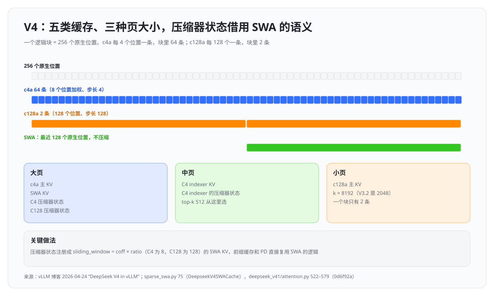

压缩本身不难，难的是“一个请求同时有五种 cache”：c4a 主 KV、SWA KV、C4 和 C128 两个压缩器的状态、C4 indexer KV，再加 c128a 主 KV。它们每条的字节数不同、每个原生位置产生的条数也不同。vLLM 的做法是定一个 256 原生位置的逻辑块：c4a 一个块里 64 条，c128a 一个块里 2 条，然后把五种 cache 按页大小归进三个桶，块表对所有 cache 共用一套编号[[5]](https://vllm.ai/blog/2026-04-24-deepseek-v4)。这就是启动参数里 `--block-size 256` 不能改的原因。

压缩器状态最巧：它其实是“最近几个位置还没凑够一条压缩记录的中间值”，vLLM 把它注册成一个 SWA KV，窗口是 coff × ratio。[compressor.py 159](https://github.com/vllm-project/vllm/blob/0d6f92a/vllm/models/deepseek_v4/compressor.py#L159) 里 `coff = 1 + (compress_ratio == 4)`，C4 的窗口是 8、C128 是 128。这样前缀缓存、PD 传输、卸载都不用为压缩器单独写逻辑，直接复用 SWA 的那套。SWA 本身在 [DeepseekV4SWACache](https://github.com/vllm-project/vllm/blob/0d6f92a/vllm/v1/attention/backends/mla/sparse_swa.py#L76)，indexer cache 在 [DeepseekV4IndexerCache](https://github.com/vllm-project/vllm/blob/0d6f92a/vllm/models/deepseek_v4/attention.py#L886)。博客还列了三组融合：压缩器 + RMSNorm + RoPE + 写 cache 快 1.4–3 倍，逆 RoPE + FP8 量化快 2–3 倍，Q norm + KV RoPE + K 写入快 10–20 倍；多流再给 5–6%。逆 RoPE 是因为 V4 的 K 和 V 共用一份，输出前要把 RoPE 转回去。

V4 的代码在 `vllm/models/deepseek_v4/` 下，按 amd / nvidia / common / cpu / xpu 分，合计 34831 行。vllm-ascend 和 vllm-mlu 各自独立支持 V4，不在这个数里。

## 2.6 V4.1：Engram、有界重放和 DSpark

V4.1-Flash 是因果 encoder-decoder，decode 激活 16B，prefill 激活 8B。40 层里最后一个 KV-source 层是第 20 层，它和之前的层写全局 KV，层 21–39 不再写 KV，只读前面写好的。全局 KV 用 FP4 压缩，每 token 只要 890 B。SWA 用 FP8，40 层每层 128 个位置。另有 Engram，一种按 n-gram 哈希查表的大嵌入[[47]](https://vllm.ai/blog/2026-10-07-deepseek-v41-flash)。vLLM Day-0 博客给的结果是低并发 1.9 倍、150 TPS 档位 5.3 倍（相对 Day-0 版本），有界重放让 TTFT 降约 30%。

**Engram**。Engram 表很大，H100 上放不进显存，所以 [config/engram.py 37](https://github.com/vllm-project/vllm/blob/0d6f92a/vllm/config/engram.py#L37) 默认 `cpu_offload=True`：表放在 host，按 n-gram 哈希去 host 查，再把行拷到 GPU。`embedding_across_dp`（第 40 行）、`dp_shared_memory`（第 44 行，默认自动）、`use_thp`（第 52 行）控制 DP rank 之间是否共享一份 host 表、是否用透明大页。实现在 [ParallelEngramEmbedding](https://github.com/vllm-project/vllm/blob/0d6f92a/vllm/models/deepseek_v41/common/engram.py#L953)，DP 共享存储在第 781 行，大页分配在第 916 行。Day-0 博客列的 Engram 优化有异步预取、TP/DP 统一并共享 host 表、THP 最多 10 倍：#56512、#57651、#56926[[47]](https://vllm.ai/blog/2026-10-07-deepseek-v41-flash)，加上 #59327[[48]](https://github.com/vllm-project/vllm/pull/59327) 排序行和内联大查询。这个月又有 #59923[[49]](https://github.com/vllm-project/vllm/pull/59923) 在 DP 之间交换打包的 FP8 Engram 行、#62091[[50]](https://github.com/vllm-project/vllm/pull/62091) 直接从对端 HBM 读 GPU 上的 Engram 表而不走 DP 集合通信，以及博客里的 #62359[[31]](https://vllm.ai/blog/2026-10-23-deepseek-v41-flash-pd-wide-ep)：共享 host 表改用 host-NUMA 的 cuMem 分配，GPU 页从 64 KB 变成 2 MB，32K 新 token 的 prefill 再快 2.8%。

**有界重放**。这是 V4.1 对 vLLM 改动最深的地方，起因是 SWA 和前缀缓存不兼容。全局 KV 随上下文增长，SWA 每请求固定：

```text
-- V4.1：全局 KV 随长度增长，SWA 每请求固定
   全局 KV 890 B/token；SWA 584 B × 128 位置 × 40 层 = 2.85 MiB/请求（fp8）
   上下文     4096：全局       3.5 MiB，SWA 占  45.1%
   上下文    32768：全局      27.8 MiB，SWA 占   9.3%
   上下文   131072：全局     111.2 MiB，SWA 占   2.5%
   上下文  1048576：全局     890.0 MiB，SWA 占   0.3%
-- 不做有界重放：前缀缓存要在每个 256 token 块边界存一份 SWA 快照
   每块全局 KV 222 KiB，SWA 快照 2920 KiB，后者是前者的 13.1x
```

4K 上下文时 SWA 占全部 KV 的 45%，1M 时只占 0.3%，看上去 SWA 不重要。但前缀缓存要能在任意块边界命中，每个 256 token 的块边界都得存一份当时的 SWA 窗口：一份 SWA 快照 2920 KiB，一块全局 KV 才 222 KiB，13.1 倍。博客的说法是“超过全局 KV 的 10 倍”[[47]](https://vllm.ai/blog/2026-10-07-deepseek-v41-flash)。有界重放的办法是 SWA 根本不进前缀缓存，命中以后重算窗口：

```text
-- V4.1 prefill 的 token×层 计数：40 层，最后一个 KV-source 层 = 20，窗口 128
   请求：前缀命中 32768，新 token 8192
   不重放（新 token 走全部层）                    327680
   decoder 侧重放（层 0–20 全部 token，层 21–39 只算最后 128 个）      174464   53.2%
   encoder 侧重放补算命中末尾 128 个位置（层 0–20）           2688    0.8%
   合计 177152，比不重放少 45.9%
   这是忽略层间成本差异的上限；博客实测 prefill 计算省 30–40%
-- 不同新 token 数下 decoder 侧重放省下的比例
   新 token    128：省   0.0%
   新 token    512：省  35.6%
   新 token   2048：省  44.5%
   新 token   8192：省  46.8%
   新 token  32768：省  47.3%
```

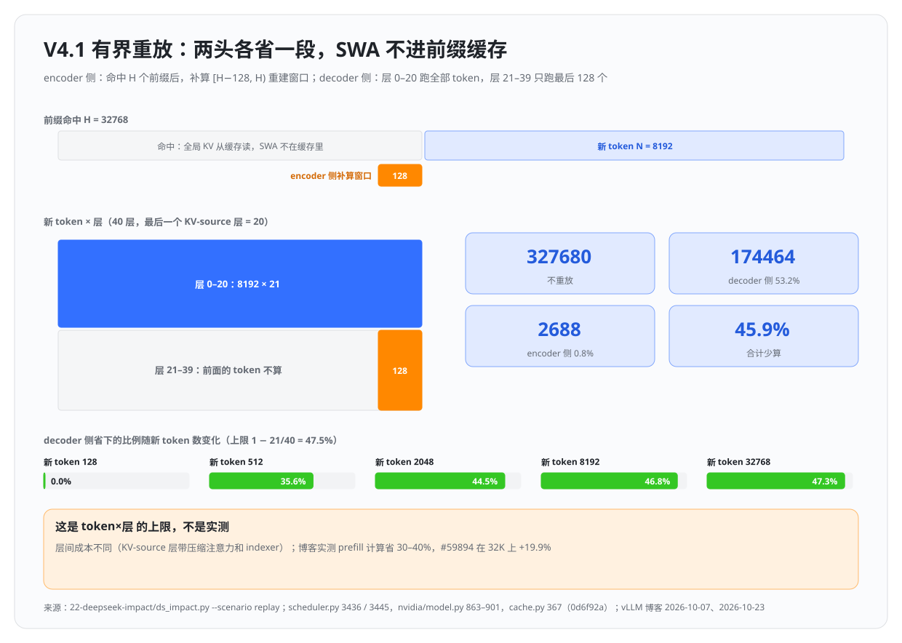

两头各有一段。encoder 侧：命中 H 个前缀 token 后，调度器把计算起点往回拨 128，重算 [H−128, H) 来重建 SWA 窗口，这部分只占 0.8%。逻辑在 [\_mark_prefix_replay](https://github.com/vllm-project/vllm/blob/0d6f92a/vllm/v1/core/sched/scheduler.py#L3445)：如果 KV 是 PD 对端传过来的、本来就带着窗口（[\_load_restores_replay_window](https://github.com/vllm-project/vllm/blob/0d6f92a/vllm/v1/core/sched/scheduler.py#L3436)），就不重放，这是 #59197[[51]](https://github.com/vllm-project/vllm/pull/59197) 修的。decoder 侧：[nvidia/model.py 868](https://github.com/vllm-project/vllm/blob/0d6f92a/vllm/models/deepseek_v41/nvidia/model.py#L868) 取 `cut = max(kv_source_layer_ids)`，层 0 到 cut 跑全部新 token，之后的层只跑每个请求最后 128 个，因为后面的层不写 KV，前面 token 的输出不会被任何人用到。新 token 越多省得越多，上限是 1 − 21/40 = 47.5%。这是只数 token×层的上限，博客实测 prefill 计算省 30–40%。

#59894[[52]](https://github.com/vllm-project/vllm/pull/59894) 把 decoder 侧的起点从层 21 提前到层 20：层 20 仍给全部 token 写 KV，但 indexer 和 attention 只对重放批算，32K 新 token 时 prefill 吞吐 +19.9%[[31]](https://vllm.ai/blog/2026-10-23-deepseek-v41-flash-pd-wide-ep)。#62183[[53]](https://github.com/vllm-project/vllm/pull/62183)、#62384[[54]](https://github.com/vllm-project/vllm/pull/62384) 让 PCP 也支持 encoder 侧和 decoder 侧重放，#64229[[55]](https://github.com/vllm-project/vllm/pull/64229) 修 KV 卸载时漏算重放的 SWA 分配，#59039[[56]](https://github.com/vllm-project/vllm/pull/59039) 在 ROCm 上开 decoder 侧重放。开关 `--swa-bounded-replay` 默认开（[cache.py 367](https://github.com/vllm-project/vllm/blob/0d6f92a/vllm/config/cache.py#L367)），但 [deepseek_v41/attention.py 539](https://github.com/vllm-project/vllm/blob/0d6f92a/vllm/models/deepseek_v41/attention.py#L539) 有三道门槛会把它关掉并退回“SWA 参与前缀缓存”：不是 Model Runner V2（只有 V2 会跳过重放 token 的分页 KV 写入）。PCP 下没开前缀缓存。ROCm 上 encoder 侧重放关闭，因为窗口截断逻辑在 FlashInfer 和 FlashMLA 的 prefill kernel 里，补齐的槽会越界。decoder 侧还有自己的门槛（[\_decoder_replay_supported](https://github.com/vllm-project/vllm/blob/0d6f92a/vllm/models/deepseek_v41/nvidia/model.py#L1295)）：PP 切在 cut 之后、序列并行或微批、cut 之后有 Engram 层、草稿模型的窗口比目标大，都不重放。

**DSpark 和自适应验证**。DSpark 是 V4 系列配的草稿模型，一次出多个草稿 token。博客在 V4-Pro 上统计，第 1 个草稿 token 被接受的概率超过 70%，第 7 个不到 10%[[57]](https://vllm.ai/blog/2026-08-14-dspark-adaptive-verification)。把所有草稿都送去验证，后面那些几乎白算。[enable_adaptive_verification](https://github.com/vllm-project/vllm/blob/0d6f92a/vllm/config/speculative.py#L613) 打开以后，[get_num_tokens](https://github.com/vllm-project/vllm/blob/0d6f92a/vllm/v1/worker/gpu/spec_decode/adaptive_verification.py#L399) 用置信度的累乘作为每个草稿位置的生存概率，把整个 batch 的草稿位置按生存概率排序，第 461 行取 `argmax(期望产出 / 耗时)` 决定只验前 B 个，耗时来自启动时测的 draft / verify 成本表。我们把这段移植过来，用合成的置信度和成本曲线跑：

```text
-- DSpark 自适应验证：32 个请求，每个 5 个草稿位置，验证成本在 96 token 后每 token +0.02 ms
   平均生存概率（第 k 个草稿被接受的概率）：k1 0.73  k2 0.50  k3 0.32  k4 0.19  k5 0.11
   全部验证：B=160，期望产出 91.1 token，耗时 9.42 ms，9.67 token/ms
   只验 top-B：B=105，期望产出 85.9 token，耗时 8.32 ms，10.32 token/ms
   不投机：B=0，产出 32 token，耗时 7.50 ms，4.27 token/ms
-- 换一条验证成本曲线：拐点越早（越接近算力瓶颈），B 越小
   拐点  32 token：B=110/160，8.95 token/ms（全验 8.51）
   拐点  64 token：B=106/160，9.58 token/ms（全验 9.05）
   拐点  96 token：B=105/160，10.32 token/ms（全验 9.67）
   拐点 160 token：B=128/160，11.91 token/ms（全验 11.19）
   拐点 256 token：B=160/160，12.14 token/ms（全验 12.14）
```

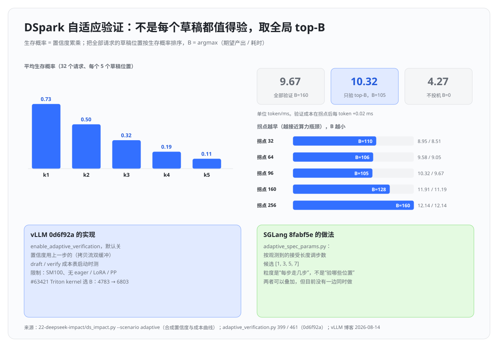

全验 160 个位置 9.67 token/ms，只验前 105 个 10.32，多 6.7%。验证成本曲线的拐点越早（越接近算力瓶颈），B 越小；拐点到 256 时验证几乎免费，B 就等于全部。这个开关默认关，DSpark 博客写明只支持 SM100，不支持 eager、LoRA、PP 和 logprobs；V4.1 recipe 默认打开它，AMD 覆盖成关。#63421[[58]](https://github.com/vllm-project/vllm/pull/63421) 把选 B 的那段从 torch.compile 换成 Triton kernel。

V4.1 还有一批 kernel：Mega-mHC 比 TileLang 版本快 1.14–1.51 倍，MegaGate 1.18–1.31 倍，mHC 多流延迟降约 4%，稀疏 MQA logits 在 512K 上下文快 14–23 倍，MegaAttention + NVFP4 KV 小 45%：#56962、#56266、#57603、#56254、#56935[[47]](https://vllm.ai/blog/2026-10-07-deepseek-v41-flash)，以及 #58634[[59]](https://github.com/vllm-project/vllm/pull/58634) 在 SM100 / SM103 上把小 batch 的 WO-A 和逆 RoPE、MXFP8 量化融在一起，ITL 降 6–7%。#61371[[60]](https://github.com/vllm-project/vllm/pull/61371) 把 FlashMLA 升到 2026.09.30 发布并换成交错的 V4.1 KV 布局，#62745[[61]](https://github.com/vllm-project/vllm/pull/62745)、#58685[[62]](https://github.com/vllm-project/vllm/pull/58685) 是 mHC 的 TileLang 路径和 JIT 监控。V4.1 目录 38686 行，是三代里最大的。

## 2.7 DeepInfer：同源引擎怎么对比

DeepInfer 开源时只做一件事：离线跑 V4.1-Flash，硬件是 SM100 和昇腾 950[[3]](https://github.com/deepseek-ai/DeepInfer)。它有注意力 DP / CP、EP + EPLB、DSpark、SWA 有界重放和 batch invariance，kernel 用 FlashMLA、DeepGEMM、DeepEP、TileKernels、DeepSelect 和 TileLang；重放保留长度由 `DEEPINFER_YOCO_PREFILL_KEEP_TOKENS=140` 控制，DSpark 的 nextn 默认 5。它没有 KV cache 系统、没有 PD 分离、没有 DP 负载均衡。致谢写的是“originally built primarily on vLLM, with additional inspiration from SGLang and TensorRT-LLM”。

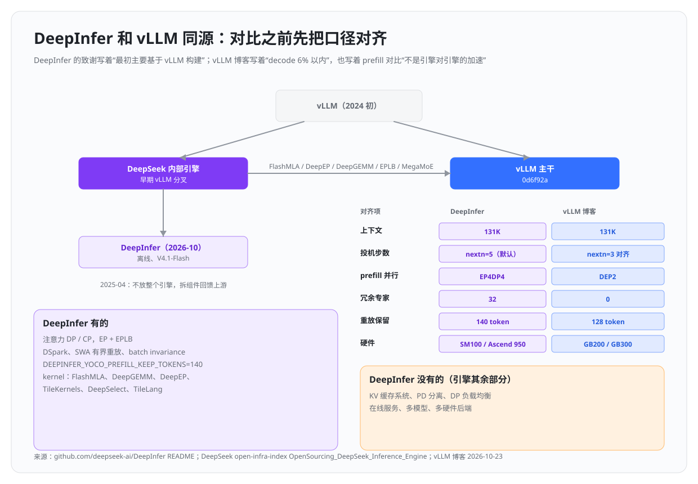

vLLM 10 月 23 日的博客拿它当参照[[31]](https://vllm.ai/blog/2026-10-23-deepseek-v41-flash-pd-wide-ep)。decode 用 DeepSeek 自己的配置（131K 上下文、nextn=3），GB200 上 batch 8 到 256 的吞吐都在 DeepInfer 公布值的 6% 以内。prefill 就不一样了：DeepInfer 的曲线是 EP4DP4、32 个冗余专家、140 token 重放，硬件没写；vLLM 是 GB300 上的 DEP2、0 冗余、128 token 重放、自己的 prompt。博客原话是“we do not read the gap between the two curves as an engine-to-engine speedup”。两边数字接近的原因，博客的解释是“share a lineage in both directions”：DeepInfer 起于 vLLM，vLLM 持续集成 DeepSeek 库里的 MegaAttn、MegaMoE 和 Mega-mHC。

这个对比的用处在于 DeepInfer 给了一个单模型、离线、没有服务开销的上界，谁快倒在其次。vLLM 的 decode 离它 6%，说明在线服务那一层（调度、KV 管理、PD、多模型抽象）在 decode 上的成本已经很小；prefill 两边的配置差太多，只能说 vLLM 的 DEP2 曲线“跟得上”。DeepInfer 两边的提交标题里都是 0 次，它对两个主干的影响目前只体现在博客的对照实验里。

## 2.8 复测对齐：把一个大数字拆回 PR

同一篇博客的标题数字是 GB300 NVL72 上 954K tok/s/GPU、P90 196 tok/s/user，比单节点聚合部署高 7.9 倍；4 张 B300 上单用户 826 tok/s[[31]](https://vllm.ai/blog/2026-10-23-deepseek-v41-flash-pd-wide-ep)。这些数字是整机的，能复用的是它拆出来的每一步。博客先量模型：DEP4、128K 上下文、每卡 64 个请求时，MoE 占目标模型 step 的 62%，attention 加 indexer 只占 13%；DEP32 下目标模型 forward 从 64K 的 8.86 ms 到 855K 的 9.53 ms，上下文涨 6.7 倍、时间只多 6.7%。这组数字用的是 #61339[[63]](https://github.com/vllm-project/vllm/pull/61339) 新加的 `vllm bench forward`，按固定形状计时，绕开调度和网络。

结论是 decode 受 MoE 限制而不受 KV 限制，所以 prefill 用小 DEP、decode 用大 EP。prefill 侧三个改动叠加：#59894[[52]](https://github.com/vllm-project/vllm/pull/59894) +19.9%、#62359[[31]](https://vllm.ai/blog/2026-10-23-deepseek-v41-flash-pd-wide-ep) +2.8%、#62240[[43]](https://github.com/vllm-project/vllm/pull/62240) +15.6%（都在 32K 新 token），4K–64K 合计 +35.6–43.9%，64K 从 71.2K 到 102.5K tok/s/GPU。decode 侧从 DEP4 扩到 DEP32，MegaMoE 时间从 13.4 ms 降到 6.0 ms，其余部分一直在 10 ms 左右，所以每卡吞吐的增益越来越小。

最反直觉的是 CPU。未优化的 DEP32 比 DEP16 还慢：每步 17.57 ms 对 13.84 ms，虽然 GPU 执行快 1.1 ms。每层都要全 rank 同步，一个 rank 慢就拖住全体，而 GPU step 越短留给 CPU 的余量越少。博客列的修复按效果排序：NIXL push 和 #61121[[31]](https://vllm.ai/blog/2026-10-23-deepseek-v41-flash-pd-wide-ep) 把 KV 读从同步改成推送，141K 到 440K tok/s/GPU。#61767[[64]](https://github.com/vllm-project/vllm/pull/61767) 用递归倍增的 CPU all-reduce 替换 Gloo，DP 同步从 10.8 ms 降到 1.5 ms。#61725[[31]](https://vllm.ai/blog/2026-10-23-deepseek-v41-flash-pd-wide-ep) 每步最多准入 4 个新 KV 加载，460K 到 516K。准入时随 prompt 长度增长的工作从 38.8 ms 降到 6.0 ms。低延迟场景另有 #61868[[65]](https://github.com/vllm-project/vllm/pull/61868) 和 #61869[[31]](https://vllm.ai/blog/2026-10-23-deepseek-v41-flash-pd-wide-ep) 的专用 decode 路径。这些修复没有一个是 DeepSeek 的组件，但都是 DeepSeek 的部署形态（大 EP、长上下文、PD）逼出来的。

## 2.9 SGLang 怎么接同一批东西

SGLang 8fabf5e[[66]](https://github.com/sgl-project/sglang/tree/8fabf5e) 接 DeepSeek 组件的方式和 vLLM 不同。kernel 走 sgl-project 自己打包的 wheel：[pyproject.toml](https://github.com/sgl-project/sglang/blob/8fabf5e/python/pyproject.toml) pin 了 `sgl-deep-ep==0.1.2.post1`、`sgl-deep-gemm==0.2.3.post2`、`tilelang==0.1.12`，FlashMLA 来自 sgl-project 的分叉 3620b63。EPLB 是原样复制：[eplb_algorithms/deepseek.py](https://github.com/sgl-project/sglang/blob/8fabf5e/python/sglang/srt/eplb/eplb_algorithms/deepseek.py) 第一行写着“This file is copied from https://github.com/deepseek-ai/EPLB/blob/main/eplb.py since that one is not a pypi package”，旁边另加了向量化版本和 elasticity_aware 版本。微批重叠叫 TBO（[two_batch_overlap.py](https://github.com/sgl-project/sglang/blob/8fabf5e/python/sglang/srt/batch_overlap/two_batch_overlap.py)）。DeepEP 在 [token_dispatcher/deepep.py](https://github.com/sgl-project/sglang/blob/8fabf5e/python/sglang/srt/layers/moe/token_dispatcher/deepep.py) 和 deepep_v2.py。

V4.1 的两侧重放在 SGLang 里也是两个文件：[encoder_swa_replay.py](https://github.com/sgl-project/sglang/blob/8fabf5e/python/sglang/srt/model_executor/encoder_swa_replay.py) 和 [decoder_swa_bounded_replay.py](https://github.com/sgl-project/sglang/blob/8fabf5e/python/sglang/srt/models/deepseek_common/decoder_swa_bounded_replay.py)。Engram 在 [layers/engram.py](https://github.com/sgl-project/sglang/blob/8fabf5e/python/sglang/srt/layers/engram.py)，配置在 [engram_config.py](https://github.com/sgl-project/sglang/blob/8fabf5e/python/sglang/srt/arg_groups/engram_config.py)。DSpark 是 [deepseek_v4_dspark.py](https://github.com/sgl-project/sglang/blob/8fabf5e/python/sglang/srt/models/deepseek_v4_dspark.py)。自适应这件事两边的粒度不同：SGLang 的 [adaptive_spec_params.py](https://github.com/sgl-project/sglang/blob/8fabf5e/python/sglang/srt/speculative/adaptive_spec_params.py) 按观测到的接受长度在 [1, 3, 5, 7] 里调“每步走几步”，vLLM 是步数不变、在整个 batch 里挑“验哪些位置”。两种做法可以叠加，目前没有哪一边同时做。

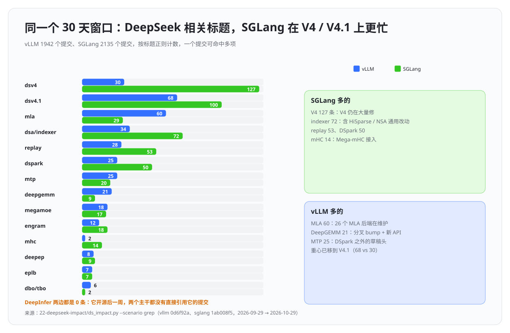

回到第 1 章的计数：SGLang 在 V4（127）、V4.1（100）、indexer（72）、重放（53）、DSpark（50）、mHC（14）上提交更多；vLLM 在 MLA（60）、DeepGEMM（21）、MTP（25）上更多。indexer 的 72 里有不少是 HiSparse / NSA 的通用改动，不全是 DeepSeek。比提交数更能说明差异的是接入方式：vLLM 用分叉 + cmake 源码编译，换 kernel 版本要发 PR 改 commit pin，一个月三次；SGLang 用自己的 wheel，换版本是改 pyproject 里的版本号，但 wheel 怎么从上游构建不在主仓库里。EPLB 上，vLLM 改写并加了减少迁移的一步，SGLang 原样复制并加了别的变体。

# 第 3 章 · 源码：DeepSeek 相关代码在 0d6f92a 的位置

按第 2 章的顺序列出入口。行号都是 0d6f92a 的，和前面各章一致。DeepSeek 模型本体在 `vllm/models/deepseek_v32/`、`deepseek_v4/`、`deepseek_v41/`，不在 `model_executor/models/`；后者只剩 V2 / V3 / R1 共用的 deepseek_v2.py 和 MTP 草稿头：

```text
-- vLLM 0d6f92a 里按模型分目录的 DeepSeek 代码（wc -l）
   vllm/models/deepseek_v32/                  4895  amd 1158 / nvidia 1849 / common 1193
   vllm/models/deepseek_v4/                  34831  amd 13166 / nvidia 7793 / common 6422 / cpu 1844 / xpu 3073
   vllm/models/deepseek_v41/                 38686  amd 15519 / nvidia 15009 / common 5340
   model_executor/models/deepseek_v2.py       2010  V2/V3/R1 共用
   model_executor/models/deepseek_mtp.py       572  MTP 草稿头
   合计 80994；三个按代际分的目录 78412
```

| 位置 | 是什么 | 读的时候盯什么 |
|-|-|-|
| [mla.py 44](https://github.com/vllm-project/vllm/blob/0d6f92a/vllm/model_executor/layers/mla.py#L44) | MultiHeadLatentAttentionWrapper，MLA 的 prefill / decode 两条路径 | decode 走吸收后的 MQA 形状，prefill 解压回每个头 |
| [deepseek_v2.py 1000](https://github.com/vllm-project/vllm/blob/0d6f92a/vllm/model_executor/models/deepseek_v2.py#L1000) | DeepseekV2MLAAttention，V2 / V3 / R1 共用 | W_UK / W_UV 吸收在哪一步做 |
| [deepseek_mtp.py 240](https://github.com/vllm-project/vllm/blob/0d6f92a/vllm/model_executor/models/deepseek_mtp.py#L240) | DeepSeekMTP 草稿头 | 和目标模型共享 embedding / lm_head |
| [flashmla.py 46](https://github.com/vllm-project/vllm/blob/0d6f92a/vllm/v1/attention/backends/mla/flashmla.py#L46) | FlashMLABackend，稠密 MLA decode | 页大小 64，FP8 布局 656 B |
| [flashmla_sparse.py 147](https://github.com/vllm-project/vllm/blob/0d6f92a/vllm/v1/attention/backends/mla/flashmla_sparse.py#L147) | FlashMLASparseBackend，V3.2 以后的稀疏 MLA | Q 头补齐到 64（#60029） |
| [sparse_attn_indexer.py 1056](https://github.com/vllm-project/vllm/blob/0d6f92a/vllm/model_executor/layers/sparse_attn_indexer.py#L1056) | SparseAttnIndexer，DSA 的 indexer | logits 走 DeepGEMM，top-k 走 DeepSelect |
| [deep_gemm.py 29](https://github.com/vllm-project/vllm/blob/0d6f92a/vllm/utils/deep_gemm.py#L29) | Blackwell 上自动关 DeepGEMM 的模型名单 | 第 44 行判断，vllm.py 1644 调用 |
| [deepgemm.cmake 30–41](https://github.com/vllm-project/vllm/blob/0d6f92a/cmake/external_projects/deepgemm.cmake#L30) | DeepGEMM 分叉的 commit pin 和差异注释 | 每次 bump 都改这里 |
| [install_python_libraries.sh 13](https://github.com/vllm-project/vllm/blob/0d6f92a/tools/ep_kernels/install_python_libraries.sh#L13) | DeepEP 上游 commit pin | 第 89 行 NCCL ≥ 2.30.4 |
| [deep_gemm_mega_moe.py 188](https://github.com/vllm-project/vllm/blob/0d6f92a/vllm/model_executor/layers/fused_moe/deep_gemm_mega_moe.py#L188) | MegaMoE 的硬件与形状检查 | 只认 SM100，维度 128 对齐 |
| [kernel.py 122](https://github.com/vllm-project/vllm/blob/0d6f92a/vllm/config/kernel.py#L122) | MoEBackend 枚举；166 原生 MegaMoE；172 indexer top-k 后端 | deep_select 只在 SM100a / SM103a |
| [all2all.py 203](https://github.com/vllm-project/vllm/blob/0d6f92a/vllm/distributed/device_communicators/all2all.py#L203) | DeepEP 三种 manager：HT 255、LL 314、v2 1040 | LL 走 RDMA 不占 SM（384） |
| [policy/default.py 273](https://github.com/vllm-project/vllm/blob/0d6f92a/vllm/distributed/eplb/policy/default.py#L273) | rebalance_experts，EPLB 入口 | 层次 / 全局两种策略的分支条件 |
| [policy/default.py 191](https://github.com/vllm-project/vllm/blob/0d6f92a/vllm/distributed/eplb/policy/default.py#L191) | preserve_intragpu_slots，vLLM 加的一步 | 只减迁移，不改负载 |
| [eplb_state.py 631](https://github.com/vllm-project/vllm/blob/0d6f92a/vllm/distributed/eplb/eplb_state.py#L631) | balancedness 日志 | 均值之和 / 最大值之和 |
| [parallel.py 258](https://github.com/vllm-project/vllm/blob/0d6f92a/vllm/config/parallel.py#L258) | enable_dbo 和两个阈值（263、268） | batch 小于阈值不切微批 |
| [vllm.py 3262](https://github.com/vllm-project/vllm/blob/0d6f92a/vllm/config/vllm.py#L3262) | DBO 不支持的组合 | MRV2 需要显式环境变量 |
| [gpu_ubatch_wrapper.py 65](https://github.com/vllm-project/vllm/blob/0d6f92a/vllm/v1/worker/gpu_ubatch_wrapper.py#L65) | UBatchWrapper，DBO 的执行侧 | 两个微批的流和事件 |
| [compressor.py 159](https://github.com/vllm-project/vllm/blob/0d6f92a/vllm/models/deepseek_v4/compressor.py#L159) | 压缩器状态注册成 SWA，窗口 coff × ratio | C4 窗口 8，C128 窗口 128 |
| [sparse_swa.py 76](https://github.com/vllm-project/vllm/blob/0d6f92a/vllm/v1/attention/backends/mla/sparse_swa.py#L76) | DeepseekV4SWACache；215 / 379 是重放的下界 | replay_start 之前没有窗口 KV |
| [cache.py 367](https://github.com/vllm-project/vllm/blob/0d6f92a/vllm/config/cache.py#L367) | swa_bounded_replay 默认 True | docstring 写明需要 MRV2 |
| [deepseek_v41/attention.py 539](https://github.com/vllm-project/vllm/blob/0d6f92a/vllm/models/deepseek_v41/attention.py#L539) | 重放的三道门槛：MRV2、PCP、ROCm | 被关掉时只有 warning_once |
| [scheduler.py 3445](https://github.com/vllm-project/vllm/blob/0d6f92a/vllm/v1/core/sched/scheduler.py#L3445) | \_mark_prefix_replay，encoder 侧回拨 | 3436：PD 传来的 KV 带窗口就不回拨 |
| [nvidia/model.py 868](https://github.com/vllm-project/vllm/blob/0d6f92a/vllm/models/deepseek_v41/nvidia/model.py#L868) | decoder 侧重放的起点 cut | 1295：不支持重放的条件 |
| [engram.py 953](https://github.com/vllm-project/vllm/blob/0d6f92a/vllm/models/deepseek_v41/common/engram.py#L953) | ParallelEngramEmbedding；781 DP 共享表；916 大页 | host 表和 GPU 表两条路径 |
| [adaptive_verification.py 461](https://github.com/vllm-project/vllm/blob/0d6f92a/vllm/v1/worker/gpu/spec_decode/adaptive_verification.py#L461) | 自适应验证的 argmax | 成本表来自启动时测量 |
| [test_eplb_algo.py 37](https://github.com/vllm-project/vllm/blob/0d6f92a/tests/distributed/test_eplb_algo.py#L37) | EPLB 单测的负载和期望布局 | ds_impact.py 的 eplb 场景逐位对齐它 |

SGLang 一侧的对应文件：[eplb_algorithms/deepseek.py](https://github.com/sgl-project/sglang/blob/8fabf5e/python/sglang/srt/eplb/eplb_algorithms/deepseek.py)、[two_batch_overlap.py](https://github.com/sgl-project/sglang/blob/8fabf5e/python/sglang/srt/batch_overlap/two_batch_overlap.py)、[encoder_swa_replay.py](https://github.com/sgl-project/sglang/blob/8fabf5e/python/sglang/srt/model_executor/encoder_swa_replay.py)、[decoder_swa_bounded_replay.py](https://github.com/sgl-project/sglang/blob/8fabf5e/python/sglang/srt/models/deepseek_common/decoder_swa_bounded_replay.py)、[adaptive_spec_params.py](https://github.com/sgl-project/sglang/blob/8fabf5e/python/sglang/srt/speculative/adaptive_spec_params.py)、[layers/engram.py](https://github.com/sgl-project/sglang/blob/8fabf5e/python/sglang/srt/layers/engram.py)、[flashmla_backend.py](https://github.com/sgl-project/sglang/blob/8fabf5e/python/sglang/srt/layers/attention/flashmla_backend.py)。读的时候拿同一个问题去对：重放的窗口长度从哪里来，EPLB 迁移时怎么保留旧槽位，自适应调的是步数还是位置。

# 第 4 章 · 实验：逐个关组件，量出各自的份额

## 4.1 离线复现正文数字

[22-deepseek-impact](../22-deepseek-impact) 不需要 GPU，先把正文里的数字跑出来，再改参数看趋势：

```bash
cd zero-to-vllm/22-deepseek-impact
python3 ds_impact.py --scenario all
python3 -m unittest test_ds_impact -v          # 22 个测试
# 改 SWA 精度和块大小，看快照倍数怎么变
python3 ds_impact.py --scenario kvbytes --swa-dtype mxfp8 --block 256
# 更偏的路由、更多冗余
python3 ds_impact.py --scenario eplb --experts 64 --gpus 16 --redundant 16 --alpha 1.1
# 新 token 少时重放省得少
python3 ds_impact.py --scenario replay --hit 32768 --new 512
# 验证成本拐点提前
python3 ds_impact.py --scenario adaptive --reqs 64 --budget-knee 64
# 在两边的 30 天窗口里按标题找 PR
python3 ds_impact.py --grep "deep_?gemm|mega ?moe"
```

eplb 场景的单测把 vLLM 单测里两层的 phy2log 逐位钉住，换了算法实现先失败；replay 场景对新 token 数扫一遍，能看到 128 个新 token 时一点不省（新 token 全在窗口里），512 时就省 35.6%。

## 4.2 在线：逐项关组件

有 GPU 时，用 #61339[[63]](https://github.com/vllm-project/vllm/pull/61339) 的 `vllm bench forward` 量固定形状的 forward，避开调度和网络噪声；再用 `vllm bench serve` 量端到端。每次只动一个开关，其余保持 recipe 默认：

```bash
# 基线：V4.1-Flash，DEP 部署
vllm serve deepseek-ai/DeepSeek-V4.1-Flash --data-parallel-size 4 --enable-expert-parallel \
  --kv-cache-dtype fp8 --block-size 256
# 1) 关 DeepGEMM：FP8 GEMM 回退
VLLM_USE_DEEP_GEMM=0 vllm serve ...
# 2) 换 all2all：NCCL 默认 → DeepEP 低延迟（decode）/ 高吞吐（prefill）
vllm serve ... --all2all-backend deepep_low_latency
# 3) EPLB：先看日志里的 balancedness，再加冗余
vllm serve ... --enable-eplb --eplb-config '{"num_redundant_experts": 32}'
# 4) DBO：MRV2 下需要显式环境变量
VLLM_USE_V2_MODEL_RUNNER=1 vllm serve ... --enable-dbo
# 5) 有界重放：关掉看命中前缀后的 TTFT
vllm serve ... --no-swa-bounded-replay
```

读结果时注意两点。第一，有些组合会被配置检查直接拒绝或静默关掉：V4.1 的 Engram 层不接受 DBO，会直接 ValueError；有界重放在 V1 runner 和 ROCm 上只打一条 warning 然后退回，日志不看就以为开着。第二，EPLB 的收益要等第一次重排之后才出现（默认每 3000 步），短压测看不到；看 `balancedness` 日志比看吞吐更直接。

## 4.3 V4.1 的两个 A/B

**有界重放**。造一批共享 32K 前缀、新 token 分别为 512、2048、8192 的请求，开关 `--swa-bounded-replay` 各跑一遍。按 4.1 的上限，512 新 token 时 decoder 侧最多省 35.6%，8192 时 46.8%；博客在 DEP2 上测到 prefill 计算省 30–40%，TTFT 降约 30%[[47]](https://vllm.ai/blog/2026-10-07-deepseek-v41-flash)。如果关和开几乎一样，先查是不是被门槛关掉了。

**自适应验证**。在 SM100 上开 DSpark，`--speculative-config '{"method":"dspark","num_speculative_tokens":5,"enable_adaptive_verification":true}'` 对比 false。低并发时验证几乎免费，两者差不多；高并发时验证成本接近算力瓶颈，自适应的收益才出来，这和 adaptive 场景里拐点越早 B 越小是同一件事。

## 4.4 和 DeepInfer 对齐

要和 DeepInfer 的公布值比，先把下面几项对齐，否则差异说明不了引擎：

| 对齐项 | DeepInfer | vLLM 侧 |
|-|-|-|
| 上下文长度 | 131K | 同 |
| 投机步数 | nextn 默认 5 | 博客 decode 对齐用 nextn=3 |
| prefill 并行 | EP4DP4 | 博客用 DEP2 |
| 冗余专家 | 32 | 博客用 0 |
| 重放保留长度 | DEEPINFER_YOCO_PREFILL_KEEP_TOKENS=140 | vLLM 窗口 128 |
| 硬件 | SM100 / 昇腾 950（prefill 图未标注） | GB200 / GB300 |
| 服务形态 | 离线、单模型 | 在线，可带 PD 和 Wide-EP |

decode 是能对齐的：上下文、nextn、batch 大小一致时，博客测到 6% 以内。prefill 至少要对齐并行方式和冗余专家数；重放 140 和 128 的差别对 prefill 计算量影响很小（每请求差 12 个 token×层数），但对齐了才能排除。

# 第 5 章 · 坑与看法

## 5.1 踩过的坑

**开关开着，功能没开。**有界重放默认 True，但不是 Model Runner V2、PCP 下没开前缀缓存、ROCm 上 encoder 侧，这三种情况 [deepseek_v41/attention.py 539](https://github.com/vllm-project/vllm/blob/0d6f92a/vllm/models/deepseek_v41/attention.py#L539) 都只打一条 `warning_once` 就退回“SWA 参与前缀缓存”。启动成功，命中率也正常，只是命中以后 TTFT 降不下来。decoder 侧的门槛更隐蔽：PP 切在 cut 之后、开了微批、cut 之后有 Engram 层，都直接不重放。压测前在启动日志里 grep 一下 replay 相关的 warning，比看 TTFT 曲线猜快得多。

**DBO 要两步才能开。**只加 `--enable-dbo`，在没有显式设 `VLLM_USE_V2_MODEL_RUNNER` 的环境里，[\_get_dbo_unsupported_features](https://github.com/vllm-project/vllm/blob/0d6f92a/vllm/config/vllm.py#L3262) 会把它列为不支持。设了 env 以后还要过 LoRA、PP、PCP、多模态、hybrid 模型、PIECEWISE CUDA graph 这一串检查。V4.1 更直接，Engram 层在 [vllm.py 1495](https://github.com/vllm-project/vllm/blob/0d6f92a/vllm/config/vllm.py#L1495) 抛 ValueError。所以 V4.1 上谈不上“DBO 收益多少”，它根本开不了；Wide-EP 的通信隐藏在 V4.1 上靠的是 MegaMoE 把通信融进 kernel。

**DeepGEMM 默认开，但会被悄悄关掉。**[deep_gemm.py 29](https://github.com/vllm-project/vllm/blob/0d6f92a/vllm/utils/deep_gemm.py#L29) 的名单在 Blackwell 上对部分模型自动关 DeepGEMM，日志只有一行 `Auto-disabled DeepGemm`。DeepSeek 不在名单里，但同一个集群混部 Qwen3.5 时，两个服务的 FP8 GEMM 走的是不同 kernel，拿一个服务的 profile 去推另一个就会错。反过来，在 quant_config 里显式写了 `use_deep_gemm`，这条名单就不生效，精度问题要自己扛。

**MegaMoE 的门槛是硬件和形状两条。**[check_deep_gemm_mega_moe_supported](https://github.com/vllm-project/vllm/blob/0d6f92a/vllm/model_executor/layers/fused_moe/deep_gemm_mega_moe.py#L188) 只认 SM100 家族，hidden 和 intermediate 都要 128 对齐。H100 和 SM120 上指定 `--moe-backend deep_gemm_mega_moe` 直接起不来；自己剪枝或蒸馏出来的 DeepSeek 变体，只要中间维度不是 128 的倍数也一样。选中 MegaMoE 以后 EP 通信由 kernel 自己做，`all2all_backend` 怎么设都不影响 MoE 层，排查通信问题时别在那个参数上浪费时间。

**EPLB 不给冗余槽，收益很小。**第 2.3 节的模拟里，0 个冗余槽时 balancedness 只从 0.30 到 0.34，16 个才到 0.94。`num_redundant_experts` 默认是 0，只加 `--enable-eplb` 不改它，等于只允许专家换卡。另一个常见误判是压测太短：默认每 3000 步才重排一次，前 3000 步的数字和不开 EPLB 一样。

**block size 改不得。**V4 / V4.1 的五种 cache 共用一套以 256 原生位置为单位的块表，c128a 一个块里只有 2 条。把 `--block-size` 改小想提高前缀命中粒度，结果是页桶对不齐，要么启动报错，要么 KV 容量远低于估算。前缀缓存的命中粒度在 V4.1 上只能是 256 token。

**DeepEP 的依赖在镜像里，不在 pip 里。**DeepEP 由 [install_python_libraries.sh](https://github.com/vllm-project/vllm/blob/0d6f92a/tools/ep_kernels/install_python_libraries.sh#L13) 按 commit 编译，v2 还要求 NCCL 不低于 2.30.4（第 89 行）。自己构建镜像时漏了这一步，`deepep_*` 后端在 import 时失败；NCCL 版本低时可能直接 hang 住，连报错都没有。SM103 和 SM107a 的构建目标是这个月才加的，B300 / GB300 用旧镜像会缺 kernel。

**ROCm 上的组合会被改写。**DeepEP 高吞吐加 DBO 时，[vllm.py 1661](https://github.com/vllm-project/vllm/blob/0d6f92a/vllm/config/vllm.py#L1661) 自动关掉异步调度，因为这个组合会破坏 DP+EP 的生成精度。吞吐掉了以后去查 DeepEP，其实是调度从异步变成了同步。同理，AMD 的 V4.1 recipe 把自适应验证显式关掉，用 NVIDIA 的配置文件直接上 MI355X 会被拒绝。

**和 DeepInfer 比数字前先对配置。**第 4.4 节那张表里任何一项不一致，差异都说明不了引擎。最常见的错是拿 DeepInfer 的 prefill 曲线（EP4DP4、32 冗余）和自己的 DEP2 比，然后得出“vLLM 快 / 慢 X 倍”。博客自己都说了不能这样读。

## 5.2 我们的看法

第一，分叉加 commit pin 和自打 wheel 是同一个问题的两种答案。vLLM 把 DeepGEMM、FlashMLA、DeepSelect 分叉到 vllm-project 名下，cmake 按 commit 拉源码编，差异写在 cmake 注释里，谁都能看到分叉相对上游多了什么；代价是每次升级都要一个 PR，这个月 DeepGEMM 动了三次，而且主仓库的 CI 要扛这些 kernel 的编译时间。SGLang 用 sgl-deep-gemm、sgl-deep-ep 这类 wheel，主仓库只改版本号，CI 轻得多；代价是 wheel 从哪个上游 commit、打了哪些补丁构建，在主仓库里看不到。vLLM 要覆盖 SM120、ROCm、XPU 和几十个非 DeepSeek 模型，分叉的可见性更重要；SGLang 更贴 DeepSeek 的硬件和模型，wheel 的轻量更划算。两边的选择都和各自的覆盖面一致。

第二，按代际分目录是在用代码量换隔离。`deepseek_v32/`、`deepseek_v4/`、`deepseek_v41/` 合计 78412 行，每一代再按 amd / nvidia / common 分。好处是 V4.1 的改动不会碰坏 V3.2，Day-0 支持可以在一个目录里快速堆；坏处是 MLA FP8 布局、indexer、SWA 这些共用的东西会在三处各演化一份，bug 修复要靠人记得同步。VLLM-21 里讲的快车道 RFC 也是这个取舍。判断它是否健康的指标是：下一代模型出来时，有多少代码从老目录收回了 `model_executor/layers/`，新目录又多了多少行倒在其次。

第三，DeepSeek 带来的收益绝大部分是 opt-in 的。九个开关里只有 DeepGEMM 和有界重放默认开，而有界重放还要 MRV2 才生效。用默认参数起一个 DeepSeek 服务，拿到的是 MLA 的显存收益和 DeepGEMM 的 FP8 GEMM，EP 通信走 NCCL，没有 EPLB，没有 DBO，没有自适应验证。vLLM 这样做是对的：每个组件都有硬件和组合门槛，默认开的话门槛不满足时会在更多机器上报错。但这意味着“vLLM 跑 DeepSeek 多快”这个问题没有单一答案，部署方得自己走一遍第 6 章的清单。

第四，规模上去以后，瓶颈从 kernel 移到了 CPU。第 2.8 节里 DEP32 比 DEP16 慢、修复它的 PR 没有一个是 DeepSeek 的组件：NIXL push、递归倍增 all-reduce、KV 加载准入限流。DeepSeek 把 kernel 和通信库都开源了，但它的线上系统怎么做调度、怎么做 DP 同步，开源物里没有，DeepInfer 也没有（它没有 PD 和 DP 负载均衡）。这部分是 vLLM 自己要补的，也是在线引擎和 DeepInfer 这类离线上界之间差距最大的地方。DeepSeek 开源改写的是 vLLM 的 kernel 层和 KV 层；服务层的账，还得 vLLM 自己算。

# 第 6 章 · 部署 DeepSeek 模型前的核对清单

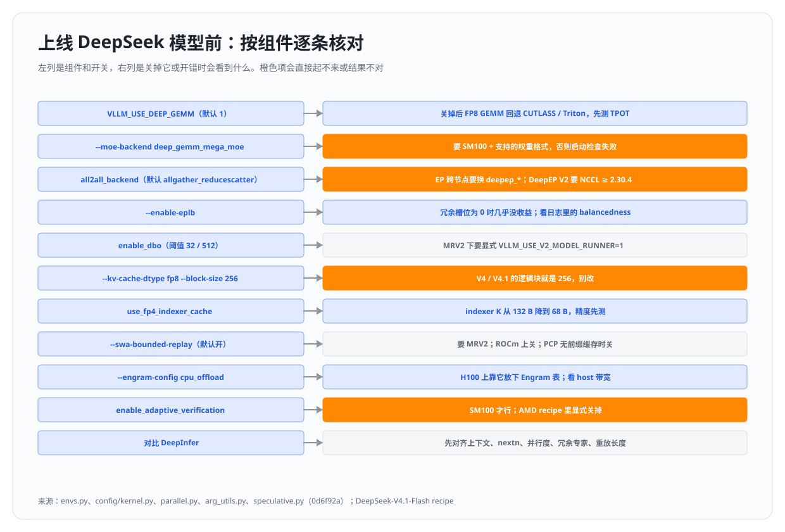

> 📌 **上线 DeepSeek V3 / V3.2 / V4 / V4.1 前，逐条核对**
> - 硬件：MegaMoE、DeepSelect、自适应验证只在 SM100 家族。SM120 走 vLLM 分叉里的 DeepGEMM 移植。H100 上 V4.1 要 `--engram-config '{"cpu_offload":true}'` 和 `VLLM_USE_V2_MODEL_RUNNER=1`。
> - KV：`--kv-cache-dtype fp8 --block-size 256`，block size 不改；V4 的 FP4 indexer cache 把每层 indexer K 从 132 B 降到 68 B，先测精度再开。
> - DeepGEMM：启动日志里不应出现 `Auto-disabled DeepGemm`；显式设了 `use_deep_gemm` 时自动排除名单不生效。
> - EP 通信：跨节点换 `deepep_high_throughput`（prefill）或 `deepep_low_latency`（decode）。DeepEP v2 要 NCCL ≥ 2.30.4。选了 MegaMoE 后 MoE 层不再走 all2all。
> - EPLB：同时设 `num_redundant_experts`，每卡 1–2 个冗余槽；看 `balancedness` 日志，压测要跑过第一次重排（默认 3000 步）。
> - DBO：要显式设 MRV2 env，LoRA、PP、PCP、多模态、hybrid 模型不支持，V4.1 Engram 直接拒绝，ROCm 上 DeepEP 高吞吐加 DBO 会关异步调度。
> - V4.1 有界重放：确认是 MRV2、非 ROCm、PCP 下开了前缀缓存，启动日志里没有回退 warning，用共享前缀请求对比开关前后的 TTFT。
> - DSpark：自适应验证只在 SM100，不支持 eager、LoRA、PP、logprobs；高并发才有收益，低并发两者差不多。
> - V3.2 / V4 稀疏注意力：短请求为主（10k–20k token 以下）时，DSA 不比 MLA 快，按负载的上下文分布选模型。
> - 大 EP（DEP16 以上）：先看每步 CPU 时间和 DP 同步，再看 kernel；PD 部署用 push 模式的 KV 传输。
> - 和 DeepInfer 对比：上下文、nextn、并行方式、冗余专家数、重放长度、硬件六项全部对齐后再比。

## 学到的

这一篇我们换了一种读源码的切法：不按模块，按来源。拿一个外部仓库（FlashMLA、DeepEP、DeepGEMM、EPLB……）当线索，在 vLLM 里找三样东西：它从哪里进来（cmake 分叉、脚本 pin、还是改写成 Python），挂在哪个开关上、默认值是什么，以及开关不满足条件时去了哪里。第三样最容易漏，也最有用，因为线上的大部分“没效果”都是条件不满足时的静默回退，而这些回退只写在代码里。

另一点是性能数字的口径。同一个组件，kernel 倍数、step 时间、端到端吞吐可以差一个数量级；同一句“匹配 DeepInfer”，decode 和 prefill 的含义完全不同。读博客时先问这个数字是在哪一层量的、和谁比、配置是否对齐，再决定能不能拿来估自己的容量。vLLM 10 月 23 日那篇博客最该学的是它把大数字拆回一个个 PR、给每一步标出前后值的做法，954K 这个数本身倒在其次。第 4 章的实验就是照这个思路设计的。

回到导读里的第一句：DeepSeek 和 vLLM 是双向同源。DeepSeek 拿 vLLM 起家，再把 kernel 和算法抽成独立库还回来；vLLM 接住这些库，又为每一代模型改写 KV cache，自己补上服务层。DeepInfer 是这个循环的最新一环。下一次 DeepSeek 发新模型时，按第 1 章的开关表和第 6 章的清单走一遍，基本就能知道 vLLM 又改了哪几层。

# 参考文献

按正文首次引用顺序编号，资料截至 2026 年 10 月底。源码以 vllm-project/vllm 主干提交 0d6f92a（2026 年 10 月 29 日）和 v0.32.0 发行版为准；SGLang 对照以 sgl-project/sglang 主干 8fabf5e 为准。

[1] DeepSeek-AI. Open Infra Index (Open Source Week, 2025-02-24..28). GitHub [https://github.com/deepseek-ai/open-infra-index](https://github.com/deepseek-ai/open-infra-index)

[2] DeepSeek-AI. The Path to Open-Sourcing the DeepSeek Inference Engine. GitHub (2025-04) [https://github.com/deepseek-ai/open-infra-index/blob/main/OpenSourcing_DeepSeek_Inference_Engine/README.md](https://github.com/deepseek-ai/open-infra-index/blob/main/OpenSourcing_DeepSeek_Inference_Engine/README.md)

[3] DeepSeek-AI. DeepInfer. GitHub [https://github.com/deepseek-ai/DeepInfer](https://github.com/deepseek-ai/DeepInfer)

[4] vllm-project. recipes/models/deepseek-ai/DeepSeek-V4.1-Flash.yaml. GitHub (0d6f92a) [https://github.com/vllm-project/vllm/blob/0d6f92a/recipes/models/deepseek-ai/DeepSeek-V4.1-Flash.yaml](https://github.com/vllm-project/vllm/blob/0d6f92a/recipes/models/deepseek-ai/DeepSeek-V4.1-Flash.yaml)

[5] vLLM Team. DeepSeek-V4 in vLLM: Hybrid Compressed Attention on a Unified KV Cache. vLLM Blog (2026-04-24) [https://vllm.ai/blog/2026-04-24-deepseek-v4](https://vllm.ai/blog/2026-04-24-deepseek-v4)

[6] DeepSeek-AI. DeepGEMM. GitHub [https://github.com/deepseek-ai/DeepGEMM](https://github.com/deepseek-ai/DeepGEMM)

[7] DeepSeek-AI. DeepEP. GitHub [https://github.com/deepseek-ai/DeepEP](https://github.com/deepseek-ai/DeepEP)

[8] DeepSeek-AI. EPLB: Expert Parallelism Load Balancer. GitHub [https://github.com/deepseek-ai/eplb](https://github.com/deepseek-ai/eplb)

[9] DeepSeek-AI. DualPipe. GitHub [https://github.com/deepseek-ai/DualPipe](https://github.com/deepseek-ai/DualPipe)

[10] DeepSeek-AI. DeepSelect. GitHub [https://github.com/deepseek-ai/DeepSelect](https://github.com/deepseek-ai/DeepSelect)

[11] vllm-project. vLLM commits 2026-09-29..2026-10-29 (0d6f92a). GitHub [https://github.com/vllm-project/vllm/commits/0d6f92a](https://github.com/vllm-project/vllm/commits/0d6f92a)

[12] sgl-project. SGLang commits 2026-09-29..2026-10-29 (1ab008f5). GitHub [https://github.com/sgl-project/sglang/commits/1ab008f5](https://github.com/sgl-project/sglang/commits/1ab008f5)

[13] DeepSeek-AI. DeepSeek-V2: A Strong, Economical, and Efficient Mixture-of-Experts Language Model. arXiv (2024) [https://arxiv.org/abs/2405.04434](https://arxiv.org/abs/2405.04434)

[14] DeepSeek-AI. DeepSeek-V3 Technical Report. arXiv (2024) [https://arxiv.org/abs/2412.19437](https://arxiv.org/abs/2412.19437)

[15] DeepSeek-AI. Day 6: One More Thing, DeepSeek-V3/R1 Inference System Overview. GitHub (2025-03-01) [https://github.com/deepseek-ai/open-infra-index/blob/main/202502OpenSourceWeek/day_6_one_more_thing_deepseekV3R1_inference_system_overview.md](https://github.com/deepseek-ai/open-infra-index/blob/main/202502OpenSourceWeek/day_6_one_more_thing_deepseekV3R1_inference_system_overview.md)

[16] Zhao et al. Insights into DeepSeek-V3: Scaling Challenges and Reflections on Hardware for AI Architectures. ISCA 2025, arXiv:2505.09343 [https://arxiv.org/abs/2505.09343](https://arxiv.org/abs/2505.09343)

[17] vLLM Project. Release v0.7.1. GitHub (2025-02-01) [https://github.com/vllm-project/vllm/releases/tag/v0.7.1](https://github.com/vllm-project/vllm/releases/tag/v0.7.1)

[18] vllm-project/vllm PR #57320: [Feature] Skip MLA weight absorption when weights are pre-processed. GitHub (merged 2026-10-17) [https://github.com/vllm-project/vllm/pull/57320](https://github.com/vllm-project/vllm/pull/57320)

[19] vLLM Team. DeepSeek-V3.2-Exp in vLLM: Fine-Grained Sparse Attention in Action. vLLM Blog (2025-09-29) [https://vllm.ai/blog/2025-09-29-deepseek-v3-2](https://vllm.ai/blog/2025-09-29-deepseek-v3-2)

[20] vllm-project/vllm PR #58305: [Perf][SM120][MLA] Use compact FP8 KV rows for NoPE models. GitHub (merged 2026-10-28) [https://github.com/vllm-project/vllm/pull/58305](https://github.com/vllm-project/vllm/pull/58305)

[21] vllm-project/vllm PR #61149: [Kernel][Build] Bump DeepGEMM to the 26/09/30 release and adapt the sparse indexer. GitHub (merged 2026-10-12) [https://github.com/vllm-project/vllm/pull/61149](https://github.com/vllm-project/vllm/pull/61149)

[22] vllm-project/vllm PR #61744: Update DeepGEMM commit. GitHub (merged 2026-10-16) [https://github.com/vllm-project/vllm/pull/61744](https://github.com/vllm-project/vllm/pull/61744)

[23] vllm-project/vllm PR #63253: [Kernel] Update DeepGEMM commit. GitHub (merged 2026-10-25) [https://github.com/vllm-project/vllm/pull/63253](https://github.com/vllm-project/vllm/pull/63253)

[24] vllm-project/vllm PR #64411: [Kernel] Update DeepGEMM commit. GitHub (merged 2026-10-29) [https://github.com/vllm-project/vllm/pull/64411](https://github.com/vllm-project/vllm/pull/64411)

[25] vllm-project/vllm PR #61829: [CI/Build] Build DeepEP for SM103 (B300/GB300) in the Docker image. GitHub (merged 2026-10-18) [https://github.com/vllm-project/vllm/pull/61829](https://github.com/vllm-project/vllm/pull/61829)

[26] vllm-project/vllm PR #61442: [CI][Tests] Add SM107a to DeepEP build. GitHub (merged 2026-10-19) [https://github.com/vllm-project/vllm/pull/61442](https://github.com/vllm-project/vllm/pull/61442)

[27] vLLM Team. vLLM Large Scale Serving: DeepSeek @ 2.2k tok/s/H200 with Wide-EP. vLLM Blog (2025-12-17) [https://vllm.ai/blog/2025-12-17-large-scale-serving](https://vllm.ai/blog/2025-12-17-large-scale-serving)

[28] vllm-project/vllm PR #58053: [Refactor] Abstract DeepGemm MegaMOE backend. GitHub (merged 2026-10-08) [https://github.com/vllm-project/vllm/pull/58053](https://github.com/vllm-project/vllm/pull/58053)

[29] vllm-project/vllm PR #61538: [MoE] Unify DeepGEMM MegaMoE experts behind one feature-matrix layer; add NVFP4. GitHub (merged 2026-10-15) [https://github.com/vllm-project/vllm/pull/61538](https://github.com/vllm-project/vllm/pull/61538)

[30] vllm-project/vllm PR #57991: [WideEP] Change DeepEPv2 to auto select hybrid mode by default. GitHub (merged 2026-09-29) [https://github.com/vllm-project/vllm/pull/57991](https://github.com/vllm-project/vllm/pull/57991)

[31] vLLM Team. Serving DeepSeek-V4.1-Flash at Scale: vLLM Matches DeepInfer and Scales to GB300 NVL72. vLLM Blog (2026-10-23) [https://vllm.ai/blog/2026-10-23-deepseek-v41-flash-pd-wide-ep](https://vllm.ai/blog/2026-10-23-deepseek-v41-flash-pd-wide-ep)

[32] vllm-project/vllm PR #52641: [EPLB] Add contention-aware expert migration batching. GitHub (merged 2026-10-03) [https://github.com/vllm-project/vllm/pull/52641](https://github.com/vllm-project/vllm/pull/52641)

[33] vllm-project/vllm PR #62081: [Bugfix][EPLB] Wait for pending expert buffer copies before NIXL READs. GitHub (merged 2026-10-18) [https://github.com/vllm-project/vllm/pull/62081](https://github.com/vllm-project/vllm/pull/62081)

[34] vllm-project/vllm PR #61786: [Bugfix][EPLB] Move 1-byte expert tensors as uint8 views. GitHub (merged 2026-10-22) [https://github.com/vllm-project/vllm/pull/61786](https://github.com/vllm-project/vllm/pull/61786)

[35] vllm-project/vllm PR #56716: [MRV2] Keep warmup out of the EPLB load stats. GitHub (merged 2026-10-14) [https://github.com/vllm-project/vllm/pull/56716](https://github.com/vllm-project/vllm/pull/56716)

[36] vllm-project/vllm PR #59611: [Bugfix][DeepSeek V4] Load redundant EPLB expert slots. GitHub (merged 2026-10-20) [https://github.com/vllm-project/vllm/pull/59611](https://github.com/vllm-project/vllm/pull/59611)

[37] vllm-project/vllm PR #57549: [EPLB] Add EPLB support to dspark draft models (DeepSeekV4). GitHub (merged 2026-10-12) [https://github.com/vllm-project/vllm/pull/57549](https://github.com/vllm-project/vllm/pull/57549)

[38] vllm-project/vllm PR #61464: [MRV2][DBO] Support DBO with speculative decoding and DCP. GitHub (merged 2026-10-28) [https://github.com/vllm-project/vllm/pull/61464](https://github.com/vllm-project/vllm/pull/61464)

[39] vllm-project/vllm PR #63372: [Bugfix][MRV2] Keep routed-expert rows of every DBO microbatch. GitHub (merged 2026-10-25) [https://github.com/vllm-project/vllm/pull/63372](https://github.com/vllm-project/vllm/pull/63372)

[40] vllm-project/vllm PR #63476: [Bugfix][MRV2] Report the first failed DBO microbatch. GitHub (merged 2026-10-25) [https://github.com/vllm-project/vllm/pull/63476](https://github.com/vllm-project/vllm/pull/63476)

[41] vllm-project/vllm PR #60735: [Bugfix][MoE] Keep DeepEP high-throughput buffers alive across DBO streams. GitHub (merged 2026-10-18) [https://github.com/vllm-project/vllm/pull/60735](https://github.com/vllm-project/vllm/pull/60735)

[42] vllm-project/vllm PR #62011: [Perf] Enable DeepGEMM sparse MQA logits on the FP8 indexer cache, DSv4.1. GitHub (merged 2026-10-27) [https://github.com/vllm-project/vllm/pull/62011](https://github.com/vllm-project/vllm/pull/62011)

[43] vllm-project/vllm PR #62240: [Perf][DSA] Rank the prefill indexer logits with DeepSelect in BF16. GitHub (merged 2026-10-28) [https://github.com/vllm-project/vllm/pull/62240](https://github.com/vllm-project/vllm/pull/62240)

[44] vllm-project/vllm PR #61615: [Perf] Enable small-head FlashMLA sparse prefill for DS V4.1 on SM90. GitHub (merged 2026-10-22) [https://github.com/vllm-project/vllm/pull/61615](https://github.com/vllm-project/vllm/pull/61615)

[45] vllm-project/vllm PR #60029: Pad to 64 not 128 Q heads in flashMLA sparse. GitHub (merged 2026-10-06) [https://github.com/vllm-project/vllm/pull/60029](https://github.com/vllm-project/vllm/pull/60029)

[46] vLLM Team. DeepSeek on GB300: Sparse Attention vs MLA Crossover. vLLM Blog (2026-02-13) [https://vllm.ai/blog/2026-02-13-gb300-deepseek](https://vllm.ai/blog/2026-02-13-gb300-deepseek)

[47] vLLM Team. DeepSeek-V4.1-Flash Day-0 Support in vLLM. vLLM Blog (2026-10-07) [https://vllm.ai/blog/2026-10-07-deepseek-v41-flash](https://vllm.ai/blog/2026-10-07-deepseek-v41-flash)

[48] vllm-project/vllm PR #59327: [Perf][DSv4.1] Faster Engram host lookups: sorted rows, inline big lookups. GitHub (merged 2026-09-30) [https://github.com/vllm-project/vllm/pull/59327](https://github.com/vllm-project/vllm/pull/59327)

[49] vllm-project/vllm PR #59923: [Perf][DSv4.1] Exchange packed FP8 Engram rows across DP and feed wkv MXFP8. GitHub (merged 2026-10-09) [https://github.com/vllm-project/vllm/pull/59923](https://github.com/vllm-project/vllm/pull/59923)

[50] vllm-project/vllm PR #62091: [Perf][DSv4.1] Read GPU Engram tables from peers' HBM instead of DP collectives. GitHub (merged 2026-10-25) [https://github.com/vllm-project/vllm/pull/62091](https://github.com/vllm-project/vllm/pull/62091)

[51] vllm-project/vllm PR #59197: [Bugfix][DSv4.1] Skip SWA bounded replay for KV loads that carry the window. GitHub (merged 2026-10-07) [https://github.com/vllm-project/vllm/pull/59197](https://github.com/vllm-project/vllm/pull/59197)

[52] vllm-project/vllm PR #59894: [Perf][DSv4.1] Trim the last KV-source layer in decoder replay. GitHub (merged 2026-10-09) [https://github.com/vllm-project/vllm/pull/59894](https://github.com/vllm-project/vllm/pull/59894)

[53] vllm-project/vllm PR #62183: [Feature][PCP] Support APC and encoder-side SWA bounded replay for DeepSeek-V4.1-Flash. GitHub (merged 2026-10-19) [https://github.com/vllm-project/vllm/pull/62183](https://github.com/vllm-project/vllm/pull/62183)

[54] vllm-project/vllm PR #62384: [Feature][PCP] Support decoder-side SWA bounded replay with APC for DeepSeek-V4.1-Flash. GitHub (merged 2026-10-24) [https://github.com/vllm-project/vllm/pull/62384](https://github.com/vllm-project/vllm/pull/62384)

[55] vllm-project/vllm PR #64229: [Bugfix][KV Offload] Count bounded-replay SWA allocations in the lazy walk target. GitHub (merged 2026-10-28) [https://github.com/vllm-project/vllm/pull/64229](https://github.com/vllm-project/vllm/pull/64229)

[56] vllm-project/vllm PR #59039: [ROCm][Perf][DSv4.1] Enable decoder SWA bounded replay. GitHub (merged 2026-10-12) [https://github.com/vllm-project/vllm/pull/59039](https://github.com/vllm-project/vllm/pull/59039)

[57] vLLM Team. DSpark and Adaptive Verification in vLLM. vLLM Blog (2026-08-14) [https://vllm.ai/blog/2026-08-14-dspark-adaptive-verification](https://vllm.ai/blog/2026-08-14-dspark-adaptive-verification)

[58] vllm-project/vllm PR #63421: [Spec Decode] Replace torch.compile'd AV draft-budget selection with a Triton kernel. GitHub (merged 2026-10-26) [https://github.com/vllm-project/vllm/pull/63421](https://github.com/vllm-project/vllm/pull/63421)

[59] vllm-project/vllm PR #58634: [Perf][DSv4.1] Fuse small-batch WO-A with inverse RoPE and MXFP8 quant on SM100/SM103. GitHub (merged 2026-09-26) [https://github.com/vllm-project/vllm/pull/58634](https://github.com/vllm-project/vllm/pull/58634)

[60] vllm-project/vllm PR #61371: [Kernel][DSv4.1] Bump FlashMLA to the 2026.09.30 release and its interleaved V4.1 KV cache. GitHub (merged 2026-10-15) [https://github.com/vllm-project/vllm/pull/61371](https://github.com/vllm-project/vllm/pull/61371)

[61] vllm-project/vllm PR #62745: [Perf][Kernel] mHC TileLang: skip Sinkhorn on non-finite padding rows; single-pass fused post+pre for <=4 tokens. GitHub (merged 2026-10-21) [https://github.com/vllm-project/vllm/pull/62745](https://github.com/vllm-project/vllm/pull/62745)

[62] vllm-project/vllm PR #58685: [Perf] JIT monitor: hook TileLang JITImpl.compile instead of \_\_call\_\_. GitHub (merged 2026-10-08) [https://github.com/vllm-project/vllm/pull/58685](https://github.com/vllm-project/vllm/pull/58685)

[63] vllm-project/vllm PR #61339: [Benchmark] Add vllm bench forward: exact-shape forward timing. GitHub (merged 2026-10-14) [https://github.com/vllm-project/vllm/pull/61339](https://github.com/vllm-project/vllm/pull/61339)

[64] vllm-project/vllm PR #61767: [Perf] Low-latency CPU all-reduce for DP metadata syncs. GitHub (merged 2026-10-15) [https://github.com/vllm-project/vllm/pull/61767](https://github.com/vllm-project/vllm/pull/61767)

[65] vllm-project/vllm PR #61868: [Perf][DSv4.1] DeepSeek-V4.1-Flash specialized decode on GB300. GitHub (merged 2026-10-21) [https://github.com/vllm-project/vllm/pull/61868](https://github.com/vllm-project/vllm/pull/61868)

[66] sgl-project. SGLang source tree at 8fabf5e. GitHub [https://github.com/sgl-project/sglang/tree/8fabf5e](https://github.com/sgl-project/sglang/tree/8fabf5e)

---

[在 Colab 里跑本章 CPU 练习](https://colab.research.google.com/github/chenziyaos/zero-to-vllm/blob/main/colab/22-deepseek-impact.ipynb) · 上一章：[VLLM-21｜前沿｜一个月主干复盘：MRV2 收口、投机解码组合与 KV 状态协议](./21-frontier-month.md) · [目录](./README.md) · 下一章：[VLLM-23｜实战｜DeepSeek-V4.1-Flash 部署：消费级显卡与 H20](./23-deepseek-v41-deploy.md)
