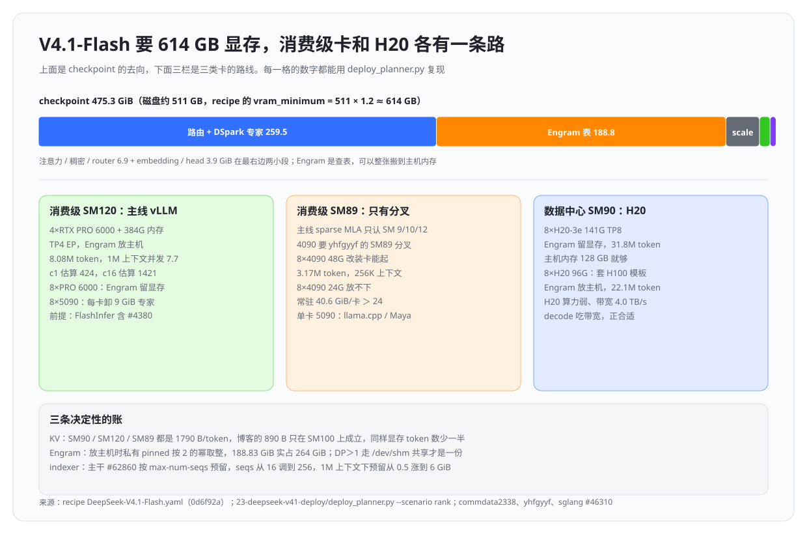
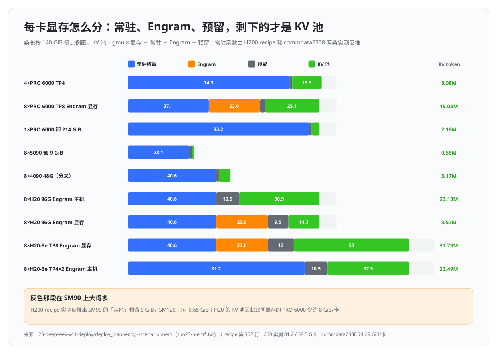
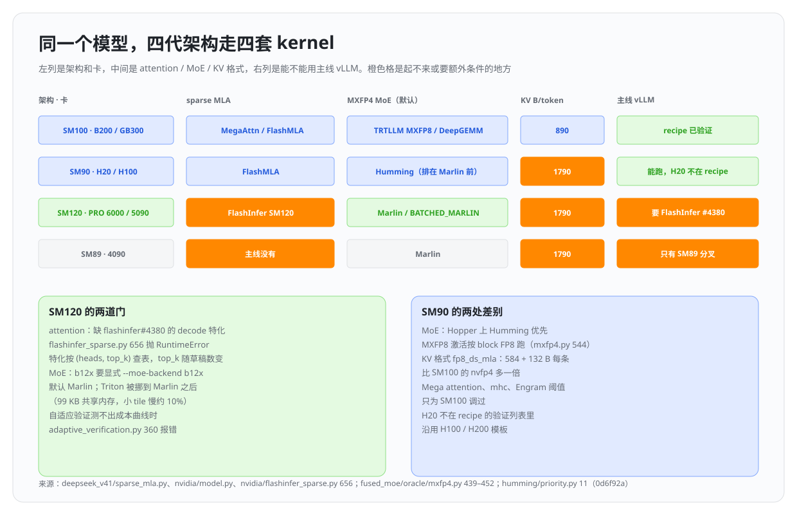
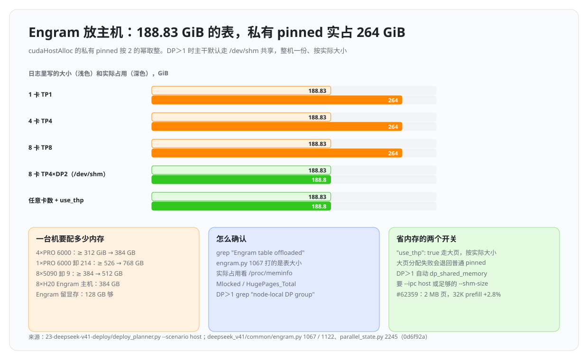
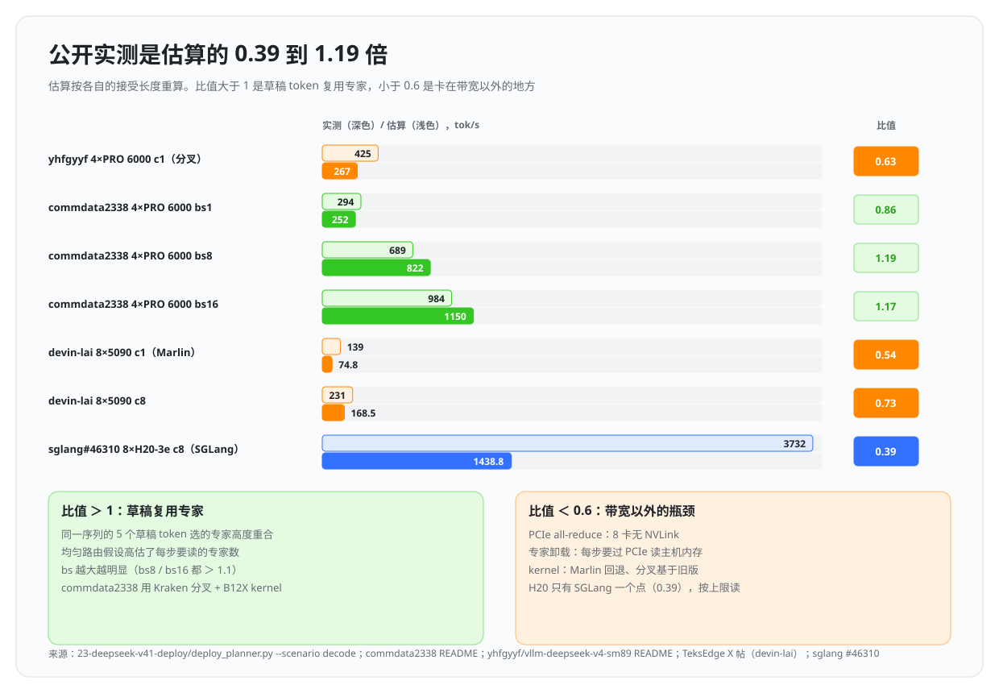
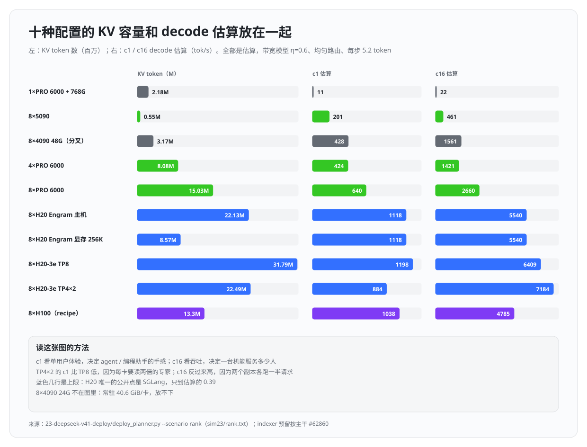
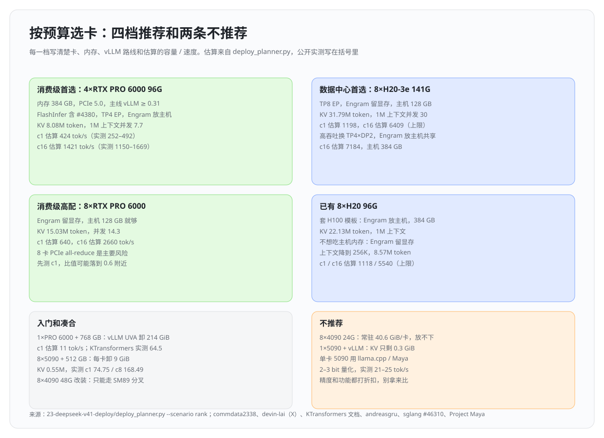
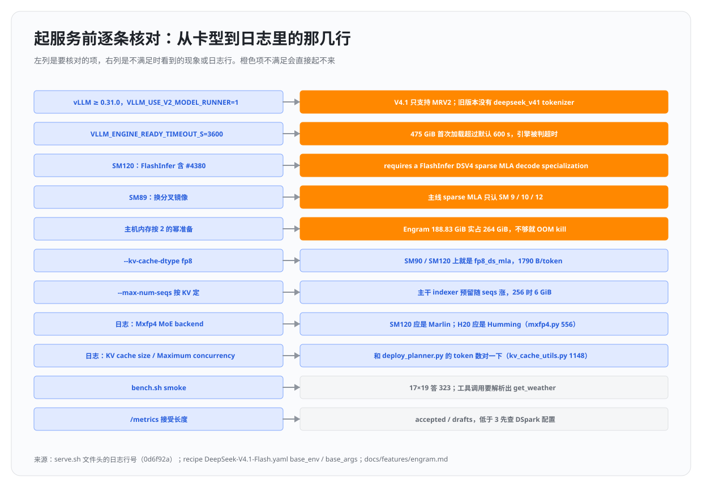

# VLLM-23｜实战｜DeepSeek-V4.1-Flash 部署：消费级显卡与 H20

> 🎯 **这篇文档解决什么问题**：DeepSeek-V4.1-Flash 9 月 10 日以 MIT 协议放出[[1]](https://deepseek.com/en/news/deepseek-v4-1-flash/)，checkpoint 有 475 GiB[[2]](https://huggingface.co/deepseek-ai/DeepSeek-V4.1-Flash-1017)。vLLM 官方 recipe 只验证了 H100、H200、B200 和 GB200，写的最低显存是 614 GB[[3]](https://github.com/vllm-project/vllm/blob/0d6f92a/recipes/models/deepseek-ai/DeepSeek-V4.1-Flash.yaml)。手上是 RTX PRO 6000、5090、4090 这类消费级或工作站卡，或者是数据中心里的 H20，recipe 里没有现成答案。社区这两个月陆续有人跑通：4×RTX PRO 6000 的完整基准、8×5090 的主线 vLLM、4090 的 SM89 分叉、单卡 PRO 6000 加 KTransformers 的混合推理、8×H20-3e 上的 SGLang 对照。这些项目的卡、版本、kernel 各不相同，数字没法直接放在一起比。我们做了一个部署规划器，把每一档的显存账、主机内存账和 decode 速度估算都放在同一套口径里算，再拿社区实测去对照校准。最后给出每个预算档位的推荐配置和起服务的命令。
>
> **使用方式**：第 1 章算 614 GB 这笔账，搞清楚哪些权重必须进显存、哪些能搬到主机。第 2 章是四代 GPU 架构各走哪套 kernel，决定一张卡能不能用主线 vLLM。第 3 章是消费级路线，第 4 章是 H20 路线，每一档都有命令、显存账和社区实测。第 5 章把估算和实测放在一起，第 6 章给出最佳卡配置。第 7 章是实验步骤，第 8 章是坑和我们的看法，第 9 章是起服务前的核对清单。正文里所有标「估算」的数字都来自规划器，没有标的是源码常量、recipe 注释或社区原文。
>
> **代码**：[23-deepseek-v41-deploy](../23-deepseek-v41-deploy)。deploy_planner.py 有七个场景：ckpt 拆 checkpoint，mem 算每卡显存，kv 算每 token 字节，indexer 算三种版本的预留，host 算 Engram 放主机时的 pinned 内存，decode 做带宽估算并和公开实测对比，rank 把十几种配置排在一起。serve.sh 是十个档位的启动命令，bench.sh 是冒烟、并发扫描和长上下文压测。22 个单测把字节数钉在源码常量上，把校准钉在 H200 recipe 和 4×PRO 6000 实测上。规划器只用 Python 标准库，不需要 GPU。

# 导读 · 先给结论

## 部署专项保留原测试对象

DeepSeek-V4.1-Flash 的 checkpoint、硬件选择和日志仍按原模型保存。全系列通用入口改成 Qwen 双模型，不意味着本章专属 MLA、MoE kernel 或显存校准系数可复用。

需要横向比较时，使用同一组长度与指标重新测量，分别报告总权重、KV/状态和通信开销。未拆项的 workspace 残差继续标为估算，不移植到 Qwen 规划器。

双模型结构以固定版本配置核对[[Qwen3.8-27B config.json]](https://huggingface.co/Qwen/Qwen3.8-27B/blob/37561816e66b5b9153b1b64c10968c18c1e6f4a0/config.json)[[Qwen3.5-35B-A3B config.json]](https://huggingface.co/Qwen/Qwen3.5-35B-A3B/blob/59d61f3ce65a6d9863b86d2e96597125219dc754/config.json)。

1. **614 GB 里有 189 GiB 可以不进显存。**checkpoint 475.3 GiB，其中 Engram 表 188.83 GiB 是按 n-gram 哈希查表，可以整张搬到主机内存，GPU 每步只取命中的行。剩下 286.5 GiB 要进显存，TP8 时每卡 35.8 GiB。消费级卡能不能跑，先看这 286.5 GiB 除以卡数放不放得下。
2. **非 SM100 的卡，KV 容量要按博客数字的一半算。**博客写的 890 B/token 是 SM100 的 nvfp4 格式。H20（SM90）、RTX PRO 6000 和 5090（SM120）、4090（SM89）用的是 fp8_ds_mla，每 token 1790 B。同样的显存，token 数少一半。
3. **消费级首选 4×RTX PRO 6000 加 384 GB 内存。**主线 vLLM 要配带 flashinfer#4380 的 FlashInfer。估算 KV 8.08M token，1M 上下文并发 7.7。c1 估算 424 tok/s，社区实测 252–492；c16 估算 1421，实测 1150–1669。4090 主线不支持，只能走 SM89 分叉；8×4090 24G 放不下。
4. **数据中心首选 8×H20-3e 141G，TP8、Engram 留显存。**估算 KV 31.79M token，主机内存 128 GB 就够。H20 算力只有 H100 的零头，但 4.0–4.8 TB/s 的带宽正好对上 decode 的需求。8×H20 96G 直接套 recipe 的 H100 模板，Engram 放主机，KV 22.13M token。H20 上唯一的公开实测是 SGLang，只到估算的 0.39，H20 的速度估算按上限读。
5. **主机内存要按 2 的幂准备。**Engram 放主机时，每个 rank 的私有 pinned 内存按 2 的幂取整，188.83 GiB 的表实际占 264 GiB。DP 大于 1 时主干默认走 /dev/shm 共享，整机只占一份、按实际大小。另一个容易漏的是主干 #62860 之后的 indexer 预留随 max-num-seqs 涨，256 条时要 6 GiB。



和前面各章的关系：VLLM-05 讲 KV cache 的显存账，这里是同一套算法套在 V4.1 的五种 cache 上。VLLM-06 讲 attention 后端怎么选，第 2 章是它在 SM89 / SM90 / SM120 上的结果。VLLM-11 讲 MoE 和 EP，这里的 MXFP4 MoE 后端选择是它的延伸。VLLM-13 讲投机解码，DSpark 的接受长度直接决定第 5 章的速度估算。VLLM-22 讲 DeepSeek 组件怎么进 vLLM，这一篇只关心一件事：这些组件在手上的卡能开哪些、开了以后跑多快。

# 第 1 章 · 问题：614 GB 显存的账怎么算

## 1.1 checkpoint 的五块

recipe 的 Memory 表把 checkpoint 拆成五块[[3]](https://github.com/vllm-project/vllm/blob/0d6f92a/recipes/models/deepseek-ai/DeepSeek-V4.1-Flash.yaml)（[vram_minimum_gb 125](https://github.com/vllm-project/vllm/blob/0d6f92a/recipes/models/deepseek-ai/DeepSeek-V4.1-Flash.yaml#L125)）。规划器按这张表复算：

```text
-- checkpoint 构成（recipe Memory 表）
   路由专家 + DSpark 专家（MXFP4）                    557.2B    259.5 GiB
   Engram 表（FP8）                              196.6B    183.1 GiB
   注意力、稠密投影、router（FP8）                         7.4B      6.9 GiB
   Embedding + LM head（BF16）、norm（FP32）         2.0B      3.9 GiB
   UE8M0 block scale                           23.6B     21.9 GiB
   合计 475.3 GiB（recipe 写约 511 GB / 476 GiB）；vram_minimum_gb = 511 × 1.2 = 613 GB
   Engram：768,022,850 行 × 256 = 183.11 GiB 值，加 scale = 188.83 GiB
   除 Engram 外 286.5 GiB 要进显存；Engram 可以整张搬到主机内存
   一个专家 35.4M 参数，MXFP4 18.8 MB；384 路由 × 40 层 = 543.6B 参数
   每步必读稠密部分 8.7 GB；bs=1 不投机时读 7 个专家 × 40 层 = 5.3 GB
   TP1：静态常驻  286.5 GiB/卡，Engram 留在显存再加  188.8 GiB/卡（DP=1）
   TP2：静态常驻  143.2 GiB/卡，Engram 留在显存再加   94.4 GiB/卡（DP=1）
   TP4：静态常驻   71.6 GiB/卡，Engram 留在显存再加   47.2 GiB/卡（DP=1）
   TP8：静态常驻   35.8 GiB/卡，Engram 留在显存再加   23.6 GiB/卡（DP=1）
```

最大的一块是 384 个路由专家加 DSpark 草稿模型的专家，MXFP4 存 259.5 GiB。第二大的是 Engram 表 188.83 GiB。Engram 是 2026 年 1 月那篇条件记忆论文的思路[[4]](https://arxiv.org/abs/2601.07372)，V4.1 把它做成了 768,022,850 行、每行 256 字节 FP8 的查找表[[5]](https://arxiv.org/abs/2609.19969)，前向时按 n-gram 哈希取行，算力几乎为零，只占容量。注意力、稠密投影、embedding 合计 10.8 GiB，scale 21.9 GiB。

recipe 写的 614 GB 是磁盘上约 511 GB 乘 1.2。这是把 Engram 也算进显存时的下限。vLLM 的 `--engram-config '{"cpu_offload":true}'` 默认就是开的（[config/engram.py 37](https://github.com/vllm-project/vllm/blob/0d6f92a/vllm/config/engram.py#L37)，文档[[6]](https://github.com/vllm-project/vllm/blob/0d6f92a/docs/features/engram.md)第 86 行），表放到 pinned 主机内存，GPU 通过 UVA 按行读。所以 614 GB 是 Engram 留在显存时的门槛，Engram 放主机时要进显存的是 286.5 GiB 加 KV。

## 1.2 每 token 的 KV：非 Blackwell 卡要按 1790 B 算

V4.1 只在第 2、8、14、20 层分配全局 KV，压缩比 2 / 2 / 2 / 1，每 token 2.5 条。vLLM 的博客按 SM100 写的是 890 B/token[[7]](https://vllm.ai/blog/2026-10-23-deepseek-v41-flash-pd-wide-ep)。这个数字是 nvfp4_ds_mla 格式，每条 288 B 的 KV 加 68 B 的 indexer K。非 SM100 的卡走 fp8_ds_mla，每条 584 + 132 B：

```text
-- 每 token 全局 KV（只有 2、8、14、20 层分配，压缩比 2/2/2/1，每 token 2.5 条）
   SM100 nvfp4_ds_mla：(288 + 68) × 2.5 = 890 B（博客 890 B）
   SM100 fp8_ds_mla MXFP8 记录：(528 + 68) × 2.5 = 1490 B
   SM90 / SM120 / SM89 fp8_ds_mla：(584 + 132) × 2.5 = 1790 B，是博客的 2.01 倍
   SWA（sm100）：528 B × 128 × 40 层 = 2.58 MiB/请求
   SWA（sm90）：584 B × 128 × 40 层 = 2.85 MiB/请求
-- 单请求 KV（SM90 / SM120 格式）
       4096 token：全局      7.0 MiB + SWA 2.85 MiB，SWA 占  29.0%
      32768 token：全局     55.9 MiB + SWA 2.85 MiB，SWA 占   4.9%
     131072 token：全局    223.8 MiB + SWA 2.85 MiB，SWA 占   1.3%
     262144 token：全局    447.5 MiB + SWA 2.85 MiB，SWA 占   0.6%
    1048576 token：全局   1790.0 MiB + SWA 2.85 MiB，SWA 占   0.2%
```

部署时加的 `--kv-cache-dtype fp8` 在这个模型上是 fp8_ds_mla 的别名（[sparse_mla.py 112](https://github.com/vllm-project/vllm/blob/0d6f92a/vllm/models/deepseek_v41/sparse_mla.py#L112)）。所以 H20、RTX PRO 6000、5090、4090 都是 1790 B/token，是博客数字的 2.01 倍。拿博客的 890 B 估 H20 的 KV 容量，会多估一倍。1M 上下文时单请求的全局 KV 是 1.75 GiB，SWA 状态 2.85 MiB 可以忽略。

## 1.3 indexer 预留随版本变

V4.1 的稀疏 indexer 在 decode 时要一块 logits buffer，大小和上下文长度成正比。这块显存的预留方式这个月改了一次，规划器的 `--version` 可以切换三种口径：

```text
-- indexer logits 预留（RTX PRO 6000 96G，len=1048576，seqs=16，batched=4096，spec=5）
   v0.31.0 / v0.32.0：固定 512 MiB
   recipe 注释的形状 batched × len × 2 B：8.00 GiB
     8192 × 1M = 16 GiB，4096 × 1M = 8 GiB
   主干 #62860 之后：min(seqs, batched) × (1+spec) × round_up(len, 256) × 4 B = 0.50 GiB
   主干形状随 max-num-seqs 变化（1M 上下文，非 SM100）：
     seqs=8        0.50 GiB
     seqs=16       0.50 GiB
     seqs=64       1.50 GiB
     seqs=256      6.00 GiB
     seqs=1024    24.00 GiB
   gather workspace：len × 8 × factor 条 × 132 B = 2.06 GiB
     len=131072  factor=5，   5242880 条，0.64 GiB
     len=262144  factor=5，  10485760 条，1.29 GiB
     len=524288  factor=2，   8388608 条，1.03 GiB
     len=1048576 factor=2，  16777216 条，2.06 GiB
```

v0.31.0 和 v0.32.0 固定预留 512 MiB。recipe 的 H100 注释按 batched × len × 2 B 估，8192 × 1M 是 16 GiB，所以 H100 把 batched 压到 4096（[recipe 128–150](https://github.com/vllm-project/vllm/blob/0d6f92a/recipes/models/deepseek-ai/DeepSeek-V4.1-Flash.yaml#L128)）。主干 #62860[[8]](https://github.com/vllm-project/vllm/pull/62860) 之后按 max-num-seqs 预留，seqs 16 时还是 0.5 GiB，256 时涨到 6 GiB。H200 recipe 用的是 seqs 256，升到主干以后同样的 gmu 下 KV 池少 5.5 GiB。#63047[[9]](https://github.com/vllm-project/vllm/pull/63047) 补的是 prefill 侧启动 profile 漏掉的显存，#62240[[10]](https://github.com/vllm-project/vllm/pull/62240) 把 prefill indexer 的排序换成 BF16 的 DeepSelect，两个都在 10 月底合进主干。规划器排行默认按主干算。

## 1.4 每卡显存账

每卡的账是：KV 池 = gmu × 显存 − 常驻权重 − Engram（留显存时）− 预留。常驻权重比静态切分多一些，因为有 CUDA graph、通信 buffer 和非均匀切分。规划器用两条实测反推系数：

| 架构 | 系数 | 来源 | 「其他」预留 |
|-|-|-|-|
| SM90 | 1.134 | recipe H200 TP4：常驻 81.2 GiB、KV 38.5 GiB（[recipe 360–366](https://github.com/vllm-project/vllm/blob/0d6f92a/recipes/models/deepseek-ai/DeepSeek-V4.1-Flash.yaml#L360)） | 8.97 GiB |
| SM120 | 1.037 | commdata2338 4×PRO 6000：74.29 GiB/卡、8,050,969 token[[11]](https://github.com/commdata2338/deepseek-v4.1-flash-1017-4x-rtx-pro-6000-benchmark) | 0.65 GiB |
| SM89 | 按 SM90 | 没有公开的显存实测 | 0.65 GiB |



规划器反推的「其他」在 SM90 上取 9 GiB，在 SM120 上取 0.65 GiB。这个残差没有逐项测量，尚不能确定 FlashMLA workspace、Humming MoE buffer 各占多少，也不能将差值全部归因于 GPU 架构。按当前校准假设，规划器给出的 H20 KV 池比同显存 PRO 6000 少约 8 GiB/卡；这是估算差值，部署时需用对应版本和配置的启动日志复核。拿 4×PRO 6000 默认参数跑一遍 mem：

```text
-- 显存账（每卡）
   RTX PRO 6000 96G × 4，TP4 DP1，Engram 在主机
     可用 88.9 GiB = 95.6 × gmu
     常驻权重 74.3 GiB（静态 71.6 × 系数 1.037）
     预留 1.2 GiB = indexer logits 0.50 + 其他 0.65（其他是两条实测校准出的残差；gather workspace 2.06 不单列）
     KV 池 13.5 GiB → 8.08M token（1790 B/token），1048576 上下文并发 7.69
     主机内存 ≥ 312 GiB，建议配 384 GB
-- 和 recipe 对账
   H200 TP4 Engram 卸载：常驻 81.2（recipe 实测 81.2），KV 38.5 GiB（recipe 38.5），23.1M token（recipe 约 20M）
   H100 TP8 静态常驻 35.8 GiB（recipe 写约 36，是静态账）
   8×H200 TP4×2：按 TP×DP 摊是每 rank 23.6 GiB、每副本 94.4 GiB（recipe 注释 23.6 / 94）；主干默认 dp_shared_memory，整机一份 188.8 GiB 在 /dev/shm
```

最后三行是对账：H200 TP4 的常驻和 KV 和 recipe 实测一致，这两个数是校准用的。H100 TP8 静态 35.8 GiB，和 recipe 写的「约 36」一致。8×H200 TP4×2 的 Engram 摊到每 rank 是 23.6 GiB、每副本 94.4 GiB，和 recipe 注释一致。recipe 写 H200 约 20M token，规划器按 1790 B/token 算出 23.1M，recipe 的数是往下取整的约数。

# 第 2 章 · 原理：四代架构走四套 kernel

显存放得下只是第一关。V4.1 的 sparse MLA 和 MXFP4 MoE 都要专门的 kernel，每代架构选的后端不一样，有的架构主线根本没有。下面这张图是 0d6f92a 上的结果：



## 2.1 sparse MLA：SM89 主线没有

V4.1 的注意力后端有三个。FLASHMLA_SPARSE_DSV41 只认 compute capability 主版本 9 和 10（[sparse_mla.py 152](https://github.com/vllm-project/vllm/blob/0d6f92a/vllm/models/deepseek_v41/sparse_mla.py#L152)），H20、H100、B200 都走它。FLASHMLA_MEGA_ATTN_DSV41 是 SM100 专用。FLASHINFER_MLA_SPARSE_DSV41 认 10 和 12（[flashinfer_sparse.py 140](https://github.com/vllm-project/vllm/blob/0d6f92a/vllm/models/deepseek_v41/nvidia/flashinfer_sparse.py#L140)），RTX PRO 6000 和 5090 走它。4090 是 SM89，三个后端都不认，主线 vLLM 起不来。yhfgyyf 的分叉补了 SM89 的 sparse MLA 和 `ced_prefill`，镜像基于 0.28.1rc1[[12]](https://github.com/yhfgyyf/vllm-deepseek-v4-sm89)。

SM120 还有一道门。FlashInfer 的 SM120 decode kernel 是按 (num_q_heads, top_k) 特化的，查不到就在 [flashinfer_sparse.py 656](https://github.com/vllm-project/vllm/blob/0d6f92a/vllm/models/deepseek_v41/nvidia/flashinfer_sparse.py#L650) 抛 RuntimeError：

```text
FLASHINFER_MLA_SPARSE_DSV4 on SM120 requires a FlashInfer DSV4 sparse MLA decode
specialization for (num_q_heads=..., top_k=...). Install a FlashInfer build containing ...
```

需要的特化在 flashinfer#4380 里[[13]](https://github.com/flashinfer-ai/flashinfer/pull/4380)。查表的函数是 [has_flashinfer_sparse_mla_sm120_config](https://github.com/vllm-project/vllm/blob/0d6f92a/vllm/utils/flashinfer.py#L505)，top_k 随 SWA 窗口和 DSpark 草稿数变，所以改了 `num_speculative_tokens` 也可能触发这条错误。serve.sh 的 SM120 档位在起服务前先 import FlashInfer 查这张表，缺了马上退出，省得等五分钟加载完权重才报错。

## 2.2 MXFP4 MoE：消费级卡默认 Marlin，Hopper 默认 Humming

专家权重是 MXFP4。后端选择在 [mxfp4.py 437–453](https://github.com/vllm-project/vllm/blob/0d6f92a/vllm/model_executor/layers/fused_moe/oracle/mxfp4.py#L437)，SM110 / SM120 上把 Triton 挪到 BATCHED_MARLIN 后面，源码注释写着原因：消费级 Blackwell 的共享内存只有 99 KB，OAI 的 Triton kernel 只能用小 tile，Marlin 的 prefill 快约 10%，decode 吞吐持平。b12x 是 SM120 专用的 MoE kernel（[b12x.py 502](https://github.com/vllm-project/vllm/blob/0d6f92a/vllm/model_executor/layers/fused_moe/b12x.py#L502)），要显式加 `--moe-backend b12x`。commdata2338 的基准用的是带 B12X 的分叉[[11]](https://github.com/commdata2338/deepseek-v4.1-flash-1017-4x-rtx-pro-6000-benchmark)，devin-lai 的 8×5090 用的是默认 Marlin[[14]](https://x.com/TeksEdge/status/2100117485177446427)，第 5 章两者比值差了一截，kernel 是原因之一。

H20 是 Hopper，`prioritize_humming` 在 cc 90 上把 Humming 排在 Marlin 前面（[humming/priority.py 11](https://github.com/vllm-project/vllm/blob/0d6f92a/vllm/model_executor/layers/quantization/utils/humming/priority.py#L11)）。checkpoint 里的 MXFP8 激活在 Hopper 上按 block FP8 跑，启动日志会打 `Running checkpoint MXFP8 MoE activations as block FP8`（[mxfp4.py 544](https://github.com/vllm-project/vllm/blob/0d6f92a/vllm/model_executor/layers/fused_moe/oracle/mxfp4.py#L544)）。最终选了哪个后端看 [mxfp4.py 556](https://github.com/vllm-project/vllm/blob/0d6f92a/vllm/model_executor/layers/fused_moe/oracle/mxfp4.py#L556) 那一行日志。

## 2.3 只在 SM100 上调过的东西

recipe 的硬件列表里 H100、H200、B200 是 verified，默认是 GB200（[recipe 16–20](https://github.com/vllm-project/vllm/blob/0d6f92a/recipes/models/deepseek-ai/DeepSeek-V4.1-Flash.yaml#L16)），H20 和 SM120 都不在列表里。Mega attention、mhc 融合、Engram 的 UVA 阈值都只在 SM100 上调过。DSpark 和自适应验证只支持 Model Runner V2（[vllm.py 3134](https://github.com/vllm-project/vllm/blob/0d6f92a/vllm/config/vllm.py#L3134)），所以 `VLLM_USE_V2_MODEL_RUNNER=1` 是硬条件。自适应验证启动时要测各种验证长度的成本曲线，测不出来就在 [adaptive_verification.py 360](https://github.com/vllm-project/vllm/blob/0d6f92a/vllm/v1/worker/gpu/spec_decode/adaptive_verification.py#L360) 报错，提示加 `enable_adaptive_verification=false`。SM120 上我们遇到过这种情况，serve.sh 留了 `ADAPTIVE=false` 开关。

SGLang 这边，#46310 的作者在 H20-3e 上 profile 过，SGLang 在 SM90 上用的还是 V4 的旧 KV 布局，64K 上下文时 indexer 一步 9.37 ms，DeepInfer 的 SM90 移植只要 1.02 ms[[15]](https://github.com/sgl-project/sglang/issues/46310)。两边在非 SM100 卡上都还是能跑、没调透的状态。

# 第 3 章 · 消费级路线：RTX PRO 6000、5090 和 4090

消费级卡没有 NVLink，卡间走 PCIe，TP 每层两次 all-reduce 的延迟比 NVLink 高两三倍。显存也小，专家放不下就要卸到主机，每步过 PCIe 读。这一章按卡型走一遍，每一档给 serve.sh 的命令、规划器的显存账和社区实测。

## 3.1 4×RTX PRO 6000 96G：消费级首选

四张 PRO 6000 合计 382 GiB，Engram 放主机后每卡静态 71.6 GiB，余量够 1M 上下文。命令：

```bash
bash serve.sh pro6000x4
# 等价于
vllm serve deepseek-ai/DeepSeek-V4.1-Flash-1017 --gpu-memory-utilization 0.93 \
  --tensor-parallel-size 4 --enable-expert-parallel \
  --kv-cache-dtype fp8 --max-model-len 1048576 --max-num-seqs 16 --max-num-batched-tokens 4096 \
  --engram-config '{"cpu_offload":true}' --safetensors-load-strategy lazy \
  --tokenizer-mode deepseek_v41 --reasoning-parser deepseek_v41 \
  --enable-auto-tool-choice --tool-call-parser deepseek_v41 --enable-prefix-caching \
  --speculative-config '{"method":"dspark","num_speculative_tokens":5,...}'
```

显存账就是 1.4 节那张：每卡常驻 74.3 GiB，KV 池 13.5 GiB，8.08M token。commdata2338 在同样的卡、gmu 0.93、batched 4096 下实测每卡 74.29 GiB、8,050,969 token、满长并发 7.68[[11]](https://github.com/commdata2338/deepseek-v4.1-flash-1017-4x-rtx-pro-6000-benchmark)，规划器的 SM120 系数就是用它校准的。他们的分叉带 B12X MoE kernel，DSpark 7 个草稿加自适应验证，启动 277 s。decode 实测 prose 场景 bs1 / 8 / 16 是 252 / 822 / 1150 tok/s，code 场景 492 / 1133 / 1669。prefill 8K 时 11,008 tok/s，64K 时 14,818，256K 时 12,283。同一台机上 SGLang 慢 1.34–2.58 倍。HumanEval+ 和 MBPP+ 分别过了 472 和 542 题，说明 MXFP4 在 SM120 上的精度没有掉。

yhfgyyf 用 SM89 分叉的镜像在 4×PRO 6000 上也测了一组[[12]](https://github.com/yhfgyyf/vllm-deepseek-v4-sm89)：8K 输入 c1 时 TTFT 913 ms、prefill 8970 tok/s、decode 267 tok/s，DSpark 接受率 84%、接受长度 5.2。32K 输入 decode 271.7，128K 掉到 80。c10 时 296.61 tok/s、TPOT 30.64 ms。分叉基于 0.28.1rc1，比 commdata2338 的 c1 低，主要差在 kernel 版本。

## 3.2 8×RTX PRO 6000：Engram 可以留显存

卡数翻倍以后，每卡静态只剩 35.8 GiB，Engram 摊到每卡 23.6 GiB 也放得下。Engram 留显存省掉了 264 GiB 的 pinned 主机内存，主机配 128 GB 就够：

```text
-- 显存账（每卡）
   RTX PRO 6000 96G × 8，TP8 DP1，Engram 在显存
     可用 88.0 GiB = 95.6 × gmu
     常驻权重 37.1 GiB（静态 35.8 × 系数 1.037）
     Engram 23.6 GiB（188.83 / 8 份）
     预留 2.2 GiB = indexer logits 1.50 + 其他 0.65（其他是两条实测校准出的残差；gather workspace 2.06 不单列）
     KV 池 25.1 GiB → 15.03M token（1790 B/token），1048576 上下文并发 14.31
     主机内存 ≥ 48 GiB，建议配 128 GB
```

KV 15.03M token，1M 上下文并发 14.3。代价是 8 卡 PCIe all-reduce。规划器按 PCIe 5.0 每次 25 µs 算，40 层每步两次是 2 ms，c1 估算 640 tok/s。8 卡 PCIe 拓扑一般要过两颗 CPU 或 PCIe switch，实际延迟可能更高，我们建议先测 c1，比值落到 0.6 左右要有准备。

## 3.3 1×RTX PRO 6000 + 768 GB：能跑，慢

单卡要把 214 GiB 专家卸到主机，用 vLLM 的 UVA offloader（日志 `Total CPU offloaded parameters`，[uva.py 69](https://github.com/vllm-project/vllm/blob/0d6f92a/vllm/model_executor/offloader/uva.py#L69)）。卸多少由 KV 下限决定：recipe 的 GB300 工作站档卸 60 GiB，注释写着「55 fails the minimum-KV check」（[recipe 160–185](https://github.com/vllm-project/vllm/blob/0d6f92a/recipes/models/deepseek-ai/DeepSeek-V4.1-Flash.yaml#L160)）。我们按 128K 上下文、2 条并发留 KV，卸 214 GiB：

```text
-- 显存账（每卡）
   RTX PRO 6000 96G × 1，TP1 DP1，Engram 在主机，专家卸载 214 GiB/卡
     可用 88.0 GiB = 95.6 × gmu
     常驻权重 83.2 GiB（静态 286.5 × 系数 1.037 − 卸载 214）
     预留 1.2 GiB = indexer logits 0.50 + 其他 0.65（其他是两条实测校准出的残差；gather workspace 0.64 不单列）
     KV 池 3.6 GiB → 2.18M token（1790 B/token），131072 上下文并发 16.45
     主机内存 ≥ 526 GiB，建议配 768 GB
```

主机内存要 526 GiB 以上：专家 214 GiB 加 Engram 264 GiB，再加系统。decode 每步要从 PCIe 读一大半命中的专家，c1 估算只有 11 tok/s。同样一张卡，KTransformers 和 SGLang 的混合方案快得多。andreasgru 在 1×PRO 6000 Max-Q 加 499 GiB 内存上把 90 个专家放 GPU、其余放 CPU 算，上下文 524,288，bs1 64.5 tok/s，bs4 106–110，bs8 201–214[[16]](https://github.com/andreasgru/ds41-flash-hybrid)。他的满负载测试没过，35.11 tok/s、p95 TTFT 57.9 s。CPU 参与专家计算比 GPU 每步从 PCIe 拉权重划算，这是单卡场景里 vLLM 的短板。

## 3.4 8×RTX 5090 32G：每卡卸 9 GiB

8 张 5090 合计 254 GiB，装不下 286.5 GiB 的非 Engram 权重，每卡要卸 9 GiB 专家：

```bash
bash serve.sh rtx5090x8     # TP8 EP，gmu 0.95，128K，--offload-backend uva --cpu-offload-gb 9
```

```text
-- 显存账（每卡）
   RTX 5090 32G × 8，TP8 DP1，Engram 在主机，专家卸载 9 GiB/卡
     可用 30.2 GiB = 31.8 × gmu
     常驻权重 28.1 GiB（静态 35.8 × 系数 1.037 − 卸载 9）
     预留 1.2 GiB = indexer logits 0.50 + 其他 0.65（其他是两条实测校准出的残差；gather workspace 0.64 不单列）
     KV 池 0.9 GiB → 0.55M token（1790 B/token），131072 上下文并发 4.13
     主机内存 ≥ 384 GiB，建议配 512 GB
```

KV 只有 0.55M token，128K 上下文并发 4.1。devin-lai 在 8×5090 加 503 GiB 内存上用主线 vLLM 跑通，TP8 EP、默认 Marlin、每 rank 卸 9–12 GiB，c1 / c8 / c16 实测 74.75 / 168.49 / 217.55 tok/s，prefill 4078 tok/s，比 eager 模式快 5.6 倍[[14]](https://x.com/TeksEdge/status/2100117485177446427)。KTransformers 的文档给了 4×5090 加 256 GB 的长上下文方案，KV 964,864 token，prefill 从 590 tok/s 降到 320，600K 上下文要算约 23 分钟[[17]](https://ktransformers.net/en/docs/inference/long-context-deployment)。

## 3.5 4090：48G 改装卡走分叉，24G 放不下

8×4090 24G 合计 192 GB，每卡常驻 40.6 GiB 超过 24 GiB，规划器直接判不可行：

```text
-- 显存账（每卡）
   RTX 4090 24G × 8，TP8 DP1，Engram 在主机
     可用 23.5 GiB = 24.0 × gmu
     常驻权重 40.6 GiB（静态 35.8 × 系数 1.134）
     预留 1.2 GiB = indexer logits 0.50 + 其他 0.65（其他是两条实测校准出的残差；gather workspace 0.16 不单列）
     KV 池 -18.2 GiB → 0.00M token（1790 B/token），32768 上下文并发 0.00  ✗ 起不来：装不下一条满长请求
     主机内存 ≥ 312 GiB，建议配 384 GB
```

48G 改装卡放得下，KV 5.3 GiB，256K 上下文 3.17M token。主线不支持 SM89，只能用 yhfgyyf 分叉 README 里的 docker 命令[[12]](https://github.com/yhfgyyf/vllm-deepseek-v4-sm89)，serve.sh 的 `rtx4090_48gx8` 档位原样搬了过来，`--hf-overrides '{"ced_prefill":true}'` 只在分叉里有：

```bash
bash serve.sh rtx4090_48gx8
# docker run ... ghcr.io/yhfgyyf/vllm-deepseek-v4-sm89:0.28.1rc1-vision11-sm89-sm120-cu130 \
#   vllm serve ... --tensor-parallel-size 8 --kv-cache-dtype fp8 --block-size 128 \
#   --max-num-seqs 4 --gpu-memory-utilization 0.98 --hf-overrides '{"ced_prefill":true}'
```

4090 的显存带宽 1.0 TB/s，比 PRO 6000 低四成，但 8 卡的总带宽和 4×PRO 6000 差不多，c1 估算 428 tok/s。这个数字我们没有实测对照，分叉基于旧版本，按比值 0.6 读更稳。单卡 5090 用 vLLM 只剩 0.3 GiB KV，不建议。Project Maya 在 1×5090 加 128 GB 内存上用 2–3 bit 量化（178.2 GB）加 203 GB Engram mmap，262K 上下文 21–25 tok/s，llama.cpp 跑 V4-Flash 约 17 tok/s[[18]](https://dev.to/seppegadeyne/run-deepseek-v41-flash-748b-locally-with-project-maya-on-one-rtx-5090-4i4a)。量化到这个程度，精度和功能都打了折扣，和 MXFP4 原版不在一个比较口径。

# 第 4 章 · 数据中心路线：H20 和 H20-3e

H20 的 FP8 算力只有 H100 的约 15%，但显存带宽 4.0 TB/s（H20-3e 4.8 TB/s），卡间有 NVLink。V4.1 每 token 只激活 6 个专家，decode 是读权重、读 KV，带宽占大头，H20 在这里很合适。recipe 没有 H20 档，我们从 H100 和 H200 的模板改。

## 4.1 8×H20 96G：套 H100 模板

recipe 的 H100 注释说 8×80 GB 是能装下这个 checkpoint 的最小 NVIDIA 节点，Engram 183 GiB 放 pinned 主机内存走 UVA，TP8 每卡约 36 GiB 常驻，indexer 按 8192 × 1M × 2 B 要 16 GiB，所以 batched 压到 4096（[recipe 128–150](https://github.com/vllm-project/vllm/blob/0d6f92a/recipes/models/deepseek-ai/DeepSeek-V4.1-Flash.yaml#L128)）。这段注释引用了 InferenceX 的 #2974 和 #3135[[19]](https://github.com/SemiAnalysisAI/InferenceX/pull/2974)[[20]](https://github.com/SemiAnalysisAI/InferenceX/issues/3135)。H20 96G 比 H100 多 16 GB，模板原样搬过来，KV 池更宽：

```bash
bash serve.sh h20x8
# vllm serve ... --gpu-memory-utilization 0.92 --tensor-parallel-size 8 --enable-expert-parallel \
#   --max-model-len 1048576 --max-num-seqs 64 --max-num-batched-tokens 4096 \
#   --engram-config '{"cpu_offload":true}'
```

```text
-- 显存账（每卡）
   H20 96G × 8，TP8 DP1，Engram 在主机
     可用 88.0 GiB = 95.6 × gmu
     常驻权重 40.6 GiB（静态 35.8 × 系数 1.134）
     预留 10.5 GiB = indexer logits 1.50 + 其他 8.97（其他是两条实测校准出的残差；gather workspace 2.06 不单列）
     KV 池 36.9 GiB → 22.13M token（1790 B/token），1048576 上下文并发 21.07
     主机内存 ≥ 312 GiB，建议配 384 GB
```

作为对照，同样参数在 H100 80G 上按 recipe 的 indexer 口径算：

```text
-- 显存账（每卡）
   H100 80G × 8，TP8 DP1，Engram 在主机
     可用 73.2 GiB = 79.6 × gmu
     常驻权重 40.6 GiB（静态 35.8 × 系数 1.134）
     预留 17.0 GiB = indexer logits 8.00 + 其他 8.97（其他是两条实测校准出的残差；gather workspace 2.06 不单列）
     KV 池 15.7 GiB → 9.40M token（1790 B/token），1048576 上下文并发 8.95
     主机内存 ≥ 312 GiB，建议配 384 GB
```

H20 比 H100 多出来的 16 GB 几乎全进了 KV 池，KV 从 15.7 GiB 涨到 36.9 GiB（H100 那行按 recipe 口径预留 8 GiB indexer，H20 这行按主干算 1.5 GiB）。不想吃主机内存可以把 Engram 留显存，每卡多占 23.6 GiB，上下文降到 256K：

```text
-- 显存账（每卡）
   H20 96G × 8，TP8 DP1，Engram 在显存
     可用 88.0 GiB = 95.6 × gmu
     常驻权重 40.6 GiB（静态 35.8 × 系数 1.134）
     Engram 23.6 GiB（188.83 / 8 份）
     预留 9.5 GiB = indexer logits 0.50 + 其他 8.97（其他是两条实测校准出的残差；gather workspace 1.29 不单列）
     KV 池 14.3 GiB → 8.57M token（1790 B/token），262144 上下文并发 32.47
     主机内存 ≥ 48 GiB，建议配 128 GB
```

KV 只剩 14.3 GiB、8.57M token，但 256K 上下文下并发 32.5，主机配 128 GB 就够。适合上下文不长、请求多的业务。

## 4.2 8×H20-3e 141G：数据中心首选

H20-3e 每卡 141 GB，和 H200 同显存。TP8 加 Engram 留显存是最省事的配置，一台机一个副本，主机不需要大内存：

```bash
bash serve.sh h20e_tp8      # TP8 EP，Engram 留显存，max-num-seqs 128，batched 8192
```

```text
-- 显存账（每卡）
   H20-3e 141G × 8，TP8 DP1，Engram 在显存
     可用 129.2 GiB = 140.4 × gmu
     常驻权重 40.6 GiB（静态 35.8 × 系数 1.134）
     Engram 23.6 GiB（188.83 / 8 份）
     预留 12.0 GiB = indexer logits 3.00 + 其他 8.97（其他是两条实测校准出的残差；gather workspace 2.06 不单列）
     KV 池 53.0 GiB → 31.79M token（1790 B/token），1048576 上下文并发 30.27
     主机内存 ≥ 48 GiB，建议配 128 GB
```

KV 31.79M token，1M 上下文并发 30.3。要更高吞吐可以照 H200 模板拆成 TP4×DP2，两个副本各跑一半请求（[recipe 360–366](https://github.com/vllm-project/vllm/blob/0d6f92a/recipes/models/deepseek-ai/DeepSeek-V4.1-Flash.yaml#L360)）。recipe 这段注释说不卸载的话表按行切在 HBM 里，KV 池会塌掉，所以这一档 Engram 要放主机：

```bash
bash serve.sh h20e_tp4dp2   # TP4 × DP2，Engram 放主机，DP>1 自动共享 /dev/shm
```

```text
-- 显存账（每卡）
   H20-3e 141G × 8，TP4 DP2，Engram 在主机
     可用 129.2 GiB = 140.4 × gmu
     常驻权重 81.2 GiB（静态 71.6 × 系数 1.134）
     预留 10.5 GiB = indexer logits 1.50 + 其他 8.97（其他是两条实测校准出的残差；gather workspace 2.06 不单列）
     KV 池 37.5 GiB → 22.49M token（1790 B/token），1048576 上下文并发 21.42
     主机内存 ≥ 237 GiB，建议配 384 GB
```

每卡常驻翻倍到 81.2 GiB，KV 37.5 GiB、22.49M token，比 TP8 少三成。c16 估算从 6409 涨到 7184，c1 从 1198 降到 884，因为每卡要读两倍的专家。在线服务看重首 token 和单用户速度选 TP8，离线批处理选 TP4×2。

## 4.3 Engram 放主机：188.83 GiB 实占 264 GiB

Engram 放主机时，vLLM 启动日志在 [engram.py 1067](https://github.com/vllm-project/vllm/blob/0d6f92a/vllm/models/deepseek_v41/common/engram.py#L1067) 打一行 `Engram table offloaded to pinned host memory`，写的是表的实际大小。[engram.py 1122](https://github.com/vllm-project/vllm/blob/0d6f92a/vllm/models/deepseek_v41/common/engram.py#L1122) 的注释说明 `pin_memory` 会把分配向上取到 2 的幂。规划器的 host 场景复算了几种切法：

```text
-- Engram 放主机：日志写的大小和实际 pinned 的大小
   1 卡 TP1：1 份，每 rank 私有 pinned，每份日志 188.83 GiB，实占  264.0 GiB；合计 188.83 → 264.0 GiB
   4 卡 TP4：4 份，每 rank 私有 pinned，每份日志  47.21 GiB，实占   66.0 GiB；合计 188.83 → 264.0 GiB
   8 卡 TP8：8 份，每 rank 私有 pinned，每份日志  23.60 GiB，实占   33.0 GiB；合计 188.83 → 264.0 GiB
   8 卡 TP4：4 份，DP 副本共享 /dev/shm，每份日志  47.21 GiB，实占   47.2 GiB；合计 188.83 → 188.8 GiB
   私有 pinned 按 2 的幂取整（engram.py:1122 注释）；加 use_thp 走大页，按实际大小
-- 当前配置的主机内存
   RTX PRO 6000 96G × 4 TP4，专家卸载 0 GiB/卡，use_thp=False：≥ 312 GiB，建议 384 GB
   加 use_thp：≥ 237 GiB，建议 384 GB（大页分配失败会退回普通 pinned，按上一行准备更稳）
```



TP 切几份，每份取整以后加起来都是 264 GiB。DP 大于 1 时，`dp_shared_memory` 默认是 None（[config/engram.py 44](https://github.com/vllm-project/vllm/blob/0d6f92a/vllm/config/engram.py#L44)），Engram 在主机时自动打开，整机一份表放 /dev/shm，按实际大小分（文档[[6]](https://github.com/vllm-project/vllm/blob/0d6f92a/docs/features/engram.md)第 123–144 行），日志在 [parallel_state.py 2245](https://github.com/vllm-project/vllm/blob/0d6f92a/vllm/distributed/parallel_state.py#L2245) 打 node-local DP group 的大小。容器里要加 `--ipc host` 或足够大的 `--shm-size`，不然 /dev/shm 默认 64 MB 直接失败。`use_thp` 走透明大页，也按实际大小分（[config/engram.py 52](https://github.com/vllm-project/vllm/blob/0d6f92a/vllm/config/engram.py#L52)），#62359[[7]](https://vllm.ai/blog/2026-10-23-deepseek-v41-flash-pd-wide-ep) 测过 2 MB 页在 32K prefill 上快 2.8%。大页分配失败会退回普通 pinned，按 264 GiB 准备更稳。ROCm 上 #63009[[21]](https://github.com/vllm-project/vllm/pull/63009) 已经改成按实际大小分配，CUDA 这边还没有。

## 4.4 SGLang 在 H20-3e 上的实测

H20 上目前没有 vLLM 的公开实测，能找到的是 SGLang 的 issue #46310[[15]](https://github.com/sgl-project/sglang/issues/46310)。作者在 8×H20-3e（每卡 143,771 MiB，64 核 CPU，512 GiB 内存）上对比了 SGLang 02b9836 和 DeepInfer 的社区 SM90 移植（PR #92，e205d42）。配置是上下文 131,072、max running 8、prefill budget 8192、mem fraction 0.85，c8、输出 1024：

| 输入 | DeepInfer tok/s | SGLang tok/s | SGLang 相对 | P50 TTFT DI / SG（s） | P50 TPOT DI / SG（ms） |
|-|-|-|-|-|-|
| 8K | 827.92 | 984.13 | +18.87% | 0.431 / 1.172 | 7.250 / 5.562 |
| 16K | 648.89 | 684.70 | +5.52% | 0.759 / 2.020 | 9.820 / 8.054 |
| 32K | 468.92 | 396.04 | −15.54% | 1.415 / 4.115 | 13.516 / 14.121 |
| 64K | 291.88 | 217.09 | −25.62% | 2.743 / 7.999 | 23.143 / 27.020 |

短上下文 SGLang 吞吐高，长上下文 DeepInfer 高，TTFT 一直是 DeepInfer 低三倍左右。SGLang 的投机解码是固定 5+1，每次验证 4.34–4.82 个 token，接受率 66.9–76.4%；DeepInfer 按置信度调度变长验证。作者没做精度评测。把 8K 那一行的 TPOT 5.562 ms 换算成 c8 吞吐是 1438.8 tok/s，按 SGLang 的接受长度 4.6 重算规划器估算是 3732，比值 0.39。这是 H20 上唯一的公开点，引擎还是 SGLang，所以第 5 章把 H20 的估算标成上限。

# 第 5 章 · 估算和实测放在一起

## 5.1 decode 估算怎么算

decode 一步要读的字节 = 稠密部分 8.73 GB / TP + 命中的专家 × 18.8 MB × 40 层 / TP。一步有 bs × (1 + 草稿数) 个 token，每个 token 选 6 个专家，按均匀路由算期望命中多少个不同专家：bs1 时 6 个 token 命中 35.6 个，bs8 时 48 个 token 命中 204.7 个。每步时间 = HBM 字节 /（带宽 × 0.6）+ 卸载字节 / PCIe 带宽 + 每层两次 all-reduce + 固定 2 ms。DSpark 每步接受 4.2 个草稿，每步出 5.2 个 token：

```text
-- decode 带宽估算（η=0.6，均匀路由，接受 4.2 个草稿 → 每步 5.2 token）
   RTX PRO 6000 96G      ×4 卸载   0  bs1   12.3 ms/步     424 tok/s；bs8   41.8 ms/步     995 tok/s；bs16   58.5 ms/步    1421 tok/s
   RTX PRO 6000 96G      ×1 卸载 214  bs1  456.3 ms/步      11 tok/s；bs8 2574.0 ms/步      16 tok/s；bs16 3772.0 ms/步      22 tok/s
   RTX 5090 32G          ×8 卸载   9  bs1   25.8 ms/步     201 tok/s；bs8  124.7 ms/步     334 tok/s；bs16  180.6 ms/步     461 tok/s
   RTX 4090 48G（改装）      ×8 卸载   0  bs1   12.1 ms/步     428 tok/s；bs8   38.4 ms/步    1083 tok/s；bs16   53.3 ms/步    1561 tok/s
   H20 96G               ×8 卸载   0  bs1    4.7 ms/步    1118 tok/s；bs8   11.3 ms/步    3691 tok/s；bs16   15.0 ms/步    5540 tok/s
   H20-3e 141G           ×8 卸载   0  bs1    4.3 ms/步    1198 tok/s；bs8    9.9 ms/步    4219 tok/s；bs16   13.0 ms/步    6409 tok/s
   单卡把 214 GiB 专家放主机，每步要从 PCIe 读一大半命中的专家，PCIe 成了瓶颈
-- 公开实测 / 估算（估算按各自的接受长度重算）
   yhfgyyf 4×PRO 6000 分叉 8K c1           bs1  接受长度 5.21  实测   267.0  估算     425  比值 0.63  sm89 分叉 README
   commdata2338 4×PRO 6000 prose bs1     bs1  接受长度 3.60  实测   252.0  估算     294  比值 0.86  Kraken + B12X
   commdata2338 4×PRO 6000 prose bs8     bs8  接受长度 3.60  实测   822.0  估算     689  比值 1.19  Kraken + B12X
   commdata2338 4×PRO 6000 prose bs16    bs16 接受长度 3.60  实测  1150.0  估算     984  比值 1.17  Kraken + B12X
   devin-lai 8×5090 c1                   bs1  接受长度 3.60  实测    74.8  估算     139  比值 0.54  主线 vLLM + Marlin
   devin-lai 8×5090 c8                   bs8  接受长度 3.60  实测   168.5  估算     231  比值 0.73  主线 vLLM + Marlin
   sglang#46310 8×H20-3e c8（TPOT 换算）     bs8  接受长度 4.60  实测  1438.8  估算    3732  比值 0.39  SGLang，非 vLLM
   比值 > 1：同一条序列的草稿 token 选的专家高度重合，均匀路由高估了要读的专家数
   比值 < 0.6：卡在带宽以外的地方，常见是 PCIe all-reduce、专家卸载、kernel 没调好（Marlin 回退、分叉旧版）
   H20 上唯一的公开点是 SGLang，比值 0.39：H20 的 c1 / c16 估算按上限读，vLLM 在 H20 上还没有公开实测
```

这个模型只算带宽，不算 attention 的计算、kernel 启动和调度。它的用处是排序和定量级，所以全部标「估算」。后半段是公开实测，每一条都按各自的接受长度重算估算再比。



比值从 0.39 到 1.19。commdata2338 的 bs8 和 bs16 超过 1：同一条序列的几个草稿 token 选的专家高度重合，均匀路由高估了每步要读的专家数，batch 越大越明显。devin-lai 的 8×5090 c1 只有 0.54：8 卡 PCIe all-reduce、每步过 PCIe 读卸载的专家、默认 Marlin，三样都在带宽模型以外。yhfgyyf 的 0.63 是分叉版本旧。SGLang 在 H20-3e 上 0.39，上一章说了它在 SM90 上还用旧 KV 布局，indexer 比 DeepInfer 慢 9 倍。

## 5.2 十种配置排在一起

```text
-- 卡配置排行（indexer 预留按 main；c1 / c16 是 decode 带宽估算，全部是估算）
   配置                               常驻     KV  KV token      上下文     并发    主机内存    c1 估算    c16 估算  档位 / 路径
   1×PRO 6000 + 768G 内存           83.2    3.6     2.18M     128K   16.4    768G       11        22  入门：vLLM UVA 卸载；更快的是 KTransformers
   1×5090 + 768G 内存               27.2    0.3     0.18M      32K    5.4    768G       10        18  不推荐：能起但 decode 约 10 tok/s，用 llama.cpp / Maya
   8×4090 24G                     40.6      ✗     0.00M      32K    0.0    384G        —         —  不可行：常驻 40 GiB/卡 > 24
   8×4090 48G（改装）                 40.6    5.3     3.17M     256K   12.0    384G      428      1561  可用：只有 SM89 分叉
   8×5090                         28.1    0.9     0.55M     128K    4.1    512G      201       461  可用：每卡卸 9 GiB 专家
   4×PRO 6000                     74.3   13.5     8.08M    1024K    7.7    384G      424      1421  消费级首选：主线 vLLM + FlashInfer #4380
   8×PRO 6000                     60.7   25.1    15.03M    1024K   14.3    128G      640      2660  消费级高配：Engram 可留显存
   8×H20 96G Engram 主机            40.6   36.9    22.13M    1024K   21.1    384G     1118      5540  数据中心可用：套 H100 模板
   8×H20 96G Engram 显存            64.2   14.3     8.57M     256K   32.5    128G     1118      5540  数据中心可用：不依赖主机内存
   8×H20-3e TP8 Engram 显存         64.2   53.0    31.79M    1024K   30.3    128G     1198      6409  数据中心首选：一台机一个副本
   8×H20-3e TP4×2 Engram 主机       81.2   37.5    22.49M    1024K   21.4    384G      884      7184  数据中心高吞吐：套 H200 模板
   8×H100 80G（recipe）             40.6   22.2    13.30M    1024K   12.7    384G     1038      4785  参照：recipe 的 H100 模板
   8×H200（recipe）                 81.2   37.5    22.49M    1024K   21.4    384G      884      7184  参照：recipe 的 H200 模板
```



读这张图时，c1 看单用户体验，决定编程助手、agent 这类交互场景的手感；c16 看吞吐，决定一台机能服务多少人。蓝色四行（H20）按上限读。绿色三行（PRO 6000 和 5090）有社区实测对照，其中 4×PRO 6000 用来校准。灰色两行是 4090 分叉和单卡卸载，偏差最大。紫色一行是 recipe 的 8×H100 模板，放进来做参照。8×H200 recipe 的数和 8×H20-3e TP4×2 一样，图里没有重复画，8×H20-3e TP8 的 KV 比 8×H200 TP4×2 多四成，是因为 Engram 留显存省掉了 TP4 多出的一倍常驻。

## 5.3 vLLM 以外的选择

消费级卡上，vLLM 不总是最快的。commdata2338 在 4×PRO 6000 上测 SGLang 比 vLLM 分叉慢 1.34–2.58 倍[[11]](https://github.com/commdata2338/deepseek-v4.1-flash-1017-4x-rtx-pro-6000-benchmark)，但单卡和小显存场景反过来：KTransformers 和 SGLang 的 CPU/GPU 混合方案让 CPU 参与专家计算，单卡 PRO 6000 bs1 实测 64.5 tok/s[[16]](https://github.com/andreasgru/ds41-flash-hybrid)，vLLM UVA 卸载估算只有 11。llama.cpp 和 Project Maya 靠 2–3 bit 量化把单卡 5090 跑到 21–25 tok/s[[18]](https://dev.to/seppegadeyne/run-deepseek-v41-flash-748b-locally-with-project-maya-on-one-rtx-5090-4i4a)。七牛的部署实践也走了 SGLang 加 EP 的路线[[22]](https://segmentfault.com/a/1190000048289649)。我们的判断是：4 卡以上、全部权重进显存时选 vLLM。单卡或必须大量卸载时，选 KTransformers 混合方案。只为本地试用、能接受精度损失，再用量化。

# 第 6 章 · 最佳卡配置



| 档位 | 卡 | 主机内存 | vLLM 路线 | KV token（估算） | c1 / c16（估算） | 公开实测 |
|-|-|-|-|-|-|-|
| 消费级首选 | 4×RTX PRO 6000 96G | 384 GB | 主线 ≥ 0.31，FlashInfer 含 #4380，TP4 EP，Engram 放主机 | 8.08M，1M 并发 7.7 | 424 / 1421 | c1 252–492，c16 1150–1669[[11]](https://github.com/commdata2338/deepseek-v4.1-flash-1017-4x-rtx-pro-6000-benchmark) |
| 消费级高配 | 8×RTX PRO 6000 96G | 128 GB | TP8 EP，Engram 留显存 | 15.03M，1M 并发 14.3 | 640 / 2660 | 无 |
| 数据中心首选 | 8×H20-3e 141G | 128 GB | TP8 EP，Engram 留显存 | 31.79M，1M 并发 30.3 | 1198 / 6409（上限） | SGLang c8 1438.8[[15]](https://github.com/sgl-project/sglang/issues/46310) |
| 数据中心高吞吐 | 8×H20-3e 141G | 384 GB | TP4×DP2，Engram 放主机，/dev/shm 共享 | 22.49M | 884 / 7184（上限） | 无 |
| 已有 H20 96G | 8×H20 96G | 384 GB | H100 模板，Engram 放主机 | 22.13M，1M 并发 21.1 | 1118 / 5540（上限） | 无 |
| H20 96G 省内存 | 8×H20 96G | 128 GB | Engram 留显存，256K | 8.57M，256K 并发 32.5 | 1118 / 5540（上限） | 无 |
| 凑合可用 | 8×RTX 5090 32G | 512 GB | TP8 EP，每卡卸 9 GiB 专家 | 0.55M，128K | 201 / 461 | c1 74.75，c8 168.49[[14]](https://x.com/TeksEdge/status/2100117485177446427) |
| 只能走分叉 | 8×RTX 4090 48G（改装） | 384 GB | yhfgyyf SM89 分叉 | 3.17M，256K | 428 / 1561 | 无 |
| 入门 | 1×RTX PRO 6000 96G | 768 GB | UVA 卸 214 GiB；更推荐 KTransformers 混合 | 2.18M，128K | 11 / 22 | KTransformers bs1 64.5[[16]](https://github.com/andreasgru/ds41-flash-hybrid) |
| 不推荐 | 8×RTX 4090 24G | — | 常驻 40.6 GiB/卡 > 24 GiB | 放不下 | — | — |
| 不推荐 | 1×RTX 5090 32G | — | vLLM 下 KV 只剩 0.3 GiB；用 llama.cpp / Maya | 0.18M | 10 / 18 | Maya 21–25[[18]](https://dev.to/seppegadeyne/run-deepseek-v41-flash-748b-locally-with-project-maya-on-one-rtx-5090-4i4a) |

我们推荐的顺序是这样排的。预算在工作站一级，选 4×RTX PRO 6000：它是唯一有完整公开基准、显存账和规划器对得上的消费级配置，1M 上下文能开满，主线 vLLM 只差一个 FlashInfer 版本。要 8 卡就直接上 8×PRO 6000 把 Engram 留显存，主机内存省下 256 GB，抵掉一部分卡钱。数据中心里能买到 H20-3e 就选它，141 GB 让 Engram 和 1M 上下文同时放进显存，一台机就是一个完整副本，运维最简单。已经有 8×H20 96G 的，直接套 recipe 的 H100 模板，配 384 GB 内存，不需要改代码。

主机内存一栏是按 2 的幂规则算的。Engram 放主机的档位一律 384 GB 起，单卡卸载档要 768 GB。CPU 内存带宽也要看：Engram 每步按行读，UVA 走 PCIe，DDR5 多通道的服务器主板比消费级主板稳得多。

# 第 7 章 · 实验：先算账，再起服务，再压测

## 7.1 不需要 GPU 的部分

```bash
cd zero-to-vllm/23-deepseek-v41-deploy
python3 deploy_planner.py --scenario all                     # 七个场景全跑
python3 deploy_planner.py --scenario mem --gpu h20_141g --n 8 --tp 8 --engram gpu \
    --max-num-seqs 128 --batched 8192                        # 换成自己的卡和参数
python3 deploy_planner.py --scenario indexer --version recipe   # 切 indexer 口径
python3 deploy_planner.py --scenario host --gpu rtxpro6000 --n 4 --tp 4 --thp
bash serve.sh plan h20x8                                     # 打印某一档的显存账
python3 -m unittest test_deploy_planner -v                   # 22 个测试
```

建议先拿自己的卡跑 mem，看 KV 池是不是正的、token 数够不够业务的上下文和并发。gmu、max-num-seqs、batched 三个参数对 KV 池的影响都能在这里先看到。

## 7.2 起服务和看日志

serve.sh 把日志落到 `results/<档位>.log`，同时过滤出要看的几行：

| 日志 | 位置 | 看什么 |
|-|-|-|
| `Using '...' Mxfp4 MoE backend.` | [mxfp4.py 556](https://github.com/vllm-project/vllm/blob/0d6f92a/vllm/model_executor/layers/fused_moe/oracle/mxfp4.py#L556) | SM120 应是 Marlin（或显式的 b12x），H20 应是 Humming |
| `Engram table offloaded to pinned host memory` | [engram.py 1067](https://github.com/vllm-project/vllm/blob/0d6f92a/vllm/models/deepseek_v41/common/engram.py#L1067) | 大小是表的实际大小，实占按 2 的幂 |
| `Engram node-local DP group size` | [parallel_state.py 2245](https://github.com/vllm-project/vllm/blob/0d6f92a/vllm/distributed/parallel_state.py#L2245) | DP>1 时出现，说明走了 /dev/shm 共享 |
| `Total CPU offloaded parameters` | [uva.py 69](https://github.com/vllm-project/vllm/blob/0d6f92a/vllm/model_executor/offloader/uva.py#L69) | 专家卸载生效 |
| `Available KV cache memory` | [gpu_worker.py 776](https://github.com/vllm-project/vllm/blob/0d6f92a/vllm/v1/worker/gpu_worker.py#L776) | 和规划器的 KV 池比 |
| `GPU KV cache size: N tokens` | [kv_cache_utils.py 1148](https://github.com/vllm-project/vllm/blob/0d6f92a/vllm/v1/core/kv_cache_utils.py#L1148) | 和规划器的 token 数比 |

首次加载要从磁盘读 475 GiB，默认 600 s 的引擎就绪超时不够，recipe 的 base_env 设了 `VLLM_ENGINE_READY_TIMEOUT_S=3600`，serve.sh 照搬。commdata2338 报告的启动时间是 277 s，NVMe 慢一点的机器很容易超过 600 s。

## 7.3 压测

```bash
bash bench.sh smoke                 # 17×19 要答 323；工具调用要解析出 get_weather
bash bench.sh decode                # 输入 8K、输出 1K，并发 1 4 8 16 32 64
CONC="1 16" bash bench.sh decode    # 只跑 c1 和 c16，和第 6 章的表对照
bash bench.sh long                  # c1，输入 32K / 128K / 256K
bash bench.sh metrics               # DSpark 接受长度 = accepted / drafts
```

decode 的口径和 yhfgyyf、#46310 对齐（8K 输入、随机数据、ignore-eos）。拿到 Output token throughput 以后，除以第 5 章的估算得到比值。比值在 0.6 以上，说明配置和 kernel 都正常；0.4 以下先查 MoE 后端日志和接受长度。接受长度低于 3，先查 DSpark 的配置和 `draft_sample_method`。

# 第 8 章 · 坑与看法

## 8.1 踩过的坑

**拿博客的 890 B 估容量。**这是最常见的错。8×H20 96G 套 H100 模板时，按 890 B 估 KV 是 44M token，实际只有 22M。看 vLLM 启动日志的 `GPU KV cache size`，不要看博客。

**主机内存按表大小配。**Engram 188.83 GiB，配 256 GB 内存看着够，实际 pinned 要 264 GiB，再加 safetensors 加载时的页缓存，进程会被 OOM killer 杀掉，日志里什么都没有。按 2 的幂准备，或者开 `use_thp`，或者用 DP>1 走 /dev/shm。

**升级主干以后 KV 池变小。**v0.31 / v0.32 上 indexer 固定 512 MiB，主干 #62860 以后按 max-num-seqs 预留。照抄 H200 recipe 的 seqs 256，1M 上下文下 indexer 涨到 6 GiB，KV 池少 5.5 GiB/卡。max-num-seqs 按 KV 池能装下的并发设，规划器 mem 场景里的「并发」那一列就是上限。

**SM120 改了草稿数就起不来。**FlashInfer 的特化按 top_k 查表，top_k 跟着 SWA 窗口和草稿数走。默认 5 个草稿能起，改成 7 个可能就查不到表。commdata2338 用 7 个草稿是因为他们的分叉自带对应的 kernel。

**容器里 /dev/shm 太小。**TP4×DP2 档 Engram 默认走 /dev/shm，docker 默认 64 MB，启动时分配失败。加 `--ipc host` 最省事，Kubernetes 里要挂一个 medium: Memory 的 emptyDir。

**8 卡 PCIe 的 all-reduce。**8×PRO 6000 和 8×5090 都没有 NVLink，卡之间可能跨 CPU socket。devin-lai 的 c1 比值只有 0.54。上 8 卡消费级之前先用 nccl-tests 测一下 all-reduce 延迟，超过 50 µs 的话 TP8 的 c1 不会比 4 卡好多少。

## 8.2 我的看法

第一，V4.1 在消费级卡上能跑，靠的是 Engram 和 MoE 两种稀疏叠在一起。Engram 让 189 GiB 权重搬到主机内存，MoE 让每 token 只读 6 个专家。两者都把压力从显存容量转到了别处：Engram 转给主机内存容量，MoE 转给显存带宽。所以选卡时看的指标是显存总量够不够放 286.5 GiB 加 KV，再看带宽，算力几乎不用看。H20 和 PRO 6000 的 FP8 算力差两三倍，decode 估算却在一个量级，原因就在这里。

第二，非 SM100 卡的 KV 格式吃亏最大。fp8_ds_mla 每条 584 + 132 B，nvfp4 是 288 + 68 B。SM100 的 nvfp4 KV 需要 Blackwell 数据中心卡的 FP4 指令，SM120 也有 FP4，但 vLLM 主干还没给 SM120 做 nvfp4 的 sparse MLA kernel。这是消费级 Blackwell 上收益最大的一处待补空白，补上以后 4×PRO 6000 的 KV 能翻倍。

第三，H20 的数字目前只能算上限。唯一的公开实测是 SGLang，比值 0.39，SGLang 在 SM90 上还没切到 V4.1 的新布局。vLLM 的 FLASHMLA_SPARSE_DSV41 在 SM90 上是原生支持的，recipe 也 verified 了 H100 和 H200，H20 的实际比值大概率比 0.39 高，但我们没有数据，不在这里下结论。手上有 H20 的团队，按第 7 章跑一遍 c1 和 c16 就能补上这个空白。

第四，消费级卡上 vLLM 和 KTransformers 的分界在卡数。4 卡以上、权重全进显存，vLLM 的 TP + EP + DSpark 更快，commdata2338 测出 SGLang 慢 1.34–2.58 倍。单卡或者必须大量卸载时，让 CPU 算专家比 GPU 每步从 PCIe 拉权重划算，KTransformers 快 6 倍。vLLM 的 UVA offloader 目前只做「把权重放主机、按需拉」，没有 CPU 专家计算，这块和 KTransformers 的差距是结构性的。

# 第 9 章 · 起服务前的核对清单



> 📌 **在消费级卡或 H20 上部署 DeepSeek-V4.1-Flash 前，逐条核对**
> - 版本：vLLM ≥ 0.31.0，`VLLM_USE_V2_MODEL_RUNNER=1`，`VLLM_ENGINE_READY_TIMEOUT_S=3600`，`PYTORCH_CUDA_ALLOC_CONF=expandable_segments:True`。
> - 架构：SM120 要 FlashInfer 含 #4380，serve.sh 的预检要通过。SM89 换 yhfgyyf 分叉镜像，SM90 不需要额外依赖。
> - 显存：先跑 `deploy_planner.py --scenario mem`，KV 池为正、token 数够上下文 × 并发；KV 按 1790 B/token 算。
> - 主机内存：Engram 放主机按 264 GiB 准备（384 GB 起），专家卸载再加卸载量；DP>1 时容器加 `--ipc host`。
> - indexer：主干上 max-num-seqs 别照抄 256，按 KV 池的并发上限设。
> - 日志：MoE 后端（SM120 Marlin / H20 Humming）、Engram offloaded、KV cache size，和规划器对一遍。
> - 冒烟：`bench.sh smoke` 算术题答 323，工具调用解析出 get_weather。
> - 速度：`CONC="1 16" bash bench.sh decode`，实测除以估算，比值低于 0.4 先查 MoE 后端和接受长度。
> - 投机解码：`bench.sh metrics` 的接受长度应在 3.5 以上；SM120 上自适应验证报错时设 `ADAPTIVE=false`。
> - 8 卡 PCIe：先用 nccl-tests 测 all-reduce 延迟。

## 学到的

这一篇的做法是先把账算清楚再动手。V4.1 的 475 GiB 拆成五块以后，哪些必须进显存、哪些能搬走就清楚了；KV 每 token 的字节数落到源码常量上，博客数字在哪些卡上不成立也就清楚了。规划器的两个系数都是从实测反推的，换一张卡、换一个版本，拿一条新的实测再校准一次就行。

另一点是估算的用法。带宽模型和实测差了 0.39 到 1.19 倍，单看一个数字没什么意义，但比值本身能告诉我们瓶颈在哪：大于 1 说明草稿复用了专家，小于 0.6 说明卡在 PCIe、卸载或 kernel 上。我们拿到一台新机器，先跑 c1 算比值，比直接看吞吐更快找到问题。

回到导读第一句，614 GB 里有 189 GiB 可以不进显存。这一条决定了消费级卡能不能跑，也决定了主机内存要配多少。下一次 DeepSeek 或者别家发新模型，先把 checkpoint 按这种方式拆一遍，看哪些块是查表、哪些块是稀疏激活，再决定买什么卡。

## 延伸阅读

[VLLM-24｜实战｜Qwen3-32B 部署：从 4090 到 H20](./24-qwen3-32b-deploy.md) 拿同一套方法算一个稠密模型。BF16 权重 61 GiB，单张 24 GB 卡要靠 AWQ（18 GiB）或 NVFP4 压下去才放得进。KV 每 token 256 KiB，是 V4.1 在非 SM100 卡上 1790 B 的一百多倍，所以同样是 4090，V4.1 的瓶颈在主机内存，Qwen3-32B 的瓶颈在 KV 池。两篇对照着读，选卡时先问模型是稀疏激活还是稠密。

# 参考文献

按正文首次引用顺序编号，资料截至 2026 年 10 月底。源码以 vllm-project/vllm 主干提交 0d6f92a（2026 年 10 月 29 日）和 v0.32.0 发行版为准；SGLang 对照以 sgl-project/sglang 主干 8fabf5e 为准。

[1] DeepSeek-AI. DeepSeek-V4.1-Flash Release (2026-09-10) [https://deepseek.com/en/news/deepseek-v4-1-flash/](https://deepseek.com/en/news/deepseek-v4-1-flash/)

[2] deepseek-ai. DeepSeek-V4.1-Flash-1017. Hugging Face [https://huggingface.co/deepseek-ai/DeepSeek-V4.1-Flash-1017](https://huggingface.co/deepseek-ai/DeepSeek-V4.1-Flash-1017)

[3] vllm-project. recipes/models/deepseek-ai/DeepSeek-V4.1-Flash.yaml. GitHub (0d6f92a) [https://github.com/vllm-project/vllm/blob/0d6f92a/recipes/models/deepseek-ai/DeepSeek-V4.1-Flash.yaml](https://github.com/vllm-project/vllm/blob/0d6f92a/recipes/models/deepseek-ai/DeepSeek-V4.1-Flash.yaml)

[4] Cheng et al. Conditional Memory via Scalable Lookup: A New Axis of Sparsity for Large Language Models. arXiv:2601.07372 (2026) [https://arxiv.org/abs/2601.07372](https://arxiv.org/abs/2601.07372)

[5] DeepSeek-AI. DeepSeek-V4.1-Flash: Pushing the Limits of KV Cache Compression. arXiv:2609.19969 (2026-09-17) [https://arxiv.org/abs/2609.19969](https://arxiv.org/abs/2609.19969)

[6] vllm-project. docs/features/engram.md. GitHub (0d6f92a) [https://github.com/vllm-project/vllm/blob/0d6f92a/docs/features/engram.md](https://github.com/vllm-project/vllm/blob/0d6f92a/docs/features/engram.md)

[7] vLLM Team. Serving DeepSeek-V4.1-Flash at Scale: vLLM Matches DeepInfer and Scales to GB300 NVL72. vLLM Blog (2026-10-23) [https://vllm.ai/blog/2026-10-23-deepseek-v41-flash-pd-wide-ep](https://vllm.ai/blog/2026-10-23-deepseek-v41-flash-pd-wide-ep)

[8] vllm-project/vllm PR #62860: [Bugfix][DSA] Reserve the decode indexer logits in the memory profile. GitHub (merged 2026-10-28) [https://github.com/vllm-project/vllm/pull/62860](https://github.com/vllm-project/vllm/pull/62860)

[9] vllm-project/vllm PR #63047: [Bugfix][DSv4.1] Budget prefill memory the startup profile misses. GitHub (merged 2026-10-29) [https://github.com/vllm-project/vllm/pull/63047](https://github.com/vllm-project/vllm/pull/63047)

[10] vllm-project/vllm PR #62240: [Perf][DSA] Rank the prefill indexer logits with DeepSelect in BF16. GitHub (merged 2026-10-28) [https://github.com/vllm-project/vllm/pull/62240](https://github.com/vllm-project/vllm/pull/62240)

[11] commdata2338. deepseek-v4.1-flash-1017-4x-rtx-pro-6000-benchmark. GitHub [https://github.com/commdata2338/deepseek-v4.1-flash-1017-4x-rtx-pro-6000-benchmark](https://github.com/commdata2338/deepseek-v4.1-flash-1017-4x-rtx-pro-6000-benchmark)

[12] yhfgyyf. vllm-deepseek-v4-sm89: DeepSeek-V4 / V4.1 on SM89 and SM120. GitHub [https://github.com/yhfgyyf/vllm-deepseek-v4-sm89](https://github.com/yhfgyyf/vllm-deepseek-v4-sm89)

[13] flashinfer-ai/flashinfer PR #4380: SM120 DSV4 sparse MLA decode specialization. GitHub [https://github.com/flashinfer-ai/flashinfer/pull/4380](https://github.com/flashinfer-ai/flashinfer/pull/4380)

[14] TeksEdge. devin-lai: DeepSeek-V4.1-Flash on 8×RTX 5090 with vLLM. X (2026-10) [https://x.com/TeksEdge/status/2100117485177446427](https://x.com/TeksEdge/status/2100117485177446427)

[15] coolhok. [Performance] DeepSeek-V4.1-Flash-1017 on 8x H20-3e: SGLang vs DeepInfer #92 measurements and profiling. sgl-project/sglang issue #46310 (2026-10-24) [https://github.com/sgl-project/sglang/issues/46310](https://github.com/sgl-project/sglang/issues/46310)

[16] andreasgru. ds41-flash-hybrid: hybrid CPU/GPU serving recipe (KTransformers + SGLang) for a single 96 GB workstation GPU. GitHub [https://github.com/andreasgru/ds41-flash-hybrid](https://github.com/andreasgru/ds41-flash-hybrid)

[17] KTransformers. Long-Context Deployment. KTransformers Docs [https://ktransformers.net/en/docs/inference/long-context-deployment](https://ktransformers.net/en/docs/inference/long-context-deployment)

[18] Seppe Gadeyne. Run DeepSeek V4.1 Flash (748B) locally with Project Maya on one RTX 5090. DEV Community [https://dev.to/seppegadeyne/run-deepseek-v41-flash-748b-locally-with-project-maya-on-one-rtx-5090-4i4a](https://dev.to/seppegadeyne/run-deepseek-v41-flash-748b-locally-with-project-maya-on-one-rtx-5090-4i4a)

[19] SemiAnalysisAI/InferenceX #2974. GitHub [https://github.com/SemiAnalysisAI/InferenceX/pull/2974](https://github.com/SemiAnalysisAI/InferenceX/pull/2974)

[20] SemiAnalysisAI/InferenceX #3135. GitHub [https://github.com/SemiAnalysisAI/InferenceX/issues/3135](https://github.com/SemiAnalysisAI/InferenceX/issues/3135)

[21] vllm-project/vllm PR #63009: [ROCm][DSv4.1] Allocate offloaded Engram tables at their exact size. GitHub (merged 2026-10-22) [https://github.com/vllm-project/vllm/pull/63009](https://github.com/vllm-project/vllm/pull/63009)

[22] 七牛云. DeepSeek-V4.1-Flash 部署实践. SegmentFault [https://segmentfault.com/a/1190000048289649](https://segmentfault.com/a/1190000048289649)

---

[在 Colab 里跑本章 CPU 练习](https://colab.research.google.com/github/zyaochen/zero-to-vllm/blob/main/colab/23-deepseek-v41-deploy.ipynb) · 上一章：[VLLM-22｜前沿｜DeepSeek 开源如何改写 vLLM：从 MLA、Wide-EP 到 DeepInfer 同源](./22-deepseek-impact.md) · [目录](./README.md) · 下一章：[VLLM-24｜实战｜Qwen3-32B 部署：从 4090 到 H20](./24-qwen3-32b-deploy.md)
