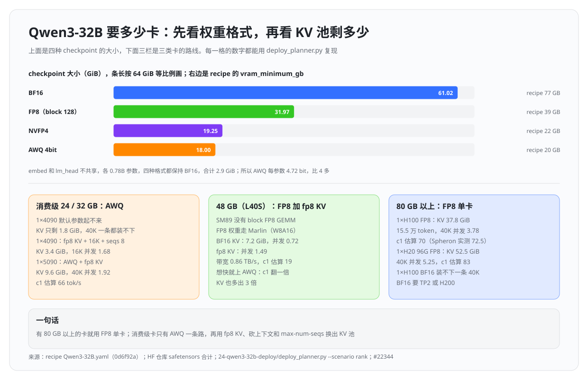
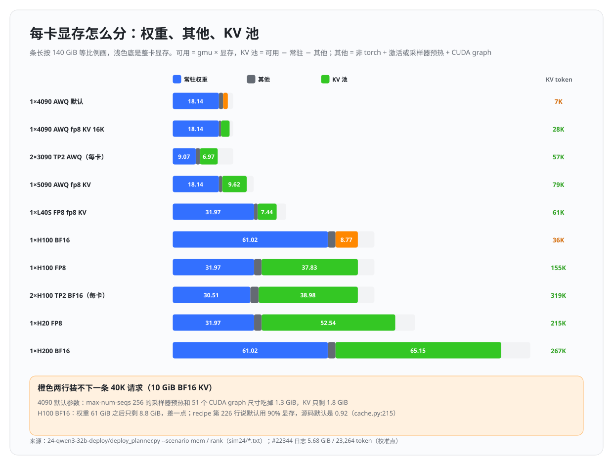
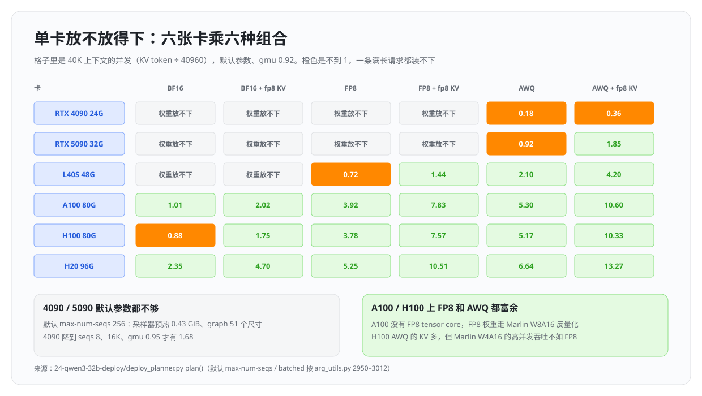
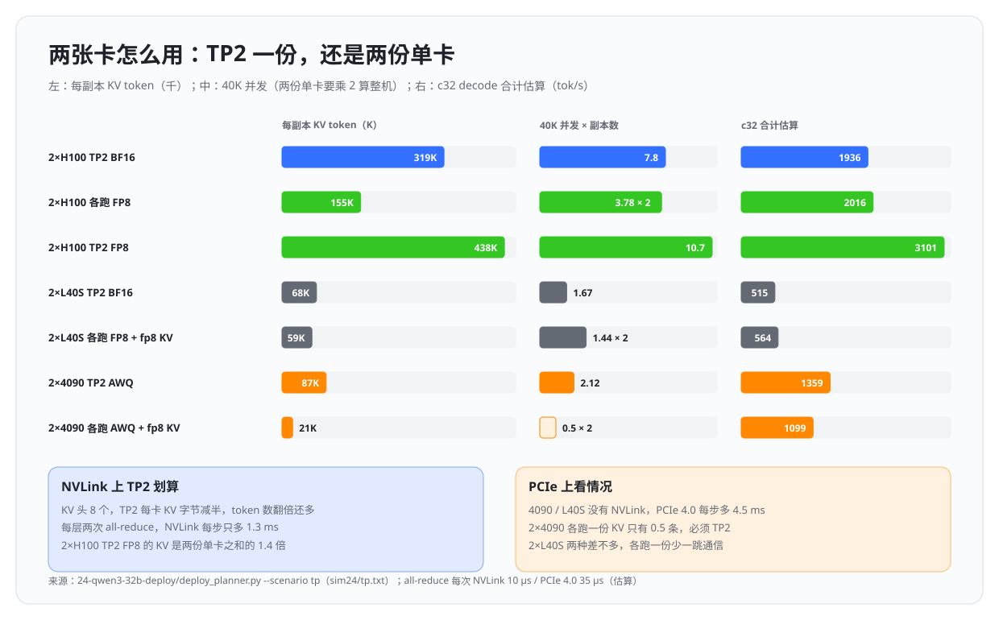
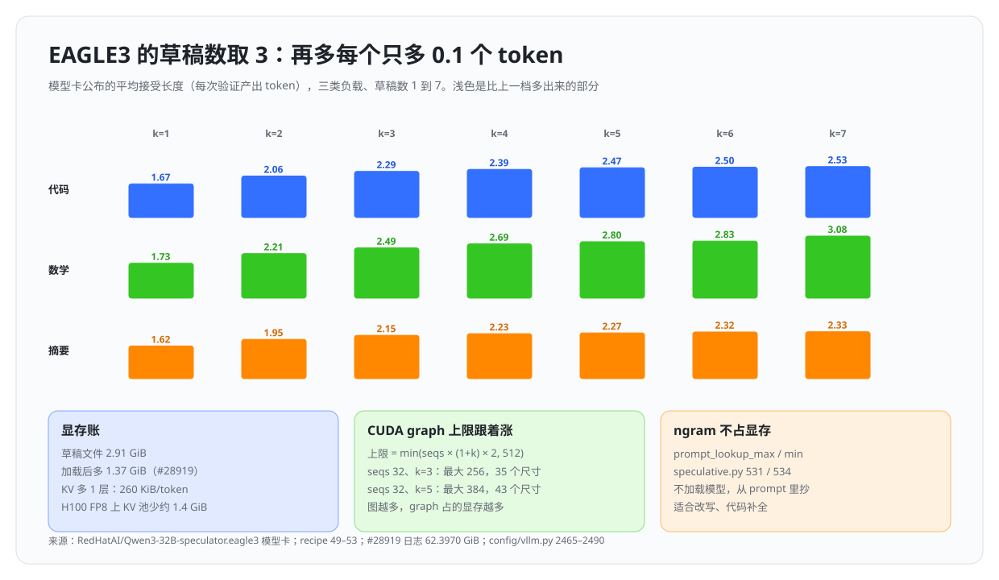
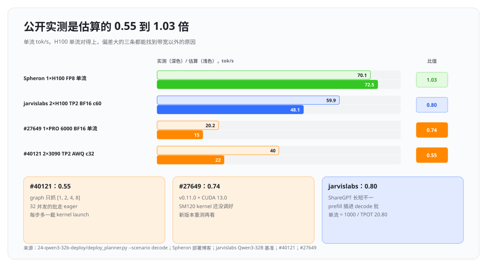
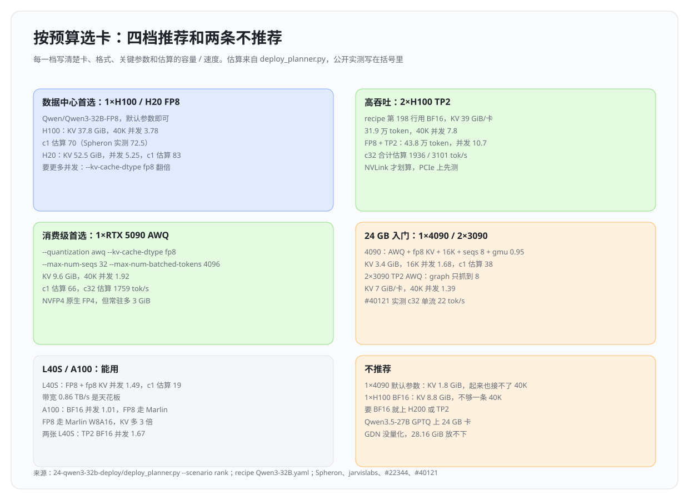
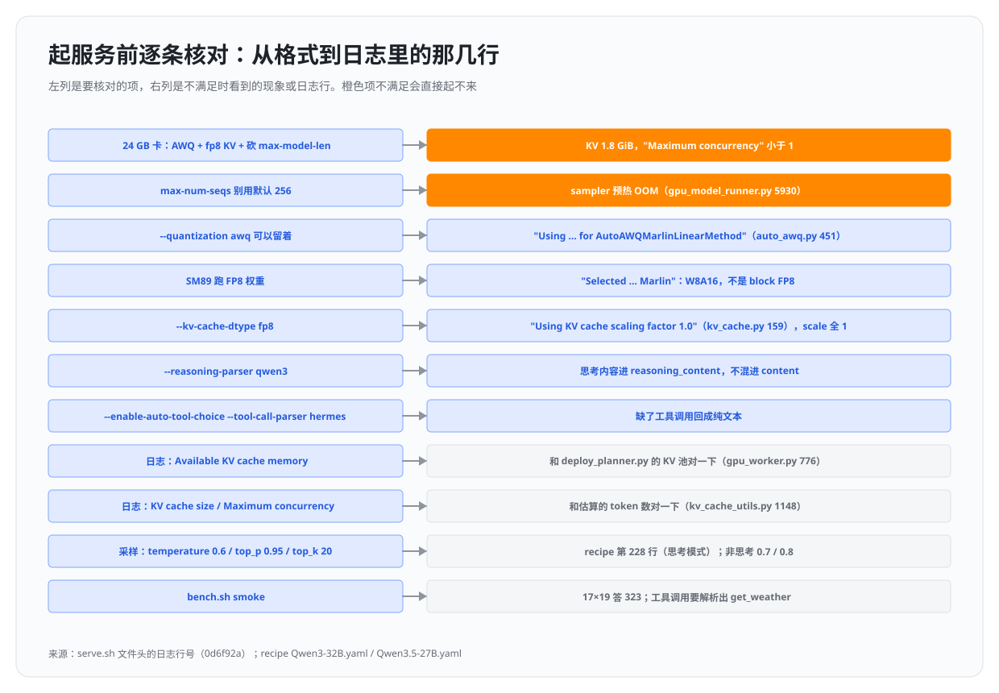

# VLLM-24｜实战｜Qwen3-32B 部署：从 4090 到 H20

> 🎯 **这篇文档解决什么问题**：Qwen3-32B 是开源稠密模型里部署最多的一档[[1]](https://arxiv.org/abs/2505.09388)[[2]](https://huggingface.co/Qwen/Qwen3-32B)。vLLM 官方 recipe 只在 TPU 和 Intel XPU 上标了 verified，NVIDIA 卡一张都没列，给的最低显存是 BF16 77 GB、FP8 39 GB、AWQ 20 GB[[3]](https://github.com/vllm-project/vllm/blob/0d6f92a/recipes/models/Qwen/Qwen3-32B.yaml)。手上是 4090、5090、L40S、H100 或 H20 的团队，最想知道的几件事 recipe 都没写：自己的卡用哪种权重格式，KV 池还剩多少，能开多长的上下文、多少并发，两张卡该切 TP2 还是各跑一份，EAGLE3 值不值得开。我做了一个部署规划器，把每张卡的显存账按 vLLM 源码的口径算出来，再拿 issue 启动日志和公开基准逐条对账，最后给出每个预算档位的配置和起服务的命令。末尾一章顺带算了 Qwen3.5-27B，它的 KV 只有 Qwen3-32B 的四分之一。
>
> **使用方式**：第 1 章算权重和 KV 的账，第 2 章逐张卡看单卡放不放得下，第 3 章比较两张卡的两种用法。第 4 章是长上下文和 fp8 KV，第 5 章是 EAGLE3 和 ngram，第 6 章是 max-num-seqs、batched 和 CUDA graph 三个参数。第 7 章和 SGLang 对照，第 8 章是 Qwen3.5-27B。第 9 章把估算和公开实测放在一起给出最佳卡配置，第 10 章是实验步骤，第 11 章是坑和我们的看法，第 12 章是核对清单。正文里标「估算」的数字都来自规划器，没有标的是源码常量、recipe 原文或公开日志。
>
> **代码**：[24-qwen3-32b-deploy](../24-qwen3-32b-deploy)。deploy_planner.py 有九个场景：weights 算四种 checkpoint 的字节，mem 算每卡显存账，kv 算每 token 字节，tp 比较 TP2 和两份单卡，spec 算 EAGLE3 的开销，profile 打印源码按卡型给的默认参数，decode 做带宽估算并和公开实测对比，rank 把十六种配置排在一起，qwen35 算 Qwen3.5-27B 的混合层。serve.sh 是十一个档位的启动命令，bench.sh 是冒烟、recipe 口径、ShareGPT、decode 并发扫描、长上下文和 /metrics。23 个单测把字节数钉在 config.json 和 HF 仓库文件大小上，把校准钉在 #22344 的启动日志上。规划器只用 Python 标准库，不需要 GPU。

# 导读 · 先给结论

## Qwen3-32B 保留为历史实战

本章 Qwen3-32B 是稠密模型专项，不是通用 MoE 主例。通用 MoE 使用 Qwen3.5-35B-A3B；不能把 32B 标题、checkpoint、量化记录和实测数据改名后继续使用。

沿用本章方法时改用公共双模型账本，另外计算 GDN 状态与 MoE 总权重驻留。本章固定模型的启动与压测脚本保留旧对象；新基座从 VLLM-01 与 VLLM-03 的 MODEL_PROFILE 入口开始。

双模型结构以固定版本配置核对[[Qwen3.8-27B config.json]](https://huggingface.co/Qwen/Qwen3.8-27B/blob/37561816e66b5b9153b1b64c10968c18c1e6f4a0/config.json)[[Qwen3.5-35B-A3B config.json]](https://huggingface.co/Qwen/Qwen3.5-35B-A3B/blob/59d61f3ce65a6d9863b86d2e96597125219dc754/config.json)。

1. **80 GB 以上的单卡直接上 FP8。**FP8 checkpoint 31.97 GiB，H100 上 KV 池剩 37.8 GiB，40K 上下文并发 3.78，H20 96G 是 5.25（估算）。BF16 放在 H100 上 KV 只剩 8.8 GiB，一条 40K 都装不下。gpustack 在 H100 上测到 FP8 比 BF16 吞吐高 50.6%[[4]](https://docs.gpustack.ai/2.0/performance-lab/qwen3-32b/h100/)。
2. **24 GB 卡要四个参数一起动。**4090 用 AWQ 默认参数起，KV 池只有 1.8 GiB、7,424 token，40K 并发 0.18。加 fp8 KV、上下文砍到 16K、max-num-seqs 降到 8、gmu 提到 0.95，才有 27,501 token（估算）。5090 多出来的 8 GB 全给了 KV，AWQ 加 fp8 KV 有 78,828 token，是消费级首选；#22344 的 5090 D 启动日志和规划器差 1 个 token[[5]](https://github.com/vllm-project/vllm/issues/22344)。
3. **两张卡优先 TP2。**Qwen3-32B 有 8 个 KV 头，TP2 每卡 KV 字节减半，每个副本的 token 数是单卡的两倍多。2×H100 TP2 FP8 估算 40K 并发 10.70，两份单卡合计 7.56。PCIe 卡 all-reduce 每步多 4.5 ms（估算），2×4090 TP2 仍比两份单卡强，两份单卡各自只剩 2.5 GiB KV。
4. **EAGLE3 的草稿数取 3。**模型卡的接受长度在 k=3 之后每多一个草稿只多 0.1 左右[[6]](https://huggingface.co/RedHatAI/Qwen3-32B-speculator.eagle3)，草稿和验证的开销却按 k 涨。草稿模型加载后多占 1.37 GiB，KV 多一层，按 260 KiB/token 算。
5. **Qwen3.5-27B 的 KV 是 Qwen3-32B 的四分之一，GPTQ-Int4 却放不进 24 GB。**它只有 16 层全注意力、4 个 KV 头，bf16 每 token 64 KiB，单卡 H100 FP8 能开两三条 262K 上下文（估算）。GPTQ-Int4 只量化了 MLP，checkpoint 28.16 GiB，recipe 写的「单张 24 GB」装不下[[7]](https://github.com/vllm-project/vllm/blob/0d6f92a/recipes/models/Qwen/Qwen3.5-27B.yaml)[[8]](https://huggingface.co/Qwen/Qwen3.5-27B-GPTQ-Int4)。



和前面各章的关系：VLLM-02 讲 gpu_memory_utilization 和 KV 容量，这里是同一本账落到具体的卡上。VLLM-11 讲 TP，第 3 章回答两张卡怎么切。VLLM-12 讲 FP8、AWQ、NVFP4 和 KV 量化，第 2 章看它们在不同架构上各走哪个 kernel。VLLM-13 讲投机解码，第 5 章给 EAGLE3 定草稿数。VLLM-17 讲负载画像和默认参数，第 6 章是它在 24 GB 卡上的后果。VLLM-08 讲混合 KV 管理，第 8 章的块大小就是从那里来的。VLLM-23 是 MoE 大模型的部署，这一篇换成稠密模型，账的算法相同，瓶颈换到了 KV 池上。

# 第 1 章 · 显存账：权重、KV 和一张卡怎么分

## 1.1 四种 checkpoint

Qwen3-32B 是 64 层的稠密 GQA 模型，64 个 Q 头、8 个 KV 头，原生上下文 32768，开 YaRN 到 131072[[1]](https://arxiv.org/abs/2505.09388)[[2]](https://huggingface.co/Qwen/Qwen3-32B)。我们把 HF 上四个常用仓库的 safetensors 加起来[[2]](https://huggingface.co/Qwen/Qwen3-32B)[[9]](https://huggingface.co/Qwen/Qwen3-32B-FP8)[[10]](https://huggingface.co/Qwen/Qwen3-32B-AWQ)[[11]](https://huggingface.co/RedHatAI/Qwen3-32B-NVFP4)：

```text
-- checkpoint 字节（HF 仓库 safetensors 合计）
   参数 32.76B = 可量化线性层 31.21B + 保持 BF16 的 1.56B（embed、lm_head 各 0.778B，不共享）
   bf16    61.02 GiB    65.5 GB  每参数 16.00 bit   recipe vram_minimum_gb  77（≈ 65.5 × 1.18）
   fp8     31.97 GiB    34.3 GB  每参数  8.38 bit   recipe vram_minimum_gb  39（≈ 34.3 × 1.14）
   awq     18.00 GiB    19.3 GB  每参数  4.72 bit   recipe vram_minimum_gb  20（≈ 19.3 × 1.03）
   nvfp4   19.25 GiB    20.7 GB  每参数  5.05 bit   recipe vram_minimum_gb  22（≈ 20.7 × 1.06）
   加载后常驻：awq 18.14 GiB（#22344），nvfp4 21.27 GiB（#22783），bf16 / fp8 按 checkpoint 算
   recipe 的 vram_minimum_gb：bf16 / fp8 是 checkpoint GB 的 1.14–1.18 倍，awq / nvfp4 只多 3–6%，都只够权重加一点 KV，开不满 40K
```

embed 和 lm_head 各 0.778B 参数，两者不共享，所有量化格式都把它们留在 BF16。这 1.56B 参数占了 2.9 GiB，所以 AWQ 平均每参数 4.72 bit，比名义上的 4 bit 多出两成。recipe 的 vram_minimum_gb[[3]](https://github.com/vllm-project/vllm/blob/0d6f92a/recipes/models/Qwen/Qwen3-32B.yaml) 是 checkpoint 大小乘一个很小的系数，AWQ 和 NVFP4 只多 3–6%，照着这个数买卡，只够放下权重。

## 1.2 每个 token 的 KV

```text
-- 每 token KV（64 层 × 8 KV 头 × 128 × K/V）
   bf16 TP1 256 KiB；TP2 128 KiB；TP4  64 KiB；TP8  32 KiB
   fp8  TP1 128 KiB；TP2  64 KiB；TP4  32 KiB；TP8  16 KiB
   一条   4096 token 的请求：bf16  1.00 GiB，fp8  0.50 GiB
   一条  32768 token 的请求：bf16  8.00 GiB，fp8  4.00 GiB
   一条  40960 token 的请求：bf16 10.00 GiB，fp8  5.00 GiB
   一条 131072 token 的请求：bf16 32.00 GiB，fp8 16.00 GiB
   131072 要开 YaRN（recipe 41–47，factor 4、original 32768），recipe 注释说 32K 以下会掉点
   fp8 KV 的 scale：checkpoint 不带 q scale 时打 kv_cache.py:141 的警告，k/v 用 1.0（kv_cache.py:158）
   Qwen3.5-27B 只有 16 层全注意力、4 个 KV 头：bf16 64 KiB/token，是 Qwen3-32B 的 1/4
```

一条 40K 的请求要 10 GiB KV，比 AWQ 权重的一半还多。稠密模型在小卡上的瓶颈就在这里：权重压到 18 GiB 以后，24 GB 卡剩下的显存连一条满长请求都放不下。

## 1.3 一张卡的分账

vLLM 的分账顺序是：可用显存 = gpu_memory_utilization × 整卡显存，先放权重，再扣掉 profiling 测出来的非 torch 内存、激活峰值和 CUDA graph，剩下的全部给 KV 池。gmu 的默认值是 0.92（[config/cache.py 215](https://github.com/vllm-project/vllm/blob/0d6f92a/vllm/config/cache.py#L215)），recipe 第 226 行写的「默认用 90%」是旧口径。启动日志里 [gpu_worker.py 776](https://github.com/vllm-project/vllm/blob/0d6f92a/vllm/v1/worker/gpu_worker.py#L776) 打出 KV 池的 GiB 数，[kv_cache_utils.py 1147–1149](https://github.com/vllm-project/vllm/blob/0d6f92a/vllm/v1/core/kv_cache_utils.py#L1147) 打出 token 数和最大并发。拿 H100 FP8 的默认参数算一遍：

```text
-- 显存账（每卡）
   H100 80G × 1，TP1，fp8 权重，KV bf16，max-num-seqs 1024，batched 8192
     可用 72.8 GiB = 79.11 × 0.92
     常驻权重 31.97 GiB（DeepGEMM（需 nvcc）或 CUTLASS block FP8）
     其他 2.99 GiB = 非 torch 0.40 + max(激活峰值 1.45, 采样器预热 1.74) + CUDA graph 0.85（51 个尺寸）
     KV 池 37.83 GiB → 154,940 token（256 KiB/token），40960 上下文并发 3.78
```



「其他」一栏里，激活峰值和采样器预热取大的一个。采样器预热按 max-num-seqs 条假请求跑一次（[gpu_model_runner.py 5930](https://github.com/vllm-project/vllm/blob/0d6f92a/vllm/v1/worker/gpu_model_runner.py#L5930)），默认 1024 条时要 1.74 GiB，比 8192 token 的激活还大。CUDA graph 0.85 GiB 来自 51 个捕获尺寸。这两项都由 max-num-seqs 决定，第 6 章再展开。

## 1.4 和公开日志对账

规划器的口径要和真实启动日志对得上才有用。我们找了三条带完整显存日志的公开记录：

| 来源 | 配置 | 规划器 | 日志 | 差在哪 |
|-|-|-|-|-|
| #22344[[5]](https://github.com/vllm-project/vllm/issues/22344) | RTX 5090 D，AWQ，eager，gmu 0.95，len 16384 | KV 5.68 GiB，23,265 token，1.42x | KV 5.68 GiB，23,264 token，1.42x | 差 1 个 token，是校准点 |
| LMCache FAQ[[12]](https://docs.lmcache.ai/getting_started/faq.html) | 2×H100 TP2 | 306,365 token，7.48x | 275,760 token，6.73x，每卡 KV 33.66 GiB | 每卡少 3.7 GiB，差在 LMCache 自己的缓冲（估算） |
| #28919[[13]](https://github.com/vllm-project/vllm/issues/28919) | EAGLE3 k=5，len 4096 | 64 层 16.91 GiB，加草稿 1 层 17.17 GiB | KV 17.08 GiB，69,264 token，16.91x | 日志落在两者之间 |

#22344 是唯一一条参数全部公开的单卡日志，单测把它钉成回归用例。另外两条用来确认 TP2 和投机解码的口径方向对。

# 第 2 章 · 单卡放不放得下

先把六张卡和六种组合摊开。格子里是 40K 上下文的并发，用的是源码按卡型给的默认 max-num-seqs 和 batched（[arg_utils.py 2950–3012](https://github.com/vllm-project/vllm/blob/0d6f92a/vllm/engine/arg_utils.py#L2950)），gmu 0.92：



## 2.1 24 GB：4090 默认参数起不来

```text
-- 显存账（每卡）
   RTX 4090 24G × 1，TP1，awq 权重，KV bf16，max-num-seqs 256，batched 2048
     可用 21.6 GiB = 23.52 × 0.92
     常驻权重 18.14 GiB（AWQ Marlin（--quantization awq 也会落到这里，auto_awq.py:263））
     其他 1.68 GiB = 非 torch 0.40 + max(激活峰值 0.36, 采样器预热 0.43) + CUDA graph 0.85（51 个尺寸）
     KV 池 1.81 GiB → 7,424 token（256 KiB/token），40960 上下文并发 0.18  ✗ 装不下一条满长请求
```

4090 显存不到 70 GiB，源码给的默认是 batched 2048、max-num-seqs 256。256 条假请求的采样器预热要 0.43 GiB，51 个 CUDA graph 尺寸要 0.85 GiB，扣完 KV 池只剩 1.81 GiB。Spheron 的对比表把 4090 标成「Marginal (OOM at default context)」[[14]](https://www.spheron.network/blog/rtx-5090-vs-rtx-4090/)，和这里的结论一致。四个参数一起动以后：

```bash
bash serve.sh 4090-awq   # AWQ + fp8 KV，gmu 0.95，max-model-len 16384，max-num-seqs 8，batched 2048
```

```text
-- 显存账（每卡）
   RTX 4090 24G × 1，TP1，awq 权重，KV fp8，max-num-seqs 8，batched 2048
     可用 22.3 GiB = 23.52 × 0.95
     常驻权重 18.14 GiB（AWQ Marlin（--quantization awq 也会落到这里，auto_awq.py:263））
     其他 0.85 GiB = 非 torch 0.40 + max(激活峰值 0.36, 采样器预热 0.01) + CUDA graph 0.08（5 个尺寸）
     KV 池 3.36 GiB → 27,501 token（128 KiB/token），16384 上下文并发 1.68
```

fp8 KV 把每 token 的字节砍半，max-num-seqs 8 让采样器预热降到 0.01 GiB、graph 只抓 5 个尺寸。代价是上下文只有 16K，并发 1.68。AWQ 这里有个容易误会的地方：加 `--quantization awq` 也会被 [auto_awq.py 263](https://github.com/vllm-project/vllm/blob/0d6f92a/vllm/model_executor/layers/quantization/auto_awq.py#L263) 的 override 改走 Marlin kernel，日志打 [auto_awq.py 451](https://github.com/vllm-project/vllm/blob/0d6f92a/vllm/model_executor/layers/quantization/auto_awq.py#L451) 的「Using ... for AutoAWQMarlinLinearMethod」。看到 [auto_awq.py 327](https://github.com/vllm-project/vllm/blob/0d6f92a/vllm/model_executor/layers/quantization/auto_awq.py#L327) 的「Falling back to unoptimized AWQ kernels」就要警惕，#40121 里 Marlin 单流 22 tok/s，退回原始 AWQ kernel 只有 4.8[[15]](https://github.com/vllm-project/vllm/issues/40121)。

## 2.2 32 GB：5090 多出来的显存全给 KV

```bash
bash serve.sh 5090-awq   # AWQ + fp8 KV，max-num-seqs 32，batched 4096
```

```text
-- 显存账（每卡）
   RTX 5090 32G × 1，TP1，awq 权重，KV fp8，max-num-seqs 32，batched 4096
     可用 29.1 GiB = 31.6 × 0.92
     常驻权重 18.14 GiB（AWQ Marlin（--quantization awq 也会落到这里，auto_awq.py:263））
     其他 1.31 GiB = 非 torch 0.40 + max(激活峰值 0.72, 采样器预热 0.05) + CUDA graph 0.18（11 个尺寸）
     KV 池 9.62 GiB → 78,828 token（128 KiB/token），40960 上下文并发 1.92
```

同样的 AWQ 权重，5090 比 4090 多 8 GB，KV 池从 3.4 GiB 涨到 9.6 GiB，40K 上下文能开 1.92 条。Spheron 测到 5090 跑 AWQ 约 1,100 tok/s、显存占用约 22 GB，4090 约 650[[14]](https://www.spheron.network/blog/rtx-5090-vs-rtx-4090/)。NVFP4 是另一个选项，#22783 的加载日志显示常驻 21.27 GiB[[16]](https://github.com/vllm-project/vllm/issues/22783)，比 AWQ 多 3.1 GiB，KV 池相应变小，40K 并发 1.30（估算）。在没有 FP4 指令的卡上加载 NVFP4 会打 [nvfp4/marlin.py 35](https://github.com/vllm-project/vllm/blob/0d6f92a/vllm/model_executor/kernels/linear/nvfp4/marlin.py#L35) 的警告，退到 Marlin weight-only。

## 2.3 48 GB：L40S 要靠 fp8 KV

```bash
bash serve.sh l40s-fp8   # FP8 权重 + fp8 KV，max-num-seqs 64，batched 4096
```

```text
-- 显存账（每卡）
   L40S 48G × 1，TP1，fp8 权重，KV fp8，max-num-seqs 64，batched 4096
     可用 40.8 GiB = 44.4 × 0.92
     常驻权重 31.97 GiB（FP8 Marlin（W8A16，SM89 没有 block FP8 的 CUTLASS kernel））
     其他 1.44 GiB = 非 torch 0.40 + max(激活峰值 0.72, 采样器预热 0.11) + CUDA graph 0.32（19 个尺寸）
     KV 池 7.44 GiB → 60,958 token（128 KiB/token），40960 上下文并发 1.49
```

FP8 权重 32 GiB 放进 44.4 GiB 的卡，KV 只剩 7.2 GiB，不加 fp8 KV 时 40K 并发 0.72。规划器按 FP8 Marlin（W8A16）算 L40S 的权重路径，起服务后看 [kernels/linear/\_\_init\_\_.py 779](https://github.com/vllm-project/vllm/blob/0d6f92a/vllm/model_executor/kernels/linear/__init__.py#L779) 的「Selected ... for」确认实际选中的 kernel。A100 的情况更明确：Ampere 没有 FP8 tensor core，gpustack 在 A100 上测到 FP8（Marlin）吞吐 1563.33 tok/s，低于 BF16 的 1730.98，TPOT 从 149.67 ms 涨到 339.76 ms[[17]](https://docs.gpustack.ai/2.0/performance-lab/qwen3-32b/a100/)。A100 上要省显存，选 AWQ（1767.21）比 FP8 合适。

## 2.4 80 GB 以上：FP8 默认参数就够

```bash
bash serve.sh h100-fp8   # 默认参数
bash serve.sh h20-fp8    # H20 96G，KV 池比 H100 多 15 GiB
```

```text
-- 显存账（每卡）
   H20 96G × 1，TP1，fp8 权重，KV bf16，max-num-seqs 1024，batched 8192
     可用 87.5 GiB = 95.1 × 0.92
     常驻权重 31.97 GiB（DeepGEMM（需 nvcc）或 CUTLASS block FP8）
     其他 2.99 GiB = 非 torch 0.40 + max(激活峰值 1.45, 采样器预热 1.74) + CUDA graph 0.85（51 个尺寸）
     KV 池 52.54 GiB → 215,195 token（256 KiB/token），40960 上下文并发 5.25
```

H100 上 BF16 的 KV 池 8.8 GiB，40K 并发 0.88，单卡 BF16 只适合短上下文。FP8 的精度代价很小，gpustack 引用的结论是「FP8 quantization can achieves less than 1% accuracy drop」，H100 上的吞吐提升是三种优化里最大的一项，量化 +50.6%，换引擎 +13.0%，chunked prefill +7.0%[[4]](https://docs.gpustack.ai/2.0/performance-lab/qwen3-32b/h100/)。H20 的算力只有 H100 的零头，显存带宽 4.0 TB/s 反而更高，Qwen3-32B 的 decode 吃带宽，所以 H20 FP8 的 c1 估算是 83 tok/s，比 H100 的 70 还高。

# 第 3 章 · 两张卡：TP2 一份还是两份单卡

```text
-- 两张卡怎么用：TP2 一份，还是两份单卡（KV 是每个副本的，c1 / c32 是 decode 带宽估算）
   配置                          副本    常驻/卡    KV/副本    token/副本   40K 并发     c1    c32 合计
   2×H100 TP2 BF16              1    30.5     39.0     319,327     7.80     67      1936
   2×H100 各跑 FP8                2    32.0     37.8     154,940     3.78     70      2016
   2×H100 TP2 FP8               1    16.0     53.5     438,352    10.70    115      3101
   2×L40S TP2 BF16              1    30.5      8.4      68,413     1.67     18       515
   2×L40S 各跑 FP8 + fp8 KV       2    32.0      7.2      58,965     1.44     19       564
   2×4090 TP2 AWQ               1     9.1     10.6      86,697     2.12     55      1359
   2×4090 各跑 AWQ + fp8 KV       2    18.1      2.5      20,628     0.50     38      1099
   TP2 每层两次 all-reduce：NVLink 上每步多 1.3 ms，PCIe 4.0 上多 4.5 ms（估算），4090 / L40S 没有 NVLink
   KV 头 8 个，TP 最多切到 8；TP2 每卡 KV 字节减半，所以 TP2 的 token 数是单卡的两倍多
```



TP2 时每卡只存 4 个 KV 头，每 token 字节减半，权重也减半，两头省下来的都给了 KV。2×H100 TP2 BF16 每卡常驻 30.5 GiB，KV 池 39.0 GiB，token 数 319,327，是单卡 FP8 的两倍多。这就是 recipe 第 198–204 行给 BF16 写 TP2 命令的原因[[3]](https://github.com/vllm-project/vllm/blob/0d6f92a/recipes/models/Qwen/Qwen3-32B.yaml)。jarvislabs 在 2×H100 TP2 BF16 上测 ShareGPT，vLLM 并发 60 时输出 2583.01 tok/s，峰值 4226.41，TPOT 20.80 ms[[18]](https://jarvislabs.ai/blog/vllm-sglang-trtllm-comparison)。

两份单卡的好处是故障隔离和没有 all-reduce，代价是 KV 分成两半。有 NVLink 的 H100 上，TP2 FP8 的 40K 并发 10.70，两份单卡 FP8 合计 7.56，c32 合计 3101 对 2016（估算）。4090 和 L40S 没有 NVLink，all-reduce 走 PCIe，每步多 4.5 ms（估算），2×4090 TP2 的 c1 估算 55，仍高于单卡的 38。两份单卡各自只剩 2.5 GiB KV，40K 一条都装不下，TP2 仍然划算。

## 3.1 2×3090：CUDA graph 只抓 4 个尺寸

```bash
bash serve.sh 3090x2-awq   # TP2 AWQ，gmu 0.75，max-num-seqs 32，capture [1,2,4,8]
```

```text
-- 显存账（每卡）
   RTX 3090 24G × 2，TP2，awq 权重，KV bf16，max-num-seqs 32，batched 8192
     可用 17.7 GiB = 23.57 × 0.75
     常驻权重 9.07 GiB（AWQ Marlin（--quantization awq 也会落到这里，auto_awq.py:263））
     其他 1.64 GiB = 非 torch 0.70 + max(激活峰值 0.87, 采样器预热 0.05) + CUDA graph 0.07（4 个尺寸）
     KV 池 6.97 GiB → 57,102 token（128 KiB/token），40960 上下文并发 1.39
```

#40121 在 2×3090 NVLink 上用 v0.18.1 跑 AWQ TP2，CUDA graph 回放到 16–64 这几个尺寸时触发 Xid 13[[15]](https://github.com/vllm-project/vllm/issues/40121)。绕法是 `--compilation-config` 里只抓 [1, 2, 4, 8]，单流 22 tok/s，32 并发合计约 720。规划器估算单流 40，比值 0.55，差距来自 graph 只覆盖到 8，更大的批全走 eager。这一档能用，但并发上去以后吞吐打折，我们只把它列为入门档。

## 3.2 PP 和 LoRA 的两个坑

#30128 在 Ray 集群上用 4090 D 跑 FP8，PP5 时报错，PP 不超过 3 正常[[19]](https://github.com/vllm-project/vllm/issues/30128)。64 层除以 5 除不尽，[distributed/utils.py 232](https://github.com/vllm-project/vllm/blob/0d6f92a/vllm/distributed/utils.py#L232) 会打「Hidden layers were unevenly partitioned」，各 stage 的层数不等。单机多卡优先 TP，PP 留给跨机。#17822 在 0.8.5 上 TP2 加一个 LoRA，V1 引擎在 CUDA graph 捕获时 OOM，V0 正常，日志里 KV 已经分到 82,128 token[[20]](https://github.com/vllm-project/vllm/issues/17822)。带 LoRA 时 gmu 要比不带时留出更多余量。

# 第 4 章 · 长上下文和 fp8 KV

recipe 默认上下文 40960，第 41–47 行给了 YaRN 到 131072 的写法（factor 4.0，original 32768），注释提醒 32K 以下的请求可能掉点[[3]](https://github.com/vllm-project/vllm/blob/0d6f92a/recipes/models/Qwen/Qwen3-32B.yaml)。131072 一条请求 bf16 KV 32 GiB，H100 FP8 的 KV 池 37.83 GiB 只够 1.18 条，换 fp8 KV 是 2.36 条（估算）。只做短对话的服务反过来压，recipe 第 225 行建议 `--max-model-len 4096`，max-model-len 越小，采样器和 graph 之外的余量越多，调度也越不容易抢占。

fp8 KV 是 24–48 GB 卡上收益最大的一个开关，KV 字节直接减半。Qwen 官方的 FP8 和 AWQ checkpoint 都不带 KV scale，加载时会打两条日志：[kv_cache.py 141](https://github.com/vllm-project/vllm/blob/0d6f92a/vllm/model_executor/layers/quantization/kv_cache.py#L141) 提示 q scale 缺失、改用 k_scale，[kv_cache.py 159](https://github.com/vllm-project/vllm/blob/0d6f92a/vllm/model_executor/layers/quantization/kv_cache.py#L159) 提示 k/v scale 用 1.0。这两条本身无害，但意味着 KV 量化没有校准过。我们没有找到 Qwen3-32B 在 fp8 KV 下的公开精度对比，上线前用自己的评测集跑一遍。

压测时有一处要和 recipe 对齐：recipe 第 232 行要求服务端加 `--no-enable-prefix-caching`，第 234–243 行用 random 1024/1024、128 条[[3]](https://github.com/vllm-project/vllm/blob/0d6f92a/recipes/models/Qwen/Qwen3-32B.yaml)。random 数据集的前缀不会命中，但 prefix caching 的哈希和块管理仍有开销，不关掉和 recipe 的数字对不上。bench.sh recipe 模式照这个口径跑。

# 第 5 章 · 投机解码：EAGLE3 和 ngram

```text
-- EAGLE3（recipe 49–53：RedHatAI/Qwen3-32B-speculator.eagle3，k=3）
   草稿文件 2.91 GiB，加载后多 1.37 GiB（#28919：62.3970 − 61.02），KV 多 1 层：260 KiB/token
   模型卡接受长度（每次验证平均产出 token），后面是比 k−1 多出来的部分：
   coding        k1 1.67 k2 2.06(+0.39) k3 2.29(+0.23) k4 2.39(+0.10) k5 2.47(+0.08) k6 2.50(+0.03) k7 2.53(+0.03)
   math          k1 1.73 k2 2.21(+0.48) k3 2.49(+0.28) k4 2.69(+0.20) k5 2.80(+0.11) k6 2.83(+0.03) k7 3.08(+0.25)
   summarization k1 1.62 k2 1.95(+0.33) k3 2.15(+0.20) k4 2.23(+0.08) k5 2.27(+0.04) k6 2.32(+0.05) k7 2.33(+0.01)
   k=3 之后每多一个草稿只多 0.1 左右，草稿和验证的开销却按 k 涨：recipe 选 k=3 是对的，高并发再降到 1–2
   k=1：CUDA graph 上限 min(seqs × 2 × 2, 512)，seqs 32 时最大 128，抓 19 个尺寸
   k=3：CUDA graph 上限 min(seqs × 4 × 2, 512)，seqs 32 时最大 256，抓 35 个尺寸
   k=5：CUDA graph 上限 min(seqs × 6 × 2, 512)，seqs 32 时最大 384，抓 43 个尺寸
   ngram（prompt_lookup_max / min，speculative.py:531 / 534）：不加载模型、不占显存，适合改写、代码补全这类输入里有原文的负载
```



recipe 第 49–53 行给的草稿模型是 RedHatAI/Qwen3-32B-speculator.eagle3，k=3，第 55–57 行写明是可选项[[3]](https://github.com/vllm-project/vllm/blob/0d6f92a/recipes/models/Qwen/Qwen3-32B.yaml)[[6]](https://huggingface.co/RedHatAI/Qwen3-32B-speculator.eagle3)。模型卡的接受长度在 2×A100、v0.11.0 上测得，三类负载在 k=3 时是 2.15–2.49，k=4 以后每多一个草稿只多 0.03–0.2。草稿文件 2.91 GiB，#28919 的日志显示 BF16 加草稿加载后 62.3970 GiB，比单独 BF16 只多 1.37 GiB[[13]](https://github.com/vllm-project/vllm/issues/28919)。vLLM 会让草稿模型共享目标模型的 embedding 和 lm_head（[llm_base_proposer.py 1421–1506](https://github.com/vllm-project/vllm/blob/0d6f92a/vllm/v1/spec_decode/llm_base_proposer.py#L1421)），差值大概率来自这里。

```bash
bash serve.sh eagle3   # H100 FP8 + EAGLE3 k=3，max-num-seqs 32
bash bench.sh metrics  # 接受长度 = accepted / drafts + 1
```

serve.sh 把 max-num-seqs 设成 32，原因在 CUDA graph 的上限：投机解码时每条序列要验证 k+1 个 token，捕获上限是 min(seqs × (k+1) × 2, 512)，seqs 1024 时直接顶到 512，graph 尺寸多、显存涨。投机解码的收益在低并发，高并发时验证的算力会和正常 decode 抢，所以并发上来以后把 k 降到 1–2。

ngram 不加载模型、不占显存，只在 prompt 里找重复片段当草稿（[speculative.py 531](https://github.com/vllm-project/vllm/blob/0d6f92a/vllm/config/speculative.py#L531) / [534](https://github.com/vllm-project/vllm/blob/0d6f92a/vllm/config/speculative.py#L534) 的 prompt_lookup_max / min）。改写、代码补全、RAG 引用原文这类输出大段照抄输入的负载，ngram 的接受率不比 EAGLE3 差，24 GB 卡上显存紧张时可以先试它。

# 第 6 章 · 负载画像：max-num-seqs、batched 和 CUDA graph

```text
-- 源码默认值（arg_utils.py 2950–3012，#17885）
   RTX 4090 24G           23.5 GiB → batched  2048，max-num-seqs  256
   RTX 5090 32G           31.6 GiB → batched  2048，max-num-seqs  256
   L40S 48G               44.4 GiB → batched  2048，max-num-seqs  256
   A100 80G               79.2 GiB → batched  2048，max-num-seqs  256   名字里有 a100，被排除在 70 GiB 档外
   H100 80G               79.1 GiB → batched  8192，max-num-seqs 1024
   H20 96G                95.1 GiB → batched  8192，max-num-seqs 1024
   H200 141G             140.4 GiB → batched  8192，max-num-seqs 1024
   B200 180G             178.3 GiB → batched 16384，max-num-seqs 1024
-- CUDA graph 尺寸（config/vllm.py 2465–2490、2588–2610）
   balanced      seqs 1024：51 个尺寸，最大 512，前几个 [1, 2, 4, 8, 16, 24]
   interactivity seqs 1024：76 个尺寸，最大 512，前几个 [1, 2, 3, 4, 5, 6]
   #40121 的绕法只抓 [1, 2, 4, 8]：4 个尺寸
-- 显存提示（gpu_worker.py 780–814）
   H100 80G gmu 0.92，graph 0.85 GiB：等价旧口径 gmu = 0.92 − 0.85/79.11 = 0.9093；想保住 KV 池就调到 0.9307
```

默认值按卡的显存分档，A100 被单独排除在大显存档外，这是 #17885 定的，理由是 A100 上大 batched 反而拖慢[[21]](https://github.com/vllm-project/vllm/pull/17885)。这套默认值在 Qwen3-32B 上的问题是：4090、5090、L40S 都拿到 max-num-seqs 256，而它们的 KV 池只装得下一两条 40K 请求。256 条并发既用不满，还让采样器预热和 CUDA graph 多占了显存。规划器 mem 场景里的「并发」一列就是 max-num-seqs 的合理上限附近，24 GB 卡设 8，32 GB 设 32，48 GB 设 64。

采样器预热 OOM 的报错在 [gpu_model_runner.py 5930](https://github.com/vllm-project/vllm/blob/0d6f92a/vllm/v1/worker/gpu_model_runner.py#L5930)：「CUDA out of memory occurred when warming up sampler with N dummy requests」，提示降 max_num_seqs 或 gmu。#29049 在 H100 上加载 LoRA 时就是 1024 条假请求的预热 OOM，graph 已经占了 6.31 GiB[[22]](https://github.com/vllm-project/vllm/issues/29049)，模型不同，机制相同。

v0.21.0 以后，CUDA graph 的显存在 profiling 阶段就计入，启动日志会提示等价的旧 gmu 和建议值（[gpu_worker.py 780–814](https://github.com/vllm-project/vllm/blob/0d6f92a/vllm/v1/worker/gpu_worker.py#L780)）。H100 FP8 默认参数下 graph 0.85 GiB，旧口径的 gmu 等于 0.9093，想保住升级前的 KV 池就提到 0.9307。CUDA graph 的尺寸表在 [config/vllm.py 2465–2490](https://github.com/vllm-project/vllm/blob/0d6f92a/vllm/config/vllm.py#L2465) 和 [2588–2610](https://github.com/vllm-project/vllm/blob/0d6f92a/vllm/config/vllm.py#L2588)，balanced 档 51 个，interactivity 档 76 个，最大都是 512。

# 第 7 章 · 对照 SGLang

## 7.1 按显存档给默认值

SGLang 在 [handle_gpu_memory_settings](https://github.com/sgl-project/sglang/blob/8fabf5e/python/sglang/srt/arg_groups/memory_hook.py#L47) 里按 GPU 显存给 chunked_prefill_size 和 decode CUDA graph 的 max_bs[[23]](https://github.com/sgl-project/sglang/blob/8fabf5e/python/sglang/srt/arg_groups/memory_hook.py)，和 vLLM 按卡型给 batched / max-num-seqs 是同一个思路，档位切得更细（[memory_hook.py 89–171](https://github.com/sgl-project/sglang/blob/8fabf5e/python/sglang/srt/arg_groups/memory_hook.py#L89)）：

| 显存 | 代表卡 | SGLang chunked / decode max_bs（tp<4） | vLLM batched / max-num-seqs |
|-|-|-|-|
| < 20 GiB | T4、4080 | 2048 / 8 | 2048 / 256 |
| < 35 GiB | A10、4090、5090 | 4096 / 48 | 2048 / 256 |
| < 60 GiB | A100 40G、L40S | 4096 / 32 | 2048 / 256 |
| < 90 GiB | H100、A100 80G | 8192 / 256 | 8192 / 1024（A100 除外） |
| < 160 GiB | H20、H200 | 8192 / 256 | 8192 / 1024 |
| ≥ 160 GiB | B200、MI300 | 16384 / 512 | 16384 / 1024 |

<35 GiB 这一档的注释（[memory_hook.py 102–106](https://github.com/sgl-project/sglang/blob/8fabf5e/python/sglang/srt/arg_groups/memory_hook.py#L102)）专门提到 5090：「32GB Blackwell (RTX 5090) can hold decode cuda graphs well past bs=24; the previous cap forced eager decode at bs>=32 and collapsed high-concurrency throughput vs vLLM」。SGLang 之前把 graph 上限压得太低，32 并发以上走 eager，吞吐输给了 vLLM，后来提到 48。SGLang 还会把 max_bs 压到 max_running_requests 以内（[memory_hook.py 182–188](https://github.com/sgl-project/sglang/blob/8fabf5e/python/sglang/srt/arg_groups/memory_hook.py#L182)）。vLLM 这边没有对应的逻辑，max-num-seqs 设小以后 graph 尺寸跟着变少，效果相近。

## 7.2 mem_fraction_static 的算法

SGLang 的 mem_fraction_static 定义为（权重 + KV 池）/ 整卡显存，默认值由一个预留公式反推（[memory_hook.py 281–328](https://github.com/sgl-project/sglang/blob/8fabf5e/python/sglang/srt/arg_groups/memory_hook.py#L281)）：预留 = 512 + max(chunked, 2048) × 1.5 + tp × pp / 8 × 1024 + graph 预留（MiB），60 GiB 以上的卡至少 10240，DeepEP 和 XPU 再各加 2048。graph 预留在 [reserve_for_graph_mb](https://github.com/sgl-project/sglang/blob/8fabf5e/python/sglang/srt/arg_groups/memory_hook.py#L357)：decode max_bs × 2，非 MLA 模型再加 prefill 捕获尺寸数 × 8。按这个公式算 Qwen3-32B 在 TP1 下的默认值：

| 卡 | 预留（MiB，估算） | mem_fraction_static（估算） | 权重 + KV 池（GiB，估算） | 和 vLLM 比 |
|-|-|-|-|-|
| 4090 | 7344 | 0.695 | 16.35 | 比 AWQ 常驻 18.14 还小，要手动调高 |
| 5090 | 7344 | 0.773 | 24.43 | vLLM 0.92 时是 29.1 |
| L40S | 7312 | 0.839 | 37.25 | vLLM 0.92 时是 40.8 |
| H100 | 13904 | 0.828 | 65.5 | vLLM 0.92 时是 72.8 |
| H20 | 13904 | 0.857 | 81.5 | vLLM 0.92 时是 87.5 |

SGLang 的默认值比 vLLM 保守，在 Qwen3-32B 这种 KV 吃紧的模型上，H100 少给 KV 约 7 GiB。它的调参文档也说 mem_fraction_static 要尽量往高推，看日志里的 token usage，大于 0.9 算用得好，#queue-req 在 100–2000 之间算健康[[24]](https://github.com/sgl-project/sglang/blob/8fabf5e/docs/docs/advanced_features/hyperparameter_tuning.mdx)。serve.sh 的 sgl 档在 H100 上直接给 0.90。对照时看两边日志的 KV token 数：vLLM 是 [kv_cache_utils.py 1148](https://github.com/vllm-project/vllm/blob/0d6f92a/vllm/v1/core/kv_cache_utils.py#L1148) 的「GPU KV cache size」，SGLang 是 `max_total_num_tokens`。

工具调用的 parser 名字两边不同。SGLang cookbook 给 Qwen3 写的是 `--reasoning-parser qwen3` 和 `--tool-call-parser qwen25`[[25]](https://github.com/sgl-project/sglang/blob/8fabf5e/docs/cookbook/autoregressive/Qwen/Qwen3.mdx)，vLLM recipe 第 30–40 行是 `--reasoning-parser qwen3` 和 `--tool-call-parser hermes`[[3]](https://github.com/vllm-project/vllm/blob/0d6f92a/recipes/models/Qwen/Qwen3-32B.yaml)。换引擎时 parser 名字跟着换，bench.sh smoke 的工具调用用例两边都能跑。

## 7.3 公开对比数据

| 来源 | 硬件 / 版本 | 口径 | 结果 |
|-|-|-|-|
| gpustack[[4]](https://docs.gpustack.ai/2.0/performance-lab/qwen3-32b/h100/) | 1×H100 SXM；vLLM v0.11.0、SGLang v0.5.5.post1、TRT-LLM v1.2.0rc1 | ShareGPT 1000 条，总吞吐 tok/s | BF16：TRT 2659.50、vLLM 2352.82、SGLang 1690.84；SGLang FP8 4005.32；TRT FP8 + chunked 4284.68 |
| gpustack[[17]](https://docs.gpustack.ai/2.0/performance-lab/qwen3-32b/a100/) | 1×A100 | 同上 | vLLM BF16 1730.98、AWQ 1767.21、FP8 1563.33；SGLang 1398.38；TRT 2054.21；TRT FP8 报 Unsupported SM version |
| jarvislabs[[18]](https://jarvislabs.ai/blog/vllm-sglang-trtllm-comparison) | 2×H100 TP2 BF16 | ShareGPT，输出 tok/s | vLLM 并发 60 时 2583.01、峰值 4226.41；SGLang 2022.69、峰值 3812.05；TRT 2389.57 |
| #18136[[26]](https://github.com/vllm-project/vllm/issues/18136) | 4×A10G，AWQ TP4（2025-05） | 输入 25000、输出 1024 | 总吞吐 vLLM 178.15、SGLang 748.92 |
| #17852[[27]](https://github.com/vllm-project/vllm/issues/17852) | H20 TP2，vLLM 0.8.5 对 SGLang 0.4.5 | TPOT（s） | FP8 离线 0.032 对 0.016；在线 0.026 对 0.024；BF16 0.032 对 0.030 |

2025 年 5 月的两条 issue 里 SGLang 领先，长输入和 FP8 上差距明显。到 v0.11.0 前后的两组第三方基准，BF16 上 vLLM 反超 SGLang 两到四成。gpustack 的 SGLang FP8 跑到 4005.32，没有给同版本 vLLM FP8 的数字，FP8 这一项我们没有可比的公开数据。引擎之间的差距随版本变动很大，选引擎前在自己的卡和负载上跑一遍 bench.sh，比引用任何一篇博客都可靠。

# 第 8 章 · Qwen3.5-27B：KV 小四倍的混合模型

Qwen3.5-27B 是 Gated DeltaNet 线性注意力和全注意力的混合模型，64 层里 48 层 GDN、16 层全注意力，原生 262144 上下文，带一个 MTP 层和视觉塔[[28]](https://huggingface.co/Qwen/Qwen3.5-27B)。recipe 要求 vLLM 0.17.0 以上，工具调用换成 `qwen3_coder`（第 34–38 行），只做文本时加 `--language-model-only`（第 49–52 行）跳过视觉塔[[7]](https://github.com/vllm-project/vllm/blob/0d6f92a/recipes/models/Qwen/Qwen3.5-27B.yaml)。

```text
-- Qwen3.5-27B checkpoint 按模块拆（GiB：BF16 / FP8 / GPTQ-Int4）
   mlp                 31.88  15.94   8.29
   linear_attn（GDN）    10.36   5.20  10.36
   self_attn            3.13   1.56   3.13
   lm_head              2.37   2.37   2.37
   embed                2.37   2.37   2.37
   visual               0.86   0.86   0.86
   mtp                  0.79   0.44   0.79
   bf16 合计  51.75 GiB =  55.6 GB，recipe vram_minimum_gb 65
   fp8  合计  28.75 GiB =  30.9 GB，recipe vram_minimum_gb 33
   gptq 合计  28.16 GiB =  30.2 GB，recipe vram_minimum_gb 17
   GPTQ-Int4 只量化了 MLP，GDN 和注意力还是 BF16：28.16 GiB 比 FP8 只小 0.6，recipe 写的 17 GB / 单张 24 GB 装不下
   加 --language-model-only 省掉 visual 0.86，GPTQ 还剩 27.30 GiB，24 GB 卡照样装不下
-- 混合层的块大小（注意力页要 ≥ GDN 状态页）
   TP1 KV bf16 spec 0 对齐 16：GDN 页 3,207,168 B → 块 784 token（v0.19，LMCache 文档写 784）
   TP1 KV bf16 spec 0 对齐 64：GDN 页 3,207,168 B → 块 832 token（主干 + flashinfer GDN prefill）
   TP2 KV fp8  spec 1 对齐 16：GDN 页 1,613,824 B → 块 1584 token（v0.19，TP2 fp8 KV + MTP k=1）
   TP2 KV fp8  spec 1 对齐 64：GDN 页 1,613,824 B → 块 1600 token（主干，同上）
   derek 在 v0.19 上跑 Qwen3.6-27B（TP2 fp8 KV、MTP k=1）日志写 1600，和这里同一量级；3.6 的 config 我们没逐项核对
-- 每条序列的 GDN 状态（48 层，和上下文长度无关）
   mamba_cache_mode=none ：TP1    147 MiB，TP2 MTP1    148 MiB
   mamba_cache_mode=align：TP1    294 MiB，TP2 MTP1    222 MiB
   默认 none（config/cache.py:304），开 --enable-prefix-caching 才走 align，每条多一页
-- KV：16 层全注意力 × 4 KV 头 × 256，bf16 64 KiB/token，fp8 32 KiB/token
   1×H100 FP8：KV 池约 41.0 GiB，32768 上下文每条  2.14 GiB，并发  19.1（估算）
   1×H100 FP8：KV 池约 41.0 GiB，262144 上下文每条 16.14 GiB，并发   2.5（估算）
   同样 1 GiB KV，Qwen3.5-27B 装的 token 是 Qwen3-32B 的 4 倍；262K 上下文单卡 H100 FP8 能开两三条
```

recipe 第 110–114 行写 FP8 单张 40 GB 卡（H100 / H200 / L40S）能跑，Int4 单张 24 GB 卡能跑[[7]](https://github.com/vllm-project/vllm/blob/0d6f92a/recipes/models/Qwen/Qwen3.5-27B.yaml)。按模块拆完 GPTQ-Int4 的 checkpoint，只有 MLP 是 4 bit，GDN 和注意力仍是 BF16，合计 28.16 GiB[[8]](https://huggingface.co/Qwen/Qwen3.5-27B-GPTQ-Int4)，比 FP8 的 28.75 只小 0.6，24 GB 卡放不下。derek 在 2×3090 上跑的是 Qwen3.6-27B 的 AWQ，TP2 每卡权重约 9.72 GB、KV 约 7.7 GB，fp8 KV 加 MTP k=1，单流 116–124 tok/s，k=1 比 k=2 快[[29]](https://derekarmstrong.dev/blog/running-qwen36-27b-dual-rtx-3090-vllm-v019/)。24 GB 卡要跑 27B 混合模型，目前可行的是两张卡 TP2。

混合模型的块大小由 GDN 状态页决定：注意力页必须不小于 GDN 页，vLLM 把 block size 抬到够大，日志打 [platforms/interface.py 1114](https://github.com/vllm-project/vllm/blob/0d6f92a/vllm/platforms/interface.py#L1114) 的「Setting attention block size to N tokens」。TP1 时是 784 或 832，LMCache 的 Qwen3.5 recipe 写 784[[30]](https://docs.lmcache.ai/recipes/qwen3_5.html)，derek 的 TP2 日志写 1600。GDN 状态每条序列固定 147 MiB，和上下文长度无关，开 prefix caching 后走 align 模式（[config/cache.py 304](https://github.com/vllm-project/vllm/blob/0d6f92a/vllm/config/cache.py#L304)），每条多一页。recipe 第 199–202 行的排障提示里，align 模式下的 Mamba prefix caching 标为实验性。

```bash
bash serve.sh qwen35-27b   # 1×H100 Qwen3.5-27B-FP8，262K 上下文，--language-model-only
```

混合模型的显存日志目前还不太可信。#40691 报告 Qwen3.5 的 KV cache size 日志算错，PR #40694 修了[[31]](https://github.com/vllm-project/vllm/issues/40691)。#37121 报告混合模型的 KV 显存被高估约 7 倍，至今未关[[32]](https://github.com/vllm-project/vllm/issues/37121)。#41619 在 WSL2 上的 RTX PRO 6000 跑 Qwen3.6-27B-FP8，Mamba 状态分配 OOM，换 SGLang 同样 OOM[[33]](https://github.com/vllm-project/vllm/issues/41619)。recipe 排障段还给了两条：graph 捕获 OOM 时调小 `--max-cudagraph-capture-size`（默认 512，来自 PR #34571），不需要思考时加 `--default-chat-template-kwargs '{"enable_thinking": false}'`[[7]](https://github.com/vllm-project/vllm/blob/0d6f92a/recipes/models/Qwen/Qwen3.5-27B.yaml)。

# 第 9 章 · 最佳卡配置

## 9.1 估算和实测

decode 每一步要把权重和当前 KV 从显存读一遍，单流速度近似等于有效带宽除以每步字节数。规划器按 75% 的带宽利用率估算：

```text
-- decode 带宽估算（η=0.75，上下文 1K；每步读一遍权重加 KV）
   RTX 4090 24G      TP1 awq  bs1  26.6 ms     38 tok/s；bs8  29.1 ms    275 tok/s；bs32  37.6 ms    850 tok/s
   RTX 5090 32G      TP1 awq  bs1  15.2 ms     66 tok/s；bs8  16.6 ms    482 tok/s；bs32  21.4 ms   1496 tok/s
   L40S 48G          TP1 fp8  bs1  53.9 ms     19 tok/s；bs8  56.8 ms    141 tok/s；bs32  66.7 ms    480 tok/s
   A100 80G          TP1 bf16 bs1  43.5 ms     23 tok/s；bs8  44.8 ms    179 tok/s；bs32  49.0 ms    654 tok/s
   H100 80G          TP1 fp8  bs1  14.3 ms     70 tok/s；bs8  15.0 ms    533 tok/s；bs32  17.6 ms   1820 tok/s
   H100 80G          TP2 bf16 bs1  14.9 ms     67 tok/s；bs8  15.2 ms    525 tok/s；bs32  16.5 ms   1936 tok/s
   H20 96G           TP1 fp8  bs1  12.0 ms     83 tok/s；bs8  12.7 ms    632 tok/s；bs32  14.8 ms   2162 tok/s
   H20 96G           TP1 bf16 bs1  22.4 ms     45 tok/s；bs8  23.1 ms    347 tok/s；bs32  25.2 ms   1270 tok/s
   B200 180G         TP1 bf16 bs1  11.5 ms     87 tok/s；bs8  11.8 ms    679 tok/s；bs32  12.9 ms   2490 tok/s
-- 公开实测 / 估算
   Spheron H100 FP8 单流             bs1  实测单流  72.5  估算  70.1  比值 1.03  Spheron 部署博客
   jarvislabs 2×H100 TP2 BF16 c60  bs60 实测单流  48.1  估算  59.9  比值 0.80  ShareGPT，vLLM
   #40121 2×3090 TP2 AWQ c32       bs32 实测单流  22.0  估算  40.0  比值 0.55  graph 只抓到 8
   #27649 PRO 6000 BF16 单流         bs1  实测单流  15.0  估算  20.2  比值 0.74  CUDA 13.0，v0.11.0
   H100 单流对得上（1.03）。#40121 只有 0.55：图只抓到 8，32 并发的批走不了 CUDA graph
   #27649 是 v0.11.0 配 CUDA 13.0 跑 SM120，kernel 还没调好；jarvislabs 的 0.80 里有 ShareGPT 长短不一的 prefill 插队
```



Spheron 的 H100 FP8 单流 65–80 tok/s[[34]](https://www.spheron.network/blog/deploy-qwen3-gpu-cloud/)，和估算 70 对得上。偏差大的三条都有带宽以外的原因：#40121 的 graph 只抓到 8[[15]](https://github.com/vllm-project/vllm/issues/40121)，#27649 是 v0.11.0 配 CUDA 13.0 跑 RTX PRO 6000，首 token 55 s、15 tok/s[[35]](https://github.com/vllm-project/vllm/issues/27649)，jarvislabs 的 ShareGPT 里长短不一的 prefill 插进了 decode 批[[18]](https://jarvislabs.ai/blog/vllm-sglang-trtllm-comparison)。实测与估算的比值只能帮助定位偏差，0.8 不能作为配置正常的验收阈值。比较前需对齐模型、版本、输入输出长度、并发和计时口径，再结合实际 kernel、CUDA Graph、显存与错误日志判断。

## 9.2 十六种配置排在一起

```text
-- 卡配置排行（c1 / c32 是 decode 带宽估算，全部是估算）
   配置                           常驻     KV  KV token     上下文     并发    c1    c32  档位 / 路径
   1×4090 AWQ 默认参数            18.1    1.8        7K     40K   0.18     —      —  不可行：40K 一条都装不下
   1×4090 AWQ fp8 KV 16K      18.1    3.4       28K     16K   1.68    38   1002  入门：砍上下文和并发
   2×3090 TP2 AWQ              9.1    7.0       57K     40K   1.39    53   1281  入门：#40121 的绕法
   1×5090 AWQ fp8 KV          18.1    9.6       79K     40K   1.92    66   1759  消费级首选：AWQ Marlin
   1×5090 NVFP4 fp8 KV        21.3    6.5       53K     40K   1.30    57   1547  消费级可选：原生 FP4
   1×L40S FP8                 32.0    7.2       29K     40K   0.72     —      —  不推荐：FP8 Marlin，KV 不够
   1×L40S FP8 fp8 KV          32.0    7.4       61K     40K   1.49    19    532  可用：FP8 Marlin
   2×L40S TP2 BF16            30.5    8.4       68K     40K   1.67    18    515  可用：PCIe all-reduce
   1×A100 BF16                61.0   10.1       41K     40K   1.01    23    654  勉强：BF16 刚够一条 40K
   1×H100 BF16                61.0    8.8       36K     40K   0.88     —      —  不推荐：KV 不够一条 40K
   1×H100 FP8                 32.0   37.8      155K     40K   3.78    70   1820  数据中心首选：DeepGEMM / CUTLASS
   2×H100 TP2 BF16            30.5   39.0      319K     40K   7.80    67   1936  参照：recipe 第 198 行
   1×H20 FP8                  32.0   52.5      215K     40K   5.25    83   2162  H20 首选：带宽 4.0 TB/s
   1×H20 BF16                 61.0   23.5       96K     40K   2.35    45   1270  H20 可用：精度不让步时
   1×PRO 6000 BF16            61.0   23.4       96K     40K   2.34    20    575  可用：带宽只有 1.8 TB/s
   1×H200 BF16                61.0   65.2      267K     40K   6.52    53   1518  高配：单卡 BF16 开满 40K 六条
```



## 9.3 按预算选

| 预算 | 配置 | serve.sh 档位 | KV token / 并发（估算） | c1 / c32 tok/s（估算） | 公开实测 |
|-|-|-|-|-|-|
| 24 GB | 1×4090 AWQ + fp8 KV，16K | 4090-awq | 27,501 / 16K 并发 1.68 | 38 / 1002 | Spheron 约 650[[14]](https://www.spheron.network/blog/rtx-5090-vs-rtx-4090/) |
| 2×24 GB | 2×3090 TP2 AWQ | 3090x2-awq | 57,102 / 40K 并发 1.39 | 53 / 1281 | 单流 22，合计约 720[[15]](https://github.com/vllm-project/vllm/issues/40121) |
| 32 GB | 1×5090 AWQ + fp8 KV | 5090-awq | 78,828 / 1.92 | 66 / 1759 | 约 1,100[[14]](https://www.spheron.network/blog/rtx-5090-vs-rtx-4090/)；KV 23,264（gmu 0.95、bf16 KV）[[5]](https://github.com/vllm-project/vllm/issues/22344) |
| 48 GB | 1×L40S FP8 + fp8 KV | l40s-fp8 | 60,958 / 1.49 | 19 / 532 | 无 |
| 80 GB | 1×H100 FP8 | h100-fp8 | 154,940 / 3.78 | 70 / 1820 | 单流 65–80[[34]](https://www.spheron.network/blog/deploy-qwen3-gpu-cloud/) |
| 96 GB | 1×H20 FP8 | h20-fp8 | 215,195 / 5.25 | 83 / 2162 | 无 |
| 2×80 GB | 2×H100 TP2 BF16 | h100-bf16-tp2 | 319,327 / 7.80 | 67 / 1936 | 输出峰值 4226.41[[18]](https://jarvislabs.ai/blog/vllm-sglang-trtllm-comparison) |

不推荐的两档：H100 单卡 BF16，KV 不够一条 40K，要 BF16 就上 TP2 或 H200。L40S 单卡 FP8 不加 fp8 KV，并发 0.72。精度不让步、一定要 BF16 的场景，单卡里只有 H20（并发 2.35）和 H200（6.52）开得满 40K。

# 第 10 章 · 实验：先算账，再起服务，再压测

## 10.1 不需要 GPU 的部分

```bash
cd zero-to-vllm/24-qwen3-32b-deploy
python3 deploy_planner.py --scenario all                                   # 九个场景全跑
python3 deploy_planner.py --scenario mem --gpu rtx4090 --fmt awq --kv-dtype fp8 \
    --gmu 0.95 --max-model-len 16384 --max-num-seqs 8 --batched 2048     # 换成自己的卡和参数
python3 deploy_planner.py --scenario mem --gpu h100 --n 2 --tp 2 --fmt bf16
python3 deploy_planner.py --scenario profile --gpu a100 --max-num-seqs 64
bash serve.sh plan 4090-awq                                                # 打印某一档的显存账
python3 -m unittest test_deploy_planner -v                                 # 23 个测试
```

先拿自己的卡跑 mem，看 KV 池是不是正的、并发够不够业务的上下文。gmu、max-num-seqs、batched、kv-dtype 四个参数对 KV 池的影响在这里都能先看到，不用反复起服务。

## 10.2 起服务和看日志

serve.sh 把日志落到 `results/<档位>.log`，同时过滤出要看的几行：

| 日志 | 位置 | 看什么 |
|-|-|-|
| `Model loading took ... GiB` | [gpu_model_runner.py 5089](https://github.com/vllm-project/vllm/blob/0d6f92a/vllm/v1/worker/gpu_model_runner.py#L5089) | 和规划器的常驻权重比，AWQ 18.14、NVFP4 21.27 |
| `Selected ... for ...` | [kernels/linear/\_\_init\_\_.py 779](https://github.com/vllm-project/vllm/blob/0d6f92a/vllm/model_executor/kernels/linear/__init__.py#L779) | 线性层实际选中的 kernel |
| `Using ... for AutoAWQMarlinLinearMethod` | [auto_awq.py 451](https://github.com/vllm-project/vllm/blob/0d6f92a/vllm/model_executor/layers/quantization/auto_awq.py#L451) | AWQ 走了 Marlin；出现 327 行的 fallback 就要查 |
| `Using KV cache scaling factor 1.0` | [kv_cache.py 159](https://github.com/vllm-project/vllm/blob/0d6f92a/vllm/model_executor/layers/quantization/kv_cache.py#L159) | fp8 KV 没有校准过的 scale |
| `Available KV cache memory` | [gpu_worker.py 776](https://github.com/vllm-project/vllm/blob/0d6f92a/vllm/v1/worker/gpu_worker.py#L776) | 和规划器的 KV 池比 |
| `GPU KV cache size` / `Maximum concurrency` | [kv_cache_utils.py 1147–1149](https://github.com/vllm-project/vllm/blob/0d6f92a/vllm/v1/core/kv_cache_utils.py#L1147) | token 数和并发，小于 1 说明一条满长请求都装不下 |
| `Graph capturing finished` | [gpu_model_runner.py 6517](https://github.com/vllm-project/vllm/blob/0d6f92a/vllm/v1/worker/gpu_model_runner.py#L6517) | graph 用了多少显存、多少秒 |
| `Setting attention block size` | [platforms/interface.py 1114](https://github.com/vllm-project/vllm/blob/0d6f92a/vllm/platforms/interface.py#L1114) | Qwen3.5 混合层的块大小 |

## 10.3 压测

```bash
bash bench.sh smoke                 # 17×19 要答 323；工具调用要解析出 get_weather
bash bench.sh recipe                # recipe 232–243 口径，服务端先加 --no-enable-prefix-caching
SHAREGPT=sharegpt.json bash bench.sh sharegpt   # 和 jarvislabs 的 c60 对齐
CONC="1 8 32" bash bench.sh decode  # 输入 1K、输出 1K，和第 9 章的 c1 / c32 对照
bash bench.sh long                  # c1，输入 16K / 32K / 40K
bash bench.sh metrics               # EAGLE3 接受长度、KV 使用率
```

拿到 Output token throughput 以后，除以第 9 章的估算得到比值。0.8 以上说明配置和 kernel 都正常。0.6 以下先查三件事：线性层 kernel 有没有退回慢路径，CUDA graph 有没有覆盖到压测的并发，prefill 有没有插进 decode 批。开了 EAGLE3 的档位，接受长度低于 2 就把 k 降到 1。

# 第 11 章 · 坑与看法

## 11.1 踩过的坑

**照 recipe 的最低显存买卡。**AWQ 的 20 GB 只够放权重。4090 用默认参数起来，日志里 Maximum concurrency 是 0.18，第一条 40K 请求进来就会被拒或者一直排队。

**小卡沿用默认 max-num-seqs。**4090、5090、L40S 都拿到 256，采样器预热和 CUDA graph 白白占掉 1 GiB 以上。max-num-seqs 按规划器 mem 场景的并发设，OOM 报在采样器预热时（[gpu_model_runner.py 5930](https://github.com/vllm-project/vllm/blob/0d6f92a/vllm/v1/worker/gpu_model_runner.py#L5930)），先降它。

**A100 上用 FP8 省显存。**A100 没有 FP8 tensor core，FP8 权重走 Marlin 反量化，gpustack 测出来比 BF16 还慢。A100 要省显存用 AWQ。

**2×3090 的 CUDA graph Xid 13。**v0.18.1 上 AWQ TP2 的 graph 回放在 16–64 尺寸出错，只抓 [1, 2, 4, 8] 能跑，代价是高并发吞吐打折。升级版本以后先去掉这个绕法试一次。

**信 Qwen3.5 的 Int4 能放进 24 GB。**GPTQ-Int4 只量化 MLP，28.16 GiB。下载前按模块算一遍，或者直接看 HF 仓库的文件大小。

**拿混合模型的 KV 日志做容量规划。**Qwen3.5 的 KV 日志有过算错的版本，混合模型的显存高估问题还开着。容量以压测时的 `vllm:kv_cache_usage_perc` 为准。

## 11.2 我们的看法

第一，稠密 32B 模型的部署瓶颈在 KV 池。权重量化把 61 GiB 压到 18–32 GiB 之后，剩下的显存能装多少 token 决定了上下文和并发。所以 fp8 KV 和 TP2 这两个开关的收益常常比换权重格式更大，2×H100 从两份单卡换成 TP2 FP8，40K 并发从 7.56 涨到 10.70，没有动任何精度。

第二，vLLM 按卡型给的默认参数是为 MoE 和高并发设计的，放到小卡和稠密模型上偏大。SGLang 在 5090 上踩过反方向的坑，graph 上限给小了，高并发掉到 eager。两边的默认值都只能当起点，按 KV 池能装下的并发反推 max-num-seqs，是我们在每张卡上都适用的做法。

第三，第三方基准里的引擎排名随版本变化太快。2025 年 5 月 SGLang 在 AWQ 和 FP8 上领先，到 v0.11.0 前后 vLLM 在 BF16 上反超。FP8 这一项没有同版本可比的公开数据。我们的建议是固定一个版本，在自己的卡上跑一遍 bench.sh 的 decode 和 sharegpt，拿比值说话。

第四，Qwen3.5-27B 这类混合模型把稠密模型的瓶颈挪开了。KV 只有四分之一，262K 上下文在单卡 H100 上能开两三条。代价是显存日志、prefix caching 和块大小都还在变，生产上用它之前，至少跑一遍长上下文压测，看实际的 KV 使用率。

# 第 12 章 · 起服务前的核对清单



> 📌 **部署 Qwen3-32B 前，逐条核对**
> - 版本：Qwen3-32B 要 vLLM ≥ 0.8.5，Qwen3.5-27B 要 ≥ 0.17.0。
> - 格式：80 GB 以上用 FP8；A100 用 BF16 或 AWQ；24–32 GB 用 AWQ；48 GB 用 FP8 加 fp8 KV。
> - 显存：先跑 `deploy_planner.py --scenario mem`，Maximum concurrency 要大于 1。
> - max-num-seqs：小卡别用默认 256，按规划器的并发设。
> - 两张卡：优先 TP2；PP 只在跨机时用。
> - 日志：Model loading took、Selected ... for、Available KV cache memory、GPU KV cache size，和规划器对一遍。
> - 冒烟：`bench.sh smoke` 答 323，工具调用解析出 get_weather。
> - 速度：`CONC="1 32" bash bench.sh decode`，实测除以估算，低于 0.6 先查 kernel 和 graph。
> - EAGLE3：k=3、max-num-seqs 32；接受长度低于 2 就降 k。
> - SGLang 对照：4090 上要手动调高 `--mem-fraction-static`，parser 换成 qwen25。

## 学到的

这一篇的做法和 VLLM-23 一样，先把账算清楚再动手。Qwen3-32B 的账比 DeepSeek 简单，权重格式只有四种，KV 每 token 256 KiB 是一个常数。账简单，所以每一档都能和公开日志对上：#22344 的 5090 D 日志差 1 个 token，LMCache 和 #28919 的差距也都能说清来源。规划器校准以后，换一张卡只需要改一个参数。

另一点是默认值的来历。vLLM 的 batched 和 max-num-seqs 按卡型分档，SGLang 按显存分档，两边都在 5090 这类新卡上调过。默认值背后的假设是大显存、高并发，Qwen3-32B 在小卡上恰好不满足这个假设。看清楚默认值是按什么算出来的，才知道在自己的卡上该往哪个方向改。

回到导读第一句，80 GB 以上的单卡直接上 FP8。这一句在 H100 和 H20 上都成立，在 A100 上不成立，原因是 A100 没有 FP8 tensor core。下一次换模型或换卡，先看权重放下以后 KV 池还剩多少，再看卡的架构能不能让量化格式走快路径。

## 延伸阅读

[VLLM-25｜实战｜Qwen3.8-27B 部署：混合注意力的显存账](./25-qwen38-27b-deploy.md) 把第 8 章预告的混合模型独立展开。同样是 27B 量级，Qwen3-32B 是 64 层全注意力，KV 每 token 256 KiB，长上下文时 KV 池是唯一的大头；Qwen3.8-27B 是 48 层 Gated DeltaNet 加 16 层全注意力，全注意力层 KV 只有 64 KiB/token，GDN 层每条序列只占一份和长度无关的固定状态（147 MiB 起），代价是混合层块大小被抬到 784–1600、消费卡要按 FP4 名单选 checkpoint。两篇对照着读，先问模型是纯稠密还是混合注意力，再决定容量规划把钱花在 KV 池还是权重和固定状态上。

# 参考文献

按正文首次引用顺序编号，资料截至 2026 年 10 月底。源码以 vllm-project/vllm 主干提交 0d6f92a（2026 年 10 月 29 日）和 v0.32.0 发行版为准；SGLang 对照以 sgl-project/sglang 主干 8fabf5e 为准。

[1] Qwen Team. Qwen3 Technical Report. arXiv (2025) [https://arxiv.org/abs/2505.09388](https://arxiv.org/abs/2505.09388)

[2] Qwen. Qwen3-32B. Hugging Face [https://huggingface.co/Qwen/Qwen3-32B](https://huggingface.co/Qwen/Qwen3-32B)

[3] vllm-project. recipes/models/Qwen/Qwen3-32B.yaml. GitHub (0d6f92a) [https://github.com/vllm-project/vllm/blob/0d6f92a/recipes/models/Qwen/Qwen3-32B.yaml](https://github.com/vllm-project/vllm/blob/0d6f92a/recipes/models/Qwen/Qwen3-32B.yaml)

[4] GPUStack Performance Lab. Optimizing Qwen3-32B Throughput on NVIDIA H100 GPUs. GPUStack Docs [https://docs.gpustack.ai/2.0/performance-lab/qwen3-32b/h100/](https://docs.gpustack.ai/2.0/performance-lab/qwen3-32b/h100/)

[5] vllm-project/vllm issue #22344: RuntimeError: \_vllm_fa2_C::varlen_fwd() expected at most 21 argument(s) but received 22. GitHub (2025-08-06) [https://github.com/vllm-project/vllm/issues/22344](https://github.com/vllm-project/vllm/issues/22344)

[6] RedHatAI. Qwen3-32B-speculator.eagle3. Hugging Face [https://huggingface.co/RedHatAI/Qwen3-32B-speculator.eagle3](https://huggingface.co/RedHatAI/Qwen3-32B-speculator.eagle3)

[7] vllm-project. recipes/models/Qwen/Qwen3.5-27B.yaml. GitHub (0d6f92a) [https://github.com/vllm-project/vllm/blob/0d6f92a/recipes/models/Qwen/Qwen3.5-27B.yaml](https://github.com/vllm-project/vllm/blob/0d6f92a/recipes/models/Qwen/Qwen3.5-27B.yaml)

[8] Qwen. Qwen3.5-27B-GPTQ-Int4. Hugging Face [https://huggingface.co/Qwen/Qwen3.5-27B-GPTQ-Int4](https://huggingface.co/Qwen/Qwen3.5-27B-GPTQ-Int4)

[9] Qwen. Qwen3-32B-FP8. Hugging Face [https://huggingface.co/Qwen/Qwen3-32B-FP8](https://huggingface.co/Qwen/Qwen3-32B-FP8)

[10] Qwen. Qwen3-32B-AWQ. Hugging Face [https://huggingface.co/Qwen/Qwen3-32B-AWQ](https://huggingface.co/Qwen/Qwen3-32B-AWQ)

[11] RedHatAI. Qwen3-32B-NVFP4. Hugging Face [https://huggingface.co/RedHatAI/Qwen3-32B-NVFP4](https://huggingface.co/RedHatAI/Qwen3-32B-NVFP4)

[12] LMCache. FAQ: KV cache size per token and capacity. LMCache Docs [https://docs.lmcache.ai/getting_started/faq.html](https://docs.lmcache.ai/getting_started/faq.html)

[13] vllm-project/vllm issue #28919: Qwen3-32B use eagle3 crash. GitHub (2025-11-18) [https://github.com/vllm-project/vllm/issues/28919](https://github.com/vllm-project/vllm/issues/28919)

[14] Spheron. RTX 5090 vs RTX 4090 for LLM Inference. Spheron Blog [https://www.spheron.network/blog/rtx-5090-vs-rtx-4090/](https://www.spheron.network/blog/rtx-5090-vs-rtx-4090/)

[15] vllm-project/vllm issue #40121: CUDA graph replay triggers Xid 13 illegal memory access on Qwen3-32B-AWQ with TP=2 on dual RTX 3090. GitHub (2026-04-17) [https://github.com/vllm-project/vllm/issues/40121](https://github.com/vllm-project/vllm/issues/40121)

[16] vllm-project/vllm issue #22783: Can't run Qwen3-32B NVFP4 model. GitHub (2025-08-13) [https://github.com/vllm-project/vllm/issues/22783](https://github.com/vllm-project/vllm/issues/22783)

[17] GPUStack Performance Lab. Optimizing Qwen3-32B Throughput on NVIDIA A100 GPUs. GPUStack Docs [https://docs.gpustack.ai/2.0/performance-lab/qwen3-32b/a100/](https://docs.gpustack.ai/2.0/performance-lab/qwen3-32b/a100/)

[18] JarvisLabs. vLLM vs SGLang vs TensorRT-LLM: Qwen3-32B on 2×H100. JarvisLabs Blog [https://jarvislabs.ai/blog/vllm-sglang-trtllm-comparison](https://jarvislabs.ai/blog/vllm-sglang-trtllm-comparison)

[19] vllm-project/vllm issue #30128: raise error when setting --pipeline_parallel_size > 3 in ray cluster. GitHub (2025-12-05) [https://github.com/vllm-project/vllm/issues/30128](https://github.com/vllm-project/vllm/issues/30128)

[20] vllm-project/vllm issue #17822: vllm 0.8.5.dev OOM on Qwen3-32B with 1 lora module. GitHub (2025-05-08) [https://github.com/vllm-project/vllm/issues/17822](https://github.com/vllm-project/vllm/issues/17822)

[21] KuntaiDu. [Perf] Use small max_num_batched_tokens for A100. vLLM PR #17885 [https://github.com/vllm-project/vllm/pull/17885](https://github.com/vllm-project/vllm/pull/17885)

[22] vllm-project/vllm issue #29049: vLLM 0.11.1 runs into OOM error when loading lora adaptors. GitHub (2025-11-20) [https://github.com/vllm-project/vllm/issues/29049](https://github.com/vllm-project/vllm/issues/29049)

[23] sgl-project. sglang/srt/arg_groups/memory_hook.py handle_gpu_memory_settings. GitHub (8fabf5e) [https://github.com/sgl-project/sglang/blob/8fabf5e/python/sglang/srt/arg_groups/memory_hook.py](https://github.com/sgl-project/sglang/blob/8fabf5e/python/sglang/srt/arg_groups/memory_hook.py)

[24] sgl-project. docs/advanced_features/hyperparameter_tuning.mdx. GitHub (8fabf5e) [https://github.com/sgl-project/sglang/blob/8fabf5e/docs/docs/advanced_features/hyperparameter_tuning.mdx](https://github.com/sgl-project/sglang/blob/8fabf5e/docs/docs/advanced_features/hyperparameter_tuning.mdx)

[25] sgl-project. cookbook/autoregressive/Qwen/Qwen3.mdx. GitHub (8fabf5e) [https://github.com/sgl-project/sglang/blob/8fabf5e/docs/cookbook/autoregressive/Qwen/Qwen3.mdx](https://github.com/sgl-project/sglang/blob/8fabf5e/docs/cookbook/autoregressive/Qwen/Qwen3.mdx)

[26] vllm-project/vllm issue #18136: SGLANG is 4 times faster than vLLM for Qwen/Qwen3-32B-AWQ. GitHub (2025-05-14) [https://github.com/vllm-project/vllm/issues/18136](https://github.com/vllm-project/vllm/issues/18136)

[27] vllm-project/vllm issue #17852: Qwen3-32B-FP8 2x slower than SGLang. GitHub (2025-05-08) [https://github.com/vllm-project/vllm/issues/17852](https://github.com/vllm-project/vllm/issues/17852)

[28] Qwen. Qwen3.5-27B. Hugging Face [https://huggingface.co/Qwen/Qwen3.5-27B](https://huggingface.co/Qwen/Qwen3.5-27B)

[29] Derek Armstrong. Running Qwen3.6-27B on Dual RTX 3090 with vLLM v0.19. derekarmstrong.dev [https://derekarmstrong.dev/blog/running-qwen36-27b-dual-rtx-3090-vllm-v019/](https://derekarmstrong.dev/blog/running-qwen36-27b-dual-rtx-3090-vllm-v019/)

[30] LMCache. Recipe: Qwen3.5. LMCache Docs [https://docs.lmcache.ai/recipes/qwen3_5.html](https://docs.lmcache.ai/recipes/qwen3_5.html)

[31] vllm-project/vllm issue #40691: The KV cache size log is wrong for Qwen3.5. GitHub (2026-04-23) [https://github.com/vllm-project/vllm/issues/40691](https://github.com/vllm-project/vllm/issues/40691)

[32] vllm-project/vllm issue #37121: KV cache \~7x memory overestimation for hybrid Mamba/attention models (Qwen3.5). GitHub (2026-03-15) [https://github.com/vllm-project/vllm/issues/37121](https://github.com/vllm-project/vllm/issues/37121)

[33] vllm-project/vllm issue #41619: Qwen3.6 hybrid Mamba models fail KV cache allocation on RTX PRO 6000 Blackwell + WSL2. GitHub (2026-05-04) [https://github.com/vllm-project/vllm/issues/41619](https://github.com/vllm-project/vllm/issues/41619)

[34] Spheron. Deploy Qwen3 on GPU Cloud. Spheron Blog [https://www.spheron.network/blog/deploy-qwen3-gpu-cloud/](https://www.spheron.network/blog/deploy-qwen3-gpu-cloud/)

[35] vllm-project/vllm issue #27649: Qwen3-32B on RTX PRO 6000 (55s First Token Delay and 15t/s). GitHub (2025-10-28) [https://github.com/vllm-project/vllm/issues/27649](https://github.com/vllm-project/vllm/issues/27649)

---

[在 Colab 里跑本章 CPU 练习](https://colab.research.google.com/github/chenziyaos/zero-to-vllm/blob/main/colab/24-qwen3-32b-deploy.ipynb) · 上一章：[VLLM-23｜实战｜DeepSeek-V4.1-Flash 部署：消费级显卡与 H20](./23-deepseek-v41-deploy.md) · [目录](./README.md) · 下一章：[VLLM-25｜实战｜Qwen3.8-27B 部署：混合注意力的显存账](./25-qwen38-27b-deploy.md)
