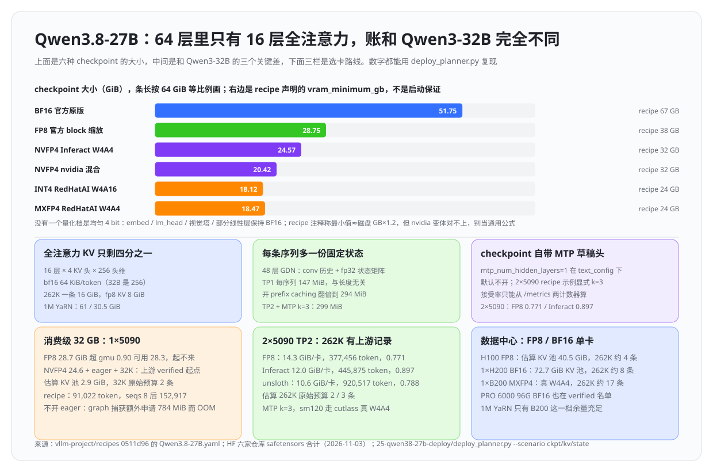
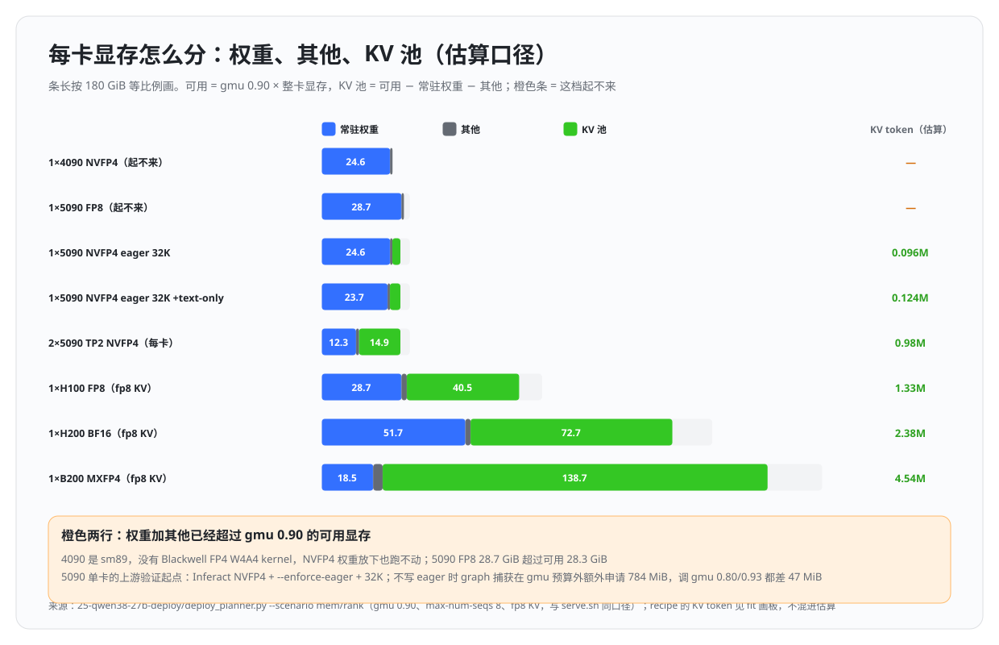
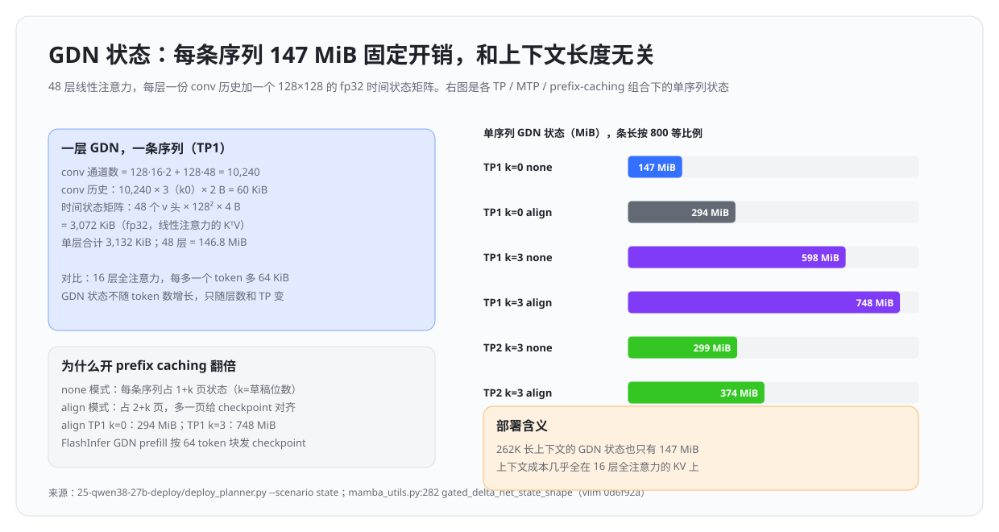
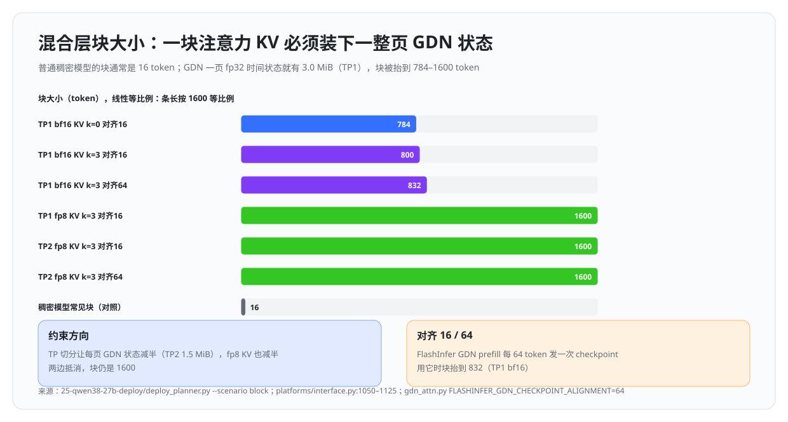
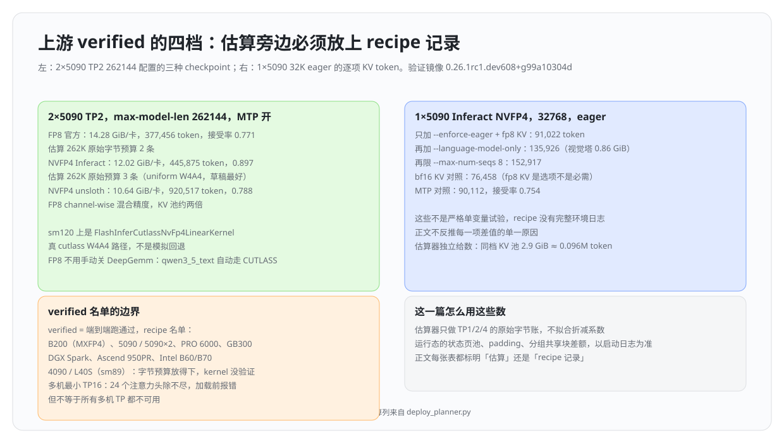
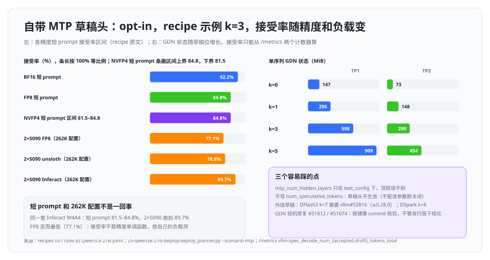
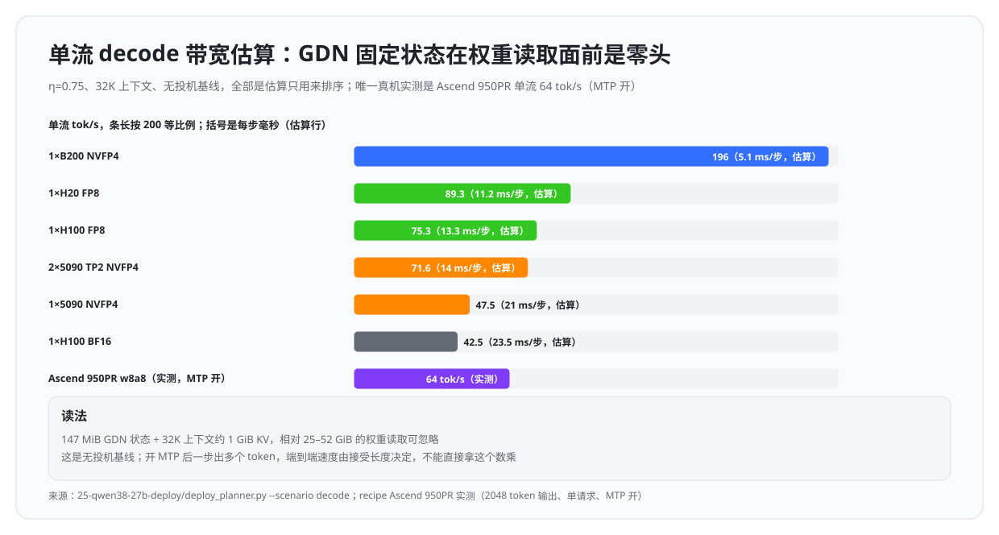
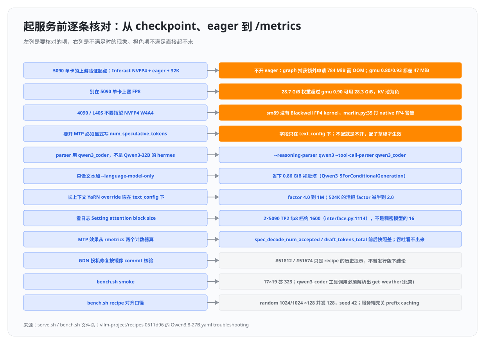

# VLLM-25｜实战｜Qwen3.8-27B 部署：混合注意力的显存账

> 🎯 **这篇文档解决什么问题**：Qwen3.8-27B 是 27B 参数的稠密混合注意力模型，64 层里只有 16 层全注意力，另外 48 层是 Gated DeltaNet（GDN）线性注意力，原生 262144 上下文、可以 YaRN 到 1M，带视觉塔，checkpoint 还自带一个 MTP 草稿头[[1]](https://github.com/vllm-project/recipes/blob/0511d96d97551a8b0db969b9b179e6f6d198071d/models/Qwen/Qwen3.8-27B.yaml)[[2]](https://huggingface.co/Qwen/Qwen3.8-27B)。它的显存账和 VLLM-24 的 Qwen3-32B 完全不是一本账：全注意力 KV 只有四分之一，但每条序列多一份和上下文长度无关的固定状态，块大小被抬到 784–1600 token，消费级卡的 CUDA graph 捕获会因此 OOM。上游 recipe 把 5090、5090×2、PRO 6000、GB300、B200、DGX Spark、Ascend 950PR 等档位标了 verified[[1]](https://github.com/vllm-project/recipes/blob/0511d96d97551a8b0db969b9b179e6f6d198071d/models/Qwen/Qwen3.8-27B.yaml)，但自己的卡用哪一种 checkpoint、KV 池还剩多少、262K 能开几条、MTP 默认开了没有、接受率去哪看，这些事没有被一次讲全。我们做了一个只依赖标准库的部署规划器，把每一档的字节账按 vLLM 源码口径算出来，再把 recipe 里的真机记录原样放在估算旁边，逐条对齐。
>
> **使用方式**：第 1 章先认识模型，第 2 章算六种 checkpoint 的字节，第 3 章算 GDN 固定状态，第 4 章是混合层块大小，第 5 章算全注意力 KV 和 1M YaRN。第 6 章是一张卡的分账，第 7 章看 4090 / 5090 / L40S 哪档起不来，第 8 章把 recipe 的真机记录和估算摆在一起，第 9 章是从 4090 到 B200 的全档排序，第 10 章讲自带 MTP 和外挂草稿，第 11 章是 decode 带宽估算，第 12 章是实验步骤，第 13 章是坑和看法，第 14 章是核对清单。正文里标「估算」的数字来自规划器，标「recipe 记录」的来自上游 guide 原文。第 12.4 至 12.10 节新增「用户提供实测」，记录双卡、每卡约 48 GiB 环境下的部署过程、近 128K 压测及 Prefix / MTP 对照；硬件规格与原始日志尚有待核对项。这三类数据分开阅读，源码常量按对应引用的版本核对。
>
> **代码**：[25-qwen38-27b-deploy](../25-qwen38-27b-deploy)。deploy_planner.py 有九个场景：ckpt 算六种 checkpoint 的字节并和 recipe 声明的 vram_minimum_gb 对账，state 算每条序列的 GDN 状态，block 算混合层块大小，kv 算全注意力层每 token 字节，mem 算每卡显存账，fit 列上游 recipe 记录，rank 把十六种配置排在一起，mtp 算草稿头开销和接受率口径，decode 做带宽估算。serve.sh 是九个真机档位的启动命令，bench.sh 是冒烟、recipe 口径、decode 并发扫描、长上下文和 MTP 接受率。46 个单测把常量钉在 config.json、六家 HF 仓库的 safetensors 合计和源码默认值上，`--scenario all` 的输出和 results/sim.txt 一致。规划器只用 Python 标准库，不需要 GPU，也不联网。原有真机数字注明来自上游 recipe；第 12.4 至 12.10 节另收用户提供的实测记录。编辑过程中未启动 GPU 服务或复测，新增命令仅作文本整理与静态检查，实测数字不代表编辑方独立复现。

# 导读 · 先给结论

## 加入 MoE 的同口径对照

本章 Qwen3.8-27B 专项与既有 checkpoint 数据保留。MoE 对照选 Qwen3.5-35B-A3B：10 层全注意力、30 层 GDN、256 个路由专家，每 token 选 8 个并含共享专家。它也需要状态预算，不能仅用 3B 激活量推导显存。

先用公共 sim_ledger.py 在相同 TP、上下文和状态副本假设下算两张账，再通过 VLLM-01 启动、VLLM-03 压测。MoE 的 BF16 KV 在 TP1 为 20 KiB/token，单份 GDN 原始状态约 61.41 MiB/序列。这里新增的是配置与张量估算，尚无选卡排序、量化质量或 MTP 吞吐实测，不套用本章稠密模型的校准系数。

双模型结构以固定版本配置核对[[Qwen3.8-27B config.json]](https://huggingface.co/Qwen/Qwen3.8-27B/blob/37561816e66b5b9153b1b64c10968c18c1e6f4a0/config.json)[[Qwen3.5-35B-A3B config.json]](https://huggingface.co/Qwen/Qwen3.5-35B-A3B/blob/59d61f3ce65a6d9863b86d2e96597125219dc754/config.json)。

```bash
python3 ../02-ledger/sim_ledger.py --model qwen3.8-27b --tp 2
python3 ../02-ledger/sim_ledger.py --model qwen3.5-35b-a3b --tp 2
MODEL_PROFILE=moe TP=2 bash ../01-first-server/serve.sh
```

1. **账和 Qwen3-32B 完全不同。**64 层里只有 16 层全注意力，4 个 KV 头、头维 256，bf16 每 token 64 KiB，是 Qwen3-32B 的四分之一；但 48 层 GDN 每条序列要存一份固定状态，TP1 是 147 MiB，开 prefix caching 翻倍到 294 MiB，和上下文长度无关。262K 长上下文省下来的显存，是拿这份固定状态和被撑大的块大小换来的。
2. **消费级单卡只有一条上游验证过的路：1×5090 + Inferact NVFP4 + eager + 32K。**FP8 权重 28.7 GiB，gmu 0.90 下 5090 可用只有 28.3 GiB，权重加其他已经顶满，KV 池为 −1.3 GiB（估算）；不开 `--enforce-eager`，CUDA graph 捕获时在 gmu 预算之外额外申请 784 MiB，调 gmu 没有用，0.80 和 0.93 都只差 47 MiB。4090 / L40S 是 sm89，字节预算放得下 INT4，但真 W4A4 kernel 不在 recipe 验证名单里。
3. **要 262K 上下文，2×5090 TP2 有上游记录，数据中心直接上 H100 FP8。**2×5090 TP2 三种 checkpoint 都是 recipe 记录：FP8 377,456 token、接受率 0.771，Inferact NVFP4 445,875 token、0.897，unsloth 混合精度 920,517 token、0.788[[1]](https://github.com/vllm-project/recipes/blob/0511d96d97551a8b0db969b9b179e6f6d198071d/models/Qwen/Qwen3.8-27B.yaml)。估算口径（gmu 0.90、fp8 KV、max-num-seqs 8）下 H100 FP8 的 262K 原始字节预算是 4 条，H200 BF16 是 8 条，B200 MXFP4 是 17 条；1M YaRN 只有 B200 / GB300 这一档余量充足。
4. **MTP 草稿头 opt-in：不配 num_speculative_tokens 就是不开。**模型把 `mtp_num_hidden_layers: 1` 放在 text_config 下面，顶层 config 没有这个字段；只有 2×5090 两档命令默认给 k=3，PRO 6000 / DGX Spark 的 recipe 示例用 k=5[[1]](https://github.com/vllm-project/recipes/blob/0511d96d97551a8b0db969b9b179e6f6d198071d/models/Qwen/Qwen3.8-27B.yaml)。草稿有没有生效吞吐看不出来，只能从 /metrics 的 accepted / draft 两个计数器做前后快照差算接受率。短 prompt 接受率 BF16 92.2%、FP8 84.8%、NVFP4 81.5–84.8%。
5. **估算归估算，上游记录归上游记录。**这一篇的显存数字分三类看：规划器给的是原始字节账，统一标「估算」，没有复刻混合 KV 页池的 padding、分组和共享块分配；2×5090 和单卡 5090 的 KV token、接受率是上游 recipe 的真机记录，标「recipe 记录」；第 12.4 至 12.10 节是用户提供的双 4090 实测，标「用户提供实测」，编辑方没有独立复现。三类数据不混着读，也不用反推折减系数把估算凑向实测。上线容量以你自己启动日志里的 Available KV cache memory 为准。



和前面各章的关系：VLLM-24 是同一套算账方法用在全注意力稠密模型 Qwen3-32B 上，这一篇是同一套方法用在混合注意力模型上，两篇的瓶颈位置正好相反，可以对照着读。VLLM-02 讲 gpu_memory_utilization 和 KV 容量，第 6 章还是这本账。VLLM-08 讲混合 KV 管理，第 4 章的块大小就是从 GDN 状态页来的。VLLM-11 讲 TP，第 8、9 章回答两张 5090 为什么要切 TP2。VLLM-12 讲 FP8、NVFP4 和 KV 量化，第 2 章看六种 checkpoint 在不同架构上各走哪个 kernel。VLLM-13 讲投机解码，第 10 章给自带 MTP 定草稿数、讲外挂 DFlash2 的门槛。VLLM-17 讲默认参数和负载画像，第 7 章是默认值在小卡上的后果。VLLM-23 是 MoE 的部署，这一篇回到稠密模型，但多了固定状态这一项。

# 第 1 章 · 先认识模型：48 层线性注意力加 16 层全注意力

Qwen3.8-27B 是 27B 参数的稠密混合注意力模型，多模态。64 层里每 4 层有 1 层全注意力（`full_attention_interval=4`），一共 16 层；其余 48 层是 Gated DeltaNet。全注意力部分是 24 个 Q 头、4 个 KV 头、头维 256；GDN 部分是 16 个 key 头、48 个 value 头、头维 128，卷积核宽度 4，时间状态用 fp32。hidden 5120，FFN 中间维 17408，词表 248320，原生窗口 262144[[2]](https://huggingface.co/Qwen/Qwen3.8-27B)。实现层仍复用上一代的类型名：vLLM 里多模态模型走 `Qwen3_5ForConditionalGeneration`（[registry.py 616](https://github.com/vllm-project/vllm/blob/0d6f92a/vllm/model_executor/models/registry.py#L616)），文本子模型的 model_type 是 `qwen3_5_text`（[qwen3_5.py 170–184](https://github.com/vllm-project/vllm/blob/0d6f92a/vllm/model_executor/models/qwen3_5.py#L170)），并不是新注册了一套类型。

模型带一个 0.86 GiB 的视觉塔，只做文本服务时加 `--language-model-only` 跳过它（recipe 第 143–145 行）[[1]](https://github.com/vllm-project/recipes/blob/0511d96d97551a8b0db969b9b179e6f6d198071d/models/Qwen/Qwen3.8-27B.yaml)。工具调用的 parser 也换了：Qwen3-32B 用 hermes，这一代是 `qwen3_coder`（recipe 第 82–86 行），reasoning parser 仍是 qwen3；chat 模板每个 assistant turn 以思考标记开头，不加 reasoning parser 的话整段思考会落进 message.content。

版本上有三个数要记住。**最低 0.17.0**，这是 recipe 声明的 min_vllm_version；recipe 的真机记录用的是 **0.26.1rc1.dev608+g99a10304d** 这个验证镜像；外挂 DFlash2 草稿要 **≥0.28.0**，那个版本才合入 PR #52816[[1]](https://github.com/vllm-project/recipes/blob/0511d96d97551a8b0db969b9b179e6f6d198071d/models/Qwen/Qwen3.8-27B.yaml)[[3]](https://github.com/vllm-project/vllm/pull/52816)。recipe 还特别写明，GDN 的投机解码修复（#51812 / #51674）没有任何已发行 tag 带上，旧版本属于「没验证过」而不是「已知可用」，生产镜像要按实际 commit 核验，不能只看版本号大小。

## 1.1 和 Qwen3-32B 放一起看

| 项 | Qwen3-32B（VLLM-24） | Qwen3.8-27B（本篇） |
|-|-|-|
| 结构 | 64 层全注意力 GQA | 48 层 GDN + 16 层全注意力 |
| KV 头 / 头维 | 8 / 128 | 4 / 256（仅 16 层） |
| 每 token KV（bf16） | 256 KiB | 64 KiB（四分之一） |
| 每序列固定状态 | 无 | 147 MiB（TP1，和长度无关） |
| 原生上下文 | 32768，YaRN 到 131072 | 262144，YaRN 到 1M |
| 草稿头 | 无，外挂 EAGLE3 | checkpoint 自带 MTP，opt-in（2×5090 示例 k=3） |
| 多模态 | 否 | 是，视觉塔 0.86 GiB |
| recipe verified 的 NVIDIA 卡 | TPU / XPU，NVIDIA 无 | 5090 / 5090×2 / PRO 6000 / GB300 / B200 / DGX Spark |

这张表是后面所有章节的提纲：全注意力层的每 token KV 缩到约四分之一，长上下文的 KV 仍随长度线性增长，只是单 token 成本更低；代价是多一份每条序列固定的 GDN 状态、一个被撑大的混合层块，还有一个必须显式打开的草稿头。

# 第 2 章 · 六种 checkpoint：没有均匀的 4 bit

官方和社区一共出了六种 NVIDIA / 通用 GPU 用的 checkpoint，外加一种昇腾专用的 w8a8。我们把 HF 树上每家仓库的全部 safetensors 加起来（2026-11-03 核对），和 recipe variants 段声明的 vram_minimum_gb 对一遍[[1]](https://github.com/vllm-project/recipes/blob/0511d96d97551a8b0db969b9b179e6f6d198071d/models/Qwen/Qwen3.8-27B.yaml)[[2]](https://huggingface.co/Qwen/Qwen3.8-27B)[[4]](https://huggingface.co/Qwen/Qwen3.8-27B-FP8)[[5]](https://huggingface.co/Inferact/Qwen3.8-27B-NVFP4)[[6]](https://huggingface.co/nvidia/Qwen3.8-27B-NVFP4)[[7]](https://huggingface.co/RedHatAI/Qwen3.8-27B-INT4)[[8]](https://huggingface.co/RedHatAI/Qwen3.8-27B-MXFP4)：

```text
-- 六种 checkpoint 的磁盘字节（HF 树上 safetensors 相加，2026-11-03 核对）
   格式                           GB     GiB    bit/参数    recipe 最小显存 GB
   BF16 官方原版                 55.56   51.75     16.46                67
   FP8 官方 block 缩放           30.87   28.75      9.15                38
   NVFP4 Inferact W4A4       26.38   24.57      7.82                32
   NVFP4 nvidia 混合精度         21.92   20.42      6.50                32
   INT4 RedHatAI W4A16       19.45   18.12      5.76                24
   MXFP4 RedHatAI W4A4       19.83   18.47      5.88                24
   Ascend w8a8（Eco-Tech，ModelScope）32.1 GB，recipe vram_minimum_gb 39，视觉塔留 BF16、带 per-channel fp32 scale
   各仓库量化覆盖范围不同；文件平均 bit/参数不能代替逐层 dtype 清单
   对照 Qwen3.5-27B GPTQ-Int4：28.16 GiB，小于当前 FP8 28.75 GiB，大于表内四种 4 bit 档
   recipe 最小显存是上游声明值，不是启动保证；其注释公式 ceil(磁盘 GB ×1.2) 与部分条目不一致
```



三个读法。第一，没有一个量化档是均匀 4 bit：embed、lm_head、视觉塔和一部分线性层都留在 BF16，NVFP4 Inferact 的文件平均位数是 7.82 bit/参数，MXFP4 是 5.88。第二，recipe 的 vram_minimum_gb 是上游声明值、不是启动保证；它注释里的 ceil(磁盘 GB×1.2) 经验式只和部分条目对得上（nvidia 变体按公式是 27，声明是 32），别当通用公式，照着这个数买卡只够把权重放进去，KV 池要另算。第三，注意上一代 Qwen3.5-27B 的 GPTQ-Int4 只量化 MLP，checkpoint 28.16 GiB，比这一代的官方 FP8（28.75 GiB）还小，但比本篇表里四种 4 bit 档都大；3.8 的 INT4 / MXFP4 是全线性层量化，才有 18–19 GiB 这一档。

## 2.1 每种格式在哪种架构上走快路径

字节放得下不等于跑得起来。recipe 的 supported_hardware 名单和 [kernels/linear/\_\_init\_\_.py 779](https://github.com/vllm-project/vllm/blob/0d6f92a/vllm/model_executor/kernels/linear/__init__.py#L779) 的 kernel 选择放在一起看：

| 格式 | 走哪个 kernel | 支持范围（recipe 0511d96） |
|-|-|-|
| BF16 | 常规 BF16 GEMM | 单卡 ≥80 GB 或 TP2；GB300 TP4 verified，1M 长上下文也验过 |
| FP8（block 128×128） | Hopper FP8 / Blackwell CUTLASS；sm120 上 qwen3_5_text 自动关 DeepGemm 走 CUTLASS | Hopper / Blackwell / MI300 / 5090（5090 的记录是 TP2）；950 加载时重量化到 MXFP8 |
| NVFP4 Inferact（uniform W4A4） | sm100+ 真 W4A4：FlashInfer CUTLASS FP4 GEMM；sm89 只能 Marlin weight-only 模拟 | 仅 Blackwell；1×5090 记录的配置带 --enforce-eager |
| NVFP4 nvidia（FP8 混合） | 同上，FP8 channel-wise 与 4-bit 组混合 | 仅 Blackwell；PRO 6000 / DGX Spark verified |
| INT4 RedHatAI（W4A16） | Marlin W4A16 | Hopper 和 Blackwell；sm89 未在端到端验证名单 |
| MXFP4 RedHatAI（W4A4） | CompressedTensorsW4A4Mxfp4 真 W4A4；Hopper 退化为 Marlin W4A16 | Blackwell 真 W4A4；B200 2026-09-20 verified |

在没有 FP4 指令的卡上加载 NVFP4，[nvfp4/marlin.py 35](https://github.com/vllm-project/vllm/blob/0d6f92a/vllm/model_executor/kernels/linear/nvfp4/marlin.py#L35) 会打「Your GPU does not have native support for FP4 computation」的警告，退到 weight-only 的 Marlin，算力密集的负载会明显变慢。这就是 4090 不能按「24.6 GiB 放得进 24 GB」推理的原因——先不管显存，kernel 就不在名单里。昇腾是另一条路：Eco-Tech 的 ModelSlim w8a8 走 `--quantization ascend`，vllm-ascend #14852 在加载时把 block 缩放的 tile 重量化成 MXFP8[[9]](https://github.com/vllm-project/vllm-ascend/pull/14852)[[10]](https://docs.vllm.ai/projects/ascend/en/latest/tutorials/models/Qwen3.8-27B.html)[[11]](https://www.modelscope.cn/models/Eco-Tech/Qwen3.8-27B-w8a8)。

# 第 3 章 · GDN 固定状态：每条序列 147 MiB，和长度无关

GDN 是线性注意力，第 t 个 token 不和前面所有 token 算注意力，而是把历史压进一个固定大小的状态矩阵。48 层 GDN，每层每条序列存两样东西：conv 历史（10240 个通道、卷积核宽度 4 留 3 个历史位、bf16）和一个 fp32 的时间状态矩阵（48 个 value 头，每个 128×128）。通道数 10240 = 128·16·2 + 128·48，公式在 [mamba_utils.py 282](https://github.com/vllm-project/vllm/blob/0d6f92a/vllm/model_executor/layers/mamba/mamba_utils.py#L282) 的 gated_delta_net_state_shape。规划器按源码口径算：

```text
-- 一层 GDN 一条序列的状态（conv 历史 + fp32 时间状态矩阵）
   TP1：conv   60.0 KiB + 时间状态   3072.0 KiB =  3132.0 KiB/层
-- 整条序列 48 层的 GDN 状态，和上下文长度无关
   模式         TP1 k=0     TP1 k=3     TP2 k=3
   none           147         598         299  MiB/序列
   align          294         748         374  MiB/序列
   none 占 1+k 页，align（--enable-prefix-caching）占 2+k 页，每页一整层状态
   262K 长上下文也只多这么点，这是 GDN 相对全注意力模型省显存的地方
```



单层 3132 KiB（conv 60 KiB 加状态 3072 KiB），48 层 146.8 MiB，取整 147。这条数和上下文多长完全没关系——32K 是 147 MiB，262K 也是 147 MiB，1M 还是 147 MiB。这正是 GDN 相对全注意力省显存的地方：全注意力那 16 层每多一个 token 多 64 KiB，线性注意力的 48 层一上来就是定额。

## 3.1 prefix caching 为什么让它翻倍

[config/cache.py 304–310](https://github.com/vllm-project/vllm/blob/0d6f92a/vllm/config/cache.py#L304) 的 mamba_cache_mode 从 enable_prefix_caching 推导：关着是 none，开了是 align。none 模式每条序列占 1+k 页状态（k 是草稿位数），align 模式占 2+k 页，多出来的一页给 checkpoint 对齐——FlashInfer 的 GDN prefill 后端按 64 token 一个 checkpoint 发状态，常量在 [gdn_attn.py 34](https://github.com/vllm-project/vllm/blob/0d6f92a/vllm/v1/attention/backends/gdn_attn.py#L34)（FLASHINFER_GDN_CHECKPOINT_ALIGNMENT = 64）。所以开 prefix caching 后 TP1 从 147 翻到 294 MiB，TP2 加 MTP k=3 时是 299→374 MiB。混合模型要不要默认开 prefix caching，要拿这份额外状态和实际前缀命中率一起算。

还有一层容易漏：GDN 的时间状态强制 fp32（mamba_ssm_dtype），KV 量化到 fp8 不影响这 3 MiB/层。第 6 章算 KV 池时，GDN 状态要单独加，不能按 token 摊。

# 第 4 章 · 混合层块大小：一块注意力 KV 要装下一整页 GDN 状态

VLLM-08 讲过 PagedAttention 的块通常是 16 token。混合模型不能随便取 16：vLLM 的混合 KV 管理器让注意力块和 mamba（GDN）状态页共用块表，一块注意力 KV 的字节数必须不小于一整页 GDN 状态，[platforms/interface.py 1050–1125](https://github.com/vllm-project/vllm/blob/0d6f92a/vllm/platforms/interface.py#L1050) 的对齐逻辑负责把块向上抬、再按对齐粒度取整，日志打 [interface.py 1114](https://github.com/vllm-project/vllm/blob/0d6f92a/vllm/platforms/interface.py#L1114) 的「Setting attention block size to N tokens to ensure that attention page size is >= mamba page size」。规划器复算的结果：

```text
-- 混合层块大小：一块注意力 KV 必须装下一整页 GDN 状态（2×5090 recipe 示例 k=3）
   TP1 KV bf16 k=0 对齐 16：块   784 token（无 MTP，默认对齐 16）
   TP1 KV bf16 k=3 对齐 16：块   800 token（默认 MTP k=3）
   TP1 KV bf16 k=3 对齐 64：块   832 token（FlashInfer GDN prefill，gdn_attn.py:34）
   TP2 KV fp8  k=3 对齐 16：块  1600 token（2×5090 TP2，fp8 KV）
   TP2 KV fp8  k=3 对齐 64：块  1600 token（2×5090 TP2，64 对齐）
   TP1 KV fp8  k=3 对齐 16：块  1600 token（1×5090 单卡，fp8 KV）
   块这么大是因为 fp32 时间状态一页就 3.0 MiB（TP1），普通稠密模型的块通常只有 16 token
```



块被抬到 784–1600 token，是普通稠密模型的 50–100 倍，原因就是一页 fp32 时间状态有 3.0 MiB（TP1）。TP1 bf16 KV、无 MTP 时是 784；recipe 示例的 MTP k=3 每页多三个 conv 历史位，抬到 800；用 FlashInfer GDN prefill（64 对齐）时是 832。5090 档位用 fp8 KV，每 token 注意力 KV 减半，但一页 GDN 状态不减半（状态是 fp32 的），块直接翻倍到 1600；TP2 时每页状态和每 token KV 同时减半，两边抵消，块还是 1600。

这个块大小有两个部署后果。一是 KV 池的内部碎片变大：池按整块分配，最后一块平均浪费半页，bf16 下 800 token 的半页约 800×64 B ≈ 50 KiB，fp8 下一块 1600 token × 32 B 也是 50 KiB 量级，单看不大，但估算器按净字节给的并发数要扣这个余量，真机以启动日志为准。二是 CUDA graph 的捕获尺寸要覆盖这么大的块，小卡上 graph 捕获的临时申请就是第 7 章那个 784 MiB OOM 的直接来源，混合模型为此专门有 PR #34571 给 FULL decode 的 graph 尺寸封顶[[12]](https://github.com/vllm-project/vllm/pull/34571)。

# 第 5 章 · 全注意力 KV：64 KiB/token 与 1M YaRN

会随上下文增长的只有那 16 层全注意力。每层 4 个 KV 头、头维 256，K 和 V 各一份：

```text
-- 全注意力 KV：只有 16 层，每层 4 KV 头 × 256 头维
   bf16 64 KiB/token，fp8 32 KiB/token
   一条   32768 上下文：bf16   2.00 GiB，fp8   1.00 GiB
   一条  262144 上下文：bf16  16.00 GiB，fp8   8.00 GiB
   一条 1000000 上下文：bf16  61.04 GiB，fp8  30.52 GiB
   再加 GDN 固定状态 147 MiB，和长度无关
   对照 Qwen3-32B（64 层全注意力、8 KV 头、头维 128）：每 token 256 KiB，4 倍
   1M 走 YaRN：factor 4.0，override 要嵌在 text_config 下面，524K 的活把 factor 减半到 2.0
```

bf16 每 token 64 KiB，fp8 32 KiB。262144 上下文一条序列 16 GiB（bf16）或 8 GiB（fp8），再加上 147 MiB 固定状态。对照 VLLM-24 的 Qwen3-32B：64 层全注意力、8 个 KV 头、头维 128，每 token 256 KiB，正好四倍。这就是「混合模型长上下文便宜」的全部数字含义——不是 KV 不要钱，是四分之三的层改成了定额状态。

## 5.1 1M 上下文：YaRN override 要嵌在 text_config 下

原生窗口 262144，到 1M 走静态 YaRN，factor 4.0、original_max_position_embeddings 262144，rope_theta 一千万（recipe 第 152–155 行）[[1]](https://github.com/vllm-project/recipes/blob/0511d96d97551a8b0db969b9b179e6f6d198071d/models/Qwen/Qwen3.8-27B.yaml)。因为是多模态 config，override 必须嵌在 `text_config.rope_parameters` 下面，放在顶层不生效；大约 524K 的活把 factor 减半到 2.0。静态 YaRN 的缩放因子和输入长度无关，recipe 也提醒短请求可能掉点，不服务长 prompt 就别开。1M 一条请求 bf16 KV 61 GiB，fp8 30.5 GiB，后面 rank 表会看到，单卡里只有 180 GB 的 B200（或 GB300 级别的多卡）开得起。

另外注意 5090 guide 里有一条反直觉的记录：bf16 KV 时 KV 池 76,458 token，fp8 KV 是 91,022，差距没有一倍。fp8 KV 在这一档是选项不是必需——能不能开、开了值不值，都按自己的池子和精度评测定，别把它当必选开关。

# 第 6 章 · 一张卡的分账

分账顺序和 VLLM-24 一样：可用显存 = gmu × 整卡显存（本章统一 gmu 0.90，和 serve.sh 同口径；5090 对应可用 28.3 GiB，recipe 描述 31.4 GiB 可用时的 OOM 余量是它自己排查时的口径），先放常驻权重，再扣非 torch 内存、激活峰值、采样器预热和 CUDA graph，剩下全部给 KV 池；每条序列再单独占一份 GDN 固定状态。日志的三个锚点也一样：[gpu_worker.py 776](https://github.com/vllm-project/vllm/blob/0d6f92a/vllm/v1/worker/gpu_worker.py#L776) 打 Available KV cache memory，[kv_cache_utils.py 1147–1149](https://github.com/vllm-project/vllm/blob/0d6f92a/vllm/v1/core/kv_cache_utils.py#L1147) 打 GPU KV cache size 和 Maximum concurrency，[gpu_model_runner.py 5089](https://github.com/vllm-project/vllm/blob/0d6f92a/vllm/v1/worker/gpu_model_runner.py#L5089) 打 Model loading took。先看主力档 H100 FP8（32K 启动档，fp8 KV）：

```text
-- H100 80G ×1 TP1，fp8 权重，KV fp8，gmu 0.90（估算）
   可用   71.2 GiB，权重   28.7，其他   1.9，KV 池   40.5
   每条序列 GDN 固定状态    147 MiB（none 模式，k=0）
   KV 池折算   1.33 M token（fp8）
     32K 上下文：每条  1.14 GiB，并发 35.44
    128K 上下文：每条  4.14 GiB，并发  9.78
    256K 上下文：每条  8.14 GiB，并发  4.98
```

28.7 GiB 权重放进去，其他 1.9（eager 关闭时含 CUDA graph、激活、采样器预热，seqs 固定 8），KV 池还有 40.5 GiB，折 1.33M fp8 token；262K 一条 8.14 GiB，原始字节预算 4 条（4.98 向下取整）。这一档启动默认 max-model-len 32768，长上下文按 KV 池余量在启动参数里放开。

## 6.1 5090 单卡、5090 双卡和两档大显存

```text
-- RTX 5090 32G ×1 TP1，nvfp4 权重，KV fp8，gmu 0.90（估算）
   可用   28.3 GiB，权重   24.6，其他   0.8，KV 池    2.9
   每条序列 GDN 固定状态    147 MiB（none 模式，k=0）
   KV 池折算   0.10 M token（fp8）
     32K 上下文：每条  1.14 GiB，并发  2.56
    128K 上下文：每条  4.14 GiB，并发  0.71
    256K 上下文：每条  8.14 GiB，并发  0.36
```

```text
-- RTX 5090 32G ×2 TP2，nvfp4 权重，KV fp8，gmu 0.90（估算）
   可用   28.3 GiB，权重   12.3，其他   1.1，KV 池   14.9
   每条序列 GDN 固定状态    299 MiB（none 模式，k=3）
   KV 池折算   0.97 M token（fp8）
     32K 上下文：每条  0.79 GiB，并发 18.78
    128K 上下文：每条  2.29 GiB，并发  6.49
    256K 上下文：每条  4.29 GiB，并发  3.47
```

```text
-- H200 141G ×1 TP1，bf16 权重，KV fp8，gmu 0.90（估算）
   可用  126.4 GiB，权重   51.7，其他   1.9，KV 池   72.7
   每条序列 GDN 固定状态    147 MiB（none 模式，k=0）
   KV 池折算   2.38 M token（fp8）
     32K 上下文：每条  1.14 GiB，并发 63.57
    128K 上下文：每条  4.14 GiB，并发 17.54
    256K 上下文：每条  8.14 GiB，并发  8.93
```

```text
-- B200 180G ×1 TP1，mxfp4 权重，KV fp8，gmu 0.90（估算）
   可用  160.5 GiB，权重   18.5，其他   3.4，KV 池  138.7
   每条序列 GDN 固定状态    147 MiB（none 模式，k=0）
   KV 池折算   4.54 M token（fp8）
     32K 上下文：每条  1.14 GiB，并发 121.28
    128K 上下文：每条  4.14 GiB，并发 33.47
    256K 上下文：每条  8.14 GiB，并发 17.03
```

这四张表放一起看趋势。单卡 5090 必须 eager、max-num-seqs 8、上下文砍到 32K，KV 池才有 2.9 GiB、0.096M token，32K 原始预算 2 条（2.56 向下取整，估算）；同一张卡加 `--language-model-only` 去掉 0.86 GiB 视觉塔，权重降到 23.7 GiB，池子涨到 3.8 GiB、32K 预算 3 条：

```text
-- RTX 5090 32G ×1 TP1，nvfp4 权重，KV fp8，gmu 0.90（估算）
   可用   28.3 GiB，权重   23.7，其他   0.8，KV 池    3.8
   每条序列 GDN 固定状态    147 MiB（none 模式，k=0）
   KV 池折算   0.12 M token（fp8）
     32K 上下文：每条  1.14 GiB，并发  3.31
    128K 上下文：每条  4.14 GiB，并发  0.91
    256K 上下文：每条  8.14 GiB，并发  0.47
```

两张 5090 切 TP2 后每卡权重减半、每 token KV 减半，每卡池子 14.9 GiB、0.97M token，262K 原始预算 3 条，这是消费级能碰原生窗口的路径。H200 141 GB 用 BF16 原版都有 72.7 GiB 池子、2.38M token，262K 预算 8 条；B200 180 GB 上 MXFP4 权重只占 18.5 GiB，池子 138.7 GiB、4.54M token，262K 原始预算 17 条（serve.sh 档位 max-num-seqs 8，要跑满 17 条得显式调大），连 1M 上下文都留得住。

「其他」一栏沿用 VLLM-24 的估算系数（非 torch 0.4 GiB、TP>1 加 NCCL 0.3、激活按 batched token、采样器预热按 seqs、graph 按捕获尺寸数缩放、eager 时 graph 为 0），是原始字节账；混合 KV 页池的 padding、GDN 分组与共享块分配没有复刻，运行态差额以启动日志校正。

# 第 7 章 · 消费卡：哪档起不来，哪档勉强能用

```text
-- RTX 4090 24G ×1 TP1，nvfp4 权重，KV fp8，gmu 0.90（估算）
   可用   21.2 GiB，权重   24.6，其他   0.8，KV 池   -4.2
   每条序列 GDN 固定状态    147 MiB（none 模式，k=0）
   权重加其他已经超了，这档起不来
```

```text
-- RTX 5090 32G ×1 TP1，fp8 权重，KV fp8，gmu 0.90（估算）
   可用   28.3 GiB，权重   28.7，其他   0.8，KV 池   -1.3
   每条序列 GDN 固定状态    147 MiB（none 模式，k=0）
   权重加其他已经超了，这档起不来
```

## 7.1 4090：字节也不够，kernel 更不够

4090 装 NVFP4 的账就是负的（gmu 0.90 下估算 KV 池 −4.2 GiB），而且 sm89 没有原生 FP4 算力，[nvfp4/marlin.py 35](https://github.com/vllm-project/vllm/blob/0d6f92a/vllm/model_executor/kernels/linear/nvfp4/marlin.py#L35) 直接打警告退 Marlin weight-only，recipe 的 verified 名单里没有任何 sm89 卡[[1]](https://github.com/vllm-project/recipes/blob/0511d96d97551a8b0db969b9b179e6f6d198071d/models/Qwen/Qwen3.8-27B.yaml)。INT4 W4A16 这一档字节塞得进（rank 表估算 262K 0.14 条、32K 预算 1 条），Marlin 在 Ada 上存在，但同样不在端到端验证名单。结论：4090 不是「调调参数能用」，是这一代六种 checkpoint 没有一档在它上面端到端验证过，要自己承担验证成本。

## 7.2 单卡 5090：FP8 顶满，NVFP4 + eager + 32K 是上游记录的起点

FP8 权重 28.7 GiB，gmu 0.90 下 5090 可用只有 28.3 GiB（不是标称 32），权重本身已经超了，KV 池 −1.3 GiB。NVFP4 Inferact 24.6 GiB 是唯一放得下的权重档，但不开 eager 时 CUDA graph 捕获会在 gmu 预算之外申请 784 MiB，直接 OOM。recipe guide 把这件事写得很死：gmu 调到 0.80 或 0.93 都只差同样的 47.06 MiB，因为那块预算只管权重和 KV，graph 捕获在它外面分配；**只有 --enforce-eager 决定服务起不起得来**，text-only 和 max-num-seqs 只是把池子做大的杠杆[[1]](https://github.com/vllm-project/recipes/blob/0511d96d97551a8b0db969b9b179e6f6d198071d/models/Qwen/Qwen3.8-27B.yaml)。还要注意这不是说 32K 是唯一可行配置，只是上游验证并记录下来的起点。

```bash
bash serve.sh 5090-nvfp4    # 1×5090 Inferact NVFP4，eager，32K，fp8 KV
bash serve.sh text-only     # 同上加 --language-model-only，视觉塔的 0.86 GiB 还给 KV 池
```

L40S 48 GB 处在中间：INT4 字节预算 262K 一条（rank 估算 1.30），但 sm89 的 kernel 同样未验证；L40S 是 Ada（sm89），A100 是 Ampere（sm80），两者架构不同，A100 上 FP8 比 BF16 慢的公开基准不能直接套到 L40S。Ada 的 FP8 W8A8 走哪条反量化 kernel、实际加速多少，本篇没有对应真机数据，不建议在未验证前把它当成可依赖的 W8A8 路径。

# 第 8 章 · recipe verified 的档位：估算旁边放真机记录

这一章不做估算，只搬运上游 recipe 的真机记录。明确口径：recipe 在独立仓库 vllm-project/recipes（commit 0511d96），不在 vllm 主干；以下数字对应验证镜像 0.26.1rc1.dev608+g99a10304d，**不是本次 GPU 实测**；我们没有完整环境日志，不用这些数字反推折减系数去校准估算器[[1]](https://github.com/vllm-project/recipes/blob/0511d96d97551a8b0db969b9b179e6f6d198071d/models/Qwen/Qwen3.8-27B.yaml)。

```text
-- 上游 recipe 记录，非本次 GPU 实测；不使用反推折减系数作验证
   来源：https://github.com/vllm-project/recipes/blob/0511d96d97551a8b0db969b9b179e6f6d198071d/models/Qwen/Qwen3.8-27B.yaml
   2×5090 TP2，262144 上下文；版本 0.26.1rc1.dev608+g99a10304d
   格式                  权重/卡 GiB   KV token   接受率
   FP8 官方                   14.28      377456    0.771
   NVFP4 Inferact           12.02      445875    0.897
   NVFP4 unsloth            10.64      920517    0.788
   1×5090 Inferact NVFP4，32768 上下文，eager；recipe 的逐项记录：
   eager + fp8 KV                   91022
   加 text-only                     135926
   再限 max-num-seqs=8               152917
   bf16 KV 对照                       76458
   MTP 对照                           90112
   这些行不是严格单变量试验；没有完整环境日志，不推导差值的单一原因。
   独立显存估算见 mem/rank；运行态权重、状态页池、padding 与分配器差额需启动日志校正。
```



2×5090 TP2、262144 上下文、MTP 开的三档记录是这一篇里最硬的消费级数据：FP8 官方每卡权重 14.28 GiB、KV 池 377,456 token、接受率 0.771；Inferact NVFP4 12.02 GiB、445,875 token、0.897；unsloth 的 NVFP4 是 FP8 channel-wise 混合精度，10.64 GiB、920,517 token、0.788，池子大约是 Inferact 的两倍，但草稿接受率低 11 个百分点。两种 NVFP4 不能互换：要池子选 unsloth，要草稿质量选 Inferact。sm120 上这三档都是 FlashInferCutlassNvFp4LinearKernel 的真 cutlass W4A4 路径，不是模拟回退；FP8 也不用手动关 DeepGemm，qwen3_5_text 在 Blackwell 上自动走 CUTLASS，guide 用「不加 VLLM_USE_DEEP_GEMM=0、池子同为 377,456」验证过。

单卡 5090 的五行记录要连着读：只加 eager + fp8 KV 是 91,022 token；加 text-only 是 135,926；再限 max-num-seqs 8 是 152,917；bf16 KV 对照 76,458；MTP 对照 90,112、接受率 0.754。recipe 自己提醒这不是严格单变量试验，我们不替它推导每一项差值的单一原因——比如 91,022 和 90,112 这两行差的 910 token，不能简单说成「MTP 的代价」，因为对比条件并没有锁死。估算器在同一档给的是 KV 池 2.9 GiB ≈ 0.096M token（fp8），方向一致，数字差距留给真机日志解释。

verified 名单还有几个边界要记住：B200 的 RedHatAI MXFP4（真 W4A4、TP1）2026-09-20 验过，GB300 是 BF16/FP8 TP4、1M 上下文也验过，PRO 6000 96G 单卡 BF16、DGX Spark、Intel Arc Pro B60/B70 都在名单；昇腾 950PR 用 vllm-ascend 0.23.0 的 qwen3.8-a5 镜像验过单卡 w8a8。另外，24 个注意力头不能被 TP16 整除，2 机 ×8 卡的 TP16 加载前就报错——但估算器只覆盖 TP1/2/4，这条不能推广成「所有多机 TP 都不可用」。

# 第 9 章 · 十六种配置排在一起

rank 场景把从 4090 到 B200 的配置排在一起（上下文按档标注，5090 单卡是 32K，其余按 262K；并发 < 1 表示一条都装不下；除标注外都是原始字节估算，verified 字样来自 recipe）：

```text
-- 各档配置（上下文按档不同，见每行标注；并发 < 1 = 一条都装不下；原始字节估算）
   配置                                权重/卡   KV 池    每条@ctx    并发  结论
   1×4090 INT4                       18.1    2.2     16.14  0.14  256K 不足一条；32K 原始预算 1 条；权重塞得进，Ada 的 W4A16 不在 recipe 验证名单
   1×4090 NVFP4                      24.6   -4.2      8.14  0.00  起不来：sm89 没有 Blackwell FP4 W4A4 kernel
   1×5090 FP8                        28.7   -1.3      8.14  0.00  起不来：gmu 0.90 下权重 28.7 GiB 已超可用，无 KV 池
   1×5090 NVFP4                      24.6    2.9      1.14  2.56  32K 原始字节预算 2 条；上游记录：eager、32K 可起；非唯一可行配置
   1×L40S INT4                       18.1   21.0     16.14  1.30  256K 原始字节预算 1 条；显存放得下，sm89 kernel 未验证
   2×5090 TP2 FP8                    14.4   12.8      4.29  2.98  256K 原始字节预算 2 条；262K verified，接受率 0.771
   2×5090 TP2 NVFP4                  12.3   14.9      4.29  3.47  256K 原始字节预算 3 条；262K verified，接受率 0.897
   1×PRO 6000 BF16                   51.7   31.8      8.14  3.91  256K 原始字节预算 3 条；96G 单卡，recipe verified
   1×A100 BF16                       51.7   17.6     16.14  1.09  256K 原始字节预算 1 条；262K 一条，剩一点池
   1×H100 FP8                        28.7   40.5      8.14  4.98  256K 原始字节预算 4 条；主力档
   1×H100 INT4                       18.1   51.2      8.14  6.28  256K 原始字节预算 6 条；Marlin W4A16
   1×H100 MXFP4                      18.5   50.8      8.14  6.24  256K 原始字节预算 6 条；Hopper 退化为 Marlin W4A16
   1×H20 FP8                         28.7   54.9      8.14  6.74  256K 原始字节预算 6 条；带宽大，并发吃 KV 池
   1×H200 BF16                       51.7   72.7      8.14  8.93  256K 原始字节预算 8 条；141G，长上下文主力
   1×B200 BF16                       51.7  105.4      8.14 12.94  256K 原始字节预算 12 条；180G，1M YaRN 也有余量
   1×B200 MXFP4                      18.5  138.7      8.14 17.03  256K 原始字节预算 17 条；真 W4A4，2026-09-20 verified
   TP 必须满足 Q/KV/GDN 头数约束；本估算器只覆盖 TP1/2/4。2机×8卡的 TP16 不适用，不能推广为所有多机 TP 不可用。
```

## 9.1 怎么用这张表

| 预算 | 配置 | serve.sh 档位 | 262K 原始预算 / 上下文 | 依据 |
|-|-|-|-|-|
| 24 GB | 无 verified 档 | — | 4090 NVFP4 起不来；INT4 262K 0.14、32K 1 条 | 估算 + recipe 名单 |
| 32 GB | 1×5090 Inferact NVFP4，eager，32K | 5090-nvfp4 | 32K 预算 2 条（估算） | recipe 记录（32K eager 可起） |
| 2×32 GB | 2×5090 TP2 FP8 / NVFP4 | 5090x2-fp8 / 5090x2-nvfp4 | 262K 预算 2 / 3 条 | recipe verified，0.771 / 0.897 |
| 80 GB | 1×H100 FP8（fp8 KV） | h100-fp8 | 262K 预算 4 条 | 估算；主力档（启动默认 32K） |
| 96 GB | 1×PRO 6000 BF16 / H20 FP8 | —（H20 参数同 h100） | 3 / 6 条 | PRO 6000 recipe verified |
| 141 GB | 1×H200 BF16（fp8 KV） | h200-bf16 | 262K 预算 8 条 | 估算；长上下文主力 |
| 180 GB | 1×B200 BF16 / MXFP4 | b200-mxfp4 | 12 / 17 条；1M YaRN 有余量 | MXFP4 2026-09-20 verified |

几个排序上的注意点。表中条数是原始字节预算的向下取整（gmu 0.90、fp8 KV、max-num-seqs 8），B200 MXFP4 的 17 超过运行档位 seqs 8，要跑满得显式调大 --max-num-seqs。H100 上 INT4（Marlin W4A16）和 MXFP4 的池子比 FP8 大约 10 GiB、并发多 1–2 条，但 MXFP4 在 Hopper 会退化成 W4A16，没有真 W4A4，选它主要是为了和 B200 用同一套 checkpoint，吞吐上不要期待 4 bit 的算力收益。H20 FP8 的预算（6 条）比 H100（4 条）高，原因是 H20 显存 96 GB、带宽 4.0 TB/s，decode 吃带宽，但 H20 算力弱，prefill 重的负载要单独评估。A100 BF16 只能装一条 262K，且 A100 没有 FP8 tensor core，要量化走 W4A16 思路（RedHatAI INT4 在 Ampere 上同样未验证）。

TP 切分还要过 head 数约束：24 个 Q 头、4 个 KV 头、48 个 GDN v 头都要能被 TP 整除，规划器只对 TP1/2/4 给数；NVLink 对 TP2 不是必需（5090 是 PCIe5），但每步 64 层、每层两次小消息（一次 reduce、一次 post-weight update）的 all-reduce 延迟要算进 decode，第 11 章会看到 2×5090 的估算反而略低于单卡 H100。

# 第 10 章 · 自带 MTP：opt-in，接受率去哪看

checkpoint 里带着一个 MTP 草稿头（权重索引里有 `mtp.*` 张量，和主干共享 embed），但它不是默认开的：只有 2×5090 两档 recipe 示例显式给 k=3，PRO 6000 和 DGX Spark 的覆盖用 k=5，其余档位不配就是普通解码；昇腾后端拼写成 qwen3_5_mtp（mtp 的别名，带弃用警告）。规划器算各 k 值的 GDN 状态增量：

```text
-- 自带 MTP 草稿头：recipe 示例 k=3，PRO 6000 / DGX Spark 用 k=5
     k    TP1 状态 MiB    TP2 状态 MiB
     0           147            73
     1           296           148
     3           598           299
     5           909           454
   每个草稿位的 conv 增量为 TP1 20 KiB/层；普通 MTP 状态页数也增加，ReplaySSM 不在本模型范围。
   草稿头和主干共享 embed，顶层 config 没有 mtp_num_hidden_layers；要开草稿必须显式写 num_speculative_tokens，不写就是普通解码
   实测短 prompt 接受率：BF16 92.2%，FP8 84.8%，NVFP4 81.5–84.8%；2×5090 FP8 实测 0.771、Inferact 0.897、unsloth 0.788
   接受率要从 vllm:spec_decode_num_accepted_tokens_total 和 vllm:spec_decode_num_draft_tokens_total 两个指标算，吞吐看不出草稿有没有生效
   recipe 留有 GDN 投机修复 #51812 / #51674 的历史提示；必须按实际镜像 commit 核验，不据此断言当前发行版均不支持。
   外挂草稿：DFlash2（incoai/Qwen3.8-27B-DFlash2）k=7，需要 vllm#52816（≥0.28.0）；DSpark（RedHatAI speculator.dspark）k=8
```



每个草稿位每层多 20 KiB conv 历史（TP1），k=3 时整条序列的状态从 147 涨到 598 MiB，TP2 是 299。真正会绊倒人的是开关位置：`mtp_num_hidden_layers: 1` 只写在 text_config 里，顶层 config 没有该字段——不写 `num_speculative_tokens`，草稿头就不生效（不配置该参数即关闭），不会报错提醒你。serve.sh 的 MTP3 常量只在 5090x2 两档挂上，参数写全：`--speculative-config '{"method":"mtp","num_speculative_tokens":3}'`，`--mtp 0` 可以显式关闭。

## 10.1 接受率只能从 /metrics 算

草稿头到底有没有干活，吞吐数字分不出来——加载了但没配参数的草稿和生效的草稿可能给出接近的吞吐。唯一可靠的口径是 /metrics 两个计数器的前后快照差：压测前后各抓一次 `vllm:spec_decode_num_accepted_tokens_total` 和 `vllm:spec_decode_num_draft_tokens_total`，Δaccepted 除以 Δdraft。bench.sh 的 mtp-snapshot / mtp 两步和 bench_checks.py 就是做这件事，计数器缺失、标签不一致或差值为负都会直接断言失败。

接受率分两组，别混。短 prompt（模型卡 / recipe 原文）：BF16 92.2%、FP8 84.8%、NVFP4 81.5–84.8%。2×5090 TP2、262K 配置：FP8 0.771、Inferact 0.897、unsloth 0.788[[1]](https://github.com/vllm-project/recipes/blob/0511d96d97551a8b0db969b9b179e6f6d198071d/models/Qwen/Qwen3.8-27B.yaml)。接受率不是精度的单调函数——同一档 Inferact W4A4 在 262K 配置下跑到 0.897，比短 prompt 区间还高，而 FP8 反而最低，所以务必按自己的负载测，不能直接抄短 prompt 的数。#51812（GDN 投机门控与 spec token 对齐）和 #51674（post-conv MTP decode 融合 kernel）是 recipe 点名的两个历史修复提示，没有发行 tag 带上；抓不到计数器时，先按镜像 commit 核验这两个 PR，而不是断言「当前发行版都不支持」[[13]](https://github.com/vllm-project/vllm/pull/51812)[[14]](https://github.com/vllm-project/vllm/pull/51674)。

## 10.2 外挂草稿：DFlash2 和 DSpark

| 草稿 | 来源 | k | 门槛 |
|-|-|-|-|
| DFlash2 | incoai/Qwen3.8-27B-DFlash2[[15]](https://huggingface.co/incoai/Qwen3.8-27B-DFlash2) | 7（block_size 8 减 1） | method=dflash，vLLM ≥0.28.0（PR #52816）[[3]](https://github.com/vllm-project/vllm/pull/52816)，要处理 GDN 的局部 conv 状态 |
| DSpark | RedHatAI/Qwen3.8-27B-speculator.dspark[[16]](https://huggingface.co/RedHatAI/Qwen3.8-27B-speculator.dspark) | 8 | method=dspark，Markov 头加 confidence 头，按模型卡参数 |

外挂草稿更长也更挑版本，DFlash2 还有本地 conv 状态和候选选择器的新机制（Inco 的博客有结构图）{R('dflashblog')}，生产上建议先把自带 MTP 的接受率测扎实，再评估外挂的收益。

# 第 11 章 · decode 带宽估算：固定状态是零头

单流 decode 每一步要把权重、当前全注意力 KV 和 GDN 状态从显存读一遍，速度近似等于有效带宽除以每步字节数。规划器按 η=0.75、32K 上下文、无投机基线估算（开 MTP 后一步出多个 token，端到端速度由接受长度决定，不能直接拿下面的数乘，这里只排硬件顺序）：

```text
-- 单流 decode 带宽估算（η=0.75，32K 上下文，无投机基线，估算）
   1×5090 NVFP4            21.0 ms/步，  47.5 tok/s
   1×H100 FP8              13.3 ms/步，  75.3 tok/s
   1×H100 BF16             23.5 ms/步，  42.5 tok/s
   1×H20 FP8               11.2 ms/步，  89.3 tok/s
   1×B200 NVFP4             5.1 ms/步， 196.0 tok/s
   2×5090 TP2 NVFP4        14.0 ms/步，  71.6 tok/s
   Ascend 950PR 实测单流 64 tok/s（2048 token 输出、单请求、MTP 开）；上面的无投机估算只给量级，开 MTP 后一步出多个 token
   147 MiB 的 GDN 状态和 32K 上下文约 1 GiB 的 KV，在权重读取面前都是零头
```



读数有三条。第一，147 MiB 固定状态加 32K 上下文约 1 GiB 的 KV，在二十多到五十多 GiB 的权重读取面前是零头，所以这个模型的 decode 时间几乎只由权重格式和卡的带宽决定。第二，2×5090 TP2 估算 71.6 tok/s，看着和单卡 H100 的 75.3 接近，但 PCIe5 上 64 层每层两次小消息 all-reduce 吃掉了权重减半的收益，TP2 买的是 262K 容量，不是单流速度。第三，H20 FP8（89.3）估算高于 H100 FP8（75.3），和 VLLM-24 的结论一致：带宽大的卡在 decode 绑定的负载上占便宜。

本节对比口径里，唯一一条 recipe 真机记录来自昇腾：单卡 950PR、w8a8、MTP 开、2048 token 输出、单请求，64 tok/s[[1]](https://github.com/vllm-project/recipes/blob/0511d96d97551a8b0db969b9b179e6f6d198071d/models/Qwen/Qwen3.8-27B.yaml)[[10]](https://docs.vllm.ai/projects/ascend/en/latest/tutorials/models/Qwen3.8-27B.html)。无投机估算给的是量级，不能拿 64 直接去除任何一行 NVIDIA 的数字——那一行 MTP 是开的，一步出多个 token。要在自己的卡上得到可比数，bench.sh decode 跑 c1 的 Mean TPOT，1000/TPOT 就是单流 tok/s。

# 第 12 章 · 实验：先算账，再起服务，再压测

## 12.1 不需要 GPU 的部分

```bash
cd zero-to-vllm/25-qwen38-27b-deploy
python3 deploy_planner.py --scenario all                                   # 九个场景全跑，输出等于 results/sim.txt
python3 deploy_planner.py --scenario mem --gpu rtx5090 --fmt nvfp4 --kv-dtype fp8 \
    --eager --max-model-len 32768 --max-num-seqs 8                         # 换成自己的卡和参数
python3 deploy_planner.py --scenario mem --gpu rtx5090 --n 2 --tp 2 --fmt fp8 --spec 3
python3 deploy_planner.py --scenario rank                                  # 十六种配置排序
python3 deploy_planner.py --scenario fit                                   # 上游 recipe 记录，原样搬运
bash serve.sh plan 5090x2-fp8                                              # 不起服务，只打某一档的显存账
python3 commands.py --profile b200-mxfp4 --mtp 3                           # 打印某档的 vllm serve 命令
python3 -m unittest test_deploy_planner -v                                 # 46 个测试
```

先跑 mem 看 KV 池是不是正的、32K/262K 的并发够不够业务量；再跑 rank 确认自己的卡不在「起不来」行。这一步在笔记本上几秒钟跑完，能省掉反复起服务。

## 12.2 起服务和看日志

```bash
bash serve.sh 5090-nvfp4      # 1×5090 Inferact NVFP4，eager，32K（上游验证起点）
bash serve.sh 5090x2-nvfp4    # 2×5090 TP2 Inferact NVFP4，262K，MTP k=3，接受率 0.897
bash serve.sh 5090x2-fp8      # 2×5090 TP2 官方 FP8，262K，MTP k=3
bash serve.sh h100-fp8        # 1×H100 官方 FP8，32K，主力档
bash serve.sh h100-int4       # 1×H100 RedHatAI INT4 W4A16（Marlin）
bash serve.sh b200-mxfp4      # 1×B200 RedHatAI MXFP4 真 W4A4
bash serve.sh h200-bf16       # 1×H200 官方 BF16，长上下文
bash serve.sh text-only       # 5090 NVFP4 加 --language-model-only
bash serve.sh no-mtp          # 2×5090 TP2 FP8，显式关 MTP 做对照
bash serve.sh sgl             # 只打印 SGLang BF16（h200-bf16）对照命令，不启动
```

所有真机档位公共的参数是 served-model-name qwen38、max-num-seqs 8、gmu 0.90、fp8 KV、`--reasoning-parser qwen3 --tool-call-parser qwen3_coder`。完整日志不经筛选落到 results/<档位>.log（失败不吞退出码），逐行对账：

| 日志 | 位置 | 看什么 |
|-|-|-|
| `Model loading took ... GiB` | [gpu_model_runner.py 5089](https://github.com/vllm-project/vllm/blob/0d6f92a/vllm/v1/worker/gpu_model_runner.py#L5089) | 常驻权重：NVFP4 约 24.6、FP8 28.7、BF16 51.7 |
| `Selected ... for ...` | [kernels/linear/\_\_init\_\_.py 779](https://github.com/vllm-project/vllm/blob/0d6f92a/vllm/model_executor/kernels/linear/__init__.py#L779) | sm120 应选中 FlashInferCutlassNvFp4LinearKernel；看到 Marlin emulation 要警惕 |
| `does not have native support for FP4` | [nvfp4/marlin.py 35](https://github.com/vllm-project/vllm/blob/0d6f92a/vllm/model_executor/kernels/linear/nvfp4/marlin.py#L35) | 卡没有 FP4 指令，退 weight-only |
| `Available KV cache memory` | [gpu_worker.py 776](https://github.com/vllm-project/vllm/blob/0d6f92a/vllm/v1/worker/gpu_worker.py#L776) | KV 池 GiB，和规划器对；这是容量规划的唯一真机依据 |
| `GPU KV cache size` / `Maximum concurrency` | [kv_cache_utils.py 1147–1149](https://github.com/vllm-project/vllm/blob/0d6f92a/vllm/v1/core/kv_cache_utils.py#L1147) | token 数和并发 |
| `Setting attention block size to N` | [interface.py 1114](https://github.com/vllm-project/vllm/blob/0d6f92a/vllm/platforms/interface.py#L1114) | 混合层块大小：5090 fp8 档约 1600，TP1 bf16 是 784/800/832 |
| `Graph capturing finished` | [gpu_model_runner.py 6517](https://github.com/vllm-project/vllm/blob/0d6f92a/vllm/v1/worker/gpu_model_runner.py#L6517) | graph 显存；5090 单卡在这一步 OOM 就加 --enforce-eager |

## 12.3 压测

```bash
bash bench.sh smoke                 # 17×19 要答 323；qwen3_coder 工具调用要解析出 get_weather（断言不过即非零退出）
bash bench.sh recipe                # random 1024/1024 ×128，并发 128，seed 42；对齐口径时服务端先关 prefix caching
CONC="1 4 8 16 32" bash bench.sh decode   # 输入 1K 输出 256，c1 的 1000/TPOT 对照第 11 章
MAX_MODEL_LEN=32768 LENS="8192 16384 32768" bash bench.sh long   # 预算先扣输出 16 和模板余量 256
bash bench.sh mtp-snapshot > m1.txt    # 压测前抓 /metrics 计数器
# ... 压测负载 ...
bash bench.sh mtp-snapshot > m2.txt
bash bench.sh mtp m1.txt m2.txt        # Δaccepted/Δdraft：recipe 记录 FP8 0.771 / NVFP4 0.897
```

对齐 recipe 的 KV token 数时有一个口径细节：random 数据集前缀不命中，但 prefix caching 的哈希和块管理仍有开销，要和 guide 对数字就在服务端关掉它（bench.sh recipe 注释里写了）。另外所有 bench 请求都带 `chat_template_kwargs.enable_thinking=false`，否则输出预算可能花在思考段上。

---

## 12.4 双卡实测的硬件口径

> 💡 **用户提供实测**：以下记录来自用户提供的双卡部署材料，编辑过程中未运行 GPU 服务或复测。原有规划器估算、上游 recipe 记录照常保留。该环境每卡约 48 GiB，不能套用第 7 章标准 24 GB RTX 4090 的显存结论。

原记录把设备写作两张 RTX 4090，并报告每卡约 48 GiB。标准 RTX 4090 的官方显存规格为 24 GB，因此这里保留原始描述，把具体板卡规格列为待核对项；不据此认定它属于某种改装卡[[GeForce RTX 4090 官方规格]](https://www.nvidia.com/en-us/geforce/graphics-cards/40-series/rtx-4090/)。

| 项目 | 用户记录 | 解释与核对要求 |
|-|-|-|
| 系统与驱动 | Linux 7.0.0-28-generic；NVIDIA 595.84 | 保留原记录，尚无系统信息原始输出 |
| GPU | 2 × RTX 4090；每卡约 48 GiB | 待 nvidia-smi 核对型号、总显存及拓扑 |
| 环境工具 | Python 3.12；uv 0.12.5；modelscope-hub 0.2.0 | 使用项目独立虚拟环境 |
| 推理栈 | vLLM 0.27.1；Transformers 5.15.0 | 与前文固定源码版本的规划器分开记录 |
| PyTorch | 2.13.0+cu130；torchvision 0.28.0+cu130；torchaudio 2.11.0+cu130 | CUDA runtime 13.0；不按包名版本号直觉改写依赖 |
| 模型文件 | FP8 权重分片约 29 GB；ModelScope 仓库约 30.89 GB | 用户提供的近似文件体积，既非 GiB 口径也非运行显存 |
| 服务预算 | TP2；131072 token；max_num_seqs=4；显存比例 0.90 | 本节部署案例，不覆盖前文 max_num_seqs=8 的脚本口径 |

模型原生上下文为 262144 token；本次把服务上限收在 131072。模型支持图像与视频输入，不等于本次已经覆盖全部多模态验收[[Qwen3.8-27B-FP8 模型卡]](https://huggingface.co/Qwen/Qwen3.8-27B-FP8)。用户仅报告通过桌面编码插件客户端试过图片；没有附原图、原始响应或视频测试记录。

```bash
nvidia-smi --query-gpu=name,memory.total,driver_version --format=csv
nvidia-smi topo -m
uname -r
```

---

## 12.5 环境隔离与版本核对

本节用户名、IP 和密钥统一使用 &lt;USER&gt;、&lt;SERVER_IP&gt;、&lt;API_KEY&gt; 占位符。执行前替换为自己的值。命令供目标 Linux 主机使用，文档编辑过程不执行安装、启动服务或 systemd 操作。

```bash
mkdir -p /home/<USER>/projects/vllm-qwen38
cd /home/<USER>/projects/vllm-qwen38
uv venv --python 3.12 --seed --managed-python .venv
source .venv/bin/activate
UV_TORCH_BACKEND=cpu uv pip install --python .venv/bin/python 'modelscope-hub==0.2.0'

export MODELSCOPE_ENDPOINT=https://modelscope.cn
export MODELSCOPE_CACHE=/data/cache/qwen38/modelscope-hub
export MODELSCOPE_DOWNLOAD_PARALLEL_WORKERS=4
export MODELSCOPE_DOWNLOAD_MAX_RETRIES=10
export MODEL_DIR=/data/models/hf/Qwen3.8-27B-FP8
ms-hub download Qwen/Qwen3.8-27B-FP8 --local-dir "$MODEL_DIR" --max-workers 8

uv pip install --python .venv/bin/python --torch-backend=cu130   'vllm==0.27.1' 'transformers==5.15.0' 'packaging>=25.0'
uv pip check
```

复现时应固定模型 revision 并记录下载完成后的文件清单。原记录没有提供 revision，不能把它当成已锁定的实验输入。下载器支持的参数以安装版本的 ms-hub download --help 为准。检查 config.json、safetensors 索引及全部权重分片，再检查 architecture、vision_config、quantization_config 和 max_position_embeddings；出现 qwen3_5_text 等兼容实现标识时，不要为了标题一致手工改名。

vLLM 0.27.1 的 CUDA 依赖明确固定 torch==2.13.0、torchvision==0.28.0、torchaudio==2.11.0。三者版本号不同是上游依赖规定，不能自行统一[[vLLM 0.27.1 CUDA 依赖]](https://raw.githubusercontent.com/vllm-project/vllm/v0.27.1/requirements/cuda.txt)。

原稿用 actual == wanted 比较版本，会把 2.13.0+cu130 与 2.13.0 判成不等。下面比较发布版本，并单独核对 CUDA runtime。保存为 check_env.py 后，在目标 GPU 主机执行；它不启动网络服务。

```python
from importlib.metadata import version
from packaging.version import Version
import torch
from vllm.platforms import current_platform

expected = {
    "vllm": "0.27.1", "torch": "2.13.0",
    "torchvision": "0.28.0", "torchaudio": "2.11.0",
    "transformers": "5.15.0",
}
for package, wanted in expected.items():
    actual = version(package)
    print(f"{package}: {actual}")
    assert Version(actual).base_version == wanted, (package, actual, wanted)
assert torch.version.cuda == "13.0", torch.version.cuda
assert torch.cuda.is_available()
assert torch.cuda.device_count() == 2
assert current_platform.is_cuda()
for i in range(torch.cuda.device_count()):
    props = torch.cuda.get_device_properties(i)
    print(i, props.name, props.total_memory / 2**30, "GiB")
```

环境导入检查只证明当前进程能识别依赖和设备。权重加载、算子编译及推理路径是否正常，还要以服务启动日志和请求结果为准。

---

## 12.6 128K 服务的启动配置

原记录的主服务不启用 MTP。它没有显式指定 Prefix Cache 开关，因此不能凭这份命令认定 Prefix Cache 已关闭。vLLM 0.27.1 的 CacheConfig 将 enable_prefix_caching 默认设为 true；最终是否生效仍需看该模型的处理路径和启动日志[[vLLM 0.27.1 CacheConfig]](https://raw.githubusercontent.com/vllm-project/vllm/v0.27.1/vllm/config/cache.py)。

> 💡 下面保留原记录的启动参数，用于解释历史测量。未来重跑缓存对照时，应分别显式设置启用和关闭，并保存最终有效配置。不能补写一个关闭参数，再宣称旧结果来自这条新命令。

将以下内容保存到项目目录的 .env，权限设为 600，并加入 .gitignore。密钥可在目标主机用 openssl rand -hex 32 生成；不要把生成值放进文档、仓库、截图或日志。

```bash
MODEL_DIR=/data/models/hf/Qwen3.8-27B-FP8
VLLM_INTERNAL_API_KEY=<API_KEY>
CUDA_VISIBLE_DEVICES=0,1
HF_HOME=/data/cache/qwen38/huggingface
HF_HUB_CACHE=/data/cache/qwen38/huggingface/hub
TORCHINDUCTOR_CACHE_DIR=/data/cache/qwen38/torchinductor
VLLM_CACHE_ROOT=/data/cache/qwen38/vllm
PYTHONUNBUFFERED=1
```

```bash
#!/usr/bin/env bash
set -euo pipefail
PROJECT_DIR="$(cd -- "$(dirname -- "${BASH_SOURCE[0]}")" && pwd)"
ENV_FILE="$PROJECT_DIR/.env"
export PATH="$PROJECT_DIR/.venv/bin:$PATH"
if [[ ! -r "$ENV_FILE" ]]; then
  echo "Missing or unreadable environment file: $ENV_FILE" >&2
  exit 1
fi
set -a
source "$ENV_FILE"
set +a
: "${MODEL_DIR:?MODEL_DIR is required}"
: "${VLLM_INTERNAL_API_KEY:?VLLM_INTERNAL_API_KEY is required}"
export VLLM_API_KEY="$VLLM_INTERNAL_API_KEY"
unset VLLM_INTERNAL_API_KEY
cd "$PROJECT_DIR"
exec "$PROJECT_DIR/.venv/bin/vllm" serve "$MODEL_DIR" \
  --host 0.0.0.0 --port 9999 \
  --served-model-name qwen3.8-27b-fp8 qwen-27b-prod \
  --tensor-parallel-size 2 --max-model-len 131072 \
  --gpu-memory-utilization 0.90 --max-num-seqs 4 \
  --max-num-batched-tokens 8192 --enable-chunked-prefill \
  --kv-cache-dtype fp8 --reasoning-parser qwen3 \
  --enable-auto-tool-choice --tool-call-parser qwen3_coder \
  --mm-encoder-tp-mode data --mm-processor-cache-type shm \
  --limit-mm-per-prompt '{"image":10,"video":{"count":1,"num_frames":32}}' \
  --media-io-kwargs '{"video":{"num_frames":32}}' \
  --disable-custom-all-reduce
```

10 张图片、1 段视频与 32 帧是这次服务配置的配额，不应写成模型的官方能力上限。disable-custom-all-reduce 用于切换集合通信实现，也不能解读成关闭所有 P2P 通信。0.0.0.0 会监听所有接口；API key 不提供传输加密，上线前还需限制访问来源并配置 TLS。

---

## 12.7 进程托管与接口验收

把下面的单元文件保存到目标主机的 /etc/systemd/system/qwen38-main.service，由具备相应权限的管理员安装。先确保脚本可执行、缓存目录可写，且 .env 只能由服务账号及必要的管理员读取。

```ini
[Unit]
Description=Qwen3.8 27B FP8 vLLM Service
Wants=network-online.target
After=network-online.target

[Service]
Type=simple
User=<USER>
Group=<USER>
WorkingDirectory=/home/<USER>/projects/vllm-qwen38
ExecStart=/home/<USER>/projects/vllm-qwen38/start-qwen38-main.sh
Restart=on-failure
RestartSec=10
TimeoutStartSec=900
TimeoutStopSec=120
KillMode=mixed
LimitNOFILE=1048576
TasksMax=infinity

[Install]
WantedBy=multi-user.target
```

```bash
sudo systemctl daemon-reload
sudo systemctl enable --now qwen38-main.service
systemctl status qwen38-main.service
journalctl -u qwen38-main.service -n 100 --no-pager
```

Type=simple 下，systemd 显示 active 只说明进程已启动，不代表模型和 HTTP 接口就绪。等待加载与编译结束后，再检查健康接口、模型列表、鉴权和生成请求。原记录的模型别名为 qwen3.8-27b-fp8 与 qwen-27b-prod。

```bash
# 在项目目录的可信终端加载变量；不要启用 set -x。
set -a
source .env
set +a
curl --fail http://127.0.0.1:9999/health \
  -H "Authorization: Bearer $VLLM_INTERNAL_API_KEY"
curl --fail http://127.0.0.1:9999/v1/models \
  -H "Authorization: Bearer $VLLM_INTERNAL_API_KEY"
# 未带凭证访问受保护接口，应检查是否返回 401。
curl -s -o /dev/null -w '%{http_code}\n' http://127.0.0.1:9999/v1/models
curl --fail http://127.0.0.1:9999/v1/chat/completions \
  -H "Authorization: Bearer $VLLM_INTERNAL_API_KEY" \
  -H 'Content-Type: application/json' \
  -d '{"model":"qwen3.8-27b-fp8","messages":[{"role":"user","content":"请简要介绍自己。"}],"max_tokens":64,"temperature":0.7,"top_p":0.8,"top_k":20,"presence_penalty":1.5,"chat_template_kwargs":{"enable_thinking":false}}'
```

用户报告曾遇到 systemd 的 PATH 中找不到 ninja，导致 FlashInfer JIT 编译受阻。应先在服务账号的实际环境中核对 ninja 是否可用，再由管理员安装缺失工具；交互式终端能找到工具，不代表服务进程也能找到。Using default W8A8 Block FP8 kernel config 是性能配置提示，单凭这行不能认定服务启动失败。

---

## 12.8 短请求与近 128K 结果

以下数字均按用户原记录保留，未附原始 bench JSON、完整日志或重复试验。输出吞吐是整个测量窗口的汇总输出 token 速率，不能直接当作单请求解码速度。TTFT 与 TPOT 均为记录中的均值。

| 输入 / 输出预算 | 并发 / 请求数 / 请求率 | 成功 / 失败 | 输出吞吐 tok/s | TTFT ms | TPOT ms |
|-|-|-|-|-|-|
| 2048 / 512 | 4 / 100 / 4 req/s | 100 / 0 | 133.06 | 1080.70 | 27.95 |
| 126976 / 2048 | 1 / 1 / 1 req/s | 1 / 0 | 18.55 | 42252.54 | 32.80 |
| 126976 / 2048 | 4 / 4 / inf | 4 / 0 | 34.29 | 105883.49 | 64.61 |

长请求的输入加输出预算为 129024 token，相对服务上限 131072 留出 2048 token。实际请求还要核对 chat 模板等额外 token。四并发长请求期间，用户报告两卡利用率均为 100%，显存分别为 43.2/48.0 GiB 与 42.9/48.0 GiB；这些快照不构成长期稳定性结论。

random 数据集验证的是请求能否完成及对应性能，不验证长文本检索、推理或答案正确率。2K 测试未加 ignore-eos，512 应理解为目标输出预算；实际生成 token 数需从结果文件读取。长请求使用 ignore-eos，以减少提前结束对长度的影响。

```bash
#!/usr/bin/env bash
set -euo pipefail
# 在项目目录运行，先激活 .venv；结果文件不应包含密钥。
set -a
source .env
set +a
export HF_HUB_OFFLINE=1 TRANSFORMERS_OFFLINE=1
mkdir -p /data/artifacts/qwen38
common=(
  --backend openai-chat --base-url http://127.0.0.1:9999
  --endpoint /v1/chat/completions
  --model /data/models/hf/Qwen3.8-27B-FP8
  --tokenizer /data/models/hf/Qwen3.8-27B-FP8
  --served-model-name qwen3.8-27b-fp8 --dataset-name random
  --header "Authorization=Bearer $VLLM_INTERNAL_API_KEY"
  --extra-body '{"chat_template_kwargs":{"enable_thinking":false}}'
  --save-result --result-dir /data/artifacts/qwen38
)
vllm bench serve "${common[@]}" \
  --random-input-len 2048 --random-output-len 512 \
  --num-prompts 100 --request-rate 4 --max-concurrency 4 \
  --result-filename qwen38-2k-c4.json
vllm bench serve "${common[@]}" \
  --random-input-len 126976 --random-output-len 2048 \
  --num-prompts 1 --request-rate 1 --max-concurrency 1 --ignore-eos \
  --result-filename qwen38-near-128k-single.json
vllm bench serve "${common[@]}" \
  --random-input-len 126976 --random-output-len 2048 \
  --num-prompts 4 --request-rate inf --max-concurrency 4 --ignore-eos \
  --result-filename qwen38-near-128k-concurrency4.json
```

---

## 12.9 Prefix 与 MTP 分开比较

原稿将第一组称为“未启用 Prefix”。由于启动命令省略该开关，这里改称“原基线，Prefix 状态待日志确认”。保留第二组显式启用 Prefix 的记录，避免把两次几乎相同的结果解释成缓存失效。随机输入通常缺少可重复利用的长前缀，这组负载本身也不适合衡量前缀命中的收益。

| 配置（用户记录） | 成功 / 失败 | 输出吞吐 tok/s | TTFT ms | TPOT ms | 报告接受率 |
|-|-|-|-|-|-|
| 原基线；Prefix 状态待核对 | 100 / 0 | 133.06 | 1080.70 | 27.95 | 不适用 |
| 显式 Prefix；无 MTP | 100 / 0 | 132.74 | 1087.93 | 28.01 | 不适用 |
| Prefix + MTP 1 | 100 / 0 | 145.91 | 177.61 | 27.05 | 未记录 |
| Prefix + MTP 2 | 100 / 0 | 184.94 | 598.32 | 20.17 | 65.73% |
| Prefix + MTP 3 | 100 / 0 | 194.79 | 637.98 | 19.05 | 52.62% |

三组 MTP 使用相同的 2048 输入、512 输出预算、100 次请求、请求率 4、并发上限 4。对 MTP 增量的比较，应优先采用显式 Prefix、无 MTP 的 132.74 tok/s 作为参照，并确认其余有效配置、预热与输入一致。这里没有重复次数、离散程度或接受率计数窗口，不能据此承诺稳定提升幅度。MTP 1 的 TTFT 明显低于其余组，也不能在缺少原始记录时单独归因于草稿步数。

```bash
--enable-prefix-caching \
--speculative-config '{"method":"mtp","num_speculative_tokens":2}'
```

每次改变 MTP 步数后重启服务，并从日志确认 speculative、mtp 和 num_speculative_tokens 的有效值。接受率 65.73% 与 52.62% 只作为用户报告保留；未拿到计数器起止值、统计窗口与分母，不能重新计算或与其他平台的接受率直接对照。

> 💡 **当前取舍**：用户最终选择先保留不启用 MTP 的主服务配置，MTP 继续作为实验项。当前材料没有确认主服务的 Prefix 最终有效状态，不能把“无 MTP”进一步写成“Prefix 也关闭”。

---

## 12.10 复测需要补齐原始记录

这次补充证明用户报告在该双卡环境中完成了所列请求，不能扩展成标准双 24 GB 4090 的复现结论，也不能扩展成长时间生产稳定性、视频支持或 128K 语义准确率的验收结论。前文源码级显存公式按其固定版本解释；vLLM 0.27.1 的混合缓存与 Mamba 状态策略应以该次有效配置重新核对。

1. 保存脱敏后的 GPU 型号、每卡总显存和拓扑输出，以及依赖清单、模型 revision 和权重文件清单。
2. 保存每组服务的完整有效配置、启动成功日志、预热方法和对应结果 JSON；特别标明 Prefix、Mamba 缓存模式和 MTP 设置。
3. 同一负载重复多轮，记录实际输入输出 token、失败原因和延迟分布。缓存收益实验另用可控的共享前缀，并区分冷缓存与热缓存。
4. 接受率附上计数器起止值与统计窗口。长上下文另做答案可验证的检索或推理测试，多模态分别验收图片与视频。
5. 原稿提及的截图未随材料提供，本次不插入虚构截图或图位。保留原文 8 张画板，不改动其内容与配色。

本节命令经过文本整理与静态检查，未在本次编辑环境中安装推理栈、运行服务或执行 GPU 压测。所列实测数据的归属保持为用户提供。

# 第 13 章 · 坑与看法

## 13.1 踩过的坑

**在单卡 5090 上塞 FP8。**28.7 GiB 权重对 gmu 0.90 下 28.3 GiB 可用显存，调 gmu 救不了——这不是预留比例问题，是字节本身顶满。要用 5090 跑 262K，只有 TP2。

**5090 NVFP4 不开 eager。**graph 捕获在 gmu 预算外申请 784 MiB，0.80 和 0.93 都只差同样的 47 MiB。症状是启动死在 CUDA graph capture 的 OutOfMemory，修法只有 `--enforce-eager`；text-only 和 max-num-seqs 只是做大池子的杠杆，别拿它们当 OOM 的解药[[1]](https://github.com/vllm-project/recipes/blob/0511d96d97551a8b0db969b9b179e6f6d198071d/models/Qwen/Qwen3.8-27B.yaml)。

**4090 / L40S 按字节数判断能用。**INT4 18.1 GiB 放得进 24 GB，但 sm89 不在 recipe 端到端验证名单，NVFP4 更是直接退 Marlin 模拟。「放得下」和「被验证过」是两回事。

**以为 MTP 默认开。**字段只在 text_config 下，顶层读不到；不配 num_speculative_tokens 草稿头就是不生效，吞吐上几乎看不出来。上线前一定从 /metrics 两个计数器的快照差确认接受率。

**parser 沿用 Qwen3-32B 的 hermes。**这一代是 qwen3_coder，reasoning parser qwen3 也实际不能省——不加的话思考段落进 content，工具调用和输出长度都会错。

**直接信混合模型的 KV 日志。**#40691 报告过 Qwen3.5 的 KV cache size 日志算错；#37121 的混合模型 KV 显存高估约 7 倍至今未关；#41619 在 WSL2 的 PRO 6000 上连 SGLang 一起 OOM[[17]](https://github.com/vllm-project/vllm/issues/40691)[[18]](https://github.com/vllm-project/vllm/issues/37121)[[19]](https://github.com/vllm-project/vllm/issues/41619)。容量以压测时的 kv_cache_usage_perc 和真机池子为准，估算只做购买和档位选择。

**TP16 报错就说多机都不行。**24 个头除不尽 16 只是这一种切法，TP4 / TP8 受头数约束和拓扑影响，要单独验证。

## 13.2 我们的看法

第一，混合注意力把稠密模型的瓶颈从 KV 池挪到了权重和页池机制。四分之三的层改成定额状态后，262K 一条只要 8 GiB fp8 KV，H100 单卡就能开几条；代价是块大小 800–1600、graph 捕获尺寸变形、prefix caching 让状态翻倍，小卡上的工程难度反而比 Qwen3-32B 高。买卡决策因此变得更简单——KV 不再是首要约束，权重格式和卡的架构（sm89 / sm100 / Hopper）才是。

第二，「verified」这三个字在这一代 recipe 里特别值钱。Qwen3-32B 的 recipe 在 NVIDIA 上一个 verified 都没有，Qwen3.8-27B 列了九档硬件，还逐档给了 KV token 和接受率。但 verified 只说明那个镜像、那些参数端到端跑通过：它不保证相邻版本可用（#51812/#51674 没有发行 tag），也不保证名单外的卡不能跑。生产上的正确姿势是抄 verified 的参数组合起步，再用自己的启动日志和压测确认，而不是向外推断名单边界。

第三，估算和实测必须分开口径。这一篇我们刻意没有反推一个折减系数把估算凑向 recipe 的 377,456 或 91,022——一旦拟合，数字看起来更准，但下次换卡、换版本就失去预测力，也说不清差额到底是 padding、共享块还是运行态分配。规划器只做源码常量的原始字节账，recipe 数字原样引用，两边的差额诚实地留着，由真机日志收口。这个做法比一个处处吻合的黑盒更有用。

第四，自带 MTP 改变了投机解码的使用方式。VLLM-24 里 EAGLE3 是外挂、要下载、要决定 k 值；这里草稿头随权重一起发，但开不开、k 取几都要显式配置，接受率随精度和负载非单调变化（FP8 在 262K 配置下反而最低）。开不开、k 取几，都应该由 /metrics 的接受率和你的并发画像决定，而不是模型卡的短 prompt 数字。

# 第 14 章 · 起服务前的核对清单



> 📌 **部署 Qwen3.8-27B 前，逐条核对**
> - 版本：recipe 声明最低 vLLM 0.17.0；生产镜像按 commit 核验 #51812 / #51674；DFlash2 要 ≥0.28.0。
> - 架构：NVFP4 / 真 W4A4 只有 Blackwell（sm100+）；4090 / L40S（sm89）不在端到端验证名单。
> - checkpoint：单卡 5090 只用 Inferact NVFP4（24.6 GiB）；FP8 28.7 GiB 单卡顶满，留给 TP2。
> - 5090 单卡：必须 --enforce-eager，max-model-len 32768，max-num-seqs 8；graph OOM 时调 gmu 无效。
> - 262K：2×5090 TP2 或单卡 ≥80 GB；1M YaRN 只有 B200 / GB300 级别有余量，override 嵌 text_config。
> - MTP：opt-in，显式 --speculative-config 写 num_speculative_tokens（2×5090 示例 k=3），接受率从 /metrics 两个计数器快照差算。
> - parser：--reasoning-parser qwen3 --tool-call-parser qwen3_coder，不是 hermes。
> - 只做文本：加 --language-model-only，省 0.86 GiB 视觉塔。
> - 显存：先跑 deploy_planner.py --scenario mem/rank，再以启动日志的 Available KV cache memory 收口。
> - 日志：确认 Setting attention block size（5090 fp8 约 1600）、Selected 的 kernel、KV token 数。
> - 冒烟：bench.sh smoke 答 323，工具调用解析出 get_weather；压测请求带 enable_thinking=false。
> - 昇腾：用 vllm-ascend 镜像、ModelScope 权重、--quantization ascend，MTP 拼写成 qwen3_5_mtp。

## 学到的

这一篇和 VLLM-24 用的是同一个规划器骨架、同一套分账顺序，换模型以后，变的是账的结构而不是算账的方法。Qwen3-32B 的账一个常数就能概括——每 token 256 KiB，瓶颈在 KV 池；Qwen3.8-27B 的账要分两笔记：会增长的 16 层（64 KiB/token）和不增长的 48 层（147 MiB/序列），外加一个被状态页撑大的块大小。先把账拆成这三笔，4090 为什么不行、5090 为什么只能 eager、TP2 为什么是消费级的出路，全都不用试就推得出来。

另一点是对「官方记录」的态度。这一代 recipe 把 verified 硬件、KV token、接受率、失败时的 47 MiB 余量都写进了 guide，信息密度比上一代高很多，但它同时也埋了很多边界：min_vllm_version 不等于已知可用、supported_hardware 不等于 verified、短 prompt 接受率不等于长负载接受率、五行 KV token 记录不是单变量实验、vram_minimum_gb 是声明值不是启动保证。把这些边界原样保留、不替上游做过度推断，比补一个漂亮的结论更难，也更有用。

回到导读的结论：选卡先看架构和权重格式，再看权重放下以后 KV 池还剩多少，最后用真机日志收口；估算负责排掉不可能的档位和解释为什么，recipe 记录负责给 verified 的起点，自己的压测负责做最终决定。下一次再遇到混合注意力模型，先问三件事：多少层是线性注意力、固定状态多大、块被抬到多少——这一篇的规划器九个场景就是按这三个问题组织的，换一个 GDN / Mamba 模型，改常量即可复用。

**延伸阅读**：Maarten Grootendorst 的 [A Visual Guide to Mamba and State Space Models](https://newsletter.maartengrootendorst.com/p/a-visual-guide-to-mamba-and-state)（2024 年 2 月）从 SSM、S4 讲到 Mamba 的选择性扫描，适合先弄清「固定大小的状态为什么能替代随长度增长的 KV」。本篇的 GDN / KDA 属于线性注意力一支，和 Mamba 一样按固定状态记账，但递推形式不同，状态大小和显存账以本篇为准。

# 参考文献

按正文首次引用顺序编号，资料截至 2026 年 10 月底。源码以 vllm-project/vllm 主干提交 0d6f92a（2026 年 10 月 29 日）和 v0.32.0 发行版为准；SGLang 对照以 sgl-project/sglang 主干 8fabf5e 为准。

[1] vllm-project/recipes. models/Qwen/Qwen3.8-27B.yaml（commit 0511d96）. GitHub [https://github.com/vllm-project/recipes/blob/0511d96d97551a8b0db969b9b179e6f6d198071d/models/Qwen/Qwen3.8-27B.yaml](https://github.com/vllm-project/recipes/blob/0511d96d97551a8b0db969b9b179e6f6d198071d/models/Qwen/Qwen3.8-27B.yaml)

[2] Qwen. Qwen3.8-27B. Hugging Face [https://huggingface.co/Qwen/Qwen3.8-27B](https://huggingface.co/Qwen/Qwen3.8-27B)

[3] vllm-project/vllm pull request #52816: DFlash2: local conv state handling and candidate selector for hybrid models. GitHub [https://github.com/vllm-project/vllm/pull/52816](https://github.com/vllm-project/vllm/pull/52816)

[4] Qwen. Qwen3.8-27B-FP8. Hugging Face [https://huggingface.co/Qwen/Qwen3.8-27B-FP8](https://huggingface.co/Qwen/Qwen3.8-27B-FP8)

[5] Inferact. Qwen3.8-27B-NVFP4. Hugging Face [https://huggingface.co/Inferact/Qwen3.8-27B-NVFP4](https://huggingface.co/Inferact/Qwen3.8-27B-NVFP4)

[6] nvidia. Qwen3.8-27B-NVFP4. Hugging Face [https://huggingface.co/nvidia/Qwen3.8-27B-NVFP4](https://huggingface.co/nvidia/Qwen3.8-27B-NVFP4)

[7] RedHatAI. Qwen3.8-27B-INT4. Hugging Face [https://huggingface.co/RedHatAI/Qwen3.8-27B-INT4](https://huggingface.co/RedHatAI/Qwen3.8-27B-INT4)

[8] RedHatAI. Qwen3.8-27B-MXFP4. Hugging Face [https://huggingface.co/RedHatAI/Qwen3.8-27B-MXFP4](https://huggingface.co/RedHatAI/Qwen3.8-27B-MXFP4)

[9] vllm-project/vllm-ascend pull request #14852: native FP8 weight_block_size dispatch with load-time MXFP8 requantization. GitHub [https://github.com/vllm-project/vllm-ascend/pull/14852](https://github.com/vllm-project/vllm-ascend/pull/14852)

[10] vLLM Ascend. Qwen3.8-27B Tutorial. vLLM Docs [https://docs.vllm.ai/projects/ascend/en/latest/tutorials/models/Qwen3.8-27B.html](https://docs.vllm.ai/projects/ascend/en/latest/tutorials/models/Qwen3.8-27B.html)

[11] Eco-Tech. Qwen3.8-27B-w8a8. ModelScope [https://www.modelscope.cn/models/Eco-Tech/Qwen3.8-27B-w8a8](https://www.modelscope.cn/models/Eco-Tech/Qwen3.8-27B-w8a8)

[12] vllm-project/vllm pull request #34571: Cap FULL decode cudagraph sizes for hybrid models. GitHub [https://github.com/vllm-project/vllm/pull/34571](https://github.com/vllm-project/vllm/pull/34571)

[13] vllm-project/vllm pull request #51812: [Spec Decode] Gate Gated Delta Net spec decoding fixes. GitHub [https://github.com/vllm-project/vllm/pull/51812](https://github.com/vllm-project/vllm/pull/51812)

[14] vllm-project/vllm pull request #51674: [Spec Decode] Fuse post-conv MTP decode kernel for Gated DeltaNet. GitHub [https://github.com/vllm-project/vllm/pull/51674](https://github.com/vllm-project/vllm/pull/51674)

[15] incoai. Qwen3.8-27B-DFlash2. Hugging Face [https://huggingface.co/incoai/Qwen3.8-27B-DFlash2](https://huggingface.co/incoai/Qwen3.8-27B-DFlash2)

[16] RedHatAI. Qwen3.8-27B-speculator.dspark. Hugging Face [https://huggingface.co/RedHatAI/Qwen3.8-27B-speculator.dspark](https://huggingface.co/RedHatAI/Qwen3.8-27B-speculator.dspark)

[17] vllm-project/vllm issue #40691: The KV cache size log is wrong for Qwen3.5. GitHub (2026-04-23) [https://github.com/vllm-project/vllm/issues/40691](https://github.com/vllm-project/vllm/issues/40691)

[18] vllm-project/vllm issue #37121: KV cache \~7x memory overestimation for hybrid Mamba/attention models (Qwen3.5). GitHub (2026-03-15) [https://github.com/vllm-project/vllm/issues/37121](https://github.com/vllm-project/vllm/issues/37121)

[19] vllm-project/vllm issue #41619: Qwen3.6 hybrid Mamba models fail KV cache allocation on RTX PRO 6000 Blackwell + WSL2. GitHub (2026-05-04) [https://github.com/vllm-project/vllm/issues/41619](https://github.com/vllm-project/vllm/issues/41619)

---

[在 Colab 里跑本章 CPU 练习](https://colab.research.google.com/github/chenziyaos/zero-to-vllm/blob/main/colab/25-qwen38-27b-deploy.ipynb) · 上一章：[VLLM-24｜实战｜Qwen3-32B 部署：从 4090 到 H20](./24-qwen3-32b-deploy.md) · [目录](./README.md) · 下一章：[VLLM-26｜专题｜Embedding 与 Rerank 服务：只有 prefill 的引擎怎么配](./26-embedding-rerank.md)
