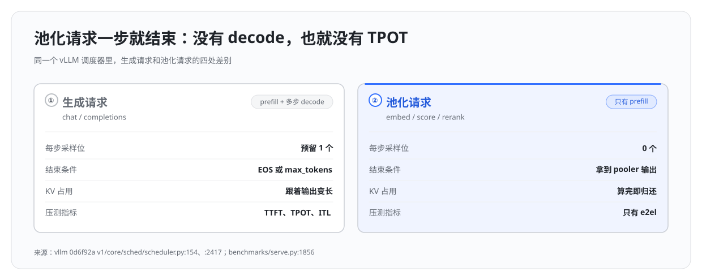
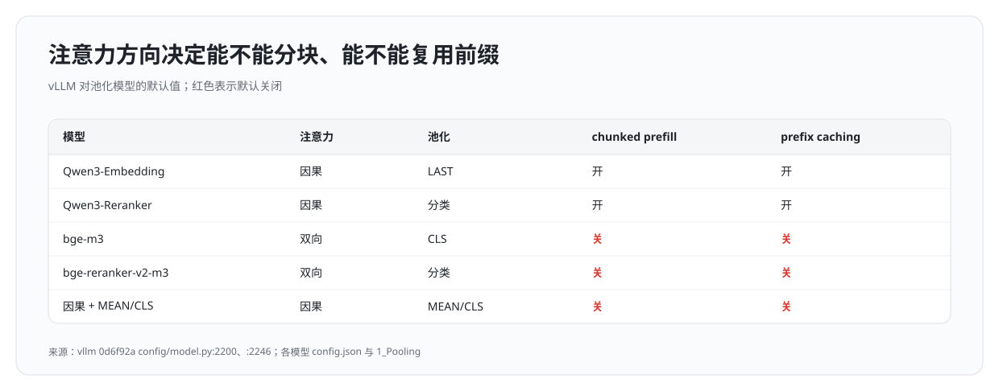
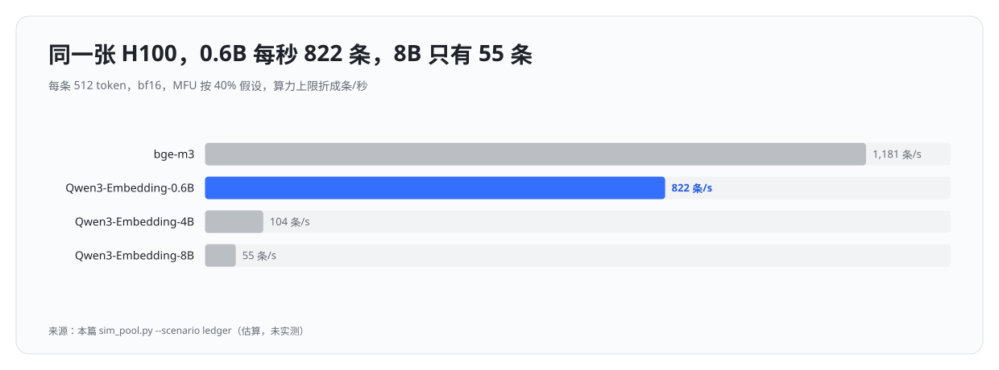
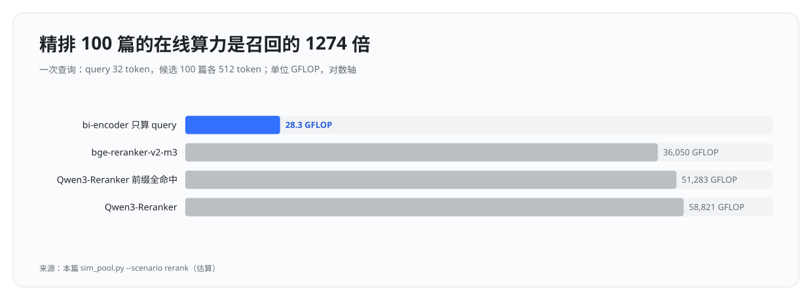
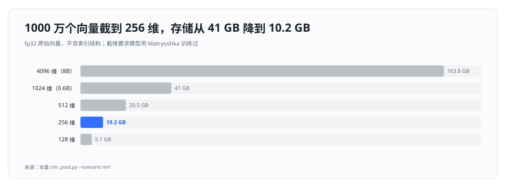

# VLLM-26｜专题｜Embedding 与 Rerank 服务：只有 prefill 的引擎怎么配

> 🎯 **一句话结论**：embedding 和 rerank 服务的调参只剩三个问题：一步塞多少 token，能不能分块和复用前缀，在线要算多少个句对。前两个由注意力方向和池化方式决定，起服时就定了；第三个由召回和精排怎么分工决定，差距最大，精排 100 篇的在线算力是召回的 1274 倍。本篇的吞吐数字是 Roofline 估算加源码推导，没有在 GPU 上实测。
>
> **这篇文档解决什么问题**：RAG 系统里除了生成模型，还要跑两类模型：把文本变成向量的 embedding 模型，和给候选文档打相关性分的 rerank 模型。vLLM 用同一个引擎服务它们，但请求只有一次 prefill、没有 decode，生成模型那套以 TPOT 和 KV 容量为中心的调参在这里大部分失效。

> 💡 **使用方式**：第 1 章讲池化请求在调度器里怎么走。第 2–3 章是起服参数和默认开关，只想把服务起起来的话看这两章和第 8 章。第 4 章算一步的时间和吞吐上限，第 5 章算召回和精排的在线算力，第 6 章讲截维。第 7 章对照 SGLang，第 8 章是真机实验。

> 💻 **代码**：[26-embedding-rerank](../26-embedding-rerank)。sim_pool.py 有 4 个场景：models 移植了 vLLM 对池化模型的 chunked prefill 和 prefix caching 判定，并列出两家的起服参数；ledger 算一步的时间；rerank 算一次查询的在线算力；mrl 算截维后的存储。pool_client.py 是只用标准库的客户端，覆盖 embed、search、rerank 和压测。16 个单测钉住了参数量、默认开关、每步预算、rerank 的 token 账，并让客户端对着本地假服务端核对两家的响应格式。serve_pool.sh 是真机实验。

# 导读 · 先给结论

1. **池化请求一步就结束。**调度器对池化模型每步不预留采样位，拿到 pooler 输出就把请求标成结束。没有 decode，所以没有 TPOT 和 ITL，`vllm bench serve` 对池化模型默认只报端到端延迟 e2el。
2. **Qwen3-Embedding 要写 `--runner pooling`，Qwen3-Reranker 还要改架构。**Qwen3-Embedding 的 config.json 写的是 Qwen3ForCausalLM，vLLM 靠仓库里 sentence-transformers 的 modules.json 认出它是池化模型，显式写上更稳。Qwen3-Reranker 要用 `--hf-overrides` 改成 Qwen3ForSequenceClassification，并配官方模板。bge 系列架构本身就是池化模型，不用加参数。
3. **注意力方向决定能不能分块、能不能复用前缀。**双向注意力的 bge-m3 和 bge-reranker-v2-m3 两样都默认关，单条输入必须整条放进一步。因果注意力配 LAST 池化的 Qwen3-Embedding 和 Qwen3-Reranker 两样都默认开。
4. **没有 decode，几乎每一步都在算力区。**H100 上 Qwen3-Embedding-0.6B 一步只要超过 111 个 token 就从读权重受限转成算力受限。每条 512 token、MFU 按 40% 假设，上限是 822 条/秒；换 8B 只剩 55 条/秒。
5. **精排的在线算力是召回的上千倍。**一次查询带 100 篇 512 token 的候选，bi-encoder 在线只算 query，28.3 GFLOP；bge-reranker-v2-m3 要算 100 个句对，36,050 GFLOP，是前者的 1274 倍。所以先用向量召回，再只对前几十篇精排。
6. **截维在 vLLM 里要先声明。**请求带 `dimensions` 时，模型 config 里要有 `is_matryoshka` 或 `matryoshka_dimensions`，否则直接返回 400。Qwen3-Embedding 的 config.json 两个都没有，要在启动时用 `--hf-overrides` 补上。

# 第 1 章 · 请求路径：池化请求只走一次 prefill



## 1.1 调度器里的两处分支

池化请求和生成请求走同一个 v1 调度器，只有两处分支。第一处在构造函数里：`num_sampled_tokens_per_step` 对池化模型是 0，调度时不为采样出的 token 预留上下文位置（`vllm/v1/core/sched/scheduler.py:154`）。第二处在处理模型输出时：请求带 `pooling_params` 且拿到了 pooler 输出，就直接标成 `FINISHED_STOPPED`（`scheduler.py:2417`，注释写的是 “Pooling stops as soon as there is output”）。

所以一个池化请求的生命周期是：排队，被调度进某一步做 prefill，算完池化，结束。长输入如果允许分块，会跨几步 prefill，最后一块算完才有 pooler 输出。中间没有 decode，也就没有逐 token 的输出流。

## 1.2 接口和指标

池化模型暴露的接口和生成模型不同：`/v1/embeddings`（OpenAI 兼容）、`/v2/embed`（Cohere 兼容）、`/pooling`（通用），以及 `/score`、`/rerank`、`/classify` 各一组。`/score` 怎么算分取决于池化任务：embed 任务是 bi-encoder，算两个向量的相似度；classify 任务是 cross-encoder，把句对一起过模型（`vllm/tasks.py:34` 的 SCORE_TYPE_MAP）。

压测时 TTFT、TPOT、ITL 都没有意义。`vllm bench serve` 的 `--percentile-metrics` 对池化模型默认只报 `e2el`（`vllm/benchmarks/serve.py:1856`）。我们关心的指标只剩两个：每秒处理多少条，端到端延迟的分位数。

> 🔁 **回到主线**：池化请求在一步 prefill 之后就结束，生成模型调参里围绕 decode 的那一半旋钮在这里全部失效。剩下的问题是 prefill 本身怎么排，而怎么排先取决于起服时引擎把模型认成了什么，这是下一章的内容。

# 第 2 章 · 起服：六个模型各要什么参数

## 2.1 引擎怎么认出池化模型

vLLM 的 `--runner` 默认是 auto。判定顺序是：先看仓库里有没有 sentence-transformers 的 modules.json，有就判成 pooling（`vllm/config/model.py:1296`，注释写的是 “Some Sentence Transformers models use \*ForCausalLM archs”）；再查架构注册表。Qwen3-Embedding 的 config.json 写的是 Qwen3ForCausalLM，靠 modules.json 才被认出来，所以本篇统一显式写 `--runner pooling`，避免换了镜像或离线目录缺文件时退回生成模式。

池化方式也来自 sentence-transformers 的配置。Qwen3-Embedding 的 1_Pooling/config.json 里 `pooling_mode_lasttoken` 为 true，取最后一个 token；bge-m3 是 `pooling_mode_cls_token`，取第一个 token。两者的 modules.json 都带 Normalize 模块，输出的是 L2 归一化后的向量。

## 2.2 六个模型的起法

| 模型 | 结构 | vLLM 起服参数 |
|-|-|-|
| Qwen3-Embedding-0.6B / 4B / 8B | Qwen3ForCausalLM，因果注意力，LAST 池化，矩阵乘参数 440M / 3633M / 6946M | `--runner pooling` |
| bge-m3 | XLMRobertaModel，双向注意力，CLS 池化，302M | 不用加 |
| bge-reranker-v2-m3 | XLMRobertaForSequenceClassification，cross-encoder，302M | 不用加 |
| Qwen3-Reranker-0.6B | config 写 Qwen3ForCausalLM，用 yes / no 两个 token 的 logit 打分，440M | `--runner pooling --hf-overrides '{"architectures": ["Qwen3ForSequenceClassification"], "classifier_from_token": ["no", "yes"], "is_original_qwen3_reranker": true}' --chat-template examples/pooling/score/template/qwen3_reranker.jinja` |

矩阵乘参数是按 config.json 逐项累加的，只算注意力投影和 MLP，不含词表 embedding：embedding 是按行查表，每步只读用到的几行。embedding 和 rerank 也都不需要整张 lm_head。

## 2.3 Qwen3-Reranker 为什么要改架构

Qwen3-Reranker 发布的是一个普通的因果语言模型，打分方式是让模型判断「文档是否满足 query」，取下一个 token 是 yes 和 no 的概率。vLLM 把它改造成单行分类头：加载权重时取 lm_head 里 yes 和 no 两行，相减后作为 score 层的权重，然后删掉整张 lm_head（`vllm/model_executor/models/adapters.py:566`）。这一行算出的是 logit(yes) − logit(no)，过 sigmoid 后正好等于 P(yes) / (P(yes) + P(no))。这样每个句对只多算一个 1024 维的点积，不用投影到 15 万的词表上。

模板决定了输入长什么样。官方模板把 system 指令、instruction 和 query 放在前面，document 放在后面，最后接上 assistant 的开头和空的思考段。用 Qwen3 tokenizer 对默认 instruction 数一遍：query 之前 61 个 token，query 和 document 之间 4 个，document 之后 9 个。第 5 章会用到这组数。

> 🔁 **回到主线**：起服参数决定了引擎把模型认成什么结构、用什么池化方式。结构里最关键的一项是注意力方向，下一章看它怎样决定 chunked prefill 和 prefix caching 能不能开。

# 第 3 章 · 默认开关：注意力方向决定分块和前缀复用



## 3.1 判定规则

生成模型的 chunked prefill 和 prefix caching 默认都开。池化模型要看两件事（`vllm/config/model.py:2200` 和 `:2246`）：

- 双向注意力（encoder_only）：两样都不支持。每个 token 都要看到整条输入，切成两块算，第一块就看不到第二块；前缀的 KV 也依赖后面的内容，不能复用。
- 因果注意力配 MEAN 或 CLS 池化：两样都不支持。
- 因果注意力配 LAST 池化（以及取最后一个位置的分类头）：两样都支持。因果注意力下前缀的 KV 与后文无关，分块和复用都成立。

启动后还有一道兜底：引擎核心收集各 worker 的 KV spec，只要有一层标了 `non_causal`，就强制关掉这两项，并打日志 “Disabling chunked prefill: model has non-causal attention layers.”（`vllm/v1/engine/core.py:274`）。手动用参数打开不支持的开关时，`arg_utils.py:3076` 会警告 “This model does not officially support chunked prefill”。

## 3.2 不分块时预算怎么定

每步 token 预算 `max_num_batched_tokens` 的默认值按显存和卡名分档：显存不少于 70 GiB 且不是 A100 的卡，API server 默认 8192；A100 和小显存卡是 2048（`vllm/engine/arg_utils.py:2995` 起）。不开 chunked prefill 时，预算会被抬到 max(max_model_len, 默认值)（`:3202`），保证最长的一条输入能整条放进一步。bge-m3 的 max_model_len 是 8192，所以在 A100 上它的预算也是 8192，而 Qwen3-Embedding 在 A100 上只有 2048，长输入会被切成多块跨步算。

> 🔁 **回到主线**：注意力方向一旦确定，分块、前缀复用和每步预算都跟着定了。剩下能算的是这一步到底要花多少时间，以及一张卡每秒能处理多少条，这是下一章的账本。

# 第 4 章 · 账本：一步的时间和吞吐上限



## 4.1 每 token 的运算量

前向一次，每个 token 的 FLOP 由两部分组成：矩阵乘 2 × 矩阵乘参数，加注意力 4 × 层数 × 头数 × head_dim × 可见长度。因果注意力平均每个位置看到 (L+1)/2 个 key，双向注意力每个位置看到 L 个。输入 512 token 时：

| 模型 | GFLOP / token | 每步读权重 | 上限（条/秒） | 满预算一步 |
|-|-|-|-|-|
| Qwen3-Embedding-0.6B | 0.94 | 0.88 GB，0.26 ms | 822 | 19.46 ms |
| Qwen3-Embedding-4B | 7.42 | 7.27 GB，2.17 ms | 104 | 153.61 ms |
| Qwen3-Embedding-8B | 14.04 | 13.89 GB，4.15 ms | 55 | 290.80 ms |
| bge-m3 | 0.65 | 0.60 GB，0.18 ms | 1,181 | 13.55 ms |

口径：H100 SXM，BF16 稠密峰值 989 TFLOPS，HBM 3.35 TB/s；MFU 按 40% 假设；满预算是 8192 token，即每步 16 条 512 token 的输入。上限只算算力，不含排队、tokenize 和网络。

## 4.2 几乎每一步都在算力区

以 Qwen3-Embedding-0.6B 为例：读一遍 0.88 GB 权重要 0.26 ms，而 40% MFU 下 0.26 ms 能算 111 个 token 的前向。一步里 token 超过 111 个，时间就由算力决定。生成模型的 decode 每步每条只有 1 个 token，要上百条并发才能越过这条线；池化请求一条就有几百个 token，一步就越过去了。所以第 3 章那组开关的意义不在省带宽，而在排批：能不能把长输入切开和短输入拼在一起，能不能少算共享的前缀。

bge-m3 的每 token 运算量比 Qwen3-Embedding-0.6B 少三成，上限因此高出 44%。代价在质量和语言覆盖上，不在本篇的账本范围内。8B 的上限只有 0.6B 的 1/15，换模型前先确认召回指标的提升值这个价。

## 4.3 KV 在这里管什么

因果模型做 prefill 也要写 KV。Qwen3-Embedding-0.6B 每条 512 token 的输入占 56.0 MiB KV，请求一结束就归还；开着 prefix caching 时，这些块会留作可复用的缓存块，直到被淘汰。KV 池在这里决定的是同一步能放多少条，而不是能挂住多少个长对话。生成模型那种「KV 不够导致抢占」的问题，在池化服务里只会出现在单步预算远大于 KV 池的极端配置下。

> 🔁 **回到主线**：一条 embedding 请求的成本几乎完全是 prefill 的算力，账本可以按 token 数线性地算。按这个账去看一个检索系统，钱主要花在哪一步，就看每次查询在线要过模型多少个 token，这是下一章召回和精排的分工问题。

# 第 5 章 · 召回与精排：在线算力差三个数量级



## 5.1 一次查询的账

设一次查询的 query 有 32 个 token，候选文档 100 篇，每篇 512 token。三种做法的在线计算量：

| 做法 | 在线 token | GFLOP | 算力下限 |
|-|-|-|-|
| bi-encoder（Qwen3-Embedding-0.6B），只算 query | 32 | 28.3 | 0.072 ms |
| cross-encoder（bge-reranker-v2-m3） | 54,800 | 36,050 | 91.128 ms |
| Qwen3-Reranker-0.6B | 61,800 | 58,821 | 148.688 ms |
| Qwen3-Reranker-0.6B，前缀全部命中 | 53,880 | 51,283 | 129.633 ms |

bi-encoder 的文档向量在入库时离线算好，查询时只需算 query 的向量，再做 100 次点积。cross-encoder 要把每个 (query, 文档) 对整段过一遍模型：XLM-R 的句对格式是 &lt;s&gt; query &lt;/s&gt;&lt;/s&gt; document &lt;/s&gt;，每对 32 + 512 + 4 = 548 个 token，100 对就是 54,800 个。两者差 1274 倍。这就是检索系统普遍分两级的原因：先用向量从百万篇里召回几百篇，再只对前几十篇做精排。

## 5.2 Qwen3-Reranker 的共享前缀

Qwen3-Reranker 每个句对比 bge 多出 74 个模板 token（61 + 4 + 9），所以总量更大。但它的模板把指令和 query 放在文档前面，同一次查询的 100 个句对共享前 93 个 token（61 + 32）。因果注意力配分类头，第 3 章的规则允许 prefix caching；按 16 token 一块，能复用 80 个 token，100 对共省下 7,920 个 token，算力下限从 148.688 ms 降到 129.633 ms。

这一行是上限，有两个前提：前缀块已经算完并留在缓存里，后面的句对才能命中。同一步里一起排进去的请求未必互相命中，实际命中率要看 `vllm:prefix_cache_queries` 和 `vllm:prefix_cache_hits` 两个计数器。query 更长、候选更多时，这部分收益会变大；query 很短时，93 个 token 里能凑满的块只有 5 个，收益有限。

> 🔁 **回到主线**：在线算力的大头在精排，召回的在线成本可以忽略。召回的成本挪到了离线：入库时要为每篇文档算一次向量并存下来，存多少维直接决定向量库的大小，这是下一章的截维问题。

# 第 6 章 · 截维：dimensions 在 vLLM 里要先声明



## 6.1 存储账

1000 万个 fp32 向量的原始存储：Qwen3-Embedding-8B 输出 4096 维，163.8 GB；0.6B 和 bge-m3 输出 1024 维，41.0 GB；截到 512 维是 20.5 GB，256 维 10.2 GB，128 维 5.1 GB。这还没算索引结构，HNSW 之类的图索引会再加一截。截维的前提是模型训练时用过 Matryoshka 表示学习（MRL），前几维已经携带主要信息；没训练过的模型截维后召回会明显变差。

## 6.2 vLLM 的校验

请求带 `dimensions` 时，vLLM 先检查模型是否声明支持 Matryoshka：config 里有 `is_matryoshka` 或 `matryoshka_dimensions` 才放行，否则返回 400（`vllm/pooling_params.py:246`，判定在 `vllm/config/model.py:2091`）。设了 `matryoshka_dimensions` 时，请求的维度必须在列表里。

Qwen3-Embedding 的模型卡说支持自定义输出维度，但 config.json 里这两个字段都没有，vLLM 也没有为它单独补。所以要在启动时加 `--hf-overrides '{"is_matryoshka": true}'`，或者用 `matryoshka_dimensions` 限定允许的几档。这是给引擎的声明，引擎不会替你验证模型是否真的训练过 MRL。

> 🔁 **回到主线**：截到 256 维能把离线存储降到四分之一，但在 vLLM 里要先在 config 里声明 Matryoshka，引擎不替你判断模型是否训练过 MRL。到这里，vLLM 侧的起服、开关、账本和截维都有了结论。SGLang 也能服务同样的六个模型，但起服参数、缓存开关和截维校验的取舍不同，下一章逐项对照，避免把一家的参数照抄到另一家。

# 第 7 章 · 对照 SGLang：同一个模型，两套起法

| 项目 | vLLM（0d6f92a） | SGLang（8fabf5e） |
|-|-|-|
| Qwen3-Embedding | `--runner pooling`，也能靠 modules.json 自动识别 | 必须加 `--is-embedding`，Qwen3ForCausalLM 不在非生成模型名单里（`srt/configs/model_config.py:2378`） |
| bge 系列 | 不用加参数，双向模型自动关分块和前缀复用 | 架构自动切 embedding 模式；文档给的命令另加 `--attention-backend triton --disable-radix-cache --chunked-prefill-size -1` |
| Qwen3-Reranker | 改成 Qwen3ForSequenceClassification，单行分类头 | 不能加 `--is-embedding`，走生成模式，取 yes / no 的 logprob；必须带 `--chat-template examples/chat_template/qwen3_reranker.jinja`，否则按模板认不出来，返回 400；文档命令还带 `--disable-radix-cache` |
| 省掉 KV | 无对应开关 | `--prefill-only-disable-kv-cache`：不写 paged KV，要求 `--is-embedding`、不分块、关 radix cache、FA3/FA4 prefill 后端 |
| 截维 | config 要声明 Matryoshka | 同样要 config 声明 Matryoshka，起服用 `--json-model-override-args` 补；再校验范围，先截维再归一化 |
| rerank 接口 | `/rerank`，返回 `{"results": [{"index", "relevance_score"}]}` | `/v1/rerank`，直接返回列表 `[{"index", "score"}]` |
| 压测 | `vllm bench serve` 有 openai-embeddings 和 vllm-rerank 两个后端 | `sglang.bench_serving --backend sglang-embedding`；没有 rerank 压测 |

两个差别最容易踩坑。第一，Qwen3-Reranker 在两家是两种实现：vLLM 把 lm_head 折成一行，SGLang 走生成模式算整张 lm_head 再取两个 token 的 logprob，两者算出的分数在数学上相同，但 SGLang 的启动命令必须不带 `--is-embedding`。第二，SGLang 文档给 Qwen3-Reranker 的命令带 `--disable-radix-cache`，第 5 章的共享前缀收益在 SGLang 上默认拿不到。SGLang 侧的细节见 SGL-25。

> 🔁 **回到主线**：两家对同一个模型的认法不同，参数不能互相照抄，但第 4–5 章的算力账两家通用。账本里的数都是估算，最后一章给出在真机上核对它们的命令。

# 第 8 章 · 真机实验

## 8.1 命令

先在 CPU 上跑账本和单测，确认第 4–6 章的数能复现：

```bash
python3 sim_pool.py --scenario models
python3 sim_pool.py --scenario ledger --model qwen3-emb-0.6b --doc-len 512
python3 sim_pool.py --scenario rerank --docs 100 --query-len 32 --doc-len 512
python3 sim_pool.py --scenario mrl
python3 test_sim_pool.py
```

再上 GPU。一个终端起 embedding 服务（带 is_matryoshka 覆盖），另一个终端依次跑 embed、带 dimensions 的 embed、search 和并发压测；然后换成 reranker 起服并压测，压完脚本会打印 prefix cache 的两个计数器。以下命令没有在 GPU 上实跑过：

```bash
bash serve_pool.sh emb
bash serve_pool.sh client
bash serve_pool.sh bench_emb 512
bash serve_pool.sh rr_qwen
bash serve_pool.sh bench_rr 100
```

## 8.2 要核对的四件事

1. `bench_emb` 在 request-rate inf 下的吞吐，和第 4 章的 822 条/秒相比，反推实际 MFU。
2. 起 bge-m3 时日志里没有 chunked prefill 相关的警告，起 Qwen3-Embedding 时手动加 `--no-enable-prefix-caching` 对比 rerank 吞吐。
3. `bench_rr` 之后 `vllm:prefix_cache_hits` 与 `vllm:prefix_cache_queries` 的比值，和第 5 章 80 / 93 的上限对比。
4. 不加 `is_matryoshka` 覆盖时，带 `dimensions` 的请求是否返回 400。

> 🔁 **回到主线**：真机数字回来以后，先用 e2el 吞吐反推 MFU，替换第 4 章的 40% 假设；再用 prefix cache 命中率校正第 5 章那一行上限。三个问题里，前两个靠起服参数一次定死，第三个靠召回和精排的分工持续省算力，实测只是把这三笔账的系数换成真值。

> 📌 **核对清单**
> - 知道池化请求为什么没有 TPOT，压测只看 e2el 和每秒条数。
> - Qwen3-Embedding 显式写 `--runner pooling`；Qwen3-Reranker 用 hf_overrides 改架构并配模板。
> - 能说出 bge-m3 和 Qwen3-Embedding 在 chunked prefill、prefix caching 上的默认值，以及为什么不同。
> - 能按 GFLOP/token 和 MFU 估出自己卡上的吞吐上限，知道一步超过约一百个 token 就进入算力区。
> - 精排只对召回的前几十篇做；用 Qwen3-Reranker 时盯住 prefix cache 命中率。
> - 截维前确认模型训练过 MRL，并在 vLLM 里声明 `is_matryoshka`。
> - 迁到 SGLang 时，Qwen3-Embedding 加 `--is-embedding`，Qwen3-Reranker 不加。

# 诚实清单

1. 第 4–5 章的吞吐和延迟全部是 Roofline 估算，MFU 40% 是假设值，没有在 GPU 上实测。验证方法见 8.2 第 1 条。
2. 前缀全部命中的那一行是上限，同一步内的请求能否互相命中没有在源码里逐行核实，以 prefix cache 计数器为准。
3. serve_pool.sh 的命令和参数按 0d6f92a 的源码和文档写成，没有在 GPU 上跑过；vLLM 版本变化后参数名可能变。
4. Qwen3-Reranker 模板的 token 数（61 / 4 / 9）是用 Qwen3-0.6B 的 tokenizer 对默认 instruction 数的；改了 instruction 或换了 tokenizer 要重数。
5. Qwen3-Embedding 是否适合截到 256 维、召回损失多少，本篇没有测，以模型卡和自己的评测集为准。
6. 模型结构取自 Hugging Face main 分支的 config.json，2026 年 11 月 19 日读取。

# 修订记录

| 版本 | 日期 | 变更 |
|-|-|-|
| v1 | 2026-11-19 | 首版。源码基线 vllm 0d6f92a、sglang 8fabf5e；账本由 sim_pool.py 生成，16 个单测通过；GPU 实验未跑。 |

# 参考文献

源码以 vllm-project/vllm 主干提交 0d6f92a（2026 年 10 月 29 日）为准，SGLang 对照以 sgl-project/sglang 主干 8fabf5e 为准。

[1] vllm-project. vllm/v1/core/sched/scheduler.py. GitHub (0d6f92a) [https://github.com/vllm-project/vllm/blob/0d6f92a/vllm/v1/core/sched/scheduler.py](https://github.com/vllm-project/vllm/blob/0d6f92a/vllm/v1/core/sched/scheduler.py)

[2] vllm-project. vllm/config/model.py. GitHub (0d6f92a) [https://github.com/vllm-project/vllm/blob/0d6f92a/vllm/config/model.py](https://github.com/vllm-project/vllm/blob/0d6f92a/vllm/config/model.py)

[3] vllm-project. vllm/engine/arg_utils.py. GitHub (0d6f92a) [https://github.com/vllm-project/vllm/blob/0d6f92a/vllm/engine/arg_utils.py](https://github.com/vllm-project/vllm/blob/0d6f92a/vllm/engine/arg_utils.py)

[4] vllm-project. vllm/model_executor/models/adapters.py. GitHub (0d6f92a) [https://github.com/vllm-project/vllm/blob/0d6f92a/vllm/model_executor/models/adapters.py](https://github.com/vllm-project/vllm/blob/0d6f92a/vllm/model_executor/models/adapters.py)

[5] vllm-project. vllm/pooling_params.py. GitHub (0d6f92a) [https://github.com/vllm-project/vllm/blob/0d6f92a/vllm/pooling_params.py](https://github.com/vllm-project/vllm/blob/0d6f92a/vllm/pooling_params.py)

[6] vLLM Docs. Embedding Usages (0d6f92a) [https://github.com/vllm-project/vllm/blob/0d6f92a/docs/models/pooling_models/embed.md](https://github.com/vllm-project/vllm/blob/0d6f92a/docs/models/pooling_models/embed.md)

[7] vLLM Docs. Scoring Usages (0d6f92a) [https://github.com/vllm-project/vllm/blob/0d6f92a/docs/models/pooling_models/scoring.md](https://github.com/vllm-project/vllm/blob/0d6f92a/docs/models/pooling_models/scoring.md)

[8] Qwen. Qwen3-Embedding-0.6B. Hugging Face [https://huggingface.co/Qwen/Qwen3-Embedding-0.6B](https://huggingface.co/Qwen/Qwen3-Embedding-0.6B)

[9] Qwen. Qwen3-Reranker-0.6B. Hugging Face [https://huggingface.co/Qwen/Qwen3-Reranker-0.6B](https://huggingface.co/Qwen/Qwen3-Reranker-0.6B)

[10] BAAI. bge-m3. Hugging Face [https://huggingface.co/BAAI/bge-m3](https://huggingface.co/BAAI/bge-m3)

[11] BAAI. bge-reranker-v2-m3. Hugging Face [https://huggingface.co/BAAI/bge-reranker-v2-m3](https://huggingface.co/BAAI/bge-reranker-v2-m3)

[12] Kusupati A, et al. Matryoshka Representation Learning. NeurIPS (2022) [https://arxiv.org/abs/2205.13147](https://arxiv.org/abs/2205.13147)

[13] SGLang Docs. Embedding Models (8fabf5e) [https://github.com/sgl-project/sglang/blob/8fabf5e/docs/docs/supported-models/embedding_models.mdx](https://github.com/sgl-project/sglang/blob/8fabf5e/docs/docs/supported-models/embedding_models.mdx)

[14] SGLang Docs. Rerank Models (8fabf5e) [https://github.com/sgl-project/sglang/blob/8fabf5e/docs/docs/supported-models/rerank_models.mdx](https://github.com/sgl-project/sglang/blob/8fabf5e/docs/docs/supported-models/rerank_models.mdx)

---

上一章：[VLLM-25｜实战｜Qwen3.8-27B 部署：混合注意力的显存账](./25-qwen38-27b-deploy.md) · [目录](./README.md)
