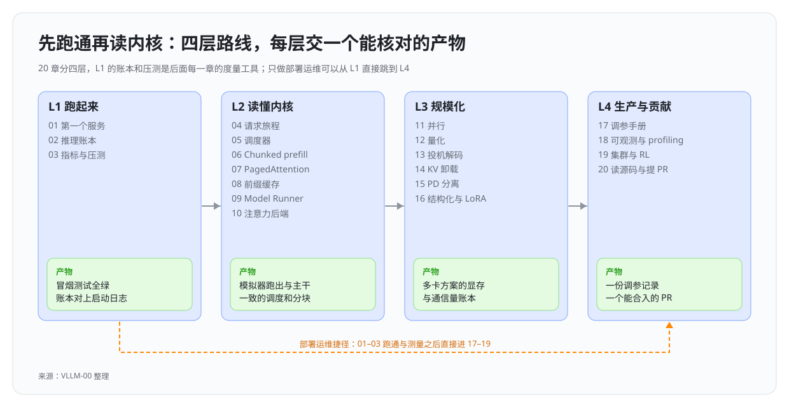
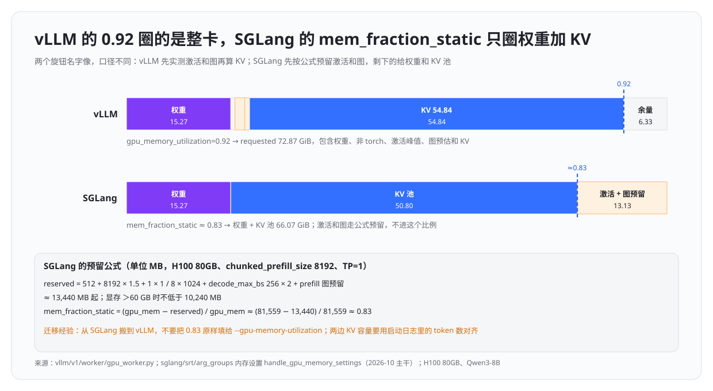
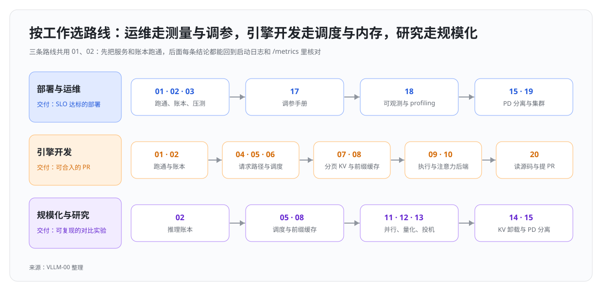

# VLLM-00｜索引｜从 0 开始 vLLM：路线、章节与练习

> 本目录是「从 0 开始 vLLM」系列文档的 Markdown 版，共 26 章，由飞书原文转换，正文与原文一致，画板导出为图片放在 `assets/`。配套代码在仓库根目录，每章一个目录。

> 🎯 **这篇文档解决什么问题**：想把 vLLM 从“能 serve 起来”学到“能读懂、能改调度和 KV 管理、能扛线上流量”，应该按什么顺序读，每一章读完能交付什么，练习代码放在哪。这一页是 26 章的入口和路线图，我们先把路线摆出来，再一章章往下走。
>
> **使用方式**：先读导读和路线图，再到第 3 章按岗位挑一条主线。每读完一章，跑通对应目录的练习，再用第 5 章的验收题自测。没轮到的章节先当查阅手册。文中版本、默认值和基准数字核对于 2026 年 10 月 29 日。
>
> **代码**：配套代码集中在 [zero-to-vllm](../README.md)，每章一个目录。CPU 上能跑的模拟器和需要 GPU 的脚本分开存放，没有 GPU 也能做完 L2 的大部分练习。

# 导读 · 先给结论

## 通用案例的双模型基线

通用 GPU 练习改用 MODEL_PROFILE=dense 或 moe，分别对应 Qwen3.8-27B 与 Qwen3.5-35B-A3B。两者都用 GDN 加全注意力；稠密与 MoE 指 FFN，和注意力类型是两个维度。先读 VLLM-02 的分项账本，再用 VLLM-01 启动、VLLM-03 压测。

旧 Qwen3-8B 示意日志、Llama CPU 模拟器和 DeepSeek MLA 专项保留原模型与数值。VLLM-24 仍是 Qwen3-32B 历史实战，不能把它改称 MoE。新增双模型命令尚无 GPU 实测，旧图中的容量和时延也不代表新模型。

双模型结构以固定版本配置核对[[Qwen3.8-27B config.json]](https://huggingface.co/Qwen/Qwen3.8-27B/blob/37561816e66b5b9153b1b64c10968c18c1e6f4a0/config.json)[[Qwen3.5-35B-A3B config.json]](https://huggingface.co/Qwen/Qwen3.5-35B-A3B/blob/59d61f3ce65a6d9863b86d2e96597125219dc754/config.json)。

```bash
MODEL_PROFILE=dense bash 01-first-server/serve.sh
MODEL_PROFILE=moe TP=2 bash 01-first-server/serve.sh
```

1. **vLLM 是从显存管理起家的。**PagedAttention 把 KV 切成固定大小的块，用块表做间接寻址，论文统计的既有系统有 60% 到 80% 的 KV 显存浪费在碎片和过量预留上，换成分块后浪费压到 4% 以下，同等延迟下吞吐提升 2 到 4 倍[[1]](https://arxiv.org/abs/2309.06180)[[2]](https://vllm.ai/blog/2023-06-20-vllm)。前缀缓存、KV 卸载、PD 分离传 KV，全部建立在“块”这个单位上，读懂块就读懂了半个 vLLM。
2. **第二个战场是 CPU 开销。**v0.6.0 时官方 profile 过 Llama 3 8B 单卡 H100：HTTP 服务占 33% 的时间，花在 GPU 上的只有 38%[[3]](https://vllm.ai/blog/2024-09-05-perf-update)。V1 重写把 API server、EngineCore、GPU worker 拆成独立进程，整体比 V0 吞吐高 1.7 倍[[4]](https://vllm.ai/blog/2025-01-27-v1-alpha-release)；之后又默认打开异步调度，并把 model runner 重写成 MRV2，在 GB200 上跑 Qwen3-0.6B 这种 CPU 开销占比很高的场景，输出吞吐从 16K tok/s 提到 25K tok/s[[5]](https://vllm.ai/blog/2026-03-24-mrv2)。
3. **先算账，后读源码。**算不出一张卡能放多少 token 的 KV、decode 为什么受显存带宽限制，读调度器时只能看到一堆 if。启动日志里的 `GPU KV cache size: N tokens` 是全系列第一个对账点，Roofline 是公共语言[[6]](https://arxiv.org/abs/2402.16363)。
4. **读源码从 nano-vllm 起步，再切到主干。**主干 vllm/ 目录约 119 万行 Python，其中 V1 引擎约 19.5 万行，scheduler.py 3781 行，MRV1 的 gpu_model_runner.py 7192 行。nano-vllm 全部约 1400 行（README 口径约 1200 行），保留了块管理、调度、前缀缓存、TP 和 CUDA Graph 的骨架[[7]](https://github.com/GeeeekExplorer/nano-vllm)。主干调度器的核心思想只有一句：没有 prefill 阶段和 decode 阶段，每个请求只有 num_computed_tokens 去追 num_tokens_with_spec，先在 nano 版上看清，再去主干找同名逻辑。
5. **规模化的问题都可以归结为资源拆分和 KV 搬运。**TP、DP、EP 拆的是算力和显存，PD 分离拆的是两种负载，KV connector 和卸载拆的是 KV 的存放位置。社区在 H200 集群上用 Wide-EP 跑 DeepSeek 做到每卡 2.2k tok/s[[8]](https://vllm.ai/blog/2025-12-17-large-scale-serving)，在 GB300 NVL72 上用 PD 分离加 Wide-EP 跑 DeepSeek-V4.1-Flash[[9]](https://vllm.ai/blog/2026-10-23-deepseek-v41-flash-pd-wide-ep)。判断标准是同一个：拆完以后瓶颈移到了哪里[[10]](https://arxiv.org/abs/2401.09670)。
6. **生产能力靠指标和压测说话，出口是一个合格的 PR。**每一次调参都要在 TTFT、TPOT、吞吐和 KV 使用率上看到可复现的变化[[11]](https://docs.vllm.ai/en/latest/configuration/optimization/)[[12]](https://docs.vllm.ai/en/latest/benchmarking/cli/)；一份可复现的 benchmark、一段 profile 证据、一个最小改动，是这套手册对“学会”的定义[[13]](https://docs.vllm.ai/en/latest/contributing/)[[14]](https://vllm.ai/blog/2026-07-16-keeping-vllm-production-quality)。



# 第 1 章 · 这套系列怎么组织

## 1.1 四级路线

二十六章分成四级，每一级有明确的出口能力，前一级的练习是后一级的输入。章节划分参考了 zero-to-sglang 的四段式（概念、手写 mini 引擎、真实引擎前沿、部署与贡献）[[15]](https://github.com/datawhalechina/zero-to-sglang)，但不照搬：vLLM 的核心抽象是“块”和“token 预算”，所以 L2 按块的生命周期排，从分配、命中、驱逐一路读到 kernel 怎么消费块表。手写引擎的部分换成对照 nano-vllm 和主干源码的 CPU 模拟器。

- **L1 跑起来（约一周，01 至 03）**：用 `vllm serve` 部署一个模型，跑通 OpenAI 兼容接口；自己算出 KV 能放多少 token，再和启动日志对账；交一份写清负载、并发、版本的压测报告。
- **L2 读懂内核（三到四周，04 至 10）**：沿一条请求读完 API server、EngineCore、GPU worker 三类进程；把调度器、chunked prefill 与异步调度、BlockPool 与块表、前缀缓存与混合 KV 管理、model runner 与编译、注意力后端逐个拆开。这一级的练习大多在 CPU 上做。
- **L3 规模化（三到四周，11 至 16）**：多卡并行、量化、投机解码、KV 卸载与连接器、PD 分离、结构化输出与多 LoRA。每章回答同一个问题：这项技术在什么负载下值得开，代价落在哪里。
- **L4 生产与贡献（持续，17 至 26）**：调参手册、可观测与 profiling、集群路由与 RL、读源码与提 PR，两篇前沿（一个月主干复盘、DeepSeek 开源对 vLLM 的影响），以及三篇部署实战：DeepSeek-V4.1-Flash、Qwen3-32B 和 Qwen3.8-27B，从消费级显卡一路排到 H20，最后一篇是 48 层 GDN 加 16 层全注意力的混合模型；另有一篇专题讲 embedding 与 rerank 这类只有 prefill 的服务怎么配。这一级没有终点，章节随上游版本更新。

## 1.2 章节落在架构上的位置

V1 引擎把一次推理拆到三类进程里[[16]](https://docs.vllm.ai/en/latest/design/arch_overview/)。API server 进程负责 HTTP、分词和多模态输入处理，也负责把 token 流反分词成文本；EngineCore 进程跑一个忙循环，里面是 Scheduler 和 KV cache 管理；GPU worker 每卡一个，加载权重、跑前向。API server 和 EngineCore 之间走 ZMQ，EngineCore 给 worker 广播调度结果走共享内存消息队列。开了 DP 还会多一个 DP Coordinator。进程数可以直接算：`-tp 4` 是 1 + 1 + 4 = 6 个进程，`-tp 2 -dp 4` 是 4 个 API server、4 个 EngineCore、8 个 worker 加 1 个 coordinator，共 17 个。



图里括号中的数字是对应章节。EngineCore 是全系列的重心，05 至 08 章都在拆它：调度循环、token 预算、块分配和前缀缓存。worker 一侧是 09 和 10 章，L3 的大部分技术最终也落在 worker 上执行。和 SGLang 最大的结构差异在于反分词的位置：SGLang 单独起一个 DetokenizerManager 进程[[17]](https://arxiv.org/abs/2312.07104)[[18]](https://github.com/sgl-project/sglang)，vLLM 把它放回 API server 进程，用 OutputProcessor 在 asyncio 循环里做，所以 vLLM 少一次进程边界，代价是 API server 的 CPU 更容易成为瓶颈，这也是高并发下要加 `--api-server-count` 的原因。

## 1.3 和 SGLang 对照着读

两个引擎解决同一组问题，取舍不同。下表是贯穿全系列的对照轴，每章的“原理”部分都会回到其中一行。

| 维度 | vLLM | SGLang | 章节 |
|-|-|-|-|
| 进程拆分 | API server（含分词与反分词）、EngineCore、每卡一个 worker | TokenizerManager、Scheduler、DetokenizerManager 三进程 | 04 |
| 调度抽象 | 不区分 prefill 与 decode，统一按 token 预算给每个请求补齐 num_computed_tokens | 显式区分 prefill batch 和 decode batch，PrefillAdder 按预算装请求，可选 mixed chunk | 05、06 |
| KV 布局 | 固定大小的块（默认 16 token），BlockPool 管空闲队列，块表交给 kernel | req_to_token 与 token_to_kv 两级映射，page size 可配 | 07 |
| 前缀复用 | 满块按链式哈希登记，查表命中，只缓存完整的块 | 基数树按 token 粒度匹配，树上加锁和驱逐 | 08 |
| CPU 开销隐藏 | 异步调度默认开启，MRV2 把输入准备搬到 GPU | overlap 调度器，下一批的准备与当前批前向重叠 | 06、09 |
| 图编译 | torch.compile 分段编译加 CUDA Graph，默认 FULL_AND_PIECEWISE | CUDA Graph 为主，torch.compile 可选 | 09 |
| KV 外移 | 统一的 KV connector 接口，接 NIXL、Mooncake、LMCache、CPU 卸载 | HiCache 分层缓存，PD 分离走独立的 disaggregation 模块 | 14、15 |
| 扩展方式 | plugin 系统通过 entry point 注入模型、平台和通用插件，不用 fork | 以主干内改动为主 | 20 |

我们做对照不为排快慢。两边的基准数字都绑定负载和版本，换一个模型、换一组输入输出长度，结论就会变。对照能帮我们判断一个现象是负载本身的性质，还是某个引擎实现上的取舍。

## 1.4 每章的固定结构

每章按同一套骨架写，方便横向对照和日后增补：

1. **问题**：这一章解决什么具体问题，不解决会在线上看到什么现象。
2. **原理**：对应的论文或官方设计文档，只讲和实现有关的部分，附公式和账本，并给出 SGLang 的对应做法。
3. **源码走读**：给出文件路径、类名和函数名，按调用顺序读。行号固定到提交 0d6f92a，上游一动就会漂，对不上时按类名和函数名 grep。
4. **动手**：配套目录里的模拟器或脚本，标明 CPU 还是 GPU，给出期望输出。
5. **调参与误区**：相关启动参数、默认值、什么时候改，以及常见的错误理解。
6. **上线前核对清单**：能直接抄进部署 checklist 的条目。

## 1.5 版本基线

源码以 vllm-project/vllm 主干提交 [0d6f92a](https://github.com/vllm-project/vllm/tree/0d6f92ae7c83f1d338d1b6a742ebcd79ab0fc2bb)（2026 年 10 月 29 日）为准，发行版对照 v0.32.0（2026 年 10 月 18 日）[[19]](https://github.com/vllm-project/vllm/releases/tag/v0.32.0)。几个和旧教程不一致的地方要先知道：

- V0 引擎已经删除。`vllm/engine/llm_engine.py` 只剩一行别名，指向 `vllm/v1/engine/llm_engine.py`。旧文章里的 BlockSpaceManager、multi-step scheduling（num_scheduler_steps）、use_v2_block_manager 在主干里都搜不到了。
- Model runner 有两份。MRV2 在 `vllm/v1/worker/gpu/model_runner.py`，装了 Triton 且没用到它尚不支持的特性时默认启用，否则回退到 MRV1 `gpu_model_runner.py`，可以用 `VLLM_USE_V2_MODEL_RUNNER` 强制指定[[20]](https://docs.vllm.ai/en/latest/design/model_runner_v2/)。读源码前先看启动日志确认自己跑的是哪一份。
- 主干新基线（2026 年 11 月 7 日合入）：Model Runner V1 已随 [#63373](https://github.com/vllm-project/vllm/pull/63373) 删除，`VLLM_USE_V2_MODEL_RUNNER` 开关与 `gpu_model_runner.py` 一并移除，主干只剩 MRV2，下面“有两份 runner、可回退 V1”的说法只对 0d6f92a 基线成立。
- 异步调度默认开启：`async_scheduling` 不设置时自动打开，pooling 模型和不支持的 executor 后端除外。
- v0.32.0 去掉了 Python 3.10，最低 3.11；cascade attention 已删除，`--disable-cascade-attn` 只打告警[[19]](https://github.com/vllm-project/vllm/releases/tag/v0.32.0)。
- PyPI wheel 和默认镜像都基于 CUDA 13.0，CUDA 12.9 用带 `-cu129` 后缀的镜像。装完要跑一次 `vllm download-kernels` 预装 FlashInfer kernel，否则 Hopper 和 Blackwell 上首次启动会现场编译，多花几分钟[[21]](https://docs.vllm.ai/en/latest/getting_started/installation/gpu/)。
- 压测用 `vllm bench serve`。仓库里的 `benchmarks/benchmark_serving.py` 现在只打印迁移提示然后退出[[12]](https://docs.vllm.ai/en/latest/benchmarking/cli/)。
- KV 缓存改为可扩展式（2026 年 11 月 2 日合入 [#56492](https://github.com/vllm-project/vllm/pull/56492)）：CUDA、ROCm 上默认开启，先预留地址区间，CUDA Graph 捕获和 warmup 跑完、知道真实空闲显存后才映射物理内存并确定块数，不再靠捕获前的 profiling 估算；`gpu_memory_utilization` 缺省值随之变为 1.0，手动压低会从可扩展池扣内存并告警。

> 💡 **常见误区**：拿 2024 年的 vLLM 源码解析对照主干读。V1 重写后目录、类名几乎全换，调度器也不再分 prefill 和 decode 两个阶段，旧文章里的流程图大多已经不成立。读源码以类名和函数名为锚点，用 grep 定位，不按旧文章里的行号找。

# 第 2 章 · 二十六章清单

下面四张表是系列的完整目录。源码列只写文件名，链接固定到提交 0d6f92a 的完整路径；练习列是配套仓库里的目录名。第一列的章节名直接链到对应文档。

## 2.1 L1 跑起来

| 章节 | 回答的问题 | 主要源码 | 论文与实践依据 | 练习 |
|-|-|-|-|-|
| [VLLM-01｜上手｜第一个服务：安装、vllm serve 与读懂启动日志](./01-first-server.md) | 怎么装、怎么用 vllm serve 起服务、怎么用 OpenAI 接口发请求；启动日志里模型加载、KV 容量、CUDA Graph 捕获这几行各在说什么 | [serve.py](https://github.com/vllm-project/vllm/blob/0d6f92a/vllm/entrypoints/cli/serve.py)，[api_server.py](https://github.com/vllm-project/vllm/blob/0d6f92a/vllm/entrypoints/openai/api_server.py)，[arg_utils.py](https://github.com/vllm-project/vllm/blob/0d6f92a/vllm/engine/arg_utils.py) | [[21]](https://docs.vllm.ai/en/latest/getting_started/installation/gpu/)[[22]](https://docs.vllm.ai/en/latest/configuration/serve_args/)[[19]](https://github.com/vllm-project/vllm/releases/tag/v0.32.0) | [01-first-server](../01-first-server) |
| [VLLM-02｜上手｜推理账本：gpu_memory_utilization、KV 容量与 Roofline](./02-ledger.md) | 权重、KV、激活、CUDA Graph 各占多少显存；0.92 的显存比例怎么一步步变成 GPU KV cache size；decode 为什么受显存带宽限制 | [gpu_worker.py](https://github.com/vllm-project/vllm/blob/0d6f92a/vllm/v1/worker/gpu_worker.py)，[kv_cache_utils.py](https://github.com/vllm-project/vllm/blob/0d6f92a/vllm/v1/core/kv_cache_utils.py)，[cache.py](https://github.com/vllm-project/vllm/blob/0d6f92a/vllm/config/cache.py) | [[6]](https://arxiv.org/abs/2402.16363)[[1]](https://arxiv.org/abs/2309.06180)[[23]](https://arxiv.org/abs/2305.13245)[[24]](https://arxiv.org/abs/2405.04434)[[25]](https://docs.vllm.ai/en/latest/configuration/conserving_memory/) | [02-ledger](../02-ledger) |
| [VLLM-03｜上手｜指标与压测：vllm bench serve、TTFT、TPOT 与 goodput](./03-bench.md) | TTFT、TPOT、ITL、goodput 怎么定义和测量；vllm bench serve 的负载怎么设计；/metrics 里先看哪几条 | [serve.py](https://github.com/vllm-project/vllm/blob/0d6f92a/vllm/benchmarks/serve.py)，[loggers.py](https://github.com/vllm-project/vllm/blob/0d6f92a/vllm/v1/metrics/loggers.py) | [[12]](https://docs.vllm.ai/en/latest/benchmarking/cli/)[[10]](https://arxiv.org/abs/2401.09670)[[26]](https://docs.vllm.ai/en/latest/usage/metrics/) | [03-bench](../03-bench) |

## 2.2 L2 读懂内核

| 章节 | 回答的问题 | 主要源码 | 论文与实践依据 | 练习 |
|-|-|-|-|-|
| [VLLM-04｜原理｜请求旅程：API server、EngineCore 与 GPU worker](./04-request-path.md) | 一条请求从 HTTP 到流式返回经过几个进程、几条队列；分词和反分词分别在哪做；进程数和 CPU 核数怎么配 | [async_llm.py](https://github.com/vllm-project/vllm/blob/0d6f92a/vllm/v1/engine/async_llm.py)，[core_client.py](https://github.com/vllm-project/vllm/blob/0d6f92a/vllm/v1/engine/core_client.py)，[core.py](https://github.com/vllm-project/vllm/blob/0d6f92a/vllm/v1/engine/core.py)，[output_processor.py](https://github.com/vllm-project/vllm/blob/0d6f92a/vllm/v1/engine/output_processor.py) | [[16]](https://docs.vllm.ai/en/latest/design/arch_overview/)[[4]](https://vllm.ai/blog/2025-01-27-v1-alpha-release)[[27]](https://vllm.ai/blog/2025-09-05-anatomy-of-vllm)[[3]](https://vllm.ai/blog/2024-09-05-perf-update) | [04-request-path](../04-request-path) |
| [VLLM-05｜原理｜调度器：token 预算、num_computed_tokens 与抢占](./05-scheduler.md) | schedule() 一轮做什么；token 预算和 max_num_seqs 怎么约束 batch；为什么先排 running 再排 waiting；KV 不够时抢占谁、被抢占的请求怎么恢复 | [scheduler.py](https://github.com/vllm-project/vllm/blob/0d6f92a/vllm/v1/core/sched/scheduler.py)，[request.py](https://github.com/vllm-project/vllm/blob/0d6f92a/vllm/v1/request.py)，[scheduler.py](https://github.com/vllm-project/vllm/blob/0d6f92a/vllm/config/scheduler.py) | [[28]](https://www.usenix.org/conference/osdi22/presentation/yu)[[1]](https://arxiv.org/abs/2309.06180)[[29]](https://arxiv.org/abs/2406.03243)[[27]](https://vllm.ai/blog/2025-09-05-anatomy-of-vllm) | [05-scheduler](../05-scheduler) |
| [VLLM-06｜原理｜Chunked prefill 与异步调度：一步装多少 token](./06-chunked-prefill.md) | 长 prompt 怎么切块并和 decode 混在一个 batch；max_num_batched_tokens 怎么同时影响 TTFT 和 ITL；异步调度怎么把下一步的调度藏到当前步的前向后面 | [scheduler.py](https://github.com/vllm-project/vllm/blob/0d6f92a/vllm/v1/core/sched/scheduler.py)，[async_scheduler.py](https://github.com/vllm-project/vllm/blob/0d6f92a/vllm/v1/core/sched/async_scheduler.py)，[core.py](https://github.com/vllm-project/vllm/blob/0d6f92a/vllm/v1/engine/core.py) | [[30]](https://arxiv.org/abs/2308.16369)[[31]](https://arxiv.org/abs/2403.02310)[[32]](https://arxiv.org/abs/2401.08671)[[33]](https://arxiv.org/abs/2408.12757)[[11]](https://docs.vllm.ai/en/latest/configuration/optimization/) | [06-chunked-prefill](../06-chunked-prefill) |
| [VLLM-07｜原理｜PagedAttention：BlockPool、块表与 KV 分配](./07-paged-kv.md) | 块怎么分配和回收；block_size 默认 16 从哪来、改大改小影响什么；块表怎么传进 kernel；和 SGLang 的 token 级页表差在哪 | [block_pool.py](https://github.com/vllm-project/vllm/blob/0d6f92a/vllm/v1/core/block_pool.py)，[kv_cache_manager.py](https://github.com/vllm-project/vllm/blob/0d6f92a/vllm/v1/core/kv_cache_manager.py)，[block_table.py](https://github.com/vllm-project/vllm/blob/0d6f92a/vllm/v1/worker/gpu/block_table.py) | [[1]](https://arxiv.org/abs/2309.06180)[[34]](https://arxiv.org/abs/2405.04437)[[35]](https://docs.vllm.ai/en/latest/design/paged_attention/)[[2]](https://vllm.ai/blog/2023-06-20-vllm) | [07-paged-kv](../07-paged-kv) |
| [VLLM-08｜原理｜前缀缓存与混合 KV 管理：块哈希、驱逐与 Jenga](./08-prefix-caching.md) | 块哈希链怎么算、怎么查；为什么只缓存满块；空闲队列如何兼做 LRU；滑动窗口、Mamba 等混合层怎么共用一个块池 | [kv_cache_utils.py](https://github.com/vllm-project/vllm/blob/0d6f92a/vllm/v1/core/kv_cache_utils.py)，[block_pool.py](https://github.com/vllm-project/vllm/blob/0d6f92a/vllm/v1/core/block_pool.py)，[kv_cache_coordinator.py](https://github.com/vllm-project/vllm/blob/0d6f92a/vllm/v1/core/kv_cache_coordinator.py)，[single_type_kv_cache_manager.py](https://github.com/vllm-project/vllm/blob/0d6f92a/vllm/v1/core/single_type_kv_cache_manager.py) | [[36]](https://docs.vllm.ai/en/latest/design/prefix_caching/)[[37]](https://docs.vllm.ai/en/latest/design/hybrid_kv_cache_manager/)[[38]](https://arxiv.org/abs/2503.18292)[[17]](https://arxiv.org/abs/2312.07104) | [08-prefix-caching](../08-prefix-caching) |
| [VLLM-09｜原理｜Model Runner、torch.compile 与 CUDA Graph](./09-model-runner.md) | 输入准备的 CPU 开销有多大；MRV1 与 MRV2 差在哪；FULL 与 PIECEWISE 两种 CUDA Graph 怎么分工；torch.compile 在 vLLM 里改了什么 | [model_runner.py](https://github.com/vllm-project/vllm/blob/0d6f92a/vllm/v1/worker/gpu/model_runner.py)，[gpu_model_runner.py](https://github.com/vllm-project/vllm/blob/0d6f92a/vllm/v1/worker/gpu_model_runner.py)，[backends.py](https://github.com/vllm-project/vllm/blob/0d6f92a/vllm/compilation/backends.py)，[cudagraph_dispatcher.py](https://github.com/vllm-project/vllm/blob/0d6f92a/vllm/v1/cudagraph_dispatcher.py) | [[20]](https://docs.vllm.ai/en/latest/design/model_runner_v2/)[[5]](https://vllm.ai/blog/2026-03-24-mrv2)[[39]](https://vllm.ai/blog/2025-08-20-torch-compile)[[40]](https://docs.vllm.ai/en/latest/design/cuda_graphs/) | [09-model-runner](../09-model-runner) |
| [VLLM-10｜原理｜注意力后端：FlashAttention、FlashInfer、Triton 与 MLA](./10-attention-backend.md) | 各后端适合什么硬件和模型、默认怎么选中；元数据构建器做什么；后端和 CUDA Graph 模式的兼容关系 | [flash_attn.py](https://github.com/vllm-project/vllm/blob/0d6f92a/vllm/v1/attention/backends/flash_attn.py)，[flashinfer.py](https://github.com/vllm-project/vllm/blob/0d6f92a/vllm/v1/attention/backends/flashinfer.py)，[triton_attn.py](https://github.com/vllm-project/vllm/blob/0d6f92a/vllm/v1/attention/backends/triton_attn.py)，[cuda.py](https://github.com/vllm-project/vllm/blob/0d6f92a/vllm/platforms/cuda.py) | [[41]](https://docs.vllm.ai/en/latest/design/attention_backends/)[[42]](https://arxiv.org/abs/2307.08691)[[43]](https://arxiv.org/abs/2407.08608)[[44]](https://arxiv.org/abs/2501.01005)[[45]](https://vllm.ai/blog/2026-03-04-vllm-triton-backend-deep-dive) | [10-attention-backend](../10-attention-backend) |

## 2.3 L3 规模化

| 章节 | 回答的问题 | 主要源码 | 论文与实践依据 | 练习 |
|-|-|-|-|-|
| [VLLM-11｜规模｜并行：TP、PP、DP、EP 与 EPLB、DCP](./11-parallelism.md) | 四种并行在 vLLM 里怎么组合；DP 为什么多一个 coordinator；Wide-EP、EPLB、弹性 EP、DCP 各解决什么 | [parallel_state.py](https://github.com/vllm-project/vllm/blob/0d6f92a/vllm/distributed/parallel_state.py)，[coordinator.py](https://github.com/vllm-project/vllm/blob/0d6f92a/vllm/v1/engine/coordinator.py)，[layer.py](https://github.com/vllm-project/vllm/blob/0d6f92a/vllm/model_executor/layers/fused_moe/layer.py)，[eplb/](https://github.com/vllm-project/vllm/tree/0d6f92a/vllm/distributed/eplb/) | [[46]](https://arxiv.org/abs/1909.08053)[[47]](https://arxiv.org/abs/2006.16668)[[48]](https://arxiv.org/abs/2412.19437)[[49]](https://vllm.ai/blog/2025-02-17-distributed-inference)[[8]](https://vllm.ai/blog/2025-12-17-large-scale-serving)[[50]](https://vllm.ai/blog/2026-05-14-elastic-expert-parallelism)[[51]](https://vllm.ai/blog/2026-08-07-decode-context-parallelism)[[52]](https://docs.vllm.ai/en/latest/serving/parallelism_scaling/) | [11-parallelism](../11-parallelism) |
| [VLLM-12｜规模｜量化：FP8、INT4、NVFP4 与 KV cache 量化](./12-quantization.md) | FP8、AWQ/GPTQ、NVFP4/MXFP4 各适合什么硬件；FP8 KV cache 省多少、损失多少；量化方法怎么挂进 linear 层 | [fp8.py](https://github.com/vllm-project/vllm/blob/0d6f92a/vllm/model_executor/layers/quantization/fp8.py)，[modelopt.py](https://github.com/vllm-project/vllm/blob/0d6f92a/vllm/model_executor/layers/quantization/modelopt.py)，[kv_cache.py](https://github.com/vllm-project/vllm/blob/0d6f92a/vllm/model_executor/layers/quantization/kv_cache.py) | [[53]](https://arxiv.org/abs/2209.05433)[[54]](https://arxiv.org/abs/2306.00978)[[55]](https://arxiv.org/abs/2210.17323)[[56]](https://arxiv.org/abs/2211.10438)[[57]](https://vllm.ai/blog/2026-04-22-fp8-kvcache)[[58]](https://docs.vllm.ai/en/latest/features/quantization/) | [12-quantization](../12-quantization) |
| [VLLM-13｜规模｜投机解码：EAGLE、MTP、n-gram 与拒绝采样](./13-speculative.md) | EAGLE/EAGLE-3、MTP、n-gram、独立草稿模型怎么选；拒绝采样怎么保证输出分布不变；接受率和 batch 大小怎么决定收益 | [eagle.py](https://github.com/vllm-project/vllm/blob/0d6f92a/vllm/v1/spec_decode/eagle.py)，[ngram_proposer.py](https://github.com/vllm-project/vllm/blob/0d6f92a/vllm/v1/spec_decode/ngram_proposer.py)，[rejection_sampler.py](https://github.com/vllm-project/vllm/blob/0d6f92a/vllm/v1/sample/rejection_sampler.py) | [[59]](https://arxiv.org/abs/2211.17192)[[60]](https://arxiv.org/abs/2302.01318)[[61]](https://arxiv.org/abs/2401.15077)[[62]](https://arxiv.org/abs/2503.01840)[[63]](https://vllm.ai/blog/2024-10-17-spec-decode)[[64]](https://docs.vllm.ai/en/latest/features/speculative_decoding/) | [13-speculative](../13-speculative) |
| [VLLM-14｜规模｜KV 卸载与连接器：CPU 卸载、LMCache 与 Mooncake](./14-kv-offload.md) | KV connector 接口长什么样；CPU 卸载、LMCache、Mooncake Store 各在哪一层；什么负载下从外部加载比重算划算 | [base.py](https://github.com/vllm-project/vllm/blob/0d6f92a/vllm/distributed/kv_transfer/kv_connector/v1/base.py)，[offloading_connector.py](https://github.com/vllm-project/vllm/blob/0d6f92a/vllm/distributed/kv_transfer/kv_connector/v1/offloading_connector.py)，[lmcache_connector.py](https://github.com/vllm-project/vllm/blob/0d6f92a/vllm/distributed/kv_transfer/kv_connector/v1/lmcache_connector.py)，[kv_offload/](https://github.com/vllm-project/vllm/tree/0d6f92a/vllm/v1/kv_offload/) | [[65]](https://arxiv.org/abs/2510.09665)[[66]](https://arxiv.org/abs/2310.07240)[[67]](https://arxiv.org/abs/2407.00079)[[68]](https://vllm.ai/blog/2026-01-08-kv-offloading-connector)[[69]](https://vllm.ai/blog/2026-09-10-tiered-kv-offloading)[[70]](https://vllm.ai/blog/2026-05-06-mooncake-store) | [14-kv-offload](../14-kv-offload) |
| [VLLM-15｜规模｜PD 分离：NIXL、KV 传输与 P/D 感知路由](./15-pd-disagg.md) | prefill 和 decode 拆开的收益和代价；NIXL connector 的 pull 与 push 两种模式；路由器怎么配合；什么规模才值得拆 | [nixl/](https://github.com/vllm-project/vllm/tree/0d6f92a/vllm/distributed/kv_transfer/kv_connector/v1/nixl/)，[mooncake/](https://github.com/vllm-project/vllm/tree/0d6f92a/vllm/distributed/kv_transfer/kv_connector/v1/mooncake/) | [[10]](https://arxiv.org/abs/2401.09670)[[71]](https://arxiv.org/abs/2311.18677)[[67]](https://arxiv.org/abs/2407.00079)[[72]](https://vllm.ai/blog/2026-09-29-disaggregated-serving-guide)[[73]](https://vllm.ai/blog/2026-10-14-nixl-push-connector)[[74]](https://docs.vllm.ai/en/latest/features/disagg_prefill/) | [15-pd-disagg](../15-pd-disagg) |
| [VLLM-16｜规模｜结构化输出与多 LoRA](./16-structured-lora.md) | xgrammar、guidance 等后端怎么生成 token mask，mask 计算怎么和前向重叠；多个 LoRA 怎么在一个 batch 里算、显存怎么算 | [\_\_init\_\_.py](https://github.com/vllm-project/vllm/blob/0d6f92a/vllm/v1/structured_output/__init__.py)，[backend_xgrammar.py](https://github.com/vllm-project/vllm/blob/0d6f92a/vllm/v1/structured_output/backend_xgrammar.py)，[model_manager.py](https://github.com/vllm-project/vllm/blob/0d6f92a/vllm/lora/model_manager.py)，[punica_wrapper/](https://github.com/vllm-project/vllm/tree/0d6f92a/vllm/lora/punica_wrapper/) | [[75]](https://arxiv.org/abs/2411.15100)[[76]](https://arxiv.org/abs/2307.09702)[[77]](https://vllm.ai/blog/2025-01-14-struct-decode-intro)[[78]](https://arxiv.org/abs/2310.18547)[[79]](https://arxiv.org/abs/2311.03285)[[80]](https://docs.vllm.ai/en/latest/features/lora/) | [16-structured-lora](../16-structured-lora) |

## 2.4 L4 生产与贡献

| 章节 | 回答的问题 | 主要源码 | 论文与实践依据 | 练习 |
|-|-|-|-|-|
| [VLLM-17｜生产｜调参手册：预算、显存比例、编译档位与负载画像](./17-tuning.md) | max_num_batched_tokens、max_num_seqs、gpu_memory_utilization、block_size、编译与 CUDA Graph 档位怎么按负载调；每次改动怎么验证 | [arg_utils.py](https://github.com/vllm-project/vllm/blob/0d6f92a/vllm/engine/arg_utils.py)，[scheduler.py](https://github.com/vllm-project/vllm/blob/0d6f92a/vllm/config/scheduler.py)，[compilation.py](https://github.com/vllm-project/vllm/blob/0d6f92a/vllm/config/compilation.py) | [[11]](https://docs.vllm.ai/en/latest/configuration/optimization/)[[81]](https://docs.vllm.ai/en/latest/configuration/engine_args/)[[82]](https://vllm.ai/blog/2026-09-08-vllm-agentx)[[12]](https://docs.vllm.ai/en/latest/benchmarking/cli/) | [17-tuning](../17-tuning) |
| [VLLM-18｜生产｜可观测与 profiling：指标口径、torch profiler 与 nsys](./18-observability.md) | Prometheus 指标各自的口径；怎么抓一次 step 的 trace；CPU 开销、通信等待、kernel 慢分别长什么样 | [loggers.py](https://github.com/vllm-project/vllm/blob/0d6f92a/vllm/v1/metrics/loggers.py)，[prometheus.py](https://github.com/vllm-project/vllm/blob/0d6f92a/vllm/v1/metrics/prometheus.py)，[profiler/](https://github.com/vllm-project/vllm/tree/0d6f92a/vllm/profiler/) | [[83]](https://docs.vllm.ai/en/latest/design/metrics/)[[26]](https://docs.vllm.ai/en/latest/usage/metrics/)[[84]](https://docs.vllm.ai/en/latest/contributing/profiling/)[[85]](https://vllm.ai/blog/2025-12-03-improved-cuda-debugging) | [18-observability](../18-observability) |
| [VLLM-19｜生产｜集群与 RL：路由、K8s 部署、sleep mode 与权重同步](./19-cluster-rl.md) | 多实例怎么做前缀感知和 P/D 感知路由；production-stack、llm-d、AIBrix 各解决什么；RL 训练里 sleep mode、权重同步和 batch invariance 怎么用 | [cumem.py](https://github.com/vllm-project/vllm/blob/0d6f92a/vllm/device_allocator/cumem.py)，[weight_transfer/](https://github.com/vllm-project/vllm/tree/0d6f92a/vllm/distributed/weight_transfer/) | [[86]](https://vllm.ai/blog/2025-12-13-vllm-router-release)[[87]](https://github.com/vllm-project/production-stack)[[88]](https://github.com/llm-d/llm-d)[[89]](https://arxiv.org/abs/2504.03648)[[90]](https://vllm.ai/blog/2025-10-26-sleep-mode)[[91]](https://vllm.ai/blog/2026-05-28-native-rl-apis)[[92]](https://vllm.ai/blog/2025-11-10-bitwise-consistent-train-inference)[[29]](https://arxiv.org/abs/2406.03243) | [19-cluster-rl](../19-cluster-rl) |
| [VLLM-20｜生产｜读源码与提 PR：插件系统、测试与基准](./20-contrib.md) | 怎么在 3781 行的 scheduler.py 和 7192 行的 gpu_model_runner.py 里快速定位；插件系统能在不 fork 的前提下改什么；PR 要附哪些测试和 benchmark | [\_\_init\_\_.py](https://github.com/vllm-project/vllm/blob/0d6f92a/vllm/plugins/__init__.py)，[envs.py](https://github.com/vllm-project/vllm/blob/0d6f92a/vllm/envs.py)，[tests/](https://github.com/vllm-project/vllm/tree/0d6f92a/tests/) | [[13]](https://docs.vllm.ai/en/latest/contributing/)[[93]](https://docs.vllm.ai/en/latest/design/plugin_system/)[[94]](https://vllm.ai/blog/2025-11-20-vllm-plugin-system)[[14]](https://vllm.ai/blog/2026-07-16-keeping-vllm-production-quality)[[95]](https://github.com/vllm-project/vllm) | [20-contrib](../20-contrib) |
| [VLLM-21｜前沿｜一个月主干复盘：MRV2 收口、投机解码组合与 KV 状态协议](./21-frontier-month.md) | 最近 30 天主干 1942 个 PR 改了什么；发行说明漏掉的后半个月；MRV2 收口、投机解码与前缀缓存 / DBO / PCP 的组合约束、KV 状态协议和服务边界的收紧 | [v1/worker/gpu/](https://github.com/vllm-project/vllm/tree/0d6f92a/vllm/v1/worker/gpu/)，[speculative.py](https://github.com/vllm-project/vllm/blob/0d6f92a/vllm/config/speculative.py)，[kv_transfer/](https://github.com/vllm-project/vllm/tree/0d6f92a/vllm/distributed/kv_transfer/) | [[19]](https://github.com/vllm-project/vllm/releases/tag/v0.32.0)[[9]](https://vllm.ai/blog/2026-10-23-deepseek-v41-flash-pd-wide-ep) | [21-frontier-month](../21-frontier-month) |
| [VLLM-22｜前沿｜DeepSeek 开源如何改写 vLLM：从 MLA、Wide-EP 到 DeepInfer 同源](./22-deepseek-impact.md) | DeepSeek 的模型结构、kernel 库和推理引擎分别怎么进 vLLM；MLA 到 V4.1 每一代怎么改 KV cache；DeepEP / EPLB / DBO 的门槛；“匹配 DeepInfer”该怎么读；和 SGLang 的接入方式对照 | [deepseek_v41/](https://github.com/vllm-project/vllm/tree/0d6f92a/vllm/models/deepseek_v41/)，[deepgemm.cmake](https://github.com/vllm-project/vllm/blob/0d6f92a/cmake/external_projects/deepgemm.cmake)，[policy/default.py](https://github.com/vllm-project/vllm/blob/0d6f92a/vllm/distributed/eplb/policy/default.py) | [[24]](https://arxiv.org/abs/2405.04434)[[48]](https://arxiv.org/abs/2412.19437)[[8]](https://vllm.ai/blog/2025-12-17-large-scale-serving)[[9]](https://vllm.ai/blog/2026-10-23-deepseek-v41-flash-pd-wide-ep) | [22-deepseek-impact](../22-deepseek-impact) |
| [VLLM-23｜实战｜DeepSeek-V4.1-Flash 部署：消费级显卡与 H20](./23-deepseek-v41-deploy.md) | 614 GB 的权重和 KV 怎么在 RTX PRO 6000、5090、4090 和 H20 / H20-3e 上分；四代架构各走哪套 sparse MLA 与 MoE kernel；Engram 卸载到主机内存的代价；估算和社区实测的对照；最佳卡配置 | [sparse_mla.py](https://github.com/vllm-project/vllm/blob/0d6f92a/vllm/models/deepseek_v41/sparse_mla.py)，[engram.py](https://github.com/vllm-project/vllm/blob/0d6f92a/vllm/config/engram.py)，[mxfp4.py](https://github.com/vllm-project/vllm/blob/0d6f92a/vllm/model_executor/layers/fused_moe/oracle/mxfp4.py) | [[9]](https://vllm.ai/blog/2026-10-23-deepseek-v41-flash-pd-wide-ep) | [23-deepseek-v41-deploy](../23-deepseek-v41-deploy) |
| [VLLM-24｜实战｜Qwen3-32B 部署：从 4090 到 H20](./24-qwen3-32b-deploy.md) | Qwen3-32B 的权重和 KV 在 4090、5090、L40S、A100、H100 / H20 上怎么分；AWQ / FP8 / NVFP4 各走哪个 kernel；TP2 和两份单卡怎么选；EAGLE3 与 ngram；和 SGLang 默认显存预留的对照；Qwen3.5-27B 混合注意力的差异；最佳卡配置 | [auto_awq.py](https://github.com/vllm-project/vllm/blob/0d6f92a/vllm/model_executor/layers/quantization/auto_awq.py)，[kv_cache.py](https://github.com/vllm-project/vllm/blob/0d6f92a/vllm/model_executor/layers/quantization/kv_cache.py)，[gpu_worker.py](https://github.com/vllm-project/vllm/blob/0d6f92a/vllm/v1/worker/gpu_worker.py) | [[54]](https://arxiv.org/abs/2306.00978)[[57]](https://vllm.ai/blog/2026-04-22-fp8-kvcache)[[62]](https://arxiv.org/abs/2503.01840) | [24-qwen3-32b-deploy](../24-qwen3-32b-deploy) |
| [VLLM-25｜实战｜Qwen3.8-27B 部署：混合注意力的显存账](./25-qwen38-27b-deploy.md) | Qwen3.8-27B 的 48 层 GDN 线性注意力加 16 层全注意力怎么算显存；六种 checkpoint（BF16 / FP8 / 两种 NVFP4 / INT4 / MXFP4）各放不放得下；GDN 固定状态、混合层块大小为什么抬到 784–1600；5090 / H100 / H200 / B200 分账与 recipe verified 档位；自带 MTP 草稿头怎么开；和 Qwen3-32B 全注意力的 KV 对照 | [Qwen3.8-27B.yaml（vllm-project/recipes 0511d96）](https://github.com/vllm-project/recipes/blob/0511d96d97551a8b0db969b9b179e6f6d198071d/models/Qwen/Qwen3.8-27B.yaml)，[gdn_attn.py](https://github.com/vllm-project/vllm/blob/0d6f92a/vllm/v1/attention/backends/gdn_attn.py)，[gpu_worker.py](https://github.com/vllm-project/vllm/blob/0d6f92a/vllm/v1/worker/gpu_worker.py) | [[1]](https://github.com/vllm-project/recipes/blob/0511d96d97551a8b0db969b9b179e6f6d198071d/models/Qwen/Qwen3.8-27B.yaml)[[2]](https://huggingface.co/Qwen/Qwen3.8-27B)[[12]](https://github.com/vllm-project/vllm/pull/51812) | [25-qwen38-27b-deploy](../25-qwen38-27b-deploy) |
| [VLLM-26｜专题｜Embedding 与 Rerank 服务：只有 prefill 的引擎怎么配](./26-embedding-rerank.md) | embedding 和 rerank 请求只有一次 prefill，调度器怎么提前结束；Qwen3-Embedding、bge-m3、bge-reranker-v2-m3、Qwen3-Reranker 各要什么起服参数；注意力方向怎样决定 chunked prefill 和 prefix caching 的默认值；H100 上每秒能处理多少条；精排 100 篇的在线算力为什么是召回的 1274 倍；`dimensions` 截维为什么要先声明 Matryoshka | [scheduler.py](https://github.com/vllm-project/vllm/blob/0d6f92a/vllm/v1/core/sched/scheduler.py)，[model.py](https://github.com/vllm-project/vllm/blob/0d6f92a/vllm/config/model.py)，[adapters.py](https://github.com/vllm-project/vllm/blob/0d6f92a/vllm/model_executor/models/adapters.py)，[pooling_params.py](https://github.com/vllm-project/vllm/blob/0d6f92a/vllm/pooling_params.py) | [[8]](https://huggingface.co/Qwen/Qwen3-Embedding-0.6B)[[9]](https://huggingface.co/Qwen/Qwen3-Reranker-0.6B)[[12]](https://arxiv.org/abs/2205.13147) | [26-embedding-rerank](../26-embedding-rerank) |

> 🔑 **本章要点**：四级共二十六章。L1 三章交付“能跑、能算、能测”，L2 七章交付“能读懂和修改 EngineCore 与 worker”，L3 六章交付“能为一个模型设计多卡部署方案”，L4 十章交付“能对线上问题做根因并向上游提 PR”。

# 第 3 章 · 三条读法

同一套章节，不同岗位关心的深度不同。下图给出三条主线，主线以外的章节按需查阅。



## 3.1 部署与运维

目标是把模型稳定跑在 SLO 之内。主线是 01、02、03 打底，直接跳到 17 调参和 18 观测，再按需补 15 PD 分离和 19 集群路由。内核章节里 05 调度器和 07 块管理建议至少读概念部分，因为大多数调参动作改的就是这两处的行为：max_num_batched_tokens 改的是调度器的 token 预算，gpu_memory_utilization 改的是 BlockPool 里有多少块。

## 3.2 引擎开发

目标是能改调度、缓存和 kernel 接入。主线是 01、02 之后把 04 到 10 全部读完，最后到 20 提 PR。这条线最长，也最依赖配套模拟器：先在 CPU 上把块池、哈希链和 token 预算跑通，再去主干对照，比直接啃 3781 行的 scheduler.py 快得多。有改动需求时先看 20 章的插件系统，很多定制不必 fork。

## 3.3 规模化与研究

目标是为一个大模型设计部署方案，或者评估一项新技术值不值得做。主线是 02 账本、05 调度和 08 前缀缓存打底，然后读完 L3 的 11 到 15。读每一章时带着同一张表：技术名、前提条件、收益口径、额外成本、和其他技术是否冲突。

> 💡 **常见误区**：研究岗跳过 L1 直接读 PD 分离和 Wide-EP。没有亲手压测过单机，就判断不了博客里的数字在自己的负载下能不能复现。Wide-EP 博客的每卡 2.2k tok/s 是在 CoreWeave 的 H200 集群、InfiniBand 加 ConnectX-7 网卡、多节点类生产负载下测得的[[8]](https://vllm.ai/blog/2025-12-17-large-scale-serving)，换网络、换输入输出长度就要重测。

# 第 4 章 · 起步前的准备

## 4.1 前置知识

- **Python 与 PyTorch**：能读懂 nn.Module、张量形状变换、asyncio 和 torch.distributed 的基本调用。vLLM 的 API server 是 asyncio 程序，读 04 章时会用到。
- **Transformer 推理**：知道自回归生成、KV cache、prefill 和 decode 的区别，能说出 decode 每一步读多少字节的权重和 KV。
- **GPU 基础**：知道 HBM 带宽、SM、kernel launch 开销、CUDA Graph 是什么。
- **注意力变体**：MHA、MQA、GQA、MLA 的 KV 形状差异直接决定显存账[[96]](https://arxiv.org/abs/1911.02150)[[23]](https://arxiv.org/abs/2305.13245)[[24]](https://arxiv.org/abs/2405.04434)。
- **SGLang 经验（可选）**：读过 zero-to-sglang 会更快，1.3 节的对照表就是为这种情况准备的；没读过也不影响，每章原理部分会把 SGLang 的做法交代清楚。

## 4.2 硬件

| 阶段 | 最低配置 | 说明 |
|-|-|-|
| L1 | 单卡 24 GB 以上的 NVIDIA GPU，算力 7.5 及以上 | 8B 级模型 BF16 权重约 16 GB，余下给 KV 和 CUDA Graph；没有卡可以租按小时计费的云实例 |
| L2 | CPU 即可 | 配套模拟器只依赖 Python 标准库，对照主干行为时再用 L1 的卡 |
| L3 | 单机 8 卡，部分章节两机 | TP、EP、PD 分离需要多卡；量化和投机解码单卡可做 |
| L4 | 与线上环境一致 | 调参和 profiling 的结论只在目标硬件上成立 |

vLLM 主仓支持 NVIDIA CUDA、AMD ROCm、Intel XPU 和多种 CPU，其他硬件通过平台插件接入[[21]](https://docs.vllm.ai/en/latest/getting_started/installation/gpu/)[[93]](https://docs.vllm.ai/en/latest/design/plugin_system/)。本系列以 NVIDIA 为主线，其他平台的差异集中写在 10 章和 20 章。

## 4.3 安装

两种方式：官方 Docker 镜像，或者用 uv 装 wheel。v0.32.0 的默认构建基于 CUDA 13.0，驱动要能跑 CUDA 13[[19]](https://github.com/vllm-project/vllm/releases/tag/v0.32.0)[[21]](https://docs.vllm.ai/en/latest/getting_started/installation/gpu/)。

```bash
# 方式一：官方镜像（镜像入口就是 vllm serve，模型名直接跟在后面）
docker run --rm -it --gpus all --ipc=host -p 8000:8000 \
  -v ~/.cache/huggingface:/root/.cache/huggingface \
  vllm/vllm-openai:v0.32.0 Qwen/Qwen3-8B

# 方式二：uv 安装（Python 3.11 及以上）
uv venv --python 3.12 && source .venv/bin/activate
uv pip install vllm==0.32.0 --torch-backend=auto
vllm download-kernels        # 预装 FlashInfer kernel，避免首次启动现场编译

# 起服务并验证
vllm serve Qwen/Qwen3-8B --host 0.0.0.0 --port 8000
curl -s http://127.0.0.1:8000/v1/models
```

## 4.4 配套仓库

配套代码在 [zero-to-vllm](../README.md)。目录按章编号，每个目录自带 README，写明运行方式、依赖和期望输出。

```text
zero-to-vllm/
├── README.md              # 总览、版本基线与运行约定
├── common/                # 共用工具：模型与显卡规格表
├── 01-first-server/       # serve.sh、smoke_test.py（GPU）
├── 02-ledger/             # 显存与 Roofline 计算器（CPU）
├── 03-bench/              # 压测脚本（GPU）与结果统计（CPU）
├── 04-request-path/ … 10-attention-backend/   # L2：CPU 模拟器 + 主干对照
├── 11-parallelism/ … 16-structured-lora/      # L3：账本、模拟器、部署脚本
└── 17-tuning/ … 26-embedding-rerank/                    # L4：调参清单、指标解析、插件与 PR 模板
```

约定：文件名以 sim\_ 开头的是 CPU 模拟器，以 gpu\_ 开头的需要 GPU，以 .sh 结尾的是启动或压测脚本，test\_ 开头的是 pytest 用例。源码对照的提交和发行版写在仓库 README 的版本基线里。

# 第 5 章 · 学习节奏、验收与下一步

## 5.1 节奏

按每周 8 到 10 小时估算，完整走一遍约十周。L2 和 L3 可以交叉读，例如读完 08 前缀缓存后插入 14 KV 卸载，两章讲的是同一批块在显存内外的两段生命周期。

| 周次 | 章节 | 本周交付 |
|-|-|-|
| 第 1 周 | 01、02、03 | 一个能用的服务、一张和启动日志对上的显存账、一份压测报告 |
| 第 2 周 | 04、05 | 三类进程的请求路径图、token 预算调度模拟器 |
| 第 3 周 | 06、07 | chunked prefill 对比实验、块池分配器 |
| 第 4 周 | 08、09 | 块哈希前缀缓存实现、MRV1 与 MRV2 的 step 时间线对比 |
| 第 5 周 | 10、11 | 后端选择表、并行方案账本 |
| 第 6 周 | 12、13 | 量化精度与吞吐对比、投机解码收益估算 |
| 第 7 周 | 14、15 | KV 卸载与 PD 分离的模拟对比 |
| 第 8 周 | 16、17 | 结构化输出开销实测、一份调参记录 |
| 第 9 至 10 周 | 18、19、20，前沿 21、22 随读 | 一份 profile 分析、一个路由模拟、一个插件或 PR 草稿 |

## 5.2 每级验收

| 级别 | 验收题 | 交付物 |
|-|-|-|
| L1 | 给定模型和显卡，算出 KV 能放多少 token，再用启动日志里的 GPU KV cache size 验证，误差在 10% 以内 | 计算表、启动日志截取、压测报告 |
| L2 | 不看源码画出 schedule() 一轮的流程，并解释一个请求从命中前缀缓存、被抢占到恢复的完整原因链 | 流程图、模拟器跑出的复现案例 |
| L3 | 给一个 MoE 模型和一组 SLO，写出并行方式、是否 PD 分离、是否开投机解码和量化的方案，附账本 | 部署方案文档、关键数字的出处 |
| L4 | 对一次线上延迟抖动给出根因，或向上游提一个附 benchmark 的 PR | trace 截图、PR 链接或草稿 |

> 📌 **开始前核对**
> - 有一张可用的 GPU，或者确认先走 CPU 练习路线
> - 已克隆配套仓库，并能在本地跑通 02-ledger 的计算器
> - 已在第 3 章选定一条主线，并把主线章节排进日程
> - 能讲清 prefill 和 decode 的区别，能估出一个 8B 模型每 token 的 KV 字节数

下一步：从 VLLM-01 开始，第 2 章表格里的章节名可以直接点进去。

# 参考文献

按正文首次引用顺序编号，资料截至 2026 年 10 月底。源码以 vllm-project/vllm 主干提交 0d6f92a（2026 年 10 月 29 日）和 v0.32.0 发行版为准。

[1] Kwon W, et al. Efficient Memory Management for Large Language Model Serving with PagedAttention. SOSP (2023) [https://arxiv.org/abs/2309.06180](https://arxiv.org/abs/2309.06180)

[2] vLLM Team. vLLM: Easy, Fast, and Cheap LLM Serving with PagedAttention. vLLM Blog (2023-06-20) [https://vllm.ai/blog/2023-06-20-vllm](https://vllm.ai/blog/2023-06-20-vllm)

[3] vLLM Team. vLLM v0.6.0: 2.7x Throughput Improvement and 5x Latency Reduction. vLLM Blog (2024-09-05) [https://vllm.ai/blog/2024-09-05-perf-update](https://vllm.ai/blog/2024-09-05-perf-update)

[4] vLLM Team. vLLM V1: A Major Upgrade to vLLM's Core Architecture. vLLM Blog (2025-01-27) [https://vllm.ai/blog/2025-01-27-v1-alpha-release](https://vllm.ai/blog/2025-01-27-v1-alpha-release)

[5] vLLM Team. Model Runner V2: A Modular and Faster Core for vLLM. vLLM Blog (2026-03-24) [https://vllm.ai/blog/2026-03-24-mrv2](https://vllm.ai/blog/2026-03-24-mrv2)

[6] Yuan Z, et al. LLM Inference Unveiled: Survey and Roofline Model Insights. arXiv (2024) [https://arxiv.org/abs/2402.16363](https://arxiv.org/abs/2402.16363)

[7] GeeeekExplorer. Nano-vLLM: A lightweight vLLM implementation built from scratch. GitHub [https://github.com/GeeeekExplorer/nano-vllm](https://github.com/GeeeekExplorer/nano-vllm)

[8] vLLM Team. vLLM Large Scale Serving: DeepSeek @ 2.2k tok/s/H200 with Wide-EP. vLLM Blog (2025-12-17) [https://vllm.ai/blog/2025-12-17-large-scale-serving](https://vllm.ai/blog/2025-12-17-large-scale-serving)

[9] vLLM Team. Serving DeepSeek-V4.1-Flash at Scale: vLLM Matches DeepInfer and Scales to GB300 NVL72. vLLM Blog (2026-10-23) [https://vllm.ai/blog/2026-10-23-deepseek-v41-flash-pd-wide-ep](https://vllm.ai/blog/2026-10-23-deepseek-v41-flash-pd-wide-ep)

[10] Zhong Y, et al. DistServe: Disaggregating Prefill and Decoding for Goodput-optimized Large Language Model Serving. OSDI (2024) [https://arxiv.org/abs/2401.09670](https://arxiv.org/abs/2401.09670)

[11] vLLM Docs. Optimization and Tuning [https://docs.vllm.ai/en/latest/configuration/optimization/](https://docs.vllm.ai/en/latest/configuration/optimization/)

[12] vLLM Docs. Benchmark CLI [https://docs.vllm.ai/en/latest/benchmarking/cli/](https://docs.vllm.ai/en/latest/benchmarking/cli/)

[13] vLLM Docs. Contributing to vLLM [https://docs.vllm.ai/en/latest/contributing/](https://docs.vllm.ai/en/latest/contributing/)

[14] vLLM Team. Keeping vLLM Production Quality: A Look Inside CI, Benchmarking, and the Release Process. vLLM Blog (2026-07-16) [https://vllm.ai/blog/2026-07-16-keeping-vllm-production-quality](https://vllm.ai/blog/2026-07-16-keeping-vllm-production-quality)

[15] Datawhale, SGLang Team. zero-to-sglang. GitHub [https://github.com/datawhalechina/zero-to-sglang](https://github.com/datawhalechina/zero-to-sglang)

[16] vLLM Docs. Architecture Overview [https://docs.vllm.ai/en/latest/design/arch_overview/](https://docs.vllm.ai/en/latest/design/arch_overview/)

[17] Zheng L, et al. SGLang: Efficient Execution of Structured Language Model Programs. NeurIPS (2024) [https://arxiv.org/abs/2312.07104](https://arxiv.org/abs/2312.07104)

[18] sgl-project. SGLang. GitHub [https://github.com/sgl-project/sglang](https://github.com/sgl-project/sglang)

[19] vLLM Project. Release v0.32.0. GitHub (2026-10-18) [https://github.com/vllm-project/vllm/releases/tag/v0.32.0](https://github.com/vllm-project/vllm/releases/tag/v0.32.0)

[20] vLLM Docs. Model Runner V2 Design [https://docs.vllm.ai/en/latest/design/model_runner_v2/](https://docs.vllm.ai/en/latest/design/model_runner_v2/)

[21] vLLM Docs. GPU Installation [https://docs.vllm.ai/en/latest/getting_started/installation/gpu/](https://docs.vllm.ai/en/latest/getting_started/installation/gpu/)

[22] vLLM Docs. Server Arguments [https://docs.vllm.ai/en/latest/configuration/serve_args/](https://docs.vllm.ai/en/latest/configuration/serve_args/)

[23] Ainslie J, et al. GQA: Training Generalized Multi-Query Transformer Models from Multi-Head Checkpoints. EMNLP (2023) [https://arxiv.org/abs/2305.13245](https://arxiv.org/abs/2305.13245)

[24] DeepSeek-AI. DeepSeek-V2: A Strong, Economical, and Efficient Mixture-of-Experts Language Model. arXiv (2024) [https://arxiv.org/abs/2405.04434](https://arxiv.org/abs/2405.04434)

[25] vLLM Docs. Conserving Memory [https://docs.vllm.ai/en/latest/configuration/conserving_memory/](https://docs.vllm.ai/en/latest/configuration/conserving_memory/)

[26] vLLM Docs. Production Metrics [https://docs.vllm.ai/en/latest/usage/metrics/](https://docs.vllm.ai/en/latest/usage/metrics/)

[27] Kurtić A (vLLM Team). Inside vLLM: Anatomy of a High-Throughput LLM Inference System. vLLM Blog (2025-09-05) [https://vllm.ai/blog/2025-09-05-anatomy-of-vllm](https://vllm.ai/blog/2025-09-05-anatomy-of-vllm)

[28] Yu G-I, et al. Orca: A Distributed Serving System for Transformer-Based Generative Models. OSDI (2022) [https://www.usenix.org/conference/osdi22/presentation/yu](https://www.usenix.org/conference/osdi22/presentation/yu)

[29] Sun B, et al. Llumnix: Dynamic Scheduling for Large Language Model Serving. OSDI (2024) [https://arxiv.org/abs/2406.03243](https://arxiv.org/abs/2406.03243)

[30] Agrawal A, et al. SARATHI: Efficient LLM Inference by Piggybacking Decodes with Chunked Prefills. arXiv (2023) [https://arxiv.org/abs/2308.16369](https://arxiv.org/abs/2308.16369)

[31] Agrawal A, et al. Taming Throughput-Latency Tradeoff in LLM Inference with Sarathi-Serve. OSDI (2024) [https://arxiv.org/abs/2403.02310](https://arxiv.org/abs/2403.02310)

[32] Holmes C, et al. DeepSpeed-FastGen: High-throughput Text Generation for LLMs via MII and DeepSpeed-Inference. arXiv (2024) [https://arxiv.org/abs/2401.08671](https://arxiv.org/abs/2401.08671)

[33] Zhu K, et al. NanoFlow: Towards Optimal Large Language Model Serving Throughput. OSDI (2025) [https://arxiv.org/abs/2408.12757](https://arxiv.org/abs/2408.12757)

[34] Prabhu R, et al. vAttention: Dynamic Memory Management for Serving LLMs without PagedAttention. ASPLOS (2025) [https://arxiv.org/abs/2405.04437](https://arxiv.org/abs/2405.04437)

[35] vLLM Docs. Paged Attention [https://docs.vllm.ai/en/latest/design/paged_attention/](https://docs.vllm.ai/en/latest/design/paged_attention/)

[36] vLLM Docs. Automatic Prefix Caching (design) [https://docs.vllm.ai/en/latest/design/prefix_caching/](https://docs.vllm.ai/en/latest/design/prefix_caching/)

[37] vLLM Docs. Hybrid KV Cache Manager [https://docs.vllm.ai/en/latest/design/hybrid_kv_cache_manager/](https://docs.vllm.ai/en/latest/design/hybrid_kv_cache_manager/)

[38] Zhang C, et al. Jenga: Effective Memory Management for Serving LLM with Heterogeneity. SOSP (2025) [https://arxiv.org/abs/2503.18292](https://arxiv.org/abs/2503.18292)

[39] vLLM Team. Introduction to torch.compile and How It Works with vLLM. vLLM Blog (2025-08-20) [https://vllm.ai/blog/2025-08-20-torch-compile](https://vllm.ai/blog/2025-08-20-torch-compile)

[40] vLLM Docs. CUDA Graphs [https://docs.vllm.ai/en/latest/design/cuda_graphs/](https://docs.vllm.ai/en/latest/design/cuda_graphs/)

[41] vLLM Docs. Attention Backends [https://docs.vllm.ai/en/latest/design/attention_backends/](https://docs.vllm.ai/en/latest/design/attention_backends/)

[42] Dao T. FlashAttention-2: Faster Attention with Better Parallelism and Work Partitioning. ICLR (2024) [https://arxiv.org/abs/2307.08691](https://arxiv.org/abs/2307.08691)

[43] Shah J, et al. FlashAttention-3: Fast and Accurate Attention with Asynchrony and Low-precision. NeurIPS (2024) [https://arxiv.org/abs/2407.08608](https://arxiv.org/abs/2407.08608)

[44] Ye Z, et al. FlashInfer: Efficient and Customizable Attention Engine for LLM Inference Serving. MLSys (2025) [https://arxiv.org/abs/2501.01005](https://arxiv.org/abs/2501.01005)

[45] vLLM Team. vLLM Triton Attention Backend Deep Dive. vLLM Blog (2026-03-04) [https://vllm.ai/blog/2026-03-04-vllm-triton-backend-deep-dive](https://vllm.ai/blog/2026-03-04-vllm-triton-backend-deep-dive)

[46] Shoeybi M, et al. Megatron-LM: Training Multi-Billion Parameter Language Models Using Model Parallelism. arXiv (2019) [https://arxiv.org/abs/1909.08053](https://arxiv.org/abs/1909.08053)

[47] Lepikhin D, et al. GShard: Scaling Giant Models with Conditional Computation and Automatic Sharding. ICLR (2021) [https://arxiv.org/abs/2006.16668](https://arxiv.org/abs/2006.16668)

[48] DeepSeek-AI. DeepSeek-V3 Technical Report. arXiv (2024) [https://arxiv.org/abs/2412.19437](https://arxiv.org/abs/2412.19437)

[49] vLLM Team. Distributed Inference with vLLM. vLLM Blog (2025-02-17) [https://vllm.ai/blog/2025-02-17-distributed-inference](https://vllm.ai/blog/2025-02-17-distributed-inference)

[50] vLLM Team. Elastic Expert Parallelism in vLLM. vLLM Blog (2026-05-14) [https://vllm.ai/blog/2026-05-14-elastic-expert-parallelism](https://vllm.ai/blog/2026-05-14-elastic-expert-parallelism)

[51] vLLM Team. Efficient Decode Context Parallelism with vLLM for Long Context Workloads. vLLM Blog (2026-08-07) [https://vllm.ai/blog/2026-08-07-decode-context-parallelism](https://vllm.ai/blog/2026-08-07-decode-context-parallelism)

[52] vLLM Docs. Parallelism and Scaling [https://docs.vllm.ai/en/latest/serving/parallelism_scaling/](https://docs.vllm.ai/en/latest/serving/parallelism_scaling/)

[53] Micikevicius P, et al. FP8 Formats for Deep Learning. arXiv (2022) [https://arxiv.org/abs/2209.05433](https://arxiv.org/abs/2209.05433)

[54] Lin J, et al. AWQ: Activation-aware Weight Quantization for LLM Compression and Acceleration. MLSys (2024) [https://arxiv.org/abs/2306.00978](https://arxiv.org/abs/2306.00978)

[55] Frantar E, et al. GPTQ: Accurate Post-Training Quantization for Generative Pre-trained Transformers. ICLR (2023) [https://arxiv.org/abs/2210.17323](https://arxiv.org/abs/2210.17323)

[56] Xiao G, et al. SmoothQuant: Accurate and Efficient Post-Training Quantization for Large Language Models. ICML (2023) [https://arxiv.org/abs/2211.10438](https://arxiv.org/abs/2211.10438)

[57] vLLM Team. The State of FP8 KV-Cache and Attention Quantization in vLLM. vLLM Blog (2026-04-22) [https://vllm.ai/blog/2026-04-22-fp8-kvcache](https://vllm.ai/blog/2026-04-22-fp8-kvcache)

[58] vLLM Docs. Quantization [https://docs.vllm.ai/en/latest/features/quantization/](https://docs.vllm.ai/en/latest/features/quantization/)

[59] Leviathan Y, et al. Fast Inference from Transformers via Speculative Decoding. ICML (2023) [https://arxiv.org/abs/2211.17192](https://arxiv.org/abs/2211.17192)

[60] Chen C, et al. Accelerating Large Language Model Decoding with Speculative Sampling. arXiv (2023) [https://arxiv.org/abs/2302.01318](https://arxiv.org/abs/2302.01318)

[61] Li Y, et al. EAGLE: Speculative Sampling Requires Rethinking Feature Uncertainty. ICML (2024) [https://arxiv.org/abs/2401.15077](https://arxiv.org/abs/2401.15077)

[62] Li Y, et al. EAGLE-3: Scaling up Inference Acceleration of Large Language Models via Training-Time Test. arXiv (2025) [https://arxiv.org/abs/2503.01840](https://arxiv.org/abs/2503.01840)

[63] vLLM Team. How Speculative Decoding Boosts vLLM Performance by up to 2.8x. vLLM Blog (2024-10-17) [https://vllm.ai/blog/2024-10-17-spec-decode](https://vllm.ai/blog/2024-10-17-spec-decode)

[64] vLLM Docs. Speculative Decoding [https://docs.vllm.ai/en/latest/features/speculative_decoding/](https://docs.vllm.ai/en/latest/features/speculative_decoding/)

[65] Liu Y, et al. LMCache: An Efficient KV Cache Layer for Enterprise-Scale LLM Inference. arXiv (2025) [https://arxiv.org/abs/2510.09665](https://arxiv.org/abs/2510.09665)

[66] Liu Y, et al. CacheGen: KV Cache Compression and Streaming for Fast Large Language Model Serving. SIGCOMM (2024) [https://arxiv.org/abs/2310.07240](https://arxiv.org/abs/2310.07240)

[67] Qin R, et al. Mooncake: A KVCache-centric Disaggregated Architecture for LLM Serving. FAST (2025) [https://arxiv.org/abs/2407.00079](https://arxiv.org/abs/2407.00079)

[68] vLLM Team. Inside vLLM's New KV Offloading Connector: Smarter Memory Transfer for Maximizing Inference Throughput. vLLM Blog (2026-01-08) [https://vllm.ai/blog/2026-01-08-kv-offloading-connector](https://vllm.ai/blog/2026-01-08-kv-offloading-connector)

[69] vLLM Team. Tiered KV Cache Offloading in vLLM. vLLM Blog (2026-09-10) [https://vllm.ai/blog/2026-09-10-tiered-kv-offloading](https://vllm.ai/blog/2026-09-10-tiered-kv-offloading)

[70] vLLM Team. Serving Agentic Workloads at Scale with vLLM x Mooncake. vLLM Blog (2026-05-06) [https://vllm.ai/blog/2026-05-06-mooncake-store](https://vllm.ai/blog/2026-05-06-mooncake-store)

[71] Patel P, et al. Splitwise: Efficient Generative LLM Inference Using Phase Splitting. ISCA (2024) [https://arxiv.org/abs/2311.18677](https://arxiv.org/abs/2311.18677)

[72] vLLM Team. Taking vLLM Apart: A Practical Guide to Disaggregated Serving. vLLM Blog (2026-09-29) [https://vllm.ai/blog/2026-09-29-disaggregated-serving-guide](https://vllm.ai/blog/2026-09-29-disaggregated-serving-guide)

[73] vLLM Team. Push-Based KV Transfer to Improve TTFT and TPOT for Disaggregated Inference in vLLM. vLLM Blog (2026-10-14) [https://vllm.ai/blog/2026-10-14-nixl-push-connector](https://vllm.ai/blog/2026-10-14-nixl-push-connector)

[74] vLLM Docs. Disaggregated Prefilling [https://docs.vllm.ai/en/latest/features/disagg_prefill/](https://docs.vllm.ai/en/latest/features/disagg_prefill/)

[75] Dong Y, et al. XGrammar: Flexible and Efficient Structured Generation Engine for Large Language Models. MLSys (2025) [https://arxiv.org/abs/2411.15100](https://arxiv.org/abs/2411.15100)

[76] Willard B T, Louf R. Efficient Guided Generation for Large Language Models. arXiv (2023) [https://arxiv.org/abs/2307.09702](https://arxiv.org/abs/2307.09702)

[77] vLLM Team. Structured Decoding in vLLM: a gentle introduction. vLLM Blog (2025-01-14) [https://vllm.ai/blog/2025-01-14-struct-decode-intro](https://vllm.ai/blog/2025-01-14-struct-decode-intro)

[78] Chen L, et al. Punica: Multi-Tenant LoRA Serving. MLSys (2024) [https://arxiv.org/abs/2310.18547](https://arxiv.org/abs/2310.18547)

[79] Sheng Y, et al. S-LoRA: Serving Thousands of Concurrent LoRA Adapters. MLSys (2024) [https://arxiv.org/abs/2311.03285](https://arxiv.org/abs/2311.03285)

[80] vLLM Docs. LoRA Adapters [https://docs.vllm.ai/en/latest/features/lora/](https://docs.vllm.ai/en/latest/features/lora/)

[81] vLLM Docs. Engine Arguments [https://docs.vllm.ai/en/latest/configuration/engine_args/](https://docs.vllm.ai/en/latest/configuration/engine_args/)

[82] vLLM Team. vLLM x AgentX: Optimizing for Real-World Agentic Serving. vLLM Blog (2026-09-08) [https://vllm.ai/blog/2026-09-08-vllm-agentx](https://vllm.ai/blog/2026-09-08-vllm-agentx)

[83] vLLM Docs. Metrics (design) [https://docs.vllm.ai/en/latest/design/metrics/](https://docs.vllm.ai/en/latest/design/metrics/)

[84] vLLM Docs. Profiling vLLM [https://docs.vllm.ai/en/latest/contributing/profiling/](https://docs.vllm.ai/en/latest/contributing/profiling/)

[85] vLLM Team. Improved CUDA Debugging. vLLM Blog (2025-12-03) [https://vllm.ai/blog/2025-12-03-improved-cuda-debugging](https://vllm.ai/blog/2025-12-03-improved-cuda-debugging)

[86] vLLM Team. vLLM Router: A High-Performance and Prefill/Decode Aware Load Balancer for Large-scale Serving. vLLM Blog (2025-12-13) [https://vllm.ai/blog/2025-12-13-vllm-router-release](https://vllm.ai/blog/2025-12-13-vllm-router-release)

[87] vLLM Project. production-stack. GitHub [https://github.com/vllm-project/production-stack](https://github.com/vllm-project/production-stack)

[88] llm-d. llm-d: Kubernetes-native distributed inference. GitHub [https://github.com/llm-d/llm-d](https://github.com/llm-d/llm-d)

[89] The AIBrix Team. AIBrix: Towards Scalable, Cost-Effective Large Language Model Inference Infrastructure. arXiv (2025) [https://arxiv.org/abs/2504.03648](https://arxiv.org/abs/2504.03648)

[90] vLLM Team. Zero-Reload Model Switching with vLLM Sleep Mode. vLLM Blog (2025-10-26) [https://vllm.ai/blog/2025-10-26-sleep-mode](https://vllm.ai/blog/2025-10-26-sleep-mode)

[91] vLLM Team. Native RL APIs in vLLM. vLLM Blog (2026-05-28) [https://vllm.ai/blog/2026-05-28-native-rl-apis](https://vllm.ai/blog/2026-05-28-native-rl-apis)

[92] vLLM Team. No More Train-Inference Mismatch: Bitwise Consistent On-Policy Reinforcement Learning with vLLM and TorchTitan. vLLM Blog (2025-11-10) [https://vllm.ai/blog/2025-11-10-bitwise-consistent-train-inference](https://vllm.ai/blog/2025-11-10-bitwise-consistent-train-inference)

[93] vLLM Docs. Plugin System [https://docs.vllm.ai/en/latest/design/plugin_system/](https://docs.vllm.ai/en/latest/design/plugin_system/)

[94] vLLM Team. Building Clean, Maintainable vLLM Modifications Using the Plugin System. vLLM Blog (2025-11-20) [https://vllm.ai/blog/2025-11-20-vllm-plugin-system](https://vllm.ai/blog/2025-11-20-vllm-plugin-system)

[95] vLLM Project. vLLM. GitHub [https://github.com/vllm-project/vllm](https://github.com/vllm-project/vllm)

[96] Shazeer N. Fast Transformer Decoding: One Write-Head is All You Need. arXiv (2019) [https://arxiv.org/abs/1911.02150](https://arxiv.org/abs/1911.02150)

[97] vLLM Project. [Core] Extensible KV cache (PR #56492). GitHub (2026-11-02) [https://github.com/vllm-project/vllm/pull/56492](https://github.com/vllm-project/vllm/pull/56492)

---

## 章节列表

- [VLLM-01｜上手｜第一个服务：安装、vllm serve 与读懂启动日志](./01-first-server.md)
- [VLLM-02｜上手｜推理账本：gpu_memory_utilization、KV 容量与 Roofline](./02-ledger.md)
- [VLLM-03｜上手｜指标与压测：vllm bench serve、TTFT、TPOT 与 goodput](./03-bench.md)
- [VLLM-04｜原理｜请求旅程：API server、EngineCore 与 GPU worker](./04-request-path.md)
- [VLLM-05｜原理｜调度器：token 预算、num_computed_tokens 与抢占](./05-scheduler.md)
- [VLLM-06｜原理｜Chunked prefill 与异步调度：一步装多少 token](./06-chunked-prefill.md)
- [VLLM-07｜原理｜PagedAttention：BlockPool、块表与 KV 分配](./07-paged-kv.md)
- [VLLM-08｜原理｜前缀缓存与混合 KV 管理：块哈希、驱逐与 Jenga](./08-prefix-caching.md)
- [VLLM-09｜原理｜Model Runner、torch.compile 与 CUDA Graph](./09-model-runner.md)
- [VLLM-10｜原理｜注意力后端：FlashAttention、FlashInfer、Triton 与 MLA](./10-attention-backend.md)
- [VLLM-11｜规模｜并行：TP、PP、DP、EP 与 EPLB、DCP](./11-parallelism.md)
- [VLLM-12｜规模｜量化：FP8、INT4、NVFP4 与 KV cache 量化](./12-quantization.md)
- [VLLM-13｜规模｜投机解码：EAGLE、MTP、n-gram 与拒绝采样](./13-speculative.md)
- [VLLM-14｜规模｜KV 卸载与连接器：CPU 卸载、LMCache 与 Mooncake](./14-kv-offload.md)
- [VLLM-15｜规模｜PD 分离：NIXL、KV 传输与 P/D 感知路由](./15-pd-disagg.md)
- [VLLM-16｜规模｜结构化输出与多 LoRA](./16-structured-lora.md)
- [VLLM-17｜生产｜调参手册：预算、显存比例、编译档位与负载画像](./17-tuning.md)
- [VLLM-18｜生产｜可观测与 profiling：指标口径、torch profiler 与 nsys](./18-observability.md)
- [VLLM-19｜生产｜集群与 RL：路由、K8s 部署、sleep mode 与权重同步](./19-cluster-rl.md)
- [VLLM-20｜生产｜读源码与提 PR：插件系统、测试与基准](./20-contrib.md)
- [VLLM-21｜前沿｜一个月主干复盘：MRV2 收口、投机解码组合与 KV 状态协议](./21-frontier-month.md)
- [VLLM-22｜前沿｜DeepSeek 开源如何改写 vLLM：从 MLA、Wide-EP 到 DeepInfer 同源](./22-deepseek-impact.md)
- [VLLM-23｜实战｜DeepSeek-V4.1-Flash 部署：消费级显卡与 H20](./23-deepseek-v41-deploy.md)
- [VLLM-24｜实战｜Qwen3-32B 部署：从 4090 到 H20](./24-qwen3-32b-deploy.md)
- [VLLM-25｜实战｜Qwen3.8-27B 部署：混合注意力的显存账](./25-qwen38-27b-deploy.md)
- [VLLM-26｜专题｜Embedding 与 Rerank 服务：只有 prefill 的引擎怎么配](./26-embedding-rerank.md)
